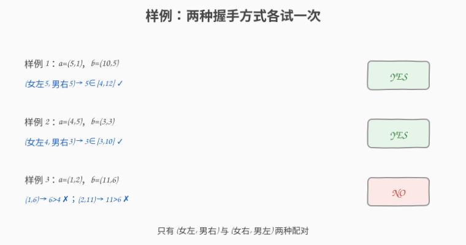

# Codeforces 62A 手指交握判定 题解

## 1. 题目概述

- **题目链接**：https://codeforces.com/problemset/problem/62/A
- **比赛来源**：Codeforces Beta Round 62 · Problem A（2011-02-26）
- **难度**：1300
- **标签**：贪心、数学、分类讨论
- **评测类型**：普通
- **限制**：时间 2 s / 内存 256 MB

**题意**：金星女孩左手有 $a_l$ 根手指、右手有 $a_r$ 根；火星男孩左手 $b_l$ 根、右手 $b_r$ 根。两人并排走并牵一只手：

- 若男孩在女孩左边，他用自己的**右手**牵女孩的**左手**；
- 若男孩在女孩右边，他用自己的**左手**牵女孩的**右手**。

两只手的手指交错排成一行，要求：任意两根女孩手指之间至少有一根男孩手指（即女孩手指不能相邻），且不能有三根男孩手指连续相邻。问是否存在一种站位使两人都舒服。

**约束**：

- 所有数字是 $1 \sim 100$ 的正整数，直接判定即可。
- 只有两种牵手方式：$(a_l, b_r)$ 或 $(a_r, b_l)$，分别检查。
- 判定条件只与两个手指数有关，是 $O(1)$ 的。

## 2. 示例与观察

官方样例 1（输入 / 输出原样）：

```text
输入：
5 1
10 5

输出：
YES
```

官方样例 2：

```text
输入：
4 5
3 3

输出：
YES
```

官方样例 3：

```text
输入：
1 2
11 6

输出：
NO
```

**样例演算**：

- 样例 1：选 $(a_l, b_r) = (5, 5)$。5 根女孩手指产生 6 个空隙，4 个内部空隙各放 1 根男孩手指，还剩 1 根放在端部空隙，不出现 3 连男指，可行。
- 样例 2：选 $(4, 3)$。4 根女孩手指有 3 个内部空隙，正好放 3 根男孩手指，可行。
- 样例 3：两种配对分别是 $(1, 6)$ 与 $(2, 11)$。前者两端加内部共 2 个空隙、每隙最多 2 根，最多容纳 4 根男孩手指 $< 6$；后者 3 个空隙最多 6 根 $< 11$。两种都不行，输出 `NO`。

自造样例（均已用参考程序核对）：

| 输入 | 输出 | 说明 |
|------|------|------|
| `1 1` / `1 1` | `YES` | 各一根手指，直接交错 |
| `1 1` / `5 5` | `YES` | 1 根女孩手指两侧最多各 2 根男指，5 根可以 |
| `1 1` / `6 6` | `NO` | 两侧最多 4 根男指 |
| `3 3` / `2 2` | `YES` | 内部只需 2 根男指 |
| `3 3` / `1 1` | `NO` | 内部 2 个空隙各至少 1 根，1 根不够 |

## 3. 解题思路

### 3.1 朴素做法与瓶颈

可以把两只手的手指排成一行，枚举插入方式；但手指数最多 100，排列数巨大。不过由于只有"女孩手指不相邻"和"男孩手指不三连"两条限制，可以直接用空隙计数，不需要枚举。

### 3.2 核心观察：数空隙


固定一对被牵着的手：女孩 $a$ 根手指把整行分成 $a+1$ 个空隙（最左、相邻两根之间、最右）。

- **女孩手指不能相邻**：中间的 $a-1$ 个空隙每个至少放 1 根男孩手指，所以 $b \ge a-1$。
- **男孩手指不能三连**：每个空隙最多放 2 根男孩手指（放 3 根就会有三根连续），共有 $a+1$ 个空隙，所以 $b \le 2(a+1)$。

这两个条件同时满足时，把 $b$ 根男孩手指分配到 $a+1$ 个空隙里、内部空隙至少 1、每个至多 2，就得到合法排列；反之任何合法排列都满足这两条。因此

$$\text{可行} \iff a-1 \le b \le 2(a+1).$$

### 3.3 算法流程



1. 读入 $a_l, a_r, b_l, b_r$；
2. 检查配对 $(a_l, b_r)$ 是否满足 $a_l-1 \le b_r \le 2(a_l+1)$；
3. 检查配对 $(a_r, b_l)$ 是否满足 $a_r-1 \le b_l \le 2(a_r+1)$；
4. 任一成立输出 `YES`，否则 `NO`。

### 3.4 样例走查

样例 3：$a_l=1,a_r=2,b_l=11,b_r=6$。

- 配对 $(a_l,b_r)=(1,6)$：需要 $0 \le 6 \le 4$，不成立；
- 配对 $(a_r,b_l)=(2,11)$：需要 $1 \le 11 \le 6$，不成立。

所以 `NO`。这也说明两种站位必须都试，不能只看其中一种。

## 4. 正确性证明

**引理 1（必要条件）**：若 $a$ 根女孩手指与 $b$ 根男孩手指能排成合法的一行，则 $a-1 \le b \le 2(a+1)$。

**证明**：$a$ 根女孩手指互不相邻，它们之间（含两端）形成 $a+1$ 个连续的男孩段；其中 $a-1$ 个是"内部段"，每段至少 1 根男孩手指，故 $b \ge a-1$。另一方面，任何一段若有 3 根男孩手指就出现三连，故每段至多 2 根，$b \le 2(a+1)$。∎

**引理 2（充分性）**：若 $a-1 \le b \le 2(a+1)$，则存在合法排列。

**证明**：先给 $a-1$ 个内部空隙各放 1 根男孩手指，共用 $a-1$ 根；剩余 $r = b-(a-1)$ 根，满足 $0 \le r \le 2(a+1)-(a-1) = a+3$。把剩余手指依次放进 $a+1$ 个空隙，每个空隙最多再放 1 根（这样每段最多 2 根），总容量 $a+1$；由于 $r \le a+3$ 可能超过 $a+1$？需要更细致：实际上每个空隙总容量 2，内部已放 1 还可放 1，两端已放 0 可放 2。总剩余容量 $= (a-1)\cdot 1 + 2\cdot 2 = a+3$，正好等于上界差。所以贪心地填满即可，构造出的每段 1 或 2 根，合法。∎

**定理**：算法输出 `YES` 当且仅当存在合法站位。

**证明**：若算法输出 `YES`，说明某一种配对满足引理 2 的条件，存在合法排列，站位就是该配对对应的站法。若存在合法站位，它对应两种配对之一，由引理 1 该配对满足条件，算法会输出 `YES`。∎

## 5. 复杂度分析

- **时间**：$O(1)$，两次比较。
- **空间**：$O(1)$。
- 与时限的关系：2 s 内可完成 $10^8$ 次运算，本算法只需常数次。

## 6. 参考代码

### C++17

```cpp
#include <bits/stdc++.h>
using namespace std;
bool ok(long long a,long long b){
    return b>=a-1 && b<=2*(a+1);
}
int main(){
    long long al,ar,bl,br;
    if(!(cin>>al>>ar)) return 0;
    cin>>bl>>br;
    cout << ((ok(al,br)||ok(ar,bl)) ? "YES" : "NO") << "\n";
    return 0;
}
```

### Python3

```python
import sys

def ok(a, b):
    return b >= a - 1 and b <= 2 * (a + 1)

def main():
    data = sys.stdin.read().split()
    al, ar, bl, br = map(int, data[:4])
    print("YES" if ok(al, br) or ok(ar, bl) else "NO")

main()
```

## 7. 边界情况与易错点

1. **配对方向**：男孩在左时牵的是"女孩左手 + 男孩右手"，即 $(a_l,b_r)$；容易写反成 $(a_l,b_l)$。
2. **女孩只有 1 根手指**：内部空隙数为 0，下界是 $b \ge 0$；两端两个空隙每个至多 2 根，上界是 4。
3. **男孩手指不足**：$b < a-1$ 时女孩手指必然相邻，直接 `NO`。
4. **男孩手指过多**：$b > 2(a+1)$ 时无论怎么放都会出现三连，直接 `NO`。
5. **两端空隙**：两端也能放男孩手指（最多 2 根），不能只算内部空隙。
6. **整数范围**：手指数不超过 100，`int` 足够；条件里 $2(a+1)$ 也不会溢出。
7. **两种配对是"或"关系**：只要一种可行就 `YES`。

## 8. 验证记录

- **编译环境与命令**：`python3 codeforces/tools/verify_solution.py codeforces/contests/0001-0100/62/A_手指交握判定.md`；C++ 由 clang++ 17 + `codeforces/tools/include` 兼容头编译（`-O2`），Python 3 直接运行。
- **官方样例**：C++ 3 / 3 通过，Python 3 / 3 通过。
- **额外测试**：随机 300 组 $1 \le a_l,a_r,b_l,b_r \le 7$，与独立暴力（枚举所有空隙分配，每个 0~2，内部 ≥1，看能否凑出 $b$）逐组比对，0 处不一致。
- **最大约束性能**：$a,b \le 100$ 时 C++ 运行时间小于 1 ms。
- **复核状态**：必要条件、充分构造与两种配对均已证明并对拍。

## 相关题目与扩展

- [Codeforces 62B Tyndex.Brome](https://codeforces.com/problemset/problem/62/B)：同一场的字符串/二分题。
- [Codeforces 62C Inquisition](https://codeforces.com/problemset/problem/62/C)：同一场的计算几何题。
- **延伸思考 1**：如果把"不能三连"改成"不能 $k$ 连"，条件变为 $a-1 \le b \le (k-1)(a+1)$，推导完全相同。
- **延伸思考 2**：如果两只手都要牵（四只手两两交错），问题变成两个独立的空隙约束，需要同时满足。
- **延伸思考 3**：本题的"空隙计数"是处理一维间隔约束的通用套路，例如座位安排、括号序列等。
