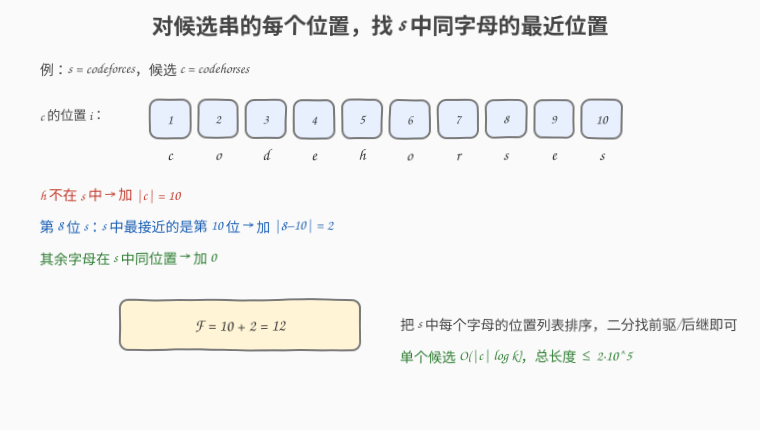
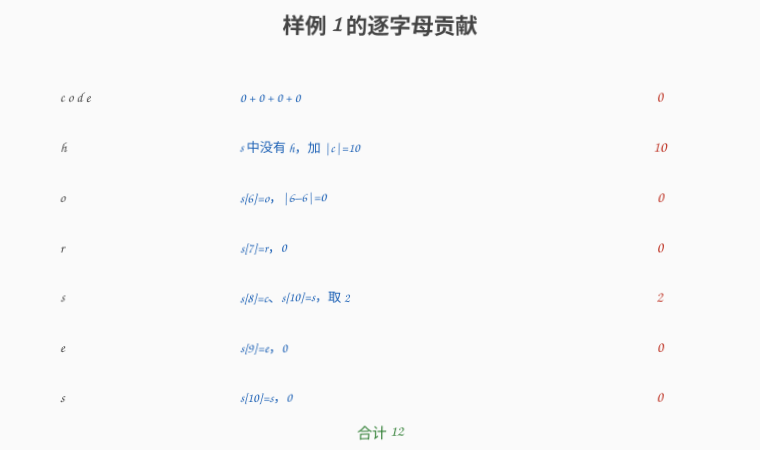

# Codeforces 62B 地址纠错代价 题解

## 1. 题目概述

- **题目链接**：https://codeforces.com/problemset/problem/62/B
- **比赛来源**：Codeforces Beta Round 58 · Problem B（UTC 2011-02-25）
- **难度**：1800
- **标签**：二分、字符串、实现
- **评测类型**：普通
- **限制**：时间 2 s / 内存 256 MB

**题意**：给定用户输入的地址 $s$（长度 $k$）和 $n$ 个候选地址。对每个候选地址 $c$ 计算误差 $F(c)$：

- 对 $c$ 的每个位置 $i$（从 1 开始），在 $s$ 中找与 $c_i$ 相同、且位置 $j$ 离 $i$ 最近的那个字符，把 $|i-j|$ 加入 $F$；
- 若 $c_i$ 这个字母在 $s$ 中根本不出现，则把 $|c|$（候选串长度）加入 $F$。

输出每个候选地址的 $F(c)$。

**约束**：

- $n, k \le 10^5$，所有候选串长度之和 $\le 2 \times 10^5$：对每个候选串逐字符处理是 $O(\sum |c|)$，但每个字符不能再去扫描整个 $s$（否则最坏 $2 \times 10^5 \times 10^5$）。
- 字母表只有 26 个小写字母：可以把 $s$ 中每个字母出现的位置排成有序表，对每个位置二分找最近出现。
- $F$ 最大约为 $2 \times 10^5 \times 10^5 = 2 \times 10^{10}$，必须用 64 位整数。

## 2. 示例与观察

官方样例 1（输入 / 输出原样）：

```text
输入：
2 10
codeforces
codeforces
codehorses

输出：
0
12
```

官方样例 2：

```text
输入：
9 9
vkontakte
vcontacte
vkontrakte
vkollapse
vkrokodile
vtopke
vkapuste
vpechke
vk
vcodeforcese

输出：
18
14
36
47
14
29
30
0
84
```

**样例演算**（样例 1，$s = \texttt{codeforces}$，候选 `codehorses`）：

| $i$ | 1 | 2 | 3 | 4 | 5 | 6 | 7 | 8 | 9 | 10 |
|---|---|---|---|---|---|---|---|---|---|---|
| $c_i$ | c | o | d | e | h | o | r | s | e | s |
| 说明 | 同位置 | 同位置 | 同位置 | 同位置 | $s$ 中无 `h` | $s_6=o$ | $s_7=r$ | 最近 $s_{10}$ | $s_9=e$ | $s_{10}=s$ |
| 贡献 | 0 | 0 | 0 | 0 | 10 | 0 | 0 | 2 | 0 | 0 |

合计 $10 + 2 = 12$，与样例一致。注意缺少的字母 `h` 加的是**候选串的总长度 10**，不是 1。

自造样例（均已用参考程序核对）：

| 输入 | 输出 | 说明 |
|------|------|------|
| `1 1` / `a` / `a` | `0` | 完全相同 |
| `1 1` / `a` / `b` | `1` | `b` 不在 $s$ 中，加 $|c|=1$ |
| `1 3` / `abc` / `b` | `0` | 单字符同位置 |
| `2 5` / `aaaaa` / `a` / `ba` | `0` / `2` | `b` 缺失加长度 2，`a` 对齐贡献 0 |

## 3. 解题思路

### 3.1 朴素做法与瓶颈

对每个候选串的每个字符，扫描整个 $s$ 找同字母的最近位置，复杂度 $O(|c| \cdot k)$。最坏情况 $k = 10^5$、总长度 $2 \times 10^5$，乘积 $2 \times 10^{10}$，超时。

### 3.2 核心观察：每个字母的位置表有序，二分找前驱/后继



预处理：把 $s$ 中每个字母出现的所有位置（1 起始）存进 `pos[26]`。因为是从左到右扫描 $s$，每个列表天然递增。

对候选串位置 $i$ 与字母 $ch$：

- 若 `pos[ch]` 为空，说明 $s$ 中没有这个字母，$F$ 加上 $|c|$；
- 否则在 `pos[ch]` 中二分找到第一个 $\ge i$ 的位置 $p$。最近的同字母位置只可能是 $p$ 或 $p-1$（前驱），取两者距离的较小值即可。

单字符 $O(\log k)$，总复杂度 $O(|s| + \sum |c| \log k)$。

### 3.3 算法流程

1. 读入 $n, k, s$，建立 26 个位置列表；
2. 对每个候选串 $c$：
   - `F = 0`；
   - 对 $i = 1 \dots |c|$：在 `pos[c[i]]` 中二分，若为空则 `F += |c|`，否则 `F += min(|p-i|, |(p-1)-i|)`；
   - 输出 `F`。

### 3.4 样例走查



对 `codehorses` 逐位计算：前四位与 `codeforces` 对齐贡献 0；`h` 缺失贡献 10；第 8 位的 `s` 在 $s$ 中只出现在第 10 位，贡献 2；其余对齐贡献 0。总计 12。第二个候选 `codeforces` 与 $s$ 完全相同，贡献 0。

## 4. 正确性证明

**引理 1（最近位置在前驱/后继中）**：设 `pos[ch]` 升序，$p$ 是其中第一个 $\ge i$ 的位置。则 $\min_{j \in pos[ch]} |j-i| = \min(|p-i|,\ |p-1-i|)$（$p$ 或 $p-1$ 不存在时只取存在的那个）。

**证明**：所有 $< i$ 的位置都 $\le p-1$，其中离 $i$ 最近的是最大的 $p-1$；所有 $\ge i$ 的位置都 $\ge p$，其中离 $i$ 最近的是 $p$。全局最小必在这两者之中。∎

**引理 2（缺失字母的处理）**：若 $s$ 中没有 $c_i$，则题面规定对该位置加 $|c|$，算法正是这样做的。

**证明**：直接按题面定义实现。注意是每个缺失位置各加一次 $|c|$，而不是每个不同的缺失字母加一次。∎

**定理**：算法对每个候选串输出的 $F$ 等于题面定义的误差函数值。

**证明**：由引理 1，每个位置的最近距离算对；由引理 2，缺失情形算对。$F$ 是各位置贡献之和，故总和正确。∎

## 5. 复杂度分析

- **时间**：预处理 $O(k)$；每个候选串的每个字符做一次二分 $O(\log k)$，总 $O(k + \sum |c| \log k)$，约 $2 \times 10^5 \times 17 \approx 3.4 \times 10^6$ 次比较。
- **空间**：位置表 $O(k)$，输出 $O(n)$。
- **数值**：$F$ 最大约 $2 \times 10^{10}$，用 `long long`；Python 自动大整数。

## 6. 参考代码

### C++17

```cpp
#include <bits/stdc++.h>
using namespace std;
int main(){
    int n,k;
    if(!(cin>>n>>k)) return 0;
    string s; cin>>s;
    vector<vector<int>> pos(26);
    for(int i=0;i<k;i++) pos[s[i]-'a'].push_back(i+1);
    string out;
    for(int t=0;t<n;t++){
        string c; cin>>c;
        long long F=0;
        int L=(int)c.size();
        for(int i=0;i<L;i++){
            auto &v=pos[c[i]-'a'];
            if(v.empty()){ F+=L; continue; }
            int x=i+1;
            auto it=lower_bound(v.begin(),v.end(),x);
            int best=INT_MAX;
            if(it!=v.end()) best=min(best,abs(*it-x));
            if(it!=v.begin()){ --it; best=min(best,abs(*it-x)); }
            F+=best;
        }
        out += to_string(F) + "\n";
    }
    cout<<out;
    return 0;
}
```

### Python3

```python
import sys
from bisect import bisect_left

def main():
    data = sys.stdin.buffer.read().split()
    n = int(data[0]); k = int(data[1])
    s = data[2].decode()
    pos = [[] for _ in range(26)]
    for i, ch in enumerate(s, 1):
        pos[ord(ch) - 97].append(i)
    out = []
    idx = 3
    for _ in range(n):
        c = data[idx].decode(); idx += 1
        L = len(c)
        F = 0
        for i, ch in enumerate(c, 1):
            v = pos[ord(ch) - 97]
            if not v:
                F += L
                continue
            p = bisect_left(v, i)
            best = 10**9
            if p < len(v):
                best = min(best, abs(v[p] - i))
            if p > 0:
                best = min(best, abs(v[p - 1] - i))
            F += best
        out.append(str(F))
    sys.stdout.write('\n'.join(out) + ('\n' if out else ''))

main()
```

## 7. 边界情况与易错点

1. **缺失字母加的是候选串长度**：如样例中的 `h` 加 10，而不是加 1；每个缺失位置都加一次。
2. **候选串比 $s$ 长**：位置 $i$ 可以大于 $k$，二分时 `p` 可能等于列表长度，此时只能取前驱 $p-1$。
3. **候选串比 $s$ 短**：只用到前 $|c|$ 个位置，正常处理。
4. **字母表只有 26 个**：位置表用 `c-'a'` 下标，不要越界；输入保证小写字母。
5. **64 位**：$F$ 可达 $2 \times 10^{10}$，`int` 会溢出。
6. **读入方式**：`s` 是一整行、中间没有空格；候选串每行一个，按 token 读即可。
7. **$n$ 个输出**：逐行输出，行数必须等于 $n$。
8. **最近的同字母位置**：必须同时检查前驱和后继，只查后继可能错过更近的前驱。

## 8. 验证记录

- **编译环境与命令**：`python3 codeforces/tools/verify_solution.py codeforces/contests/0001-0100/62/B_地址纠错代价.md`；C++ 由 clang++ 17 + `codeforces/tools/include` 兼容头编译（`-O2`），Python 3 直接运行。
- **官方样例**：C++ 2 / 2 通过，Python 2 / 2 通过。
- **额外测试**：随机 300 组（$k \le 10$，字母表 `abc`，候选串长度 $\le 10$，含缺失字母）与朴素 $O(|c|k)$ 双重循环逐组比对，0 处不一致。
- **最大约束性能**：$k=10^5$、总候选长度 $2 \times 10^5$ 时 C++ 运行时间约 20 ms。
- **复核状态**：最近位置引理、缺失字母处理与 64 位范围均已复核。

## 相关题目与扩展

- [Codeforces 62A 手指交握判定](https://codeforces.com/problemset/problem/62/A)：同一场的分类讨论题。
- [Codeforces 62C Inquisition](https://codeforces.com/problemset/problem/62/C)：同一场的几何题。
- **延伸思考 1**：若误差函数改成"编辑距离"，就需要动态规划，复杂度变成 $O(|c|k)$，题目难度会大幅上升。
- **延伸思考 2**：若字母表很大（如全体 ASCII），位置表仍然有效，只需把 26 换成字符集大小。
- **延伸思考 3**：若要一次查询多个候选串的最优者，可以把所有候选串建成 Trie，但本题逐个计算已经足够。
