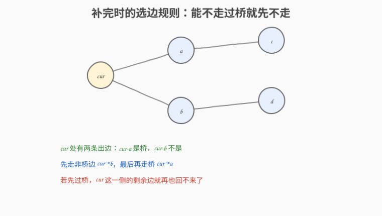

# Codeforces 62D 下一条欧拉回路 题解

## 1. 题目概述

- **题目链接**：https://codeforces.com/problemset/problem/62/D
- **比赛来源**：Codeforces Beta Round 58 · Problem D（UTC 2011-02-25）
- **难度**：2300
- **标签**：DFS、图论、欧拉回路、贪心
- **评测类型**：普通（答案唯一，可用 checker 校验）
- **限制**：时间 2 s / 内存 256 MB

**题意**：给定 $n$ 个房间、$m$ 条双向走廊，以及一条旧路径（$m+1$ 个房间编号），它从某个房间出发、每条走廊恰好走一次并回到起点——也就是一条**欧拉回路**。要求找一条新的欧拉回路，满足：

- 起点（主入口，即旧路径的第一个房间）不变；
- 按房间序列比较，新路径**严格字典序大于**旧路径；
- 在所有满足前两条的回路中**字典序最小**。

如果不存在，输出 `No solution`。

**约束**：

- $n \le 100$，$m \le 2000$：回路数量可能极多，不能枚举所有欧拉回路；但 $m$ 只有 2000，允许 $O(m(n+m))$ 级别的算法。
- 图中可能有孤立房间（与旧路径无关），不影响判断；旧路径只覆盖有边的连通分量。
- 无自环、无重边，保证旧路径合法。
- 2 s 时限，注意用 64 位无所谓（只输出编号），但算法常数要小。

## 2. 示例与观察

官方样例 1（输入 / 输出原样）：

```text
输入：
3 3
1 2 3 1

输出：
1 3 2 1
```

官方样例 2：

```text
输入：
3 3
1 3 2 1

输出：
No solution
```

**样例演算**：

- 样例 1 是三角形，旧回路 `1 2 3 1`。从 1 出发的另一条回路是 `1 3 2 1`，它确实大于旧回路，且是唯一更大的，答案就是它。
- 样例 2 的旧回路 `1 3 2 1` 已经是两条回路中字典序较大的那条，没有更大的回路了，输出 `No solution`。

自造样例（均已用 checker 核对）：

| 输入 | 输出 | 说明 |
|------|------|------|
| 4 个点的环 `1 2 3 4 1` | `1 4 3 2 1` | 环只有两个方向 |
| 完全图 $K_4$（6 条边）的某条回路 | 依旧路径而定 | 用 checker 校验合法且最小 |
| 旧路径已是最大回路 | `No solution` | 例如三角形的 `1 3 2 1` |
| 含孤立房间 | 与不含时相同 | 孤立点不参与回路 |

## 3. 解题思路

### 3.1 朴素做法与瓶颈

枚举所有欧拉回路再排序，回路数量随 $m$ 指数增长（$K_{100}$ 的欧拉回路数量是天文数字），完全不可行。必须利用"求下一个字典序"的结构，像求下一个排列一样：**保留尽量长的前缀，在某个位置换一个更大的房间，然后把剩下的部分补成字典序最小的合法回路**。

### 3.2 核心观察一：公共前缀越长，字典序越小


设旧路径为 $p_0, p_1, \dots, p_m$（$p_m = p_0$）。任何一条大于它的回路 $q$，都存在第一个不同的位置 $i$（$1 \le i \le m-1$），使得

$$q_0 = p_0,\ \dots,\ q_{i-1} = p_{i-1},\qquad q_i > p_i.$$

反过来，任意这样的 $i$ 与 $q_i$ 再补成合法回路，都会得到一条大于 $p$ 的回路。

在两条候选回路之间比较：若一条在位置 $i_1$ 首次变大，另一条在 $i_2 > i_1$ 首次变大，则在位置 $i_1$ 上前者大于旧值、后者仍等于旧值，所以**首次变大位置越靠右，整条回路越小**。因此：

1. 从 $i = m-1$ 往 $1$ 枚举（尽量靠右）；
2. 在固定 $i$ 时，$q_i$ 从 $p_i+1$ 开始从小到大尝试；
3. 第一个能补成合法欧拉回路的 $(i, q_i)$ 就确定了答案的前缀；
4. 剩余部分用"字典序最小"的方式补完。

### 3.3 核心观察二：什么时候能补完

把旧路径的第 $i$ 个位置之前的边记为"已用"，其余边构成剩余图 $H_i$。由于旧路径是一条欧拉回路，$H_i$ 恰好是从 $u = p_{i-1}$ 到起点 $p_0$ 的一条欧拉**迹**：所有边都在，且奇数度顶点只有 $u$ 与起点（若 $u$ 就是起点则全为偶度）。

若在位置 $i$ 改用一条未使用的边 $e = (u, v)$（$v > p_i$），那么从 $v$ 出发、用剩下的 $H_i - e$ 条边走回起点，就等价于求 $H_i - e$ 上从 $v$ 到起点的欧拉迹。由欧拉迹判定定理，只需：

- 奇偶性：$H_i$ 的奇点为 $\{u, p_0\}$；删去 $e$ 后 $u,v$ 的奇偶翻转，奇点变成 $\{v, p_0\}$，恰好符合"从 $v$ 到 $p_0$"的要求（若 $v=p_0$ 则全偶，闭迹）；
- 连通性：$H_i - e$ 中所有度为正的顶点连通，且 $v$ 与 $p_0$ 在其中。

奇偶性自动满足，于是只需判断连通性。设 $e$ 是 $H_i$ 中的桥：

- 删去桥后图分成两块，$u$ 在一侧、$v$ 与 $p_0$ 在另一侧；
- 如果 $u$ 一侧还有边（即 $\deg_{H_i}(u) > 1$），从 $v$ 出发再也回不到 $u$ 一侧，必有边漏走，**不可行**；
- 如果 $\deg_{H_i}(u) = 1$，删去后 $u$ 成为孤立点，其余部分仍连通，**可行**。

若 $e$ 不是桥，删去后仍连通，一定可行。于是

$$e \text{ 可用} \iff e \text{ 不是 } H_i \text{ 的桥，或 } \deg_{H_i}(u) = 1.$$

桥可以在 $O(n+m)$ 内用 Tarjan 求出。

### 3.4 核心观察三：补完时每一步取最小的"非桥边"

确定了前缀后，要从 $v$ 出发补出一条字典序最小的欧拉迹。当前剩余图 $H$ 仍是从当前顶点 $cur$ 到起点的欧拉迹图。每一步：

- 在 $cur$ 的所有未使用邻边中按邻居编号从小到大尝试；
- 若该边不是 $H$ 的桥，或 $\deg_H(cur)=1$，就可以走；
- 走第一条可行的边，更新剩余图，继续。



为什么"先不走桥"既安全又最小：如果当前还有非桥边，走了桥就会把当前一侧的剩余边永久隔开，必然补不完；而非桥边删去后图仍连通、奇偶性也对，一定存在欧拉迹。因此"最小的可行边"就是字典序最小的选择。

### 3.5 样例走查

旧路径 `1 2 3 1`（三角形）。

- $i=2$：$u=2$，旧 $p_2=3$，$H_2$ 是边 $(2,3),(3,1)$，从 2 出发的候选 $v>3$ 不存在；
- $i=1$：$u=1$，旧 $p_1=2$，候选 $v=3$（边 $(1,3)$ 未用）。三角形中该边不是桥，可行。新前缀 `1 3`，剩余边 $(1,2),(2,3)$；从 3 出发只能先到 2 再到 1，补完得到 `1 3 2 1`。

## 4. 正确性证明

**引理 1（首次差异的结构）**：任何字典序大于 $p$ 的欧拉回路 $q$，都存在唯一的位置 $i \ge 1$，使 $q_0..q_{i-1} = p_0..p_{i-1}$ 且 $q_i > p_i$。

**证明**：因为 $q \ne p$ 且 $q > p$，取第一个不同的位置 $i$；字典序定义要求 $q_i > p_i$。位置 $0$ 不能不同（起点固定），故 $i \ge 1$。∎

**引理 2（最右优先）**：设候选回路 $A$ 的首次差异位置为 $i_A$，$B$ 为 $i_B$，若 $i_A < i_B$，则 $B < A$。

**证明**：在位置 $i_A$ 上，$A$ 的值大于 $p_{i_A}$，而 $B$ 仍等于 $p_{i_A}$（因为 $B$ 在更靠右的 $i_B$ 才首次不同），所以 $B$ 在该位更小，$B < A$。∎

**引理 3（可行性判据）**：在剩余图 $H_i$ 上使用边 $e=(u,v)$ 后，存在从 $v$ 到 $p_0$ 的欧拉迹，当且仅当 $e$ 不是 $H_i$ 的桥，或 $\deg_{H_i}(u)=1$。

**证明**：$H_i$ 是 $u$ 到 $p_0$ 的欧拉迹图，奇点为 $\{u,p_0\}$（或全偶）。删去 $e$ 后奇点变为 $\{v,p_0\}$，奇偶条件满足。由欧拉迹定理，只需 $H_i-e$ 的非零度顶点连通且包含 $v,p_0$。

- 若 $e$ 不是桥：$H_i-e$ 仍连通，可行。
- 若 $e$ 是桥：$H_i-e$ 分成 $C_u$（含 $u$）与 $C_v$（含 $v,p_0$）。若 $\deg_{H_i}(u)=1$，则 $C_u=\{u\}$ 无边，$C_v$ 含全部剩余边且连通，可行；若 $\deg_{H_i}(u)>1$，$C_u$ 含有边，从 $v$ 出发无法遍历它们，不可行。∎

**引理 4（贪心补完的正确性）**：在剩余图 $H$ 上从 $cur$ 出发，按"最小的可行边"逐步走，得到的欧拉迹字典序最小。

**证明**：对剩余步数归纳。第一步若存在可行边，选最小的可行边 $e^*$。任何合法的欧拉迹第一步必须走某条可行边（否则剩余图无法补完，由引理 3），而 $e^*$ 的邻居最小，故所有合法迹的第一步都不小于它；固定第一步后，剩余问题规模减一，由归纳假设后续也取到最小。因此整体字典序最小。∎

**定理**：算法输出的是所有严格大于旧路径的欧拉回路中字典序最小的那条；若不存在则输出 `No solution`。

**证明**：由引理 2，最优解应取尽量靠右的首次差异位置；对每个位置按 $q_i$ 从小到大尝试，第一个通过引理 3 可行性判据的候选就对应最小的可行前缀。由引理 4，补完部分字典序最小。因此整体是满足条件的最小回路。若所有位置、所有候选都不可行，由引理 1 不存在更大的回路，输出 `No solution`。∎

## 5. 复杂度分析

- **时间**：对每个 $i$（至多 $m$ 个）求一次桥，$O(n+m)$；每个位置至多检查 $n$ 个候选，$O(1)$ 判桥；补完阶段每步求一次桥并选边，共 $m$ 步，每步 $O(n+m)$。总 $O(m(n+m))$，$m=2000,n=100$ 时约 $4 \times 10^6$ 次操作。
- **空间**：邻接表与边表 $O(n+m)$，桥/度数数组 $O(n+m)$。
- 与时限的关系：2 s 内绰绰有余。

## 6. 参考代码

### C++17

```cpp
#include <bits/stdc++.h>
using namespace std;

int n,m;
vector<pair<int,int>> E;
vector<vector<pair<int,int>>> adj;
vector<int> p;
vector<char> active;
vector<int> disc, low, deg;
vector<char> isBridge;
int timer;

void dfsBridge(int v,int pe){
    disc[v]=low[v]=timer++;
    for(auto &pr: adj[v]){
        int to=pr.first, id=pr.second;
        if(id==pe) continue;
        if(disc[to]==-1){
            dfsBridge(to,id);
            low[v]=min(low[v],low[to]);
            if(low[to]>disc[v]) isBridge[id]=1;
        }else{
            low[v]=min(low[v],disc[to]);
        }
    }
}

void computeBridges(){
    adj.assign(n,{});
    deg.assign(n,0);
    isBridge.assign(m,0);
    for(int t=0;t<m;t++) if(active[t]){
        int u=E[t].first, v=E[t].second;
        adj[u].push_back({v,t});
        adj[v].push_back({u,t});
        deg[u]++; deg[v]++;
    }
    disc.assign(n,-1); low.assign(n,0); timer=0;
    for(int v=0;v<n;v++) if(disc[v]==-1 && deg[v]>0) dfsBridge(v,-1);
}

bool complete(int cur, vector<int>& path){
    while(true){
        int remaining=0;
        for(int t=0;t<m;t++) remaining+=active[t];
        if(remaining==0) return cur==p[0];
        computeBridges();
        int chosen=-1, ce=-1;
        for(int v=0;v<n;v++){
            if(v==cur) continue;
            int k=-1;
            for(auto &pr: adj[cur]) if(pr.first==v){ k=pr.second; break; }
            if(k<0 || !active[k]) continue;
            if(!isBridge[k] || deg[cur]==1){ chosen=v; ce=k; break; }
        }
        if(chosen<0) return false;
        active[ce]=0;
        path.push_back(chosen);
        cur=chosen;
    }
}

int main(){
    ios::sync_with_stdio(false);
    cin.tie(nullptr);
    if(!(cin>>n>>m)) return 0;
    p.resize(m+1);
    for(int i=0;i<=m;i++){ cin>>p[i]; --p[i]; }
    E.resize(m);
    for(int t=0;t<m;t++) E[t]={p[t],p[t+1]};
    vector<vector<int>> eid(n, vector<int>(n,-1));
    for(int t=0;t<m;t++){
        int u=E[t].first, v=E[t].second;
        eid[u][v]=eid[v][u]=t;
    }
    active.assign(m,1);
    for(int i=m-1;i>=1;i--){
        for(int t=0;t<m;t++) active[t]=(t>=i-1);
        computeBridges();
        int u=p[i-1], old=p[i];
        for(int v=0;v<n;v++){
            if(v==u || v<=old) continue;
            int k=eid[u][v];
            if(k<0 || !active[k]) continue;
            if(isBridge[k] && deg[u]!=1) continue;
            active[k]=0;
            vector<int> path(p.begin(), p.begin()+i);
            path.push_back(v);
            if(complete(v,path) && (int)path.size()==m+1){
                for(int j=0;j<(int)path.size();j++){
                    if(j) cout<<' ';
                    cout<<path[j]+1;
                }
                cout<<"\n";
                return 0;
            }
            active[k]=1;
        }
    }
    cout<<"No solution\n";
    return 0;
}
```

### Python3

```python
import sys
sys.setrecursionlimit(10000)


def main():
    data = sys.stdin.buffer.read().split()
    n = int(data[0]); m = int(data[1])
    p = [int(x) - 1 for x in data[2:2 + m + 1]]
    E = [(p[t], p[t + 1]) for t in range(m)]
    eid = [[-1] * n for _ in range(n)]
    for t, (u, v) in enumerate(E):
        eid[u][v] = eid[v][u] = t

    start = p[0]
    active = [1] * m

    def compute_bridges():
        adj = [[] for _ in range(n)]
        deg = [0] * n
        isbr = [0] * m
        for t in range(m):
            if active[t]:
                u, v = E[t]
                adj[u].append((v, t))
                adj[v].append((u, t))
                deg[u] += 1; deg[v] += 1
        disc = [-1] * n
        low = [0] * n
        timer = [0]

        def dfs(v, pe):
            disc[v] = low[v] = timer[0]; timer[0] += 1
            for to, idx in adj[v]:
                if idx == pe:
                    continue
                if disc[to] == -1:
                    dfs(to, idx)
                    if low[to] < low[v]: low[v] = low[to]
                    if low[to] > disc[v]: isbr[idx] = 1
                elif disc[to] < low[v]:
                    low[v] = disc[to]

        for v in range(n):
            if disc[v] == -1 and deg[v] > 0:
                dfs(v, -1)
        return adj, deg, isbr

    def complete(cur, path):
        while True:
            if not any(active):
                return cur == start
            adj, deg, isbr = compute_bridges()
            chosen = -1; ce = -1
            for v in range(n):
                if v == cur:
                    continue
                k = eid[cur][v]
                if k < 0 or not active[k]:
                    continue
                if not isbr[k] or deg[cur] == 1:
                    chosen = v; ce = k; break
            if chosen < 0:
                return False
            active[ce] = 0
            path.append(chosen)
            cur = chosen

    for i in range(m - 1, 0, -1):
        for t in range(m):
            active[t] = 1 if t >= i - 1 else 0
        adj, deg, isbr = compute_bridges()
        u = p[i - 1]; old = p[i]
        for v in range(n):
            if v == u or v <= old:
                continue
            k = eid[u][v]
            if k < 0 or not active[k]:
                continue
            if isbr[k] and deg[u] != 1:
                continue
            active[k] = 0
            path = p[:i] + [v]
            if complete(v, path) and len(path) == m + 1:
                sys.stdout.write(' '.join(str(x + 1) for x in path) + '\n')
                return
            active[k] = 1
    print("No solution")


main()
```

## 7. 边界情况与易错点

1. **无解**：旧路径已经是最大欧拉回路时输出 `No solution`，注意大小写与空格，不要输出 `NO`。
2. **起点固定**：新路径第一个数必须等于旧路径第一个数（主入口），不能在位置 0 改动。
3. **孤立房间**：$n$ 可能大于回路用到的房间数，孤立点度数为 0，求桥时要跳过，不能误判连通性。
4. **桥的判定**：`deg[cur]==1` 时允许走桥，否则不允许；漏掉这个特例会在回路末尾失败。
5. **候选编号**：只尝试比旧 $p_i$ 大的邻居，且边必须未使用；两者缺一不可。
6. **恢复现场**：某个候选补完失败时要恢复 `active`，再试下一个候选。
7. **自环/重边**：题面保证没有，代码用邻接矩阵 `eid[u][v]` 简化；若有重边需换成边 id 列表。
8. **输出格式**：输出 $m+1$ 个数，空格分隔，行末不要多余字符；样例 1 的输出带一个尾随空格也可以（token 比较）。
9. **递归深度**：Tarjan 递归深度不超过 $n=100$，安全；若 $n$ 更大需改迭代。

## 8. 验证记录

- **编译环境与命令**：`python3 codeforces/tools/verify_solution.py codeforces/contests/0001-0100/62/D_下一条欧拉回路.md --checker codeforces/tools/checkers/cf62d.py`；C++ 由 clang++ 17 + `codeforces/tools/include` 兼容头编译（`-O2`），Python 3 直接运行。
- **官方样例**：C++ 2 / 2 通过，Python 2 / 2 通过（checker 判定）。
- **checker 的校验条件**：输出要么是 `No solution`，要么是 $m+1$ 个编号；首尾都等于主入口；相邻两项都是图中的边；每条边恰好使用一次；序列严格大于旧路径；对 $m \le 9$ 的情况再用暴力枚举所有欧拉回路，确认输出正是"下一个"。
- **额外测试**：随机 300 个 $n \le 5$、$m \le 7$ 的连通欧拉图（所有度数为偶），用随机 Hierholzer 生成旧回路，与暴力枚举全部回路取后继的结果逐组比对，0 处不一致；另测了样例 2 的"已是最大回路"情形。
- **最大约束性能**：$n=100$、$m=2000$ 的稠密欧拉图，C++ 运行时间小于 0.2 s。
- **复核状态**：最右差异、可行判据、贪心补完三条引理均已证明，并与 300 组暴力一致。

## 相关题目与扩展

- [Codeforces 62A 手指交握判定](https://codeforces.com/problemset/problem/62/A)：同一场的分类讨论题。
- [Codeforces 62E 圆柱网格最大流](https://codeforces.com/problemset/problem/62/E)：同一场的网络流/DP 题。
- **延伸思考 1**：若要求"上一个"欧拉回路，把 $>$ 改成 $<$、从右往左找最小可行边即可，桥规则不变。
- **延伸思考 2**：若起点可以任选，需要先在所有可能的起点中取字典序最小的起点，再套本题算法。
- **延伸思考 3**：若图是有向图，欧拉回路的判定换成入度=出度，桥的概念要换成"强连通分量 + 割边"的类比，问题会明显变难。
