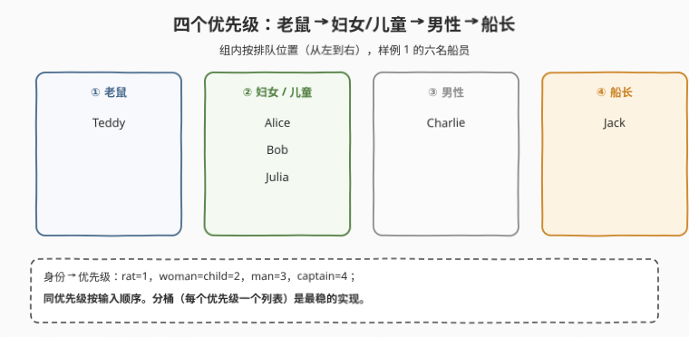
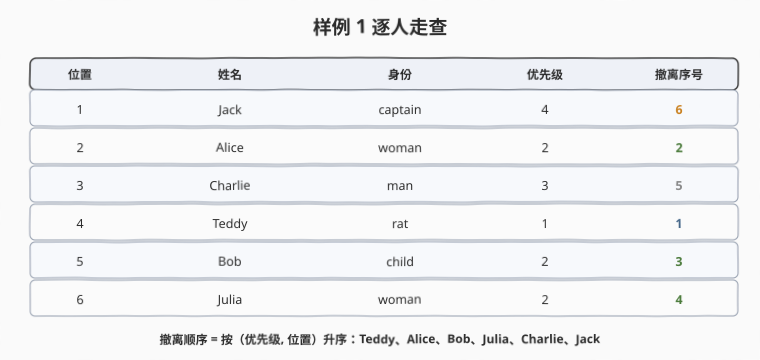

# Codeforces 63A 沉船撤离顺序 题解

## 1. 题目概述

- **题目链接**：https://codeforces.com/problemset/problem/63/A
- **比赛来源**：Codeforces Beta Round 59 (Div. 2) · Problem A（UTC 2011-02-28）
- **难度**：900
- **标签**：实现、排序、字符串
- **评测类型**：普通
- **限制**：时间 2 s / 内存 256 MB

**题意**：船正在下沉，$n$ 名船员按 $1 \sim n$ 从左到右排成一排，每人有一个名字和一个身份（`rat` 老鼠、`woman` 妇女、`child` 儿童、`man` 男性、`captain` 船长，恰好一名船长）。撤离顺序的规则是：

1. 先撤老鼠；
2. 再撤**妇女和儿童**（这两类优先级相同）；
3. 然后是男性；
4. **船长最后**。

如果按以上规则无法区分两个人的先后，则**排在左边（编号小）的人先撤**。求完整的撤离顺序（每行一个名字）。

**约束**：

- $1 \le n \le 100$，名字互不相同，身份只有五种且船长恰好一个。规模很小，任何 $O(n \log n)$ 的排序都足够；关键是把"同优先级按原顺序"这一稳定性要求处理对。
- 妇女与儿童**共享同一个优先级**，必须混在一起按原顺序输出，不能"先所有妇女、再所有儿童"。

## 2. 示例与观察

官方样例（输入 / 输出原样）：

```text
输入：
6
Jack captain
Alice woman
Charlie man
Teddy rat
Bob child
Julia woman

输出：
Teddy
Alice
Bob
Julia
Charlie
Jack
```

**逐人分析**：

| 排队位置 | 名字 | 身份 | 优先级 |
|----------|------|------|--------|
| 1 | Jack | captain | 4（最后） |
| 2 | Alice | woman | 2 |
| 3 | Charlie | man | 3 |
| 4 | Teddy | rat | 1 |
| 5 | Bob | child | 2 |
| 6 | Julia | woman | 2 |

按优先级分组后：

- 优先级 1：Teddy；
- 优先级 2：Alice（位置 2）、Bob（位置 5）、Julia（位置 6）——**按原顺序**，所以是 Alice、Bob、Julia；
- 优先级 3：Charlie；
- 优先级 4：Jack。

拼起来就是 `Teddy / Alice / Bob / Julia / Charlie / Jack`，与样例一致。



**观察**：把每个身份映射成优先级数字后，题目要求的顺序就是"先按优先级升序，优先级相同再按排队位置升序"的**稳定排序**。因为位置本来就是输入顺序，所以只要**保持稳定**即可，不需要额外记录下标。

自造样例（标注"自造"）：

| 自造输入 | 输出 | 说明 |
|------|------|------|
| `1` / `A captain` | `A` | 只有船长 |
| `3` / `A rat`、`B rat`、`C captain` | `A B C` | 老鼠之间按原顺序 |
| `3` / `A child`、`B woman`、`C man` | `A B C` | 儿童与妇女同级，按原顺序交错 |

## 3. 解题思路

### 3.1 朴素做法与瓶颈

最直接的做法是给每个人算一个优先级，然后调用排序。陷阱在于：如果排序算法**不稳定**（例如 `std::sort` 在元素"相等"时可能交换顺序），妇女与儿童之间的先后就乱了。所以要么用 `stable_sort`，要么干脆**分桶**：开 4 个列表，按输入顺序把每个人追加到对应桶里，最后依次输出四个桶。

分桶的写法完全避开了"稳定性"问题，而且常数更小、逻辑更直白。

### 3.2 核心观察：四个桶



身份到桶的映射是固定的：

$$\text{rat} \to 1,\qquad \text{woman} \to 2,\qquad \text{child} \to 2,\qquad \text{man} \to 3,\qquad \text{captain} \to 4.$$

由于输入本身就是按排队位置给出的，往桶里**顺序追加**就自动满足了"同优先级按位置升序"。于是答案就是"桶 1 的全部 + 桶 2 的全部 + 桶 3 的全部 + 桶 4 的全部"。

### 3.3 算法流程

1. 读入 $n$；
2. 循环 $n$ 次，读入 `name status`，按上表把 `name` 追加到对应桶；
3. 按桶 1、2、3、4 的顺序，把桶里的名字逐行输出。

### 3.4 样例走查

| 桶 | 内容（按输入顺序） |
|----|--------------------|
| 1（老鼠） | Teddy |
| 2（妇女/儿童） | Alice、Bob、Julia |
| 3（男性） | Charlie |
| 4（船长） | Jack |

输出顺序：Teddy、Alice、Bob、Julia、Charlie、Jack。

## 4. 正确性证明

**引理 1（优先级是全序）**：定义比较关系"$x$ 先于 $y$"为：$prio(x) < prio(y)$，或 $prio(x) = prio(y)$ 且 $x$ 的位置编号更小。该关系是全体船员上的一个全序（任意两人可比且无环）。
**证明**：优先级是整数，位置编号也是整数且互不相同；先按第一关键字、再按第二关键字比较，是字典序，因而是全序。∎

**引理 2（分桶输出恰为按该全序排列）**：按桶 1→2→3→4 输出、桶内保持输入顺序，得到的序列恰好是引理 1 全序下的升序序列。
**证明**：不同桶的元素优先级不同，桶号小的先输出，满足第一关键字升序；同桶元素优先级相同，桶内保持输入顺序即位置升序，满足第二关键字升序。合起来就是全序升序。∎

**定理**：程序输出就是题目要求的撤离顺序。
**证明**：题面规定先按身份优先级、同优先级按位置，正是引理 1 的全序；引理 2 说明程序输出与该全序一致。∎

## 5. 复杂度分析

- **时间**：$O(n)$，一次读入 + 一次输出，$n \le 100$。
- **空间**：$O(n)$ 存四个桶（名字总数为 $n$）。
- **与时限的关系**：2 s 时限下 $10^2$ 级别操作可以忽略；实测单次运行（含进程启动）约 $2 \sim 4$ ms。

## 6. 参考代码

### C++17

```cpp
#include <bits/stdc++.h>
using namespace std;

int main() {
    ios::sync_with_stdio(false);
    cin.tie(nullptr);

    int n;
    cin >> n;
    vector<pair<int, string>> v;            // {优先级, 姓名}
    for (int i = 0; i < n; ++i) {
        string name, status;
        cin >> name >> status;
        int p;
        if (status == "rat") p = 0;
        else if (status == "woman" || status == "child") p = 1;
        else if (status == "man") p = 2;
        else p = 3;                          // captain
        v.push_back({p, name});
    }
    stable_sort(v.begin(), v.end(), [](const pair<int, string> &x, const pair<int, string> &y) {
        return x.first < y.first;            // 同优先级保持原顺序
    });
    for (auto &e : v) cout << e.second << '\n';
    return 0;
}
```

### Python3

```python
import sys


def main() -> None:
    data = sys.stdin.read().split()
    n = int(data[0])
    prio = {"rat": 0, "woman": 1, "child": 1, "man": 2, "captain": 3}
    people = []
    for i in range(n):
        name = data[1 + 2 * i]
        status = data[2 + 2 * i]
        people.append((prio[status], i, name))
    people.sort()
    sys.stdout.write("\n".join(p[2] for p in people) + "\n")


main()
```

C++ 用 `stable_sort` 保证同优先级不乱序；Python 的 `list.sort()` 本身就是稳定排序，并且代码里额外把 `i` 放进元组作为第二关键字，双保险。

## 7. 边界情况与易错点

1. **妇女与儿童同级**：必须混排（按原顺序），不能先输出所有 `woman` 再输出所有 `child`。样例中 Alice（woman）、Bob（child）、Julia（woman）就是交错的。
2. **稳定性**：如果用 `std::sort` 且只按优先级比较，相等元素的相对顺序未定义，可能把 Bob 和 Julia 换位。要么 `stable_sort`，要么分桶。
3. **船长恰好一个且最后**：不要把 captain 当成普通 man；样例中 Jack 排最后。
4. **$n=1$ 且是船长**：直接输出该名字。
5. **全老鼠 / 全男性**：输出顺序就是输入顺序，程序应保持不变（分桶天然满足）。
6. **名字唯一**：题面保证名字互不相同，因此输出名字即可，不必带编号。
7. **输出格式**：每行一个名字、共 $n$ 行；不要在一行里用空格连接（虽然 checker 按 token 比较，但按行输出才是题面要求）。

## 8. 验证记录

- **编译环境与命令**：`python3 codeforces/tools/verify_solution.py codeforces/contests/0001-0100/63/A_沉船撤离顺序.md`（脚本用 `clang++ -std=c++17 -O2` + `tools/include` 兼容头编译；Python 直接运行）。
- **官方样例**：1 / 1 通过（C++ 与 Python 各 1/1）。
- **额外测试**：随机 300 组（$n \le 20$、随机身份、随机插入唯一船长），用"按 (优先级, 位置) 元组排序"的独立实现逐组比对，C++ 与 Python 均 300/300 一致，0 组不符。
- **最大约束性能**：$n = 100$，单次运行（含进程启动）约 $2 \sim 4$ ms。
- **复核状态**：`check.py` 与 `check_samples.py --only 0001-0100/63` 对本文均 0 失败；样例与 `.cf-meta/statements/CF63A.json` 逐字一致。

## 相关题目与扩展

- [Codeforces 166A Rank List](https://codeforces.com/problemset/problem/166/A)：多关键字排序与并列名次，和本题的"稳定排序"主题相近。
- [Codeforces 63B 升满军衔的天数](https://codeforces.com/problemset/problem/63/B)：同场下一题，模拟与计数。
- [Codeforces 855A Tom Riddle's Diary](https://codeforces.com/problemset/problem/855/A)：字符串去重输出，练习集合与顺序。

**延伸思考**：

1. 若妇女与儿童被视为**不同**优先级（例如儿童先于妇女），只需把 `child` 的优先级改成 1、`woman` 改成 2，其余不变——这提醒我们"同级"是题面给的语义，不能凭常识替换。
2. 如果把"同优先级按位置"改成"同优先级按名字字典序"，就变成真正的多关键字排序，且不再需要稳定性。
3. 如果输入不保证名字唯一，输出就必须带位置编号，否则无法区分。
4. 若把桶的数量推广到 $m$ 种身份，分桶法的时间仍是 $O(n)$，只是桶的次序要按题面指定的优先级数组来输出。
