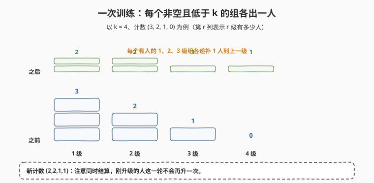
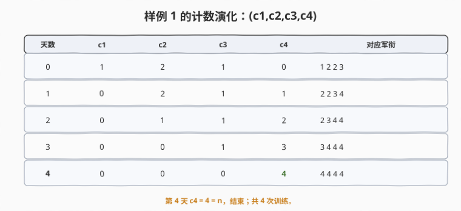
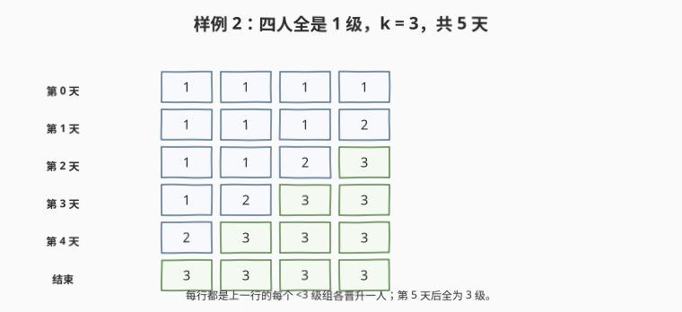

# Codeforces 63B 升满军衔的天数 题解

## 1. 题目概述

- **题目链接**：https://codeforces.com/problemset/problem/63/B
- **比赛来源**：Codeforces Beta Round 59 (Div. 2) · Problem B（UTC 2011-02-28）
- **难度**：1200
- **标签**：实现、模拟
- **评测类型**：普通
- **限制**：时间 2 s / 内存 256 MB

**题意**：有 $n$ 名士兵，每人军衔为 $1 \sim k$（$k$ 是最高军衔"将军"）。每次训练花一枚金币，训练结束时按如下规则晋升：

1. 把士兵按军衔分组（相同军衔一组，组数最少）；
2. 对**每个军衔小于 $k$ 的组**，**恰好**从该组中选一名士兵，把他的军衔提升一级。

问：把所有士兵都升到 $k$ 级最少需要多少枚金币（即多少次训练）？

**约束**：

- $1 \le n, k \le 100$，第二行给出的军衔是**非递减**的。
- 每次训练至少晋升一人，总晋升次数是 $\sum_i (k - a_i) \le 9900$，所以模拟的天数有上界，直接模拟可行。
- 关键细节：同一轮里被晋升的士兵**不会再**在同一轮中再次晋升（先分组、再各提升一人，是"同时"结算的）。

## 2. 示例与观察

官方样例（输入 / 输出原样）：

```text
输入：
4 4
1 2 2 3

输出：
4

输入：
4 3
1 1 1 1

输出：
5
```

**样例 1** 的晋升过程（题面提示）：

$$1\,2\,2\,3 \to 2\,2\,3\,4 \to 2\,3\,4\,4 \to 3\,4\,4\,4 \to 4\,4\,4\,4$$

每一步都是"当前出现的每个 $<4$ 的军衔组各提升一人"，共 4 次。

**样例 2**（$k=3$，四人全是 1 级）：

$$1\,1\,1\,1 \to 1\,1\,1\,2 \to 1\,1\,2\,3 \to 1\,2\,3\,3 \to 2\,3\,3\,3 \to 3\,3\,3\,3$$

共 5 次。注意第 2 步里同时晋升了"1 级组"和"2 级组"各一人，并不是只晋升一人。



**观察 1**：谁被晋升不影响后续——同一组内所有人的军衔相同，晋升任意一个，组的"计数"变化完全一样。所以只需维护**每个军衔的人数** $c_1, \dots, c_k$。

**观察 2**：一轮训练对计数的变换是（同时对 $r = 1..k-1$ 结算）：

$$c_r \leftarrow c_r - [c_r > 0], \qquad c_{r+1} \leftarrow c_{r+1} + [c_r > 0].$$

即"每个非空的、低于 $k$ 的军衔组，各交出一人到上一级"。

**观察 3**：终止条件是 $c_k = n$（所有人都是将军）。

## 3. 解题思路

### 3.1 朴素做法与瓶颈

最直观的模拟是：用数组存每个人的军衔，每天排序分组，然后对每个不同的、小于 $k$ 的军衔挑一个人加一，再排序。$n, k \le 100$、天数 $\le 9900$，复杂度 $O(\text{天数} \cdot n \log n) \approx 9900 \times 700$，完全可行。

但更简单、更不容易错的是"计数模拟"：只维护 $c_r$，一轮里用增量数组同时结算。它把"挑哪个人"的细节完全消掉了，也天然避免"同一轮被连续晋升两次"的 bug。

### 3.2 核心观察：只关心每级人数



由于同组士兵完全等价，任何只依赖"每组人数"的量都不会因为"选了谁"而改变。题面问的又只是训练次数，所以计数向量 $c$ 就是完整状态。

一轮的操作：对所有 $r < k$ 且 $c_r > 0$ 的 $r$，$c_r$ 减一、$c_{r+1}$ 加一，**同时进行**。用 `add[]` 增量数组先累加所有变化，再一次性加到 $c$ 上，就能保证"同时"语义。

### 3.3 算法流程

1. 读入 $n, k$ 与 $n$ 个军衔，统计 $c_1..c_k$；
2. 令 `days = 0`；
3. 当 $c_k < n$ 时：
   - 清空增量数组 `add[1..k]`；
   - 对 $r = 1..k-1$，若 $c_r > 0$，则 `add[r]--`、`add[r+1]++`；
   - 把 `add` 加到 $c$ 上，`days++`；
4. 输出 `days`。

### 3.4 样例走查



| 天 | 计数 $(c_1,c_2,c_3)$ | 本轮晋升的组 |
|----|----------------------|--------------|
| 0 | (4,0,0) | — |
| 1 | (3,1,0) | 1 级组 |
| 2 | (2,1,1) | 1、2 级组 |
| 3 | (1,1,2) | 1、2 级组 |
| 4 | (0,1,3) | 2 级组 |
| 5 | (0,0,4) | —（结束） |

与题面序列 $1\,1\,1\,1 \to 1\,1\,1\,2 \to 1\,1\,2\,3 \to 1\,2\,3\,3 \to 2\,3\,3\,3 \to 3\,3\,3\,3$ 完全对应。

## 4. 正确性证明

**引理 1（计数充分）**：给定计数向量 $c$，无论组内具体选谁晋升，下一轮的计数向量都相同，且等于 3.2 中的变换。
**证明**：组 $r$ 中每个士兵军衔都是 $r$，晋升任意一人后该组少一人、组 $r+1$ 多一人；计数只依赖每组人数。一轮中所有组同时结算，故变换由 3.2 的公式给出。∎

**引理 2（模拟与真实过程一致）**：设真实过程的计数为 $c^{(t)}$，程序维护的计数为 $\hat c^{(t)}$，则对每个 $t \ge 0$ 有 $\hat c^{(t)} = c^{(t)}$。
**证明**：对 $t$ 归纳。$t=0$ 时程序按输入统计，与初始计数一致。若 $\hat c^{(t)} = c^{(t)}$，由引理 1，真实过程第 $t+1$ 轮的计数就是 $c^{(t)}$ 经 3.2 变换的结果；程序在每一轮也执行同一变换（用增量数组保证同时结算），故 $\hat c^{(t+1)} = c^{(t+1)}$。∎

**引理 3（终止与天数）**：程序循环恰好执行"从初始状态到全部为 $k$"所需的轮数。
**证明**：循环条件是 $\hat c_k < n$，由引理 2 等价于"还有人未满级"，一旦全部满级立即停止；每轮 `days` 加一，故 `days` 等于所需轮数。又每轮至少晋升一人，且总晋升次数有限（$\le n(k-1)$），循环必然终止。∎

**定理**：程序输出的 `days` 就是把所有士兵升到 $k$ 级所需的最少金币数。
**证明**：训练必须一轮一轮进行，题面规定每轮花一枚金币，所以"金币数 = 轮数"；引理 2、3 说明程序统计的轮数正是真实过程所需的轮数。∎

## 5. 复杂度分析

- **时间**：每轮 $O(k)$，轮数 $D \le \sum_i (k-a_i) \le n(k-1) \le 9900$，总计 $O(Dk) \le 9.9 \times 10^5$ 次操作。
- **空间**：$O(k)$。
- **与时限的关系**：2 s 时限下百万级操作毫无压力；实测最大数据（$n=k=100$，全为 1 级）单次运行约 $2 \sim 4$ ms。

## 6. 参考代码

### C++17

```cpp
#include <bits/stdc++.h>
using namespace std;

int main() {
    ios::sync_with_stdio(false);
    cin.tie(nullptr);

    int n, k;
    cin >> n >> k;
    vector<int> cnt(k + 2, 0);
    for (int i = 0; i < n; ++i) {
        int x;
        cin >> x;
        ++cnt[x];
    }
    int days = 0;
    while (cnt[k] < n) {
        vector<int> add(k + 2, 0);           // 同一轮内同时结算
        for (int r = 1; r < k; ++r)
            if (cnt[r] > 0) { --add[r]; ++add[r + 1]; }
        for (int r = 1; r <= k; ++r) cnt[r] += add[r];
        ++days;
    }
    cout << days << '\n';
    return 0;
}
```

### Python3

```python
import sys


def main() -> None:
    data = sys.stdin.read().split()
    n, k = int(data[0]), int(data[1])
    cnt = [0] * (k + 2)
    for x in data[2:2 + n]:
        cnt[int(x)] += 1
    days = 0
    while cnt[k] < n:
        add = [0] * (k + 2)
        for r in range(1, k):
            if cnt[r] > 0:
                add[r] -= 1
                add[r + 1] += 1
        for r in range(1, k + 1):
            cnt[r] += add[r]
        days += 1
    print(days)


main()
```

## 7. 边界情况与易错点

1. **所有人已经是 $k$ 级**：一次训练都不需要，答案 0。循环条件 `cnt[k] < n` 天然处理。
2. **$k=1$**：最高军衔就是 1 级，所有人一开始就满级，答案 0。
3. **同时结算**：如果边遍历 $r$ 边直接修改 `cnt[r]`，刚被晋升到 $r+1$ 的士兵可能在同一轮里被再次晋升，导致天数偏少。必须用增量数组（或先记录后统一更新）。
4. **每个"组"只晋升一人**：不是每个士兵都晋升。例如四个 1 级士兵，一轮只会有一个人变成 2 级。
5. **$n=1$**：只有一名士兵，他从 $a_1$ 升到 $k$ 需要 $k-a_1$ 轮；每轮他所在的组（只有他自己）晋升一人，恰好一轮一级。
6. **输入非递减**：题面保证有序，但程序用计数统计，与顺序无关，更稳妥。
7. **`days` 上界**：$\le n(k-1) \le 9900$，用 `int` 足够；若 $n,k$ 变大则要注意换成 64 位。
8. **输出**：只有一个整数，不要输出过程。

## 8. 验证记录

- **编译环境与命令**：`python3 codeforces/tools/verify_solution.py codeforces/contests/0001-0100/63/B_升满军衔的天数.md`。
- **官方样例**：2 / 2 通过（C++ 与 Python 各 2/2）。
- **额外测试**：随机 300 组（$n \le 12$、$k \le 8$、随机非递减军衔），用"直接维护士兵数组、每天排序分组后对每组晋升第一个"的独立模拟逐组比对，C++ 与 Python 均 300/300 一致，0 组不符。
- **最大约束性能**：$n = k = 100$、全部为 1 级（轮数最多），单次运行（含进程启动）约 $2 \sim 4$ ms。
- **复核状态**：`check.py` 与 `check_samples.py --only 0001-0100/63` 均 0 失败；样例与 `.cf-meta/statements/CF63B.json` 逐字一致。

## 相关题目与扩展

- [Codeforces 63A 沉船撤离顺序](https://codeforces.com/problemset/problem/63/A)：同场上一题，稳定排序。
- [Codeforces 158A Next Round](https://codeforces.com/problemset/problem/158/A)：按名次计数与阈值判断，练习模拟类实现。
- [Codeforces 110A Nearly Lucky Number](https://codeforces.com/problemset/problem/110/A)：按位统计算法。

**延伸思考**：

1. 如果规则改成"每个组的**全部**士兵都晋升一级"，那么天数就是 $\max_i (k - a_i)$——这是很自然的变体，可以用来检验你是否真的读懂了"恰好一名"。
2. 如果要求输出**任意一种**具体的晋升方案（谁在哪天晋升），计数模拟之外还要为每个组维护一个队列，按队列顺序取人。
3. 如果 $k$ 很大（比如 $10^9$）但 $n$ 很小，天数上界不再紧致，可以观察"每轮晋升的组数"序列来加速：本质上这是一个"把 n 个计数器往 k 推"的过程，可以用数学公式或矩阵幂优化。
4. 如果把"恰好一名"改成"至多一名"，过程可能不终止（比如所有组都选择不晋升），题目就失去意义——这也是约束"恰好"的必要性。
