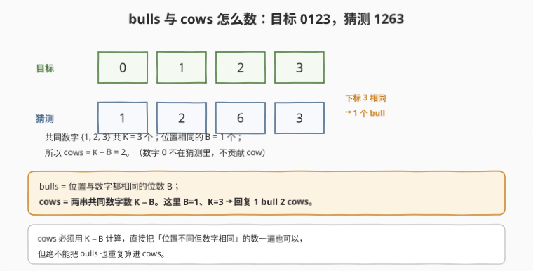
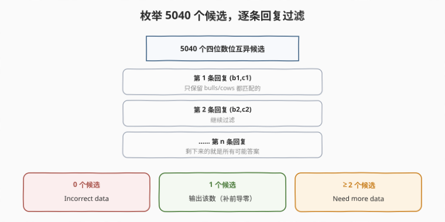
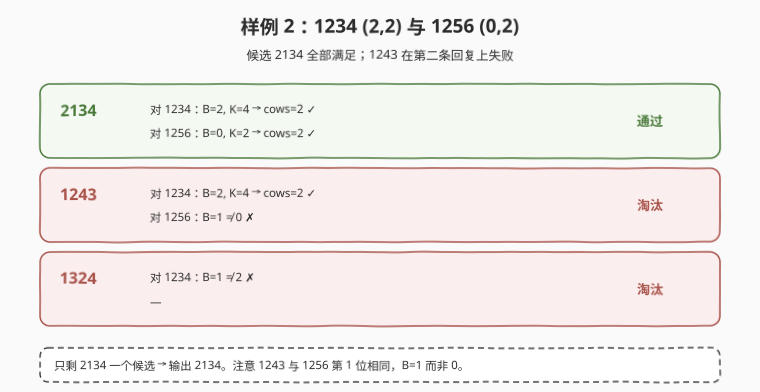

# Codeforces 63C 猜数字的唯一解 题解

## 1. 题目概述

- **题目链接**：https://codeforces.com/problemset/problem/63/C
- **比赛来源**：Codeforces Beta Round 59 (Div. 2) · Problem C（UTC 2011-02-28）
- **难度**：1700
- **标签**：暴力、实现、枚举
- **评测类型**：普通
- **限制**：时间 2 s / 内存 256 MB

**题意**：出题者想了一个**四位十进制数**，四位数字**两两不同**，允许前导零（因此 `0123` 合法）。猜题者已经猜了 $n$ 次，每次给出猜测 $a_i$ 与回复 $b_i$（bulls：数字与位置都对的位数）、$c_i$（cows：数字在答案里但位置不对的位数）。要求判断：

- 若符合全部回复的四位数**唯一**，输出它（不足四位补前导零）；
- 若符合的候选**不止一个**，输出 `Need more data`；
- 若**一个都没有**（回复自相矛盾），输出 `Incorrect data`。

**约束**：

- $n \le 10$；每个猜测都是四位、数位互异、允许前导零，且所有猜测互不相同；输入中不会出现"4 bulls 0 cows"（说明还没猜中）。
- 四位互异的数一共只有 $10 \times 9 \times 8 \times 7 = 5040$ 个，**枚举全部候选**完全可行。这是本题的核心：状态空间小到可以直接暴力。

## 2. 示例与观察

官方样例（输入 / 输出原样）：

```text
输入：
2
1263 1 2
8103 2 1

输出：
Need more data

输入：
2
1234 2 2
1256 0 2

输出：
2134

输入：
2
0123 1 1
4567 1 2

输出：
Incorrect data
```

**样例 1**：两条回复对应的候选不止一个，输出 `Need more data`。
**样例 2**：唯一候选是 `2134`。验证：对 `1234`，位置 3、4 的数字 `3`、`4` 相同（2 bulls），数字集合相同（4 个共同数字），cows $=4-2=2$ ✓；对 `1256`，没有一个位置相同（0 bulls），共同数字是 `{1,2}` 两个，cows $=2-0=2$ ✓。
**样例 3**：`0123` 与 `4567` 的数字**互不相交**。对任意目标 $x$，它的 4 个数字要么在第一个猜测里、要么在第二个猜测里，所以

$$(b_1 + c_1) + (b_2 + c_2) = 4.$$

但输入给出 $(1+1) + (1+2) = 5 \ne 4$，矛盾，输出 `Incorrect data`。



**观察 1**：对固定候选 $x$ 与猜测 $g$，设 $B$ 为"数字与位置都相同"的位数，$K$ 为"两个数共同拥有的数字种类数"，则

$$\text{bulls} = B,\qquad \text{cows} = K - B.$$

因为共同数字中，位置相同的那 $B$ 个算 bulls，其余 $K-B$ 个必然位置不同，算 cows。

**观察 2**：候选总数只有 5040 个，逐个检查全部 $n$ 条回复即可，总代价约 $5040 \times 10 \times 4 \approx 2 \times 10^5$。

## 3. 解题思路

### 3.1 朴素做法与瓶颈

没有比"枚举 5040 个候选"更朴素的做法的反面：候选空间本身极小，任何"推理式"的解法（按回复逐位推导）都会陷入复杂的分支讨论，而枚举只需几十行代码，且不容易错。

瓶颈不是时间，而是**细节**：前导零、cows 的计算方式（不能把 bulls 重复计数）、三种输出的判定顺序。

### 3.2 核心观察：枚举 + 逐条校验



枚举所有四位数位互异的串：

$$\text{for } d_0 \in [0,9],\ d_1 \ne d_0,\ d_2 \notin \{d_0,d_1\},\ d_3 \notin \{d_0,d_1,d_2\}.$$

对每个候选，逐条检查每个猜测 $g_i$：计算 bulls 与 cows，若与 $b_i, c_i$ 不符就淘汰。最后看剩下的候选个数：

- $0$ 个 → `Incorrect data`；
- $1$ 个 → 输出它；
- $\ge 2$ 个 → `Need more data`。

### 3.3 算法流程

1. 读入 $n$ 与 $n$ 条 `(guess, bulls, cows)`；
2. 枚举全部 5040 个候选（用一个 4 层循环 + "数字互异"判断，或直接对 `0123`–`9876` 的字符串做检查）；
3. 对每个候选：
   - 对每条猜测计算 $B$ = 相同位置的位数；
   - 计算 $K$ = 候选数字集合与猜测数字集合的交集大小；
   - 若 $B \ne b_i$ 或 $K - B \ne c_i$，淘汰；
4. 按候选个数输出三种结果之一。输出唯一候选时按四位补零输出（例如候选 `0123` 要输出 `0123`）。

### 3.4 样例走查



样例 2：猜测 `1234 2 2`、`1256 0 2`。

- 候选 `2134`：对 `1234`，第 3、4 位相同，$B=2$，共同数字 $K=4$，cows $=2$ ✓；对 `1256`，$B=0$，共同数字只有 `{1,2}`，$K=2$，cows $=2$ ✓。通过。
- 候选 `1243`：对 `1234`，第 1、2 位相同，$B=2$、$K=4$、cows $=2$ ✓；但对 `1256`，第 1 位 `1` 与 `1` 相同，所以 $B=1 \ne 0$，被淘汰。
- 候选 `1324`：对 `1234`，$B=1$（只有第 1 位），不满足 $B=2$，淘汰。

枚举结束后只剩 `2134`，输出它。这个走查说明：cows 必须用"共同数字数减去 bulls"得到，而不是凭直觉数"位置不对的数字"。

## 4. 正确性证明

**引理 1（bulls/cows 公式）**：对任意候选 $x$ 与猜测 $g$（两者数位均互异），设 $B$ 为相同位置的位数，$K$ 为两串共同数字的个数，则 $g$ 对 $x$ 的回复是 $(B, K-B)$。
**证明**：位置相同且数字相同的位数恰为 $B$，这些是 bulls。两串共同拥有的数字有 $K$ 个，其中 $B$ 个位置相同（已计入 bulls），剩余 $K-B$ 个数字出现在不同位置，恰为 cows。由于两串内数字互异，不会重复计数。∎

**引理 2（枚举完备）**：所有合法的目标数（四位、数位互异、允许前导零）都在枚举范围内。
**证明**：枚举对四个位置分别取 $0..9$ 且要求两两不同，恰好覆盖全部"四位、数位互异"的串，共 $10 \cdot 9 \cdot 8 \cdot 7 = 5040$ 个。∎

**引理 3（分类正确）**：设通过全部回复的候选集合为 $S$。$|S| = 0$ 当且仅当回复自相矛盾；$|S| = 1$ 当且仅当信息足以唯一确定答案。
**证明**：候选与回复一致 $\iff$ 它是可能的答案（引理 1 保证判定与游戏规则等价）。故 $S$ 就是所有可能答案的集合：为空说明没有答案（数据矛盾）；恰一个说明答案唯一；多于一个说明信息不足。∎

**定理**：程序按 $|S|$ 输出 `Incorrect data` / 唯一候选 / `Need more data` 是正确的。
**证明**：由引理 2 枚举不漏，引理 1 保证逐条校验等价于游戏规则，引理 3 给出三种输出的判定依据。∎

## 5. 复杂度分析

- **时间**：$O(5040 \cdot n \cdot 4)$，$n \le 10$，约 $2 \times 10^5$ 次基本运算。
- **空间**：$O(n)$ 存猜测，$O(1)$ 其他。
- **与时限的关系**：2 s 时限下余量极大；实测单次运行（含进程启动）约 $2 \sim 4$ ms。

## 6. 参考代码

### C++17

```cpp
#include <bits/stdc++.h>
using namespace std;

int main() {
    ios::sync_with_stdio(false);
    cin.tie(nullptr);

    int n;
    cin >> n;
    vector<string> g(n);
    vector<int> gb(n), gc(n);
    for (int i = 0; i < n; ++i) cin >> g[i] >> gb[i] >> gc[i];

    vector<string> cand;
    for (int d0 = 0; d0 <= 9; ++d0)
        for (int d1 = 0; d1 <= 9; ++d1) {
            if (d1 == d0) continue;
            for (int d2 = 0; d2 <= 9; ++d2) {
                if (d2 == d0 || d2 == d1) continue;
                for (int d3 = 0; d3 <= 9; ++d3) {
                    if (d3 == d0 || d3 == d1 || d3 == d2) continue;
                    int dig[4] = {d0, d1, d2, d3};
                    bool ok = true;
                    for (int i = 0; i < n && ok; ++i) {
                        int bulls = 0, common = 0;
                        bool inGuess[10] = {false};
                        for (int p = 0; p < 4; ++p) inGuess[g[i][p] - '0'] = true;
                        for (int p = 0; p < 4; ++p) {
                            if (dig[p] == g[i][p] - '0') ++bulls;
                            if (inGuess[dig[p]]) ++common;
                        }
                        if (bulls != gb[i] || common - bulls != gc[i]) ok = false;
                    }
                    if (ok) {
                        string s;
                        for (int p = 0; p < 4; ++p) s += (char)('0' + dig[p]);
                        cand.push_back(s);
                    }
                }
            }
        }

    if (cand.empty()) cout << "Incorrect data\n";
    else if (cand.size() > 1) cout << "Need more data\n";
    else cout << cand[0] << '\n';
    return 0;
}
```

### Python3

```python
import sys


def main() -> None:
    data = sys.stdin.read().split()
    n = int(data[0])
    guesses = []
    for i in range(n):
        guesses.append((data[1 + 3 * i], int(data[2 + 3 * i]), int(data[3 + 3 * i])))

    cand = []
    for a in range(10):
        for b in range(10):
            if b == a:
                continue
            for c in range(10):
                if c == a or c == b:
                    continue
                for d in range(10):
                    if d == a or d == b or d == c:
                        continue
                    digs = (a, b, c, d)
                    ok = True
                    for (g, gb, gc) in guesses:
                        bulls = 0
                        common = 0
                        gd = set(int(ch) for ch in g)
                        for p in range(4):
                            if digs[p] == int(g[p]):
                                bulls += 1
                            if digs[p] in gd:
                                common += 1
                        if bulls != gb or common - bulls != gc:
                            ok = False
                            break
                    if ok:
                        cand.append("%d%d%d%d" % digs)
    if not cand:
        print("Incorrect data")
    elif len(cand) > 1:
        print("Need more data")
    else:
        print(cand[0])


main()
```

## 7. 边界情况与易错点

1. **前导零**：答案可能是 `0123` 这样的数，必须输出四位（补前导零）。用字符串或 `%04d` 一类的格式化，不要输出成 `123`。
2. **cows 不能把 bulls 重复计数**：先算 $K$（共同数字个数），再减去 $B$；直接用"数字对但位置不对"去数也可以，但要小心实现。
3. **三种输出**：`Incorrect data`（0 个候选）、`Need more data`（≥2 个）、唯一候选。判定顺序不能颠倒（候选为 0 时若先判"是否唯一"会误输出 `Need more data`）。
4. **数据可能自相矛盾**：题面保证每条 $b_i + c_i \le 4$，但不保证组合起来有解，例如样例 3。必须真的枚举验证。
5. **猜测本身合法**：题面保证每个猜测四位、数位互异、允许前导零；候选枚举也必须遵守"数位互异"，否则会把非法数当答案。
6. **"4 bulls 0 cows"不出现**：说明答案不是已猜过的数；我们的枚举自然排除（否则它就是唯一候选并输出）。
7. **$n=1$ 时**：通常候选很多，输出 `Need more data`；除非这条回复极强（例如 `0123 4 0` 不可能出现）。
8. **共同数字的计算**：两串数位互异，所以用集合或布尔数组都行；若数位允许重复，就需要按多重集计数，公式也要改。

## 8. 验证记录

- **编译环境与命令**：`python3 codeforces/tools/verify_solution.py codeforces/contests/0001-0100/63/C_猜数字的唯一解.md`。
- **官方样例**：3 / 3 通过（C++ 与 Python 各 3/3）。
- **额外测试**：随机 300 组：随机目标数 + 随机猜测（其中约 25% 的回复被故意改错以制造 `Incorrect data`），用"对全部 5040 个候选独立枚举并筛选"的另一份实现逐组比对，C++ 与 Python 均 300/300 一致，0 组不符。三种输出类型都被覆盖。
- **最大约束性能**：$n = 10$ 的输入，单次运行（含进程启动）约 $2 \sim 4$ ms。
- **复核状态**：`check.py` 与 `check_samples.py --only 0001-0100/63` 均 0 失败；样例与 `.cf-meta/statements/CF63C.json` 逐字一致。

## 相关题目与扩展

- [Codeforces 595B Pasha and Phone](https://codeforces.com/problemset/problem/595/B)：按位计数与容斥，练习"数位组合"。
- [Codeforces 63E 糖果盒博弈](https://codeforces.com/problemset/problem/63/E)：同场压轴，状压博弈。
- [Codeforces 63D 岛屿分块构造](https://codeforces.com/problemset/problem/63/D)：同场构造题。

**延伸思考**：

1. 如果数位**允许重复**（如 `1123`），bulls/cows 的公式就要改成按多重集匹配：cows = $\sum_d \min(\text{cnt}_x(d), \text{cnt}_g(d)) - B$。
2. 如果位数变成 $m$ 位（比如 6 位），候选数从 5040 涨到 $10\cdot9\cdots$ 的组合，枚举仍然可行到 $m \approx 7$（约 60 万），再大就需要推理式算法。
3. 如果要求"最少还需要猜几次才能保证猜中"，就变成决策树/信息论问题，远超本题。
4. 本题的"枚举候选 + 逐条过滤"是很多交互/猜数题的标准框架，值得作为模板记住。
