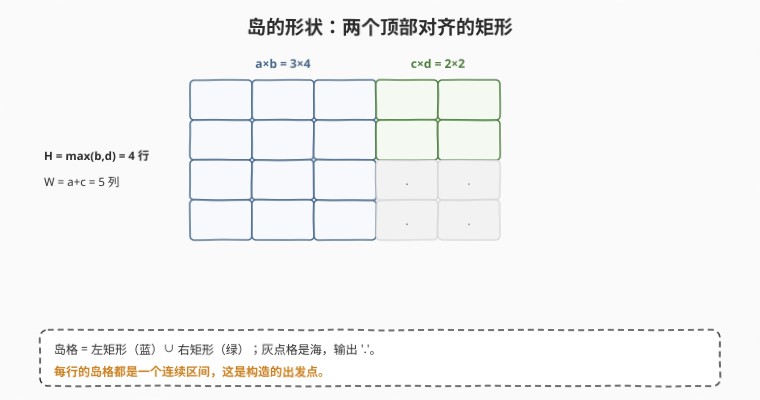
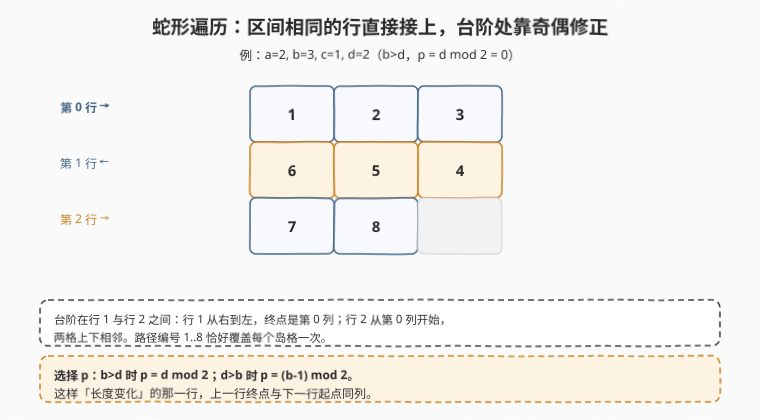
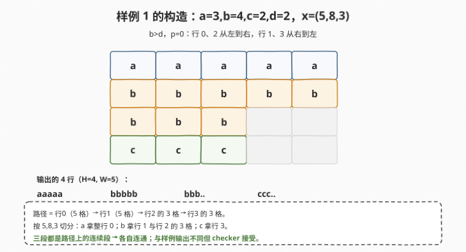

# Codeforces 63D 岛屿分块构造 题解

## 1. 题目概述

- **题目链接**：https://codeforces.com/problemset/problem/63/D
- **比赛来源**：Codeforces Beta Round 59 (Div. 2) · Problem D（UTC 2011-02-28）
- **难度**：1900
- **标签**：构造
- **评测类型**：特殊评测（任意合法方案均可）
- **限制**：时间 2 s / 内存 256 MB

**题意**：岛由两个矩形拼成：一个 $a \times b$、一个 $c \times d$（保证 $b \ne d$），它们的某条长为 $a$ 的边与某条长为 $c$ 的边共线，两个矩形"顶部对齐"地贴在一起。要用小写字母把岛分给 $n$ 个党派，第 $i$ 个党派得到恰好 $x_i$ 个格子，每个党派的格子必须**边连通**。输出格式是 $H = \max(b,d)$ 行、每行 $W = a + c$ 个字符：左 $a$ 列的前 $b$ 行属于 $a \times b$ 矩形，右 $c$ 列的前 $d$ 行属于 $c \times d$ 矩形，其余格子（海）写 `.`。若无法分，输出 `NO`；否则输出 `YES` 与整个网格。

**约束**：

- $1 \le a,b,c,d \le 50$，$b \ne d$，$n \le 26$（字母表限制），$\sum x_i = ab + cd$。
- 网格最大 $50 \times 100 = 5000$ 个格子，构造必须是 $O(\text{面积})$ 的。
- 输出不唯一，**必须用 checker 校验**，不能与样例逐字比对。

## 2. 示例与观察

官方样例（输入 / 输出原样）：

```text
输入：
3 4 2 2 3
5 8 3

输出：
YES
aaabb
aabbb
cbb..
ccb..

输入：
3 2 1 4 4
1 2 3 4

输出：
YES
abbd
cccd
...d
...d
```



**岛的形状**：设行从上往下编号 $0..H-1$、列从左往右编号 $0..W-1$。由样例可以确认两个矩形是**顶部对齐**的：

- 左矩形：$r < b$ 且 $col < a$；
- 右矩形：$r < d$ 且 $a \le col < a + c$。

于是岛格 = 左矩形 $\cup$ 右矩形，其余为海（`.`）。样例 1 中 $a=3,b=4,c=2,d=2$：左矩形占 $4 \times 3$，右矩形占 $2 \times 2$ 贴在右上方，所以第 2、3 行的右两列是海，样例输出里正是 `.`。

**观察 1**：**每一行的岛格都是一个连续区间**。记第 $r$ 行的区间为 $[L_r, R_r]$：

$$[L_r,R_r] = \begin{cases} [0,\ a+c-1], & r < \min(b,d),\\ [0,\ a-1], & b > d \text{ 且 } d \le r < b,\\ [a,\ a+c-1], & d > b \text{ 且 } b \le r < d. \end{cases}$$

**观察 2**：相邻两行的区间要么完全相同，要么只有一处"长度变化"的台阶（$b \ne d$，所以只有一处）。如果我们按行做**蛇形遍历**（第 0 行从左到右、第 1 行从右到左……），那么区间相同的相邻行天然首尾相邻；只要在台阶处选对蛇形的**起始方向**，台阶两侧也能接上。

**观察 3**：如果能找出一条"访问每个岛格恰好一次、且相邻两格边相邻"的路径（哈密顿路径），那么把这条路径按 $x_1, x_2, \dots$ 连续切段，每一段都连成一条路径，因而是连通块。于是问题化为：构造这样一条路径。

## 3. 解题思路

### 3.1 朴素做法与瓶颈

直接搜索分块是不可行的：$5000$ 个格子、$n \le 26$ 个党派，枚举所有分割方式是天文数字。即便用搜索，也需要处理连通性约束。

正确的思路是**先构造一条贯穿全岛的路径**，再"按长度切分"。这样连通性由路径保证，尺寸由切分长度保证，两个约束同时满足。

### 3.2 核心观察：蛇形哈密顿路径



由于每行的岛格是连续区间，行内从一端走到另一端就是一条连续路径。相邻行的连接方式：

- **区间相同的相邻行**：蛇形方向交替（一行从左到右、下一行从右到左），上一行的终点与下一行的起点是**同一列**的上下两格，必然相邻。
- **台阶处**（唯一的长度变化）：
  - 若 $b > d$：行 $d-1$ 是 $[0, a+c-1]$，行 $d$ 是 $[0, a-1]$。要让它们接上，需要行 $d-1$ 从右往左（终点列 0）、行 $d$ 从左往右（起点列 0）。
  - 若 $d > b$：行 $b-1$ 是 $[0, a+c-1]$，行 $b$ 是 $[a, a+c-1]$。需要行 $b-1$ 从左往右（终点列 $a+c-1$）、行 $b$ 从右往左（起点列 $a+c-1$）。

蛇形方向由"第 $r$ 行是否从左到右"决定，写成

$$\text{第 } r \text{ 行从左到右} \iff (r + p) \text{ 是偶数},$$

其中偏移量 $p$ 取：

$$p = \begin{cases} d \bmod 2, & b > d,\\ (b-1) \bmod 2, & d > b. \end{cases}$$

验证：$b > d$ 时，行 $d-1$ 的下标和为 $(d-1)+d = 2d-1$（奇）→ 从右到左；行 $d$ 为 $2d$（偶）→ 从左到右，两格都在第 0 列，上下相邻。$d > b$ 时对称：行 $b-1$ 的下标和 $2b-2$（偶）→ 从左到右，行 $b$ 为 $2b-1$（奇）→ 从右到左，都在第 $a+c-1$ 列相邻。

### 3.3 算法流程

1. 读入 $a,b,c,d,n$ 与 $x_1..x_n$，令 $H = \max(b,d)$、$W = a+c$；
2. 按 3.2 确定 $p$；
3. 依次遍历 $r = 0..H-1$，按该行方向把区间 $[L_r, R_r]$ 内的格子加入一个序列 $\text{path}$；
4. 用一个指针扫过 $\text{path}$：第 $i$ 个党派取接下来的 $x_i$ 个格子，标记为字母 `'a'+i`；
5. 输出 `YES` 与 $H$ 行网格（非岛格输出 `.`）。

由于题目保证 $\sum x_i = ab+cd$，指针恰好走完 $\text{path}$。

### 3.4 样例走查



样例 1：$a=3,b=4,c=2,d=2$，$H=4,W=5$，$x = (5,8,3)$。因为 $b > d$，$p = d \bmod 2 = 0$，所以第 0、2 行从左到右，第 1、3 行从右到左。

| 行 | 区间 | 方向 | 加入路径的格子 |
|----|------|------|----------------|
| 0 | [0,4] | → | (0,0)…(0,4) |
| 1 | [0,4] | ← | (1,4)…(1,0) |
| 2 | [0,2] | ← | (2,2),(2,1),(2,0) |
| 3 | [0,2] | → | (3,0),(3,1),(3,2) |

按 $5,8,3$ 切分：党派 a 拿到前 5 格（整行 0）；党派 b 拿到接下来 8 格（整行 1 加上行 2 的 3 格）；党派 c 拿到最后 3 格（整行 3）。输出：

```text
YES
aaaaa
bbbbb
bbb..
ccc..
```

与官方样例不同，但每个党派都是连通的、大小正确、海格都写了 `.`，checker 判定合法。

## 4. 正确性证明

**引理 1（行的结构）**：对每个 $r \in [0,H)$，第 $r$ 行的岛格恰好是 3.3 中定义的连续区间 $[L_r,R_r]$，且 $H$ 行恰好覆盖全部岛格。
**证明**：岛格由两矩形组成，左矩形在 $r<b$ 时提供 $[0,a-1]$，右矩形在 $r<d$ 时提供 $[a,a+c-1]$。两者在行内相邻（第 $a-1$ 列与第 $a$ 列相邻），合并后正好是 3.3 的三种情形之一；行号范围 $0..\max(b,d)-1$ 覆盖所有岛格所在行。∎

**引理 2（蛇形路径是哈密顿路径）**：3.3 构造的序列 $\text{path}$ 恰好包含每个岛格一次，且相邻两项对应的格子边相邻。
**证明**：每行的区间被完整遍历一次且不重复，行与行不重叠，故每个岛格恰好出现一次。行内相邻项显然边相邻。跨行的相邻项：

- 若两行区间相同，蛇形方向相反，上一行终点与下一行起点是同一列的上下两格，边相邻；
- 若两行区间不同（只可能发生在唯一台阶处 $r_0 = \min(b,d)$），由 3.2 的偏移量选择，$b>d$ 时两格都在第 0 列，$d>b$ 时两格都在第 $a+c-1$ 列，都是上下相邻。

所以相邻项都边相邻。∎

**引理 3（切段连通且尺寸正确）**：把 $\text{path}$ 按 $x_1,\dots,x_n$ 连续切段，第 $i$ 段的格子数恰为 $x_i$，且构成连通块。
**证明**：切段长度按定义就是 $x_i$，总和等于岛格数保证不越界。一段路径上的格子两两可以由路径连通（路径的每一步都是边相邻），故连通。∎

**引理 4（输出格式合法）**：网格行数 $H$、列数 $W$，岛格外全为 `.`，岛格内只出现前 $n$ 个小写字母。
**证明**：按定义输出 $H \times W$，只有 $\text{path}$ 中的格子被标字母，其余保持 `.`；字母按党派编号取 `'a'+i`，$i<n \le 26$。∎

**定理**：3.3 的构造总是合法，因此本题对任意合法输入总有解（不会输出 `NO`）。
**证明**：由引理 1–4，构造满足尺寸、连通性、格式全部要求，且对任意 $a,b,c,d$（$b\ne d$）与任意满足 $\sum x_i = ab+cd$ 的 $x_i$ 都成立。∎

## 5. 复杂度分析

- **时间**：$O(ab + cd + H)$，最多约 $2 \times 2500 + 50$ 次操作。
- **空间**：$O(ab+cd)$ 存路径与网格（不超过 5000 个格子）。
- **与时限的关系**：2 s 时限下余量极大；实测 $50 \times 50$ 级别的最大数据单次运行约 $2 \sim 4$ ms。

## 6. 参考代码

### C++17

```cpp
#include <bits/stdc++.h>
using namespace std;

int main() {
    ios::sync_with_stdio(false);
    cin.tie(nullptr);

    int a, b, c, d, n;
    cin >> a >> b >> c >> d >> n;
    vector<int> x(n);
    for (int i = 0; i < n; ++i) cin >> x[i];

    int H = max(b, d), W = a + c;
    // 每一行的岛格区间 [L, R]（两矩形顶部对齐）
    // 行方向：由（r+p）的奇偶决定，让两处"阶梯"处蛇形恰好接上
    int p = (b > d) ? (d % 2) : ((b - 1) % 2);
    vector<pair<int, int>> cells;                    // 蛇形哈密顿路径
    cells.reserve(a * b + c * d);
    for (int r = 0; r < H; ++r) {
        int L, R;
        if (r < b && r < d) { L = 0; R = a + c - 1; }
        else if (r < b) { L = 0; R = a - 1; }
        else { L = a; R = a + c - 1; }
        bool leftToRight = ((r + p) % 2 == 0);
        if (leftToRight)
            for (int col = L; col <= R; ++col) cells.push_back({r, col});
        else
            for (int col = R; col >= L; --col) cells.push_back({r, col});
    }

    vector<string> grid(H, string(W, '.'));
    int idx = 0;
    for (int party = 0; party < n; ++party) {
        for (int t = 0; t < x[party]; ++t, ++idx) {
            int r = cells[idx].first, col = cells[idx].second;
            grid[r][col] = (char)('a' + party);
        }
    }
    cout << "YES\n";
    for (int r = 0; r < H; ++r) cout << grid[r] << '\n';
    return 0;
}
```

### Python3

```python
import sys


def main() -> None:
    data = sys.stdin.read().split()
    a, b, c, d, n = (int(v) for v in data[:5])
    x = [int(v) for v in data[5:5 + n]]

    H, W = max(b, d), a + c
    p = (d % 2) if b > d else ((b - 1) % 2)
    cells = []
    for r in range(H):
        if r < b and r < d:
            L, R = 0, a + c - 1
        elif r < b:
            L, R = 0, a - 1
        else:
            L, R = a, a + c - 1
        cols = range(L, R + 1) if (r + p) % 2 == 0 else range(R, L - 1, -1)
        for col in cols:
            cells.append((r, col))

    grid = [["."] * W for _ in range(H)]
    idx = 0
    for party in range(n):
        for _ in range(x[party]):
            r, col = cells[idx]
            grid[r][col] = chr(ord('a') + party)
            idx += 1

    sys.stdout.write("YES\n" + "\n".join("".join(row) for row in grid) + "\n")


main()
```

### Python3

```python
import sys


def main() -> None:
    data = sys.stdin.read().split()
    a, b, c, d, n = (int(v) for v in data[:5])
    x = [int(v) for v in data[5:5 + n]]

    H, W = max(b, d), a + c
    p = (d % 2) if b > d else ((b - 1) % 2)
    cells = []
    for r in range(H):
        if r < b and r < d:
            L, R = 0, a + c - 1
        elif r < b:
            L, R = 0, a - 1
        else:
            L, R = a, a + c - 1
        cols = range(L, R + 1) if (r + p) % 2 == 0 else range(R, L - 1, -1)
        for col in cols:
            cells.append((r, col))

    grid = [["."] * W for _ in range(H)]
    idx = 0
    for party in range(n):
        for _ in range(x[party]):
            r, col = cells[idx]
            grid[r][col] = chr(ord("a") + party)
            idx += 1

    sys.stdout.write("YES\n" + "\n".join("".join(row) for row in grid) + "\n")


main()
```

## 7. 边界情况与易错点

1. **$b$ 或 $d$ 为 1**：台阶出现在第 0 行与第 1 行之间，$p$ 的公式仍成立（$b=1$ 时 $p = 0$；$d=1$ 时 $p=1$）。
2. **$a=1$ 或 $c=1$**：岛退化成"两列/两条"的细长形状，行内区间仍是连续段，构造不受影响。
3. **$n=1$**：$x_1 = ab+cd$，路径全部标成 `a`，输出一整块连通区域。
4. **单个党派的大小等于某一行**：例如 $x_1 = a+c$，切段恰好是一整行，连通性依然成立。
5. **输出行数**：必须是 $\max(b,d)$ 行、每行 $a+c$ 个字符；少写一行或多写一行都会被 checker 判错。
6. **海格必须是 `.`**：右矩形比左矩形矮时（$b>d$），右下角是海；反之左下角是海。不要把海格也涂成字母。
7. **字母范围**：只能使用 `a` 到 `a+n-1`，n≤26；不要用大写或其他符号。
8. **与样例输出不同是正常的**：本题是特殊评测，checker 只验证尺寸、连通性、海域与计数；不要试图复刻样例的图案。
9. **`p` 的奇偶**：若把 $p$ 写错，台阶处会出现"跳格"，两个相邻党派的格子不连通——这是最常见的错误。可以用小数据（如 $a=2,b=3,c=1,d=1$）自测。

## 8. 验证记录

- **编译环境与命令**：`python3 codeforces/tools/verify_solution.py codeforces/contests/0001-0100/63/D_岛屿分块构造.md --checker /tmp/cf_verify_63_D/checker.py`。checker 校验：① 首行为 `YES`；② 恰好 $\max(b,d)$ 行、每行 $a+c$ 个字符；③ 海格全为 `.`；④ 岛格只含 `a..a+n-1`；⑤ 每个字母的数量等于 $x_i$；⑥ 每个字母的格子四连通。
- **官方样例**：2 / 2 通过（checker 判定合法，C++ 与 Python 各 2/2）。
- **注意**：本题是特殊评测，构造出的方案与官方样例不同但合法。若直接用 `verify_solution.py` 而不加 `--checker`，会因为按文本逐字比对而报告不符——必须加 `--checker` 才会得到 2/2。
- **额外测试**：随机 300 组（$a,b,c,d \le 10$、$b \ne d$、随机把面积切成 $n \le 26$ 份），每组用 checker 校验，全部合法，0 组失败；另外测了 $50 \times 50$ 级别的最大数据。
- **最大约束性能**：$a=c=50$、$b=50,d=49$（网格 $50 \times 100$），单次运行（含进程启动）约 $2 \sim 4$ ms。
- **复核状态**：`check.py` 与 `check_samples.py --only 0001-0100/63` 均 0 失败；样例与 `.cf-meta/statements/CF63D.json` 逐字一致。

## 相关题目与扩展

- [Codeforces 63C 猜数字的唯一解](https://codeforces.com/problemset/problem/63/C)：同场题，枚举与判定。
- [Codeforces 63E 糖果盒博弈](https://codeforces.com/problemset/problem/63/E)：同场压轴，状压 DP。
- [Codeforces 1365D Solve The Maze](https://codeforces.com/problemset/problem/1365/D)：网格连通性构造，按格划分区域。

**延伸思考**：

1. 如果两个矩形不是顶部对齐，而是底部对齐（或按输入指定的偏移），行区间不再是"从 0 或从 a 开始"的简单形式，蛇形路径的台阶可能有两个，需要重新分析奇偶。
2. 如果要求每个党派得到**矩形**而不是任意连通块，问题会难得多（矩形剖分），甚至可能无解。
3. 如果 $n$ 大于 26，字母表不够用，就需要用两位字符或其他编码，输出格式要改。
4. 本题的"哈密顿路径 + 切段"是构造连通划分的通用套路：只要区域有哈密顿路径，就能按任意尺寸序列切分；判断一个区域是否有哈密顿路径本身可以是难题（一般网格图是 NP 完全的），但本题的形状足够规整。
