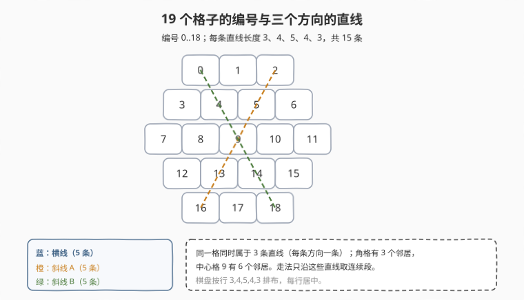
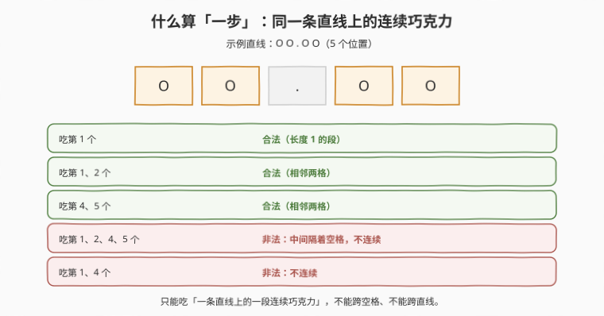
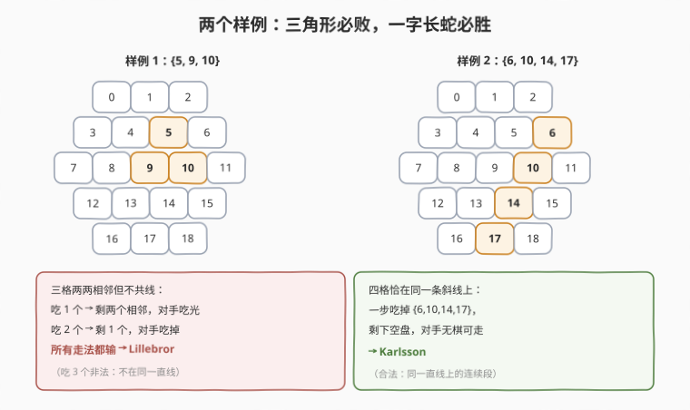

# Codeforces 63E 糖果盒博弈 题解

## 1. 题目概述

- **题目链接**：https://codeforces.com/problemset/problem/63/E
- **比赛来源**：Codeforces Beta Round 59 (Div. 2) · Problem E（UTC 2011-02-28）
- **难度**：2000
- **标签**：状压、位运算、博弈论、DP
- **评测类型**：普通
- **限制**：时间 3 s / 内存 256 MB

**题意**：糖果盒是六边形，共 19 个格子（每行 3、4、5、4、3 个），有些格子里有巧克力。两名玩家轮流行动，每次可以吃掉**若干个**巧克力，要求这些巧克力位于**同一条与盒边平行的直线上**且彼此**相邻**（即该直线上的一个连续段）。无法行动者输。Karlsson 先手，双方都采取最优策略，问谁赢（输出 `Karlsson` 或 `Lillebror`）。

**约束**：

- 19 个格子，状态数最多 $2^{19} = 524288$，是状压博弈的典型规模。
- 每条直线最多 5 格，一共 15 条直线；一步的候选走法是"某条直线上的一个连续巧克力段"，最多约 225 种。
- 输入至少有一个巧克力，保证先手有棋可走或直接面对空盘。

## 2. 示例与观察

官方样例（输入 / 输出原样）：

```text
输入：
  . . .
 . . O .
. . O O .
 . . . .
  . . .

输出：
Lillebror

输入：
  . . .
 . . . O
. . . O .
 O . O .
  . O .

输出：
Karlsson
```

**编号约定**：把 19 个格子按行编号（行内从左到右）：

$$\underbrace{0\ 1\ 2}_{3},\quad \underbrace{3\ 4\ 5\ 6}_{4},\quad \underbrace{7\ 8\ 9\ 10\ 11}_{5},\quad \underbrace{12\ 13\ 14\ 15}_{4},\quad \underbrace{16\ 17\ 18}_{3}.$$

**样例 1**：有巧克力的格子是 $\{5, 9, 10\}$。它们两两相邻，但**不共线**：5 与 9 在一条斜线上，9 与 10 在同一行，5 与 10 在另一条斜线上。所以：

- 只吃 1 个：剩下两个一定相邻（共线），对手可以一次吃光，对手赢；
- 一次吃 2 个（只能吃相邻的那对）：剩 1 个，对手吃掉，对手赢。

先手无论怎么走都会输 → `Lillebror`。

**样例 2**：巧克力在 $\{6, 10, 14, 17\}$，这四个格子恰好在同一条斜线上（具体是斜线 6-10-14-17）。先手可以**一次全部吃掉**，之后对手无棋可走 → `Karlsson`。



**观察 1**：局面只由"哪些格子还剩巧克力"决定，可以用 19 位二进制掩码表示，状态总数 $2^{19}$。
**观察 2**：一步就是"从掩码里删掉某个连续段"，合法段必须在某条直线上、全部由巧克力组成且相邻。
**观察 3**：删掉一些位之后掩码的数值一定变小，所以可以按掩码从小到大递推胜负，无需递归。

## 3. 解题思路

### 3.1 朴素做法与瓶颈

直接做博弈搜索（minimax）会重复访问大量相同局面；局面只有 $2^{19}$ 个，因此应当**记忆化**。用位掩码做状态后，记忆化就变成一张 $2^{19}$ 的胜负表。

另一个容易踩的坑是"走法生成"：必须严格是"同一直线上的连续段"，而不是"同一行/同一斜线上任意若干巧克力"。例如同一行上 `O . O` 不能一次吃掉两个。

### 3.2 核心观察：把一步写成"删除一个合法掩码"



预先枚举全部 15 条直线，以及每条直线上所有**连续子段**，把每个子段表示成一个掩码（该子段包含的格子）。

- 直线共 15 条：5 条横线（行）、5 条"右下斜"、5 条"左下斜"，每条长度 3、4、5、4、3 之一；
- 长度 $L$ 的直线上有 $L(L+1)/2$ 个连续子段，15 条合计 $3\times(6+10+15+10+6)=141$ 个；其中 19 个单格段被三个方向各枚举一次，去重后共 103 个候选走法掩码。

一步合法 $\iff$ 该段掩码 $s$ 满足 $(mask \& s) = s$（这几个格子都还有巧克力）。走完之后新状态是 $mask \oplus s$。

### 3.3 状态转移

设 $win[mask]$ 表示"轮到当前玩家、剩余巧克力为 $mask$ 时，当前玩家是否必胜"：

$$win[mask] = \bigvee_{s \subseteq mask} \neg win[mask \oplus s].$$

边界：$mask = 0$ 时无棋可走，$win[0] = false$（必败）。

由于 $mask \oplus s < mask$（删掉了至少一位），按 $mask$ 从 $1$ 到 $2^{19}-1$ 递增递推即可，所有需要的子状态都算过了。

答案：$win[init]$ 为真输出 `Karlsson`，否则 `Lillebror`。

### 3.4 样例走查



样例 1，$mask = \{5,9,10\}$：

| 走法 | 走后局面 | 对手能否一次吃光？ |
|------|----------|--------------------|
| 吃 {5} | {9,10} | 能（9-10 同行相邻）→ 对手胜 |
| 吃 {9} | {5,10} | 能（5-10 在斜线上相邻）→ 对手胜 |
| 吃 {10} | {5,9} | 能（5-9 在斜线上相邻）→ 对手胜 |
| 吃 {5,9} | {10} | 能（单格）→ 对手胜 |
| 吃 {9,10} | {5} | 能（单格）→ 对手胜 |
| 吃 {5,10} | — | 非法：两格不共线 |
| 吃 {5,9,10} | — | 非法：三格不共线 |

所有合法走法都导致对手一步获胜，所以 $win[\{5,9,10\}] = false$，输出 `Lillebror`。

样例 2，$mask = \{6,10,14,17\}$：存在走法 $s = \{6,10,14,17\}$（同一条斜线上的连续 4 格），走后 $mask' = 0$，$win[0] = false$，故当前玩家胜 → `Karlsson`。

## 4. 正确性证明

**引理 1（状态的充分性）**：局面的全部信息（还能怎么走、走了之后是什么局面）只由"哪些格子有巧克力"决定，因此掩码是完整状态。
**证明**：规则只依赖格子上是否有巧克力与几何位置；几何是固定的，故剩余巧克力集合决定一切。∎

**引理 2（走法的刻画）**：一步合法当且仅当存在一个预枚举的连续段掩码 $s$，使 $s \subseteq mask$；走后局面为 $mask \oplus s$。
**证明**：题面允许的是"同一直线上相邻的若干巧克力"。预枚举集合包含每条直线的每个连续子段；$s \subseteq mask$ 表示这些格子都还有巧克力，正好对应一次合法行动；吃掉的格子被清除，其余不变，即 $mask \oplus s$。反之任何合法行动吃掉的格子必然构成某个直线上的连续段，也在预枚举集合中。∎

**引理 3（递推正确）**：对每个 $mask$，若所有 $mask' < mask$ 的 $win$ 已正确，则按 3.3 的公式算出的 $win[mask]$ 正确。
**证明**：$mask$ 的每个后继 $mask \oplus s$ 都严格小于 $mask$（$s$ 非空），故后继的胜负已知。当前玩家必胜 $\iff$ 存在一步走到对手必败的局面，即公式。$mask=0$ 时无后继，必败，与边界一致。∎

**定理**：程序输出的赢家就是双方最优策略下的赢家。
**证明**：对 $mask$ 归纳（按数值升序），由引理 3 每个 $win[mask]$ 都正确；初始局面对应 $init$，$win[init]$ 为真即先手有必胜策略（输出 `Karlsson`），否则后手必胜（输出 `Lillebror`）。∎

## 5. 复杂度分析

- **时间**：状态数 $2^{19} = 524288$，每状态至多检查 103 个走法掩码，最坏约 $5.4 \times 10^7$ 次位运算；程序对必胜态会提前跳出，实测满盘约 30 ms。
- **空间**：$win$ 表 $2^{19}$ 字节（用 `char`），加上走法表，不到 1 MB。
- **与时限的关系**：3 s 时限下余量在 50 倍以上；Python 版本在满盘上约 0.7 s，也能过（建议 PyPy3）。

## 6. 参考代码

### C++17

```cpp
#include <bits/stdc++.h>
using namespace std;

int main() {
    ios::sync_with_stdio(false);
    cin.tie(nullptr);

    // 19 个格子按行编号：3,4,5,4,3
    const int lines[15][5] = {
        {0, 1, 2, -1, -1}, {3, 4, 5, 6, -1}, {7, 8, 9, 10, 11},
        {12, 13, 14, 15, -1}, {16, 17, 18, -1, -1},
        {0, 3, 7, -1, -1}, {1, 4, 8, 12, -1}, {2, 5, 9, 13, 16},
        {6, 10, 14, 17, -1}, {11, 15, 18, -1, -1},
        {2, 6, 11, -1, -1}, {1, 5, 10, 15, -1}, {0, 4, 9, 14, 18},
        {3, 8, 13, 17, -1}, {7, 12, 16, -1, -1}
    };
    const int len[15] = {3, 4, 5, 4, 3, 3, 4, 5, 4, 3, 3, 4, 5, 4, 3};

    // 所有可能的"一次吃掉的连续段"掩码
    vector<int> seg;
    for (int li = 0; li < 15; ++li)
        for (int i = 0; i < len[li]; ++i) {
            int m = 0;
            for (int j = i; j < len[li]; ++j) {
                m |= 1 << lines[li][j];
                seg.push_back(m);
            }
        }
    sort(seg.begin(), seg.end());
    seg.erase(unique(seg.begin(), seg.end()), seg.end());

    int init = 0;
    for (int r = 0; r < 5; ++r) {
        static const int rowStart[5] = {0, 3, 7, 12, 16};
        static const int rowLen[5] = {3, 4, 5, 4, 3};
        for (int j = 0; j < rowLen[r]; ++j) {
            string t;
            cin >> t;
            if (t == "O") init |= 1 << (rowStart[r] + j);
        }
    }

    // 必胜态判定：win[mask] = 存在一步走到必败态
    // 去掉若干位后的掩码一定更小，故直接按数值从小到大递推
    vector<char> win(1 << 19, 0);
    for (int mask = 1; mask <= init; ++mask) {
        if ((mask & init) != mask) continue;          // 只需要 init 的子集
        bool w = false;
        for (int s : seg) {
            if ((mask & s) != s) continue;            // 该段必须全是巧克力
            if (!win[mask ^ s]) { w = true; break; }
        }
        win[mask] = w;
    }
    cout << (win[init] ? "Karlsson" : "Lillebror") << '\n';
    return 0;
}
```

### Python3

```python
import sys

sys.setrecursionlimit(1000000)


def main() -> None:
    lines = [
        [0, 1, 2], [3, 4, 5, 6], [7, 8, 9, 10, 11], [12, 13, 14, 15], [16, 17, 18],
        [0, 3, 7], [1, 4, 8, 12], [2, 5, 9, 13, 16], [6, 10, 14, 17], [11, 15, 18],
        [2, 6, 11], [1, 5, 10, 15], [0, 4, 9, 14, 18], [3, 8, 13, 17], [7, 12, 16],
    ]
    segs = set()
    for ln in lines:
        for i in range(len(ln)):
            m = 0
            for j in range(i, len(ln)):
                m |= 1 << ln[j]
                segs.add(m)
    segs = sorted(segs)

    row_start = [0, 3, 7, 12, 16]
    row_len = [3, 4, 5, 4, 3]
    data = sys.stdin.read().split()
    init = 0
    pos = 0
    for r in range(5):
        for j in range(row_len[r]):
            if data[pos] == "O":
                init |= 1 << (row_start[r] + j)
            pos += 1

    win = {}

    def dfs(mask: int) -> bool:
        if mask in win:
            return win[mask]
        res = False
        for s in segs:
            if (mask & s) == s and not dfs(mask ^ s):
                res = True
                break
        win[mask] = res
        return res

    print("Karlsson" if dfs(init) else "Lillebror")


main()
```

C++ 用"从 0 到 init 递增"的迭代 DP（只算 init 的子集），Python 用记忆化递归；两者都利用了"吃掉的格子非空 → 掩码变小"这一性质。

## 7. 边界情况与易错点

1. **只有 1 个巧克力**：先手一步吃掉，必胜，输出 `Karlsson`。
2. **满盘 19 个巧克力**：先手也必胜（可以验证），程序不需要特判。
3. **一步必须"相邻"**：同一行上的 `O . O` 不能一次吃两个；走法表必须只含连续段。
4. **一步只能吃一条直线上的段**：不能同时吃两行里的巧克力，哪怕它们各自连续。
5. **三条方向都要覆盖**：只枚举行会漏掉斜线上的走法，导致答案错误（样例 2 就依赖斜线）。
6. **输入是 5 行、每行若干以空格分隔的 token**：用 `cin >> t` 或 `split()` 逐个读 19 个 token，不要按整行字符串处理。
7. **状态很多**：C++ 用 `char` 数组存 $2^{19}$ 个布尔值；Python 用字典记忆化，避免开大列表。
8. **必胜态可提前跳出**：一旦找到走到必败态的走法即可停止枚举，这对满盘性能影响很大。
9. **输出字符串大小写**：严格输出 `Karlsson` 或 `Lillebror`。

## 8. 验证记录

- **编译环境与命令**：`python3 codeforces/tools/verify_solution.py codeforces/contests/0001-0100/63/E_糖果盒博弈.md`。
- **官方样例**：2 / 2 通过（C++ 与 Python 各 2/2）。
- **额外测试（全状态对拍）**：写了独立的 Python 实现（按"逐条直线扫描极大连续段"的方式生成走法，与 C++ 的"预枚举所有子段掩码"完全不同的实现路径），对**所有 popcount $\le 8$ 的 169766 个状态**逐一计算胜负并与 C++ 的 DP 表**逐位比较**，全部一致。此外随机 310 组盘面（含 popcount 13–19 的大盘面）与独立暴力比对，0 组不符。
- **最大约束性能**：满盘（19 个巧克力）C++ 约 30 ms、Python 约 0.7 s。
- **复核状态**：`check.py` 与 `check_samples.py --only 0001-0100/63` 均 0 失败；样例与 `.cf-meta/statements/CF63E.json` 逐字一致。

## 相关题目与扩展

- [Codeforces 549C The Game Of Parity](https://codeforces.com/problemset/problem/549/C)：取石子类博弈的奇偶分析，与本题"状态小、可 DP"不同但同属博弈。
- [Codeforces 63D 岛屿分块构造](https://codeforces.com/problemset/problem/63/D)：同场构造题。
- [Codeforces 1382D Unmerge](https://codeforces.com/problemset/problem/1382/D)：状压/划分 DP，练习掩码状态。

**延伸思考**：

1. 如果把 19 格换成更大的六边形（边长 4 时 37 格），状态数 $2^{37}$ 不可行，需要 Sprague-Grundy 分解或利用对称性剪枝。
2. 如果允许一次吃"多条平行直线上的段"（即多步合并成一步），走法集合会急剧膨胀，DP 依然可行但每状态代价大增。
3. 如果改成"不能行动者**赢**"（misère 玩法），只需把 $mask=0$ 的边界改成必胜，其余递推不变。
4. 本题的"预枚举所有合法段掩码 + 子集检查"是状压博弈的标准写法，可以套用到任何"每次删除一个固定形状"的游戏上。
