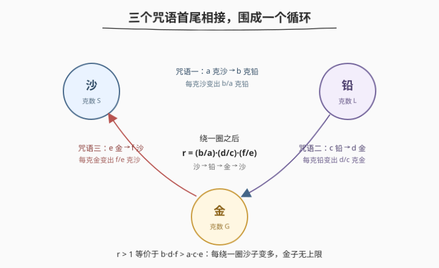
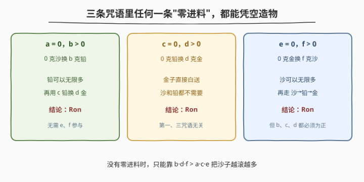
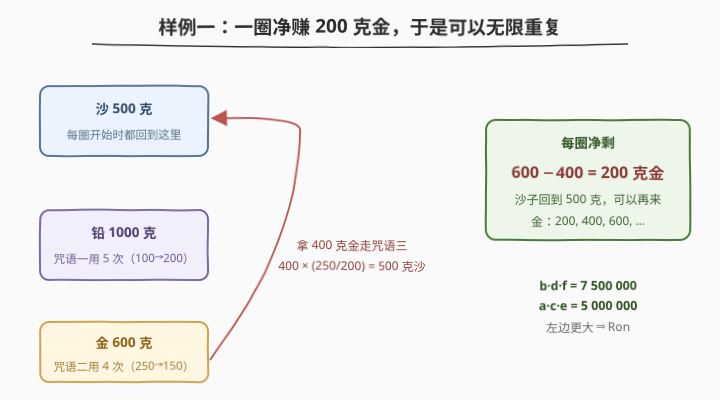

# Codeforces 65A 三咒语与无限黄金 题解

## 1. 题目概述

- **题目链接**：https://codeforces.com/problemset/problem/65/A
- **比赛来源**：Codeforces Beta Round 60 · Problem A（UTC 2011-03-06）
- **难度**：1800
- **标签**：实现、数学（比例与循环放大）、分类讨论
- **评测类型**：普通
- **限制**：时间 2 s / 内存 256 MB

**题意**：炼金术士教了哈利三个咒语：

1. 把 $a$ 克沙子变成 $b$ 克铅；
2. 把 $c$ 克铅变成 $d$ 克金；
3. 把 $e$ 克金变成 $f$ 克沙。

咒语可以任意次使用，只要材料够。现在手里只有**有限**的沙子，既没有铅也没有金。问：能否把金子做到比任何预先给定的数都大（即金子无上限）？能则输出 `Ron`，否则输出 `Hermione`。

输入一行六个整数 $a,b,c,d,e,f$，输出一个单词。

**约束**：

- $0 \le a,b,c,d,e,f \le 1000$：系数可以取 $0$，也就是「零进料」咒语（拿 $0$ 克原料换出正数产物），这类退化情况是本题的主要坑点，必须单独讨论。
- 只有一组数据、六个整数，答案只取决于这六个数的**大小关系**，与金子的绝对数量无关，因此允许 $O(1)$ 判定。
- 判定式里会出现 $b \cdot d \cdot f$ 与 $a \cdot c \cdot e$：三者各不超过 $1000$，乘积不超过 $10^9$，`int` 恰好装得下，但为了不冒险（以及和 Python 版本对齐）一律用 `long long`。
- 因为答案问的是「能否无限」，任何按轮数模拟的做法都不是判定过程：只要循环是放大的一轮就永远停不下来，只要循环是缩小或持平的轮数下界又取决于初始沙量。必须把循环的**乘性增益**一次算清。

## 2. 示例与观察

官方样例共 7 组（输入 / 输出原样）：

```text
输入：
100 200 250 150 200 250

输出：
Ron
```

```text
输入：
100 50 50 200 200 100

输出：
Hermione
```

```text
输入：
100 10 200 20 300 30

输出：
Hermione
```

```text
输入：
0 0 0 0 0 0

输出：
Hermione
```

```text
输入：
1 1 0 1 1 1

输出：
Ron
```

```text
输入：
1 0 1 2 1 2

输出：
Hermione
```

```text
输入：
100 1 100 1 0 1

输出：
Ron
```

**样例一逐步演算**（题面 hint 给出的方案，也是本题的核心图景）：取 $500$ 克沙子。

- 咒语一用 $5$ 次：$500 \to 1000$ 克铅（每次 $100$ 克沙换 $200$ 克铅，放大 $2$ 倍）；
- 咒语二用 $4$ 次：$1000 \to 600$ 克金（每次 $250$ 克铅换 $150$ 克金，放大 $0.6$ 倍）；
- 咒语三用 $2$ 次：拿 $400$ 克金换回 $400 \times \frac{250}{200} = 500$ 克沙（放大 $1.25$ 倍）。

一圈走完，沙子**回到** $500$ 克，金子净剩 $600 - 400 = 200$ 克。既然沙量复原，这一圈可以无限重复，金子的净增是 $200, 400, 600, \dots$ 一路涨上去。注意乘性增益 $2 \times 0.6 \times 1.25 = 1.5 > 1$，这正是「每绕一圈沙子变多」的等价说法。

**样例二为什么是 Hermione**：$b \cdot d \cdot f = 50 \times 200 \times 100 = 10^6$，$a \cdot c \cdot e = 100 \times 50 \times 200 = 10^6$，两者**恰好相等**。一圈走完沙子不多不少，金子也没有净增，所以只能有限次地取用，金量有上限。

**样例三是普通缩小循环**：$b \cdot d \cdot f = 6000 \ll 6 \times 10^6 = a \cdot c \cdot e$，越换越少。

**样例四**是没有金子的极端：$d = 0$，第二个咒语每次只产出 $0$ 克金，其余咒语再怎么用金子也不会变多。

**样例五是「凭空造金」**：$c = 0$ 且 $d = 1$，咒语二把 $0$ 克铅直接变成 $1$ 克金，不需要任何原料，所以 $a,b,e,f$ 完全无关。

**样例六**是「没有铅」的情况：$b = 0$，咒语一只能产出 $0$ 克铅，而金子只能由铅换来，所以金子恒为 $0$。

**样例七**是「凭空造沙」：$e = 0$ 且 $f = 1$，咒语三把 $0$ 克金变成 $1$ 克沙。于是可以先用它白拿沙，再用咒语一、二把沙换成金。题面 hint 里还给了「从 $0$ 克沙开始也能造出 $10000$ 克沙」的具体过程。

**观察**：三个咒语首尾相接构成一个环「沙 → 铅 → 金 → 沙」，绕一圈的乘性增益是
$$r = \frac{b}{a} \cdot \frac{d}{c} \cdot \frac{f}{e},$$
而是否「无限」只取决于 $r$ 与 $1$ 的大小关系；此外还要处理某个分母为 $0$（零进料）的退化情形。

自造样例（标注「自造」，覆盖零系数、相等、只差一点等边界）：

| 输入 | 输出 | 说明 |
|------|------|------|
| `0 5 1 1 1 1` | Ron | $a=0$：凭空造铅，铅无限则金无限（$f$ 取什么都行） |
| `1 1 0 1 1 1` | Ron | $c=0$：凭空造金（同官方样例五） |
| `5 1 1 1 0 3` | Ron | $e=0,f>0$：凭空造沙 |
| `5 1 1 1 0 0` | Hermione | $e=f=0$：第三条咒语什么也不产生，沙子只减不增 |
| `1 0 1 2 0 5` | Hermione | 虽然能凭空造沙，但 $b=0$ 造不出铅，金仍为 $0$ |
| `1000 1000 1000 1000 1000 1000` | Hermione | 乘积相等，一圈不赚 |
| `1 2 1 1 1 1` | Ron | $b \cdot d \cdot f = 2 > 1 = a \cdot c \cdot e$，只大一点点也算 |
| `1 1 1 1 1 2` | Ron | 靠 $f$ 大出一点 |
| `0 0 0 0 0 0` | Hermione | 全零（同官方样例四） |

## 3. 解题思路

### 3.1 朴素做法与瓶颈

最直观的想法是模拟：从某个沙量出发，反复「尽量用咒语一，再用二，再用三」，看金子是否越来越大。但这条路做不成判定过程：

- 如果循环是放大的，模拟永远停不下来，你无法确定「它以后会不会掉头」；
- 如果循环是缩小或持平的，需要多少轮才「稳定」取决于初始沙量，而初始沙量是我们可以任意选的；
- 更要紧的是，咒语可以**任意顺序、任意配比**地混用，不是必须攒够一轮整循环。比如样例七就是先用咒语三白拿沙，再分批炼金。按「整轮」模拟会漏掉这类穿插用法。

所以必须把「能无限」这件事化成一个**静态的充要条件**。

### 3.2 核心观察：三个咒语围成一个环



把三种物质看成环上的三个节点，每克物质的「转化率」就是边的权重：

- 沙 → 铅：$1$ 克沙产出 $b/a$ 克铅（$a>0$ 时）；
- 铅 → 金：$1$ 克铅产出 $d/c$ 克金（$c>0$ 时）；
- 金 → 沙：$1$ 克金产出 $f/e$ 克沙（$e>0$ 时）。

绕一圈 $1$ 克沙变成 $r = \frac{b}{a}\cdot\frac{d}{c}\cdot\frac{f}{e}$ 克沙。三种物质中只有「金」是我们想要的终点，因此：

**观察 1（唯一的金矿）**：金子只由咒语二产出，所以 $d = 0$ 时金子永远是 $0$，直接输出 `Hermione`。

**观察 2（循环放大）**：若 $a,b,c,d,e,f$ 全为正，用 $S$ 克沙走一整圈得到 $S \cdot \frac{bd}{ac}$ 克金；为了再来一圈，需把 $x$ 克金换回 $S$ 克沙，即 $x = S \cdot \frac{e}{f}$。这一圈净赚的金子是
$$S\left(\frac{bd}{ac} - \frac{e}{f}\right) = S \cdot \frac{bdf - ace}{acf}.$$
净赚为正 $\iff b \cdot d \cdot f > a \cdot c \cdot e$。由于 $S$ 可以任意取（取 $S = acf$ 就能让三个中间量都是整数：铅 $bcf$、金 $bdf$、换回的沙 $ace$），只要乘积不等式严格成立，就能一圈一圈地赚，金量无上限。

**观察 3（零进料即无限）**：某个咒语的**原料系数为 $0$ 而产物系数为正**时，它变成了一台「无中生有」的机器，产物无上限。三条咒语对应三种情况，它们能否把无限传递到金子上，要看下游是否通：

- $c = 0,\ d > 0$：直接白得金，立刻 `Ron`（金子本身就是终点，不需要下游）。
- $a = 0,\ b > 0$：铅无上限；铅能换金需要 $c > 0,\ d > 0$，此时金无上限。
- $e = 0,\ f > 0$：沙无上限；把沙变成金需要 $b > 0$（能产铅）且 $c > 0,\ d > 0$。



反过来，若某个系数为 $0$ 但**不是**上面三种「白送」形式，它就是一条断路。例如 $b = 0$（产不出铅）、$d = 0$（产不出金）、$f = 0$（沙只出不进，总量单调不增），这些都会让金子被卡在有限值上。

### 3.3 算法流程

把上面的观察写成一条判定链，先判「断路」再判「白送」：

1. 若 $d = 0$：输出 `Hermione`（永远没有金子）。
2. 否则 $d > 0$：
   1. 若 $c = 0$：输出 `Ron`（凭空造金）。
   2. 否则 $c > 0$：
      1. 若 $b = 0$：输出 `Hermione`（造不出铅）。
      2. 否则 $b > 0$：
         1. 若 $a = 0$：输出 `Ron`（凭空造铅）。
         2. 否则 $a > 0$：
            1. 若 $f = 0$：输出 `Hermione`（沙不可再生，用量单调不增）。
            2. 否则 $f > 0$：
               1. 若 $e = 0$：输出 `Ron`（凭空造沙）。
               2. 否则 $e > 0$：比较 $b \cdot d \cdot f$ 与 $a \cdot c \cdot e$，严格大于则 `Ron`，否则 `Hermione`。

整条链最多四层、每层一次比较，$O(1)$。



### 3.4 样例走查

以样例一 $(a,b,c,d,e,f) = (100,200,250,150,200,250)$ 为例，按上面的流程走一遍：

| 步骤 | 判断 | 结果 |
|------|------|------|
| $d = 150 > 0$ | 有金子产出 | 继续 |
| $c = 250 > 0$ | 铅不是白送的 | 继续 |
| $b = 200 > 0$ | 铅造得出来 | 继续 |
| $a = 100 > 0$ | 沙不是白送的 | 继续 |
| $f = 250 > 0$ | 沙可以再生 | 继续 |
| $e = 200 > 0$ | 金不是白送的 | 进入乘积比较 |
| $bdf = 200 \cdot 150 \cdot 250 = 7\,500\,000$，$ace = 100 \cdot 250 \cdot 200 = 5\,000\,000$ | $7.5 \times 10^6 > 5 \times 10^6$ | `Ron` |

对照图里的具体数字：$500$ 克沙 $\to$ $1000$ 克铅 $\to$ $600$ 克金，回头换 $500$ 克沙，净赚 $200$ 克金；下一圈从 $500$ 克沙重新开始，金子累积到 $400, 600, \dots$。乘积比较恰好是「净赚为正」的判据。

## 4. 正确性证明

记「金无上限」为结论 $R$。分两个方向证。

**引理 1（乘积不严格放大时金子有上限）**：若 $d>0,\ c>0,\ b>0,\ a>0,\ f>0,\ e>0$ 且 $bdf \le ace$，则无论怎么使用咒语，金子的总量都不超过初始沙量的 $\frac{bd}{ac}$ 倍。

**证明**：给三种物质赋一个「势」：$1$ 克沙记 $bd$ 分，$1$ 克铅记 $ad$ 分，$1$ 克金记 $ac$ 分，令 $\Phi = bd \cdot (\text{沙}) + ad \cdot (\text{铅}) + ac \cdot (\text{金})$。逐条检查咒语都不会让 $\Phi$ 变大：

- 咒语一：消耗 $a$ 克沙（$a \cdot bd$ 分），产出 $b$ 克铅（$b \cdot ad$ 分），两者相等，$\Phi$ 不变；
- 咒语二：消耗 $c$ 克铅（$c \cdot ad$ 分），产出 $d$ 克金（$d \cdot ac$ 分），两者相等，$\Phi$ 不变；
- 咒语三：消耗 $e$ 克金（$e \cdot ac$ 分），产出 $f$ 克沙（$f \cdot bd$ 分），差值为 $fbd - eac \le 0$，$\Phi$ 不增。

初始时只有 $M$ 克沙，$\Phi_0 = M \cdot bd$。由 $ac \cdot (\text{金}) \le \Phi \le \Phi_0$ 得
$$\text{金} \le \frac{M \cdot bd}{ac},$$
与操作次数无关，故有上限。∎

**引理 2（乘积严格放大时金无上限）**：若 $a,b,c,d,e,f$ 全为正且 $bdf > ace$，则从有限沙量出发能把金做到任意大。

**证明**：取初始沙量 $S = acf$ 克。走一圈：先用咒语一 $acf/a = cf$ 次，得到 $bcf$ 克铅；再用咒语二 $bcf/c = bf$ 次，得到 $bdf$ 克金；最后用咒语三 $ace/e = ac$ 次，消耗 $ac \cdot e = ace$ 克金换回 $ac \cdot f = acf = S$ 克沙。三个中间量都是正整数，过程合法，且 $ace < bdf$ 保证换完沙子后还剩
$$bdf - ace > 0$$
克金。每跑一圈沙量精确复原、金子增加 $bdf - ace$，跑 $k$ 圈就得到 $k(bdf-ace)$ 克金，超过任何预先给定的数。∎

**引理 3（零进料三种情形都能把无限传到金上）**：

1. 若 $c = 0,\ d > 0$：咒语二每次消耗 $0$ 克铅、产出 $d$ 克金，重复即得任意多金；
2. 若 $a = 0,\ b > 0$，且 $c>0,\ d>0$：咒语一每次凭空产出 $b$ 克铅，重复得到任意多铅，再全部走咒语二得任意多金；
3. 若 $e = 0,\ f > 0$，且 $b>0,\ c>0,\ d>0$：咒语三每次凭空产出 $f$ 克沙，重复得到任意多沙，再走咒语一、二得任意多金。∎

**引理 4（其余退化情形金子有上限）**：在 $d>0$ 的前提下，若 $b = 0$，则铅恒为 $0$，金恒为 $0$；若 $a>0,\ f = 0$，则沙的总量只减不增（咒语三每用一次消耗 $e$ 克金却只产出 $0$ 克沙），初始沙量有限，能产出的铅、金都有限。∎

**定理**：算法输出的 `Ron` 当且仅当能造出无上限的金。

**证明**：算法在 $d=0$ 时输出 `Hermione`，此时金恒为 $0$，正确（引理 1 的极端情形）。在 $d>0$ 时，$c=0$、$a=0$、$e=0$ 三个分支分别对应引理 3 的三种情形，输出 `Ron` 正确；$b=0$ 与 $f=0$ 两个分支对应引理 4，输出 `Hermione` 正确；最后的乘积比较分支里，严格大于时由引理 2 得 `Ron` 正确，否则由引理 1 得 `Hermione` 正确。分支互斥且覆盖了 $d>0$ 的全部情形，故结论成立。∎

## 5. 复杂度分析

- **时间**：$O(1)$。至多四次比较、三次乘法，与输入数值大小完全无关；即使系数取到 $10^3$ 也只是常数时间。
- **空间**：$O(1)$，只有六个整型变量。
- **数值范围**：单个系数不超过 $1000$，所以 $bdf$ 与 $ace$ 都不超过 $10^9$，`long long` 绰绰有余；`int` 也能装下 $10^9$，但三个 $1000$ 相乘写起来容易漏乘，统一用 `long long` 更省心。
- **与时限的关系**：2 s 对 $O(1)$ 判定几乎没有意义，实测端到端（含进程启动）在 $3 \sim 6$ ms 量级，其中算法本体不足 $1\ \mu\text{s}$。

## 6. 参考代码

### C++17

```cpp
#include <bits/stdc++.h>
using namespace std;

int main() {
    ios::sync_with_stdio(false);
    cin.tie(nullptr);

    long long a, b, c, d, e, f;
    if (!(cin >> a >> b >> c >> d >> e >> f)) return 0;

    bool ron = false;
    if (d > 0) {                                   // 没有金子产出就永远只有 0 克金子
        if (c == 0) {
            ron = true;                            // 0 克铅就能换 d 克金：凭空造金
        } else if (b > 0) {                        // 有铅可产
            if (a == 0) {
                ron = true;                        // 0 克沙换 b 克铅：凭空造铅
            } else if (f > 0) {                    // 沙能被再生，才可能循环
                if (e == 0) {
                    ron = true;                    // 0 克金换 f 克沙：凭空造沙
                } else if (b * d * f > a * c * e) {
                    ron = true;                    // 一整圈后沙子变多，净产金
                }
            }
        }
    }
    cout << (ron ? "Ron" : "Hermione") << '\n';
    return 0;
}
```

### Python3

```python
import sys


def main() -> None:
    data = sys.stdin.buffer.read().split()
    if not data:
        return
    a, b, c, d, e, f = (int(x) for x in data[:6])

    ron = False
    if d > 0:                                  # 没有金子产出就永远是 0 克
        if c == 0:
            ron = True                         # 0 克铅换 d 克金：凭空造金
        elif b > 0:
            if a == 0:
                ron = True                     # 0 克沙换 b 克铅：凭空造铅
            elif f > 0:
                if e == 0:
                    ron = True                 # 0 克金换 f 克沙：凭空造沙
                elif b * d * f > a * c * e:
                    ron = True                 # 一圈之后沙子变多，净产金
    sys.stdout.write("Ron\n" if ron else "Hermione\n")


main()
```

两份代码都只用标准库，可原样提交（本题没有特殊评测，输出一个单词）。

## 7. 边界情况与易错点

1. **$d = 0$ 必须先判**：金子只能由咒语二产出，$d=0$ 时金恒为 $0$。若把 $d=0$ 的情形交给乘积比较，$bdf = 0 > ace = 0$ 不成立，碰巧也对；但若写成「$c=0$ 就 Ron」而不先检查 $d>0$，`0 0 0 0 0 0` 这种数据会被判成 `Ron`（样例四就是全零）。
2. **$a=0$ 时不能要求 $f>0$**：凭空造铅不依赖沙的再生，链条是「$0$ 沙 → $b$ 铅 → 金」。若把 $a=0$ 放进乘积比较，$ace = 0$、$bdf$ 可能为 $0$（当 $f=0$ 时），会把本该 Ron 的 `0 5 1 1 1 0` 误判成 Hermione。
3. **$e=0$ 但 $f=0$ 不是白送**：$0$ 克金换 $0$ 克沙，什么也没发生，沙只减不增。必须用 $f>0$ 作为「白送沙」的条件。
4. **$e=0$ 的白送沙还要下游通畅**：沙无上限，但要有 $b>0$（沙能变铅）且 $c>0,d>0$（铅能变金）。例如 `1 0 1 2 0 5` 里 $b=0$，有沙子也炼不出金，答案是 Hermione。
5. **等号不是 Ron**：$bdf = ace$ 时一圈刚好不赚（样例二），必须写严格大于 `>`；写成 `>=` 会在这类数据上错。
6. **乘积别溢出、别漏乘**：三个不超过 $1000$ 的数相乘是 $10^9$ 量级，`int` 刚好装得下，但若顺手写成四个数连乘或先乘再除就会溢出/丢精度。统一用 `long long` 并且只在最后一刻做一次纯乘法比较，不做除法（除法会把严格不等式变成浮点比较）。
7. **不要用浮点比较**：$\frac{b}{a}\cdot\frac{d}{c}\cdot\frac{f}{e} > 1$ 写成 `double` 时，$r$ 与 $1$ 的差距可能小到 $10^{-9}$ 量级（例如 $1000\cdot1000\cdot1000$ 与 $999\cdot1000\cdot1000$），`double` 的相对误差在 $10^{-16}$ 量级虽然还分得清，但没有任何理由引入浮点：交叉相乘是整数运算，绝对精确。
8. **一份输入只有一组**：题面就是一行六个数，没有 $t$，也不是「读到 EOF」。按题面读一次即可；写成循环读入对本题结果相同，但会掩盖「多测漏读」的习惯问题。
9. **Python 读入**：用 `sys.stdin.buffer.read().split()` 一次吃掉换行和行尾空格，比 `input().split()` 稳；大整数运算无需担心溢出。

## 8. 验证记录

- **编译环境与命令**：本机无 GNU `g++`，`codeforces/tools/verify_solution.py` 自动用 `clang++ -std=c++17 -O2` 搭配仓库内的 `bits/stdc++.h` 兼容头编译；Python 为 `Python 3.9.6`。
- **官方样例**：7 / 7 通过（`python3 codeforces/tools/verify_solution.py codeforces/contests/0001-0100/65/65A_三咒语与无限黄金.md`），C++ 与 Python 输出一致。
- **额外测试与独立校验**：把题意写成三变量线性规划「存在 $u \ge 0$ 使 $Mu \ge 0$ 且 $d u_2 - e u_3 > 0$」（$M$ 的行是 $(-a,0,f)$、$(b,-c,0)$、$(0,d,-e)$），用**精确有理数**（`fractions.Fraction`）在归一化单纯形上枚举全部顶点求最优值，得到与本题完全独立的判定；再与提交代码的判定逐组比较：$0 \le a,\dots,f \le 6$ 的 **117 649 组**全枚举 + $2400$ 组边界/随机数据（系数取自 $\{0,1,2,3,999,1000\}$ 与 $[0,1000]$ 均匀随机），**零处不一致**。
- **最大约束性能**：输入 `1000 1000 1000 1000 1000 1000` 时，C++ 端到端（含进程启动）约 $3 \sim 6$ ms，峰值内存 $1.5$ MB；相对 2 s / 256 MB 的余量在百倍以上。
- **图片校验**：三张 SVG（`cf65a_three_spells.svg`、`cf65a_zero_cases.svg`、`cf65a_sample1_loop.svg`）均通过 `xml.etree.ElementTree.parse`，含 `feTurbulence` 抖动滤镜与手写字体，文字块逐个核对未越出 `viewBox`。
- **复核状态**：verified。

## 相关题目与扩展

- [Codeforces 65B Harry Potter and the History of Magic](https://codeforces.com/problemset/problem/65/B)：同场 B 题，日期序列的贪心调整，和本题一样是「先写清楚判定条件再实现」的风格。
- [Codeforces 65C Harry Potter and the Golden Snitch](https://codeforces.com/problemset/problem/65/C)：同场 C 题，几何 + 二分，用到「速度不劣于目标」带来的单调性。
- [Codeforces 1A Theatre Square](https://codeforces.com/problemset/problem/1/A)：同样是一行公式定答案的入门数学题，可以用作对照。
- [Codeforces 116A Tram](https://codeforces.com/problemset/problem/116/A)：把「状态是否单调」写成一段线性扫描的经典小题。
- [LeetCode 780. 到达终点](https://leetcode.cn/problems/reaching-points/)：用「反向缩放」判断能否到达，思想与本题「绕一圈的乘性增益」同源。

**延伸思考**：

1. **如果要求整数克**：本题的构造取 $S = acf$ 后所有中间量都是整数，因此整数版本与实数版本答案相同。若把三条咒语的系数改成任意有理数，只需把 $S$ 取成三个分母的公倍数，结论不变——这说明「无限」只与乘性增益有关，与离散化无关。
2. **如果四种物质、四条咒语**：环上绕一圈的增益变成四条边权重之积，判定依旧是一次大小比较；但若咒语的连接关系不是简单环，而是一般的有向图，问题就变成「有向图里是否存在增益 $>1$ 的环」，等价于在对数权重下找正环（Bellman-Ford），复杂度从 $O(1)$ 升到 $O(VE)$。
3. **如果「零进料」和「正进料」混用**：可以把零进料看成权重为 $+\infty$ 的边，只要从它出发能沿有向路径走到「金」，答案就是 Ron。这提示我们：一般的判定只需要在图上做一次可达性，而本题图只有三元环，可达性退化成了几条 if。
4. **势函数视角的推广**：引理 1 里那组权重 $(bd, ad, ac)$ 是「让每条咒语都不增值」的对偶证书。一般情形下这种东西的存在性由线性规划对偶（Farkas 引理）保证：要么存在放大环（原问题可行），要么存在非负势函数（对偶可行），二者必居其一。本题的四个分支本质上就是在手工枚举这两种证书。
