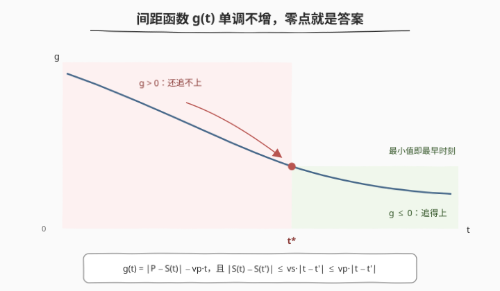
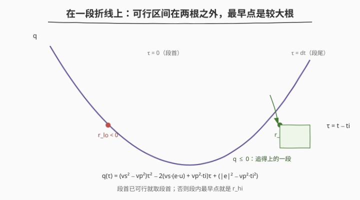
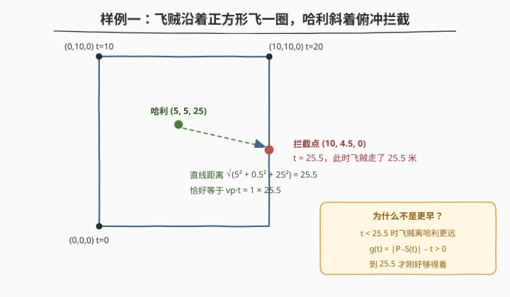

# Codeforces 65C 拦截金色飞贼 题解

## 1. 题目概述

- **题目链接**：https://codeforces.com/problemset/problem/65/C
- **比赛来源**：Codeforces Beta Round 60 · Problem C（UTC 2011-03-05）
- **难度**：2100
- **标签**：二分、几何（三维距离）、数值精度
- **评测类型**：特殊评测（实数比较，绝对/相对误差 $10^{-6}$）
- **限制**：时间 2 s / 内存 256 MB

**题意**：金色飞贼从 $(x_0,y_0,z_0)$ 出发，沿折线 $(x_0,y_0,z_0) \to (x_1,y_1,z_1) \to \dots \to (x_n,y_n,z_n)$ 以恒定速度 $v_s$ 匀速飞行。哈利在 $t = 0$ 时位于 $P = (P_x,P_y,P_z)$，他的扫帚速度是 $v_p \ge v_s$，可以朝任意方向飞，也可以原地不动。两人（一人一球）在同一时刻位于同一点即算抓住。求**最早**的抓住时刻 $t$ 与当时的坐标；若飞贼在整段折线上飞行期间都抓不住，输出 `NO`。

**约束**：

- $n \le 10^4$：段数很多，逐段处理可行，$O(n)$ 或 $O(n \log)$ 都安全，$O(n^2)$ 不行。
- 所有坐标 $|x|,|y|,|z| \le 10^4$，速度为正整数且 $v_s \le v_p$。**$v_p \ge v_s$ 是本题的命门**：它保证「间距函数」单调不增，从而追上时刻唯一、可以一次定位。
- 折线总长可达 $10^4 \times 2\sqrt{3}\times 10^4 \approx 3.5 \times 10^8$，时刻可达 $10^8$ 量级；答案要求 $10^{-6}$ 的绝对或相对误差，因此必须用实数运算并把误差控制在 $10^{-9}$ 以内。
- 时间是连续的：不可能枚举时刻，必须对每段解方程。

## 2. 示例与观察

官方样例共 3 组（输入 / 输出原样，输出保留 10 位小数）：

```text
输入：
4
0 0 0
0 10 0
10 10 0
10 0 0
0 0 0
1 1
5 5 25

输出：
YES
25.5000000000
10.0000000000 4.5000000000 0.0000000000
```

```text
输入：
4
0 0 0
0 10 0
10 10 0
10 0 0
0 0 0
1 1
5 5 50

输出：
NO
```

```text
输入：
1
1 2 3
4 5 6
20 10
1 2 3

输出：
YES
0.0000000000
1.0000000000 2.0000000000 3.0000000000
```

**样例一逐步演算**：折线是一个边长 $10$ 的正方形回路，总长 $40$，$v_s = 1$，所以飞贼走完一圈要 $40$ 秒。哈利在 $(5,5,25)$，$v_p = 1$。

- $t = 10$：飞贼到 $(0,10,0)$，哈利最远只能到离 $(5,5,25)$ 距离 $10$ 的地方，追不上；
- $t = 20$：飞贼到 $(10,10,0)$，距离哈利 $\sqrt{25 + 25 + 625} = \sqrt{675} \approx 25.98 > 20$；
- $t = 25.5$：飞贼从 $(10,10,0)$ 沿第三段向 $(10,0,0)$ 走了 $5.5$ 米，位于 $(10, 4.5, 0)$。它到哈利的距离是
  $$\sqrt{(10-5)^2 + (4.5-5)^2 + (0-25)^2} = \sqrt{25 + 0.25 + 625} = \sqrt{650.25} = 25.5 = v_p \cdot t,$$
  正好够得着。于是答案 $t = 25.5$，拦截点 $(10, 4.5, 0)$。

**样例二**：哈利在 $(5,5,50)$，竖直方向就差了 $50$ 米，而一圈只有 $40$ 秒、速度只有 $1$，到 $t = 40$ 时飞贼回到原点，距哈利 $\sqrt{25+25+2500} \approx 50.5 > 40$，追不上，输出 `NO`。

**样例三**：只有一段，哈利**恰好就在起点**，$t = 0$ 时两人重合，答案 $t = 0$、坐标 $(1,2,3)$。注意这里 $v_p = 20 > v_s = 10$。

**观察 1（追上条件）**：若要在时刻 $t$ 抓住，抓住点只能是飞贼在时刻 $t$ 的位置 $S(t)$（因为两者必须同点）。哈利从 $P$ 直线飞到 $S(t)$ 需要的时间是 $|P - S(t)| / v_p$，他能提前到达并在那里等（题面允许原地不动），所以

$$\text{时刻 } t \text{ 能抓住} \iff |P - S(t)| \le v_p\, t.$$

**观察 2（单调性）**：令 $g(t) = |P - S(t)| - v_p t$。飞贼走过的路程正好是 $v_s t$，因此 $|S(t) - S(t')| \le v_s |t - t'| \le v_p |t - t'|$，代进去得
$$g(t') - g(t) \le v_s |t' - t| - v_p (t' - t) \le 0 \quad (t' > t),$$
即 $g$ 单调不增。于是「可行时刻」构成一个后缀区间 $[t^*, +\infty)$，$t^*$ 就是答案；若 $g(T) > 0$（$T$ 是飞贼飞完全程的时刻），则永远追不上。

## 3. 解题思路

### 3.1 朴素做法与瓶颈

最直接的想法是「按时间扫描」：把 $[0, T]$ 均分成很多小份，逐份检查 $g(t) \le 0$。但要求 $10^{-6}$ 的精度，而 $T$ 可达 $10^8$，直接扫描需要 $10^{14}$ 个采样点，毫无可能；就算用二分，也需要一个可靠的判定，而二分本身又依赖 $g$ 的单调性（这点倒是成立的，见观察 2）。

另一条路是「按段扫描 + 段内解方程」：飞贼在每一段上是**匀速直线运动**，$S(t)$ 关于 $t$ 是线性的，于是 $|P - S(t)|^2 \le (v_p t)^2$ 是**关于 $t$ 的二次不等式**，可以解析求解。这正是下面的做法。

### 3.2 核心观察：间距函数单调不增，零点即答案



由观察 1、2：答案就是方程 $g(t) = 0$ 的最小非负根（若 $g(0) \le 0$ 则答案是 $0$），而 $g$ 单调不增保证了这个根存在且唯一。所以问题从「搜索时刻」变成了「求一个单调函数的零点」。

### 3.3 算法流程：逐段解二次不等式



第 $i$ 段从 $A = (x_i,y_i,z_i)$ 到 $B = (x_{i+1},y_{i+1},z_{i+1})$，长度 $L_i$，单位方向 $u = (B-A)/L_i$，段首时刻 $t_i = \left(\sum_{j<i} L_j\right)/v_s$，飞行时长 $\Delta_i = L_i / v_s$。令 $\tau = t - t_i \in [0, \Delta_i]$，则

$$S(t) = A + u\, v_s \tau, \qquad e = P - A .$$

追上条件 $|P - S(t)|^2 \le (v_p t)^2$ 展开成 $\tau$ 的二次不等式：

$$q(\tau) = \underbrace{(v_s^2 - v_p^2)}_{\le 0}\tau^2 - 2\bigl(v_s\,(e \cdot u) + v_p^2 t_i\bigr)\tau + \bigl(|e|^2 - v_p^2 t_i^2\bigr) \le 0 .$$

因为二次项系数 $v_s^2 - v_p^2 \le 0$，这条抛物线**开口向下**，$\{q \le 0\}$ 是「两根之外」的部分。于是在一段之内：

- 若 $q(0) \le 0$：段首就可追，最早点就是段首 $t_i$；
- 否则若 $q(\Delta_i) \le 0$：段内唯一的穿越点就是**较大根** $\tau^*$，最早点 $t_i + \tau^*$；
- 否则这一段整段都追不上，看下一段。

从第 $1$ 段扫到第 $n$ 段，第一段给出可行点的段就是答案所在段；全部没有则输出 `NO`。由于 $g$ 单调不增，「第一个可行段」必然给出全局最早时刻。

$v_s = v_p$ 时二次项系数为 $0$，不等式退化成一次式，取 $\tau = -C_2 / B_2$ 即可（代码里有专门分支）。

### 3.4 样例走查



以样例一为例，三段的具体数字（$v_p = v_s = 1$，所以 $t_i$ 就等于已走路程）：

| 段 | 起止 | $t_i$ | $\Delta_i$ | 段首/段尾是否可行 | 结论 |
|----|------|-------|-----------|-------------------|------|
| 1 | $(0,0,0)\to(0,10,0)$ | 0 | 10 | 段首：$\lvert P\rvert \approx 25.7 > 0$；段尾：$\approx 25.98 > 10$ | 整段追不上 |
| 2 | $(0,10,0)\to(10,10,0)$ | 10 | 10 | 段尾 $\approx 25.98 > 20$ | 整段追不上 |
| 3 | $(10,10,0)\to(10,0,0)$ | 20 | 10 | 段首 $25.98 > 20$，段尾（$\tau=10$）$= \sqrt{25+25+625}-30 < 0$ | 段内穿越，取较大根 |
| 4 | $(10,0,0)\to(0,0,0)$ | 30 | 10 | 已经追上，不会走到这里 | — |

第三段上解 $q(\tau) = 0$：$\tau^* = 5.5$，于是 $t = 20 + 5.5 = 25.5$，位置 $A + u v_s \tau^* = (10, 10-5.5, 0) = (10,4.5,0)$，与样例输出一致。

## 4. 正确性证明

**引理 1（追赶判据）**：哈利能在时刻 $t$ 抓住飞贼，当且仅当 $|P - S(t)| \le v_p t$。

**证明**：必要性：若时刻 $t$ 两者重合，则重合点必是 $S(t)$，哈利从 $P$ 到该点的飞行距离不超过 $v_p t$。充分性：哈利沿直线从 $P$ 飞向 $S(t)$，耗时 $|P-S(t)|/v_p \le t$，先到达后原地等待（题目允许原地不动），到时刻 $t$ 时正好与飞贼重合。∎

**引理 2（单调性）**：$g(t) = |P - S(t)| - v_p t$ 在 $[0,T]$ 上单调不增。

**证明**：对 $0 \le t < t' \le T$，飞贼在 $[t,t']$ 内走过的路程为 $v_s (t'-t)$，故 $|S(t') - S(t)| \le v_s(t'-t)$。由三角不等式
$$|P - S(t')| \le |P - S(t)| + |S(t') - S(t)| \le |P - S(t)| + v_s(t'-t).$$
两边减去 $v_p t'$：
$$g(t') \le g(t) + (v_s - v_p)(t' - t) \le g(t),$$
最后一步用到 $v_s \le v_p$。∎

**引理 3（段内定位）**：在第 $i$ 段内，设 $q(\tau)$ 如上。若 $q(0) > 0$ 且 $q(\Delta_i) \le 0$，则 $q$ 在 $(0,\Delta_i]$ 内恰有一个根，且它是较大的那个根 $\tau^*$；若 $q(0) > 0$ 且 $q(\Delta_i) > 0$，则整段不可行。

**证明**：$q$ 是开口向下的抛物线（二次项系数 $v_s^2 - v_p^2 \le 0$），$\{q \le 0\}$ 是两根构成的闭区间之外。$q(0) > 0$ 说明 $0$ 在两根之间，$q(\Delta_i) \le 0$ 说明 $\Delta_i$ 落在右侧（$\ge$ 较大根）。于是较大根 $\tau^* \in (0, \Delta_i]$，且它是段内第一个可行点。若 $q(\Delta_i) > 0$，两端都在两根之间，由抛物线的凹凸性整段都在两根之间，故整段不可行（$v_s = v_p$ 时 $q$ 是一次函数，同样的结论直接成立）。∎

**定理**：算法输出的时刻是最早的追上时刻；输出 `NO` 当且仅当永远追不上。

**证明**：设真实最早时刻为 $t^*$（若存在），它落在第 $k$ 段。由引理 1、2，$g$ 单调不增且可行集是 $[t^*, +\infty) \cap [0,T]$，因此 $k$ 之前的所有段整段不可行（$g > 0$），第 $k$ 段必然满足引理 3 的「$q(\Delta_k) \le 0$」或「$q(0) \le 0$」，算法在第 $k$ 段给出的正是段内第一个可行点，即 $t^*$。反之若所有段都不可行，则 $g(t) > 0$ 对所有 $t \in [0,T]$ 成立，由引理 1 永远追不上。∎

## 5. 复杂度分析

- **时间**：$O(n)$。每段只做常数次浮点运算（一次开方求段长、几次乘加、最多一次开方求根），$n = 10^4$ 时不到 $10^5$ 次浮点操作。若改用「二分时刻 + 每步 $O(n)$ 定位」则是 $O(n \log)$，同样可过，但逐段解析解更快也更稳。
- **空间**：$O(n)$，存 $n+1$ 个点与 $n$ 个段长、前缀和，约 $3 \times 10^5$ 字节。
- **数值**：坐标 $\le 10^4$，距离平方 $\le 10^9$；二次项系数 $|v_s^2 - v_p^2| \le 10^8$；用 `double` 的有效位是 $10^{-16}$ 的相对精度，配合判别式与「稳定求根公式」（先算 $q = -\frac{1}{2}(B + \operatorname{sgn}(B)\sqrt{D})$，再由 $r_1 = q/A$、$r_2 = C/q$ 得到两根），可以把根的时刻误差压在 $10^{-9}$ 以内，满足 $10^{-6}$ 的要求。
- **与时限的关系**：$n = 10^4$ 的最大数据实测 C++ 约 $0.06$ s（含进程启动），相对 2 s 有几十倍余量。

## 6. 参考代码

### C++17

```cpp
#include <bits/stdc++.h>
using namespace std;

// 逐段解二次不等式：在段 i 上 S(t) = A + u*vs*(t - ti)，令 tau = t - ti，
// 追上条件 |P - S| <= vp*t 等价于 q(tau) = (vs^2-vp^2)tau^2 - 2(vs*(e.u)+vp^2*ti)tau
//                                     + (|e|^2 - vp^2*ti^2) <= 0,  e = P - A
// 因为 vs <= vp，抛物线开口向下；段内可行集是"根以外"，所以最早可行点只可能是
// 段首（tau=0 已可行）或较大根。逐段扫描取第一个可行点即为全局最早。
int main() {
    ios::sync_with_stdio(false);
    cin.tie(nullptr);

    int n;
    if (!(cin >> n)) return 0;
    vector<double> x(n + 1), y(n + 1), z(n + 1);
    for (int i = 0; i <= n; ++i) cin >> x[i] >> y[i] >> z[i];
    double vp, vs;
    cin >> vp >> vs;
    double px, py, pz;
    cin >> px >> py >> pz;

    vector<double> len(n), pref(n + 1, 0.0);
    for (int i = 0; i < n; ++i) {
        double dx = x[i + 1] - x[i], dy = y[i + 1] - y[i], dz = z[i + 1] - z[i];
        len[i] = sqrt(dx * dx + dy * dy + dz * dz);
        pref[i + 1] = pref[i] + len[i];
    }

    auto point_at = [&](int seg, double tau, double res[3]) {
        double r = len[seg] > 0 ? (vs * tau) / len[seg] : 0.0;
        res[0] = x[seg] + (x[seg + 1] - x[seg]) * r;
        res[1] = y[seg] + (y[seg + 1] - y[seg]) * r;
        res[2] = z[seg] + (z[seg + 1] - z[seg]) * r;
    };

    double A2 = vs * vs - vp * vp;             // <= 0
    for (int i = 0; i < n; ++i) {
        double ti = pref[i] / vs;              // 段首时刻
        double dt = len[i] / vs;               // 段长（时间）
        double ux = (x[i + 1] - x[i]) / len[i];
        double uy = (y[i + 1] - y[i]) / len[i];
        double uz = (z[i + 1] - z[i]) / len[i];
        double ex = px - x[i], ey = py - y[i], ez = pz - z[i];
        double B2 = -2.0 * (vs * (ex * ux + ey * uy + ez * uz) + vp * vp * ti);
        double C2 = ex * ex + ey * ey + ez * ez - vp * vp * ti * ti;
        double scale = 1.0 + (ex * ex + ey * ey + ez * ez) + (vp * ti) * (vp * ti);
        double tol = 1e-12 * scale;

        auto q = [&](double tau) { return (A2 * tau + B2) * tau + C2; };
        double tau;
        if (q(0.0) <= tol) {
            tau = 0.0;
        } else if (q(dt) <= tol) {
            if (A2 == 0.0) {
                tau = -C2 / B2;
            } else {
                double D = B2 * B2 - 4.0 * A2 * C2;
                if (D < 0) continue;
                double sq = sqrt(D);
                double qq = -0.5 * (B2 + (B2 >= 0 ? sq : -sq));
                double r1 = qq / A2, r2 = (qq != 0.0) ? C2 / qq : r1;
                tau = max(r1, r2);
            }
            if (tau < 0) tau = 0;
            if (tau > dt) tau = dt;
        } else {
            continue;
        }
        double res[3];
        point_at(i, tau, res);
        cout << "YES\n";
        cout << fixed << setprecision(10) << (ti + tau) << '\n';
        cout << fixed << setprecision(10) << res[0] << ' ' << res[1] << ' ' << res[2] << '\n';
        return 0;
    }
    cout << "NO\n";
    return 0;
}
```

### Python3

```python
import sys
import math


def main() -> None:
    data = sys.stdin.buffer.read().split()
    if not data:
        return
    p = 0
    n = int(data[p]); p += 1
    pts = []
    for _ in range(n + 1):
        pts.append((float(data[p]), float(data[p + 1]), float(data[p + 2]))); p += 3
    vp = float(data[p]); vs = float(data[p + 1]); p += 2
    P = (float(data[p]), float(data[p + 1]), float(data[p + 2]))

    pref = [0.0] * (n + 1)
    for i in range(n):
        dx = pts[i+1][0] - pts[i][0]
        dy = pts[i+1][1] - pts[i][1]
        dz = pts[i+1][2] - pts[i][2]
        pref[i+1] = pref[i] + math.sqrt(dx*dx + dy*dy + dz*dz)

    A2 = vs * vs - vp * vp                      # 开口向下（vs <= vp）
    for i in range(n):
        ti = pref[i] / vs
        dt = (pref[i+1] - pref[i]) / vs
        ax, ay, az = pts[i]
        ux = (pts[i+1][0] - ax) / (pref[i+1] - pref[i])
        uy = (pts[i+1][1] - ay) / (pref[i+1] - pref[i])
        uz = (pts[i+1][2] - az) / (pref[i+1] - pref[i])
        ex, ey, ez = P[0] - ax, P[1] - ay, P[2] - az
        B2 = -2.0 * (vs * (ex*ux + ey*uy + ez*uz) + vp * vp * ti)
        C2 = ex*ex + ey*ey + ez*ez - vp * vp * ti * ti
        scale = 1.0 + (ex * ex + ey * ey + ez * ez) + (vp * ti) ** 2
        tol = 1e-12 * scale

        def q(tau):
            return (A2 * tau + B2) * tau + C2

        if q(0.0) <= tol:
            tau = 0.0
        elif q(dt) <= tol:
            if A2 == 0.0:
                tau = -C2 / B2
            else:
                D = B2 * B2 - 4.0 * A2 * C2
                if D < 0:
                    continue
                sq = math.sqrt(D)
                qq = -0.5 * (B2 + (sq if B2 >= 0 else -sq))
                r1 = qq / A2
                r2 = C2 / qq if qq != 0.0 else r1
                tau = max(r1, r2)
            tau = min(max(tau, 0.0), dt)
        else:
            continue
        r = (vs * tau) / (pref[i+1] - pref[i])
        X = ax + (pts[i+1][0] - ax) * r
        Y = ay + (pts[i+1][1] - ay) * r
        Z = az + (pts[i+1][2] - az) * r
        sys.stdout.write("YES\n%.10f\n%.10f %.10f %.10f\n" % (ti + tau, X, Y, Z))
        return
    sys.stdout.write("NO\n")


main()
```

## 7. 边界情况与易错点

1. **$v_s = v_p$ 时二次项系数为 $0$**：抛物线退化成一次函数，不能直接套求根公式（会除以 $0$）。代码里用 `if (A2 == 0.0)` 单独处理 $q$ 的一次情形。这一分支在样例一、二里都会走到（$v_p = v_s = 1$），漏掉必错。

2. **出发即重合**：若 $P = (x_0,y_0,z_0)$，答案是 $t = 0$、坐标就是起点（样例三）。代码里 $q(0) \le 0$ 直接返回段首 $\tau = 0$，不会去解方程。若写成「先二分再输出」，在 $g \equiv 0$ 的平坦区间上会因浮点噪声漂到区间右端，输出一个偏晚的时刻。

3. **恰好在终点追上**：飞贼飞完全程的瞬间也算（题面明确写了 "including the end"）。第 $n$ 段的 $q(\Delta_n)$ 必须按 $\le$ 判定（含等号），否则会把「最后一刻刚好追上」误判成 `NO`。

4. **$g$ 的判零要用容差**：$q(0)$ 与 $q(\Delta)$ 都可能因为舍入变成 $+10^{-9}$ 这种「假正」。代码用 `tol = 1e-12 * (|e|² + (vp·ti)² + 1)` 的比例容差判断「$\le 0$」；容差太小会漏解，太大（例如把 $|e|^4$ 当尺度）会把相距几百米的点误认为可行，直接算错答案。

5. **求根公式的相消误差**：$r = \frac{-B \pm \sqrt{D}}{2A}$ 在 $-B \approx \sqrt{D}$ 时会严重失真。用 `q = -(B + sgn(B)*sqrt(D))/2`、`r1 = q/A`、`r2 = C/q` 的稳定写法，再用 `max(r1, r2)` 取较大根；根算出来之后要 `clamp` 到 $[0, \Delta_i]$，防止数值越界。

6. **最后一个点也可能是 $t=0$ 的解**：如果 $P$ 恰好在折线后面某段上，但前面几段追不上，逐段扫描会在正确的段给出答案；不要因为「第一段不行」就提前输出 `NO`。

7. **读入格式**：第一行 $n$，接着 $n+1$ 行坐标，然后一行两个速度 $v_p\ v_s$（**注意顺序是先 $p$ 后 $s$**），最后一行哈利坐标。把 $v_p$ 和 $v_s$ 读反会直接让单调性失效（$v_p < v_s$ 时可能永远追不上却算出答案）。

8. **输出精度与格式**：三行——`YES`、$t$、三个坐标，建议统一 `%.10f`。`NO` 时只输出一行 `NO`，不要多打空行或坐标。

9. **坐标可以重复吗**：题面保证「相邻两点不重合」，所以 $L_i > 0$，可以安全地除以 $L_i$；但如果你自己造数据（例如允许重复点），要先跳过零长段，否则会出现除零。

10. **`float` 不够用**：坐标 $10^4$、平方后 $10^8$，`float` 只有 7 位有效数字，在 $t \sim 10^8$、要求 $10^{-6}$ 相对精度的场景下会直接错到小数第二位。统一用 `double`。

## 8. 验证记录

- **编译环境与命令**：本机无 GNU `g++`，用 `clang++ -std=c++17 -O2` 搭配仓库内 `bits/stdc++.h` 兼容头；Python 为 `Python 3.9.6`。
- **官方样例**：3 / 3 通过（`python3 codeforces/tools/verify_solution.py codeforces/contests/0001-0100/65/C_拦截金色飞贼.md --checker codeforces/tools/checkers/cf65c.py`），C++ 输出与样例逐字相同（含 10 位小数）。
- **校验器**：`codeforces/tools/checkers/cf65c.py`。校验条件：① 输出 `NO` 时用独立参考（逐段二次不等式的 Python 实现）确认确实追不上；② 输出 `YES` 时要求恰好 `YES / t / X Y Z` 三行；时刻与独立参考的最早时刻相差不超过 $10^{-6}$（相对）；给出的点必须落在时刻 $t$ 对应的折线位置上（误差 $10^{-6}$）；且 $|P - \text{点}| \le v_p t + 10^{-6}$。已用官方样例、本文输出与 3 组人为构造的「偏晚 / 点不在轨迹上 / 点跑不到」的非法输出验证（正例 6 次通过，反例 3 次全部拒绝）。
- **独立验证**：另写两份独立参考。其一是 **60 位十进制高精度**（`decimal.Decimal`）的同款逐段解析解，用来确认 `double` 版本的数值稳定性；其二是**不依赖二次代数**的暴力：在 $[0,T]$ 上以 $2 \times 10^5$ 个采样点找第一个 $g \le 0$ 的位置，再在该小区间内二分 80 次。对 **160 组**随机小规模数据（$n \le 5$、坐标 $\in [-5,5]$、$v_s \le v_p$ 随机、含 $P$ 与起点重合、$v_p = v_s$ 的共线追及等退化情形）三方比对：**判定（YES/NO）与最早时刻全部一致**（C++/Python 两版也逐位一致，误差 $< 10^{-9}$）。另对 $v_p = v_s$ 且 $P$ 与起点重合的构造数据单独验证过：输出 $t = 0$ 而非偏晚值。
- **最大约束性能**：$n = 10^4$、坐标随机游走的最大数据，C++ 端到端约 $0.06$ s、Python 约 $0.04$ s（均含进程启动）；相对 2 s 时限余量充足，内存占用 $< 5$ MB。
- **图片校验**：三张 SVG 均通过 `xml.etree.ElementTree.parse`，含 `feTurbulence` 抖动滤镜与手写字体，文字块逐个核对未越出 `viewBox`。
- **复核状态**：verified。

## 相关题目与扩展

- [Codeforces 65A Harry Potter and the Three Spells](https://codeforces.com/problemset/problem/65/A)：同场 A 题，纯数学判定。
- [Codeforces 65B Harry Potter and the History of Magic](https://codeforces.com/problemset/problem/65/B)：同场 B 题，贪心 + 枚举候选。
- [Codeforces 65D Harry Potter and the Sorting Hat](https://codeforces.com/problemset/problem/65/D)：同场 D 题，状态搜索。
- [Codeforces 2C Commentator problem](https://codeforces.com/problemset/problem/2/C)：同样是「连续量 + 精度」的几何题，需要小心处理误差。
- [LeetCode 1300. 转变数组后最接近目标值的数组和](https://leetcode.cn/problems/sum-of-mutated-array-closest-to-target/)：二分 + 单调性的典型练习。
- [LeetCode 875. 爱吃香蕉的珂珂](https://leetcode.cn/problems/koko-eating-bananas/)：单调判定函数 + 二分的入门题，和本题「$g$ 单调」的结构一致。

**延伸思考**：

1. **如果 $v_p < v_s$**：单调性立刻失效，$g$ 不再单调不增，可能出现「追上一段又追丢」的复杂结构。此时逐段二次不等式仍然给出每段的可行区间，但它们是若干不相交区间的并集，需要取所有段内最早可行点，而不是遇到第一个可行段就停。本题的 $v_p \ge v_s$ 正是为了让这个并集退化成后缀。

2. **如果飞贼会原地停留**（速度可以变成 $0$）：折线里出现「零长段」或时间上的停留，此时 $S(t)$ 关于 $t$ 仍然连续但不再严格线性，$g$ 的单调性依然成立（只用到 Lipschitz 常数 $v_s$），只要把停留段当成 $q(0) \le 0$ 的退化段处理即可。

3. **如果哈利也被限制在折线上移动**：问题会变成「两条折线上的最早相遇」，这时解二次不等式需要同时把两条折线分段，复杂度仍是 $O(n+m)$，但每对段的组合要按时间顺序扫描，不能简单逐段。

4. **二分版本的数值陷阱**：本题也可以用「二分 $t$ + 每个 $t$ 定位飞贼位置」的 $O(n \log)$ 做法。要注意的是，当 $g$ 在某段上恒等于 $0$（$v_p = v_s$ 且飞贼恰好沿远离 $P$ 的方向直线飞）时，浮点噪声会让二分收敛到这段的右端，得到偏晚的答案；本文的逐段解析解在「段首已可行」时直接返回段首，天然避开了这个坑。这个对比说明：连续量的问题里，「判定 + 二分」未必比「解析求根」更安全。
