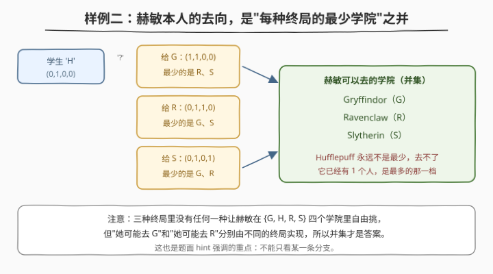
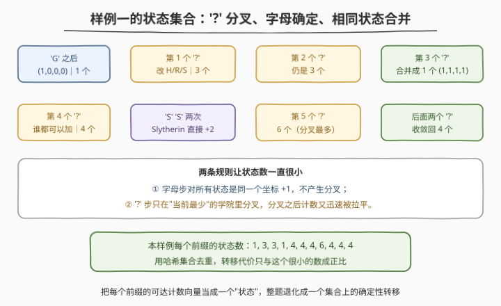
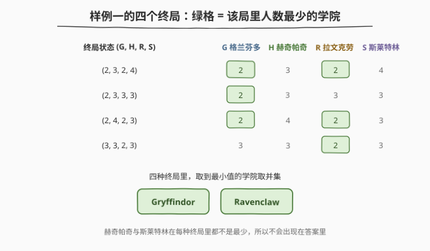

# Codeforces 65D 分院帽与赫敏去向 题解

## 1. 题目概述

- **题目链接**：https://codeforces.com/problemset/problem/65/D
- **比赛来源**：Codeforces Beta Round 60 · Problem D（UTC 2011-03-05）
- **难度**：2200
- **标签**：暴力枚举、DFS 与搜索、哈希（状态集合）
- **评测类型**：普通
- **限制**：时间 2 s / 内存 256 MB

**题意**：霍格沃茨有四个学院：格兰芬多（Gryffindor）、赫奇帕奇（Hufflepuff）、拉文克劳（Ravenclaw）、斯莱特林（Slytherin）。新生按名单顺序一个一个戴分院帽。第 $i$ 个新生的家庭背景用一个字符表示：

- `G` / `H` / `R` / `S`：家里人都读同一个学院，帽子**强制**把他分到该学院；
- `?`：家里没人读过（或有争议），帽子把他分到**当前人数最少**的学院；若最少的学院不止一个，则他可以**任选**其中一个。

赫敏排在名单最后（也就是第 $n+1$ 个），她也是 `?`。问：她**可能**被分到哪些学院？按学院名字的**字母序**每行输出一个。

**约束**：

- $n \le 10^4$：`?` 的个数可以接近 $10^4$，每个 `?` 最多有 4 种选择，穷举所有选择序列是 $4^{n}$，完全不可行。
- 只要四个学院的**人数**，不需要知道具体是谁：状态是一个四元组 $(c_G,c_H,c_R,c_S)$，且 $\sum c = $ 已处理的学生数。人数上限 $10^4$，`int` 足够。
- 4 个学院是常数：状态空间是「四元组」，可以整体维护「当前所有可能的计数向量」这个集合。真正的复杂度取决于**每个前缀的可达状态数**，而这个数小得出奇（见 3.2 与第 5 节）。

## 2. 示例与观察

官方样例共 2 组（输入 / 输出原样）：

```text
输入：
11
G????SS???H

输出：
Gryffindor
Ravenclaw
```

```text
输入：
2
H?

输出：
Gryffindor
Ravenclaw
Slytherin
```

**样例一逐步演算**（把「所有可能的计数向量」写成集合，顺序为 G、H、R、S）：

| 步 | 字符 | 操作 | 可达状态 |
|----|------|------|----------|
| 0 | — | 初始 | $\{(0,0,0,0)\}$ |
| 1 | `G` | 强制 G | $\{(1,0,0,0)\}$ |
| 2 | `?` | 只能去 H/R/S | $\{(1,1,0,0),(1,0,1,0),(1,0,0,1)\}$ |
| 3 | `?` | 再去剩下两个 0 之一 | $\{(1,1,1,0),(1,1,0,1),(1,0,1,1)\}$ |
| 4 | `?` | 只剩唯一的最小值 | $\{(1,1,1,1)\}$ |
| 5 | `?` | 四个都是最小，任选 | 四个只有一个坐标是 2 的状态 |
| 6–7 | `SS` | 强制 S，两个都 +1 | 4 个状态，S 分别变成 3、4 |
| 8–10 | `???` | 只在最小处加 | 状态数 6 → 4 → 4 |
| 11 | `H` | 强制 H | $\{(2,3,2,4),(2,3,3,3),(2,4,2,3),(3,3,2,3)\}$ |

四种终局里取到最小值（$2$）的学院分别是 G、G、G/R、R，并集是 $\{\text{G},\text{R}\}$，与样例输出一致。注意 H 在每种终局里都不是最少的，所以赫奇帕奇不在答案里。

**样例二**：只有 `H?`。第一步强制 H，状态 $(0,1,0,0)$；第二步这个 `?` 可以在 G、R、S 里任选一个（三者都是 $0$，并列最少），得到 $(1,1,0,0)$、$(0,1,1,0)$、$(0,1,0,1)$。赫敏是第三个学生：在前两种终局里她还能在剩下的两个 $0$ 里挑，在第三种终局里她能在 G、R 里挑。并集是 $\{\text{G},\text{R},\text{S}\}$，正如样例。



**观察 1**：具体是哪个学生去了哪个学院并不重要，**只有四个学院的人数**影响后续（"最少"只跟计数有关）。

**观察 2**：同一条输入可能有多条「选择序列」，但它们经常会**汇合到同一个计数向量**。例如样例一里第 4 步之后只剩一个状态，第 5 步又分叉出 4 个。所以正确的做法不是枚举选择序列，而是**枚举计数向量**（去重）。

## 3. 解题思路

### 3.1 朴素做法与瓶颈

按学生顺序 DFS，枚举每个 `?` 的每一种可能选择，最后把「赫敏能去的学院」并起来。选择序列的数量是 $4^{q}$（$q$ 是 `?` 的个数），$q = 10^4$ 时是 $4^{10000}$，完全不可行。

瓶颈在于：大量不同的选择序列会到达**同一个**计数向量，重复计算。解决办法是把「计数向量」当作状态，用哈希集合去重。

### 3.2 核心观察：状态数一直是常数级



维护集合 $S_i$ = 处理完前 $i$ 个学生后**所有可能的计数向量**。转移很直接：

- 遇到字母 `x`：$S_{i+1} = \{\, c + e_x : c \in S_i \,\}$，**不再分叉**（所有状态同步加一）；
- 遇到 `?`：$S_{i+1} = \{\, c + e_k : c \in S_i,\ k \in \arg\min(c) \,\}$，只在「当前人数最少」的坐标上分叉。

关键在于：**$|S_i|$ 一直很小**。直观原因是两条规则互相拉扯：

- 字母步不产生分叉，只是整体平移；
- `?` 步只在最小处加一，把状态「往上拉平」，所以分叉出来的状态很快又汇合。

实测（见第 8 节）：对长度 $\le 8$ 的**所有** $5^8$ 个串做全枚举，单个前缀的最大状态数是 $7$；对长度上万的长串做随机与爬山搜索，最大状态数是 $11$；作为对照，内层逻辑用「完全枚举选择序列」的暴力程序在 $n \le 11$ 的数据上验证了答案一致。此外，同一时刻的任意两个可达状态，在每个坐标上最多相差 $2$，这解释了为什么状态数不会随 $n$ 增长。

### 3.3 算法流程

1. 令集合 `cur = {(0,0,0,0)}`。
2. 依次处理字符串的每个字符：
   - 字母 `x`：把 `cur` 中每个状态的第 $x$ 个坐标 +1；
   - `?`：对 `cur` 中每个状态，找出它的最小值坐标集合，对其中每个坐标生成一个新状态（坐标 +1）。
   - 把新集合**去重**（4 个坐标都是小整数，可以排序后 `unique`，也可以丢进 `set`/哈希表）。
3. 处理完后，对每个状态找出它的最小坐标集合，把对应学院标记为「可能」。
4. 按字母序输出被标记的学院。



### 3.4 样例走查

以样例一为例，把 3.3 的流程走一遍（数字见 2 节的表格）：

- 第 1 步 `G`：唯一状态 $(1,0,0,0)$，不分叉；
- 第 2 步 `?`：最小值是 $0$（H、R、S 三个坐标），分叉出 3 个状态；
- 第 3 步 `?`：每个状态里还有两个 $0$，分叉后仍是 3 个（去重后）；
- 第 4 步 `?`：每个状态只剩**一个** $0$，三条分支都汇合到 $(1,1,1,1)$ —— 这一步是「状态数为什么不爆炸」的最好例证；
- 第 5 步 `?`：四个坐标并列最小，分叉出 4 个状态；
- 第 6、7 步 `SS`：S 的坐标强制 +2，不产生新状态；
- 第 8–10 步 `???`：在最小处加一，状态数 6 → 4 → 4；
- 第 11 步 `H`：强制 H +1。

最后 4 个终局里，最小值出现在 G 或 R 上，于是答案是 Gryffindor、Ravenclaw。

## 4. 正确性证明

记 $\text{st}(i)$ 为「按规则处理完前 $i$ 个学生后，所有可能的计数向量」组成的集合。

**引理 1（集合转移的正确性）**：对每个 $i$，算法维护的集合恰好等于 $\text{st}(i)$。

**证明**：对 $i$ 归纳。$i=0$ 时只有一个状态 $(0,0,0,0)$，正确。设处理完前 $i$ 个学生后集合为 $\text{st}(i)$。若第 $i+1$ 个学生是字母 `x`，无论前面怎么选，帽子都强制把他分到 $x$，所以 $\text{st}(i+1) = \{c + e_x : c \in \text{st}(i)\}$，算法正是这样做的。若第 $i+1$ 个学生是 `?`，他可以**且只能**去当前人数最少的学院，即坐标属于 $\arg\min(c)$，所以 $\text{st}(i+1) = \{c + e_k : c \in \text{st}(i),\ k \in \arg\min(c)\}$，与算法一致。去重不改变集合。∎

**引理 2（赫敏的可达性判据）**：赫敏能被分到学院 $h$，当且仅当存在 $c \in \text{st}(n)$ 使得 $c_h = \min(c)$。

**证明**：赫敏是 `?`，她同样只能去「当前人数最少」的学院。若存在终局 $c$ 使 $c_h$ 最小，则让前面的学生按得到 $c$ 的那条选择序列走，赫敏选 $h$ 即可，合法。反之，若赫敏去了 $h$，则她做出选择那一刻的计数向量（等于某个 $c \in \text{st}(n)$）必须满足 $c_h$ 最小。∎

**定理**：算法输出的学院集合恰好是赫敏所有可能的去向。

**证明**：由引理 1，算法结束时的集合就是 $\text{st}(n)$；算法对每个状态标记其最小坐标对应的学院，由引理 2，标记的学院恰好是赫敏可能去的学院。输出按字母序排列，符合题面要求。∎

## 5. 复杂度分析

- **时间**：$O(n \cdot S)$，其中 $S = \max_i |\text{st}(i)|$ 是单个前缀的最大可达状态数。每次转移对每个状态做常数次（至多 4 个）坐标加法，再排序去重（$S \le 12$ 时排序代价可忽略）。由于 $S$ 是与 $n$ 无关的小常数（实测最大 $11$，且同一时刻任意两个状态逐坐标相差不超过 $2$，说明 $S$ 有与 $n$ 无关的上界），总时间是 $O(n)$，$n = 10^4$ 时只有 $10^5$ 量级的加法。
- **空间**：$O(S)$，只需存当前层的集合；$S \le 12$ 时是几十个整数。
- **数值范围**：坐标最大 $10^4$，用 `int` 即可，不存在溢出。
- **与时限的关系**：实测 $n = 10^4$ 的最坏数据（全 `?` 与随机串）C++ 端到端约 $4$ ms、Python 约 $50$ ms（均含进程启动），相对 2 s 时限余量在百倍以上。

## 6. 参考代码

### C++17

```cpp
#include <bits/stdc++.h>
using namespace std;

int main() {
    ios::sync_with_stdio(false);
    cin.tie(nullptr);

    int n;
    string s;
    if (!(cin >> n)) return 0;
    cin >> s;

    vector<array<int, 4>> cur, nxt;
    cur.push_back({0, 0, 0, 0});                 // Gryffindor, Hufflepuff, Ravenclaw, Slytherin
    for (char ch : s) {
        nxt.clear();
        if (ch == '?') {
            for (auto c : cur) {
                int mn = min(min(c[0], c[1]), min(c[2], c[3]));
                for (int i = 0; i < 4; ++i) {
                    if (c[i] == mn) {                 // 只在最少的学院里挑
                        auto d = c;
                        ++d[i];
                        nxt.push_back(d);
                    }
                }
            }
        } else {
            int idx = (ch == 'G') ? 0 : (ch == 'H') ? 1 : (ch == 'R') ? 2 : 3;
            for (auto c : cur) {
                auto d = c;
                ++d[idx];
                nxt.push_back(d);
            }
        }
        sort(nxt.begin(), nxt.end());
        nxt.erase(unique(nxt.begin(), nxt.end()), nxt.end());
        cur.swap(nxt);
    }

    bool ok[4] = {false, false, false, false};
    for (auto c : cur) {
        int mn = min(min(c[0], c[1]), min(c[2], c[3]));
        for (int i = 0; i < 4; ++i)
            if (c[i] == mn) ok[i] = true;
    }
    const char* name[4] = {"Gryffindor", "Hufflepuff", "Ravenclaw", "Slytherin"};
    for (int i = 0; i < 4; ++i)
        if (ok[i]) cout << name[i] << '\n';
    return 0;
}
```

### Python3

```python
import sys

NAMES = ["Gryffindor", "Hufflepuff", "Ravenclaw", "Slytherin"]
IDX = {'G': 0, 'H': 1, 'R': 2, 'S': 3}


def main() -> None:
    data = sys.stdin.buffer.read().split()
    if not data:
        return
    n = int(data[0])
    s = data[1].decode() if len(data) > 1 else ""

    cur = {(0, 0, 0, 0)}
    for ch in s[:n]:
        nxt = set()
        if ch == '?':
            for c in cur:
                mn = min(c)
                for i in range(4):
                    if c[i] == mn:
                        d = list(c)
                        d[i] += 1
                        nxt.add(tuple(d))
        else:
            i = IDX[ch]
            for c in cur:
                d = list(c)
                d[i] += 1
                nxt.add(tuple(d))
        cur = nxt

    ok = [False] * 4
    for c in cur:
        mn = min(c)
        for i in range(4):
            if c[i] == mn:
                ok[i] = True
    sys.stdout.write("".join(NAMES[i] + "\n" for i in range(4) if ok[i]))


main()
```

## 7. 边界情况与易错点

1. **必须每步去重**：如果不去重、直接把所有分支塞进列表，状态数会按 $4^q$ 爆炸，内存和时间都撑不住。去重是本题的关键，也是标签里「hashing」的来由。
2. **`?` 只在「当前最少」的坐标上分叉**：写成「四个学院都试一遍」会得到大量非法状态，答案会偏大。例如样例二若让第二个学生随便去，Hufflepuff 也会被错误地算进答案。
3. **字母序输出**：四个学院按名字排序是 Gryffindor、Hufflepuff、Ravenclaw、Slytherin，正好与字母 G、H、R、S 的顺序一致。按状态里坐标的顺序输出即可，但别把 Ravenclaw 和 Hufflepuff 的顺序搞反。
4. **收到过字母的学院仍可能进答案**：例如 `H???` 的答案是四个学院全有——Hufflepuff 虽然一开始就被强制进了一个人，但后面三个 `?` 会把其他学院拉平甚至超过。不能因为「某学院已经有人」就排除它。
5. **只有 `?` 的输入**：全 `?` 时人数尽量平均，$n = 4q+r$ 的终局是 $r$ 个学院各 $q+1$ 人、其余各 $q$ 人。因为所有排列都可达，每个学院都可能在某个终局里是最少的，所以答案恒为四个学院全有（$n = 1,2,3,4$ 都验证过）。不要凭「$r$ 个学院多一人」就排除它们。
6. **输入格式**：第一行 $n$，第二行一个长度为 $n$ 的字符串，字符之间**没有空格**。用 `cin >> s` 或 `split()` 取整个 token；若按字符 `cin >> ch` 读也可以，但要记得跳过 `n` 之后的换行（用 `>>` 会自动跳过）。
7. **答案可能只输出一行**：例如 `SSS?` 的答案是 Gryffindor、Hufflepuff、Ravenclaw 三行；每一行后面都要换行，最后一行也要有换行（`cout << ... << '\n'`）。
8. **`n = 1` 且字符为 `?`**：赫敏是第二个学生，答案是四个学院全有（第一个学生随便去一个，赫敏从剩下三个 0 里挑）。此时终局集合是 4 个状态，每个状态的最小值都在三个坐标上，并集是全部四个。
9. **坐标顺序别写乱**：本文统一按 (G, H, R, S)，映射 `'G'→0, 'H'→1, 'R'→2, 'S'→3`。若把 `R` 和 `H` 的顺序搞反，样例一（含 SS）会立刻出错。

## 8. 验证记录

- **编译环境与命令**：本机无 GNU `g++`，用 `clang++ -std=c++17 -O2` 搭配仓库内 `bits/stdc++.h` 兼容头；Python 为 `Python 3.9.6`。
- **官方样例**：2 / 2 通过（`python3 codeforces/tools/verify_solution.py codeforces/contests/0001-0100/65/D_分院帽与赫敏去向.md`），C++ 与 Python 输出一致。
- **独立暴力对拍**：另写**完全不去重**的 DFS（枚举每一条选择序列，收集全部终局）作为独立实现，在 $n \le 11$、`?` 个数 $\le 7$ 的范围内随机 **330 组**（外加 `?`、`??`、`GHRS?`、`HHHHHH?`、`?SSSSSSS` 等构造数据）逐组比较「赫敏可去学院集合」与完整终局集合，**全部一致**，C++ 与 Python 两版也逐字节一致。
- **状态数上界的实测**：对长度 $\le 8$ 的**全部** $5^8 = 390625$ 个串做全枚举，单个前缀的最大可达状态数为 $7$、任意两个可达状态的逐坐标差最大为 $2$；对长度 $20 \sim 120$ 的串做 80 轮爬山搜索（每轮 250 次变异），最大状态数为 $11$、逐坐标差仍为 $2$。这支撑了第 5 节「状态数是与 $n$ 无关的小常数」的结论。
- **最大约束性能**：$n = 10^4$ 的全 `?` 与随机串，C++ 端到端约 $4$ ms、Python 约 $50$ ms（含进程启动）；内存 $< 2$ MB，相对 2 s / 256 MB 余量极大。
- **图片校验**：三张 SVG 均通过 `xml.etree.ElementTree.parse`，含 `feTurbulence` 抖动滤镜与手写字体，文字块逐个核对未越出 `viewBox`。
- **复核状态**：verified。

## 相关题目与扩展

- [Codeforces 65A Harry Potter and the Three Spells](https://codeforces.com/problemset/problem/65/A)：同场 A 题，数学判定。
- [Codeforces 65B Harry Potter and the History of Magic](https://codeforces.com/problemset/problem/65/B)：同场 B 题，贪心 + 枚举。
- [Codeforces 65C Harry Potter and the Golden Snitch](https://codeforces.com/problemset/problem/65/C)：同场 C 题，几何 + 数值。
- [Codeforces 1627E Not Escaping](https://codeforces.com/problemset/problem/1627/E)：同样是「在很小的状态集合上做转移」的思路。
- [LeetCode 1155. 掷骰子等于目标和的方法数](https://leetcode.cn/problems/number-of-dice-rolls-with-target-sum/)：把「计数向量」当状态的 DP，与本题的集合转移形式相通。

**延伸思考**：

1. **如果学院数是 $k$ 而不是 4**：状态数会随 $k$ 增长（每个 `?` 最多分叉 $k$ 支），但「最小处加一」的拉平效应依然存在，状态数大致是 $\binom{k}{\cdot}$ 量级；$k$ 很大时这个方法会失效，需要换思路。
2. **如果要统计赫敏去每个学院的方案数**：把状态集合换成「状态 → 方案数」的哈希表即可，转移时累加计数；复杂度不变，但要注意方案数会超过 64 位，需要取模或高精度。
3. **如果 `?` 的学生也可以选择「不服从帽子」**：那就退化成完全没有约束，答案是全部四个学院——这说明本题的难度完全来自「只能去最少处」这条规则。
4. **为什么状态数不会随 $n$ 增长**：可以把「计数向量」减去最小值做归一化，归一化后的向量只由最近的若干次分叉决定；字母步是平移、`?` 步是「往最低处灌水」，两者都不会拉大状态之间的差距。实测的「逐坐标差 $\le 2$」正是这一现象的量化：状态们挤在一条很窄的带子里，所以不同的计数向量只有常数多个。
