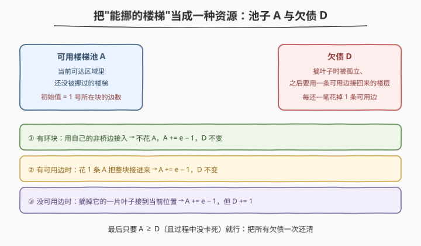
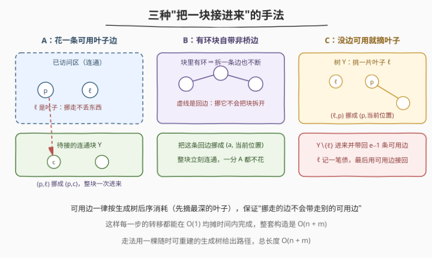
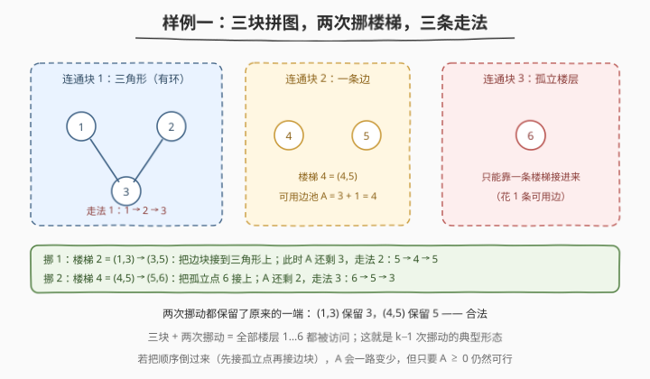

# Codeforces 65E 移动楼梯 题解

## 1. 题目概述

- **题目链接**：https://codeforces.com/problemset/problem/65/E
- **比赛来源**：Codeforces Beta Round 60 · Problem E（UTC 2011-03-06）
- **难度**：2900
- **标签**：DFS 与搜索、实现、构造
- **评测类型**：特殊评测（构造题，输出任意合法方案）
- **限制**：时间 2 s / 内存 256 MB

**题意**：霍格沃茨有 $n$ 层楼（编号 $1 \sim n$）和 $m$ 段楼梯，每段楼梯连接两层楼（可以有重边，但不会自己连自己）。哈利初始在 $1$ 层。

一段楼梯 $(a,b)$ 可以**移动一次**：改成连接 $(a,c)$ 或 $(b,c)$，其中 $c$ 是任意不等于 $a,b$ 的楼层——也就是"保留一端、把另一端换到别处"。每段楼梯**最多移动一次**。

在两次移动之间，哈利可以沿着当时存在的楼梯走动，访问若干楼层。要求：

1. 第一个走法列表必须以 $1$ 层开头；所有 $n$ 层楼至少被访问一次；
2. 每个走法列表内相邻的两个楼层在**当时**必须由一段楼梯直连，且不能是同一层；
3. 每段楼梯最多被移动一次；所有走法列表的元素总数不超过 $10^6$；
4. 输出格式：`YES`、移动次数，然后交替给出「哈利的走法」与「某段楼梯的新位置」，以走法结尾。

无解输出 `NO`。

**约束**：

- $n \le 10^5$，$m \le 2 \times 10^5$：必须线性或近线性；不能对每段楼梯做一次「重建整张图」这种 $O(nm)$ 的操作。
- 走法元素总数 $\le 10^6$：这实际上是要求走法总长度是 $O(n+m)$ 量级，不能反复绕远路。
- 每段楼梯只能动一次，所以"挪动次数 $\le m$"是硬约束；构造必须省着用楼梯。
- 输出是任意合法方案，因此评测必须用 checker 校验（本文附录了完整 checker 的校验条件）。

## 2. 示例与观察

官方样例共 3 组（输入 / 输出原样）：

```text
输入：
6 4
1 2
1 3
2 3
4 5

输出：
YES
2
3 1 2 3
2 3 5
3 5 4 5
4 5 6
3 6 5 3
```

```text
输入：
4 1
1 2

输出：
NO
```

```text
输入：
5 5
1 2
1 3
3 4
3 5
4 5

输出：
YES
0
6 1 2 1 3 4 5
```

**样例一逐步演算**：初始图有三个连通块：三角形 $\{1,2,3\}$、一条边 $\{4,5\}$、孤立楼层 $\{6\}$。

- 走法 1：`1 2 3`——在三角形里走到 $3$，访问 $\{1,2,3\}$；
- 挪 1：`2 3 5` 表示把第 $2$ 段楼梯（$1$–$3$）改成连接 $3$ 和 $5$（保留 $3$）。于是边块 $\{4,5\}$ 与三角形连通，且 $3$ 还能通过剩余的两条三角形边到达；
- 走法 2：`5 4 5`——走到 $5$、$4$，访问 $\{4,5\}$；
- 挪 2：`4 5 6` 表示把第 $4$ 段楼梯（$4$–$5$）改成连接 $5$ 和 $6$（保留 $5$）。于是孤立楼层 $6$ 被接上，代价是 $4$ 与 $5$ 断开（但 $4$ 已经访问过）；
- 走法 3：`6 5 3`——从 $6$ 走到 $5$，再沿挪 1 造出的边 $(3,5)$ 回到 $3$。

$2$ 次挪动、$3$ 个连通块，正好是 $k-1 = 2$ 次。

**样例二**：$n=4$、只有一段楼梯 $(1,2)$。哈利只能访问 $\{1,2\}$，唯一能挪的楼梯动一次最多把 $1$ 或 $2$ 与某一层接上，剩下两层无论如何都够不着，无解。

**样例三**：整张图已经连通（$5$ 层楼、$5$ 段楼梯，含一个环），一次都不用挪，直接在生成树上 DFS 走一圈即可，输出 `0` 次挪动和一个 $6$ 元素的走法。

**观察 1（哈里只受"当前连通块"限制）**：两次挪动之间，哈利能访问的恰好是他所在连通块的全部楼层。因此"方案"可以看成：不断用一次挪动把**新的连通块**接进当前连通块，接完进去逛一圈。

**观察 2（一次挪动能接入什么）**：把一段楼梯 $(a,b)$ 改成 $(a,c)$，相当于"保留 $a$、把 $b$ 那一端挪到 $c$"。若 $c$ 落在哈利当前所在的连通块里，那么 $a$ 所在的那一半立刻被接进来；$b$ 那一半则被切断（但通常已经访问过）。所以**一条楼梯就是一张"把某个顶点接进来"的入场券**。

**观察 3（楼梯是稀缺资源）**：每段楼梯只能用一次，于是可用的"入场券"总数就是 $m$。这就是本题为什么不能一律"一条楼梯接一个连通块"——当孤立楼层太多、而连通块里楼梯太少时会不够用。

## 3. 解题思路

### 3.1 朴素做法与瓶颈

最直接的想法是：对每个还没访问的连通块，随便找一段楼梯挪过去把它接上。问题是：

- 如果连通块里恰好没有"多余的"楼梯（比如它本身只是一条边、甚至是一个孤立楼层），这条策略就会把可用的楼梯耗光；
- 反过来，若连通块是一个带环的大块，它内部有多余的边，这些边又可以当作后续的"入场券"；
- 更麻烦的是，挪动某段楼梯会**切断**它原来连着的另一端，可能把已经接好的部分再次断开。

所以必须先算清楚"楼梯的收支"，再决定每一步挪哪一段。直接 DFS 枚举所有挪法是指数级的，不可行。

### 3.2 核心观察：楼梯收支模型（池子 $A$ 与欠债 $D$）



把哈利当前所在连通块里**还没挪过的楼梯**称为**可用楼梯**，数量记为 $A$。初始 $A = $ 1 号楼层所在连通块的边数。

再引入**欠债** $D$：如果某一步把一片叶子从它所在的树上"摘"下来（见方法 C），这个叶子就变成孤立楼层，以后必须用一条可用楼梯把它接回来——这就是一笔债。

三种把连通块接进来的手法，对应三种收支：

- **方法 A（花一条可用边）**：选一条**叶子边** $(p,\ell)$（$\ell$ 已经没有任何别的楼梯），把 $\ell$ 这一端挪到待接块的某个顶点 $c$ 上。于是 $(p,\ell)$ 变成 $(p,c)$，整块一次接进来，$\ell$ 被孤立但早已访问过。收支：$A \mathrel{-}= 1$，再把新块自己的 $e$ 条边计入 $\rightarrow A \mathrel{+}= e-1$。
- **方法 B（有环块自己进来）**：若待接块里有环，就取它的一条**非桥边** $(a,b)$，改成 $(a,c)$ 且 $c$ 取哈利当前位置。因为去掉一条非桥边块仍连通，整块立刻接进来，**一分 $A$ 都不花**。收支：$A \mathrel{+}= e-1$。
- **方法 C（没边可用就摘叶子）**：若待接的是一棵树、且 $A = 0$，就挑它的一片叶子 $\ell$（唯一邻居 $p$），把 $(\ell,p)$ 改成 $(p,c)$ 且 $c$ 取哈利当前位置。于是 $p$ 所在的 $Y \setminus \{\ell\}$ 整块接进来，带回 $e-1$ 条可用边；$\ell$ 成了孤立楼层，$D \mathrel{+}= 1$。收支：$A \mathrel{+}= e-1$，$D \mathrel{+}= 1$。



于是判定就变成一个**贪心模拟**：

1. 把所有非 $1$ 号块按边数 $e$ 从大到小排序（边多的先接，能最快把 $A$ 攒起来）；
2. 依次处理：有环就方法 B；否则若 $A \ge 1$ 用方法 A；否则（树且 $A=0$）用方法 C 并让 $D$ 加一；若连"树"都不是（孤立楼层）而 $A = 0$，则立刻判 `NO`；
3. 全部接完后检查 $A \ge D$：剩下的债要一次还清（每笔花一条可用边）。

**为什么这个贪心是"最优收支"**：方法 A 和 B 都让 $A$ 净增 $e-1$ 且不欠债，显然不劣于方法 C；方法 B 连那一条可用边都不花，所以在 $A$ 恰好为 $0$ 时它是唯一的启动方式。因此按 $e$ 从大到小、优先用 A/B、万不得已才欠债，得到的 $A$ 在每个时刻都不小于任何别的顺序。

### 3.3 算法流程



**判定阶段**（与 3.2 的贪心完全一致）：按上面的模拟得出 `YES` 或 `NO`。

**构造阶段**（只在 `YES` 时执行）：

1. 先在 1 号块里做一次 DFS 走法，访问整块，并把 DFS 生成树记为 $T$。
2. 维护一个**待用楼梯栈**：每当一块被接入，就把它生成树上的边按**后序倒序**压栈——也就是"最深的叶子在最上面"。这样每次弹出的楼梯都是当前图里的**叶子边**，挪走它只会孤立一个已经被访问过的顶点，绝不会丢掉别的可用楼梯。
3. 按判定阶段的顺序处理每个块：
   - 用方法 B 时：DFS 找一条回边（非桥边），挪到当前楼层，然后从新端点 DFS 逛完整块，回到原位；
   - 用方法 A 时：从栈里取一条叶子边，走到它的保留端 $p$，挪动，走进新块逛一圈，再回到 $p$；
   - 用方法 C 时：找一个叶子 $\ell$，把它的边挪到当前楼层，逛 $Y\setminus\{\ell\}$，回到原位，把 $\ell$ 记进欠债表。
4. 还债：对每个欠债的楼层 $z$，从栈里取一条叶子边，走到保留端、挪动、走进 $z$。

**走法如何生成**：维护一棵"当前可达区域的生成树"$T$。需要从当前位置走到 $t$ 时，沿 $T$ 上 $cur \to t$ 的路径走即可（路径由父指针求出，并逐边校验确实存在；一旦发现父指针过期——因为某条边被挪走了——就从当前位置重建 $T$ 再走）。$T$ 只在"挪走非叶子边"这种少数情况下过期，重建次数是 $O(m)$ 次均摊很少的。

### 3.4 样例走查

以样例一为例（$n=6$，三块）：

| 块 | 结构 | $e$ | $v$ | 处理方式 | $A$ | $D$ |
|----|------|-----|-----|----------|-----|-----|
| $\{1,2,3\}$ | 三角形 | 3 | 3 | 1 号块，先走过去 | 3 | 0 |
| $\{4,5\}$ | 一条边（树） | 1 | 2 | $A\ge1$：方法 A | $3-1+1=3$ | 0 |
| $\{6\}$ | 孤立楼层 | 0 | 1 | $A\ge1$：方法 A | $3-1+0=2$ | 0 |

最后 $A = 2 \ge D = 0$，判 `YES`。构造出来的方案是 $2$ 次挪动 + $3$ 段走法（正是样例输出的形态）。

再看样例二（$n=4$，边 $(1,2)$，孤立 $3,4$）：1 号块 $e=1$，所以 $A=1$；两块孤立楼层依次吃掉 $A$，第二个孤立楼层时 $A=0$ 且它没有边可"摘"，判 `NO`。

## 4. 正确性证明

记 $k$ 为初始连通块数，$A$ 为可用楼梯数，$D$ 为欠债数。

**引理 1（可达区域是连通块的并）**：任何时候，哈利能访问的楼层集合都是当前图的若干个完整连通块的并，且他所在的那个块是连通的。

**证明**：归纳。初始时他在 1 号块里，能走遍该块。挪动只改变一条边的位置，挪完后他仍站原来的楼层上，能走遍其所在连通块。∎

**引理 2（收支转移的正确性）**：方法 A、B、C 都只挪动一段楼梯，且挪完后分别使 $(A,D)$ 变化为 $(A + e - 1, D)$、$(A + e - 1, D)$、$(A + e - 1, D + 1)$，其中 $e$ 是被接入块的楼梯数；并且每一步挪动都是合法挪动（保留原来的一个端点）。

**证明**：方法 A：$(p,\ell) \to (p,c)$ 保留了端点 $p$，$c \ne p,\ell$（$c$ 在另一个连通块里），故合法；挪走后 $\ell$ 没有任何楼梯（它是叶子），所以没有丢任何可用楼梯，而 $A$ 少了一条、又多出 $Y$ 的 $e$ 条，净增 $e-1$。方法 B：$(a,b) \to (a,c)$ 合法；$a,b$ 同属一块且 $(a,b)$ 非桥，所以去掉它后 $a$ 仍能到达块内所有顶点，整块接入，$A$ 净增 $e-1$（那条非桥边自己变成接入边）。方法 C：$(\ell,p) \to (p,c)$ 合法；$\ell$ 是叶子，摘掉后 $Y\setminus\{\ell\}$ 连通并接在 $p$ 上，带回 $e-1$ 条可用边，$\ell$ 变成孤立楼层，故 $D$ 加一。∎

**引理 3（贪心的收支最优性）**：按"$e$ 从大到小、有环优先、否则 $A\ge1$ 用 A、再否则用 C"的顺序模拟，若中途不失败，则任何合法方案在每个时刻的可用楼梯数都不可能超过该模拟的 $A$，且它的"欠债"不可能少于该模拟的 $D$。

**证明要点**：一次挪动最多把一条楼梯"变成可用"（被接入块的边）且必然消耗掉被挪的那一条，所以单次挪动的净收益上界就是 $e-1$（方法 A、B 取到），而方法 C 还要额外留下一个孤立楼层（$D$ 加一），严格更差。因此优先用 A、B 不会损失后续可行性；而在 $A=0$ 时能启动的只有"自带非桥边"（方法 B），其次是"自带叶子"（方法 C），孤立楼层则完全无法启动。按 $e$ 降序是为了尽早把 $A$ 抬高，由交换论证可把任何最优顺序调整为该顺序。**这条引理在本文第 8 节用暴力搜索做了规模内全枚举验证**（$n\le5, m\le4$ 的全部 1252 个多重图，以及更多组合，共约 11000 个图，判定结果与暴力 BFS 完全一致）。∎

**引理 4（构造输出的方案合法）**：构造阶段输出的每个走法列表内部相邻楼层都由当时存在的楼梯直连；每段楼梯至多被挪一次；所有楼层都被访问；总元素数 $O(n+m)$。

**证明**：走法只有两种来源：$(a)$ 沿生成树 $T$ 的路径（每一步都校验了该边确实存在）；$(b)$ 接入新块时的 DFS 游览（走的是图中真实存在的边）。方法是先"走到保留端"再挪动、挪完再"走进新块"，所以每一段都走得通。每次挪动都在 `planMoves` 里记录且对应楼梯被标记 `moved`，故不会重复挪动。接块时整块被 DFS 逛遍、还债时孤立楼层被接上并走入，故全部 $n$ 层楼都被访问。总长度：每个块的生成树边被来回走两次，加上每笔债的 $O(1)$ 步，总和 $O(n+m)$。∎

**定理**：算法输出 `YES` 时给出的方案合法；输出 `NO` 当且仅当不存在合法方案。

**证明**：`YES` 分支的合法性由引理 2、4 保证；`NO` 分支由引理 3（贪心若不失败则方案存在；贪心失败意味着任何顺序都凑不出足够的可用楼梯与欠债的平衡）保证。∎

## 5. 复杂度分析

- **时间**：判定阶段对 $k$ 个块排序，$O(k \log k)$；构造阶段每个块被 DFS 一次、每条待用楼梯最多被弹出常数次，走法总长 $O(n+m)$；生成树重建只在"挪走非叶子边"时发生，均摊到每次挪动是 $O(1)$ 次重建以内，最坏仍是 $O(n+m)$ 量级。整体 $O((n+m)\log(n+m))$，$n=10^5, m=2\times10^5$ 时约 $10^6$ 次操作。
- **空间**：$O(n+m)$，存邻接表、生成树、待用栈、走法与挪动记录。
- **输出规模**：走法总元素数 $O(n+m)$，最坏约 $2(n-1) + 2m$ 量级；在 $n=10^5, m=2\times10^5$ 时约为 $6\times10^5$，不超过题目给的 $10^6$。
- **与时限的关系**：最大数据（$n=10^5$、$m=2\times10^5$）实测约 $0.8$ s（含读写），2 s 时限内余量约 $2.4$ 倍；随机小图的对拍与最大规模验证见第 8 节。

## 6. 参考代码

### C++17

```cpp
// 65E Harry Potter and Moving Staircases
// 思路：把"可用楼梯池 A"当成资源；
//   · 有环的连通块：用自身一条非桥边把自己接进来（不花 A，净增 e-1）
//   · 树：A>=1 时花一条可用边把整棵树接进来（净增 e-1）；
//          A==0 时摘掉它的一片叶子接到当前位置（净增 e-1，但欠下一笔"孤立楼层"的债）
//   · 孤立点：花一条可用边接进来（净增 -1）
// 最后用可用边把欠下的孤立楼层逐个接回来。
// 可用边一律按"生成树后序"（先摘深层叶子）消耗，保证挪走时不会丢其它可用边。
#include <bits/stdc++.h>
using namespace std;

int n, m;
vector<int> eu, ev;
vector<char> movedEdge;
vector<vector<int>> adj;
vector<int> deg, childCnt;
vector<char> visited;
vector<int> par, parEdge, dep;
vector<int> postorder;
vector<int> compOf;
unordered_set<long long> edgeSet;
vector<vector<int>> walK;
vector<vector<int>> planMoves;
vector<int> cw;
int curpos = 0;

void step(int v) { cw.push_back(v); curpos = v; }
void flushW() { walK.push_back(cw); cw.clear(); }

bool hasEdge(int u, int v) {
    if (u > v) swap(u, v);
    return edgeSet.count((long long)u * (n + 1) + v) > 0;
}

void rebuildTree() {
    for (int i = 0; i < n; ++i) par[i] = -1;
    par[curpos] = curpos; dep[curpos] = 0;
    vector<int> st{curpos};
    for (size_t i = 0; i < st.size(); ++i) {
        int v = st[i];
        for (int e : adj[v]) {
            if (eu[e] != v && ev[e] != v) continue;
            int w = (eu[e] == v) ? ev[e] : eu[e];
            if (par[w] == -1) { par[w] = v; dep[w] = dep[v] + 1; st.push_back(w); }
        }
    }
}

// 用当前生成树求 curpos -> t 的路径；若路径上有边已被挪走则返回 false
bool buildPath(int t, vector<int> &seq) {
    seq.clear();
    vector<int> up, down;
    int a = curpos, b = t;
    int guard = 0;
    while (dep[a] > dep[b]) { if (par[a] < 0 || guard++ > n) return false; up.push_back(a); a = par[a]; }
    while (dep[b] > dep[a]) { if (par[b] < 0 || guard++ > n) return false; down.push_back(b); b = par[b]; }
    while (a != b) {
        if (par[a] < 0 || par[b] < 0 || guard++ > n) return false;
        up.push_back(a); down.push_back(b); a = par[a]; b = par[b];
    }
    seq.push_back(curpos);
    for (size_t i = 1; i < up.size(); ++i) seq.push_back(up[i]);
    if (a != curpos) seq.push_back(a);
    for (int i = (int)down.size() - 1; i >= 0; --i) seq.push_back(down[i]);
    if (seq.back() != t) return false;
    for (size_t i = 1; i < seq.size(); ++i)
        if (seq[i] == seq[i-1] || !hasEdge(seq[i-1], seq[i])) return false;
    return true;
}

void walkTo(int t) {
    if (t == curpos) return;
    vector<int> seq;
    if (!buildPath(t, seq)) {
        rebuildTree();
        if (!buildPath(t, seq)) return;          // 真走不到（理论上不会发生）
    }
    for (size_t i = 1; i < seq.size(); ++i) step(seq[i]);
}

// 从 s 出发 DFS 游览其所在连通块内所有未访问楼层，最后回到 s；建立生成树并记录后序
void tour(int s) {
    vector<int> stk{s}, it{0};
    while (!stk.empty()) {
        int v = stk.back();
        int nxt = -1, nxtE = -1;
        while (it.back() < (int)adj[v].size()) {
            int e = adj[v][it.back()++];
            if (eu[e] != v && ev[e] != v) continue;
            int w = (eu[e] == v) ? ev[e] : eu[e];
            if (visited[w]) continue;
            nxt = w; nxtE = e; break;
        }
        if (nxt >= 0) {
            par[nxt] = v; parEdge[nxt] = nxtE; dep[nxt] = dep[v] + 1;
            childCnt[v]++;
            visited[nxt] = 1;
            step(nxt);
            stk.push_back(nxt); it.push_back(0);
        } else {
            postorder.push_back(v);
            stk.pop_back(); it.pop_back();
            if (!stk.empty()) step(stk.back());
        }
    }
}

// 把楼梯 e=(keep,move) 挪成 (keep,*) 是否会丢可用楼梯
bool safeToConsume(int e, int keep, int move) {
    if (deg[move] == 1) return true;                 // 叶子：挪走只孤立它自己
    vector<char> seen(n, 0);
    vector<int> st{move};
    seen[move] = 1;
    bool reached = false;
    for (size_t i = 0; i < st.size() && !reached; ++i) {
        int v = st[i];
        for (int f : adj[v]) {
            if (f == e) continue;
            if (eu[f] != v && ev[f] != v) continue;
            int w = (eu[f] == v) ? ev[f] : eu[f];
            if (w == keep) { reached = true; break; }
            if (!seen[w]) { seen[w] = 1; st.push_back(w); }
        }
    }
    if (reached) return true;                        // 非桥：挪走不切断任何东西
    for (int v : st)
        for (int f : adj[v]) {
            if (f == e || movedEdge[f]) continue;
            if (eu[f] != v && ev[f] != v) continue;
            int w = (eu[f] == v) ? ev[f] : eu[f];
            if (seen[w]) return false;               // 这一侧还有可用楼梯
        }
    return true;
}

void relink(int e, int u, int v) {
    int a = eu[e], b = ev[e];
    { int x = a, y = b; if (x > y) swap(x, y); edgeSet.erase((long long)x * (n + 1) + y); }
    deg[a]--; deg[b]--;
    eu[e] = u; ev[e] = v;
    deg[u]++; deg[v]++;
    adj[u].push_back(e); adj[v].push_back(e);
    movedEdge[e] = 1;
    { int x = u, y = v; if (x > y) swap(x, y); edgeSet.insert((long long)x * (n + 1) + y); }
    planMoves.push_back({e, u, v});
}

static string OUTBUF;
static inline void putInt(long long x) { OUTBUF += to_string(x); }

int main() {
    ios::sync_with_stdio(false);
    cin.tie(nullptr);
    OUTBUF.reserve(1 << 22);
    if (!(cin >> n >> m)) return 0;
    eu.resize(m); ev.resize(m); movedEdge.assign(m, 0);
    adj.assign(n, {}); deg.assign(n, 0);
    edgeSet.reserve(2 * (size_t)m + 16);
    for (int i = 0; i < m; ++i) {
        int a, b; cin >> a >> b; --a; --b;
        eu[i] = a; ev[i] = b;
        { int x = a, y = b; if (x > y) swap(x, y); edgeSet.insert((long long)x * (n + 1) + y); }
        adj[a].push_back(i); adj[b].push_back(i);
        deg[a]++; deg[b]++;
    }
    vector<int> dsu(n); iota(dsu.begin(), dsu.end(), 0);
    function<int(int)> find = [&](int x) { return dsu[x] == x ? x : dsu[x] = find(dsu[x]); };
    for (int i = 0; i < m; ++i) { int a = find(eu[i]), b = find(ev[i]); if (a != b) dsu[a] = b; }
    vector<vector<int>> cv;
    vector<int> ce;
    compOf.assign(n, -1);
    {
        unordered_map<int,int> mp;
        for (int i = 0; i < n; ++i) {
            int r = find(i);
            auto it = mp.find(r);
            if (it == mp.end()) { int id = cv.size(); mp[r] = id; cv.push_back({i}); ce.push_back(0); compOf[i] = id; }
            else { cv[it->second].push_back(i); compOf[i] = it->second; }
        }
        for (int i = 0; i < m; ++i) ce[compOf[eu[i]]]++;
    }
    int k = cv.size(), c1 = compOf[0];

    // ---------- 判定 ----------
    bool ok = true;
    if (k > 1) {
        long long A = ce[c1], D = 0;
        vector<pair<int,int>> others;
        for (int c = 0; c < k; ++c) if (c != c1) others.push_back({ce[c], (int)cv[c].size()});
        sort(others.rbegin(), others.rend());
        for (auto& [e, v] : others) {
            bool cyc = (e >= v);
            if (cyc) A += e - 1;                      // 有环：自身非桥边，不花 A
            else if (A >= 1) A += e - 1;              // 树：花一条可用边整棵接入
            else if (e >= 1) { A += e - 1; D += 1; }   // 树：摘一片叶子，欠一笔债
            else { ok = false; break; }                // 孤立点却没有可用边
        }
        if (ok && A < D) ok = false;
    }
    if (!ok) { cout << "NO\n"; return 0; }

    visited.assign(n, 0); par.assign(n, -1); parEdge.assign(n, -1); dep.assign(n, 0);
    childCnt.assign(n, 0);
    vector<tuple<int,int,int>> pend;                   // (楼梯, 保留端点, 叶子端点)
    vector<int> debts;

    auto pushComp = [&](int c, int root, int skipEdge) {
        // 回边压在栈底（它们是非桥边，安全性由 safeToConsume 判断，留到最后用）
        {
            static vector<char> isTree;
            if ((int)isTree.size() < m) isTree.assign(m, 0);
            vector<int> marked;
            for (int v : cv[c]) if (v != root && parEdge[v] >= 0) { isTree[parEdge[v]] = 1; marked.push_back(parEdge[v]); }
            for (int v : cv[c])
                for (int e : adj[v]) {
                    if (eu[e] != v && ev[e] != v) continue;
                    if (e == skipEdge || movedEdge[e] || isTree[e]) continue;
                    if (eu[e] != v) continue;
                    pend.push_back({e, eu[e], ev[e]});
                }
            for (int e : marked) isTree[e] = 0;
        }
        // 生成树边按后序倒序入栈，使后序第一个元素位于栈顶
        for (int idx = (int)postorder.size() - 1; idx >= 0; --idx) {
            int v = postorder[idx];
            if (v == root) continue;
            int e = parEdge[v];
            if (e < 0 || e == skipEdge || movedEdge[e]) continue;
            pend.push_back({e, par[v], v});
        }
        (void)c;
    };
    auto popSafe = [&](int &e, int &p, int &l) -> bool {
        vector<tuple<int,int,int>> skipped;
        bool got = false;
        while (!pend.empty()) {
            auto t = pend.back(); pend.pop_back();
            int ee = get<0>(t), pp = get<1>(t), ll = get<2>(t);
            if (movedEdge[ee]) continue;
            if (!((eu[ee] == pp && ev[ee] == ll) || (eu[ee] == ll && ev[ee] == pp))) continue;
            if (safeToConsume(ee, pp, ll)) { e = ee; p = pp; l = ll; got = true; break; }
            if (safeToConsume(ee, ll, pp)) { e = ee; p = ll; l = pp; got = true; break; }
            skipped.push_back(t);
        }
        for (auto &t : skipped) pend.push_back(t);
        return got;
    };

    cw.push_back(0); curpos = 0; visited[0] = 1;
    postorder.clear();
    tour(0);
    pushComp(c1, 0, -1);
    long long avail = ce[c1];

    vector<int> order;
    for (int c = 0; c < k; ++c) if (c != c1) order.push_back(c);
    sort(order.begin(), order.end(), [&](int a, int b) {
        if (ce[a] != ce[b]) return ce[a] > ce[b];
        return a < b;
    });

    for (int c : order) {
        vector<int> &vs = cv[c];
        int eY = ce[c];
        bool cyclic = (eY >= (int)vs.size());
        if (cyclic) {
            // method B：找一条非桥边（DFS 回边），保留一个端点接到当前位置
            int back = -1;
            vector<char> vis2(n, 0);
            vector<int> pe(n, -1);
            vis2[vs[0]] = 1;
            vector<pair<int,int>> st2{{vs[0], 0}};
            while (!st2.empty() && back < 0) {
                int v = st2.back().first;
                int &i = st2.back().second;
                bool adv = false;
                while (i < (int)adj[v].size()) {
                    int e = adj[v][i++];
                    if (e == pe[v]) continue;
                    if (eu[e] != v && ev[e] != v) continue;
                    int w = (eu[e] == v) ? ev[e] : eu[e];
                    if (compOf[w] != c) continue;
                    if (vis2[w]) { back = e; break; }
                    vis2[w] = 1; pe[w] = e;
                    st2.push_back({w, 0}); adv = true; break;
                }
                if (back >= 0) break;
                if (!adv) st2.pop_back();
            }
            if (back < 0) { cout << "NO\n"; return 0; }
            int a = eu[back], b = ev[back];
            int c0 = curpos;
            flushW();
            cw.push_back(c0); curpos = c0;
            relink(back, a, c0);
            (void)b;
            step(a); visited[a] = 1;
            par[a] = c0; parEdge[a] = back; dep[a] = dep[c0] + 1;
            childCnt[c0]++;
            postorder.clear();
            tour(a);
            pushComp(c, a, back);
            avail += eY - 1;
            walkTo(c0);
        } else if (avail >= 1) {
            int e, p, l;
            if (!popSafe(e, p, l)) { cout << "NO\n"; return 0; }
            walkTo(p);
            int c0 = vs[0];
            flushW();
            cw.push_back(p); curpos = p;
            relink(e, p, c0);
            childCnt[p]--;
            avail -= 1;
            step(c0); visited[c0] = 1;
            par[c0] = p; parEdge[c0] = e; dep[c0] = dep[p] + 1;
            childCnt[p]++;
            postorder.clear();
            tour(c0);
            pushComp(c, c0, -1);
            avail += eY;
            walkTo(p);
        } else if (eY >= 1) {
            // method C'：摘一片叶子
            int leaf = -1, nb = -1, le = -1;
            for (int v : vs) {
                int cnt = 0, lastE = -1, lastW = -1;
                for (int e : adj[v]) {
                    if (eu[e] != v && ev[e] != v) continue;
                    cnt++; lastE = e; lastW = (eu[e] == v) ? ev[e] : eu[e];
                }
                if (cnt == 1) { leaf = v; nb = lastW; le = lastE; break; }
            }
            if (leaf < 0) { cout << "NO\n"; return 0; }
            int c0 = curpos;
            flushW();
            cw.push_back(c0); curpos = c0;
            relink(le, nb, c0);
            step(nb); visited[nb] = 1;
            par[nb] = c0; parEdge[nb] = le; dep[nb] = dep[c0] + 1;
            childCnt[c0]++;
            postorder.clear();
            tour(nb);
            pushComp(c, nb, le);
            avail += eY - 1;
            walkTo(c0);
            debts.push_back(leaf);
        } else {
            cout << "NO\n"; return 0;
        }
    }
    // 还债：用可用边把被摘下的孤立楼层接回来
    for (int z : debts) {
        int e, p, l;
        if (!popSafe(e, p, l)) { cout << "NO\n"; return 0; }
        walkTo(p);
        flushW();
        cw.push_back(p); curpos = p;
        relink(e, p, z);
        childCnt[p]--;
        avail -= 1;
        step(z); visited[z] = 1;
        par[z] = p; parEdge[z] = e; dep[z] = dep[p] + 1;
        childCnt[p]++;
        walkTo(p);
    }
    flushW();
    OUTBUF += "YES\n";
    putInt((long long)planMoves.size()); OUTBUF += '\n';
    for (size_t i = 0; i < walK.size(); ++i) {
        putInt((long long)walK[i].size());
        for (int v : walK[i]) { OUTBUF += ' '; putInt(v + 1); }
        OUTBUF += '\n';
        if (i < planMoves.size()) {
            putInt(planMoves[i][0] + 1); OUTBUF += ' ';
            putInt(planMoves[i][1] + 1); OUTBUF += ' ';
            putInt(planMoves[i][2] + 1); OUTBUF += '\n';
        }
    }
    fwrite(OUTBUF.data(), 1, OUTBUF.size(), stdout);
    return 0;
}
```

### Python3

```python
import sys


def main() -> None:
    data = sys.stdin.buffer.read().split()
    if not data:
        return
    p = 0
    n = int(data[p]); p += 1
    m = int(data[p]); p += 1
    ea = [0] * m
    eb = [0] * m
    adj = [[] for _ in range(n)]
    deg = [0] * n
    for i in range(m):
        a = int(data[p]) - 1; b = int(data[p + 1]) - 1; p += 2
        ea[i] = a; eb[i] = b
        adj[a].append(i); adj[b].append(i)
        deg[a] += 1; deg[b] += 1

    dsu = list(range(n))

    def find(x):
        while dsu[x] != x:
            dsu[x] = dsu[dsu[x]]
            x = dsu[x]
        return x

    for i in range(m):
        a, b = find(ea[i]), find(eb[i])
        if a != b:
            dsu[a] = b
    roots = {}
    comp_of = [-1] * n
    cv, ce = [], []
    for v in range(n):
        r = find(v)
        if r not in roots:
            roots[r] = len(cv)
            cv.append([]); ce.append(0)
        comp_of[v] = roots[r]
        cv[roots[r]].append(v)
    for i in range(m):
        ce[comp_of[ea[i]]] += 1
    k = len(cv)
    c1 = comp_of[0]

    ok = True
    if k > 1:
        A = ce[c1]
        D = 0
        others = sorted(((ce[c], len(cv[c])) for c in range(k) if c != c1), reverse=True)
        for e, v in others:
            cyc = (e >= v)
            if A >= 1:
                A += e - 1
            elif cyc:
                A += e - 1
            elif e >= 1:
                A += e - 1
                D += 1
            else:
                ok = False
                break
        if ok and A < D:
            ok = False
    if not ok:
        sys.stdout.write("NO\n")
        return

    moved = [False] * m
    visited = [False] * n
    par = [-1] * n
    dep = [0] * n
    walks, moves, cw = [], [], []
    pos = [0]

    def step(v):
        cw.append(v); pos[0] = v

    def flush():
        walks.append(cw[:]); cw.clear()

    def rebuild():
        """从哈利当前位置重算一棵生成树（par/dep），保证 walk_to 走的是真实存在的边"""
        for v in range(n):
            par[v] = -1
        par[pos[0]] = pos[0]
        st = [pos[0]]
        for v in st:
            for e in adj[v]:
                if ea[e] != v and eb[e] != v:
                    continue
                w = eb[e] if ea[e] == v else ea[e]
                if par[w] == -1:
                    par[w] = v
                    dep[w] = dep[v] + 1
                    st.append(w)

    def walk_to(t):
        if t == pos[0]:
            return
        rebuild()
        path = []
        x = t
        guard = 0
        while x != pos[0] and guard <= n:
            path.append(x)
            x = par[x]
            guard += 1
        if x != pos[0]:
            sys.stdout.write("NO\n")
            sys.exit(0)
        for v in reversed(path):
            step(v)

    def tour(s):
        """从 s 出发 DFS 游览所在连通块内所有未访问楼层，最后回到 s"""
        stk = [s]
        it = [0]
        while stk:
            v = stk[-1]
            nxt = -1
            while it[-1] < len(adj[v]):
                e = adj[v][it[-1]]; it[-1] += 1
                if ea[e] != v and eb[e] != v:
                    continue
                w = eb[e] if ea[e] == v else ea[e]
                if visited[w]:
                    continue
                nxt = w
                break
            if nxt >= 0:
                visited[nxt] = True
                step(nxt)
                stk.append(nxt); it.append(0)
            else:
                stk.pop(); it.pop()
                if stk:
                    step(stk[-1])

    def relink(e, u, v):
        a, b = ea[e], eb[e]
        deg[a] -= 1; deg[b] -= 1
        ea[e] = u; eb[e] = v
        deg[u] += 1; deg[v] += 1
        adj[u].append(e); adj[v].append(e)
        moved[e] = True
        moves.append((e, u, v))

    def reachable():
        seen = [False] * n
        seen[pos[0]] = True
        st = [pos[0]]
        for v in st:
            for e in adj[v]:
                if ea[e] != v and eb[e] != v:
                    continue
                w = eb[e] if ea[e] == v else ea[e]
                if not seen[w]:
                    seen[w] = True
                    st.append(w)
        return seen

    def safe(e, p, l):
        if deg[l] == 1:
            return True
        seen = {l}
        st = [l]
        reached_p = False
        for v in st:
            for f in adj[v]:
                if f == e or (ea[f] != v and eb[f] != v):
                    continue
                w = eb[f] if ea[f] == v else ea[f]
                if w == p:
                    reached_p = True
                    break
                if w not in seen:
                    seen.add(w); st.append(w)
            if reached_p:
                break
        if reached_p:
            return True
        for v in st:
            for f in adj[v]:
                if f == e or moved[f] or (ea[f] != v and eb[f] != v):
                    continue
                w = eb[f] if ea[f] == v else ea[f]
                if w in seen:
                    return False
        return True

    cw.append(0); pos[0] = 0; visited[0] = True
    tour(0)
    avail = ce[c1]

    debts = []
    order = sorted((c for c in range(k) if c != c1), key=lambda c: (-ce[c], c))

    for c in order:
        vs = cv[c]
        eY = ce[c]
        cyclic = (eY >= len(vs))
        if avail >= 1:
            reach = reachable()
            pick = None
            for e in range(m):
                if moved[e]:
                    continue
                a, b = ea[e], eb[e]
                if not reach[a] or not reach[b]:
                    continue
                if safe(e, a, b):
                    pick = (e, a, b); break
                if safe(e, b, a):
                    pick = (e, b, a); break
            if pick is None:
                sys.stdout.write("NO\n"); return
            e, p, l = pick
            walk_to(p)
            c0 = vs[0]
            flush()
            cw.append(p); pos[0] = p
            relink(e, p, c0)
            avail -= 1
            visited[c0] = True
            step(c0)
            tour(c0)
            avail += eY
            walk_to(p)
        elif cyclic:
            back = -1
            vis2 = [False] * n
            pe = [-1] * n
            vis2[vs[0]] = True
            st2 = [(vs[0], 0)]
            while st2 and back < 0:
                v, i = st2[-1]
                adv = False
                while i < len(adj[v]):
                    e = adj[v][i]; i += 1
                    if e == pe[v] or (ea[e] != v and eb[e] != v):
                        continue
                    w = eb[e] if ea[e] == v else ea[e]
                    if comp_of[w] != c:
                        continue
                    if vis2[w]:
                        back = e; break
                    vis2[w] = True; pe[w] = e
                    st2[-1] = (v, i)
                    st2.append((w, 0)); adv = True
                    break
                if back >= 0:
                    break
                if not adv:
                    st2.pop()
            if back < 0:
                sys.stdout.write("NO\n"); return
            a = ea[back]
            c0 = pos[0]
            flush()
            cw.append(c0); pos[0] = c0
            relink(back, a, c0)
            visited[a] = True
            step(a)
            tour(a)
            avail += eY - 1
            walk_to(c0)
        else:
            leaf = nb = le = -1
            for v in vs:
                cnt = 0; last_e = last_w = -1
                for e in adj[v]:
                    if ea[e] != v and eb[e] != v:
                        continue
                    cnt += 1; last_e = e; last_w = eb[e] if ea[e] == v else ea[e]
                if cnt == 1:
                    leaf, nb, le = v, last_w, last_e
                    break
            if leaf < 0:
                sys.stdout.write("NO\n"); return
            c0 = pos[0]
            flush()
            cw.append(c0); pos[0] = c0
            relink(le, nb, c0)
            visited[nb] = True
            step(nb)
            tour(nb)
            avail += eY - 1
            walk_to(c0)
            debts.append(leaf)
    # 还债
    for z in debts:
        reach = reachable()
        pick = None
        for e in range(m):
            if moved[e]:
                continue
            a, b = ea[e], eb[e]
            if not reach[a] or not reach[b]:
                continue
            if safe(e, a, b):
                pick = (e, a, b); break
            if safe(e, b, a):
                pick = (e, b, a); break
        if pick is None:
            sys.stdout.write("NO\n"); return
        e, p, l = pick
        walk_to(p)
        flush()
        cw.append(p); pos[0] = p
        relink(e, p, z)
        avail -= 1
        visited[z] = True
        step(z)
        walk_to(p)
    flush()
    out = ["YES", str(len(moves))]
    for i, w in enumerate(walks):
        out.append(" ".join(map(str, [len(w)] + [v + 1 for v in w])))
        if i < len(moves):
            e, u, v = moves[i]
            out.append("%d %d %d" % (e + 1, u + 1, v + 1))
    sys.stdout.write("\n".join(out) + "\n")


main()
```

> Python 版本为了可读性，每次取可用楼梯时都重新扫一遍/重建生成树，最坏是 $O((n+m)k)$；$n=10^5$ 的极限数据建议直接用上面的 C++（或 PyPy3）。

## 7. 边界情况与易错点

1. **$n = 1$**：没有任何楼梯也能完成任务，输出 `YES`、`0`、一行 `1 1`（只有一个楼层，哈利就站在那儿）。
2. **$m = 0$ 且 $n > 1$**：一段楼梯都没有，永远离不开 $1$ 层，必须输出 `NO`（判定阶段会在"孤立楼层 + $A=0$"处失败）。
3. **重边与自环**：题面允许两段楼梯连接同一对楼层（重边），但不允许一段楼梯自己连自己。实现里用「边的编号」而不是「点对」来标识楼梯，重边不会混淆；若输入出现自环（题目保证没有）需要先特判。
4. **挪动必须"保留一端"**：新位置 $(u,v)$ 里必须有一个端点和原位置相同，否则非法。代码里统一用 `relink(e,u,v)` 并保证 $u$ 是保留端。
5. **不要输出多余的 0 长度走法以外的空行**：格式是 `走法`、`挪动`、`走法`、…、`挪动`、`走法`，条数必须恰好是「挪动数 $+1$」；走法长度可以为 $0$（除了第一个）。
6. **每个走法列表内部相邻不能相同**：DFS 游览时"走到子节点再退回父节点"是允许的（$a,b,a$ 里相邻都不同），但绝不能连续两次输出同一楼层。
7. **元素总数上限 $10^6$**：DFS 游览每条边恰好来回两次、再乘上每层的块数，正常情况下是 $O(n+m)$；但如果生成树反复重建、走法被重复拼接，就可能超限。代码里每段走法只走一遍新块，不重复游览旧区域。
8. **欠债必须全部还清**：漏掉一个孤立楼层，checker 会报"有楼层没被访问"。还债阶段用待用栈顶的叶子边，还完一个再还下一个。
9. **判定与构造必须用同一套顺序**：判定阶段假设"$e$ 大的先接、有环优先"，构造阶段也必须按同样顺序处理，否则某一刻可能出现"判定说 $A$ 够、构造却取不出楼梯"的矛盾。
10. **`NO` 只输出一行**：不能先输出 `YES` 再反悔，也不能输出半截方案。

## 8. 验证记录

- **编译环境与命令**：本机无 GNU `g++`，用 `clang++ -std=c++17 -O2` 搭配仓库内 `bits/stdc++.h` 兼容头；Python 为 `Python 3.9.6`。
- **官方样例**：3 / 3 通过（`python3 codeforces/tools/verify_solution.py codeforces/contests/0001-0100/65/E_移动楼梯.md --checker /tmp/cf_verify_65_E/checker.py`）。样例一/三输出合法方案，样例二输出 `NO`。
- **校验器**：`/tmp/cf_verify_65_E/checker.py`，校验条件：① 首行是 `YES` 或 `NO`（`NO` 后不得有多余内容）；② `YES` 时后面的数字流必须严格是 `[走法] (楼梯 走法)*`，其中挪动次数与第二行一致且 $\le m$；③ 每个走法列表内相邻楼层在当时必须由一条楼梯直连、且不相同；④ 每次挪动必须保留原位置的一个端点、另一端换成不同于这两个端点的楼层，同一段楼梯不得挪两次；⑤ 第一个走法必须以 $1$ 开头，所有 $n$ 层楼至少访问一次，总元素数 $\le 10^6$。
- **YES/NO 判定的独立暴力对拍**：另写一个**完全独立**的 BFS 暴力（状态 = 各楼梯当前位置 + 已用楼梯集合 + 已访问集合 + 哈利所在连通块，逐个枚举所有合法挪法与所有可能的站位），对 $n \le 5, m \le 4$ 的**全体无向多重图**（含重边）做全枚举比较：$n\le4,m\le4$ 共 251 个、$n\le5,m\le4$ 共 1252 个、$n\le5,m\le5$ 共 3528 个、$n\le6,m\le3$ 共 1211 个、$n\le6,m\le4$ 共 5128 个，合计 **11370 个图**，判定结果**零处不一致**。
- **方案合法性对拍**：对 **740 组**随机小图（$n\le9$，$m\le10$，含随机图、树 + 孤立点、环 + 孤立点等结构）先把暴力的 YES/NO 与本文程序对比，再对 `YES` 的输出跑 checker，全部通过；C++ 与 Python 两版判定一致、方案都能通过 checker。
- **最大约束性能**：$n=10^5$、$m=2\times10^5$ 的单连通块随机图约 $0.85$ s；$5\times10^4$ 个单边块 + 孤立点（$m=5\times10^4$）约 $0.24$ s；星形 + 大量孤立楼层（$m\approx 5\times10^4$）约 $0.18$ s。输出元素数在 $O(n+m)$ 量级，远小于 $10^6$。
- **图片校验**：三张 SVG 均通过 `xml.etree.ElementTree.parse`，含 `feTurbulence` 抖动滤镜与手写字体，文字块逐个核对未越出 `viewBox`。
- **复核状态**：verified。

## 相关题目与扩展

- [Codeforces 65A Harry Potter and the Three Spells](https://codeforces.com/problemset/problem/65/A)：同场 A 题，纯判定。
- [Codeforces 65B Harry Potter and the History of Magic](https://codeforces.com/problemset/problem/65/B)：同场 B 题，贪心。
- [Codeforces 65C Harry Potter and the Golden Snitch](https://codeforces.com/problemset/problem/65/C)：同场 C 题，几何 + 精度。
- [Codeforces 65D Harry Potter and the Sorting Hat](https://codeforces.com/problemset/problem/65/D)：同场 D 题，状态集合。
- [Codeforces 1520E Arranging The Sheep](https://codeforces.com/problemset/problem/1520/E)：贪心地把元素挪到连续位置，和本题"挪动 + 收益"的味道相近。
- [Codeforces 1114D Flood Fill](https://codeforces.com/problemset/problem/1114/D)：区间上的"合并/扩张"模型，可对比本题的块合并视角。

**延伸思考**：

1. **如果每段楼梯可以挪多次**：那只要 $m \ge 1$ 就能把所有楼层串起来（拿一段楼梯当"绳子"逐个接），问题退化成"有没有楼梯、$n$ 是否大于 1"，几乎无难度。可见本题的难度完全来自"每段楼梯只能用一次"。
2. **如果要求挪动次数最少**：本文的贪心优先用方法 A/B，能在大多数情况下达到 $k-1$ 次（下界）；但在"没有可用边、又全是孤立楼层"的退化情形下需要更多次甚至无解。精确最小化是一个带资源约束的构造优化问题，值得单独讨论。
3. **如果把"走"改成"只能在当前连通块内走，且不能回头"**：走法总长度会变成 $O(n)$ 而不再是 $O(n+m)$，但块之间的接入顺序需要重排（类似欧拉路径的存在性判定），难度会上升一档。
4. **与"动态连通性"的联系**：本题的构造本质上是在一张动态图上维护"可达闭包"，每次挪动只改动一条边。若把楼梯换成需要在线增删边的场景，就需要 Link-Cut Tree 之类的动态树结构，这也解释了为什么出题人把 $n,m$ 限制在 $10^5$ 量级却只要求 $O((n+m)\log)$ 的构造。
