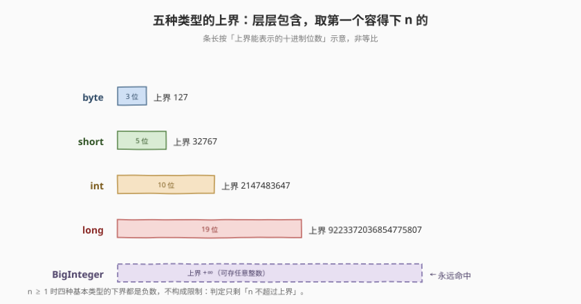
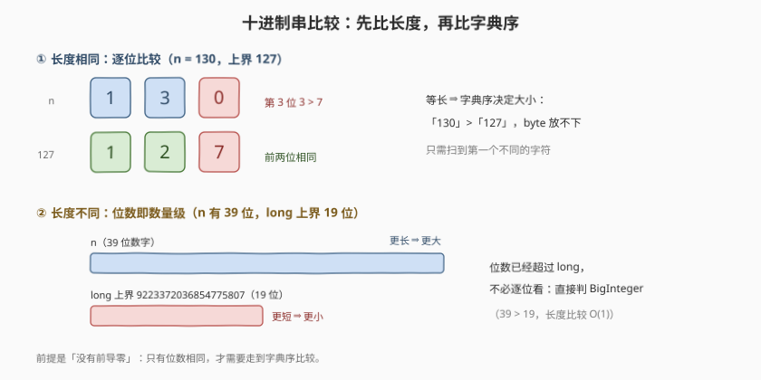

# Codeforces 66A 最小整数类型 题解

## 1. 题目概述

- **题目链接**：https://codeforces.com/problemset/problem/66/A
- **比赛来源**：Codeforces Beta Round 61 (Div. 2) · Problem A（UTC 2011-03-07）
- **难度**：1300
- **标签**：实现、字符串
- **评测类型**：普通
- **限制**：时间 2 s / 内存 256 MB

**题意**：给定一个正整数 $n$（十进制、无前导零、最多 100 位），从 Java 的五种整数类型 `byte, short, int, long, BigInteger` 中挑出**能存下 $n$ 的最小类型**输出。前四种类型的取值范围分别是 $[-128, 127]$、$[-32768, 32767]$、$[-2147483648, 2147483647]$、$[-9223372036854775808, 9223372036854775807]$，边界值都算在内；`BigInteger` 能存任意整数，但被认为"最大最慢"，排在最后。

**约束**：

- $n$ 的位数最多 $100$：`long long` 只有约 19 位十进制有效数字，**任何 64 位整数类型都存不下 $n$**，用 `stoll` 读入会抛 `std::out_of_range`，必须按字符串（或大整数）处理。
- $n \ge 1$：四种基本类型的下界（$-128$、$-32768$ 等）全部是负数，因此**下界永远满足**，判定只剩"$n$ 是否不超过上界"这一件事。
- 输入只有一组数据，没有测试组数 $t$，也不是读到 EOF 的多组格式。
- 输出必须是五个固定单词之一，`BigInteger` 的大小写不能错。

## 2. 示例与观察

官方样例一（输入 / 输出原样）：

```text
输入：
127
输出：
byte
```

官方样例二：

```text
输入：
130
输出：
short
```

官方样例三：

```text
输入：
123456789101112131415161718192021222324
输出：
BigInteger
```

逐步演算：

- $127$ 恰好等于 `byte` 的上界。题面强调"边界值包含在取值范围内"，所以 127 用 `byte` 就够，答案不是 `short`。$128$ 才会溢出到 `short`。
- $130 > 127$，越过 `byte`；但 $130 \le 32767$，落在 `short` 里，答案 `short`。
- 第三个数有 $39$ 位十进制，而 `long` 的上界 `9223372036854775807` 只有 $19$ 位。位数就已经超过，不可能放进任何基本类型，只能 `BigInteger`。

自造样例（标注"自造"，覆盖每个上界的两侧）：

| 输入 | 输出 | 说明 |
|------|------|------|
| `1` | byte | 最小正整数 |
| `128` | short | `byte` 上界 +1 |
| `32767` | short | `short` 上界（含） |
| `32768` | int | `short` 上界 +1 |
| `2147483648` | long | `int` 上界 +1 |
| `9223372036854775807` | long | `long` 上界（含） |
| `9223372036854775808` | BigInteger | `long` 上界 +1 |
| `999...9`（100 个 9） | BigInteger | 位数上界 |

**观察**：五种类型的上界单调递增、范围层层包含，所以"最小类型"就是**列表中第一个上界不小于 $n$ 的类型**。判定 $n \le U$ 不需要真的把 $n$ 转成整数：两个无前导零的十进制串，先比长度，长度相同再比字典序即可。

## 3. 解题思路

### 3.1 朴素做法与瓶颈

最直接的想法是把 $n$ 读进 `long long`，然后依次和四个上界比较。问题是 $n$ 最多 $100$ 位，`long long` 最大约 $9.22 \times 10^{18}$（19 位），读入时就会失败（`failbit`）或得到一个被截断的错误值，后面的比较全部失去意义。换成 `__int128` 也只有约 $3.4 \times 10^{38}$（38 位），仍然不够。所以要么手写高精度，要么干脆**不转整数**。

### 3.2 核心观察：只需比较上界，且可以按字符串比较



图中用"能表示的十进制位数"示意五种类型的上界（非等比）：`byte` 3 位、`short` 5 位、`int` 10 位、`long` 19 位，`BigInteger` 无限。因为 $n \ge 1$，四个下界都不构成限制，每种类型实际只剩一条上界 $U_T$；又因为 $U_{\text{byte}} < U_{\text{short}} < U_{\text{int}} < U_{\text{long}} < +\infty$，按列表顺序找第一个满足 $n \le U_T$ 的类型，得到的一定是"能存下 $n$ 的最小类型"。

比较 $n$ 和 $U_T$ 时把两者都当十进制字符串：

- 长度不同：位数少的一定更小（无前导零时，$L$ 位数的最小值是 $10^{L-1}$，$L+1$ 位数的最小值是 $10^{L}$）；
- 长度相同：从高位到低位，第一次出现不同字符的位置上谁大谁就大，这正是字典序。

四个上界都是常量，直接写成字符串 `"127"`、`"32767"`、`"2147483647"`、`"9223372036854775807"`。

### 3.3 算法流程



1. 读入字符串 $n$（最多 100 个字符，用 `cin >> string` 最省事）。
2. 定义 `fits(lim)`：若 `n.size() != lim.size()`，返回 `n.size() < lim.size()`；否则返回 `n <= lim`。
3. 依次判断 `fits("127")`、`fits("32767")`、`fits("2147483647")`、`fits("9223372036854775807")`，命中即输出对应类型并结束。
4. 四个都没命中，输出 `BigInteger`。

图里画了两个典型情形：左边 `"130"` 与 `"127"` 长度相同，第三位 $3 < 7$ 才决定大小；右边 39 位的 $n$ 与 19 位的 `long` 上界长度不同，只比长度就已经分出胜负，根本不用逐位看。

### 3.4 样例走查

以官方样例二 $n = 130$ 为例：

| 检查顺序 | 上界字符串 | 长度比较 | 结果 | 说明 |
|----------|------------|----------|------|------|
| 1 | `127` | 3 = 3 | `"130" <= "127"` 为假 | 第三位 $3 > 7$，越过 `byte` |
| 2 | `32767` | 3 < 5 | 真 | 位数更少，必然更小，落在 `short` |

输出 `short`。样例三的 $n$ 有 39 位，与 `"9223372036854775807"` 的长度 19 一比就出局，四次检查全是"长度更大"，最后输出 `BigInteger`。

## 4. 正确性证明

**引理 1（十进制串比较规则）**：设 $x, y$ 是不含前导零的非空十进制串，则 $x < y$（按数值）当且仅当 $\lvert x \rvert < \lvert y \rvert$，或者 $\lvert x \rvert = \lvert y \rvert$ 且 $x$ 的字典序小于 $y$。

**证明**：若 $\lvert x \rvert = a < b = \lvert y \rvert$，则 $x \le 10^{a} - 1 < 10^{b-1} \le y$，故 $x < y$。若位数相同为 $a$，把两个串看成 $a$ 位向量，数值比较就是最高位起逐位比较：设第一个不同位置为 $p$（从高位起），此前缀完全相同，两数之差等于 $(x_p - y_p) \cdot 10^{a-1-p}$，其符号由 $x_p - y_p$ 决定，也就是字典序的符号。∎

**引理 2（只需比较上界）**：对每个类型 $T$，正整数 $n$ 能被 $T$ 存储当且仅当 $n \le U_T$，其中 $U_T$ 是该类型的上界。

**证明**：类型的取值范围是 $[L_T, U_T]$，$n$ 能被存储等价于 $L_T \le n \le U_T$。已知 $n \ge 1$，而四种基本类型的 $L_T \in \{-128, -32768, -2147483648, -9223372036854775808\}$ 全为负数，故 $L_T \le n$ 恒成立，条件化为 $n \le U_T$。∎

**引理 3（上界单调）**：$127 < 32767 < 2147483647 < 9223372036854775807 < +\infty$。

**证明**：逐个数位比较即得；`BigInteger` 的上界视为 $+\infty$，任意有限正整数都不超过它。∎

**定理**：算法输出的类型，正是能存储 $n$ 的最小类型。

**证明**：由引理 2，算法第 $k$ 次检查为真等价于"第 $k$ 种类型能存下 $n$"。算法按列表顺序找第一个能存下的类型 $T^{*}$。由引理 3，列表顺序与上界递增顺序一致，故任何排在 $T^{*}$ 之前的类型 $T$ 都满足 $U_T < U_{T^{*}}$，而 $n \le U_{T^{*}}$ 且 $n > U_T$，即 $T$ 存不下 $n$；而 $T^{*}$ 能存下。所以 $T^{*}$ 就是最小类型。若四种基本类型都存不下，上界为 $+\infty$ 的 `BigInteger` 一定可以，且它是列表最后一项，同样是最小的可行类型。∎

## 5. 复杂度分析

- **时间**：$O(L)$，$L \le 100$ 是 $n$ 的位数。最多做 4 次比较，每次先 $O(1)$ 比长度、再 $O(L)$ 比字典序，总比较字符数不超过 $4L$。
- **空间**：$O(L)$，只存一个输入串和几个常量上界串；没有数组、没有大整数对象。
- **与时限的关系**：$L \le 100$ 时全算法不到 $1\ \mu\text{s}$，2 s 的时限有六个数量级以上的余量。实测主要是进程启动开销（见第 8 节）。

## 6. 参考代码

### C++17

```cpp
#include <bits/stdc++.h>
using namespace std;

int main() {
    ios::sync_with_stdio(false);
    cin.tie(nullptr);

    string n;
    if (!(cin >> n)) return 0;

    // 位数不同时位数少的一定更小；位数相同时按字典序比较（无前导零）
    auto fits = [&](const string& lim) {
        if (n.size() != lim.size()) return n.size() < lim.size();
        return n <= lim;
    };

    if (fits("127")) cout << "byte\n";
    else if (fits("32767")) cout << "short\n";
    else if (fits("2147483647")) cout << "int\n";
    else if (fits("9223372036854775807")) cout << "long\n";
    else cout << "BigInteger\n";
    return 0;
}
```

### Python3

```python
import sys


def main() -> None:
    data = sys.stdin.buffer.read().split()
    if not data:
        return
    n = int(data[0])
    if n <= 127:
        print("byte")
    elif n <= 32767:
        print("short")
    elif n <= 2147483647:
        print("int")
    elif n <= 9223372036854775807:
        print("long")
    else:
        print("BigInteger")


main()
```

Python 自带任意精度整数，`int(data[0])` 直接吃下 100 位数字，因此 Python 版不必手写字符串比较，按数值判界即可；C++ 版则完全绕开整数类型，两种写法都只用标准库，可原样提交。

## 7. 边界情况与易错点

1. **边界值包含在内**：$127$ 是 `byte`、$32767$ 是 `short`、$2147483647$ 是 `int`、$9223372036854775807$ 是 `long`。判定必须写 $n \le U$，写成 $n < U$ 会让所有边界值都跳到下一档。
2. **64 位整数装不下输入**：$n$ 最多 100 位，`long long` 只有 19 位，`stoll` 遇到超出范围的值会抛 `std::out_of_range`，根本拿不到正确的数；即使用 `unsigned long long` 也只有 20 位。这是本题唯一真正的坑。
3. **必须先比长度再比字典序**：只按字典序比较 `"9"` 与 `"127"` 会得到 `"9" > "127"`，但数值上 $9 < 127$。顺序反了会在 `9`、`99`、`999` 这类输入上出错。
4. **前导零**：题面保证没有前导零，`n.size()` 才等价于数值位数。如果输入允许前导零（例如 `"0127"`），必须先去掉前导零再比长度，否则会把 `byte` 误判成 `short`。
5. **输出拼写**：`BigInteger` 中间是大写 `I`，其余四种全小写；`byte` 不是 `Byte`。这类题在 Codeforces 上按 token 比对，大小写不敏感，但在别的评测系统可能逐字比对。
6. **题面关于 `%lld` 的提醒**：老 Codeforces 上 Windows 与 Linux 的 64 位格式符不一致，所以题面叫大家别用 `%lld`。本题按字符串处理，完全绕开了这个历史包袱。
7. **只有一组数据**：不要写 `while (cin >> n)` 之类的多组循环。本题结果虽然不受影响，但按题面读一次、输出一次更贴合输入契约。

## 8. 验证记录

- **编译环境与命令**：本机只有 `Apple clang 21.0.0`（`/usr/bin/g++` 是 clang 的软链），没有 GNU `g++`，因此用 `clang++ -std=c++17 -O2` 搭配 `codeforces/tools/include` 下的 `bits/stdc++.h` 兼容头编译，代码可原样提交 GNU C++17；Python 侧为 `Python 3.9.6`。官方样例用 `python3 codeforces/tools/verify_solution.py` 跑通。
- **官方样例**：3 / 3 通过（`127 → byte`、`130 → short`、39 位数 → `BigInteger`），C++ 与 Python 输出一致。
- **额外测试**：自行构造 **265 组**输入，包含四个上界及其 $\pm 1$、`1`、100 个 9、$10^{99}$、`9223372036854775808`，再加 250 组随机位数（1–100 位）的随机数；与独立暴力（把输入交给 Python 大整数、逐个 `<=` 判界）逐组比对，**全部一致**，C++ 与 Python 两份代码也互相一致。
- **最大约束性能**：输入 100 个 9 时，C++ 端到端（含进程启动）约 $2.0 \sim 2.3$ ms，Python 约 $18$ ms；相对 2 s 时限的余量在三个数量级以上。算法本体只有几次字符串比较。
- **图片校验**：两张 SVG（`cf66a_type_ranges.svg`、`cf66a_string_compare.svg`）均通过 `xml.etree.ElementTree.parse`，采用手绘抖动滤镜与 Comic Sans / Kaiti SC 字体，文字均在 `viewBox` 内。
- **复核状态**：verified（样例、对拍、性能、图片四项均实跑通过）。

## 相关题目与扩展

- [Codeforces 66B Petya and Countryside](https://codeforces.com/problemset/problem/66/B)：同场 B 题，一维高度数组上的水流扩散，是"逐起点暴力 + 单调性剪枝"的入门题。
- [Codeforces 66D Petya and His Friends](https://codeforces.com/problemset/problem/66/D)：同场 D 题，构造两两 $gcd>1$ 而整体 $gcd=1$ 的数，正好练"把整数范围写清楚"。
- [Codeforces 71A Way Too Long Words](https://codeforces.com/problemset/problem/71/A)：另一道纯字符串实现题，用长度分支决定输出形式。
- [Codeforces 4A Watermelon](https://codeforces.com/problemset/problem/4/A)：同样是小范围判界 + 分支输出，适合作为熟悉输入输出格式的第一题。
- [LeetCode 8. 字符串转换整数 (atoi)](https://leetcode.cn/problems/string-to-integer-atoi/)：把字符串按数值解释并处理越界，正好是本题"不转整数、直接比较字符串"的反面练习。

**延伸思考**：

1. **如果允许负数和前导零**：判定就不只看上界了，要同时比较下界，且必须先归一化（去前导零、提取符号）。此时"先比长度"的技巧可以保留，但符号要单独处理。
2. **如果类型集合不是嵌套的**：比如把 `unsigned int`（$0 \sim 4294967295$）混进来，"列表中第一个匹配"就不再等于"最小类型"，必须比较各类型的取值范围（先比上界、再比下界）才能选出真正最小的类型。
3. **换成任意进制**：只要该进制的字符顺序与数值大小一致（如十六进制里 `0<1<...<9<a<...<f`），"先比长度、再比字典序"的规则逐字成立，因为引理 1 的证明只用到"$b$ 进制 $L$ 位数的最小值是 $b^{L-1}$"。
4. **如果 $n$ 有 $10^6$ 位**：字符串比较仍是 $O(L)$，但读入本身成了瓶颈；此时可以只保留"是否已超过当前上界"的流式状态，边读边判，做到 $O(1)$ 额外空间。
