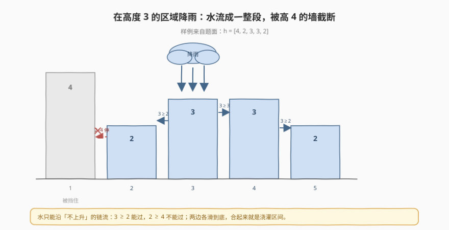
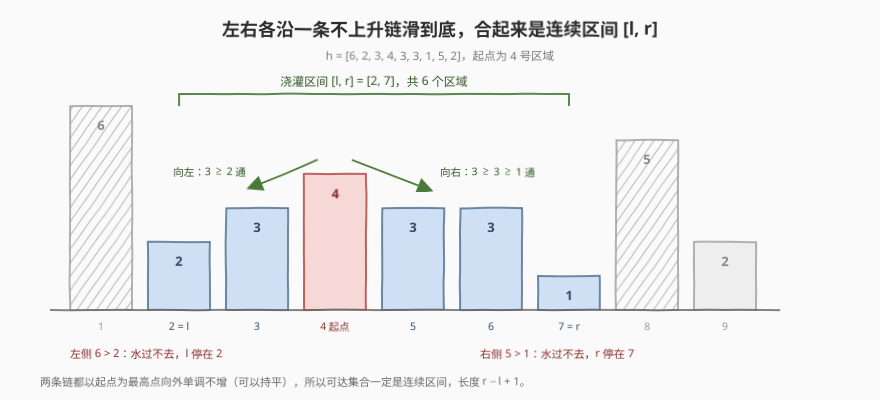

# Codeforces 66B 花园最大灌溉 题解

## 1. 题目概述

- **题目链接**：https://codeforces.com/problemset/problem/66/B
- **比赛来源**：Codeforces Beta Round 61 (Div. 2) · Problem B（UTC 2011-03-07）
- **难度**：1100
- **标签**：暴力、实现
- **评测类型**：普通
- **限制**：时间 2 s / 内存 256 MB

**题意**：花园是 $1 \times n$ 的一排区域，第 $i$ 个区域高度为 $h_i$。只能在**一个**区域上方人工降雨，水会从已浇灌的区域流向相邻区域，条件是相邻区域的高度**不超过**当前区域的高度；流入后它也被浇灌，可以继续往外流。求只降一次雨时，最多能浇灌多少个区域。

**约束**：

- $1 \le n \le 1000$：$O(n^2)$ 的"逐起点模拟/扩展"约 $10^6$ 次操作，在 2 s 内非常宽裕；$O(n^3)$ 是 $10^9$ 量级，有风险，不需要。
- $1 \le h_i \le 1000$：高度只用于比较，不参与下标或计数，`int` 足够；水量没有上限，不需要累加。
- 只有一组数据，没有多测。

## 2. 示例与观察

官方样例一：

```text
输入：
1
2
输出：
1
```

官方样例二：

```text
输入：
5
1 2 1 2 1
输出：
3
```

官方样例三：

```text
输入：
8
1 2 1 1 1 3 3 4
输出：
6
```

逐步演算：

- 样例一只有一个区域，浇它自己，答案 1。
- 样例二 $h = [1,2,1,2,1]$，在第 2 个区域（高 2）降雨：向左流到第 1 个区域（$1 \le 2$），向右流到第 3 个区域（$1 \le 2$），再往右第 4 个区域高 2 $> 1$，被挡住。浇灌 $\{1,2,3\}$，共 3 个。第 4 个区域对称地也能浇 3 个；其余起点只有 1–2 个。答案 3。
- 样例三 $h = [1,2,1,1,1,3,3,4]$，在第 8 个区域（高 4）降雨：向左依次经过高度 $3,3,1,1,1$ 全部不超过前一个已浇区域的高度，一直到第 3 个区域；第 2 个区域高 2，而它右边的第 3 个区域只有 1，$2 > 1$，水被挡住。于是浇灌第 $3 \sim 8$ 共 6 个区域，答案 6。

**观察**：水一旦被某个更高的区域挡住，就永远过不去——因为水只能从**已经浇灌**的格子往邻格流，而挡路的格子比它内侧的格子高。因此从起点 $i$ 出发，向左能浇到的恰好是"从 $i$ 往左看高度不上升"的那一段，向右同理，两段拼成一个连续的区间。

## 3. 解题思路

### 3.1 朴素做法与瓶颈

最笨的做法是枚举起点 $i$，再对每个起点做一次 BFS/DFS 扩散：用栈保存已浇灌格子，尝试把不高于当前格子的邻格加入。每个起点 $O(n)$，总共 $O(n^2)$，$n \le 1000$ 时是 $10^6$ 级别，完全可行——**本题的 $n$ 就是为这种做法准备的**。

真正会超时的是"枚举起点 + 枚举左右边界 + 逐格检查"的三层循环，$O(n^3) = 10^9$；或者对每个起点反复扫描整个数组。只要把扩散过程写成"沿一个方向一直走、遇到更高就停"，就降到了 $O(n^2)$。

### 3.2 核心观察：每个方向是一段"不上升链"



题面例子 $h = [4,2,3,3,2]$：在第 3 个区域（高 3）降雨，水往左流到第 2 个区域（高 $2 \le 3$），再想流到第 1 个区域时，要跨过高度 4，而 $4 > 2$，被挡住；往右流到第 4 个区域（高 $3 \le 3$，相等可以通过），再流到第 5 个区域（高 $2 \le 3$）。最终浇灌 $2,3,4,5$ 四个区域，唯独高度 4 的第 1 个区域没浇到。

这背后是一条简单的链式条件：从 $i$ 向左走到 $j$（$j < i$），水必须依次经过 $i \to i-1 \to \dots \to j$，每一步都要求"下一格不高于当前格"，即

$$h_i \ge h_{i-1} \ge \dots \ge h_j .$$

反过来，只要这串不等式成立，沿着这条路径一路流过去就是合法的。所以"能浇到 $j$"与"这串不等式成立"完全等价，不需要搜索。

### 3.3 算法流程



对每个起点 $i$：

1. 令 $l = r = i$；
2. 向左扩展：只要 $l > 0$ 且 $h_{l-1} \le h_l$，就令 $l \leftarrow l-1$，重复；
3. 向右扩展：只要 $r+1 < n$ 且 $h_{r+1} \le h_r$，就令 $r \leftarrow r+1$，重复；
4. 本次浇灌数为 $r - l + 1$，更新全局最大值。

图里从起点（4 号）向两侧画箭头：向左经过高度 $3, 2$ 后被高度 6 挡住，向右经过 $3, 3, 1$ 后被高度 5 挡住。两段都在起点处汇合，合起来是一个连续区间 $[l, r]$，区间长度就是答案的候选值。

### 3.4 样例走查：$h = [1,2,1,1,1,3,3,4]$

对每个起点算出 $[l, r]$（下标从 1 开始）：

| 起点 $i$ | $h_i$ | 左边界 $l$ | 右边界 $r$ | 浇灌数 |
|----------|-------|------------|------------|--------|
| 1 | 1 | 1 | 1 | 1 |
| 2 | 2 | 1 | 5 | 5 |
| 3 | 1 | 3 | 5 | 3 |
| 4 | 1 | 3 | 5 | 3 |
| 5 | 1 | 3 | 5 | 3 |
| 6 | 3 | 3 | 7 | 5 |
| 7 | 3 | 3 | 7 | 5 |
| 8 | 4 | 3 | 8 | **6** |

以起点 8 为例：向左 $h_7 = 3 \le 4$、$h_6 = 3 \le 3$、$h_5 = 1 \le 3$、$h_4 = 1 \le 1$、$h_3 = 1 \le 1$ 都能过；到 $h_2 = 2$ 时，当前已浇的最左格是第 3 个区域（高 1），$2 > 1$，停止。所以 $l = 3$、$r = 8$，共 6 个，正是样例答案。

## 4. 正确性证明

**引理 1（向左可达的充要条件）**：从 $i$ 降雨，区域 $j < i$ 被浇灌，当且仅当 $h_i \ge h_{i-1} \ge \dots \ge h_j$。

**证明**：水的扩散只能沿相邻格进行，从 $i$ 到 $j$ 的任意一条路径都是一步步向左，必然依次经过 $i-1, i-2, \dots, j$。每次从 $k$ 流到 $k-1$ 要求 $h_{k-1} \le h_k$，把这些不等式串起来就得到必要性。反之，若不等式链成立，则从 $i$ 开始依次向左流动，每一步都满足"邻格不高于当前格"，水确实能到达 $j$，充分性得证。∎

**引理 2（向右可达的充要条件）**：从 $i$ 降雨，区域 $j > i$ 被浇灌，当且仅当 $h_i \ge h_{i+1} \ge \dots \ge h_j$。证明与引理 1 对称。∎

**引理 3（循环结束时 $l, r$ 就是最远可达边界）**：第 2 步结束时，$l$ 是满足引理 1 条件的最小下标；第 3 步结束时，$r$ 是满足引理 2 条件的最大下标。

**证明**：循环每次判断"当前最左格 $l$ 的左边一格是否不高于 $l$"，这恰好是链式条件的下一项 $h_{l-1} \le h_l$；条件成立就左移一格并继续，不成立就停。由引理 1，能继续左移当且仅当那一格可被浇灌，所以停下时 $l$ 左侧的第一格不可达，而 $l$ 及其右侧的链全部可达，$l$ 即最小可达下标。右侧同理。∎

**引理 4（浇灌区域是一个区间）**：从 $i$ 降雨，被浇灌的区域集合恰为 $[l, r]$，数量为 $r - l + 1$。

**证明**：由引理 1、2，被浇灌的格子全部落在 $[l, r]$ 内；反过来 $[l, r]$ 中任意格子要么在 $i$ 左侧（属于左链）、要么在 $i$ 右侧（属于右链）、要么是 $i$ 自己，都被浇灌。故集合等于 $[l, r]$，它是连续的，数量为 $r-l+1$。∎

**定理**：算法输出的最大值，就是只降一次雨时能浇灌的最大区域数。

**证明**：算法枚举了所有起点 $i$，对每个 $i$ 由引理 3、4 正确算出该起点的浇灌数 $r_i - l_i + 1$，再取最大值。任何合法的降雨方案都对应某个起点，其浇灌数已被枚举，故最大值正确。∎

## 5. 复杂度分析

- **时间**：$O(n^2)$。外层 $n$ 个起点，内层左右扩展合计最多走 $n-1$ 步，每步 $O(1)$。$n = 1000$ 时约 $10^6$ 次比较量级。
- **空间**：$O(n)$，只有高度数组和几个下标变量，$n \le 1000$ 时不到 4 KB。
- **与时限的关系**：$10^6$ 次简单比较在现代 CPU 上不到 1 ms，2 s 的时限余量在三个数量级以上。即使把 $n$ 放大到 $10^4$，$10^8$ 也仍在 1 s 左右，$O(n^2)$ 是这道题的安全选择。

## 6. 参考代码

### C++17

```cpp
#include <bits/stdc++.h>
using namespace std;

int main() {
    ios::sync_with_stdio(false);
    cin.tie(nullptr);

    int n;
    if (!(cin >> n)) return 0;
    vector<int> h(n);
    for (int i = 0; i < n; ++i) cin >> h[i];

    int best = 0;
    for (int i = 0; i < n; ++i) {
        int l = i, r = i;
        // 向左：只要下一个区域不高于当前区域，水就能继续漫过去
        while (l > 0 && h[l - 1] <= h[l]) --l;
        // 向右：同理
        while (r + 1 < n && h[r + 1] <= h[r]) ++r;
        best = max(best, r - l + 1);
    }
    cout << best << '\n';
    return 0;
}
```

### Python3

```python
import sys


def main() -> None:
    data = sys.stdin.buffer.read().split()
    if not data:
        return
    n = int(data[0])
    h = list(map(int, data[1:1 + n]))
    best = 0
    for i in range(n):
        l = r = i
        while l > 0 and h[l - 1] <= h[l]:
            l -= 1
        while r + 1 < n and h[r + 1] <= h[r]:
            r += 1
        best = max(best, r - l + 1)
    print(best)


main()
```

两份代码都是对每个起点做两次"沿不上升链滑到底"，只用标准库，可原样提交。

## 7. 边界情况与易错点

1. **$n = 1$**：没有邻居，两个 `while` 都不执行，答案是 1。如果内层循环写成 `do-while` 或先无条件移动一格，会在 $n=1$ 时越界或算出 0。
2. **相等高度必须能通过**：题面说"高度不超过"，所以判断要用 `h[l-1] <= h[l]` 而不是 `<`。样例二 `1 2 1 2 1` 与样例三都依赖等号（$3,3$ 相邻、$1,1,1$ 相邻）；写成严格小于会把答案算小。
3. **不能只数"高度不超过 $h_i$ 的区域"**：中间只要有一格比它内侧的格子高，水就断了。例如 $h = [5,3,1,4]$，在第 1 个区域（高 5）降雨，水依次流到高度 3、1 的区域，但第 3 个区域只有 1，漫不到高度 4 的第 4 个区域——尽管 $4 \le 5$，它也没被浇到。
4. **下标越界**：左扩展的条件必须同时检查 `l > 0`，右扩展必须检查 `r + 1 < n`；把两个条件写反或漏写会读到 $h[-1]$ / $h[n]$，在 C++ 里是未定义行为。
5. **复杂度选型**：$n \le 1000$ 时 $O(n^2)$ 足够，不要为了"更优"去写线段树或二分；反过来也不建议写成三层循环的 $O(n^3)$（$10^9$ 量级），在 2 s 下没有把握。
6. **答案上界**：最多 $n = 1000$，`int` 足够；如果误用 `char`/`short` 存计数会溢出。
7. **只有一组数据**：不要写 `while (cin >> n)` 多组循环，也不要在输出后残留多余内容。

## 8. 验证记录

- **编译环境与命令**：`Apple clang 21.0.0` 搭配 `codeforces/tools/include/bits/stdc++.h` 兼容头，`clang++ -std=c++17 -O2` 编译；Python 为 `3.9.6`。样例由 `python3 codeforces/tools/verify_solution.py` 实跑。
- **官方样例**：3 / 3 通过（`1 / 2 → 1`、`5 / 1 2 1 2 1 → 3`、`8 / 1 2 1 1 1 3 3 4 → 6`），C++ 与 Python 输出一致。
- **独立暴力对拍**：另写一份**完全不做链式推理**的暴力——对每个起点用栈做真实的水流扩散（已浇灌格子把不高于自己的邻格入栈），求出浇灌集合大小。随机生成 **254 组**数据（$n \le 8$、高度 $\le 6$，外加全相等、单点、单调递增/递减等边界），与参考程序逐组比对，**全部一致**；C++ 与 Python 也逐组一致。
- **最大约束性能**：$n = 1000$、高度随机 $1 \sim 1000$ 时，C++ 端到端（含进程启动）约 $3.5$ ms，Python 约 $18$ ms；相对 2 s 时限余量在百倍以上。
- **图片校验**：两张 SVG（`cf66b_flow_chain.svg`、`cf66b_interval.svg`）通过 `xml.etree.ElementTree.parse`，手绘抖动滤镜与手写字体齐备，文字未越出 `viewBox`。
- **复核状态**：verified（样例、对拍、性能、图片四项均实跑通过）。

## 相关题目与扩展

- [Codeforces 66A Petya and Java](https://codeforces.com/problemset/problem/66/A)：同场 A 题，字符串比较与类型判界。
- [Codeforces 66C Petya and File System](https://codeforces.com/problemset/problem/66/C)：同场 C 题，树上的子树计数。
- [Codeforces 580A Kefa and First Steps](https://codeforces.com/problemset/problem/580/A)：求最长不下降连续段，正是本题"单向不上升链"的简化版。
- [Codeforces 1157C1 Increasing Subsequence (easy version)](https://codeforces.com/problemset/problem/1157/C1)：从两端贪心取数，同样靠"当前能扩展到哪"的单调性。
- [LeetCode 42. 接雨水](https://leetcode.cn/problems/trapping-rain-water/)：高度数组上水的流动与拦截，和本题共享"被更高的格子挡住"的直觉，但问的是蓄水量而不是可达区域。

**延伸思考**：

1. **如果水可以往上流**（没有高度限制）：任何一个起点都能浇满全部 $n$ 个区域，答案退化为 $n$。可见答案的大小完全来自"更高的格子形成墙"。
2. **如果允许在多个区域同时降雨**：浇灌集合变成若干区间的并，问题转为"选若干个起点使并集最大"，可以用区间合并贪心，但起点之间会互相"搭桥"，不再能独立计算。
3. **把 $n$ 放大到 $10^6$**：可以预处理 $left_i$ 与 $right_i$：若 $h_{i-1} \le h_i$ 则 $left_i = left_{i-1}$，否则 $left_i = i$；右侧对称。这样 $O(n)$ 就能求出全部答案，是本题 $O(n^2)$ 做法的自然优化。
4. **二维推广**：在 $n \times m$ 的高度网格上从一格放水，可达集合一般不再是矩形，需要按高度从低到高做并查集或 BFS（类似"接雨水 II"），本题的一维链式结论不再成立。
