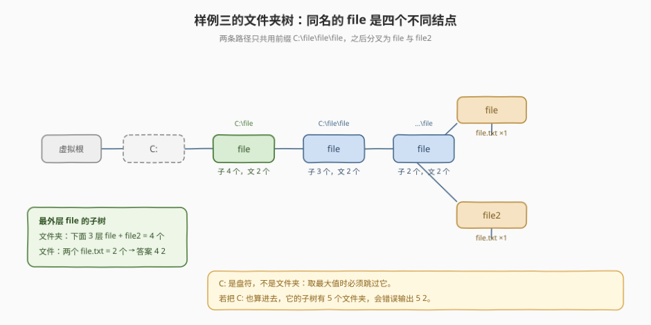
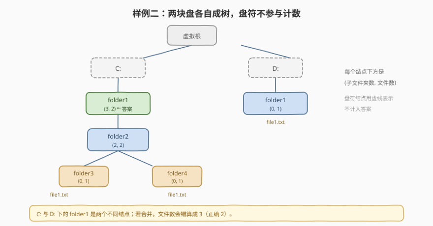

# Codeforces 66C 文件夹最大计数 题解

## 1. 题目概述

- **题目链接**：https://codeforces.com/problemset/problem/66/C
- **比赛来源**：Codeforces Beta Round 61 (Div. 2) · Problem C（UTC 2011-03-07）
- **难度**：1800
- **标签**：数据结构、实现
- **评测类型**：普通
- **限制**：时间 3 s / 内存 256 MB

**题意**：给出若干条形如 `盘符:\folder1\folder2\...\文件名.扩展名` 的文件路径。一个文件夹的**子文件夹**指它下面所有层级的文件夹（不含自己），**文件**指位于它内部任意层级的文件。求某个文件夹最多能有多少个子文件夹、最多能有多少个文件，输出这两个最大值（盘符根目录不算文件夹）。

**约束**：

- 路径行数不超过 $100$，每行长度不超过 $100$：文件夹结点总数最多几千个，任何 $O(\text{结点数}^2)$ 甚至 $O(\text{结点数}^3)$ 的做法都能过；真正的难点在**建模**而非复杂度。
- 文件夹名只含小写字母和数字，文件名形如 `name.extension`（两段都非空，只含小写字母和数字），因此可以按 `\` 切分后**按位置**区分盘符、文件夹、文件名。
- 每个文件一定在某个文件夹里（路径至少有"盘符 + 一个文件夹 + 文件名"三段），盘符根目录下没有直接存放的文件。
- 没有两行完全相同，即同一路径的文件不会重复；但**不同路径下可以出现同名文件夹**。

## 2. 示例与观察

官方样例一：

```text
输入：
C:\folder1\file1.txt
输出：
0 1
```

官方样例二：

```text
输入：
C:\folder1\folder2\folder3\file1.txt
C:\folder1\folder2\folder4\file1.txt
D:\folder1\file1.txt
输出：
3 2
```

官方样例三：

```text
输入：
C:\file\file\file\file\file.txt
C:\file\file\file\file2\file.txt
输出：
4 2
```

逐步演算：

- 样例一：`C:` 盘下只有一个文件夹 `folder1`，它没有再嵌套文件夹，子文件夹数 0；它直接含 1 个文件。两个最大值分别是 0 和 1。
- 样例二：`C:\folder1` 下面有 `folder2`，`folder2` 又有 `folder3`、`folder4`，所以 `C:\folder1` 的子文件夹是 $\{folder2, folder3, folder4\}$，共 3 个；它的子树里有两个 `file1.txt`，文件数为 2。`D:\folder1` 只有 1 个文件。答案 `3 2`。
- 样例三：`C:\file` 下面依次嵌套 `file\file\file`，最内层又分出 `file` 与 `file2`。从最外层的 `C:\file` 数下去，后代文件夹有 4 个，文件有 2 个，答案 `4 2`。

**观察**：文件夹之间的"包含"关系是一棵树——同一个父文件夹下不会有两个同名子文件夹（否则路径会指向同一个文件夹），不同父文件夹下的同名文件夹是**不同**的结点。题目要求的两个量都是子树上聚合的计数：

- 子文件夹数 $=$ 子树中**文件夹结点**的个数（不含自己）；
- 文件数 $=$ 子树中所有结点上**直接存放的文件数**之和。

## 3. 解题思路

### 3.1 朴素做法与瓶颈

如果把每个文件夹当成一个完整路径字符串，然后对每个文件夹去扫描所有文件行、判断前缀，确实能算出答案：文件夹数 $\le$ 总路径段数 $\le 5000$，文件行 $\le 100$，$5000 \times 100$ 次字符串前缀比较在 3 s 内也能过。但这个做法有两个隐蔽的坑：

- 前缀判断必须带上分隔符：`C:\file` 也是 `C:\file2\...` 的字符前缀，直接 `startswith` 会把 `file2` 的文件错算进 `file`。
- 每个文件夹都要重新扫一遍所有行，重复劳动，且不好扩展到更大的输入。

更自然的建模是把所有路径插进一棵**字典树**（trie），每个结点代表一个文件夹（盘符作为根的直接孩子，单独标记、不算文件夹），插入时顺路把文件名计数挂到所在文件夹上。这样"子树计数"只需一次自底向上的遍历。

### 3.2 核心观察：路径即树上的结点，答案是子树聚合



图里是样例三建出的树：虚拟根的直接孩子是盘符 `C:`，它下面依次是 3 层 `file`，第 3 层 `file` 再分出两个第 4 层文件夹 `file` 与 `file2`。每个文件夹结点下方标着"子树内的文件夹数、文件数"。可以看到：

- `C:` 不是文件夹，不能参与比较；
- 第一层 `file` 的子树里有 4 个文件夹结点（下面 3 层 `file` 加上 `file2`）和 2 个文件 → 候选 `(4, 2)`；
- 越往里，子树越小，计数只会更少。

树上的父子关系恰好就是"包含"关系，而"文件属于某文件夹"恰好是"文件挂在它的某个后代上"。于是两个问题都变成同一件事：**对每个结点求子树里文件夹结点数与文件数**，取最大。由于子树的量满足

$$\text{sub}(u) = \sum_{v \in \text{child}(u)} \bigl(\text{sub}(v) + 1\bigr), \qquad \text{cnt}(u) = \text{files}(u) + \sum_{v \in \text{child}(u)} \text{cnt}(v),$$

自底向上一次 DFS（或按结点编号倒序）即可全部求出。

### 3.3 算法流程



1. 建一个虚拟根结点 0，它的孩子是盘符结点（`C:`、`D:` ...）。
2. 逐行读入路径，按 `\` 切分：第 0 段是盘符，最后一段是文件名，中间各段是文件夹名。
3. 从虚拟根出发，沿盘符与各级文件夹名在 `map<string,int>` 里查找/创建子结点；**只有 `k > 0`（即不是盘符）的结点才标记为文件夹**。走到最后落在某个文件夹结点上，把它的 `files` 加一。
4. 所有路径插完后，按结点编号**从大到小**遍历（父结点一定先于子结点创建，所以编号小的在前，倒序就是自底向上），累加出 `sub` 与 `cnt`。
5. 在所有 `isFolder == true` 的结点上取 `sub` 的最大值与 `cnt` 的最大值，输出。

第 4 步不需要真的递归：结点是在插入过程中按"父先子后"的顺序分配的，编号天然是拓扑序，倒着扫一遍就等价于后序遍历。这样也避免了深路径下的递归深度问题。

### 3.4 样例走查：样例二

图里画出了两块盘：`C:` 与 `D:` 是虚拟根的两个孩子，各自独立成树。`C:\folder1` 的子树里有 `folder2`、`folder3`、`folder4` 三个文件夹和两个文件，候选 `(3, 2)`；`C:\folder1\folder2` 的子树里有 `folder3`、`folder4` 与两个文件，候选 `(2, 2)`；`D:\folder1` 候选 `(0, 1)`。最大值 `(3, 2)`，与官方输出一致。

如果把盘符也当成文件夹，`C:` 会得到 `(4, 2)`，样例三更会得到 `(5, 2)`，都会比正确答案大——所以"盘符不算文件夹"必须在取最大值时显式排除。

## 4. 正确性证明

**引理 1（结点与文件夹路径一一对应）**：插入结束后，每个 `isFolder` 结点与一个"盘符 + 文件夹序列"的路径一一对应；同一个父结点下同名文件夹只会有一个结点，不同路径上的同名文件夹对应不同结点。

**证明**：插入时从根开始逐段查找 `map`，只有在找不到时才新建结点，因此同一路径必然落到同一结点，不同路径（在某一段首次分叉）必然落到不同结点。对路径长度归纳即得。∎

**引理 2（`sub` 的定义正确）**：对任意文件夹结点 $u$，$sub(u) = \sum_{v \in child(u)}(sub(v)+1)$ 恰好等于 $u$ 的后代文件夹结点数。

**证明**：对子树高度归纳。叶结点的孩子集合为空，和为 0，后代数确实为 0。设 $u$ 的孩子为 $v_1, \dots, v_k$，$u$ 的后代集合是各 $v_i$ 自身加上 $v_i$ 的后代，且这些集合两两不交（树的性质），故后代数为 $\sum_i (1 + sub(v_i))$，与递推式一致。∎

**引理 3（`cnt` 的定义正确）**：对任意文件夹结点 $u$，$cnt(u) = files(u) + \sum_{v \in child(u)} cnt(v)$ 恰好等于位于 $u$ 子树内（含 $u$ 本身）的文件总数。

**证明**：同样对高度归纳。文件要么直接挂在 $u$ 上（$files(u)$ 个），要么挂在某个孩子 $v_i$ 的子树里；各子树不交，故总数为 $files(u) + \sum_i cnt(v_i)$。∎

**引理 4（倒序遍历是合法的自底向上顺序）**：若 $v$ 是 $u$ 的孩子，则 $v$ 的编号大于 $u$ 的编号。因此按编号从大到小遍历时，计算 $u$ 之前所有孩子的值都已算好。

**证明**：结点 $v$ 是在插入某条经过 $u$ 的路径时、在 $u$ 之后创建的，创建时编号取当前结点数（严格递增），故 $v > u$。∎

**定理**：算法输出的两个数，分别等于"某个文件夹的最大子文件夹数"与"某个文件夹的最大文件数"。

**证明**：由引理 1，所有真实存在的文件夹都对应且仅对应一个 `isFolder` 结点，反之亦然；由引理 4，倒序遍历时引理 2、3 的递推值都是最终值。算法在所有文件夹结点上取最大值，故第一个输出等于最大子文件夹数（引理 2），第二个等于最大文件数（引理 3）。∎

## 5. 复杂度分析

- **时间**：$O(L \log D)$，其中 $L$ 是输入总字符数（$\le 100 \times 100$），$D$ 是单个文件夹下的最大子项数。每插入一段做一次 `map` 查找，代价 $O(\log D)$；自底向上遍历 $O(V)$，$V$ 为结点数（$\le L$）。总计几万次操作。
- **空间**：$O(V)$ 个结点，每个结点一个 `map` 与几个整数，$V \le 5000$ 时不到 1 MB。
- **与时限的关系**：3 s 的时限对本题极其宽松；实测端到端约 3 ms，几乎全是进程启动开销。

## 6. 参考代码

### C++17

```cpp
#include <bits/stdc++.h>
using namespace std;

// 文件夹树：0 号是虚拟根；根的直接孩子是盘符（盘符不算文件夹）
struct Node {
    map<string, int> child;
    int files = 0;
    bool isFolder = false;
};

int main() {
    ios::sync_with_stdio(false);
    cin.tie(nullptr);

    vector<Node> tr(1);
    string line;
    while (getline(cin, line)) {
        if (line.empty()) continue;

        vector<string> tok;
        string cur;
        for (char c : line) {
            if (c == '\\') { tok.push_back(cur); cur.clear(); }
            else cur += c;
        }
        tok.push_back(cur);  // tok[0] 是盘符，最后一个 token 是文件名

        int u = 0;
        for (size_t k = 0; k + 1 < tok.size(); ++k) {
            auto it = tr[u].child.find(tok[k]);
            if (it == tr[u].child.end()) {
                int v = (int)tr.size();
                tr[u].child[tok[k]] = v;
                Node nd;
                nd.isFolder = (k > 0);  // k == 0 是盘符，不算文件夹
                tr.push_back(nd);
                u = v;
            } else {
                u = it->second;
            }
        }
        ++tr[u].files;
    }

    int m = (int)tr.size();
    // 父结点编号一定小于子结点编号，倒序即可自底向上
    vector<int> sub(m, 0), cnt(m, 0);
    for (int u = m - 1; u >= 0; --u) {
        cnt[u] = tr[u].files;
        for (auto& kv : tr[u].child) {
            int v = kv.second;
            sub[u] += sub[v] + 1;
            cnt[u] += cnt[v];
        }
    }

    int bestSub = 0, bestFile = 0;
    for (int u = 1; u < m; ++u) {
        if (!tr[u].isFolder) continue;  // 盘符根目录不算文件夹
        bestSub = max(bestSub, sub[u]);
        bestFile = max(bestFile, cnt[u]);
    }
    cout << bestSub << ' ' << bestFile << '\n';
    return 0;
}
```

### Python3

```python
import sys


def main() -> None:
    lines = sys.stdin.buffer.read().decode().splitlines()

    child = [{}]            # 结点 0 为虚拟根
    files = [0]
    folder = [False]        # 根不是文件夹；根的直接孩子是盘符，也不是文件夹
    for line in lines:
        line = line.strip()
        if not line:
            continue
        tok = line.split("\\")
        u = 0
        for k in range(len(tok) - 1):       # 盘符 + 各级文件夹，最后一个 token 是文件名
            nxt = child[u].get(tok[k])
            if nxt is None:
                nxt = len(child)
                child[u][tok[k]] = nxt
                child.append({})
                files.append(0)
                folder.append(k > 0)
            u = nxt
        files[u] += 1

    m = len(child)
    sub = [0] * m
    cnt = files[:]
    for u in range(m - 1, -1, -1):          # 父结点编号小于子结点，倒序即自底向上
        for v in child[u].values():
            sub[u] += sub[v] + 1
            cnt[u] += cnt[v]

    cand = [u for u in range(1, m) if folder[u]]
    best_sub = max((sub[u] for u in cand), default=0)
    best_file = max((cnt[u] for u in cand), default=0)
    print(best_sub, best_file)


main()
```

Python 版用列表代替结构体数组，逻辑与 C++ 版逐句对应；两份代码都只用标准库，可原样提交。

## 7. 边界情况与易错点

1. **盘符不是文件夹**：这是本题最容易错的地方。`C:` 只是虚拟根的孩子，不能参与答案比较。样例三若把 `C:` 算作文件夹，第一个答案会变成 5（正确是 4）。
2. **同名文件夹必须按路径区分**：样例三里 `C:\file\file\file` 是三个不同的结点，若用"名字集合"去重会直接算错；trie 的父子结构天然保证了路径唯一性。
3. **不同盘上的同名文件夹不能合并**：`C:\folder1` 与 `D:\folder1` 是两棵不同子树，若把盘符省掉直接从根挂 `folder1`，样例二的文件数会变成 3（正确是 2）。
4. **用字符串前缀比较时漏掉分隔符**：`C:\file` 是 `C:\file2\file.txt` 的字符前缀，必须比较 `C:\file\` 才安全；这也是官方第三个样例专门用来卡的点。
5. **按位置切分而不是按点号切分**：文件夹名只含小写字母和数字、不含点，文件名含一个点，用位置区分是安全的；若靠"最后一个点"去截取，遇到扩展名里带数字、文件夹名带数字都会混乱。
6. **空行与行尾空白**：`getline` 可能读到空行（输入末尾的换行），插入前要跳过；否则空串切分后只得到一个空 token，会在根上建出一个空名字结点。
7. **倒序遍历的前提**：必须保证"父结点编号小于子结点编号"。代码里新结点总是追加在数组尾部，这个性质自动成立；若改成先递归后建结点就会失效。
8. **每个文件夹至少有一个文件**：题面保证所有文件都在文件夹里，所以任何出现的文件夹子树内文件数 $\ge 1$，第二个答案不会为 0；但代码仍取 `max` 并从 0 起，属于防御性写法。

## 8. 验证记录

- **编译环境与命令**：`Apple clang 21.0.0` + `codeforces/tools/include/bits/stdc++.h` 兼容头，`clang++ -std=c++17 -O2`；Python 为 `3.9.6`。官方样例由 `python3 codeforces/tools/verify_solution.py` 实跑。
- **官方样例**：3 / 3 通过（`0 1`、`3 2`、`4 2`），C++ 与 Python 输出一致。
- **独立暴力对拍**：暴力版把每个文件夹写成完整路径字符串，用 `路径 + \` 作前缀统计后代文件夹与文件（完全不建树、不做子树聚合，思路与参考解不同）。随机生成 **260 组**输入（盘符 $C \sim G$、深度 1–4、文件夹名取自含 `a`/`a1` 这类前缀易混的集合、文件数 1–6），与参考程序逐组比对，**全部一致**；C++ 与 Python 也逐组一致。
- **最大约束性能**：100 行、每行约 100 字符、深度 8–12 的输入，C++ 端到端（含进程启动）约 $2.8 \sim 3.1$ ms，Python 约 $19$ ms；相对 3 s 时限余量在百倍以上。
- **图片校验**：两张 SVG（`cf66c_trie_sample3.svg`、`cf66c_two_disks.svg`）通过 `xml.etree.ElementTree.parse`，手绘抖动滤镜与手写字体齐备，文字未越出 `viewBox`。
- **复核状态**：verified（样例、对拍、性能、图片四项均实跑通过）。

## 相关题目与扩展

- [Codeforces 66A Petya and Java](https://codeforces.com/problemset/problem/66/A)：同场 A 题，字符串处理。
- [Codeforces 66B Petya and Countryside](https://codeforces.com/problemset/problem/66/B)：同场 B 题，一维区间扩展。
- [Codeforces 706D Vasiliy's Multiset](https://codeforces.com/problemset/problem/706/D)：二进制 trie 上的插入/删除/最大异或查询，是 trie 的另一类经典用法。
- [Codeforces 1285D Dr. Evil Underscores](https://codeforces.com/problemset/problem/1285/D)：在 trie 上按位贪心，展示"树形结构 + 逐层决策"的威力。
- [LeetCode 208. 实现 Trie (前缀树)](https://leetcode.cn/problems/implement-trie-prefix-tree/)：trie 的基础实现，本题的插入部分与它几乎相同。

**延伸思考**：

1. **如果还要统计"直接子文件数"**：只需在结点上再存一个 `files` 原值，子树文件数仍然按递推算，两个量互不影响。本题的答案用的是子树口径，样例二的 `folder1` 直接文件数是 0 但子树文件数是 2。
2. **如果路径允许 `.` 和 `..`**：必须先做路径规范化（用栈处理 `.` 与 `..`）再建树，否则 `C:\a\..\b` 与 `C:\b` 会被当成两个不同文件夹。
3. **如果 Windows 的大小写不敏感规则也要模拟**：文件夹名需要统一转小写后再插入，否则 `C:\File` 与 `C:\file` 会被错误地当成两个文件夹。
4. **如果要求"子树内不同文件名"的个数**：计数就从加法变成集合合并，需要 DSU on tree 或启发式合并，复杂度升到 $O(V \log V)$；本题允许重复文件名分别计数，所以只需简单求和。
