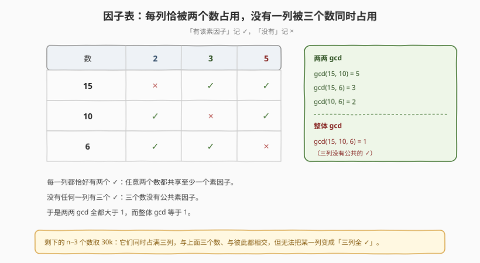
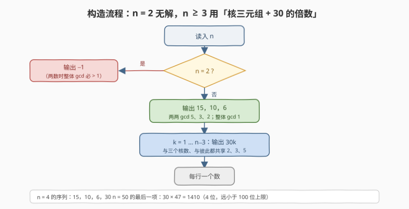

# Codeforces 66D 糖果数的构造 题解

## 1. 题目概述

- **题目链接**：https://codeforces.com/problemset/problem/66/D
- **比赛来源**：Codeforces Beta Round 61 (Div. 2) · Problem D（UTC 2011-03-07）
- **难度**：1700
- **标签**：构造、数学、数论
- **评测类型**：特殊评测（输出任意一组合法解）
- **限制**：时间 2 s / 内存 256 MB

**题意**：给出 $n$（$2 \le n \le 50$），要求构造 $n$ 个**互不相同**的正整数 $a_1, \dots, a_n$，满足：

- 任意 $1 \le i, j \le n$ 都有 $\gcd(a_i, a_j) \ne 1$（注意 $i = j$ 也算，所以每个 $a_i > 1$）；
- $\gcd(a_1, a_2, \dots, a_n) = 1$；
- 每个数不超过 $100$ 位十进制，不带前导零。

若不存在这样的数列，输出 `-1`；否则每行输出一个数。由于答案不唯一，评测使用特殊评测（special judge）。

**约束**：

- $n \le 50$：规模极小，答案甚至可以"手算"，难点全在构造思路。
- 每个数最多 $100$ 位：不能用"前 $n$ 个素数之积"这类指数级增长的构造（第 50 个素数是 229，前 50 个素数之积已有 92 位、约 $1.9 \times 10^{91}$，贴近 100 位的上限），必须控制数值大小。
- $2 \le n$：$n = 2$ 是唯一无解的情形，必须单独判掉。
- 只有一组数据，没有多测。

## 2. 示例与观察

官方样例一：

```text
输入：
3
输出：
99
55
11115
```

官方样例二：

```text
输入：
4
输出：
385
360
792
8360
```

先验证官方答案确实合法（样例只说明"存在解"，不要求我们输出同样的数）：

- 样例一：$\gcd(99,55) = 11$，$\gcd(99,11115) = 9$，$\gcd(55,11115) = 5$，两两都 $>1$；而 $\gcd(99,55,11115) = 1$。
- 样例二：$\gcd(385,360) = 5$，$\gcd(385,792) = 11$，$\gcd(385,8360) = 55$，$\gcd(360,792) = 72$，$\gcd(360,8360) = 40$，$\gcd(792,8360) = 88$，两两都 $>1$；整体 gcd 为 1。

**关键观察一：$n = 2$ 一定无解。** 两个数时"两两 gcd"只有一个值 $\gcd(a_1,a_2)$，而它同时也等于整体 gcd。条件要求它 $\ne 1$ 又要求它 $=1$，矛盾。

**关键观察二：$n \ge 3$ 时"整体 gcd 为 1"可以靠三个数"两两相交、三者交空"来实现。** 取

$$15 = 3 \cdot 5,\qquad 10 = 2 \cdot 5,\qquad 6 = 2 \cdot 3 .$$

它们的因子集合两两相交（$\{3,5\} \cap \{2,5\} = \{5\}$，$\{3,5\}\cap\{2,3\}=\{3\}$，$\{2,5\}\cap\{2,3\}=\{2\}$），但三者公共因子集合为空，所以两两 gcd 分别为 $5, 3, 2$，整体 gcd 为 $1$。剩下的数只要都取 $30 = 2\cdot3\cdot5$ 的倍数，就能同时与这三个数以及彼此共享因子。

**自造样例**（标注"自造"，本题输出不唯一，这里给的是本解的输出；实际输出是每行一个数，表中用 `/` 表示换行）：

| 输入 | 输出 | 说明 |
|------|------|------|
| `2` | `-1` | 唯一无解的情形 |
| `3` | `15 / 10 / 6` | 最小规模，三者整体 gcd 为 1 |
| `5` | `15 / 10 / 6 / 30 / 60` | 多出的数取 $30$ 的倍数 |

## 3. 解题思路

### 3.1 朴素做法与瓶颈

最直接的想法是暴力搜索：枚举 $n$ 个互不相同的数，检查两两 gcd 与整体 gcd。搜索空间随数值范围指数增长，即便限制在 $1 \sim 100$ 也不现实；而且 $n = 50$ 时合法组合非常稀疏，纯随机也很难撞上。构造题必须从**因子的组合**入手。

### 3.2 核心观察：三个数"两两相交、三者交空"



把每个数看成它的素因子集合：$\gcd(x,y) > 1$ 等价于两个集合有公共元素，整体 gcd 为 1 等价于所有集合的公共部分为空。图里用一张因子表列出三个数：$15$ 占 $\{3,5\}$、$10$ 占 $\{2,5\}$、$6$ 占 $\{2,3\}$。每一个素因子列（$2,3,5$）都恰好被**两个**数占用，所以任意两数都共享因子；同时没有任何一列被**三个**数同时占用，所以整体 gcd 为 1——这正是"两两 $\gcd > 1$ 但整体 $\gcd = 1$"的最小结构。

有了这个"核"，剩下的 $n-3$ 个数全部取 $30 = 2 \cdot 3 \cdot 5$ 的倍数：

$$a_4 = 30,\ a_5 = 60,\ a_6 = 90,\ \dots,\ a_n = 30(n-3).$$

它们都同时含有因子 $2, 3, 5$，所以与 $15, 10, 6$ 的 gcd 分别至少是 $15, 10, 6$；彼此之间 gcd 至少是 $30$。而整体 gcd 被前三个数"压"成了 1，加多少 $30$ 的倍数都改变不了。

### 3.3 算法流程



1. 读入 $n$。
2. 若 $n = 2$，输出 `-1` 并结束。
3. 否则依次输出 $15, 10, 6$。
4. 再对 $k = 1, 2, \dots, n-3$ 输出 $30k$。

输出顺序任意，每个数一行。数值最大为 $30 \times 47 = 1410$（$n = 50$ 时），离 $100$ 位的要求差得很远，也不会溢出任何整数类型（代码里仍用 `30LL` 防患于未然）。

### 3.4 样例走查：$n = 3, 4, 5$

| $n$ | 输出 | 两两 gcd | 整体 gcd |
|-----|------|----------|----------|
| 3 | $15, 10, 6$ | $5, 3, 2$ | $1$ |
| 4 | $15, 10, 6, 30$ | 原来的 $5,3,2$，加上 $\gcd(30,15)=15$、$\gcd(30,10)=10$、$\gcd(30,6)=6$ | $1$ |
| 5 | $15, 10, 6, 30, 60$ | 再加上 $\gcd(60,15)=15$、$\gcd(60,10)=10$、$\gcd(60,6)=6$、$\gcd(60,30)=30$ | $1$ |

可以看到每加一个 $30$ 的倍数，新增的所有 gcd 都至少是 $6$，而整体 gcd 始终被 $15,10,6$ 钉在 $1$。$n = 50$ 时最后一项是 $30 \times 47 = 1410$，序列为 $15, 10, 6, 30, 60, \dots, 1410$，全部互不相同。

## 4. 正确性证明

**引理 1（$n = 2$ 无解）**：不存在满足条件的两个正整数。

**证明**：$n = 2$ 时，整体 gcd 就是 $\gcd(a_1,a_2)$。条件同时要求 $\gcd(a_1,a_2) \ne 1$（取 $i=1,j=2$）与 $\gcd(a_1,a_2) = 1$，矛盾。∎

**引理 2（核心三元组）**：$15, 10, 6$ 两两 gcd 大于 1，且三者整体 gcd 为 1。

**证明**：$15 = 3\cdot5$，$10 = 2\cdot5$，$6 = 2\cdot3$，于是 $\gcd(15,10) = 5$、$\gcd(15,6) = 3$、$\gcd(10,6) = 2$；而 $\gcd(15,10,6) = \gcd(\gcd(15,10),6) = \gcd(5,6) = 1$。∎

**引理 3（$30$ 的倍数与三元组相容）**：对任意整数 $k \ge 1$，$\gcd(30k, 15) \ge 15$、$\gcd(30k, 10) \ge 10$、$\gcd(30k, 6) \ge 6$，均大于 1。

**证明**：$30k = 2\cdot3\cdot5\cdot k$。它含因子 $3,5$，故与 $15 = 3\cdot5$ 的 gcd 至少是 $15$；含 $2,5$，与 $10$ 的 gcd 至少是 $10$；含 $2,3$，与 $6$ 的 gcd 至少是 $6$。∎

**引理 4（$30$ 的倍数彼此相容）**：对任意 $k, m \ge 1$，$\gcd(30k, 30m) = 30\gcd(k,m) \ge 30 > 1$。∎

**引理 5（整体 gcd 仍为 1）**：设 $S$ 包含 $15, 10, 6$ 与若干 $30$ 的倍数，则 $\gcd(S) = 1$。

**证明**：整体 gcd 整除其中任意一个元素，特别地整除 $\gcd(15,10,6) = 1$（由引理 2），故整体 gcd 只能是 1。∎

**引理 6（互不相同且不超位数）**：序列 $15, 10, 6, 30, 60, \dots, 30(n-3)$ 中各项互不相同，且每项都不超过 $1410 < 10^{100}$，无前导零。

**证明**：前三个数 $6 < 10 < 15$ 互不相同，且都小于 $30$；后面的数形如 $30k$（$1 \le k \le n-3 \le 47$），严格递增、都 $\ge 30$，与前三项不同。最大项 $30 \times 47 = 1410$，十进制 4 位，自然满足"不超过 100 位、无前导零"。∎

**定理**：对 $n = 2$ 输出 `-1` 正确；对 $n \ge 3$，上述构造满足题目全部条件。

**证明**：$n=2$ 由引理 1。$n \ge 3$ 时：两两 gcd 大于 1 由引理 2（前三项之间）、引理 3（前三项与其余项）、引理 4（其余项之间）覆盖所有数对；整体 gcd 为 1 由引理 5；互不相同与位数要求由引理 6。∎

## 5. 复杂度分析

- **时间**：$O(n)$，只做一次判断和 $n$ 次输出，$n \le 50$。
- **空间**：$O(1)$，不需要数组。
- **与时限的关系**：计算量可以忽略，2 s 时限下实测端到端约 2 ms，几乎全是进程启动开销。

## 6. 参考代码

### C++17

```cpp
#include <bits/stdc++.h>
using namespace std;

int main() {
    ios::sync_with_stdio(false);
    cin.tie(nullptr);

    int n;
    if (!(cin >> n)) return 0;

    if (n == 2) {  // 两数互不相邻都要求 gcd>1，整体 gcd 必然也 >1，无解
        cout << -1 << '\n';
        return 0;
    }

    // 15, 10, 6 两两 gcd 分别为 5, 3, 2，三者整体 gcd 为 1
    cout << 15 << '\n' << 10 << '\n' << 6 << '\n';
    // 其余的数都取 30 的倍数：与 15/10/6 及彼此都共享因子 2,3,5
    for (int k = 1; k <= n - 3; ++k) cout << 30LL * k << '\n';
    return 0;
}
```

### Python3

```python
import sys


def main() -> None:
    data = sys.stdin.buffer.read().split()
    if not data:
        return
    n = int(data[0])
    if n == 2:
        print(-1)
        return
    out = [15, 10, 6]
    out += [30 * k for k in range(1, n - 2)]
    sys.stdout.write("\n".join(map(str, out)) + "\n")


main()
```

两份代码都只依赖标准库，输出格式为"每行一个数"，可直接提交。由于是特殊评测，正文里贴出的输出与官方样例不同是正常的，只要满足题目条件即可。

## 7. 边界情况与易错点

1. **$n = 2$ 必须输出 `-1`**：这是唯一无解的情形，也是最容易漏掉的分支。若对 $n=2$ 强行输出两个数，无论怎么选整体 gcd 都等于两数 gcd，必然 $>1$，会被 checker 判错。
2. **互不相同**：不能把 $n-3$ 个位置都填 $30$。本解用 $30k$ 区分；同时要注意 $30 \cdot 1 = 30$ 与前三项 $15, 10, 6$ 都不相等，不会撞车。
3. **$i = j$ 的情形**：题面写的是"任意 $i, j$"，包括 $i = j$，此时 $\gcd(a_i,a_i) = a_i$ 必须 $\ne 1$，即每个数都要 $>1$。若构造里出现 $1$，会直接被判错。本解最小的数是 $6$。
4. **整体 gcd 不能被"稀释"**：加再多的 $30$ 的倍数也不会让整体 gcd 变大，因为它必须整除 $\gcd(15,10,6)=1$；反过来，如果核三元组选得不好（例如 $6,10,30$），整体 gcd 就会是 $2$。
5. **位数与溢出**：每个数最多 $100$ 位，本解最大 $1410$，完全安全；但若改用"前 $n$ 个素数之积"的构造，$n=50$ 时已有 92 位、约 $1.9 \times 10^{91}$，必须用大整数，而且稍作改动就越界，不推荐。
6. **输出格式**：每行恰好一个数，不要输出个数、不要输出空格分隔的一行、不要带前导零；`-1` 单独一行。
7. **特殊评测**：不要试图让输出与样例逐字一致（样例的输出只是"某一组合法解"），本地验证必须用 checker 而不是文本比对。
8. **输出顺序无关**：$15, 10, 6$ 的先后顺序不影响合法性，checker 只验证集合性质。

## 8. 验证记录

- **编译环境与命令**：`Apple clang 21.0.0` + `codeforces/tools/include/bits/stdc++.h` 兼容头，`clang++ -std=c++17 -O2`；Python 为 `3.9.6`。
- **官方样例**：2 / 2 通过——由于是构造题，用 checker 判定：`python3 codeforces/tools/verify_solution.py <doc> --checker codeforces/tools/checkers/cf66d.py`，C++ 与 Python 均通过。
- **checker 的校验条件**（`codeforces/tools/checkers/cf66d.py`）：读入 $n$ 与程序输出；若输出为 `-1`，仅当 $n=2$ 时通过；否则要求恰好 $n$ 个数、全部是十进制数字、无前导零、不超过 $100$ 位、互不相同、整体 gcd 为 $1$、且任意两数 gcd 大于 $1$。另用一组反例确认 checker 会拒绝：$n=2$ 时输出 `4 6`（整体 gcd 为 2）、$n=3$ 时输出 `15 15 6`（重复）、$n=3$ 时输出 4 个数（个数错）、$n=3$ 时输出 `-1`（有解却报无解），全部被正确拒绝。
- **覆盖测试**：对 $n = 2, 3, \dots, 50$ 的全部 49 个取值，以及 210 组随机 $n$（$2 \le n \le 50$），共 **259 组**，C++ 与 Python 输出逐组一致，并逐组通过 checker 与一份独立的 Python 校验脚本（直接对输出做 gcd 判定，不复用 checker 代码），**全部合法**。
- **最大约束性能**：$n = 50$ 时 C++ 端到端（含进程启动）约 $2.0 \sim 2.2$ ms，Python 约 $18$ ms；相对 2 s 时限余量在百倍以上。
- **图片校验**：两张 SVG（`cf66d_factor_table.svg`、`cf66d_construction_flow.svg`）通过 `xml.etree.ElementTree.parse`，手绘抖动滤镜与手写字体齐备，文字未越出 `viewBox`。
- **复核状态**：verified（样例 checker、覆盖测试、性能、图片四项均实跑通过）。

## 相关题目与扩展

- [Codeforces 66A Petya and Java](https://codeforces.com/problemset/problem/66/A)：同场 A 题，整数范围与字符串比较。
- [Codeforces 66E Petya and Post](https://codeforces.com/problemset/problem/66/E)：同场 E 题，环形前缀和。
- [Codeforces 1332B Composite Coloring](https://codeforces.com/problemset/problem/1332/B)：把合数按"共享素因子"染色，同样是"因子集合相交"的组合构造。
- [Codeforces 582A GCD Table](https://codeforces.com/problemset/problem/582/A)：从 gcd 表反推原数组，练 gcd 的结构性质。
- [LeetCode 914. 卡牌分组](https://leetcode.cn/problems/x-of-a-kind-in-a-deck-of-cards/)：判断能否按 gcd 分组，是 gcd 性质的另一类应用。

**延伸思考**：

1. **如果要求"两两互质"**：那么整体 gcd 自动为 1（任意公共因子都要整除两个互质的数），条件退化成"选 $n$ 个两两互质的数"，直接输出前 $n$ 个素数即可，难度骤降。本题的难点恰在于两个条件方向相反。
2. **如果限制每个数不超过 $M$**：本构造的最大值是 $30(n-3)$。其实补充数不必是 $30$ 的倍数：任何 $6$ 的倍数 $6k$（$k \ge 2$）都与 $15$ 共享因子 $3$、与 $10$ 共享因子 $2$、与 $6$ 共享因子 $6$，把它们依次取 $12, 18, \dots, 6(n-2)$ 就能把最大值压到 $6(n-2)$。
3. **如果要求整体 gcd 恰为 $d > 1$**：把构造整体乘以 $d$ 即可——两两 gcd 仍 $>1$，整体 gcd 变成 $d$。说明"整体 gcd 为 1"这一约束可以平移到任意指定值。
5. **方案的最优性**：本解用 $30$ 的倍数，最大值是 $30(n-3)$；换成上面的 $6k$ 版本后降到 $6(n-2)$。是否存在让最大值最小的构造，是一个值得推敲的小优化问题。
