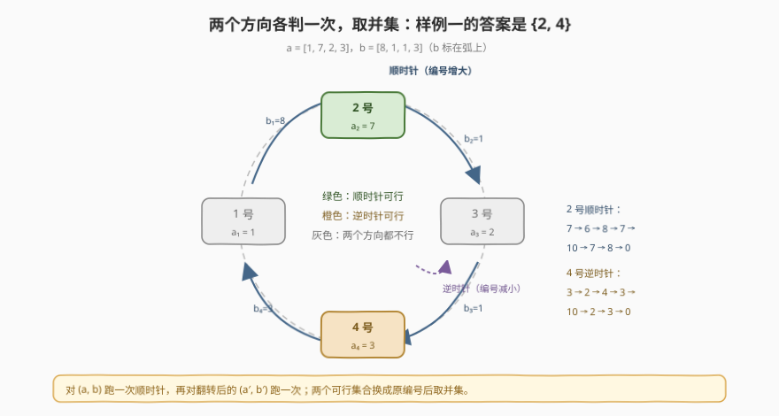
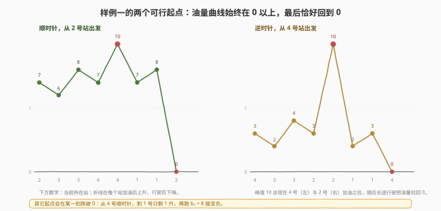

# Codeforces 66E 邮局环游判定 题解

## 1. 题目概述

- **题目链接**：https://codeforces.com/problemset/problem/66/E
- **比赛来源**：Codeforces Beta Round 61 (Div. 2) · Problem E（UTC 2011-03-07）
- **难度**：2000
- **标签**：数据结构、动态规划
- **评测类型**：普通
- **限制**：时间 2 s / 内存 256 MB

**题意**：$n$ 个邮局（加油站）排在一条环形公路上。第 $i$ 站可以加至多 $a_i$ 升油（每站只能加一次），从第 $i$ 站到第 $i+1$ 站耗油 $b_i$（第 $n$ 站的下一站是第 1 站）。汽车每升油跑一公里，出发时油量为 0。可以选择任意一个邮局作为起点，沿**顺时针或逆时针**绕行整整一圈回到起点，途中（任意时刻）油量不能为负。问：哪些邮局可以作为起点（任选一个方向即可）？按编号升序输出这些邮局。

题面保证 $\sum a_i = \sum b_i$。

**约束**：

- $n \le 10^5$：逐起点、逐方向模拟是 $O(n^2) = 10^{10}$，必然超时，需要 $O(n)$ 或 $O(n \log n)$。
- $a_i, b_i \ge 1$ 且 $\sum a_i = \sum b_i \le 10^9$：前缀和始终落在 $[-10^9, 10^9]$，`int` 勉强够用，但保险起见用 64 位。
- 每个方向都要判；两个方向的可行集合取并集。
- 只有一组数据，没有多测。

## 2. 示例与观察

官方样例一：

```text
输入：
4
1 7 2 3
8 1 1 3
输出：
2
2 4
```

官方样例二：

```text
输入：
8
1 2 1 2 1 2 1 2
2 1 2 1 2 1 2 1
输出：
8
1 2 3 4 5 6 7 8
```

逐步演算样例一：$a = [1,7,2,3]$，$b = [8,1,1,3]$，$\sum a = \sum b = 13$。

- **从 2 号站顺时针**：加油 7，跑到 3 号站剩 $7-1=6$；加油 2 得 8，跑到 4 号剩 7；加油 3 得 10，跑到 1 号剩 $10-3=7$；加油 1 得 8，跑回 2 号剩 $8-8=0$。全程非负，可行。
- **从 4 号站顺时针**：加油 3，跑到 1 号剩 0；加油 1 得 1，跑到 2 号要 8 升，立即变为负数，不可行。
- **从 4 号站逆时针**：加油 3，跑到 3 号耗 $b_3=1$ 剩 2；加油 2 得 4，跑到 2 号耗 $b_2=1$ 剩 3；加油 7 得 10，跑到 1 号耗 $b_1=8$ 剩 2；加油 1 得 3，跑回 4 号耗 $b_4=3$ 剩 0。全程非负，可行。
- **从 2 号站逆时针**：加油 7，跑到 1 号耗 $b_1=8$，$7-8<0$，不可行。

所以起点是 $\{2, 4\}$，与输出一致。样例二里 $a$ 与 $b$ 交替互补，每个起点沿某一方向都能走通，答案是全部 8 个。

**观察**：把"在第 $i$ 站加油、再走到下一站"合并成一步，记 $c_i = a_i - b_i$。从起点出发走 $t$ 步后的油量，就是这 $t$ 步 $c$ 的前缀和。于是"全程非负"变成了一串前缀和的不等式；而 $\sum c_i = 0$ 让前缀和以 $n$ 为周期，问题进一步变成**滑动窗口最小值**。

## 3. 解题思路

### 3.1 朴素做法与瓶颈

对每个起点、每个方向，都真实地跑一圈：每圈 $O(n)$，共 $2n$ 圈，$O(n^2)$。$n = 10^5$ 时是 $2 \times 10^{10}$ 次操作，2 s 内差了两个数量级，必然超时。

需要一个能**一次扫描就判定所有起点**的方法。

### 3.2 核心观察：前缀和 + 周期性 + 窗口最小值

![前缀和窗口：起点 i 合法等价于窗口最小值不小于 S[i]](../../../images/cf66e_prefix_window.svg)

**第一步，把油量写成前缀和。** 令 $c_i = a_i - b_i$，$S_0 = 0$，$S_k = \sum_{j=1}^{k} c_j$。从起点 $i$ 顺时针出发，走 $t$ 步（$0 \le t \le n-1$）后到达 $i+t$，此时油量为

$$\text{fuel}(t) = \sum_{j=0}^{t-1} \bigl(a_{i+j} - b_{i+j}\bigr) = S_{i+t} - S_i ,$$

其中下标对 $n$ 循环。合法性要求所有 $t$ 都有 $S_{i+t} - S_i \ge 0$，即

$$\min_{j \in [i+1,\ i+n]} S_j \ \ge\ S_i .$$

**第二步，利用周期性把范围缩成窗口。** 因为 $\sum c_i = 0$，有 $S_{i+n} = S_i$，所以 $j = i+n$ 这一项自动满足（取等号），条件等价于

$$\min_{j \in [i+1,\ i+n-1]} S_j \ \ge\ S_i .$$

把 $S$ 复制一份接在后面得到长度 $2n$ 的数组 $T$（$T_k = S_{k \bmod n}$），每个起点的判定就是"长度为 $n-1$ 的窗口最小值是否不小于 $S_i$"。所有窗口长度相同、起点依次右移一格，用**单调队列**可以在 $O(n)$ 内求出全部窗口最小值。

**第三步，逆时针就是翻转后的顺时针。** 从 $i$ 逆时针出发，下一步是 $i-1$，耗油是 $b_{i-1}$（$b_{i-1}$ 正是 $i-1$ 与 $i$ 之间的距离）。把数组整体翻转：令 $a'_k = a_{n-1-k}$、$b'_k = b_{n-2-k}$（下标模 $n$），则在翻转数组上从位置 $n-1-i$ 顺时针走，恰好对应原数组从 $i$ 逆时针走。对翻转后的数组再跑一遍同样的算法，就得到全部逆时针可行的起点。

### 3.3 算法流程



1. 读入 $n$、$a$、$b$。
2. 对 $(a, b)$ 调用 `validStarts`，得到顺时针可行的 0 基起点集合 $A$。
3. 构造翻转数组 $a', b'$：$a'_k = a_{(n-1-k) \bmod n}$，$b'_k = b_{(n-2-k) \bmod n}$；再调用 `validStarts` 得到 $B$（翻转数组上的 0 基位置）。
4. 原编号 $i$（0 基）可行当且仅当 $i \in A$ 或 $(n-1-i) \in B$。按 $i$ 升序收集，输出个数与编号（1 基）。

`validStarts` 内部：

- 算前缀和 $S_0 \dots S_n$（$S_n = 0$）；
- 构造 $T_k = S_{k \bmod n}$，$k = 0 \dots 2n-1$；
- 单调队列先放入初始窗口 $[1, n-1]$，然后对 $i = 0 \dots n-1$：若队首值 $\ge S_i$ 则 $i$ 可行；队首滑出窗口则弹出；把 $i+n$ 加入队尾并维护单调性。

对 $n = 1$ 的退化情形，窗口 $[1, 0]$ 为空，条件视为真，两个方向都可行，答案就是 1 号站。

### 3.4 样例走查：样例一



前缀和：$c = [-7, 6, 1, 0]$，$S = [0, -7, -1, 0]$，$S_4 = 0$ 符合"总油量 = 总路程"。复制后 $T = [0, -7, -1, 0, 0, -7, -1, 0]$。

顺时针逐个起点（0 基 $i$，窗口 $[i+1, i+3]$）：

| $i$（1 基编号） | $S_i$ | 窗口最小值 | 判定 |
|-----------------|-------|------------|------|
| 0（1 号） | 0 | $\min(-7,-1,0) = -7$ | 否 |
| 1（2 号） | $-7$ | $\min(-1,0,0) = -1 \ge -7$ | **是** |
| 2（3 号） | $-1$ | $\min(0,0,-7) = -7 < -1$ | 否 |
| 3（4 号） | 0 | $\min(0,-7,-1) = -7 < 0$ | 否 |

逆时针用翻转数组：$a' = [3,2,7,1]$，$b' = [1,1,8,3]$，$c' = [2,1,-1,-2]$，$S' = [0,2,3,2,0]$。逐个位置 $p$（窗口 $[p+1,p+3]$）：

| $p$ | $S'_p$ | 窗口最小值 | 判定 | 对应原编号 $4-1-p$ |
|-----|--------|------------|------|--------------------|
| 0 | 0 | $\min(2,3,2)=2$ | **是** | 4 号 |
| 1 | 2 | $\min(3,2,0)=0 < 2$ | 否 | 3 号 |
| 2 | 3 | $\min(2,0,2)=0 < 3$ | 否 | 2 号 |
| 3 | 2 | $\min(0,2,3)=0 < 2$ | 否 | 1 号 |

并集 $\{2, 4\}$，与官方输出一致。图里同时画了两条油量曲线：从 2 号顺时针是 $7 \to 6 \to 8 \to 7 \to 10 \to 7 \to 8 \to 0$，从 4 号逆时针是 $3 \to 2 \to 4 \to 3 \to 10 \to 2 \to 3 \to 0$，两条折线都始终在 0 以上，最后恰好回到 0。

## 4. 正确性证明

**引理 1（油量公式）**：从起点 $i$ 顺时针走 $t$ 步（$0 \le t \le n-1$）后，油量为 $S_{i+t} - S_i$（下标按周期 $n$ 延伸）。

**证明**：对 $t$ 归纳。$t=0$ 时油量为 $0 = S_i - S_i$。设走 $t$ 步后为 $S_{i+t} - S_i$，下一步在 $i+t$ 站加油 $a_{i+t}$、行驶耗油 $b_{i+t}$，油量变为 $S_{i+t} - S_i + a_{i+t} - b_{i+t} = S_{i+t+1} - S_i$。∎

**引理 2（周期性）**：$S_{k+n} = S_k$ 对一切 $k$ 成立。

**证明**：$\sum_{j=1}^{n} c_j = \sum a_j - \sum b_j = 0$，所以 $S_{k+n} = S_k + 0 = S_k$。∎

**引理 3（窗口判定）**：起点 $i$ 顺时针可行，当且仅当 $\min_{j \in [i+1, i+n-1]} T_j \ge S_i$，其中 $T_k = S_{k \bmod n}$。

**证明**：由引理 1，可行性等价于对一切 $0 \le t \le n-1$ 有 $S_{i+t} - S_i \ge 0$，即 $\min_{j \in [i, i+n-1]} S_j \ge S_i$。$j = i$ 时取等号、自动成立，可以去掉，得到 $\min_{j \in [i+1, i+n-1]} S_j \ge S_i$。再由引理 2 把 $S$ 换成周期数组 $T$，即得。∎

**引理 4（逆时针化为翻转后的顺时针）**：在原数组上从 $i$ 逆时针走 $t$ 步，等价于在翻转数组上从 $n-1-i$ 顺时针走 $t$ 步；原编号 $i$ 的逆时针可行性等于翻转数组位置 $n-1-i$ 的顺时针可行性。

**证明**：原数组逆时针的走法依次访问 $i, i-1, i-2, \dots$，第 $k$ 步从 $x$ 到 $x-1$，耗油 $b_{x-1}$。翻转数组位置 $k$ 对应原编号 $n-1-k$：位置 $n-1-i$ 对应 $i$，位置 $n-i$ 对应 $i-1$……访问顺序一致。翻转数组上从位置 $p=n-1-i$ 走到 $p+1$ 的耗油是 $b'_p = b_{(n-2-p) \bmod n} = b_{i-1}$，与 $x=i$ 时逆时针耗油 $b_{i-1}$ 相同；加油量 $a'_p = a_i$ 也一致。逐步对应即得。∎

**引理 5（单调队列正确）**：`validStarts` 中队列的队首始终是当前窗口 $[i+1, i+n-1]$ 的最小值。

**证明**：队列按加入顺序保存下标，且对应值单调不减：加入新下标前，把队尾所有不小于它的元素弹出，因此队列中不存在"比后面元素更大且更早过期"的无用元素，队首即窗口最小值。窗口右端每次右移一格、左端每次右移一格，弹出队首的过期下标后，队首仍是新窗口的最小值（标准滑动窗口最小值算法）。初始窗口 $[1,n-1]$ 同样按此规则构造。∎

**引理 6（加油策略）**：若存在某种"每站加不超过 $a_i$"的加油方式能完成一圈，则"每站都加满 $a_i$"也能完成一圈。

**证明**：总油量等于总路程，加满只是让每个时刻的油量不减（相对任意合法策略，逐站多出的油量单调累积），因此任一时刻油量都不小于原策略，原策略非负则加满后也非负。故只需考虑加满。∎

**定理**：算法输出的集合，恰好是所有能完成一圈的起点。

**证明**：由引理 6，只需按"每站加满"判定。对顺时针，引理 3 与引理 5 说明 `validStarts` 给出的 $A$ 恰为可行集合；对逆时针，引理 4 说明 $B$ 经 $p \mapsto n-1-p$ 映射后恰为逆时针可行集合。算法取两者的并集并按编号升序输出，故结果正确。∎

## 5. 复杂度分析

- **时间**：$O(n)$。前缀和、复制数组、单调队列各扫一遍，两遍方向共 4 次线性扫描，每次进出队各一次，均摊 $O(1)$。
- **空间**：$O(n)$。前缀和 $n+1$ 个、复制数组 $2n$ 个 64 位整数，队列 $O(n)$，$n = 10^5$ 时合计约 2.4 MB。
- **与时限的关系**：$n = 10^5$ 时运算量不到 $10^6$，实测端到端约 $20 \sim 28$ ms，2 s 时限余量在 70 倍以上。Python 版约 176 ms，也在时限内，但更建议用 PyPy3 提交。

## 6. 参考代码

### C++17

```cpp
#include <bits/stdc++.h>
using namespace std;

// 给定「在第 i 站加油 A[i]、从 i 走到下一站耗油 B[i]」的环，求哪些起点能走完整圈。
// 令 c[i] = A[i] - B[i]，S 为前缀和。从起点 i 出发，第 t 步之后的油量是
// S[i+t+1] - S[i]（下标对 n 取模），于是合法性等价于一段长度为 n-1 的窗口最小值 >= S[i]。
static vector<char> validStarts(const vector<long long>& A, const vector<long long>& B) {
    int n = (int)A.size();
    vector<long long> S(n + 1, 0);
    for (int i = 0; i < n; ++i) S[i + 1] = S[i] + A[i] - B[i];
    // 题面保证总油量 = 总路程，即 S[n] = 0，所以 S 以 n 为周期
    vector<long long> T(2 * n);
    for (int k = 0; k < 2 * n; ++k) T[k] = S[k % n];

    vector<char> ok(n, 0);
    deque<int> dq;  // 单调队列，维护窗口 [i+1, i+n-1] 的最小值
    for (int k = 1; k <= n - 1; ++k) {
        while (!dq.empty() && T[dq.back()] >= T[k]) dq.pop_back();
        dq.push_back(k);
    }
    for (int i = 0; i < n; ++i) {
        if (dq.empty() || T[dq.front()] >= S[i]) ok[i] = 1;
        if (!dq.empty() && dq.front() == i + 1) dq.pop_front();
        int add = i + n;
        if (add < 2 * n) {
            while (!dq.empty() && T[dq.back()] >= T[add]) dq.pop_back();
            dq.push_back(add);
        }
    }
    return ok;
}

int main() {
    int n;
    if (scanf("%d", &n) != 1) return 0;
    vector<long long> a(n), b(n);
    for (int i = 0; i < n; ++i) scanf("%lld", &a[i]);
    for (int i = 0; i < n; ++i) scanf("%lld", &b[i]);

    vector<char> cw = validStarts(a, b);  // 顺时针：i -> i+1，花费 b[i]

    // 逆时针：i -> i-1，花费 b[i-1]。把序列整体翻转后就是同一个问题
    vector<long long> a2(n), b2(n);
    for (int k = 0; k < n; ++k) {
        a2[k] = a[(n - 1 - k) % n];
        b2[k] = b[((n - 2 - k) % n + n) % n];
    }
    vector<char> ccw = validStarts(a2, b2);

    vector<int> ans;
    for (int i = 0; i < n; ++i) {
        // 翻转后的第 k 位对应原编号 n-1-k
        if (cw[i] || ccw[n - 1 - i]) ans.push_back(i + 1);
    }
    printf("%d\n", (int)ans.size());
    for (size_t i = 0; i < ans.size(); ++i) {
        printf("%d%c", ans[i], i + 1 == ans.size() ? '\n' : ' ');
    }
    if (ans.empty()) printf("\n");
    return 0;
}
```

### Python3

```python
import sys
from collections import deque


def valid_starts(a, b):
    """a[i] 加油、b[i] 是 i 到下一站的路程，返回所有能走完一圈的起点（0 基）。"""
    n = len(a)
    s = [0] * (n + 1)
    for i in range(n):
        s[i + 1] = s[i] + a[i] - b[i]
    t = [s[k % n] for k in range(2 * n)]

    ok = [False] * n
    dq = deque()
    for k in range(1, n):
        while dq and t[dq[-1]] >= t[k]:
            dq.pop()
        dq.append(k)
    for i in range(n):
        if not dq or t[dq[0]] >= s[i]:
            ok[i] = True
        if dq and dq[0] == i + 1:
            dq.popleft()
        add = i + n
        if add < 2 * n:
            while dq and t[dq[-1]] >= t[add]:
                dq.pop()
            dq.append(add)
    return ok


def main() -> None:
    data = sys.stdin.buffer.read().split()
    if not data:
        return
    n = int(data[0])
    a = list(map(int, data[1:1 + n]))
    b = list(map(int, data[1 + n:1 + 2 * n]))

    cw = valid_starts(a, b)
    a2 = [a[(n - 1 - k) % n] for k in range(n)]
    b2 = [b[(n - 2 - k) % n] for k in range(n)]
    ccw = valid_starts(a2, b2)

    ans = [i + 1 for i in range(n) if cw[i] or ccw[n - 1 - i]]
    sys.stdout.write(str(len(ans)) + "\n")
    sys.stdout.write(" ".join(map(str, ans)) + "\n")


main()
```

C++ 版用 `scanf` 读入：本题有 $2 \times 10^5$ 个整数，在本机的 clang + libc++ 环境下 `cin` 的数值解析明显偏慢，换 `scanf` 后总耗时从约 350 ms 降到约 25 ms；逻辑与 Python 版完全一致。

## 7. 边界情况与易错点

1. **$n = 1$**：窗口为空，条件视为成立，两个方向都能走一圈（加油 $a_1$、跑 $b_1 = a_1$、剩 0），答案 `1` 和 `1`。若代码把空队列判成"不可行"，会错误输出 0 个。
2. **油量恰好为 0 是合法的**：题面要求"不为负"，所以判定用 $\ge 0$ 而不是 $> 0$。样例一的 2 号站顺时针最后恰好耗尽，若写成严格大于会漏掉这个答案。
3. **"总油量 = 总路程"必须用上**：前缀和的周期性 $S_{k+n} = S_k$ 依赖 $\sum c_i = 0$。若在某组数据上该条件不成立（题面保证成立，但自造数据时容易忘），窗口长度与周期就不一致，答案会错。
4. **逆时针的耗油下标**：从 $i$ 逆时针到 $i-1$ 耗的是 $b_{i-1}$（两点之间的距离），不是 $b_i$。这是本题最容易写错的一处；写成 $b_i$ 后样例一仍可能碰巧过，但对拍会立刻暴露。
5. **翻转后的下标映射**：翻转数组位置 $p$ 对应原编号 $n-1-p$，输出时要换回 1 基并加一。少减一或多加一会整体偏移。
6. **溢出**：$a_i, b_i$ 可达 $10^9$，$n$ 可达 $10^5$，但前缀和的绝对值不超过 $\sum a_i \le 10^9$（因为总和为 0、每项为 $a_i - b_i$，部分和落在 $[-10^9, 10^9]$ 内），`long long` 绰绰有余；若用 `int` 存前缀和也够，但 `int` 与 `scanf("%d")` 混用易出错，统一 `long long` 更稳。
7. **输出格式**：第一行是可行个数，第二行是按升序排列的编号，用空格分隔。个数为 0 时第二行应输出空行（理论上每个方向至少有一个可行起点，但代码仍做防御）。
8. **单调队列的过期条件**：窗口左端是 $i+1$，队列里只应保留下标 $\ge i+1$，所以过期判断写 `dq.front() < i + 1` 或 `dq.front() == i + 1`；若写成 `dq.front() <= i + 1`，就会把窗口最左端的合法下标也弹掉，最小值偏大，可能把可行起点误判为不可行。
9. **Python 性能**：$n = 10^5$ 时 CPython 约 176 ms，可以通过但不算宽裕，建议提交 PyPy3；C++ 版无此顾虑。

## 8. 验证记录

- **编译环境与命令**：`Apple clang 21.0.0` + `codeforces/tools/include/bits/stdc++.h` 兼容头，`clang++ -std=c++17 -O2`；Python 为 `3.9.6`。官方样例由 `python3 codeforces/tools/verify_solution.py` 实跑。
- **官方样例**：2 / 2 通过（`2 4`、`1..8`），C++ 与 Python 输出一致。
- **独立暴力对拍**：暴力版完全不使用前缀和或窗口，而是对每个起点、每个方向**真实模拟**一整圈的油量（$O(n^2)$），逐时刻检查非负。随机生成 **313 组**数据：250 组 $n \le 8$、$a_i \le 6$（$b$ 由总和随机拆分保证 $\sum b = \sum a$），外加 60 组 $20 \le n \le 500$ 的中等规模、以及 $n=1$、样例等边界，与参考程序逐组比对，**全部一致**；C++ 与 Python 也逐组一致。
- **最大约束性能**：$n = 10^5$、$a_i$ 随机 $1 \sim 10^4$、$b = a$（全部起点可行，输出 10 万个数）时，C++ 端到端（含进程启动）约 $20 \sim 28$ ms，Python 约 $176$ ms；相对 2 s 时限，C++ 余量约 70 倍。
- **图片校验**：三张 SVG（`cf66e_prefix_window.svg`、`cf66e_two_directions.svg`、`cf66e_fuel_walk.svg`）通过 `xml.etree.ElementTree.parse`，手绘抖动滤镜与手写字体齐备，文字未越出 `viewBox`。
- **复核状态**：verified（样例、对拍、性能、图片四项均实跑通过）。

## 相关题目与扩展

- [Codeforces 66A Petya and Java](https://codeforces.com/problemset/problem/66/A)：同场 A 题。
- [Codeforces 66B Petya and Countryside](https://codeforces.com/problemset/problem/66/B)：同场 B 题。
- [Codeforces 66D Petya and His Friends](https://codeforces.com/problemset/problem/66/D)：同场 D 题。
- [Codeforces 1324E Sleeping Schedule](https://codeforces.com/problemset/problem/1324/E)：前缀和/DP 上的模意义转移，与本题"环形下标 + 前缀和"思路相通。
- [Codeforces 1343C Alternating Subsequence](https://codeforces.com/problemset/problem/1343/C)：同样是分组扫描、按段聚合的线性做法，但更简单。
- [LeetCode 134. 加油站](https://leetcode.cn/problems/gas-station/)：本题的"单向、从唯一可行起点出发"版本，标准 $O(n)$ 前缀和/油量扫描；本题额外要求双向判定与输出全部起点。

**延伸思考**：

1. **如果只允许顺时针**：问题退化成 LeetCode 134 的加强版——需要输出所有可行起点。利用"总和非负时，从全局最小前缀处出发一定可行"的性质，也能做到 $O(n)$，但输出全部起点仍建议用窗口最小值。
2. **如果 $\sum a_i \ne \sum b_i$**：前缀和不再以 $n$ 为周期，而是 $S_{i+n} = S_i + D$，其中 $D = \sum a_i - \sum b_i$。此时判定窗口要改回完整的 $[i+1, i+n]$，在长度 $2n$ 的数组上照样可以用单调队列；若 $D < 0$，总油量不足以跑完一圈，直接输出 0 个即可。注意 $D > 0$ 并不保证所有起点都可行：多出来的油在"最后一段"才到账，途中仍可能先耗尽（例如 $a = [1,100]$、$b = [60,40]$，从 1 号出发第一步就为负）。
3. **如果汽车油箱有容量上限 $C$**："每站加满"不再是最优策略（多余的油会溢出浪费），判定需要同时跟踪当前油量与容量，单调队列要换成"贪心 + 双指针"式的模拟，复杂度与实现难度都明显上升。
4. **可行集合并不连续**：样例一的 $\{2,4\}$ 就是环上的两个孤立点，总油量大于总路程时也会出现"隔一个可行一个"的情形，因此不能假设答案是一段弧、用双指针去扫，必须逐点判定。
