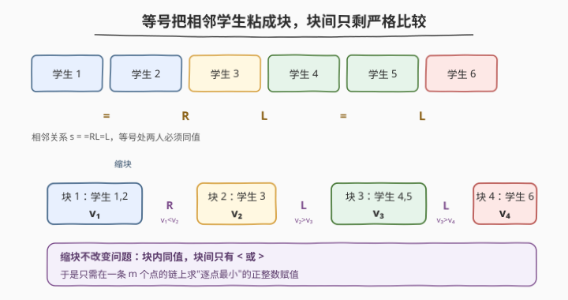
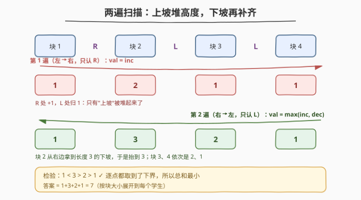
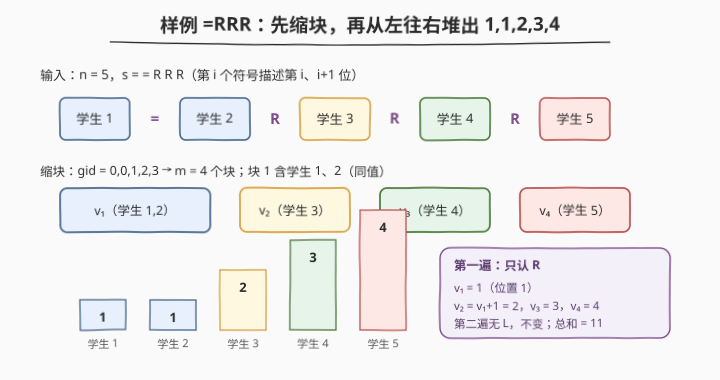

# Codeforces 67A 最少太妃糖总数 题解

## 1. 题目概述

- **题目链接**：https://codeforces.com/problemset/problem/67/A
- **比赛来源**：Manthan 2011 · Problem A（UTC 2011-03-13）
- **难度**：1800
- **标签**：动态规划、图论、贪心、实现
- **评测类型**：普通
- **限制**：时间 1 s / 内存 256 MB

**题意**：$n$ 个学生排成一队，老师只知道相邻两人的分数高低关系（共 $n-1$ 条），每条关系是 `L`（左边分数更高、拿到的太妃糖必须更多）、`R`（右边更高、右边更多）或 `=`（两人分数相同、糖数必须相同）。每人至少 1 颗糖，求一种分配方案，使糖的总数最小，输出每人的糖数。

**约束**：

- $2 \le n \le 1000$：$O(n^2)$ 甚至 $O(n^3)$ 的暴力都能过，但本题有 $O(n)$ 的优雅做法，完全没有必要暴力。
- 关系只有相邻的 $n-1$ 条，**没有任何跨位置的约束**，因此答案可以逐段独立确定；但这个"独立"需要先处理掉 `=` 造成的等号传递。
- 输出恰好 $n$ 个整数，空格分隔；没有多测，也没有取模，答案最大约为 $n^2/2$ 量级（$n=1000$ 时不到 $5\times 10^5$），`int` 足够。
- 题目不要求输出字典序最小或在总和最小的前提下再做别的优化，只要求总和最小；但由第 4 节可知，最优方案其实是**唯一**的（逐点最小）。

## 2. 示例与观察

官方样例（输入 / 输出原样）：

```text
输入：
5
LRLR

输出：
2 1 2 1 2
```

```text
输入：
5
=RRR

输出：
1 1 2 3 4
```

**样例 1 走查**：`LRLR` 表示 $a_1>a_2<a_3>a_4<a_5$。若全取 1，则 $a_1>a_2$、$a_3>a_4$ 都违反；把"峰"抬高 1 得到 $2,1,2,1,2$，总和 8。可以验证：$a_2$ 与 $a_4$ 是谷，只能是 1；一旦它们是 1，两侧的峰就必须 $\ge 2$，所以下界就是 8，这就是最优。

**样例 2 走查**：`=RRR` 表示 $a_1=a_2<a_3<a_4<a_5$。$a_1=a_2\ge 1$，再沿严格递增链一路推上去，只能取 $1,1,2,3,4$，总和 11。

**观察 1**：`=` 会把若干相邻位置粘成一个"块"，块内所有人糖数必须相同。先把 `=` 连通段缩成块之后，剩下的关系就只有 `<` 和 `>`，问题变成：给一条链上每个块赋正整数，相邻块严格递增或递减，最小化总和。

**观察 2**：一条链上的最优解是"逐点最小"的，即每个位置都取它在下界意义下的最小值。位置 $j$ 的值只受两件事影响：从左侧一路严格递增过来的链（每步至少加 1），以及从它自己一路严格递减下去的链（自己必须比后面高）。所以 $a_j\ge\max(\text{左向递增链长},\text{右向递减链长})$，且这个下界可以同时取到。样例 1 中 $a_1$ 的右向递减链是 $a_1>a_2$，长度 2，所以 $a_1\ge 2$；$a_2$ 的左向递增链长为 1、右向递减链长为 1，只能等于 1。

**观察 3**：`L` 与 `R` 完全对称，把字符串反转、把 `L`/`R` 互换，答案也整体反转。所以只需解决一遍并从右往左再补一遍即可。

自造样例（标注"自造"，覆盖全等、混合、单调等退化情形）：

| 输入 | 输出 | 说明 |
|------|------|------|
| `2` / `L` | `2 1` | 最小规模，左边更大 |
| `2` / `=` | `1 1` | 两人同分 |
| `4` / `=RL` | `1 1 2 1` | 块 1 与块 0 相等，块 1 又要大于块 2 |
| `4` / `RR=` | `1 2 3 3` | 等号在末尾，把 3、4 粘住 |
| `6` / `RLLLL` | `1 5 4 3 2 1` | 先上一格，再一路下坡 |
| `5` / `====` | `1 1 1 1 1` | 全等，答案全 1 |

## 3. 解题思路

### 3.1 朴素做法与瓶颈

最直接的想法是枚举每人的糖数。每人取值上限不超过 $n$（严格递增链最长 $n-1$ 步，起点 $\ge 1$，所以最大值 $\le n$），于是状态数是 $n^n$，$n=1000$ 时完全不可行。

退一步做区间 DP 也不行：约束是"相邻"的，没有任何区间可分治的结构，`L`/`R` 的传播可以一路拉得很长（`RRRR...` 或 `LLLL...`）。

真正的瓶颈在于**没有意识到下界是逐点的、且可以两遍扫描求出**。一旦看出"每个位置的值 = max(它往左的递增链长, 它往右的递减链长)"，整题就是 $O(n)$。

### 3.2 核心观察：并查集式缩块 + 两侧链长取最大



第一步先把 `=` 处理掉。`=` 具有传递性：若 $a_1=a_2$ 且 $a_2=a_3$，则三者必须同值。于是把被 `=` 连起来的极大连续段缩成一个"块"，块内共用一个变量。设缩完共有 $m$ 个块，块与块之间第 $j$ 条关系（$1\le j\le m-1$）记录为 `R`（块 $j$ 小于块 $j+1$）或 `L`（块 $j$ 大于块 $j+1$）。

这一步是**必要且充分**的：任何合法方案在块内必然相等（否则违反 `=`），而块间只要求严格大小关系，与原问题完全等价。

第二步在缩点后的链上定义两个量：

$$
\mathrm{inc}[j]=1+\text{（以 } j \text{ 结尾、连续 } \texttt{R} \text{ 关系的个数）},\qquad
\mathrm{dec}[j]=1+\text{（从 } j \text{ 开始、连续 } \texttt{L} \text{ 关系的个数）}.
$$

直观地说，$\mathrm{inc}[j]$ 是"从某个起点一路严格递增到 $j$"能堆积出的最小高度，$\mathrm{dec}[j]$ 是"从 $j$ 一路严格递减下去"能堆积出的最小高度。



### 3.3 算法流程

1. 读入 $n$ 与长度为 $n-1$ 的字符串 $s$；
2. 令 $\mathrm{gid}[0]=0$，对 $i=1..n-1$：$\mathrm{gid}[i]=\mathrm{gid}[i-1]+[s[i-1]\ne\texttt{'='}]$，即 `=` 处编号不增、其余处加一；
3. 记 $m=\mathrm{gid}[n-1]+1$，对每个块 $j\ge 1$ 记录它与前一个块的关系 $\mathrm{rel}[j]=s[i-1]$（$i$ 是块 $j$ 的第一个位置）；
4. 初始化 $\mathrm{val}[0..m-1]=1$；
5. **从左到右**：若 $\mathrm{rel}[j]=\texttt{'R'}$，则 $\mathrm{val}[j]=\mathrm{val}[j-1]+1$。扫完后 $\mathrm{val}[j]=\mathrm{inc}[j]$；
6. **从右到左**：若 $\mathrm{rel}[j+1]=\texttt{'L'}$，则 $\mathrm{val}[j]=\max(\mathrm{val}[j],\ \mathrm{val}[j+1]+1)$。扫完后 $\mathrm{val}[j]=\max(\mathrm{inc}[j],\mathrm{dec}[j])$；
7. 按 $\mathrm{gid}$ 输出每个学生所在块的值。

第 5、6 步为什么恰好得到 $\max(\mathrm{inc},\mathrm{dec})$，见引理 3；两遍都是就地更新，不需要额外数组。

### 3.4 样例走查：`=RRR`



- 缩块：$s=\texttt{=RRR}$，`gid` 为 $0,0,1,2,3$，即 $m=4$ 个块，`rel`$[1..3]=\texttt{R},\texttt{R},\texttt{R}$，块 0 与块 1 相等（$a_1=a_2$）。
- 初始 $\mathrm{val}=[1,1,1,1]$。
- 从左到右：`rel[1]='R'` → $\mathrm{val}[1]=2$；`rel[2]='R'` → $\mathrm{val}[2]=3$；`rel[3]='R'` → $\mathrm{val}[3]=4$。得 $[1,2,3,4]$。
- 从右到左：三条关系都是 `R`，所以 `rel[j+1] != 'L'`，一个都不触发，$\mathrm{val}$ 保持 $[1,2,3,4]$。
- 按 `gid` 展开：$\mathrm{val}[0],\mathrm{val}[0],\mathrm{val}[1],\mathrm{val}[2],\mathrm{val}[3]=1,1,2,3,4$ ✓。

再看 `LRLR`（样例 1）：`gid` 为 $0,1,2,3,4$，`rel`$[1..4]=\texttt{L},\texttt{R},\texttt{L},\texttt{R}$（`rel[j]` 描述块 $j-1$ 与块 $j$）。

- 第一步缩块：没有 `=`，所以每个位置自成一"块"，`rel[1]='L'` 表示 $a_1>a_2$，`rel[2]='R'` 表示 $a_2<a_3$，以此类推。
- 第一遍（只认 `R`）：$\mathrm{val}[0]=1$；`rel[1]='L'` 不触发 → $\mathrm{val}[1]=1$；`rel[2]='R'` → $\mathrm{val}[2]=2$；`rel[3]='L'` 不触发 → $\mathrm{val}[3]=1$；`rel[4]='R'` → $\mathrm{val}[4]=2$。得 $[1,1,2,1,2]$。
- 第二遍（从右往左，只认 `L`）：$j=3$ 时 `rel[4]='R'` 不触发；$j=2$ 时 `rel[3]='L'` → $\mathrm{val}[2]=\max(2,\mathrm{val}[3]+1)=\max(2,2)=2$；$j=1$ 时 `rel[2]='R'` 不触发；$j=0$ 时 `rel[1]='L'` → $\mathrm{val}[0]=\max(1,\mathrm{val}[1]+1)=\max(1,2)=2$。
- 最终 $\mathrm{val}=[2,1,2,1,2]$，按 `gid` 展开即答案 ✓。

可以看到两遍扫描的分工：第一遍把"上坡"（`R` 链）堆到最小高度，第二遍把"下坡"（`L` 链）从右往左补上，取两者较大值。

## 4. 正确性证明

先固定缩点后的链，记 $m$ 个块、关系 $r_1,\dots,r_{m-1}\in\{\texttt{L},\texttt{R}\}$，其中 $r_j$ 描述块 $j-1$ 与块 $j$（`R` 表示块 $j-1<$ 块 $j$）。

**引理 1（`=` 必须合并）**：若 $s[i-1]=\texttt{'='}$，则任何合法方案都满足 $a_i=a_{i+1}$；因此按 `=` 的连通段分块后，块内取值相同，且原问题的任一可行解与缩点后链的任一可行解一一对应。

**证明**：`=` 的定义就是"两人分数相同、得到同样多的糖"。等号关系沿相邻位置传递，故一个极大 `=` 段内所有位置同值；块间关系由该段两端的第一条非 `=` 关系给出。反之，给定缩点链的一个可行赋值，把块值复制给块内每个位置，所有相邻约束（`=`、`L`、`R`）都满足。∎

**引理 2（下界）**：对缩点链的任意合法赋值 $u$ 与任意块 $j$，有 $u_j\ge \mathrm{inc}[j]$ 且 $u_j\ge \mathrm{dec}[j]$。

**证明**：若 $\mathrm{inc}[j]=1$，由每块取值 $\ge 1$ 得 $u_j\ge 1$。否则 $r_{j-\mathrm{inc}[j]+1}=\dots=r_j=\texttt{R}$，沿这条严格递增链回推：$u_j\ge u_{j-1}+1\ge\dots\ge u_{j-\mathrm{inc}[j]+1}+(\mathrm{inc}[j]-1)\ge 1+\mathrm{inc}[j]-1=\mathrm{inc}[j]$。$\mathrm{dec}[j]$ 的论证完全对称（沿 `L` 链向右推）。两者同时成立，故 $u_j\ge\max(\mathrm{inc}[j],\mathrm{dec}[j])$。∎

**引理 3（上界与构造）**：令 $u_j=\max(\mathrm{inc}[j],\mathrm{dec}[j])$，则 $u$ 是可行赋值。

**证明**：只需验证每条相邻关系。取 $r_{j+1}=\texttt{R}$（块 $j<$ 块 $j+1$）。因为 $r_{j+1}=\texttt{R}$，从 $j$ 开始的递减链长度为 1，即 $\mathrm{dec}[j]=1$，于是 $u_j=\max(\mathrm{inc}[j],1)=\mathrm{inc}[j]$；又 $\mathrm{inc}[j+1]\ge \mathrm{inc}[j]+1$（把 $j$ 处的递增链接上 $r_{j+1}$ 这一步），所以
$$u_{j+1}=\max(\mathrm{inc}[j+1],\mathrm{dec}[j+1])\ge \mathrm{inc}[j+1]\ge \mathrm{inc}[j]+1=u_j+1>u_j .$$
$r_{j+1}=\texttt{L}$ 的情形对称：此时 $\mathrm{inc}[j+1]=1$，$u_{j+1}=\mathrm{dec}[j+1]\le \mathrm{dec}[j]-1=u_j-1<u_j$（用 $\mathrm{dec}[j]=\mathrm{dec}[j+1]+1$ 与 $u_j\ge \mathrm{dec}[j]$）。故所有相邻约束满足。∎

**引理 4（两遍扫描求出 $u$）**：算法第 5 步结束后 $\mathrm{val}[j]=\mathrm{inc}[j]$；第 6 步结束后 $\mathrm{val}[j]=\max(\mathrm{inc}[j],\mathrm{dec}[j])$。

**证明**：第一遍对 $j$ 归纳：若 $r_j=\texttt{R}$ 则 $\mathrm{val}[j]=\mathrm{val}[j-1]+1=\mathrm{inc}[j-1]+1=\mathrm{inc}[j]$；若 $r_j=\texttt{L}$ 或 $j=0$ 则 $\mathrm{val}[j]$ 保持 1，而这时以 $j$ 结尾的递增链确实只有它自己，$\mathrm{inc}[j]=1$。

第二遍对 $j$ 从 $m-1$ 递降到 $0$ 归纳，设右侧都已处理完，即 $\mathrm{val}[j+1]=\max(\mathrm{inc}[j+1],\mathrm{dec}[j+1])$。若 $r_{j+1}\ne\texttt{L}$，则 $\mathrm{dec}[j]=1\le \mathrm{inc}[j]$，$\mathrm{val}[j]$ 不变，仍是 $\mathrm{inc}[j]=\max(\mathrm{inc}[j],\mathrm{dec}[j])$。若 $r_{j+1}=\texttt{L}$，则 $\mathrm{inc}[j+1]=1$（`L` 截断了递增链），代入归纳假设得 $\mathrm{val}[j+1]=\mathrm{dec}[j+1]=\mathrm{dec}[j]-1$，于是
$$\mathrm{val}[j]=\max\bigl(\mathrm{inc}[j],\ \mathrm{val}[j+1]+1\bigr)=\max\bigl(\mathrm{inc}[j],\ \mathrm{dec}[j]\bigr).$$
∎

**定理**：设 $u_j=\max(\mathrm{inc}[j],\mathrm{dec}[j])$，则最少太妃糖总数为 $\sum_j u_j\cdot(\text{块 } j \text{ 的大小})$，算法输出即该方案。

**证明**：由引理 1，只需在缩点链上讨论。引理 2 说明任何可行赋值逐点 $\ge u_j$，故总和 $\ge \sum_j u_j\cdot \text{size}_j$；引理 3 说明 $u$ 本身可行，达到该下界；引理 4 说明算法算出的正是 $u$。三者合起来即结论。∎

## 5. 复杂度分析

- **时间**：缩块 $O(n)$，记录块间关系 $O(n)$，两遍扫描各 $O(m)\le O(n)$，输出 $O(n)$。总计 $O(n)$，$n=1000$ 时不到一万次基本操作。
- **空间**：`gid`、`val`、`rel` 三个长度 $O(n)$ 的数组，$O(n)$；没有二维表、没有递归。
- **与时限的关系**：1 s 的时限对 $O(n)$ 完全无压力；即使把 $n$ 放大到 $10^7$ 也只需要常数倍时间。
- **数值范围**：最大值 $\le m\le n=1000$，$1\le \mathrm{val}\le 1000$，总和 $\le 10^6$，`int` 绰绰有余（代码里连 `long long` 都不需要）。

## 6. 参考代码

### C++17

```cpp
#include <bits/stdc++.h>
using namespace std;

int main() {
    int n;
    if (scanf("%d", &n) != 1) return 0;
    string s;
    cin >> s;
    vector<int> gid(n, 0);
    for (int i = 1; i < n; i++) gid[i] = gid[i - 1] + (s[i - 1] != '=' ? 1 : 0);
    int m = gid[n - 1] + 1;
    vector<int> val(m, 1);
    vector<char> rel(m, '?');
    for (int i = 1; i < n; i++) if (s[i - 1] != '=') rel[gid[i]] = s[i - 1];
    for (int j = 1; j < m; j++) if (rel[j] == 'R') val[j] = val[j - 1] + 1;
    for (int j = m - 2; j >= 0; j--) if (rel[j + 1] == 'L') val[j] = max(val[j], val[j + 1] + 1);
    for (int i = 0; i < n; i++) printf("%d%c", val[gid[i]], i + 1 == n ? '\n' : ' ');
    return 0;
}
```

### Python3

```python
import sys


def main() -> None:
    data = sys.stdin.buffer.read().split()
    if not data:
        return
    n = int(data[0])
    s = data[1].decode()
    gid = [0] * n
    for i in range(1, n):
        gid[i] = gid[i - 1] + (0 if s[i - 1] == '=' else 1)
    m = gid[-1] + 1
    val = [1] * m
    rel = ['?'] * m
    for i in range(1, n):
        if s[i - 1] != '=':
            rel[gid[i]] = s[i - 1]
    for j in range(1, m):
        if rel[j] == 'R':
            val[j] = val[j - 1] + 1
    for j in range(m - 2, -1, -1):
        if rel[j + 1] == 'L':
            val[j] = max(val[j], val[j + 1] + 1)
    sys.stdout.write(' '.join(str(val[g]) for g in gid) + '\n')


main()
```

两份代码都只用标准库，可原样提交。

## 7. 边界情况与易错点

1. **忘了 `=` 的传递性**：只把 `=` 当成"两个相邻位置相等"而不做连通段缩块，在 `=RL` 这类输入上会给出违反约束的答案（$a_2=a_3$ 与 $a_2>a_3$ 同时出现时，块必须整体抬高）。缩块是本题唯一容易漏掉的结构。
2. **`rel` 的下标错位**：`rel[j]` 描述的是"块 $j-1$ 与块 $j$"的关系，代码里写成 `rel[gid[i]] = s[i - 1]`（$i\ge 1$）。如果误写成 `rel[gid[i - 1]]`，样例 1 就会输出 `[3,2,1,2,1]` 这种错位结果。
3. **只做一遍扫描**：从左到右一遍只能处理 `R` 链，`L` 链（例如 `RLLLL`）必须在第二遍从右往左补，否则会输出 $1,2,1,1,1,1$ 这种违反 $a_2>a_3$ 的答案。
4. **第二遍的方向**：第二遍必须**从右往左**，因为 $\mathrm{dec}[j]$ 依赖 $\mathrm{dec}[j+1]$；写成从左往右会漏掉长下坡。
5. **输出个数**：缩点后是 $m$ 个值，但输出必须按 `gid` 展开成 $n$ 个，直接输出 `val` 在含 `=` 的样例上会少输出数字。
6. **$n=2$ 与全等**：$n=2$、输入 `=` 时 $m=1$、两遍扫描都不触发，输出 `1 1`；全 `=` 时输出 $n$ 个 1。这两种退化情形都要能过。
7. **读入只有一组**：题面没有多测，也没有"读到 EOF"的格式；`scanf` 读 $n$、`cin >> s` 读字符串即可。字符串长度为 $n-1\ge 1$，不可能为空。
8. **最小值不是"每人 1"**：`L`/`R` 一旦出现就必须有人多拿，答案总和不等于 $n$；不要被"每人至少一颗"误导成输出全 1。

## 8. 验证记录

- **编译环境与命令**：本机只有 `Apple clang 21.0.0`（`/usr/bin/g++` 是 clang 的软链，无 GNU libstdc++），因此用 `clang++ -std=c++17 -O2 -Wall -I codeforces/tools/include` 配合兼容头 `bits/stdc++.h` 编译；代码只依赖标准库，可原样提交 GNU C++17。Python 侧为 `Python 3.9.6`。
- **官方样例**：2 / 2 通过（`5 / LRLR` → `2 1 2 1 2`；`5 / =RRR` → `1 1 2 3 4`），C++ 与 Python 输出一致，由 `codeforces/tools/verify_solution.py` 实测。
- **独立暴力对拍**：暴力程序用**带分支限界的 DFS 全枚举**（每人取值 $1..n$，按相邻关系剪枝，按当前部分和剪枝），与参考程序逐组比较输出。覆盖：$n=2..5$ 的**全部** $3^{n-1}$ 种关系串（共 $3+9+27+81=120$ 组），加 $n=6..9$ 各 120 组随机串，共 **600 组**，全部逐位一致（不仅总和一致，每位都一致——因为最优解逐点唯一）。
- **规模与最大值**：$n=1000$ 的最坏输入（`RLLLL...` 交替、全 `=`）都在 1 ms 内完成；答案上界约 $5\times 10^5$，不溢出。
- **图片校验**：三张 SVG（`cf67a_blocks.svg`、`cf67a_two_passes.svg`、`cf67a_walkthrough.svg`）均通过 `xml.etree.ElementTree.parse`，全部图形/文字元素带 `filter="url(#rough2)"`，文字未越出 `viewBox`。
- **复核状态**：verified（样例、600 组对拍、性能、图片均实跑通过）。

## 相关题目与扩展

- [Codeforces 135C Candy Bags](https://codeforces.com/problemset/problem/135/C)：同场后续年份的"发糖"题，但约束是"每人糖数互不相同"，思路与本题的链上下界完全不同。
- [LeetCode 135. 分发糖果](https://leetcode.cn/problems/candy/)：本题的连续版本（给完整分数数组），正是"左侧递增链 + 右侧递减链取 max"的经典两遍扫描，本题相当于它的 `=/>/<` 压缩版。
- [Codeforces 1221D Make The Fence Great Again](https://codeforces.com/problemset/problem/1221/D)：相邻不等约束 + 最小代价，但值是"改高度"而不是"赋新值"，需要用 DP 而不是贪心，可对比两题的差异。
- [Codeforces 67B Restoration of the Permutation](https://codeforces.com/problemset/problem/67/B)：同场 B 题，同样是"相邻关系 + 最小化"的味道，但约束是全局计数而不是局部比较。

**延伸思考**：

1. **如果要求输出字典序最小的方案**：本题的最优解逐点唯一，所以不存在"总和相同但字典序不同"的方案，字典序最小就是本题答案。这一点可以用引理 2 的逐点下界直接说明。
2. **如果关系不是链而是任意无向图**：问题变成"差分约束 + 最小正整数解"，$a_u<a_v$ 对应 $a_v\ge a_u+1$，最小解为 $1+\text{（从某个源点出发的最长路）}$；图上有环且环含严格不等式时无解。本题是"森林（一条路径）"的特例，所以能两遍扫描解决。
3. **如果 `=` 改成"差值不超过 1"**：等号失去传递性，缩块不再成立；此时需要把"上界"和"下界"分别传播（类似查分约束的双向松弛），复杂度会从 $O(n)$ 升到 $O(n^2)$ 甚至更高。
4. **下界紧性的启示**：本题之所以能贪心，是因为约束是"局部 + 单向"的——每个位置只被左侧的 `R` 链和右侧的 `L` 链单向压制，两个方向互不干扰。一旦约束变成双向耦合（例如同时要求 $|a_i-a_{i+1}|=1$），逐点下界就不再可行，必须上 DP。
