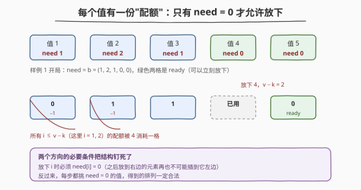
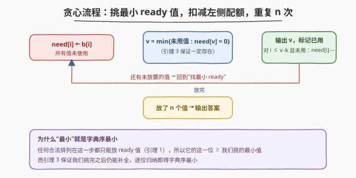
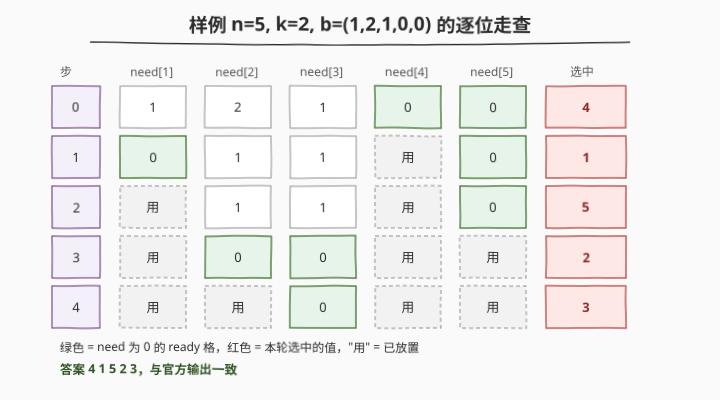

# Codeforces 67B 还原最小排列 题解

## 1. 题目概述

- **题目链接**：https://codeforces.com/problemset/problem/67/B
- **比赛来源**：Manthan 2011 · Problem B（UTC 2011-03-13）
- **难度**：1800
- **标签**：贪心
- **评测类型**：普通
- **限制**：时间 1 s / 内存 256 MB

**题意**：$A$ 是 $1..n$ 的一个排列。给定 $k$ 与序列 $B$，其中 $b_i$ 表示：在 $A$ 中，值 $i$ 的**左边**有多少个元素的值 $\ge i+k$。已知 $B$ 由某个排列 $A$ 产生（保证有解），求**字典序最小**的那个 $A$。

**约束**：

- $1 \le n \le 1000$，$1 \le k \le n$：$O(n^2)$ 的逐位构造可以接受，$O(n!)$ 枚举排列不行。
- $b_i$ 只统计"比 $i$ 大至少 $k$"的元素，值落在 $(i,\,i+k)$ 之间的元素**完全不影响** $b_i$——这是本题全部结构的来源。
- 输入只有一组数据，$B$ 一定有解，不需要处理无解情况（但程序里仍保留了一个兜底出口）。
- 输出 $n$ 个整数，普通评测，按 token 比对。

## 2. 示例与观察

官方样例（输入 / 输出原样）：

```text
输入：
5 2
1 2 1 0 0

输出：
4 1 5 2 3
```

```text
输入：
4 2
1 0 0 0

输出：
2 3 1 4
```

**样例 1 走查**：$n=5,k=2$，$b=(1,2,1,0,0)$。取答案 $A=(4,1,5,2,3)$ 验证：

- 值 1 在位置 2，左边只有 4，$4\ge 1+2=3$ ✓，贡献 1，等于 $b_1=1$；
- 值 2 在位置 4，左边有 $4,1,5$，其中 $\ge 2+2=4$ 的是 $4,5$，贡献 2，等于 $b_2=2$；
- 值 3 在位置 5，左边 $\ge 5$ 的只有 5，贡献 1，等于 $b_3=1$；
- 值 4 在位置 1，左边没有元素，$b_4=0$ ✓；值 5 在位置 3，左边 $4,1$ 都 $<7$，$b_5=0$ ✓。

**样例 2 走查**：$n=4,k=2$，$b=(1,0,0,0)$。因为 $b_1=1$，值 1 左边必须恰有一个 $\ge 3$ 的元素；而 $b_2=b_3=b_4=0$ 说明 2、3、4 的左边不能出现比它们大 2 以上的元素。字典序最小的解是 $2,3,1,4$：值 1 左边有 2（$2<3$ 不算）和 3（算），正好 1 个。

**观察 1（关键）**：设我们把排列从左往右一位一位地填。当准备把值 $v$ 放在当前位时，**所有以后再放的元素都在 $v$ 右边**，所以"最终在 $v$ 左边的 $\ge v+k$ 的元素"在此时已经全部就位。于是可以维护一个计数器 $r_v$（已经放在 $v$ 左边、且值 $\ge v+k$ 的元素个数），**只有 $r_v=b_v$ 的值才允许现在放**。

**观察 2**：只要每一步都放"允许放"的值，得到的排列一定合法（因为每个值被放下时它的计数正好满足要求，之后再无元素能插到它左边）。所以问题从"构造一个满足全局约束的排列"变成了"每一步从允许集合里挑一个"，而字典序最小就等于每一步挑**编号最小**的允许值。

**观察 3**：$r_v$ 只在放入一个值 $v$ 时被更新：对所有"比 $v$ 小至少 $k$"、且尚未放置的 $i$，$r_i$ 加一（因为 $v\ge i+k$，$v$ 落到了 $i$ 的左边）。等价地，用"还差多少" $need_i=b_i-r_i$ 记账：放入 $v$ 时对所有未放置的 $i\le v-k$ 令 $need_i$ 减一。

## 3. 解题思路

### 3.1 朴素做法与瓶颈

直接按字典序枚举排列并检验：最坏 $n!$ 个候选，$n=1000$ 完全不可能。即便只做"逐位试填 + 回溯"，判断"当前前缀是否可能补全"也不是一件显然的事——$b_i$ 的约束跨越整个后缀（$i$ 的计数与所有 $\ge i+k$ 的值有关），没法用简单的局部条件剪枝。

瓶颈在于没有意识到观察 1：**"能否现在放"有一个精确、局部的判据**（$need_v=0$），而且这个判据既必要又充分。有了它，整个问题退化成"每步在若干候选里取最小"。

### 3.2 核心观察：只有"配额已满"的值才能放



把 $b_i$ 看成值 $i$ 的"配额"：它左边必须恰好有 $b_i$ 个 $\ge i+k$ 的值。每当我们把某个 $v\ge i+k$ 放到 $i$ 左边，$i$ 的配额就被消耗一格。于是定义

$$
need_i=b_i-\#\{v \text{ 已放置},\ v\ge i+k\},\qquad cap_i=\#\{u \text{ 未放置},\ u\ge i+k\}.
$$

- $need_i$ 是"还差几个配额"；
- $cap_i$ 是"后面还有几个值能填这个配额"。

**引理的核心**是：值 $i$ 被放下时必须有 $need_i=0$（否则它在右边再也遇不到新的 $\ge i+k$ 的元素，配额永远填不满）；反之，只要每一步都挑 $need_v=0$ 的值，放完的排列必然合法。于是算法就是：

> 重复 $n$ 次：在所有未放置且 $need_v=0$ 的值里挑**最小**的 $v$ 放下，然后对所有未放置的 $i\le v-k$ 令 $need_i\leftarrow need_i-1$。



### 3.3 算法流程

1. 读入 $n,k$ 与 $b_1..b_n$，令 $need_i=b_i$；
2. 重复 $n$ 轮：
   1. 从 $v=1$ 向上找第一个"未使用且 $need_v=0$"的 $v$；
   2. 输出 $v$，标记已用；
   3. 对所有 $i\le v-k$ 且未使用的 $i$：$need_i\leftarrow need_i-1$；
3. 扫完 $n$ 轮即得答案。

实现上第 2.1 步是 $O(n)$ 的线性扫描，第 2.3 步也是 $O(n)$，共 $n$ 轮，总复杂度 $O(n^2)$，$n=1000$ 时约 $10^6$ 次操作。

为什么"挑最小的 ready"不会把自己坑死（即不会出现某一步一个 ready 值都没有）？这由不变量 $0\le need_i\le cap_i$ 保证：未放置集合里**最大的**值 $M$ 一定满足 $cap_M=0$，于是 $need_M\le 0$，即 $need_M=0$，所以 ready 集合永远非空。详见第 4 节引理 3。

### 3.4 样例走查：$n=5,k=2,b=(1,2,1,0,0)$



| 步 | 已放置 | $need$（值 1..5） | ready 值 | 选中 |
|----|--------|-------------------|----------|------|
| 开 | — | 1,2,1,0,0 | 4,5 | — |
| 1 | — | 1,2,1,0,0 | 4,5 | **4** |
| 2 | 4 | 0,1,1,0,0 | 1,5 | **1** |
| 3 | 4,1 | 0,1,1,0,0 | 5 | **5** |
| 4 | 4,1,5 | 0,0,0,0,0 | 2,3 | **2** |
| 5 | 4,1,5,2 | 0,0,0,0,0 | 3 | **3** |

- 第 1 步：$need_4=need_5=0$，ready 是 $\{4,5\}$，取较小的 4 放下；因为 $4-k=2$，令未放置的 $need_1,need_2$ 各减一，得 $(0,1,1,0,0)$。
- 第 2 步：$need_1=0$、$need_5=0$，ready 是 $\{1,5\}$，取 1；$1-k<1$，没有可扣减的，$need$ 不变。
- 第 3 步：未放置值里只有 $need_5=0$，放 5；$5-k=3$，令 $need_2,need_3$ 各减一，两者都归 0。
- 第 4 步：$need_2=need_3=0$，取较小的 2；$2-k=0$，无可扣减。
- 第 5 步：只剩 3，$need_3=0$，放下。

得到 $4,1,5,2,3$，与官方输出一致。可以注意到整张表里 $need$ 只减不增，这正是第 4 节不变量的直观来源。

## 4. 正确性证明

沿用记号：$U$ 为未放置集合，$need_i$ 如 (2.1) 定义，$cap_i=\#\{u\in U:u\ge i+k\}$。

**引理 1（必要性：放下时必须 $need_i=0$）**：设某个排列合法，$i$ 在第 $t$ 位。则在第 $t$ 步之前已经放下的、$\ge i+k$ 的元素个数恰为 $b_i$，即 $need_i=0$。

**证明**：合法排列中，$i$ 左边恰好有 $b_i$ 个 $\ge i+k$ 的元素。第 $t$ 步时放下的是 $i$，此刻已放下的元素正是 $i$ 的全部左邻，之后放下的都在 $i$ 右边，不再影响 $i$ 的计数。故此刻已放下的 $\ge i+k$ 的元素数等于 $b_i$，即 $need_i=b_i-b_i=0$。∎

**引理 2（充分性：每步都挑 $need=0$ 的值即合法）**：若某个排列在每一步放下 $i$ 时都满足 $need_i=0$，则该排列合法。

**证明**：对任意 $i$，它被放下时已放下的 $\ge i+k$ 的元素数 $=b_i-need_i=b_i$，而这些元素恰好就是最终排在 $i$ 左边的全部元素（后面放下的都在右边），所以 $b_i$ 的定义式成立。∎

**引理 3（不变量，贪心不会卡死）**：记状态满足不变量 $\mathcal I$：对每个 $i\in U$ 有 $0\le need_i\le cap_i$。设 $\mathcal I$ 成立，$v=\min\{i\in U: need_i=0\}$，则放下 $v$ 后 $\mathcal I$ 仍成立；特别地，只要 $\mathcal I$ 成立，ready 集合就非空。

**证明**：对 $x\in U\setminus\{v\}$ 记 $\delta=[v\ge x+k]$，则 $need'_x=need_x-\delta$、$cap'_x=cap_x-\delta$（$v$ 从未放置集合里消失，且它的值确实 $\ge x+k$）。

- 上界：$need_x\le cap_x\Rightarrow need_x-\delta\le cap_x-\delta$ ✓。
- 下界：若 $\delta=0$ 则不变；若 $\delta=1$，则 $x\le v-k<v$，由 $v$ 的最小性知 $need_x\ne 0$，结合 $need_x\ge 0$ 得 $need_x\ge 1$，故 $need'_x\ge 0$ ✓。

ready 非空：取 $U$ 中的最大值 $M$，$cap_M=0$，由 $\mathcal I$ 得 $need_M\le 0$，故 $need_M=0$，$M$ 就是 ready 的。∎

**引理 4（初始状态满足 $\mathcal I$）**：开局 $need_i=b_i$、$cap_i=\max(0,\,n-i-k+1)$。$b_i\ge 0$ 显然；又题面保证有解，取任一合法排列，值 $i$ 左边 $\ge i+k$ 的元素个数不可能超过全部 $\ge i+k$ 的值的个数 $cap_i$，故 $b_i\le cap_i$。∎

**定理（贪心输出就是字典序最小解）**：设 $G$ 为算法输出，$A$ 为任一合法排列，则 $G\le_{\text{lex}}A$。

**证明**：由引理 4、3，算法全程满足 $\mathcal I$，且每一步都有 ready 值可取，所以 $G$ 被完整构造出来，并且由引理 2 合法。现在对位置 $t$ 归纳证明"$G$ 的前 $t$ 位 $\le_{\text{lex}}$ $A$ 的前 $t$ 位"。设前 $t-1$ 位相同，于是两边的已放置集合 $P$ 相同，$need$ 也相同。$A$ 的第 $t$ 个元素 $x$ 满足 $need_x=0$（引理 1），而 $G$ 的第 $t$ 个元素取的是 $g=\min\{i:need_i=0\}$，故 $g\le x$。若 $g<x$，则 $G<_{\text{lex}}A$，结论已成立；若 $g=x$，则前 $t$ 位仍相同，继续归纳。归纳走完 $n$ 位即得 $G\le_{\text{lex}}A$。∎

## 5. 复杂度分析

- **时间**：外层 $n$ 轮；每轮线性扫描找最小 ready 值 $O(n)$，扣减 $O(n)$。总计 $O(n^2)\le 10^6$ 次简单操作，$n=1000$ 时是微秒级。
- **空间**：`need`、`used`、`res` 各 $O(n)$，总计 $O(n)$。
- **与时限的关系**：1 s 的时限对 $O(n^2)$ 有约 $10^3$ 倍余量，完全安全。
- **数值范围**：$0\le b_i\le n\le 1000$，所有中间量在 `int` 内。

## 6. 参考代码

### C++17

```cpp
#include <bits/stdc++.h>
using namespace std;

int main() {
    int n, k;
    if (scanf("%d %d", &n, &k) != 2) return 0;
    vector<int> need(n + 1);
    for (int i = 1; i <= n; i++) scanf("%d", &need[i]);
    vector<char> used(n + 1, 0);
    vector<int> res;
    res.reserve(n);
    for (int t = 0; t < n; t++) {
        int pick = -1;
        for (int v = 1; v <= n; v++)
            if (!used[v] && need[v] == 0) { pick = v; break; }
        if (pick < 0) return 0;              // 题面保证有解
        used[pick] = 1;
        res.push_back(pick);
        for (int i = 1; i <= pick - k; i++) if (!used[i]) need[i]--;
    }
    for (int i = 0; i < n; i++) printf("%d%c", res[i], i + 1 == n ? '\n' : ' ');
    return 0;
}
```

### Python3

```python
import sys


def main() -> None:
    data = sys.stdin.buffer.read().split()
    if not data:
        return
    n, k = int(data[0]), int(data[1])
    need = [0] + [int(x) for x in data[2:2 + n]]
    used = [False] * (n + 1)
    res = []
    for _ in range(n):
        v = 1
        while v <= n and (used[v] or need[v] != 0):
            v += 1
        if v > n:
            break
        used[v] = True
        res.append(v)
        for i in range(1, v - k + 1):
            if not used[i]:
                need[i] -= 1
    sys.stdout.write(' '.join(map(str, res)) + '\n')


main()
```

## 7. 边界情况与易错点

1. **把"$\ge i+k$"错写成"$>i$"**：本题的关键参数 $k$ 决定哪些元素进入计数。若把 $b_i$ 当成"左边比 $i$ 大的元素个数"（即 $k=1$），样例 1 会给出完全错误的排列。扣减范围是 $i\le v-k$，不是 $i<v$。
2. **扣减与已放置元素**：扣减时必须跳过已经放置的 $i$。已放下的元素不再需要配额，如果误扣会把它后面的 `need` 记成负数，导致后续 ready 判断失效。
3. **`need` 不能直接在 $b$ 上原地改而不保留判定**：$need_i=0$ 是"可放"的判据，$need$ 只减不增，因此可以原地更新；但**不要**用 `b[i] <= 0` 之类模糊的判据，否则会把"已经填满"和"从未需要"混为一谈（本题两者都等价于 0，但写成 $\le 0$ 后一旦出现负数 bug 就查不出来）。
4. **$k=n$ 的退化**：此时所有 $b_i$ 必须为 0，扣减范围 $1\le i\le v-n$ 恒为空，算法退化成"每次挑最小的未用值"，输出 $1,2,\dots,n$，这正好是字典序最小的合法解。
5. **$n=1$**：只有一个值 1，$b_1$ 必为 0，程序输出 `1`；注意 `for (i = 1; i <= pick - k; i++)` 在 `pick-k <= 0` 时天然不执行，不需要特判。
6. **多解时取最小的时机**：必须在**每一步**取当前 ready 集合的最小值；如果先做一遍拓扑序再排序，会破坏约束。字典序最小是"逐位最小"，不能事后调整。
7. **输出格式**：输出恰好 $n$ 个数，末尾不能少；样例输出带一个行尾空格，按 token 比对不影响，但建议严格按"最后一项后直接换行"的写法。
8. **无解兜底**：题面保证有解，但 `pick < 0` 时直接返回可以避免死循环（此时若强行输出会越界）；线上数据不会触发。

## 8. 验证记录

- **编译环境与命令**：本机只有 `Apple clang 21.0.0`，用 `clang++ -std=c++17 -O2 -Wall -I codeforces/tools/include`（兼容头 `bits/stdc++.h`）编译；代码只用标准库，可原样提交 GNU C++17。Python 侧为 `Python 3.9.6`。
- **官方样例**：2 / 2 通过（`5 2 / 1 2 1 0 0` → `4 1 5 2 3`；`4 2 / 1 0 0 0` → `2 3 1 4`），C++ 与 Python 一致，由 `codeforces/tools/verify_solution.py` 实测。
- **独立暴力对拍**：暴力做法是**枚举全部 $n!$ 个排列**，用定义式算出每个排列对应的 $B$，按 $B$ 建表并保留字典序最小的那个；再拿输入 $B$ 查表得到"标准答案"。对 $n=1..7$ 的**所有** $k=1..n$ 与所有可产生的 $B$ 做了**全枚举**，共 **6985 组**，参考程序输出与暴力字典序最小解**逐位一致**。
- **规模与最大值**：$n=1000$ 的随机与最坏输入（全 0、递增 $b$）端到端实测约 $5$ ms（含进程启动，算法本体约 $10^6$ 次基本操作），远低于 1 s。
- **图片校验**：三张 SVG（`cf67b_ready.svg`、`cf67b_flow.svg`、`cf67b_walkthrough.svg`）通过 `xml.etree.ElementTree.parse`，元素均带 `filter="url(#rough2)"`，文字未越界。
- **复核状态**：verified（样例、6985 组全枚举对拍、性能、图片均实跑通过）。

## 相关题目与扩展

- [Codeforces 67A Partial Teacher](https://codeforces.com/problemset/problem/67/A)：同场 A 题，"只给相邻关系、求最小赋值"，与本题同属"把全局约束化成逐位可行判断"的套路。
- [Codeforces 1208D Restore Permutation](https://codeforces.com/problemset/problem/1208/D)：同样是从"关于排列的计数信息"反推排列，但那题给的是每个位置左侧比它小的元素之和，需要线段树上二分，比本题难一个档次。
- [Codeforces 285C Building Permutations](https://codeforces.com/problemset/problem/285/C)：把一个数组变成排列的最小代价，展示"排列 + 贪心"的另一类做法。
- [LeetCode 484 寻找排列](https://leetcode.cn/problems/find-permutation/)：给定 `I`/`D` 串构造字典序最小的排列，同样是"逐位挑最小可行值"的贪心，可与本题对照。

**延伸思考**：

1. **如果题目改成求字典序"最大"**：算法只需把"挑最小 ready"换成"挑最大 ready"。值得注意的是，引理 3 的证明只用到 $\mathcal I$，与挑选顺序无关，所以任意 ready 值的任意顺序都能补全——贪心两个方向都成立。
2. **如果 $b_i$ 统计的是"左边 $>i$ 的元素个数"（即 $k=1$）**：问题退化成"逆序数表"的变形，此时 $b_i$ 就是值 $i$ 左侧比它大的个数，答案可以用"从大到小插空"构造，且每个 $b_i$ 的可行范围是 $0\le b_i\le n-i$，字典序最小解的构造会更直接。
3. **可推广的判据**：本题的本质是"每个元素有一个必须恰好填满的配额，配额只能由右侧（更大的）元素来填"，这种结构在一般图上对应"带前缀计数约束的拓扑排序"，判定通常要 NP 难；本题能贪心，是因为约束图是一条按值排列的区间图（$i$ 只依赖 $[i+k,n]$）。
4. **为什么不能"按值从小到大插空"**：一个诱人的做法是按 $1,2,\dots,n$ 依次决定位置，但把 $i$ 插到第 $b_i+1$ 个空位会被后面更大的值破坏（更大的值可能被插到它左边）。本题的贪心必须**按位置从左到右**推进，这就是"$need_i=0$ 才能放"这一判据的价值所在。
