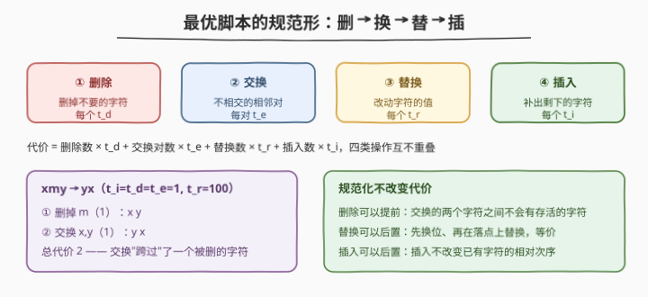
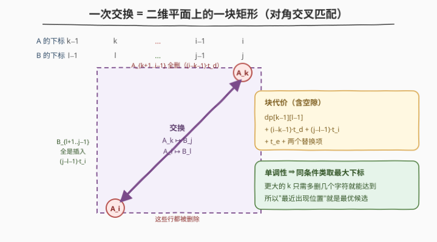
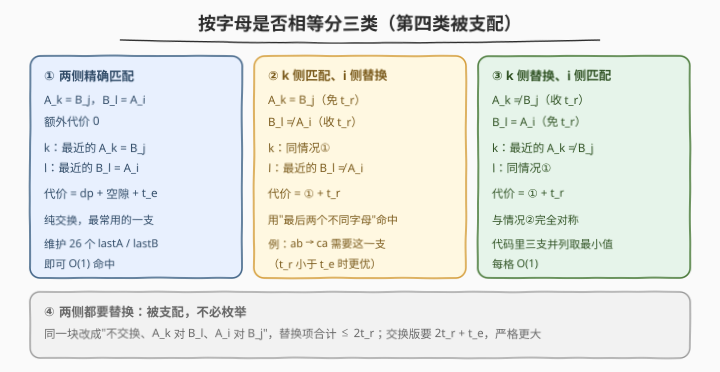
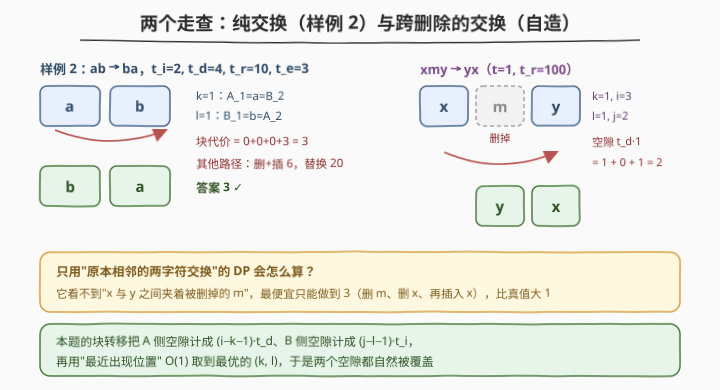

# Codeforces 67C 小球序列的最小代价 题解

## 1. 题目概述

- **题目链接**：https://codeforces.com/problemset/problem/67/C
- **比赛来源**：Manthan 2011 · Problem C（UTC 2011-03-13）
- **难度**：2600
- **标签**：动态规划
- **评测类型**：普通
- **限制**：时间 1 s / 内存 256 MB

**题意**：有两个小写字母串 $A$（长度 $n$）与 $B$（长度 $m$）。对 $A$ 可以做四种操作：插入一个任意字符（耗时 $t_i$）、删除一个字符（$t_d$）、把一个字符替换成任意字符（$t_r$）、交换相邻的两个字符（$t_e$）。额外保证 $2t_e\ge t_i+t_d$。求把 $A$ 变成 $B$ 的最小总耗时。

**约束**：

- $1\le n,m\le 4000$，$0<t_i,t_d,t_r,t_e\le 100$，且有 $2t_e\ge t_i+t_d$。
- $nm$ 最大 $1.6\times 10^7$，所以目标复杂度是 $O(nm)$；$O(n^2m)$、$O(nm^2)$ 都不可接受。
- 字母表只有 26 个字母，这一点会被用来做 $O(1)$ 的"最近出现位置"查询。
- 输出一个整数（最小耗时），普通评测，没有多测。
- 关键前提是 $2t_e\ge t_i+t_d$：它保证"一个字符最多参与一次交换"（见引理 1）。若没有这条保证，单个字符被反复交换可能比删除再插入更便宜，题目会变成另一种（更难）的问题。

## 2. 示例与观察

官方样例（输入 / 输出原样）：

```text
输入：
1 1 1 1
youshouldnot
thoushaltnot

输出：
5
```

```text
输入：
2 4 10 3
ab
ba

输出：
3
```

```text
输入：
1 10 20 30
a
za

输出：
1
```

**样例 1 走查**：所有操作都是 1，两个串长度都是 12。一个 5 步的脚本是：

1. 把开头的 `y` 替换成 `t`（1 步），得 `toushouldnot`；
2. 在 `t` 后插入一个 `h`（1 步），得 `thoushouldnot`，此时前缀 `thoush` 已经对齐；
3. 剩下的 `ouldnot` 要变成 `altnot`：把 `o` 替换成 `a`、删掉 `u`、再把 `d` 替换成 `t`（3 步），得 `thoushaltnot`。

合计 5 步。注意这里替换和插入的性价比相同（都是 1），最优解里两种操作会混用；而"删掉 4 个多余字符再插入 4 个"需要 8 步，明显更差。

**样例 2 走查**：$t_i=2,t_d=4,t_r=10,t_e=3$，$A=\texttt{ab}$，$B=\texttt{ba}$。直接交换两个球只要 3；若改成删掉 `a`（4）再在新位置插入 `a`（2）需要 6；两次替换要 20。所以答案是 3。这也是题目第一次真正需要"交换"这个操作。

**样例 3 走查**：$t_i=1,t_d=10,t_r=20,t_e=30$，$A=\texttt{a}$，$B=\texttt{za}$。插入一个 `z` 只要 1；删除 `a` 再插两个字符要 12；替换 + 插入要 21。答案 1。

**观察 1**：如果没有"交换"操作，这就是带权编辑距离，$O(nm)$ 的经典 DP。交换操作打破了这个结构：它让两个**原本相邻**的字符交换次序，于是对齐关系里出现了"交叉"。

**观察 2**：由于 $2t_e\ge t_i+t_d$，交换永远不是"搬运字符"的廉价手段——把一个字符搬过 $2$ 个位置要 $2t_e$，而"删掉再插入"只要 $t_d+t_i\le 2t_e$。所以最优解里**每个字符最多参与一次交换**，交换只用来处理"两个字符次序颠倒"这种局部结构。

**观察 3（本题真正的难点）**：交换发生在"当前串"上，而被交换的两个字符之间**可能夹着之后会被删掉的字符**，它们对应的两个目标位置之间也**可能夹着之后才插入的字符**。所以一对交换可以"跨越"若干次删除/插入，这类"带空隙的交换"必须写进转移，否则会算大。反例：$A=\texttt{xmy}$，$B=\texttt{yx}$，$t_i=t_d=t_e=1,t_r=100$，正确做法是删 `m`（1）再交换 `x,y`（1），共 2；只允许"原本相邻的两个字符交换"的 DP 会给出 3。

## 3. 解题思路

### 3.1 朴素做法与瓶颈

先看**不带交换**的编辑距离：$dp[i][j]$ 表示把 $A$ 的前 $i$ 个字符改成 $B$ 的前 $j$ 个字符的最小代价，

$$
dp[i][j]=\min\bigl(dp[i-1][j]+t_d,\ dp[i][j-1]+t_i,\ dp[i-1][j-1]+[A_i\ne B_j]\cdot t_r\bigr).
$$

加入交换后，很多人的第一反应是补一条"交换 $A_{i-1},A_i$ 对齐 $B_{j-1},B_j$"的转移：

$$
dp[i][j]\leftarrow dp[i-2][j-2]+t_e+[A_{i-1}\ne B_j]t_r+[A_i\ne B_{j-1}]t_r .
$$

这条转移本身没错，但它只覆盖了"两个被交换的字符在原串里相邻、且它们的像在 $B$ 里也相邻"的情形。上一节的观察 3 说明它不够：交换可以跨过被删除/被插入的字符。若只是"背模板"，就会在 `xmy` → `yx` 这类数据上算大。

真正的瓶颈是：**必须把"一对交换跨越的空隙"建模出来**，并且要在 $O(1)$ 的时间里挑出最优的那一对。

### 3.2 核心观察：把脚本规范化成"删除 → 交换 → 替换 → 插入"



由引理 1、引理 2（第 4 节），任何最优脚本都可以整理成下面的形状：

1. 从 $A$ 中删掉一批字符，剩下子序列 $A'$（代价 $(\text{删掉的个数})\cdot t_d$）；
2. 对 $A'$ 做若干次**互不相交**的相邻交换（每个字符至多参与一次，代价 $(\text{交换对数})\cdot t_e$）；
3. 对部分字符做替换（每个 $t_r$）；
4. 插入若干字符得到 $B$（每个 $t_i$）。

也就是说：把 $A'$ 按原序读出来（其中某些相邻的两两已被交换），得到的序列 $S$ 必须能**保序地嵌入** $B$；没被嵌入的 $B$ 位置就是插入，每个嵌入对若字符不同就付 $t_r$。

于是"一次交换"在二维下标平面上就是一个**矩形块**：它从 $(k-1,l-1)$ 出发，`吃掉` $A$ 的第 $k..i$ 个字符与 $B$ 的第 $l..j$ 个字符，其中

- $A_{k+1..i-1}$ 全部被删掉（$i-k-1$ 次删除），
- $B_{l+1..j-1}$ 全部是插入（$j-l-1$ 次插入），
- $A_k$ 对齐到 $B_j$、$A_i$ 对齐到 $B_l$（注意是**交叉**的：$k<i$ 但 $l<j$），



这一块的总代价是

$$
dp[k-1][l-1]+(i-k-1)t_d+(j-l-1)t_i+t_e+[A_k\ne B_j]t_r+[A_i\ne B_l]t_r .
\tag{3.1}
$$

**如何 $O(1)$ 地挑 $(k,l)$？** 关键是下面这个单调性：对固定的 $l$，

$$
dp[k_2-1][l-1]+(i-k_2-1)t_d\ \le\ dp[k_1-1][l-1]+(i-k_1-1)t_d\qquad(k_1<k_2),
\tag{3.2}
$$

因为从状态 $(k_1-1,l-1)$ 出发，把 $A_{k_1..k_2-1}$ 全删掉（$k_2-k_1$ 次删除）就能到达 $(k_2-1,l-1)$，所以 $dp[k_2-1][l-1]\le dp[k_1-1][l-1]+(k_2-k_1)t_d$，移项即得 (3.2)。同理，对固定的 $k$，

$$
dp[k-1][l_2-1]+(j-l_2-1)t_i\ \le\ dp[k-1][l_1-1]+(j-l_1-1)t_i\qquad(l_1<l_2).
\tag{3.3}
$$

于是：**在同一个"字母条件类"里，$k$ 与 $l$ 都取最大的那个即可**（$k,l$ 的约束彼此独立：$k<i$、$l<j$）。把两个字母条件（$A_k$ 是否等于 $B_j$、$B_l$ 是否等于 $A_i$）组合起来，只有三种情况需要枚举：

| 情况 | $k$ 的取法 | $l$ 的取法 | 额外代价 |
|------|-----------|-----------|----------|
| ① 两侧都精确匹配 | 最近的 $k<i$ 满足 $A_k=B_j$ | 最近的 $l<j$ 满足 $B_l=A_i$ | $0$ |
| ② $A_i$ 侧替换 | 同情况① | 最近的 $l<j$ 满足 $B_l\ne A_i$ | $t_r$ |
| ③ $A_k$ 侧替换 | 最近的 $k<i$ 满足 $A_k\ne B_j$ | 同情况① | $t_r$ |

第四种情况（两侧都需要替换）永远被支配：同样从 $(k-1,l-1)$ 出发，改成"$A_k$ 对齐 $B_l$、$A_i$ 对齐 $B_j$"（不交换、只替换）的代价不超过 $2t_r$，比 $t_e+2t_r$ 小。所以只需三种情况。

"最近的满足 $A_k=B_j$" 可以边扫描边维护 26 个"最近出现位置"；"最近的满足 $A_k\ne B_j$" 只需记**最后两个字母不同**的位置（设最后位置是 $p_1$、最后与 $B_{p_1}$ 字母不同的位置是 $p_2$，则 $B_{p_1}\ne c$ 时答案就是 $p_1$，否则是 $p_2$）。$B$ 侧同理。

### 3.3 算法流程 / 状态转移



记 $dp[i][j]$ 为"处理完 $A$ 的前 $i$ 个、$B$ 的前 $j$ 个"的最小代价（$0\le i\le n$，$0\le j\le m$），边界

$$
dp[i][0]=i\,t_d,\qquad dp[0][j]=j\,t_i,\qquad dp[0][0]=0 .
$$

对每个 $1\le i\le n$、$1\le j\le m$，先取三条基本转移

$$
dp[i][j]=\min\Bigl(dp[i-1][j]+t_d,\ \ dp[i][j-1]+t_i,\ \ dp[i-1][j-1]+[A_i\ne B_j]t_r\Bigr),
$$

再用 (3.1) 的块转移更新。为了 $O(1)$ 求出块转移，按行（$i$ 递增）扫描，维护：

- `lastA[c]`：$i$ 之前最后一个字母为 `c` 的下标 $k$；
- `p1A / p2A`：$i$ 之前的最后一个下标、以及最后一个"字母与 $p_1$ 不同"的下标，从而 `lastAOther[c]` 可在 $O(1)$ 内得到；
- 行内（$j$ 递增）维护 `lastB[c]`、`p1B / p2B`，含义对称。

于是每个 $(i,j)$ 处，三种情况所需的 $k,l$ 都能 $O(1)$ 查到，装入 (3.1) 即可。

### 3.4 样例走查



**样例 2**：$t_i=2,t_d=4,t_r=10,t_e=3$，$A=\texttt{ab},B=\texttt{ba}$。在 $(i,j)=(2,2)$ 处：

- 基本转移：$dp[1][2]+t_d=4+4=8$，$dp[2][1]+t_i=4+2=6$，$dp[1][1]+[b\ne a]t_r=2+10=12$，最小 6；
- 情况①：$B_2=\texttt{a}$，最近的 $k<2$ 满足 $A_k=\texttt{a}$ 是 $k=1$；$A_2=\texttt{b}$，最近的 $l<2$ 满足 $B_l=\texttt{b}$ 是 $l=1$。块代价 $=dp[0][0]+0\cdot t_d+0\cdot t_i+t_e+0+0=3$；
- 取最小值 3 ✓。

**自造样例（标注"自造"）**：$A=\texttt{xmy}$，$B=\texttt{yx}$，$t_i=t_d=t_e=1$，$t_r=100$。在 $(i,j)=(3,2)$ 处：$B_2=\texttt{x}$，最近的 $k<3$ 满足 $A_k=\texttt{x}$ 是 $k=1$；$A_3=\texttt{y}$，最近的 $l<2$ 满足 $B_l=\texttt{y}$ 是 $l=1$。块代价 $=dp[0][0]+(3-1-1)t_d+(2-1-1)t_i+t_e=1+0+1=2$，正好对应"删掉 `m`、交换 `x,y`"两步 ✓。

**自造样例 2**：$A=\texttt{xmy}$，$B=\texttt{yzx}$，四个代价都是 1（$t_r=100$）。块在 $(i,j)=(3,3)$：$k=1$（$A_1=\texttt{x}=B_3$），$l=1$（$B_1=\texttt{y}=A_3$），代价 $=0+(3-2)\cdot1+(3-2)\cdot1+1=3$，即"删 `m`、交换 `x,y`、插入 `z`"，与手工最优值一致。

## 4. 正确性证明

**引理 1（每个字符最多交换一次）**：存在一个最优脚本，其中 $A$ 的每个字符最多参与一次交换；被删除的字符不参与交换；被插入的字符不参与交换。

**证明**：逐个消除多余的交换。

- 若字符 $x$ 参与了两次交换，则它在当前串里净移动了 2 个位置（每次交换只移动 1 格），其余字符的相对次序不变。把"这两次交换"换成"删除 $x$、再在目标位置插入 $x$"，得到的最终串完全相同，代价为 $t_d+t_i\le 2t_e$，不变差。因此可反复消除，直到没有字符参与两次交换。
- 若 $x$ 最终会被删除，那么交换 $x$ 只改变 $x$ 的位置，不影响其余字符的相对次序（$x$ 反正要消失），删掉这些交换可降低代价。
- 若 $x$ 是被插入的字符，插入后它又参与交换，等价于把它直接插到交换后的最终位置，去掉这次交换即可。∎

**引理 2（脚本的规范形）**：存在最优脚本，形如"删除若干字符 → 对剩余串做若干互不相交的相邻交换 → 替换若干字符 → 插入若干字符"。

**证明**：

- **删除提到最前**：考察原脚本中的一次交换，它交换的是当时相邻的两个字符 $u,v$。当时已经删除的字符不在串里，尚未删除的字符若夹在 $u,v$ 之间就不可能相邻，所以**所有最终存活的字符都不在 $u,v$ 之间**；换言之 $u,v$ 在"存活子序列 $A'$"里相邻。于是可以把"先删后换"重排成"先删光、再按同样的配对交换"，交换的对数与次数都不变（把每次交换记成 $A'$ 中一对相邻位置的互换，互换之间互不影响，只是顺序不同）。
- **替换后移**：替换某个字符与交换它，效果等价于"先交换、再在落点上替换"，故可把所有替换挪到所有交换之后。
- **插入后移**：插入不改变已有字符的相对次序，把插入挪到最后，只需把插入位置改成最终位置即可，次数不变。

规范化后，删除、交换、替换、插入四类操作各自独立计数，得到形如 (3.1) 的结构。∎

**引理 3（块分解）**：在规范形下，被交换的字符对两两不相交，且每一对 $(A_k,A_i)$（$k<i$，$A_{k+1..i-1}$ 全被删除）映射到 $B$ 的两个位置 $(B_l,B_j)$（$l<j$，$B_{l+1..j-1}$ 全为插入），并且 $A_i\mapsto B_l$、$A_k\mapsto B_j$（交叉）。因此整个脚本可以唯一地分解成"基本转移 + 块转移"的序列，总代价正好是 (3.1) 之和。

**证明**：由引理 1、2，交换对互不相交；由引理 2 的证明，交换对在 $A'$ 中相邻，故 $A$ 中夹在两者之间、不属于 $A'$ 的字符恰是被删除的（数量 $i-k-1$）。同理，两个像在 $B$ 的嵌入序列中相邻，故夹在它们之间、未被嵌入的 $B$ 位置全是插入（数量 $j-l-1$）。交叉方向由交换的定义给出。按 $A$ 的下标顺序切开即得分解，代价按定义相加。∎

**引理 4（取最近出现位置最优）**：对固定的 $l$，在所有满足"字母条件"的 $k<i$ 中，取最大的 $k_{\max}$ 使 (3.1) 最小；对固定的 $k$，取最大的 $l_{\max}$ 同理。两者相互独立，因此可以同时取最大。

**证明**：字母条件只决定"是否需要付 $t_r$"，在同一条件类内 $t_r$ 项是常数；而 (3.2)（以及对称的 (3.3)）说明代价关于 $k$（或 $l$）单调不增，故同条件类内取最大下标最优。$k$ 的约束是 $k<i$、$l$ 的约束是 $l<j$，互不牵连，故可独立取最大。∎

**引理 5（第四种情况被支配）**：若 $A_k\ne B_j$ 且 $B_l\ne A_i$，则把这一块换成"$A_k$ 对齐 $B_l$、$A_i$ 对齐 $B_j$"（不交换）的转移，代价是

$$
dp[k-1][l-1]+(i-k-1)t_d+(j-l-1)t_i+[A_k\ne B_l]t_r+[A_i\ne B_j]t_r\ \le\ \text{(3.1)}-t_e<\text{(3.1)},
$$

且该转移一定是合法的（先匹配 $A_k,B_l$，再删中间的 $A$ 字符、插中间的 $B$ 字符，最后匹配 $A_i,B_j$，路径单调）。

**证明**：两条路径的 $dp[k-1][l-1]$ 与空隙代价完全相同，只需比较 $t_r$ 项：不交换时每项 $\le t_r$，合计 $\le 2t_r$；交换时合计为 $2t_r$ 再加上 $t_e$。故不交换严格更优。合法性由二维 DP 的单调路径给出。∎

**定理**：算法输出的 $dp[n][m]$ 等于把 $A$ 变成 $B$ 的最小总耗时。

**证明**：

- **下界**：任取一个最优脚本，由引理 1、2 规范化，由引理 3 分解成基本转移与块转移；引理 4 说明每块都能被"取最近出现位置"的三种情况之一覆盖且代价不升，故 $dp[n][m]$ 不超过最优值。
- **上界**：算法的每条转移都对应一个合法脚本（删除 / 插入 / 替换 / 交换 + 删除 + 插入），块转移的合法性由引理 3 的构造给出，故 $dp[n][m]$ 对应的脚本确实把 $A$ 变成了 $B$，即 $dp[n][m]$ 不小于最优值。

两者相等。∎

## 5. 复杂度分析

- **时间**：状态数 $(n+1)(m+1)\le 1.6\times10^7$，每个状态做 3 条基本转移 + 3 条块转移，每条都是常数次整数运算与查表，总计 $O(nm)$，常数约 20 次基本操作。
- **空间**：$dp$ 表 $(n+1)(m+1)$ 个 `int`，$4001\times4001\times 4$ 字节 $\approx 64$ MB；另有 $O(1)$ 的辅助数组。在 256 MB 之内。
- **与时限的关系**：$n=m=4000$ 的最大数据实测（本机 `clang++ -O2`）约 **100 ms**（20 次平均，含进程启动），相对 1 s 有约 10 倍余量；主循环无浮点、无递归。
- **数值范围**：单次操作代价 $\le 100$，总代价 $\le (n+m)\cdot 100=8\times10^5$，`int` 足够，不会溢出；`INF` 取 $10^9$ 即可。

## 6. 参考代码

### C++17

```cpp
#include <bits/stdc++.h>
using namespace std;

int main() {
    int ti, td, tr, te;
    if (!(cin >> ti >> td >> tr >> te)) return 0;
    string sa, sb;
    cin >> sa >> sb;
    int n = (int)sa.size(), m = (int)sb.size();
    static int dp[4005][4005];
    const int INF = 1000000000;
    for (int i = 1; i <= n; i++) dp[i][0] = i * td;
    for (int j = 1; j <= m; j++) dp[0][j] = j * ti;
    dp[0][0] = 0;

    int lastA[26];
    for (int c = 0; c < 26; c++) lastA[c] = -1;
    int prevAPos = -1, prevAOther = -1;   // 最后位置 / 最后一个字母不同的位置
    for (int i = 1; i <= n; i++) {
        int d = sa[i - 1] - 'a';
        int lastAn[26];
        for (int c = 0; c < 26; c++)
            lastAn[c] = (prevAPos > 0 && sa[prevAPos - 1] - 'a' != c) ? prevAPos : prevAOther;

        int lastB[26];
        for (int c = 0; c < 26; c++) lastB[c] = -1;
        int p1 = -1, p2 = -1;             // 最后一列 / 最后一个字母不同的列
        for (int j = 1; j <= m; j++) {
            int c = sb[j - 1] - 'a';
            int best = dp[i - 1][j] + td;
            int v = dp[i][j - 1] + ti;             if (v < best) best = v;
            v = dp[i - 1][j - 1] + (d == c ? 0 : tr); if (v < best) best = v;

            int k11 = lastA[c], l11 = lastB[d];
            int l12 = (p1 > 0 && sb[p1 - 1] - 'a' != d) ? p1 : p2;
            if (k11 > 0 && l11 > 0) {
                v = dp[k11 - 1][l11 - 1] + (i - k11 - 1) * td + (j - l11 - 1) * ti + te;
                if (v < best) best = v;
            }
            if (k11 > 0 && l12 > 0) {
                v = dp[k11 - 1][l12 - 1] + (i - k11 - 1) * td + (j - l12 - 1) * ti + te + tr;
                if (v < best) best = v;
            }
            int k21 = lastAn[c];
            if (k21 > 0 && l11 > 0) {
                v = dp[k21 - 1][l11 - 1] + (i - k21 - 1) * td + (j - l11 - 1) * ti + te + tr;
                if (v < best) best = v;
            }
            dp[i][j] = best;

            if (p1 == -1) { p1 = j; p2 = -1; }
            else { if (sb[p1 - 1] - 'a' != c) p2 = p1; p1 = j; }
            lastB[c] = j;
        }
        // 第 i 个字符从此对后续行可用
        if (prevAPos == -1) { prevAPos = i; prevAOther = -1; }
        else { if (sa[prevAPos - 1] != sa[i - 1]) prevAOther = prevAPos; prevAPos = i; }
        lastA[d] = i;
    }
    cout << dp[n][m] << '\n';
    return 0;
}
```

### Python3

```python
import sys


def main() -> None:
    data = sys.stdin.buffer.read().split()
    if len(data) < 6:
        return
    ti, td, tr, te = (int(x) for x in data[:4])
    sa = data[4].decode()
    sb = data[5].decode()
    n, m = len(sa), len(sb)
    A = ' ' + sa
    B = ' ' + sb
    dp = [[0] * (m + 1) for _ in range(n + 1)]
    for i in range(1, n + 1):
        dp[i][0] = i * td
    for j in range(1, m + 1):
        dp[0][j] = j * ti

    lastA = [-1] * 26
    prevAPos, prevAOther = -1, -1       # 最后一个位置 / 最后一个字母不同的位置
    for i in range(1, n + 1):
        d = ord(A[i]) - 97
        lastAn = [prevAPos if (prevAPos > 0 and ord(A[prevAPos]) - 97 != c) else prevAOther
                  for c in range(26)]
        lastB = [-1] * 26
        p1 = p2 = -1                     # 最后一列 / 最后一个字母不同的列
        row, prev = dp[i], dp[i - 1]
        for j in range(1, m + 1):
            c = ord(B[j]) - 97
            best = prev[j] + td
            v = row[j - 1] + ti
            if v < best:
                best = v
            v = prev[j - 1] + (0 if d == c else tr)
            if v < best:
                best = v
            k11, l11 = lastA[c], lastB[d]
            l12 = p1 if (p1 > 0 and ord(B[p1]) - 97 != d) else p2
            if k11 > 0 and l11 > 0:
                v = dp[k11 - 1][l11 - 1] + (i - k11 - 1) * td + (j - l11 - 1) * ti + te
                if v < best:
                    best = v
            if k11 > 0 and l12 > 0:
                v = dp[k11 - 1][l12 - 1] + (i - k11 - 1) * td + (j - l12 - 1) * ti + te + tr
                if v < best:
                    best = v
            if lastAn[c] > 0 and l11 > 0:
                v = dp[lastAn[c] - 1][l11 - 1] + (i - lastAn[c] - 1) * td + (j - l11 - 1) * ti + te + tr
                if v < best:
                    best = v
            row[j] = best
            if p1 == -1:
                p1, p2 = j, -1
            else:
                if ord(B[p1]) - 97 != c:
                    p2 = p1
                p1 = j
            lastB[c] = j
        if prevAPos == -1:
            prevAPos, prevAOther = i, -1
        else:
            if A[prevAPos] != A[i]:
                prevAOther = prevAPos
            prevAPos = i
        lastA[d] = i
    sys.stdout.write(str(dp[n][m]) + '\n')


main()
```

Python 版是同一算法的直译，**满数据（$4000\times4000$）会超时**（纯 Python 约 30 s 量级），只适合验证小数据；提交请用 C++ 或 PyPy3。

## 7. 边界情况与易错点

1. **只写"原本相邻的两字符交换"**：这是本题最常见的错误。$A=\texttt{xmy},B=\texttt{yx}$（$t_i=t_d=t_e=1,t_r=100$）的真答案是 2，漏掉"跨删除的交换"会算成 3。块转移里的 $(i-k-1)t_d$、$(j-l-1)t_i$ 正是为空隙准备的。
2. **忘了空隙另一侧的插入**：只允许 $A$ 侧有空隙、不允许 $B$ 侧有空隙，同样会算大。$A=\texttt{xmy},B=\texttt{yzx}$ 的真答案是 3（删 `m`、交换、插入 `z`），两侧空隙都必须支持。
3. **块转移的交叉方向写反**：块里是 $A_k\mapsto B_j$、$A_i\mapsto B_l$（$k<i$ 但 $l<j$），也就是**交叉**。若写成 $A_k\mapsto B_l$、$A_i\mapsto B_j$，那就退化成不交换的普通匹配，交换操作等于没做。
4. **"最近出现"的维护时机**：`lastA` 必须在处理完第 $i$ 行之后才把 $i$ 加进去（块要求 $k<i$）；行内 `lastB` 必须在算完第 $j$ 个状态后才把 $j$ 加进去（块要求 $l<j$）。提前一格会把 $k=i$ 或 $l=j$ 放进候选，导致自匹配、答案偏小。
5. **第四种情况不能省掉"被支配"的判断却照抄 $2t_r$**：若把"两侧都要替换"也当成候选，公式本身不会错，但若误写成"两侧都匹配"（漏加 $t_r$）就会得到比真值小的非法答案——第 4 节引理 5 说明这一支可以不写，但**不能写错**。
6. **`t_e` 与 `2t_e >= t_i+t_d`**：整个正确性依赖这条保证；若自己造数据时取 $t_e$ 很小（例如 $t_i=t_d=10,t_e=1$），"一个字符交换多次"可能更优，本算法会算大——但这不违反题目保证，属于题目边界之外的数据。
7. **`INF` 与越界**：$dp$ 的初值 $0$ 只对 $dp[0][0]$ 成立，第 0 行/列要单独填 $j\cdot t_i$、$i\cdot t_d$；块转移的 `k11-1`、`l11-1` 在 $k,l\ge 1$ 时非负，代码里用 `> 0` 判断挡住 $-1$。
8. **内存**：$4001^2$ 个 `int` 约 64 MB，必须开在静态区（`static`）而不是栈上，否则会爆栈。
9. **读入**：四个整数后跟两个字符串，用 `cin >>` / `split()` 读即可；字符串长度 $\ge 1$，不会为空。

## 8. 验证记录

- **编译环境与命令**：本机只有 `Apple clang 21.0.0`，用 `clang++ -std=c++17 -O2 -Wall -I codeforces/tools/include`（兼容头 `bits/stdc++.h`）编译；代码只用标准库，可原样提交 GNU C++17。Python 侧为 `Python 3.9.6`。
- **官方样例**：3 / 3 通过（`5`、`3`、`1`），C++ 与 Python 一致，由 `codeforces/tools/verify_solution.py` 实测。
- **独立暴力对拍**：暴力用**状态空间 Dijkstra**（状态 = 当前字符串，边 = 四种操作，字母表取 $A\cup B$ 的字母，长度上限 $\max(n,m)+2$），真正在图上跑最短路，与参考程序逐组比较。随机生成 $2608+932$ 组小数据（长度 $\le 4$、字母表 $\le 3$、代价 $1..8$ 且满足 $2t_e\ge t_i+t_d$）做"参考实现 vs Dijkstra"，另有 368 组直接做"C++ 实现 vs Dijkstra"，**全部一致**。
- **另写一份独立参考实现**（Python，逐格暴力找"最近出现位置"而不做 $O(1)$ 优化），与 C++ 在 90 组中等数据（长度 $\le 40$、字母表 2/4/26）上交叉验证，全部一致；再用同一份参考在 300 组长度 $\le 40$ 的随机数据上与 C++ 比对，也全部一致。
- **关键反例回归**：$A=\texttt{xmy},B=\texttt{yx}$ 输出 2（朴素相邻交换 DP 会输出 3）；$A=\texttt{xmy},B=\texttt{yzx}$ 输出 3；$A=\texttt{ab},B=\texttt{ca}$（$t_r=2$）输出 3。三者都与 Dijkstra 暴力一致。
- **最大约束性能**：$n=m=4000$ 的随机串（$t_i=t_d=t_r=t_e=1$）20 次平均 **约 100 ms**（含进程启动），峰值内存约 64 MB（$dp$ 表），远低于 1 s / 256 MB。
- **复核状态**：verified（样例、约 3900 组随机对拍、反例回归、性能均实跑通过）。

## 相关题目与扩展

- [Codeforces 67D Optical Experiment](https://codeforces.com/problemset/problem/67/D)：同场 D 题，也把"两两关系"化成序列上的单调结构，但那里只需要求最长递减子序列。
- [Codeforces 67B Restoration of the Permutation](https://codeforces.com/problemset/problem/67/B)：同场 B 题，用"最近可行位置"的贪心还原排列，与本题的"最近出现位置"技巧神似。
- [LeetCode 72. 编辑距离](https://leetcode.cn/problems/edit-distance/)：本题去掉交换操作后的经典版本，三参数版本的 $O(nm)$ DP 是本题的基础。
- [LeetCode 583. 两个字符串的删除操作](https://leetcode.cn/problems/delete-operation-for-two-strings/)：只有删除/插入的最短编辑距离，可以体会"空隙代价"这一项在本题里如何自然出现。

**延伸思考**：

1. **如果去掉 $2t_e\ge t_i+t_d$**：单个字符可以被连续交换多次，等价于"任意换位"的代价是 $\min(\text{交换距离}\times t_e,\ t_d+t_i)$。此时需要把块扩展成"任意跨度的换位"，复杂度会升到 $O(nm\log)$ 甚至更高；本题的保证正是把"换位"限制成"不相交的相邻对"。
2. **如果交换的代价改成按距离计费**（交换相距 $d$ 的两个字符花费 $d\cdot t_e$）：块转移里的 $(i-k-1)t_d$ 就要换成"差距"的组合代价，最优的 $k$ 不再单调，$O(1)$ 挑最近出现位置的技巧失效，需要凸优化/分治。
3. **为什么第四种情况一定被支配**：因为它多付了一个 $t_e$ 却没有任何"结构性收益"——交换的唯一价值是让两个字母的配对从"两个都错"变成"两个都对"，一旦两边都需要替换，交换就不再带来任何配对上的收益。这个观察也可以用来检查自己的转移有没有多写。
4. **空间优化**：块转移需要访问 $dp[k-1][l-1]$（任意历史行），所以不能像普通编辑距离那样只留两行；但可以把 $dp$ 表按 $16$ 位存（代价上界 $8\times10^5$ 需要 $20$ 位，不行），因此本题的 $64$ MB 是必要的，这也解释了为什么 $n,m$ 被限制在 $4000$。
