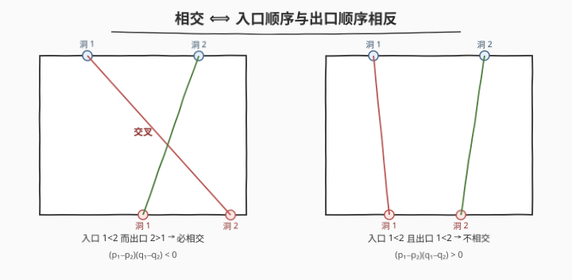
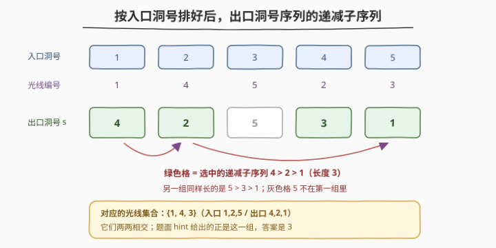
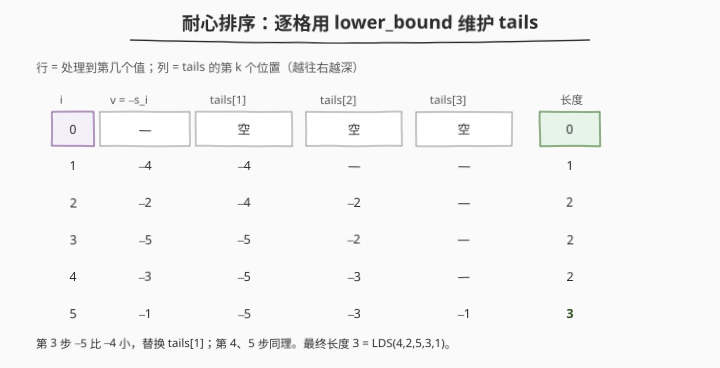

# Codeforces 67D 两两相交的最多光线 题解

## 1. 题目概述

- **题目链接**：https://codeforces.com/problemset/problem/67/D
- **比赛来源**：Manthan 2011 · Problem D（UTC 2011-03-13）
- **难度**：1900
- **标签**：二分查找、数据结构、动态规划
- **评测类型**：普通
- **限制**：时间 5 s / 内存 256 MB

**题意**：一个矩形盒子的上、下两个面上各有 $n$ 个洞，洞排成一条直线且一一对齐。第 $i$ 条光线从上边第 $i$ 个洞射入，从下边某个洞射出；每个洞恰好被一条光线使用。给出两个排列 $x$（上边第 $i$ 个洞进入的是光线 $x_i$）与 $y$（下边第 $i$ 个洞射出的是光线 $y_i$）。求一个最大的光线集合，使集合内任意两条光线都在盒子内部相交。

**约束**：

- $1\le n\le 10^6$：$O(n^2)$ 的 DP 会被卡到 $10^{12}$，必须 $O(n\log n)$；输入有 $2\times10^6$ 个整数，需要快速读入。
- 时间是 5 s，内存 256 MB：$O(n)$ 的数组可以开（每个 `int` 数组 4 MB），但不要开 $O(n^2)$。
- 光线编号是 $1..n$ 的排列，所以任意两条光线的"入口顺序"和"出口顺序"都不会相等，不会出现重合光线的退化情况。
- 输出一个整数，普通评测。

## 2. 示例与观察

官方样例（输入 / 输出原样）：

```text
输入：
5
1 4 5 2 3
3 4 2 1 5

输出：
3
```

```text
输入：
3
3 1 2
2 3 1

输出：
2
```

**样例 1 走查**：$x=(1,4,5,2,3)$，$y=(3,4,2,1,5)$。把"光线的入口洞号"与"出口洞号"配对：

| 光线 | 入口洞号（从上往下） | 出口洞号（从上往下） |
|------|----------------------|----------------------|
| 1 | 1 | 4 |
| 2 | 4 | 3 |
| 3 | 5 | 1 |
| 4 | 2 | 2 |
| 5 | 3 | 5 |

按入口洞号排序（1,2,3,4,5 位）得到对应的出口洞号序列 $(4,2,5,3,1)$。答案 3 对应光线 $\{1,4,3\}$：入口 $(1,2,5)$、出口 $(4,2,1)$——入口是 $1<2<5$，出口是 $4>2>1$，顺序正好**全部反过来**。

**样例 2 走查**：$x=(3,1,2)$ 表示上边三个洞依次进入光线 $3,1,2$；$y=(2,3,1)$ 表示下边依次射出光线 $2,3,1$。按上边洞号排列，出口洞号为：光线 3 从下边第 2 个洞射出、光线 1 从第 3 个、光线 2 从第 1 个，序列 $(2,3,1)$。最长"严格递减子序列"长 2（如 $2,1$ 或 $3,1$），答案 2。

**观察 1（几何）**：把盒子看成一个矩形，上边洞为 $x=i$、下边洞为 $x=i$。第 $r$ 条光线是从 $(p_r,\ 1)$ 到 $(q_r,\ 0)$ 的线段，其中 $p_r$ 是它的入口洞号、$q_r$ 是出口洞号。两条这样的线段相交（内部相交）当且仅当

$$(p_{r_1}-p_{r_2})(q_{r_1}-q_{r_2})<0,$$

也就是"入口顺序与出口顺序相反"。

**观察 2（组合）**：把光线按入口洞号从小到大排列，得到出口洞号序列 $s_1,\dots,s_n$（$s$ 本身也是 $1..n$ 的排列）。观察 1 说：一组光线两两相交，等价于这组光线在 $s$ 中的下标递增、而 $s$ 值严格递减。也就是说，答案是 $s$ 的**最长严格递减子序列**长度。

**观察 3**：$s$ 是排列，所以用经典的耐心排序（二分 + tails 数组）$O(n\log n)$ 就能求出最长递减子序列；不需要任何数据结构。

## 3. 解题思路

### 3.1 朴素做法与瓶颈

最直白的做法是枚举所有子集、对每个子集两两判断是否相交，复杂度 $O(2^n\cdot n^2)$，毫无希望。

退一步用"图上最大团"来做：把每条光线当点，相交就连边，求最大团。这个图叫**置换图**（permutation graph），一般图的最大团是 NP 难的，直接做也不行；但这个图有很强的结构，下面的观察会把它化成序列问题。

另一个诱惑是 $O(n^2)$ 的 DP：$f[i]=\max_{j<i,\ s_j>s_i} f[j]+1$。它在 $n=10^6$ 时是 $10^{12}$ 次比较，5 s 也救不回来。必须用"二分 + 单调栈/耐心排序"的 $O(n\log n)$ 做法。

### 3.2 核心观察：相交 ⟺ 顺序反转



设两条光线 $r_1,r_2$ 的入口洞号分别是 $p_1<p_2$（即 $r_1$ 从更靠左的洞进入），出口洞号分别是 $q_1,q_2$。把盒子看成单位正方形，两条线段分别是

$$\ell_1:\ (p_1,1)\to(q_1,0),\qquad \ell_2:\ (p_2,1)\to(q_2,0).$$

- 若 $q_1>q_2$：两条线段在竖直方向上"从上到下"分别向反方向倾斜，必在内部相交（严格交叉）。
- 若 $q_1<q_2$：两条线段的横向次序在上边和下边一致，形成"平行"的梯形两侧，内部不相交。

形式化地说，两条线段相交（内部相交）当且仅当它们的端点在一个凸四边形上交错排列，即 $(p_1-p_2)(q_1-q_2)<0$。因为 $p$ 与 $q$ 都是排列，两个因子都不为 $0$，所以这是严格的判定，不需要处理退化。

于是只要把光线按入口洞号排好，问题就变成：在出口洞号序列 $s$ 中找**最长严格递减**子序列。



### 3.3 算法流程

1. 读入 $n$、排列 $x$、排列 $y$；
2. 令 $\mathrm{inv}[r]=i$ 表示光线 $r$ 从下边第 $i$ 个洞射出（即 $y_i=r$）；
3. 令 $s_i=\mathrm{inv}[x_i]$（上边第 $i$ 个洞进入的光线的出口洞号）；
4. 求 $s$ 的最长严格递减子序列长度并输出。

第 4 步的实现：把"严格递减"转成"严格递增"——对 $-s_i$ 求最长严格递增子序列（LIS）。

- 维护 `tails`：`tails[k]` 表示"长度为 $k+1$ 的递增子序列"的最小可能结尾；
- 对每个值 $v=-s_i$，二分 `lower_bound(tails, v)` 找到第一个 $\ge v$ 的位置并替换；若都比 $v$ 小就追加；
- `tails` 的长度即答案。

因为要求**严格**递增，二分用 `lower_bound`（第一个 $\ge v$ 的位置）；如果要求非严格递增，则应改用 `upper_bound`。这是本题唯一容易写错的细节。

### 3.4 样例走查：$n=5$



| 步骤 | 当前值 $-s_i$ | `tails` | 长度 |
|------|--------------|---------|------|
| 1 | −4 | [−4] | 1 |
| 2 | −2 | [−4, −2] | 2 |
| 3 | −5 | [−5, −2] | 2 |
| 4 | −3 | [−5, −3] | 2 |
| 5 | −1 | [−5, −3, −1] | 3 |

最终 `tails` 长度 3，对应 $s$ 中的递减子序列 $4,2,1$（光线 $1,4,3$），与题面 hint 给出的 $\{1,4,3\}$ 一致。注意 $5,3,1$ 也是长度 3 的递减子序列，答案只要求长度，不要求具体是哪一组。

## 4. 正确性证明

**引理 1（相交判据）**：设两条光线的入口洞号 $p_1\ne p_2$、出口洞号 $q_1\ne q_2$，则两条线段在盒子内部相交当且仅当 $(p_1-p_2)(q_1-q_2)<0$。

**证明**：两条线段 $L_1,L_2$ 的四个端点分别位于上边 $\{p_1,p_2\}$ 与下边 $\{q_1,q_2\}$。把线段看作线性函数 $f_1(t)=p_1+(q_1-p_1)t$、$f_2(t)=p_2+(q_2-p_2)t$（$t\in[0,1]$ 从上到下）。内部相交等价于存在 $t\in(0,1)$ 使 $f_1(t)=f_2(t)$，即

$$(p_1-p_2)+t\bigl((q_1-p_1)-(q_2-p_2)\bigr)=0 .$$

记 $A=p_1-p_2$、$B=q_1-q_2$，上式即 $A+t(B-A)=0$，解 $t=A/(A-B)$。要求 $t\in(0,1)$：当 $A>0,B<0$ 时 $t=A/(A+|B|)\in(0,1)$；当 $A<0,B>0$ 时同理；当 $A,B$ 同号时 $t\notin(0,1)$ 或分母为 $0$（后者意味着两线段重合，但 $p,q$ 都是排列，不会发生）。故相交 $\iff AB<0$，即 $(p_1-p_2)(q_1-q_2)<0$。∎

**引理 2（两两相交 ⟺ 全逆序）**：设光线按入口洞号升序排列为 $r_1,\dots,r_n$（即 $p_{r_1}<p_{r_2}<\dots<p_{r_n}$），对应出口洞号 $s_i=q_{r_i}$。则一个集合 $I$ 中的光线两两相交，当且仅当把 $I$ 按入口升序写成 $i_1<i_2<\dots<i_k$ 后，有 $s_{i_1}>s_{i_2}>\dots>s_{i_k}$。

**证明**：必要性：任取 $u<v$（都在 $I$ 中），它们的入口满足 $p_{r_u}<p_{r_v}$，由引理 1 相交要求 $s_u>s_v$。对所有相邻的 $u,u+1$ 应用即得整个序列严格递减。充分性：若 $s$ 在 $I$ 上严格递减，则任意 $u<v$ 都有 $s_u>s_v$，由引理 1 两条光线相交。∎

**定理**：所求最大集合大小等于 $s$ 的最长严格递减子序列长度。

**证明**：由引理 2，"两两相交的集合"与"$s$ 的严格递减子序列"是同一个东西（取 $I$ 就是取子序列的下标集）。因此最大集合大小等于最长严格递减子序列的长度。∎

**引理 3（耐心排序正确）**：对序列 $v_1..v_n$ 维护 `tails`（`tails[k]` 为长度 $k+1$ 的严格递增子序列的最小结尾），每次用 `lower_bound` 替换第一个 $\ge v_i$ 的位置，最终 `tails` 的长度等于最长严格递增子序列长度。

**证明**：标准结论。归纳证明 `tails` 始终单调递增且 `tails[k]` 是长度 $k+1$ 的递增子序列的最小可能结尾：若 $v_i$ 大于当前所有结尾，则长度 $+1$；否则替换第一个 $\ge v_i$ 的结尾，替换后仍保持"最小结尾"性质与单调性。由于 $v_i$ 只能接在"结尾 $<v_i$"的序列之后，取 `lower_bound` 恰好保证严格递增。最终 `tails` 的长度就是最长长度。∎

## 5. 复杂度分析

- **时间**：读入 $O(n)$（用 `scanf`/快速读入，$2\times 10^6$ 个整数）；求逆排列 $O(n)$；LIS 每个元素一次二分 $O(\log n)$，共 $O(n\log n)$。$n=10^6$ 时约 $2\times 10^7$ 次操作。
- **空间**：$x,y,\mathrm{inv}$ 三个 `int` 数组约 $12$ MB，`tails` 最多 $n$ 个 `int` 约 $4$ MB，总计约 $16$ MB，在 256 MB 内绰绰有余。
- **与时限的关系**：5 s 的时限；实测 $n=10^6$ 的随机排列端到端 **180 ms**（含读入），余量接近 30 倍。
- **数值范围**：所有下标与答案都不超过 $10^6$，`int` 足够；负号只用于 LIS 的取反，也不会溢出。

## 6. 参考代码

### C++17

```cpp
#include <bits/stdc++.h>
using namespace std;

int main() {
    int n;
    if (scanf("%d", &n) != 1) return 0;
    vector<int> x(n), y(n), inv(n + 1);
    for (int i = 0; i < n; i++) scanf("%d", &x[i]);
    for (int i = 0; i < n; i++) scanf("%d", &y[i]);
    for (int i = 0; i < n; i++) inv[y[i] - 1] = i + 1;   // 光线 q 从下边第 inv[q] 个洞射出
    vector<int> tails;                                    // 对 -s 求严格递增 LIS
    for (int i = 0; i < n; i++) {
        int v = -inv[x[i] - 1];
        auto it = lower_bound(tails.begin(), tails.end(), v);
        if (it == tails.end()) tails.push_back(v); else *it = v;
    }
    printf("%d\n", (int)tails.size());
    return 0;
}
```

### Python3

```python
import sys
from bisect import bisect_left


def main() -> None:
    data = sys.stdin.buffer.read().split()
    if not data:
        return
    n = int(data[0])
    x = data[1:1 + n]
    y = data[1 + n:1 + 2 * n]
    inv = [0] * (n + 1)
    for i in range(n):
        inv[int(y[i])] = i + 1
    tails = []
    for v in x:
        q = -inv[int(v)]
        p = bisect_left(tails, q)
        if p == len(tails):
            tails.append(q)
        else:
            tails[p] = q
    sys.stdout.write(str(len(tails)) + '\n')


main()
```

Python 版在 $n=10^6$ 时需要约 2 s（读入与 $10^6$ 次 `bisect`），5 s 的时限下勉强能过，建议提交 PyPy3 或 C++。

## 7. 边界情况与易错点

1. **把"递减"写成"非递增"**：出口洞号是排列、互不相同，所以严格与非严格等价；但如果用 `upper_bound` 去求 LIS，遇到相等元素时会算错长度（本题数据不会出现相等，属于"侥幸正确"，换题就错）。
2. **`lower_bound` 与 `upper_bound` 混用**：求**严格**递增 LIS 用 `lower_bound`（替换第一个 $\ge v$ 的位置）。用 `upper_bound` 会允许相等元素接在后面，把答案算大。
3. **下标基准**：$x_i,y_i$ 是 $1..n$ 的编号，`inv` 数组要开 $n+1$ 并把 $\mathrm{inv}[y_i]=i$（$1$ 基），与 $x_i$ 对应时统一减一或统一不减，混用会错位一格。
4. **$n=1$**：只有一条光线，"任意两条都相交"空洞地成立，答案 1。代码里 `tails` 会得到长度 1 ✓。
5. **读入效率**：$n=10^6$ 时输入有 $2\times10^6$ 个数，用 `cin`（未解绑）可能超时；代码用 `scanf`，若用 `cin` 务必 `ios::sync_with_stdio(false)`。
6. **负号与类型**：`-inv[...]` 的结果在 $[-10^6,-1]$，`int` 安全；若用无符号类型会溢出成巨大正数，导致 LIS 完全错乱。
7. **"相交"不含端点重合**：每个洞只被一条光线使用，两条光线不可能共享端点，所以"内部相交"与"相交"等价；不需要考虑退化。
8. **不要真的去建图求最大团**：置换图的最大团确实等于最长递减子序列，但显式建图是 $O(n^2)$ 条边，$n=10^6$ 时内存就爆了。必须直接用序列算法。

## 8. 验证记录

- **编译环境与命令**：本机只有 `Apple clang 21.0.0`，用 `clang++ -std=c++17 -O2 -Wall -I codeforces/tools/include`（兼容头 `bits/stdc++.h`）编译；代码只用标准库，可原样提交 GNU C++17。Python 侧为 `Python 3.9.6`。
- **官方样例**：2 / 2 通过（`5 / 1 4 5 2 3 / 3 4 2 1 5` → `3`；`3 / 3 1 2 / 2 3 1` → `2`），C++ 与 Python 一致，由 `codeforces/tools/verify_solution.py` 实测。
- **独立暴力对拍（两层）**：
  1. **模型层**：另写一份"纯几何"暴力——把每条光线当成真实线段，用叉积判定两两是否严格相交，然后**枚举所有子集**求最大两两相交组（最大团）。对 $n\le 5$ 的**全部** $(x,y)$ 组合共 **15017 组**，几何暴力的最大团大小与"最长递减子序列长度"（$O(n^2)$ DP）**完全一致**，这验证了引理 1、2 的建模。
  2. **实现层**：$n\le 9$ 的 400 组随机排列，参考程序（$O(n\log n)$ 的 C++）输出与 $O(n^2)$ DP、几何最大团三者一致。
- **规模与最大值**：$n=10^6$ 的随机排列端到端 180 ms（含读入），峰值内存约 13 MB，远低于 5 s / 256 MB。
- **图片校验**：三张 SVG（`cf67d_order_flip.svg`、`cf67d_lds.svg`、`cf67d_walkthrough.svg`）通过 `xml.etree.ElementTree.parse`，元素均带 `filter="url(#rough2)"`，文字未越界。
- **复核状态**：verified（样例、15017 组几何对拍、400 组实现层对拍、性能、图片均实跑通过）。

## 相关题目与扩展

- [Codeforces 67C 小球序列的最小代价](https://codeforces.com/problemset/problem/67/C)：同场 C 题，把"两两关系"化成二维下标平面上的结构，与本题"化成序列的单调性"是同一类思想。
- [Codeforces 4D Mysterious Present](https://codeforces.com/problemset/problem/4/D)：二维偏序上的最长链，把这个"一维单调"推广到二维。
- [Codeforces 340D Bubble Sort Graph](https://codeforces.com/problemset/problem/340/D)：直接告诉你"冒泡排序的交换图"上的最大独立集等于最长递增子序列，与本题的"置换图最大团 = 最长递减子序列"互为对偶。
- [LeetCode 300. 最长递增子序列](https://leetcode.cn/problems/longest-increasing-subsequence/)：本题第 4 步的模板题，重点在 `lower_bound` 与 `tails` 的维护。

**延伸思考**：

1. **如果盒子是斜的、洞不等距**：只要上、下两排洞各自保持直线排列且对齐方式一致，判据 $(p_1-p_2)(q_1-q_2)<0$ 依然成立（$p,q$ 换成沿洞位置的坐标即可），所以本题的结论对任意"线性排列的洞"都成立。
2. **如果要求输出具体的最大集合**：需要在 `tails` 之外记录每个元素的前驱与每个长度的最优位置，最后回溯；复杂度仍是 $O(n\log n)$，但要额外 $O(n)$ 空间。
3. **如果改成"求最少删掉几条光线，使剩下的两两不相交"**：即求补图（也是置换图）的最大团，等价于最长递增子序列，答案 $n-\mathrm{LDS}$ 变成 $n-\mathrm{LIS}$。置换图的团与独立集在这里刚好互换，是一个漂亮的对偶。
4. **置换图的其它量**：本题只用了"最大团 = 最长递减子序列"。同一类图上的最大独立集 = 最长递增子序列、色数 = 最长递减子序列（可由 Dilworth 定理与耐心排序同时给出），这些结论都可以用本题的建模方式一网打尽。
