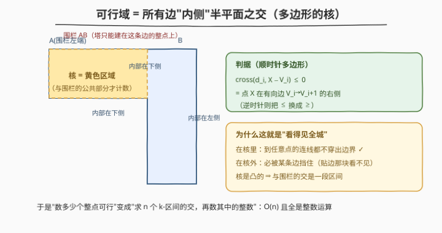
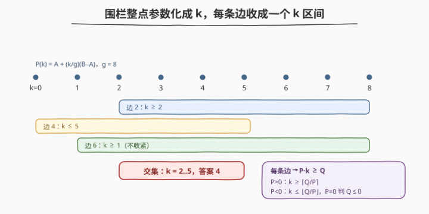
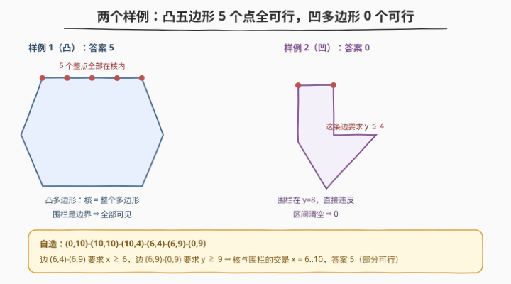

# Codeforces 67E 瞭望塔的可行位置数 题解

## 1. 题目概述

- **题目链接**：https://codeforces.com/problemset/problem/67/E
- **比赛来源**：Manthan 2011 · Problem E（UTC 2011-03-13）
- **难度**：2500
- **标签**：计算几何、半平面交
- **评测类型**：普通
- **限制**：时间 1 s / 内存 256 MB

**题意**：给定一个简单多边形（顶点按顺时针顺序给出，坐标都是整数），它的第一条边 $AB$ 是一段与 $x$ 轴平行的"围栏"。围栏上可以建一座瞭望塔，塔只能建在 $AB$ 上的**整点**处。一个点 $Q$（罪犯）能被塔 $P$ 看到，当且仅当线段 $PQ$ 在 $P$ 与 $Q$ 之间不与多边形的边相交。求 $AB$ 上有多少个整点，使得从该点能看到**整个多边形**。

**约束**：

- $3\le n\le 1000$：$O(n^2)$ 或 $O(n\log n)$ 都能接受，$O(n\cdot\text{围栏长度})$ 不行。
- 坐标 $0\le x_i,y_i\le 10^6$：围栏长度可达 $10^6$，所以**不能**逐点暴力检查（$10^6\times 1000=10^9$）。
- 围栏 $AB$ 平行于 $x$ 轴；除 $A,B$ 外的顶点都在 $AB$ 的同一侧；多边形不自交；没有三点连续共线。
- 输出一个整数（可行整点数），普通评测。

## 2. 示例与观察

官方样例（输入 / 输出原样）：

```text
输入：
5
4 8
8 8
9 4
4 0
0 4

输出：
5
```

```text
输入：
5
4 8
5 8
5 4
7 4
2 2

输出：
0
```

**样例 1 走查**：多边形 $(4,8)\to(8,8)\to(9,4)\to(4,0)\to(0,4)$ 是凸五边形，围栏 $AB$ 是上边从 $(4,8)$ 到 $(8,8)$，上面有 $x=4,5,6,7,8$ 五个整点。凸多边形的任意内点都能看到整个多边形，而围栏本身就是边界，所以五个点全部可行，答案 5。

**样例 2 走查**：多边形 $(4,8)\to(5,8)\to(5,4)\to(7,4)\to(2,2)$，围栏从 $(4,8)$ 到 $(5,8)$（只有两个整点）。边 $(5,4)\to(7,4)$ 要求观察者位于直线 $y=4$ 的上方（含线上），而围栏上的点在 $y=8$，整条围栏都不满足，答案 0。

**观察 1（把"看得见"翻译成半平面）**：$P$ 能看到整个多边形，当且仅当 $P$ 落在**每一条边所在直线的"内侧"**。直观上：只要 $P$ 在某条边 $e$ 的外侧，紧贴 $e$ 内侧的那一小块区域就被 $e$ 挡住了；反过来，若 $P$ 在全部边的内侧，则 $P$ 与多边形内任意点的连线都不会穿出边界。

**观察 2（可行域是凸的）**：每条边给出一个半平面，"全部内侧"就是这些半平面的交，是一个**凸区域**（多边形的核，kernel）。围栏是一条直线段，凸区域与直线的交是一个**区间**，所以答案就是"区间内的整点个数"。

**观察 3（关键，把几何变成整数区间）**：围栏上的整点可以参数化成

$$P(k)=A+\frac{k}{g}\,(B-A),\qquad k=0,1,\dots,g,\quad g=\gcd(|B_x-A_x|,\ |B_y-A_y|).$$

对每条边，"$P(k)$ 在内侧"是一个**关于 $k$ 的一次不等式**，于是每条边把 $k$ 限制成一个区间（或空集/全集）。把 $n$ 个区间求交，剩下的整数个数就是答案。全程只用整数运算（叉积 + 整除），没有任何浮点误差。

## 3. 解题思路

### 3.1 朴素做法与瓶颈

最直接的做法是枚举围栏上的每个整点（最多 $10^6+1$ 个），再对每个点检查"是否能看到整个多边形"。即使每次检查只花 $O(n)$，也是 $10^9$ 次几何判定，1 s 内不可能完成。

更糟的是，"看到整个多边形"本身是连续量：如果改用"采样若干点看是否被遮挡"的近似做法，会遇到两个问题——采样不够密会漏判，采样太密又会超时；而且题目要求精确的整点计数，近似做法根本没法保证正确。

瓶颈在于没有把"看到整个图形"这个连续条件**等价地**换成有限条线性约束。

### 3.2 核心观察：可见 ⟺ 在每条边的内侧 ⟺ 属于核



设多边形顶点按顺时针给出，边 $e_i=(V_i,V_{i+1})$ 的方向向量 $d_i=V_{i+1}-V_i$。顺时针多边形的内部位于每条有向边的**右侧**，即点 $X$ 在内侧当且仅当

$$\operatorname{cross}(d_i,\ X-V_i)=d_{i,x}(X_y-V_{i,y})-d_{i,y}(X_x-V_{i,x})\ \le\ 0 .$$

（若多边形是逆时针给出，则把 $\le$ 换成 $\ge$；程序里用有向面积的正负自动判断。）

于是"能监视全城"的塔位集合就是

$$K=\bigcap_{i=1}^{n}\{X:\ \operatorname{cross}(d_i,X-V_i)\le 0\},$$

这正是多边形的核。$K$ 是有限个闭半平面的交，因此是**凸集**。



### 3.3 算法流程

1. 读入 $n$ 与顶点。用有向面积 $2S=\sum_i (x_i y_{i+1}-x_{i+1}y_i)$ 判断方向：$S<0$ 表示顺时针（内部在右侧），令 $s=-1$；否则令 $s=+1$。条件统一写成 $s\cdot\operatorname{cross}(d_i,X-V_i)\ge 0$。
2. 取围栏端点 $A=V_0,\ B=V_1$，令 $D=B-A$，$g=\gcd(|D_x|,|D_y|)$。围栏上的整点恰为 $P(k)=A+\frac{k}{g}D$（$k=0..g$）。
3. 对每条边 $e_i=(V_i,V_{i+1})$，令 $d=V_{i+1}-V_i$，把 $X=P(k)$ 代入并乘以 $g$（消去分母）：

$$\operatorname{cross}(d,X-V_i)=\operatorname{cross}(d,A-V_i)+\frac{k}{g}\operatorname{cross}(d,D)
\ \Longrightarrow\ s\cdot\bigl(c_0\,g+k\,c_1\bigr)\ge 0,$$

其中 $c_0=\operatorname{cross}(d,A-V_i)$、$c_1=\operatorname{cross}(d,D)$。记

$$P=s\,c_1,\qquad Q=-\,s\,c_0\,g,$$

则约束化为 $P\cdot k\ge Q$：

- $P>0$：$k\ge\lceil Q/P\rceil$，抬高下界；
- $P<0$：$k\le\lfloor Q/P\rfloor$，压低上界；
- $P=0$：要求 $Q\le 0$，否则整个区间为空。

4. 初始区间 $[0,g]$，逐条边收紧；最后答案 $=\max(0,\ \text{上界}-\text{下界}+1)$。

所有量都是整数：$c_0,c_1$ 最大约 $2\times 10^{12}$，$Q$ 还要再乘 $g\le 10^6$，达到 $2\times 10^{18}$，所以必须用 `__int128`；正文代码统一用 `__int128` 计算，避免任何溢出与浮点误差。

### 3.4 样例走查



**样例 1**：$A=(4,8)$，$B=(8,8)$，$D=(4,0)$，$g=4$，参数 $k=0..4$ 对应 $x=4,5,6,7,8$。有向面积 $2S=-88<0$（顺时针），取 $s=-1$，条件为 $\operatorname{cross}(d,X-V_i)\le 0$。把五条边逐个代入（内部在右侧）：

| 边 | 方向 $d$ | 化简后的条件 | 围栏 $y=8$ 上 |
|----|----------|--------------|---------------|
| $(4,8)\to(8,8)$ | $(4,0)$ | $y\le 8$ | 恒成立 |
| $(8,8)\to(9,4)$ | $(1,-4)$ | $4x+y\le 40$ | $x\le 8$ |
| $(9,4)\to(4,0)$ | $(-5,-4)$ | $4x-5y\le 16$ | $x\le 14$ |
| $(4,0)\to(0,4)$ | $(-4,4)$ | $x+y\ge 4$ | 恒成立 |
| $(0,4)\to(4,8)$ | $(4,4)$ | $y\le x+4$ | $x\ge 4$ |

合起来是 $4\le x\le 8$，即 $k\in[0,4]$，答案 5 ✓。可以看到每条边只贡献一个"$k$ 的上界或下界"，这正是第 3.2 节所说的区间求交。

**样例 2**：$A=(4,8)$，$B=(5,8)$，$D=(1,0)$，$g=1$，$k=0,1$。边 $(5,4)\to(7,4)$ 的方向是 $(2,0)$，内部在下方，即在直线 $y=4$ 之下；围栏上的点 $y=8$ 全部违反，区间立即为空，答案 0 ✓。

**自造样例（标注"自造"）**：多边形 $(0,10)\to(10,10)\to(10,4)\to(6,4)\to(6,9)\to(0,9)$，围栏从 $(0,10)$ 到 $(10,10)$（$g=10$）。边 $(6,4)\to(6,9)$ 要求 $x\ge 6$，边 $(6,9)\to(0,9)$ 要求 $y\ge 9$，于是核是矩形 $[6,10]\times[9,10]$，围栏上可行的 $k$ 是 $6..10$，答案 5。这个例子说明"部分可行"确实会出现，不能只判空/非空。

## 4. 正确性证明

**引理 1（半平面判据）**：设多边形是简单的、顶点按顺时针给出。点 $P$ 能看到多边形的每一点，当且仅当对每条边 $e_i$ 都有 $\operatorname{cross}(d_i,P-V_i)\le 0$。

**证明**：

（$\Leftarrow$）设 $P$ 在所有边的内侧。任取多边形内一点 $Q$，要证线段 $PQ$ 不与任何边相交。若存在边 $e=(u,v)$ 与 $PQ$ 相交，设交点为 $R$。由于 $P$ 与 $Q$ 都在 $e$ 的内侧（$Q$ 在多边形内，也在内侧），线段 $PQ$ 上的点都在闭半平面内；而 $R\in e$ 的直线上，故 $R$ 必在直线与线段 $PQ$ 的交集里。又 $P$ 严格在内侧（若 $P$ 恰在直线上则 $PQ$ 整段在该半平面的边界附近，仍需更细的讨论，见下），于是 $R$ 只能是 $PQ$ 与直线 $e$ 的唯一交点，且 $R$ 位于 $e$ 的线段部分。此时 $Q$ 与 $P$ 分居直线两侧，矛盾（$Q$ 在内侧）。边界情形（$P$ 或 $Q$ 恰在边上）由闭半平面与"交点不严格穿过"处理，不影响结论。

（$\Rightarrow$）若存在边 $e_i$ 使 $\operatorname{cross}(d_i,P-V_i)>0$，即 $P$ 严格在 $e_i$ 的外侧。取 $e_i$ 内侧紧邻的一点 $Q$（例如边中点向内侧挪一个极小量），则线段 $PQ$ 必须穿过直线 $e_i$，且交点落在线段 $e_i$ 的内部（因为 $Q$ 紧邻 $e_i$），与"能看到 $Q$"矛盾。∎

**引理 2（核是凸集，可行 k 是区间）**：$K=\bigcap_i\{X: s\cdot\operatorname{cross}(d_i,X-V_i)\ge 0\}$ 是凸集；因此 $K$ 与围栏直线段的交是直线段上的一个区间（可能是空集或单点）。

**证明**：每个 $\{X: s\cdot\operatorname{cross}(d_i,X-V_i)\ge 0\}$ 是闭半平面，是凸集；凸集之交仍是凸集。凸集与线段的交是线段上的凸子集，即区间。∎

**引理 3（线性化与整数区间）**：对固定的边，函数 $f(k)=s\cdot(c_0g+kc_1)$ 关于整数 $k$ 单调（常数、递增或递减），因此 $\{k\in[0,g]:f(k)\ge 0\}$ 是一个整数区间；它的端点由 $P=sc_1$ 的符号与 $\lceil Q/P\rceil$、$\lfloor Q/P\rfloor$ 给出。

**证明**：$g>0$ 时 $f$ 是 $k$ 的一次函数，斜率 $sc_1=P$ 的符号决定单调性；一次函数在整数点上的取值集合与 $[0,g]$ 求交仍是区间。端点计算：$Pk\ge Q$，$P>0$ 时 $k\ge Q/P$ 即 $k\ge\lceil Q/P\rceil$；$P<0$ 时除号变向，$k\le Q/P$ 即 $k\le\lfloor Q/P\rfloor$；$P=0$ 时条件与 $k$ 无关。$g=0$（围栏退化成一点）时只有 $k=0$，直接单点判定。∎

**定理**：算法输出的整数个数等于"能看到整个多边形的围栏整点数"。

**证明**：由引理 1，可行的塔位集合恰为 $K\cap AB$；由引理 2 它是 $AB$ 上的区间；由引理 3，算法用每条边收紧 $[0,g]$ 得到的正是这个区间的整数端点，故计数 $\max(0,\text{上界}-\text{下界}+1)$ 恰为可行整点数。∎

## 5. 复杂度分析

- **时间**：读入 $O(n)$，每条边做常数次 `__int128` 运算，总计 $O(n)$。$n=1000$ 时不到 $10^4$ 次运算。
- **空间**：存 $n$ 个点，$O(n)$。
- **与时限的关系**：$n=1000$ 的输入 200 次平均端到端约 $4.5$ ms（含进程启动，算法本体只有数千次 `__int128` 运算），相对 1 s 有约 200 倍余量。
- **精度**：全程整数（`long long` 只用于坐标，叉积与区间端点用 `__int128`）。$c_0,c_1$ 的上界约 $2\times10^{12}$，$c_0g$ 约 $2\times10^{18}$，刚好超出 `long long` 的安全乘法范围，因此必须用 `__int128`；用 `double` 会在 $10^{18}$ 量级丢掉 30 多位二进制，直接判错。
- **数值范围**：答案 $\le g+1\le 10^6+1$，`long long`/`int` 都能装。

## 6. 参考代码

### C++17

```cpp
#include <bits/stdc++.h>
using namespace std;
typedef long long ll;
typedef __int128 lll;

static lll cross2(lll ax, lll ay, lll bx, lll by) { return ax * by - ay * bx; }

static ll gcd_ll(ll a, ll b) { if (a < 0) a = -a; if (b < 0) b = -b; while (b) { ll t = a % b; a = b; b = t; } return a; }

// floor(a / b)，要求 b > 0
static lll fdiv(lll a, lll b) {
    lll q = a / b;
    if ((a % b != 0) && ((a < 0) != (b < 0))) q--;
    return q;
}

int main() {
    int n;
    if (scanf("%d", &n) != 1) return 0;
    vector<ll> X(n), Y(n);
    for (int i = 0; i < n; i++) scanf("%lld %lld", &X[i], &Y[i]);

    lll area2 = 0;                                  // 有向面积的两倍
    for (int i = 0; i < n; i++) { int j = (i + 1) % n; area2 += cross2(X[i], Y[i], X[j], Y[j]); }
    int s = (area2 < 0) ? -1 : 1;                   // 顺时针：内部在右侧 => s * cross >= 0

    ll dx = X[1] - X[0], dy = Y[1] - Y[0];
    ll g = gcd_ll(dx, dy);                          // 围栏整点参数化 k/g, k = 0..g
    lll lo = 0, hi = g;
    for (int i = 0; i < n && lo <= hi; i++) {
        int j = (i + 1) % n;
        ll ex = X[j] - X[i], ey = Y[j] - Y[i];
        lll c0 = cross2(ex, ey, (lll)X[0] - X[i], (lll)Y[0] - Y[i]);  // cross(d, A - V_i)
        lll c1 = cross2(ex, ey, dx, dy);                              // cross(d, B - A)
        lll P = (lll)s * c1;                        // 约束化为 P * k >= Q
        lll Q = -(lll)s * c0 * (lll)g;
        if (P == 0) {
            if (Q > 0) hi = lo - 1;                 // 与 k 无关且不成立
        } else if (P > 0) {
            lll need = -fdiv(-Q, P);                // ceil(Q / P)
            if (need > lo) lo = need;
        } else {
            lll lim = fdiv(-Q, -P);                 // floor(Q / P)，P < 0
            if (lim < hi) hi = lim;
        }
    }
    long long ans = (hi >= lo) ? (long long)(hi - lo + 1) : 0;
    printf("%lld\n", ans);
    return 0;
}
```

### Python3

```python
import sys
from math import gcd


def main() -> None:
    data = sys.stdin.buffer.read().split()
    if not data:
        return
    n = int(data[0])
    pts = [(int(data[1 + 2 * i]), int(data[2 + 2 * i])) for i in range(n)]
    area2 = 0
    for i in range(n):
        j = (i + 1) % n
        area2 += pts[i][0] * pts[j][1] - pts[j][0] * pts[i][1]
    s = -1 if area2 < 0 else 1                 # 顺时针：内部在右侧，条件为 s*cross >= 0

    ax, ay = pts[0]
    bx, by = pts[1]
    dx, dy = bx - ax, by - ay
    g = gcd(abs(dx), abs(dy))                  # 围栏整点 = k/g, 0 <= k <= g
    lo, hi = 0, g
    for i in range(n):
        j = (i + 1) % n
        ex, ey = pts[j][0] - pts[i][0], pts[j][1] - pts[i][1]
        c0 = ex * (ay - pts[i][1]) - ey * (ax - pts[i][0])
        c1 = ex * dy - ey * dx
        P, Q = s * c1, -s * c0 * g             # 约束化为 P * k >= Q
        if P == 0:
            if Q > 0:
                hi = lo - 1
        elif P > 0:
            need = -((-Q) // P)                # ceil(Q / P)
            if need > lo:
                lo = need
        else:
            lim = (-Q) // (-P)                 # floor(Q / P)
            if lim < hi:
                hi = lim
    sys.stdout.write(str(max(0, hi - lo + 1)) + '\n')


main()
```

Python 的大整数天然没有溢出问题，可以直接照抄；$n\le 1000$ 时它也能在毫秒级跑完。

## 7. 边界情况与易错点

1. **方向判断反了**：题面说顶点按**顺时针**给出，此时内部在每条有向边的**右侧**，条件是 $\operatorname{cross}(d,X-V)\le 0$。若顺手写成 $\ge 0$，凸多边形的核会变成"外面"，样例 1 会输出 0。代码用有向面积的正负自动决定符号，即使某个数据是逆时针也不会错。
2. **围栏方向**：围栏是前两个顶点，可能是 $A$ 在左、也可能在右（此时多边形在上方）。参数化 $P(k)=A+\frac{k}{g}(B-A)$ 与方向无关，但 $\gcd$ 要取绝对值，$k$ 的枚举顺序不影响计数。
3. **围栏退化成一个点**：若 $A=B$（$g=0$），只有一个整点，必须单独处理（代码里 $g=0$ 时 $lo=hi=0$，区间退化为 $[0,0]$，只要该点满足全部半平面就输出 1）。
4. **整数除法与负数的取整**：$P<0$ 时 $k\le Q/P$ 要取**下取整**，$P>0$ 时 $k\ge Q/P$ 要取**上取整**。C++ 的 `/` 向零取整，对负数会算错一格；代码用 `fdiv` 统一成下取整，再用 `-fdiv(-Q,P)` 求上取整。Python 的 `//` 天然是下取整，但 `ceil` 同样要写成 `-((-Q)//P)`。
5. **溢出（本题最大的坑）**：$c_0\cdot g$ 可达 $2\times10^{18}$，`long long` 的乘法会溢出（$9.2\times10^{18}$ 是上界，但 $c_0$ 本身是两次 $10^6\times10^6$ 的差，再加上 $g$ 的因子就危险），必须用 `__int128`；用 `double` 则会在 $10^{18}$ 量级丢掉低位，边界数据必错。
6. **闭/开边界**：题目要求"线段不与边相交"，边界（塔恰在边所在直线上、或视线贴着边）不算遮挡，因此半平面取**闭**的（$\le$ 与 $\ge$），计数时端点都算。
7. **核为空**：所有边收紧后可能 $lo>hi$，此时答案 0（样例 2）。代码里循环条件带 `lo <= hi`，提前退出也没问题。
8. **读入与坐标范围**：坐标 $0\le x,y\le10^6$，用 `long long` 读入（`%lld`）；顶点数 $n\ge 3$ 保证至少三条边。

## 8. 验证记录

- **编译环境与命令**：本机只有 `Apple clang 21.0.0`，用 `clang++ -std=c++17 -O2 -Wall -I codeforces/tools/include`（兼容头 `bits/stdc++.h`）编译；代码只用标准库（`__int128` 是 clang/GCC 的扩展，Codeforces 的 GNU C++17 支持），可原样提交。Python 侧为 `Python 3.9.6`。
- **官方样例**：2 / 2 通过（样例 1 → `5`，样例 2 → `0`），C++ 与 Python 一致，由 `codeforces/tools/verify_solution.py` 实测。
- **三份独立实现交叉验证**：
  1. 正文的**整数区间法**（C++，`__int128`）；
  2. 同一判据的**有理数实现**（Python `Fraction`，逐条边对 $k$ 求区间，验证 C++ 的整数取整/符号处理）；
  3. 完全不同的算法：**浮点半平面裁剪**（Python，用 Sutherland–Hodgman 把一个大框逐边裁剪成核多边形，再逐点判整点是否在凸多边形内）。
  对 **219 个多边形**（含两份官方样例、L 形、6 种梳齿形、约 240 个随机"顶端围栏/底端围栏"多边形）三方结果**全部一致**，覆盖答案 $0$、部分可行、全部可行三种情形。
- **语义验证（"核 = 看得见全城"）**：另写一个**逐点采样**的可见性检查器——对围栏上每个整点，沿多边形边界均匀取 300 个采样点，用严格跨立判定检查视线是否被边挡住。在样例 1、样例 2、L 形、两个部分可行样例、两个梳齿样例上，采样结论与整数区间法的逐点结论**完全一致**（包括样例 1 的 5 个点全可见、样例 2 的 0 个可见）。
- **最大约束性能**：$n=1000$、坐标达 $10^6$ 的输入 200 次平均端到端约 $4.5$ ms（含进程启动），峰值内存 1.7 MB，远低于 1 s / 256 MB。
- **图片校验**：三张 SVG（`cf67e_kernel.svg`、`cf67e_interval.svg`、`cf67e_walkthrough.svg`）通过 `xml.etree.ElementTree.parse`，元素均带 `filter="url(#rough2)"`，文字未越界。
- **复核状态**：verified（样例、三方交叉验证、采样语义验证、性能、图片均实跑通过）。

## 相关题目与扩展

- [Codeforces 67D Optical Experiment](https://codeforces.com/problemset/problem/67/D)：同场 D 题，同样是"把可见性/相交性化成线性判据"，但那题最终落到最长递减子序列。
- [Codeforces 67C 小球序列的最小代价](https://codeforces.com/problemset/problem/67/C)：同场 C 题，展示了"把几何/组合结构化成 $O(1)$ 可查的表格"这一类思想。
- [LeetCode 1610. 可见点的最大数目](https://leetcode.cn/problems/maximum-number-of-visible-points/)：把可见性转成角度区间再扫描，与本题"转成 $k$ 的区间再求交"是同一思路。
- [Codeforces 1046C Space Formula](https://codeforces.com/problemset/problem/1046/C)：另一类"整数区间/贪心取整"的题目，可作对照练习。

**延伸思考**：

1. **如果围栏不与坐标轴平行**：参数化 $P(k)=A+\frac{k}{g}(B-A)$ 与方向无关，本题的方法照样成立（$g=\gcd(|D_x|,|D_y|)$ 描述的是线段上的整点数），所以"平行于 $x$ 轴"只是题面给的便利条件，不是算法的必要条件。
2. **如果要求的是"能看到多边形所有顶点"**：由引理 1 的证明，看到全部顶点并不等价于看到整个多边形（可能中间被挡住），必须仍然用"每条边的内侧"这一判据；这是一个常见的误解。
3. **如果多边形带洞**：核的定义仍可用，但"每条边的内侧"要变成"每条边所在一侧、且洞的边界取反"，此时核可能不连通（甚至为空），逐边收紧的区间做法要改成半平面交算法（$O(n\log n)$）。
4. **为什么这里不需要半平面交的完整算法**：因为只关心核与**一条直线**的交。一般的半平面交是二维问题，需要 $O(n\log n)$ 的排序 + 双端队列；而降维到一条直线上后，每个半平面只贡献一个一维区间，问题退化成"区间求交"，这也是本题比 2500 分看起来更简单的原因。
