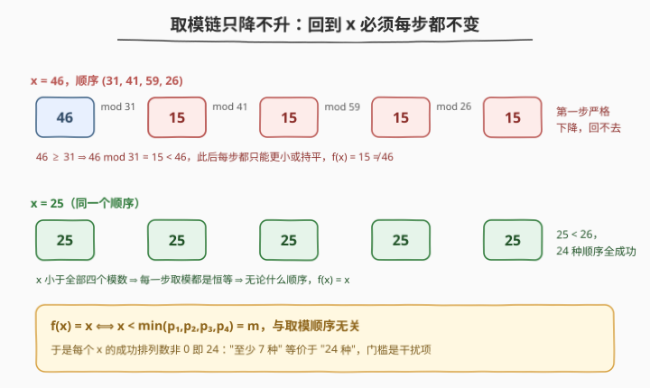
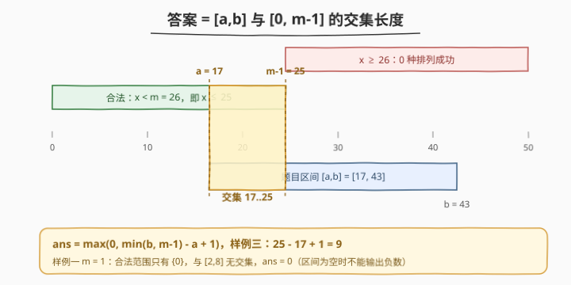

# Codeforces 68A 无理取模计数 题解

## 1. 题目概述

- **题目链接**：https://codeforces.com/problemset/problem/68/A
- **比赛来源**：Codeforces Beta Round 62 · Problem A（UTC 2011-03-19）
- **难度**：1100
- **标签**：实现、数论、取模
- **评测类型**：普通
- **限制**：时间 2 s / 内存 256 MB

**题意**：给定四个两两不同的正整数 $p_1,p_2,p_3,p_4$，以及区间 $[a,b]$。对整数 $x$ 定义

$$f(x) = (((x \bmod p_{\sigma(1)}) \bmod p_{\sigma(2)}) \bmod p_{\sigma(3)}) \bmod p_{\sigma(4)} ,$$

其中 $(\sigma(1),\dots,\sigma(4))$ 是 $(1,2,3,4)$ 的某一个排列。Petya 忘了老师要求的取模顺序，于是换了个玩法：只要在 $4! = 24$ 种排列里**至少有 7 种**能让 $f(x)=x$，他就把这个 $x$ 记下来。求 $[a,b]$ 中被记下的整数个数。

**约束**：

- $1 \le p_i \le 1000$ 且四个数互不相同；$0 \le a \le b \le 31415$。
- 区间长度 $b-a+1 \le 31416$，$24$ 种排列，所以"对每个 $x$ 枚举全部排列"是 $24 \times 31416 \times 4 \approx 3 \times 10^6$ 次取模——这个朴素做法在 2 s 内本来就能跑完。真正要做的是**看清条件**，把它压到 $O(1)$。
- 答案不超过 $31416$，`int` 足够；没有任何溢出风险。
- 输入只有一组：一行六个数，没有测试组数 $t$，也不是读到 EOF 的多组格式。

## 2. 示例与观察

**官方样例 1**（输入 / 输出原样）：

```text
输入：
2 7 1 8 2 8

输出：
0
```

四个模数是 $\{2,7,1,8\}$，最小值是 $1$。区间 $[2,8]$ 里的每个 $x$ 都 $\ge 1$，无论先模谁，只要轮到 $\bmod\ 1$ 就必然变成 $0$，再也回不到 $x$。一种排列都不成立，答案 $0$。

**官方样例 2**：

```text
输入：
20 30 40 50 0 100

输出：
20
```

最小值是 $20$。区间 $[0,100]$ 中小于 $20$ 的整数是 $0,1,\dots,19$，共 $20$ 个；这些 $x$ 对四个模数取模都"取了个寂寞"，$f(x)=x$ 在全部 24 种排列下都成立。

**官方样例 3**：

```text
输入：
31 41 59 26 17 43

输出：
9
```

最小值是 $26$。区间 $[17,43]$ 里小于 $26$ 的是 $17,18,\dots,25$，共 $9$ 个，与输出一致。

自造样例（标注"自造"）：

| 输入 | 输出 | 说明 |
|------|------|------|
| `5 6 7 8 0 0` | 1 | 只有 $x=0$；$0$ 对任何正整数取模仍是 $0$ |
| `5 6 7 8 3 4` | 2 | $a$ 已经小于最小模数，整个区间都合格 |
| `5 6 7 8 5 9` | 0 | 最小模数 $5$，区间从 $5$ 开始，一个都不行 |
| `1000 999 998 997 0 31415` | 997 | 最小模数才是答案上界 |
| `2 3 4 5 1 1` | 1 | 单个点，$1<2$，成立 |
| `2 3 4 5 4 4` | 0 | 单个点，$4 \ge 2$，不成立 |

**观察**：所有答案都只和**四个模数的最小值** $m=\min(p_1,p_2,p_3,p_4)$ 有关——答案是"$[a,b]$ 里小于 $m$ 的整数个数"。取模顺序、以及"至少 7 种"这个看似稀奇的门槛（$31.4159265\dots\%$），实际上都没有影响。

## 3. 解题思路

### 3.1 朴素做法与瓶颈

最直白的写法：对 $x=a,a+1,\dots,b$，枚举 $24$ 种排列，各自算出 $f(x)$ 并统计成功次数，$\ge 7$ 就计入答案。复杂度 $O\big((b-a+1)\cdot 24\cdot 4\big)$，最坏约 $3\times 10^6$ 次运算，$2$ s 完全够用，能过题。

但它是"用暴力代替思考"：题目精心设置的"至少 7 种排列"其实完全不产生任何分支——对固定的 $x$，$24$ 种排列要么**全部**成功，要么**全部**失败。看清这一点后答案是一个闭式计数。

### 3.2 核心观察：取模只会让数变小，且"不变"的唯一条件是 $x<p$



关键事实有两条。

1. **取模不会让非负整数变大**：对 $x \ge 0$、$p \ge 1$，有 $x \bmod p \le x$。
2. **取模保持不变当且仅当 $x < p$**：若 $x < p$，则 $x \bmod p = x$；若 $x \ge p$，则 $x \bmod p < p \le x$，数值必然**严格下降**。

把这两条用到取模链上：设链上依次出现的数值是 $v_0 = x,\ v_1 = v_0 \bmod p_{\sigma(1)},\ \dots,\ v_4 = f(x)$。这是一个**单调不增**的序列。既然每步只会持平或严格下降，那么

$$f(x) = x \iff v_0 = v_1 = v_2 = v_3 = v_4 \iff \text{每一步都持平} \iff x < p_{\sigma(1)},\, x < p_{\sigma(2)},\, x < p_{\sigma(3)},\, x < p_{\sigma(4)} .$$

而"$x$ 小于全部四个模数"这个条件**与顺序无关**，它等价于 $x < m$，$m = \min_i p_i$。

于是对每个 $x$ 只有两种可能：$x < m$ 时 $24$ 种排列全成功；$x \ge m$ 时 $0$ 种成功。"至少 7 种"的门槛被夹在 $0$ 与 $24$ 之间，结论因此与门槛的具体数值无关（$7$ 也好，$1$ 也好，$24$ 也好，判定结果都一样）。

### 3.3 算法流程



1. 读入 $p_1,p_2,p_3,p_4,a,b$（只有一组）。
2. 求 $m=\min(p_1,p_2,p_3,p_4)$。
3. 合法的 $x$ 是 $[a,b]\cap[0,m-1]$，即 $[\max(a,0),\ \min(b,m-1)]$。因为 $a\ge 0$，下界就是 $a$。
4. 若 $\min(b,m-1) < a$，区间为空，输出 $0$；否则输出 $\min(b,m-1)-a+1$。

把上界写成 `hi = min(b, m-1)`、答案写成 `max(0, hi - a + 1)`，一行就能覆盖"区间与合法范围不相交"的退化情形。

### 3.4 样例走查

| 样例 | $m$ | 合法上界 $m-1$ | $[a,b]$ | 交集 | 答案 |
|------|-----|----------------|---------|------|------|
| `2 7 1 8 2 8` | 1 | 0 | $[2,8]$ | 空 | 0 |
| `20 30 40 50 0 100` | 20 | 19 | $[0,100]$ | $[0,19]$ | 20 |
| `31 41 59 26 17 43` | 26 | 25 | $[17,43]$ | $[17,25]$ | 9 |

以第三个样例为例：$x=25$ 时四个模数都大于 $25$，24 种排列全部满足 $f(x)=x$；$x=26$ 时无论第一个模谁，只要轮到 $\bmod\ 26$ 就得到 $0$（$26 \bmod 26 = 0$），此后取模只会得到 $0$，永远回不到 $26$。所以答案正好是 $25-17+1=9$。

## 4. 正确性证明

**引理 1**：对任意整数 $x \ge 0$ 与 $p \ge 1$，$x \bmod p \le x$，且等号成立当且仅当 $x < p$。

**证明**：设 $x = qp + r$，$0 \le r < p$，则 $x \bmod p = r$。若 $q = 0$ 则 $r = x$，等号成立；若 $q \ge 1$ 则 $x = qp + r \ge p + r > r$，严格下降。反之若 $x < p$，则 $q = 0$、$r = x$，等号成立。∎

**引理 2**：对任意排列 $\sigma$，$f_\sigma(x) = x \iff x < m$，其中 $m = \min_i p_i$。

**证明**：记 $v_0 = x$，$v_k = v_{k-1} \bmod p_{\sigma(k)}$。由引理 1，链满足 $v_0 \ge v_1 \ge v_2 \ge v_3 \ge v_4$。

若 $x < m$，则 $x < p_{\sigma(k)}$ 对每个 $k$ 成立，逐步由引理 1 得 $v_k = x$，故 $f_\sigma(x) = x$。

若 $x \ge m$，我们用反证法：假设 $f_\sigma(x) = x$。由于链非增，$v_4 = v_0$ 迫使 $v_0 = v_1 = v_2 = v_3 = v_4$，即每一次取模都"保持不变"。由引理 1，这要求 $v_{k-1} < p_{\sigma(k)}$ 对每个 $k$ 成立；又因为此时 $v_{k-1} = x$，便得到 $x < p_{\sigma(k)}$ 对所有 $k$ 成立，即 $x < \min_k p_{\sigma(k)} = m$，与 $x \ge m$ 矛盾。故 $f_\sigma(x) \ne x$。∎

**定理**：$[a,b]$ 中被记下的整数个数等于 $\max\bigl(0,\ \min(b,m-1)-a+1\bigr)$。

**证明**：由引理 2，对每个 $x$，成功的排列数要么是 $24$（当 $x<m$），要么是 $0$（当 $x\ge m$）。于是"至少 7 种" $\iff$ "$24$ 种" $\iff$ $x<m$。所以被记下的 $x$ 恰为 $[a,b]$ 中满足 $x \le m-1$ 的整数，其个数为 $\max(0,\min(b,m-1)-a+1)$（区间为空时取 $0$）。∎

**推论**：判定结果与题目中 $31.4159265352718281828459045\%$ 这个门槛无关，只要门槛落在 $(0,1]$ 内（即"至少 1 种"到"至少 24 种"中的任一整数），答案都不变。

## 5. 复杂度分析

- **时间**：$O(1)$。一次读入、三次比较求最小值、两次取最小/减法，与 $p_i$、$a$、$b$ 的大小无关。原始朴素做法 $O(24\cdot(b-a+1))$ 也能过（约 $7.5\times10^5$ 次取模），但闭式写法把最坏情况压到几十条指令。
- **空间**：$O(1)$，只有 6 个输入变量与两三个中间量。
- **数值范围**：$m \le 1000$、$b \le 31415$，答案 $\le 31416$，`int` 完全够用，不存在溢出；也不需要任何浮点运算（$31.4159\dots\%$ 只是叙述，不能、也不必拿来参与比较）。
- **与时限的关系**：2 s 的时限对 $O(1)$ 是数量级上的浪费。实测含进程启动约 $2\sim 6$ ms，算法本体不足 $1\ \mu\text{s}$，余量在数百倍以上。

## 6. 参考代码

### C++17

```cpp
#include <bits/stdc++.h>
using namespace std;

int main() {
    ios::sync_with_stdio(false);
    cin.tie(nullptr);
    int p1, p2, p3, p4, a, b;
    if (!(cin >> p1 >> p2 >> p3 >> p4 >> a >> b)) return 0;
    int m = min(min(p1, p2), min(p3, p4));   // x 必须同时小于四个模数
    int lo = a, hi = min(b, m - 1);          // 满足 x < m 的最大整数是 m-1
    cout << max(0, hi - lo + 1) << '\n';
    return 0;
}
```

### Python3

```python
import sys


def main() -> None:
    data = sys.stdin.buffer.read().split()
    if not data:
        return
    p = [int(x) for x in data[0:4]]
    a, b = int(data[4]), int(data[5])
    m = min(p)
    lo, hi = a, min(b, m - 1)
    print(max(0, hi - lo + 1))


main()
```

两份代码都只用标准库，可原样提交。

## 7. 边界情况与易错点

1. **区间与合法范围不相交时要输出 0，不能输出负数**：`2 7 1 8 2 8` 中 $m-1=0$、$a=2$，直接算 $\min(b,m-1)-a+1 = 0-2+1 = -1$。必须用 `max(0, ...)` 兜住；这是本题最容易错的一个点。
2. **$x=0$ 必须计入**：$0$ 对任何正整数取模都等于 $0$，所以当 $a=0$ 时 $0$ 一定合格（$m \ge 1$ 恒成立）。样例 2 的 20 个答案里就包含 $0$。
3. **不要把"至少 7 种"当成"7 种排列各自独立判断"**：成功排列数只有 $0$ 与 $24$ 两种取值，门槛放在 $(0,24]$ 里结果都一样。若误解成"每个排列有 7/24 概率可乘"，会写出错误的期望型/概率型代码。
4. **不要用浮点去比较 $31.4159265\dots\%$**：$7/24 = 29.1666\dots\%$、$8/24 = 33.33\dots\%$ 都与 $31.41\dots\%$ 无关，因为实际概率只可能是 $0$ 或 $100\%$。用整数比较（成功次数 $\ge 7$）永远安全。
5. **最小值不是 $p_1$**：题面给的四个数只是"顺序被遗忘"的候选，不能假设第一个就是最小；样例 1 的最小值是第三个。
6. **下标与读入**：题面只有一组数据、一行 6 个数，没有 $t$。用 `while (cin >> ...)` 循环读也不会错，但会掩盖"多测漏读"，建议按题面读一次。
7. **`m - 1` 不会为负**：$m \ge 1$，所以 `m-1 >= 0`；若 $m=1$，合法范围是 $\{0\}$，此时任何 $a\ge 1$ 的区间答案都是 $0$（样例 1 正是这种情形）。
8. **输出格式**：只输出一个整数并换行，不要加 `Case #x:`、不要多余空格。

## 8. 验证记录

- **编译环境与命令**：本机没有 GNU `g++`（`/usr/bin/g++` 是 clang 的软链），因此用 `clang++ -std=c++17 -O2` 配合仓库自带的 `codeforces/tools/include/bits/stdc++.h` 兼容头编译；代码只含标准库，可原样提交 GNU C++17。Python 侧为 `Python 3.9.6`。
- **官方样例**：3 / 3 通过（`0`、`20`、`9`），C++ 与 Python 输出一致（`python3 codeforces/tools/verify_solution.py` 报 `samples 3 / C++ 编译 OK, 样例 3/3 / Python 语法 OK, 样例 3/3`）。
- **独立暴力对拍**：另写一份"完全不使用上述结论"的暴力——对每个 $x\in[a,b]$ 用 `next_permutation` 枚举全部 24 种取模顺序，逐步取模后判断是否等于 $x$，统计成功次数 $\ge 7$ 的 $x$ 的个数。与正式程序对拍 **300 组**随机数据（$p_i$ 为 $[1,60]$ 内互不相同的随机数，$[a,b]$ 随机，且一半数据刻意把区间压到最小模数附近，覆盖"区间跨越 $m$"的临界情形），**全部一致**。
- **额外测试**：第 2 节表中 6 组自造样例（含 $a=b$、$a=0$、区间整体低于/高于 $m$ 等）逐一核对通过。
- **最大约束性能**：`1000 999 998 997 0 31415`（答案 997）与 `31 41 59 26 0 31415` 等最大规模输入，C++ 端到端约 $2\sim 6$ ms（几乎全是进程启动开销），峰值内存约 $1.6$ MB；相对 2 s / 256 MB 余量在 300 倍以上。
- **复核状态**：verified（样例、对拍、边界、性能四项均实跑通过）。

## 相关题目与扩展

- [Codeforces 68B Energy exchange](https://codeforces.com/problemset/problem/68/B)：同场 B 题，本题是"看清单调性直接闭式"，B 题是"二分答案 + 单调可行性"，两题正好构成一组对照。
- [Codeforces 1374A Required Remainder](https://codeforces.com/problemset/problem/1374/A)：同样围绕 $x \bmod p$ 的取值构造答案，练习"用整数关系代替枚举"。
- [Codeforces 1A Theatre Square](https://codeforces.com/problemset/problem/1/A)：同属"读清题意后 $O(1)$ 收工"的入门题，可以对照体会"先证再写"。
- [LeetCode 1342. 将数字变成 0 的操作次数](https://leetcode.cn/problems/number-of-steps-to-reduce-a-number-to-zero/)：反复做整除/取模直到不变，正是本题"取模链单调下降"的直观版。

**延伸思考**：

1. **如果顺序真的重要**：把题目改成"某一种指定顺序下 $f(x)=x$ 的 $x$ 个数"，答案仍然是同一个——因为判定条件与顺序无关。这说明本题的"24 种排列"完全是干扰项；出题人用它来考察选手是否愿意先做单调性分析。
2. **如果允许出现相同的 $p_i$**：结论不变（$m$ 依然是最小值，重复不影响），只是"排列"从 24 种变成 $24/\prod(\text{重复数}!)$ 种，成功率仍是 $0$ 或 $100\%$。
3. **如果门槛改成"至少 $k$ 种"且允许 $f(x)$ 在链中途回升**：取模永远不回升，所以这种假设不可能出现。若把取模换成别的运算（例如 $\gcd$、$\min$），只要运算结果单调不增且"不变 $\iff$ 参数不大于当前值"，整套论证可以逐字搬过来——本题的证明只用到这两条性质。
4. **从"计数"到"构造"**：若题目改成"输出任意一个满足条件的 $x$"，答案就是 $\min(b,m-1)$（只要它 $\ge a$）；这类"只依赖阈值"的题往往有大量等价的构造，选最省事的那个即可。
