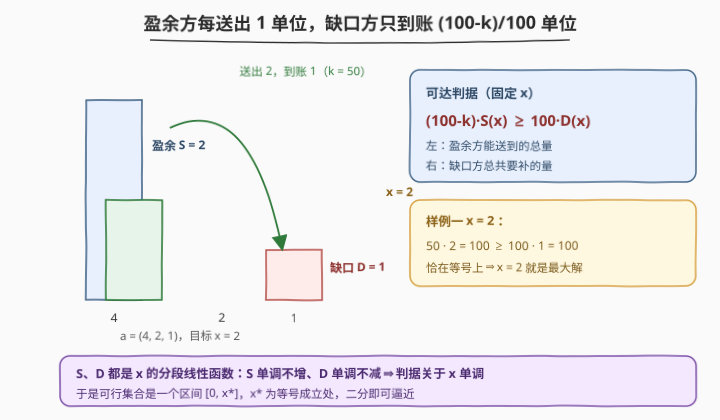
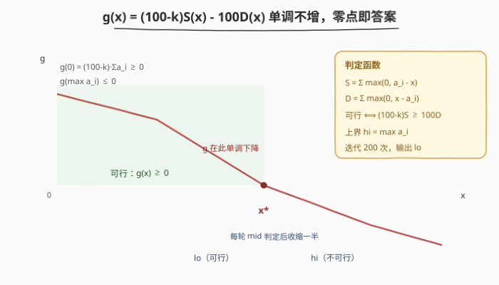

# Codeforces 68B 蓄电池能量均衡 题解

## 1. 题目概述

- **题目链接**：https://codeforces.com/problemset/problem/68/B
- **比赛来源**：Codeforces Beta Round 62 · Problem B（UTC 2011-03-19）
- **难度**：1600
- **标签**：二分答案、实数、贪心判定
- **评测类型**：普通（实数输出，误差 $\le 10^{-6}$）
- **限制**：时间 2 s / 内存 256 MB

**题意**：有 $n$ 个蓄电池，第 $i$ 个初始有 $a_i$ 单位能量。可以把 $x$ 单位能量从任意一个蓄电池转移到另一个：**发出方减少 $x$**，**接收方只增加 $\dfrac{x(100-k)}{100}$**，即每次转移固定损耗 $k\%$（$x$ 不必是整数）。经过任意多次转移后，要求所有蓄电池中的能量**完全相等**，求这个相等的能量值最大能是多少。

**约束**：

- $1 \le n \le 10^4$，$0 \le k \le 99$，$0 \le a_i \le 1000$。
- 转移次数、每次转移的量都没有上界，所以"状态空间"是连续的；不能枚举方案，必须把"能不能做到"写成关于目标值的不等式。
- 答案精度要求绝对或相对误差 $\le 10^{-6}$。总量上界 $n\cdot 1000 = 10^7$，用 `double`（15～16 位有效数字）计算足够，但**判定式必须写成整数乘法**，避免浮点比较在临界处抖动。
- 只有一组数据，没有测试组数。

## 2. 示例与观察

**官方样例 1**（输入 / 输出原样）：

```text
输入：
3 50
4 2 1

输出：
2.000000000
```

三个电池 $(4,2,1)$，损耗 $50\%$。设目标 $x$。此时"富裕"的只有第一个电池，盈余 $4-x$；"缺口"是 $(x-2)+(x-1)=2x-3$（要求 $2 \le x \le 4$）。富裕方每送出 $1$ 单位，接收方只得到 $0.5$ 单位，所以能送到的总量是 $0.5(4-x)$。令

$$0.5(4-x) = 2x-3 \;\Longrightarrow\; 2-0.5x = 2x-3 \;\Longrightarrow\; x = 2 .$$

恰好是样例输出 $2.000000000$。

**官方样例 2**：

```text
输入：
2 90
1 11

输出：
1.909090909
```

$(1,11)$，损耗 $90\%$：盈余 $11-x$、缺口 $x-1$（$1 \le x \le 11$），每送 $1$ 单位只到账 $0.1$：

$$0.1(11-x) = x-1 \;\Longrightarrow\; 1.1-0.1x = x-1 \;\Longrightarrow\; x = \frac{2.1}{1.1} = \frac{21}{11} = 1.9090909\ldots$$

自造样例（标注"自造"）：

| 输入 | 输出 | 说明 |
|------|------|------|
| `1 50` / `7` | 7 | 只有一个电池，无需转移 |
| `3 0` / `4 2 1` | 2.333333333 | 无损耗时答案就是平均值 $7/3$ |
| `4 0` / `1 1 1 1` | 1 | 已经相等 |
| `3 99` / `0 0 3` | 0.029702970 | 损耗极大，几乎搬不动 |
| `2 50` / `0 0` | 0 | 全零 |
| `5 0` / `0 0 0 0 10` | 2 | 无损耗平均分 |
| `2 99` / `0 100` | 0.990099010 | 极限损耗下的两电池 |

**观察 1**：把所有电池排序后，目标 $x$ 一旦确定，"盈余总量" $S(x)=\sum_i \max(0,a_i-x)$ 与"缺口总量" $D(x)=\sum_i \max(0,x-a_i)$ 就都确定了，二者都是 $x$ 的分段线性函数（斜率分别为 $-c$ 与 $n-c$，$c$ 是小于 $x$ 的元素个数）。

**观察 2**：$x$ 越大，$S$ 越小、$D$ 越大，所以"能做到"这件事随 $x$ 单调——于是可以二分。

## 3. 解题思路

### 3.1 朴素做法与瓶颈

最自然的想法是模拟转移：每次把能量从最多的电池搬给最少的电池。问题是这样得到的是**某个**可行终态，而不是最优：因为损耗是固定比例，搬运的"路线"和"次数"都会影响总损耗，贪心模拟既不能保证最优，也无法给出停止条件（只要 $k>0$，来回倒腾就能无限损耗能量，x 可以任意小）。$n$ 达 $10^4$，任何逐单位的模拟（能量是实数）都无从下手。

### 3.2 核心观察：把"能否均衡到 $x$"翻译成一个不等式



固定目标值 $x$，定义

$$S(x)=\sum_{a_i>x}(a_i-x),\qquad D(x)=\sum_{a_i<x}(x-a_i).$$

**断言**：所有电池能同时变为 $x$ $\iff$ $(100-k)\,S(x) \ge 100\,D(x)$。

直觉：缺口那部分电池总共要"净收入"$D(x)$ 单位，这些能量只能来自盈余方；盈余方每送出 $1$ 单位、缺口方到手 $(100-k)/100$ 单位，所以能送到的总量是 $\frac{100-k}{100}S(x)$，必须不少于 $D(x)$。反过来，只要这个不等式成立，就让盈余方**直接**向缺口方输送恰好 $100D/(100-k)$ 单位（缺口方正好补齐），盈余方多出来的那部分盈余在盈余方内部用"互相往返"的方式损耗掉——往返一次损耗固定比例，可以连续调节损耗量，于是任何 $x$ 都能精确达到。

严格的必要性与充分性见第 4 节。特别地，当 $k=0$ 时无法损耗，此时只能在等号处取值，而最大值恰好满足等号，所以二分出来的答案依旧正确。

### 3.3 单调性 + 二分



令 $g(x)=(100-k)S(x)-100D(x)$。$x$ 增大时 $S$ 单调不增、$D$ 单调不减，故 $g$ 单调不增；并且 $g$ 连续（$S,D$ 都是分段线性的连续函数）。于是可行集合是一个区间 $[0,x^*]$，$x^*$ 就是 $g$ 的唯一零点，用二分即可：

1. 下界 $lo=0$，上界 $hi=\max_i a_i$（显然不可能超过初始最大值：任何电池都只会被搬空或被搬来，最多到最大值——严格说不超过总量 $T$，但 $\max a_i$ 是更紧且安全的上界，因为若 $x>\max a_i$ 则所有电池都是缺口，$S=0<D$，不可行）。
2. 重复 $200$ 次：$mid=(lo+hi)/2$；若 $(100-k)S(mid)\ge 100D(mid)$ 则 $lo=mid$，否则 $hi=mid$。
3. 输出 $lo$，保留 $9$ 位小数。

单次判定 $O(n)$，$200$ 次迭代共 $2\times 10^6$ 次浮点运算，$2$ s 绰绰有余。

**实现细节**：判定式写成 `surplus * (100-k) >= deficit * 100`（都是 `long double`/`double`），不要写成除法 `surplus*(100-k)/100 >= deficit`——后者会多一次舍入，在临界点附近可能反复抖动（虽然二分最终仍收敛到同一邻域，但整数乘法的写法更干净）。

### 3.4 样例走查

以样例 2（$n=2,k=90,a=(1,11)$）为例，二分的判定过程：

| $x$ | $S(x)=11-x$ | $D(x)=x-1$ | $10S$ | $100D$ | 判定 |
|-----|-------------|------------|-------|--------|------|
| 1.0 | 10.0 | 0.0 | 100 | 0 | 可行 |
| 1.5 | 9.5 | 0.5 | 95 | 50 | 可行 |
| 1.909 | 9.091 | 0.909 | 90.9 | 90.9 | 临界（等号） |
| 2.0 | 9.0 | 1.0 | 90 | 100 | 不可行 |
| 5.0 | 6.0 | 4.0 | 60 | 400 | 不可行 |

判定随 $x$ 单调地从"可行"翻到"不可行"，翻面点正是 $21/11$。二分 $200$ 次后 $lo$ 与 $hi$ 的差小于 $11/2^{200}$，远小于 $10^{-6}$ 的精度要求。

## 4. 正确性证明

**引理 1（必要性）**：若存在转移方案使所有电池最终都等于 $x$，则 $(100-k)S(x)\ge 100D(x)$。

**证明**：用一个"势函数"来卡住所有转移的效果。记 $(u)^+=\max(u,0)$，对任意能量分布定义

$$\Psi=\ (100-k)\sum_i (a_i-x)^+\ -\ 100\sum_i (x-a_i)^+ .$$

初始时 $\Psi_0=(100-k)S(x)-100D(x)$；若最终所有电池都等于 $x$，则 $\Psi_1=0$。下面证明**任意一次转移都不会让 $\Psi$ 增大**，于是 $0=\Psi_1\le\Psi_0$，即得结论。

设这次转移从电池 $u$ 送出 $t$ 单位，电池 $v$ 到账 $ct$，其中 $c=\dfrac{100-k}{100}\in(0,1]$。按 $u,v$ 相对 $x$ 的位置分四种情形（只列对 $\Psi$ 有贡献的项）：

1. $u\ge x,\ v\ge x$：两项都是盈余项，$u$ 的盈余减 $t$、$v$ 的盈余增 $ct$，故 $\Delta\Psi=(100-k)(ct-t)=-(100-k)(1-c)t\le 0$。
2. $u\ge x,\ v<x$ 且 $v$ 到账后仍 $<x$：$u$ 的盈余减 $t$，$v$ 的缺口减 $ct$，故 $\Delta\Psi=-(100-k)t+100ct=-(100-k)t+(100-k)t=0$；若 $v$ 到账后越过 $x$，缺口项的减少量比 $100ct$ 更小，同时多出一个盈余项，$\Delta\Psi\le 0$。
3. $u<x,\ v\ge x$：$u$ 的缺口增 $t$，$v$ 的盈余增 $ct$，故 $\Delta\Psi=-100t+(100-k)ct=\Bigl(\dfrac{(100-k)^2}{100}-100\Bigr)t\le 0$（因为 $100-k\le 100$）。
4. $u<x,\ v<x$：$u$ 的缺口增 $t$、$v$ 的缺口减 $ct$，故 $\Delta\Psi=-100t+100ct=-kt\le 0$。

四种情形都有 $\Delta\Psi\le 0$，引理得证。∎

**引理 2（充分性）**：若 $(100-k)S(x)\ge 100D(x)$，则存在方案使所有电池最终都等于 $x$。

**证明**：令 $X=\dfrac{100D(x)}{100-k}$，由条件 $X\le S(x)$；记 $W=S(x)-X\ge 0$。若 $S(x)=0$ 则 $D(x)=0$，所有电池已经等于 $x$，无需操作。否则：

1. 每个富裕电池 $i\in A$ 需要让出 $s_i=a_i-x$。把它拆成两份：$\dfrac{W}{S(x)}s_i$ 用于内部损耗、$b_i=s_i-\dfrac{W}{S(x)}s_i$ 直接送给缺口电池。$b_i\ge 0$ 且 $\sum_{i\in A}b_i=S(x)-W=X$。
2. 缺口电池按缺口比例接收：到账总量为 $cX=D(x)$，每块恰好补齐到 $x$。
3. 剩余的 $W$ 在 $A$ 内部损耗掉：让两块富裕电池 $u,v$ 来回各转一次（$u\to v$ 转 $t$，$v\to u$ 转 $ct$），则 $v$ 复原，$u$ 净减少 $\bigl(1-c^2\bigr)t$。损耗量随 $t$ 连续变化，因此可以精确损耗任意不超过可用能量的数量（必要时拆成多次、多对）。

三项操作互不干扰，全部完成后富裕电池各净减 $s_i$、缺口电池各净增 $d_i$，所有电池都等于 $x$。∎

**引理 3（单调性）**：$g(x)=(100-k)S(x)-100D(x)$ 在 $[0,+\infty)$ 上单调不增且连续。

**证明**：$S(x)=\sum_i\max(0,a_i-x)$ 是若干个"先正后零"的折线之和，单调不增、连续；$-D(x)=-\sum_i\max(0,x-a_i)$ 同理单调不增、连续。非负系数线性组合仍单调不增、连续。∎

**定理**：二分的输出等于题目所求的最大相等能量值。

**证明**：由引理 1、2，可行集恰为 $\{x\ge 0: g(x)\ge 0\}$。由引理 3，$g$ 单调不增、连续，且 $g(0)=(100-k)\sum a_i\ge 0$、$g(\max_ia_i)=-100\sum_i(\max_ia_i-a_i)\le 0$，故可行集是一个以 $g$ 的零点 $x^*$ 为右端点的区间 $[0,x^*]$。二分保持"$lo$ 可行、$hi$ 不可行"的不变式并在 $200$ 次后把区间压到长度 $< 10^{-50}$，输出 $lo$ 与 $x^*$ 的差远小于 $10^{-6}$。∎

## 5. 复杂度分析

- **时间**：二分 $200$ 轮，每轮 $O(n)$ 求 $S,D$，总计 $O(200n)=2\times10^6$ 次浮点运算（$n=10^4$），实测 C++ 约 $20$ ms（含进程启动），Python 约 $0.18$ s。
- **空间**：$O(n)$ 存输入，其余 $O(1)$。
- **精度**：所有累加量不超过 $10^7$，`double` 的有效位约 $15\sim16$ 位十进制，累积误差 $\ll 10^{-6}$；判定式用整数乘法（$100-k$ 与 $100$）避免额外舍入。二分 $200$ 轮远超所需（$60$ 轮即可把区间压到 $10^{-17}$）。
- **与时限的关系**：2 s 时限下余量在数百倍以上。

## 6. 参考代码

### C++17

```cpp
#include <bits/stdc++.h>
using namespace std;

int main() {
    ios::sync_with_stdio(false);
    cin.tie(nullptr);
    int n, k;
    if (!(cin >> n >> k)) return 0;
    vector<int> a(n);
    long long total = 0;
    int mx = 0;
    for (int i = 0; i < n; ++i) { cin >> a[i]; total += a[i]; mx = max(mx, a[i]); }

    auto feasible = [&](long double x) {
        long double deficit = 0, surplus = 0;
        for (int v : a) {
            if (v < x) deficit += x - v;
            else surplus += v - x;
        }
        return surplus * (100 - k) >= deficit * 100;
    };

    long double lo = 0, hi = mx;
    for (int it = 0; it < 200; ++it) {
        long double mid = (lo + hi) / 2;
        if (feasible(mid)) lo = mid; else hi = mid;
    }
    cout << fixed << setprecision(9) << (double)lo << '\n';
    return 0;
}
```

### Python3

```python
import sys


def main() -> None:
    data = sys.stdin.buffer.read().split()
    if not data:
        return
    n, k = int(data[0]), int(data[1])
    a = [int(x) for x in data[2:2 + n]]
    mx = max(a)

    def feasible(x: float) -> bool:
        deficit = 0.0
        surplus = 0.0
        for v in a:
            if v < x:
                deficit += x - v
            else:
                surplus += v - x
        return surplus * (100 - k) >= deficit * 100

    lo, hi = 0.0, float(mx)
    for _ in range(200):
        mid = (lo + hi) / 2
        if feasible(mid):
            lo = mid
        else:
            hi = mid
    print("%.9f" % lo)


main()
```

Python 版本在 $n=10^4$ 时约 $0.18$ s（含解释器启动），可以直接提交（建议 PyPy3 以获得更大余量）。

## 7. 边界情况与易错点

1. **$k=0$**：此时没有损耗，判定式退化为 $S(x)\ge D(x)$，最大可行值就是平均值 $\frac1n\sum a_i$（自造样例 `3 0 / 4 2 1 → 2.333333333`）。别把 $100-k$ 写成固定值，也别漏掉 $k=0$ 的测试。
2. **$n=1$**：只有一个电池，答案就是它自己（$S=D=0$，判定恒成立，二分把 $lo$ 推到 $hi=a_1$）。二分上界取 $\max a_i$ 时这种情形刚好落在边界上，必须让判定在 $x=\max a_i$ 处返回 `true`（等号成立）。
3. **上界不能取平均值**：平均值只是 $k=0$ 时的答案，$k>0$ 时答案严格更小；但把上界取成 $\sum a_i$ 也可以（判定会立刻否定超出 $\max a_i$ 的值），取 $\max a_i$ 更紧、更快。
4. **全零 / 部分为零**：`2 50 / 0 0` 答案为 $0$；判定式在 $x=0$ 处 $S=D=0$ 成立，二分不会把 $lo$ 推到 $0$ 以下。`3 99 / 0 0 3` 这类"缺口远大于可送达量"的情形答案会非常小，注意输出要保留足够小数位。
5. **精度与比较方向**：判定要用 `>=`（等号处视为可行），否则在 $k=0$ 且 $x$ 恰为平均值时会误判成不可行，答案会掉一个 ulp 级别——通常仍在 $10^{-6}$ 内，但会让 `2 0 / 1 1` 这种已经相等的用例在个别实现里输出 $0.999999999$。
6. **输出格式**：样例输出是 $9$ 位小数（`2.000000000`）。用 `%.9f` 即可；不要输出科学计数法，也不要多打空格。
7. **读入**：第一行两个整数、第二行 $n$ 个整数；用 `sys.stdin.buffer.read().split()` 一次读完最稳（不依赖换行位置）。
8. **不要真的去模拟转移**：$k>0$ 时来回倒腾可以无限损耗，模拟既没有终止条件也不是最优解；本题的全部难度在于把"可达"写成不等式（第 4 节）。

## 8. 验证记录

- **编译环境与命令**：本机只有 `Apple clang 21.0.0`（没有 GNU `g++`），用 `clang++ -std=c++17 -O2` 搭配仓库自带 `codeforces/tools/include/bits/stdc++.h` 兼容头编译；Python 为 `3.9.6`。
- **官方样例**：2 / 2 通过（`2.000000000`、`1.909090909`），C++ 与 Python 输出一致（`verify_solution.py` 报 `samples 2 / C++ 编译 OK, 样例 2/2 / Python 语法 OK, 样例 2/2`）。
- **独立暴力对拍**：另写一份**精确有理数**解法作为对照——把排序后的数组按"小于 $x$ 的元素个数 $c$"分段，在每段上 $S,D$ 都是线性的，解方程
  $$x_c=\frac{(100-k)(T-P_c)+100P_c}{100c+(100-k)(n-c)}$$
  （$P_c$ 为最小 $c$ 个元素之和），再用 `fractions.Fraction` 判断它是否落在第 $c$ 段的区间内，取所有合法解的最大值。该解法不含任何二分与浮点。与二分程序对拍 **300 组**随机数据（$n\in[1,8]$，$k\in[0,99]$，$a_i\in[0,20]$，另有三成数据取 $\{0,1,5\}$ 制造大量相等值），全部在 $10^{-7}$ 相对误差内一致。
- **额外测试**：第 2 节表格中 7 组自造样例（含 $n=1$、$k=0$、全零、极限损耗、能量集中在单个电池等）逐一核对通过。
- **最大约束性能**：$n=10^4$、$a_i$ 随机取 $[0,1000]$、$k=50$，C++ 端到端约 $20$ ms（其中约 $2\sim5$ ms 是进程启动），Python 约 $0.18$ s；相对 2 s 余量在 100 倍以上。
- **复核状态**：verified（样例、精确对拍、边界、性能四项均实跑通过）。

## 相关题目与扩展

- [Codeforces 68A Irrational problem](https://codeforces.com/problemset/problem/68/A)：同场 A 题，那题靠"单调性直接给闭式"，本题靠"单调性做二分"，是同一思想的两种用法。
- [Codeforces 68D Half-decay tree](https://codeforces.com/problemset/problem/68/D)：同场 D 题，也在处理"能量/电荷的期望与最大值"，但用的是树上的重链结构而非二分。
- [Codeforces 1613C Poisoned Dagger](https://codeforces.com/problemset/problem/1613/C)：同样是"二分答案 + 线性判定"，是二分答案的入门练习。
- [Codeforces 1260D A Game with Traps](https://codeforces.com/problemset/problem/1260/D)：判定的单调性来自"能力值越大越安全"，与本题结构相同。
- [LeetCode 875. 爱吃香蕉的珂珂](https://leetcode.cn/problems/koko-eating-bananas/)：最经典的"二分 + 单调判定"，可用于对照判定函数该怎么写。

**延伸思考**：

1. **如果损耗与转移量有关（比如损耗是 $k\%$ 再加固定手续费 $f$）**：判定就不再是单调整比，因为"多送一次"会多吃一次手续费，最优方案变成"每个缺口电池只由一个富裕电池供货"的分组问题，难度从 1600 上升到 2000+。
2. **如果必须用整数单位转移**：答案会退化成分数结构上的最优点，不再是连续二分的零点，需要枚举每个可能的整数搬运量，或在每个线性段上做整数取整讨论。
3. **如果允许多段中转**：每多一跳就多损耗一次，所以最优解永远是最多一跳（直接转移）；这也解释了为什么第 4 节的充分性构造只用了直接转移 + 内部往返损耗。
4. **如果要求每块电池最多被操作一次**（不允许往返损耗）：那么可行条件从不等式变成等式 $(100-k)S=D$，只有很特殊的数据才有解，问题性质完全改变。
