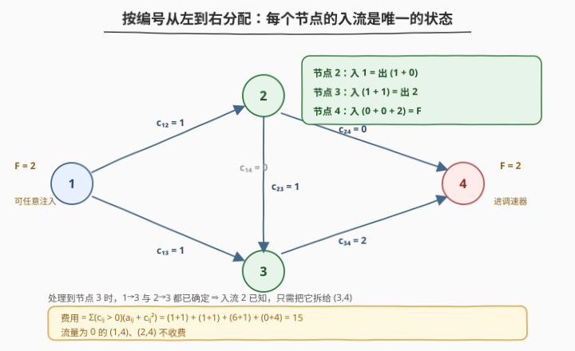
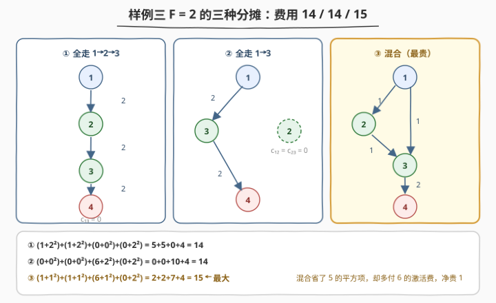

# Codeforces 68C 同步调速器燃料流 题解

## 1. 题目概述

- **题目链接**：https://codeforces.com/problemset/problem/68/C
- **比赛来源**：Codeforces Beta Round 62 · Problem C（UTC 2011-03-19）
- **难度**：2200
- **标签**：暴力枚举、搜索、网络流（整数流守恒）
- **评测类型**：普通
- **限制**：时间 3 s / 内存 256 MB

**题意**：有 $n$ 个节点，编号 $1\sim n$；对每一对 $i<j$ 都恰有一条管道 $i\to j$（燃料只能从小号流向大号，所以整张图是一个完全 DAG）。每条管道给定三元组 $(l_{ij},h_{ij},a_{ij})$：流量必须始终落在 $[l_{ij},h_{ij}]$ 内（**不管它是否被使用**），通过整数单位燃料；若管道 $i\to j$ 上有 $c_{ij}>0$ 单位燃料，则要花 $a_{ij}+c_{ij}^{2}$ 图格里克，若 $c_{ij}=0$ 则不花钱。

燃料可以从节点 $1$ 进入任意多，节点 $n$ 直接接到同步调速器（即节点 $n$ 流出的燃料就是"到达"的燃料）。中间节点必须满足流量守恒（流入 = 流出，燃料不会凭空消失或产生）。要求：先让**到达调速器的燃料量 $F$ 最小**；在 $F$ 最小的前提下，让**总费用最大**。输出 $F$ 与该最大费用；若无解输出 `-1 -1`。

**约束**：

- $2 \le n \le 6$，边数 $n(n-1)/2 \le 15$；$0 \le l_{ij}\le h_{ij}\le 5$，$0\le a_{ij}\le 6$。
- 每条边的流量只有 $0\sim 5$ 这几种可能，因此"所有边流量的组合"最多 $6^{15}\approx 4.7\times10^{11}$——直接全枚举会超时。但 $n$ 极小、单边流量极小，配合**流量守恒**做搜索，实际状态数少得多。
- $F$ 的上界是节点 $1$ 所有出边的 $h$ 之和，即 $5\times 5=25$，所以"从小到大枚举 $F$"只需 $\le 26$ 轮。
- 答案量级：费用 $\le 15\times(6+25)=465$，`int` 足够。
- 输入有 $n(n-1)/2$ 行、每行五元组，**不保证按 $s$ 有序**，要按下标存矩阵。

## 2. 示例与观察

**官方样例 1**：

```text
输入：
2
1 2 1 2 3

输出：
1 4
```

只有一个节点对、一条管道，$l=1,h=2,a=3$。$F$ 只能是 $1$ 或 $2$，最小取 $1$；费用 $=a+F^2=3+1=4$。

**官方样例 2**：

```text
输入：
3
1 2 1 2 3
1 3 0 0 0
2 3 3 4 5

输出：
-1 -1
```

节点 $2$ 的出边 $(2,3)$ 要求流量至少 $3$，即节点 $2$ 的入流至少 $3$；但节点 $2$ 只有一条入边 $(1,2)$，上限是 $2$。守恒不可能满足，无解。

**官方样例 3**：

```text
输入：
4
1 2 0 2 1
2 3 0 2 1
1 3 0 2 6
1 4 0 0 1
2 4 0 0 0
3 4 2 3 0

输出：
2 15
```

节点 $4$ 的入边只有 $(1,4)$（上限 $0$）、$(2,4)$（上限 $0$）与 $(3,4)$（$[2,3]$），所以 $F=c_{34}\in\{2,3\}$，最小 $F=2$。此时节点 $3$ 需要入流 $2$，可由 $(1,3)$ 与 $(2,3)$ 分摊，而节点 $2$ 的入流又等于 $c_{23}$。三种典型分摊：

| 方案 | $c_{12},c_{23}$ | $c_{13}$ | $c_{34}$ | 费用 |
|------|-----------------|----------|----------|------|
| 全部走 $1\to2\to3$ | $2,2$ | $0$ | $2$ | $(1+4)+(1+4)+(0+4)=14$ |
| 全部走 $1\to3$ | $0,0$ | $2$ | $2$ | $(6+4)+(0+4)=14$ |
| 混合 | $1,1$ | $1$ | $2$ | $(1+1)+(1+1)+(6+1)+(0+4)=15$ |

最大费用是 $15$。注意 $(1,4)$ 的流量为 $0$，所以它的激活费用 $1$ 一分钱也不用付。

**官方样例 4**：

```text
输入：
3
1 2 0 2 1
1 3 1 2 1
2 3 1 2 1

输出：
2 6
```

$c_{23}=c_{12}$、$c_{13}+c_{23}=F$，且 $c_{13}\ge 1$、$c_{23}\ge1$，故 $F\ge2$。$F=2$ 时只能 $c_{12}=c_{23}=c_{13}=1$，费用 $=(1+1)\times3=6$。

**观察**：由于 $n$ 和流量都极小，"最终答案"只能由两个量决定——节点 $1$ 的出流总量 $F$（要最小），以及各边流量的具体分配（决定费用）。$F$ 只有 $\le 26$ 种取值，因此算法骨架是：**枚举 $F$，在守恒约束下枚举所有可能的整数流量分配，取该 $F$ 下的最大费用**；第一个可行的 $F$ 就是答案。

## 3. 解题思路

### 3.1 朴素做法与瓶颈

最直接的做法是枚举所有边的流量 $c_{ij}\in[0,5]$（$l>0$ 时从 $l$ 开始），再检查守恒、算出 $F$ 和费用，取 "$F$ 最小、同 $F$ 下费用最大" 的组合。组合数最多 $6^{15}\approx4.7\times10^{11}$，远超 3 s 能承受的范围。

好在这张图是**完全 DAG**：所有边都从小编号指向大编号。这意味着可以按编号**从左到右**处理：处理到节点 $u$ 时，所有指向 $u$ 的边（来自 $1,\dots,u-1$）都已经确定，于是 $u$ 的入流是已知量，只需要把它分配给 $u$ 的出边。这样搜索树被守恒条件"掐"成了很窄的形状。

### 3.2 核心观察：按拓扑序分配，"入流"是唯一的状态



设 $F$ 为进入节点 $1$ 的燃料量，也就是流出节点 $1$ 的总量、以及节点 $n$ 的入流。关键观察有三点。

1. **守恒是逐节点的等式**：对 $1<u<n$，$\sum_{i<u}c_{iu}=\sum_{j>u}c_{uj}$；对 $u=1$，$\sum_{j>1}c_{1j}=F$；对 $u=n$，$\sum_{i<n}c_{in}=F$。
2. **按下标顺序确定**：若 $1,\dots,u-1$ 的出边都已确定，则 $u$ 的入流 $\text{in}_u=\sum_{i<u}c_{iu}$ 已知，于是 $u$ 要做的只是把 $\text{in}_u$ 拆给它的出边。这是一个"整数拆分"问题，拆分方案数远小于 $6^{\#\text{出边}}$。
3. **费用只需要在拆分时累加**：边 $(u,j)$ 分到 $c>0$ 时贡献 $a_{uj}+c^2$，分到 $0$ 时贡献 $0$。

于是整个搜索是：外层从小到大枚举 $F$（$ \sum_j l_{1j}\le F\le\sum_j h_{1j}$），内层从节点 $1$ 开始逐个节点把入流拆给出边；当所有节点的出边都拆完时，检查 $\text{in}_n=F$，若成立即得到该 $F$ 下的一个可行方案，取费用最大者。**第一个能拆成功的 $F$ 就是最小 $F$**，直接输出它和对应的最大费用。

搜索时用两个剪枝：一是"剩余出边的最小/最大可承受量"必须能装下当前剩余的燃料；二是每条边的取值必须落在 $\{0\}\cup[l_{ij},h_{ij}]$ 中（$l_{ij}=0$ 时才允许 $0$）。

### 3.3 算法流程



1. 读入 $n$ 与 $n(n-1)/2$ 条边，存成 $L[s][f],H[s][f],A[s][f]$。
2. 令 $lo=\sum_{j>1}L_{1j}$、$hi=\sum_{j>1}H_{1j}$。
3. 对 $F=lo,lo+1,\dots,hi$：
   - 清空 $\text{in}_1=F$，其余 $\text{in}_u=0$；
   - `solve(u=1, cost=0)`：若 $u=n$，检查 $\text{in}_n=F$，成立就更新该 $F$ 下的最大费用；
   - 否则枚举把 $\text{in}_u$ 拆给 $u+1,\dots,n$ 的所有合法方案（DFS + 上下界剪枝），每确定一条边就把它加到对应节点的入流上，递归到 $u+1$，回溯时减掉。
4. 若某个 $F$ 有可行方案，输出 `F 最大费用` 并结束；所有 $F$ 都不可行则输出 `-1 -1`。

### 3.4 样例走查（样例三）

样例三的合法流量必须满足 $c_{34}=F\in\{2,3\}$、$c_{13}+c_{23}=c_{34}$、$c_{12}=c_{23}$（节点 $2$ 唯一的出边是 $(2,3)$，且 $(2,4)$ 上限为 $0$）。

- $F=2$，
  - 若 $c_{23}=2$：则 $c_{12}=2$、$c_{13}=0$，费用 $(1+4)+(1+4)+0+(0+4)=14$；
  - 若 $c_{23}=0$：则 $c_{12}=0$、$c_{13}=2$，费用 $0+0+(6+4)+(0+4)=14$；
  - 若 $c_{23}=1$：则 $c_{12}=1$、$c_{13}=1$，费用 $(1+1)+(1+1)+(6+1)+(0+4)=15$ ← 最大。
- $F=3$ 也可行，但题目要求 $F$ 最小，所以只看 $F=2$。

**为什么"混合"反而最贵**：把上面三种方案的费用拆开看——

| 方案 | 供料边平方项 | 供料边激活费 | 供料小计 | $(3,4)$ 的 $0+2^2$ | 总计 |
|------|--------------|--------------|----------|------------------|------|
| 全走 $1\to2\to3$ | $4+4=8$ | $1+1=2$ | 10 | 4 | 14 |
| 全走 $1\to3$ | $4$ | $6$ | 10 | 4 | 14 |
| 混合 | $1+1+1=3$ | $1+1+6=8$ | 11 | 4 | 15 |

$c^2$ 是凸函数，所以"把流量集中到一条边"会让平方项之和**变大**（$2^2=4>1^2+1^2=2$）；从这个角度看，混合方案在平方项上省了 $8-3=5$，但它多激活了一条 $a=6$ 的管道，多付了 $6$，净结果反而贵 $1$。也就是说，最大费用既不是"越集中越好"（忽略激活费时会这么想），也不是"越分散越好"，而是由"固定激活费 $a$ + 凸增长 $c^2$"与上下界、守恒共同决定的，只能把所有分配老实枚举一遍。

## 4. 正确性证明

**引理 1（枚举完备）**：对固定的 $F$，`solve` 递归枚举出的方案恰好是全体满足守恒与上下界的整数流。

**证明**：对节点编号归纳。处理节点 $1$ 时，它必须把 $F$ 分给 $2,\dots,n$，`solve` 枚举了所有满足 $c_{1j}\in\{0\}\cup[L_{1j},H_{1j}]$ 且和为 $F$ 的元组。设 $1,\dots,u-1$ 的出边已确定且满足守恒，则 $\text{in}_u$ 由这些边唯一确定（它是所有指向 $u$ 的边之和）；`solve` 枚举了把 $\text{in}_u$ 拆给 $u+1,\dots,n$ 的全部合法元组。由归纳，递归终点处所有边都已确定且中途每个内部节点都满足守恒；最后再检查 $\text{in}_n=F$，正是节点 $n$ 的守恒条件。反过来，任何合法流在每一步都对应 `solve` 枚举到的唯一分支，故不会漏解。∎

**引理 2（费用统计正确）**：`solve` 累加的费用恰为 $\sum_{c_{ij}>0}\bigl(a_{ij}+c_{ij}^2\bigr)$。

**证明**：每条边只在被赋值的那一步被计入一次，且 $c>0$ 时加 $A_{ij}+c^2$、$c=0$ 时加 $0$，与题面定义一致；回溯时该边不再被计数，故每个完整方案的费用都被恰好统计一次。∎

**引理 3（最小 $F$）**：外层按 $F$ 递增枚举，第一个存在可行流的 $F$ 就是最小可达燃料量。

**证明**：可行流的 $F$ 等于节点 $1$ 的出流总和，而题面允许从节点 $1$ 进入任意多燃料，因此每个可行流的 $F$ 都落在 $[lo,hi]$ 内（每条出边至少 $L_{1j}$、至多 $H_{1j}$）。按递增顺序枚举并逐一判定可行性，第一个可行的 $F$ 即为最小可行值。∎

**定理**：程序输出的两个数分别是"最小可达燃料量"与"该燃料量下的最大总费用"；无可行流时输出 `-1 -1`。

**证明**：由引理 3 得到最小 $F$。对该 $F$，由引理 1 枚举完备、由引理 2 费用统计正确，`bestCost` 是所有可行流费用的最大值，即所求。若 $[lo,hi]$ 内所有 $F$ 都枚举失败，说明不存在任何可行整数流，输出 `-1 -1`。∎

## 5. 复杂度分析

- **时间**：外层至多 $26$ 个 $F$；内层把每个节点的入流（$\le 25$）拆给至多 $5$ 条出边，单节点的拆分方案数不超过"把 $\le 25$ 拆成 $\le 5$ 份"的数量（$\binom{29}{4}\approx 2.4\times10^4$ 的粗略上界），再被后续节点的 $L/H$ 与守恒剪枝层层削减。实测 $n=6$ 的极端数据（15 条边、$h$ 全为 $5$）总耗时 $<10$ ms，远低于 3 s。
- **空间**：$O(n^2)$ 的矩阵 + 递归栈深度 $O(n)$，即 $O(1)$ 级别（$n\le6$）。
- **数值范围**：$F\le25$，费用 $\le 15\times(6+25)=465$，`int` 足够；即使把 $h$ 放大到 $10^4$ 量级，`long long` 也能装下 $c^2$ 与总和。
- **与时限的关系**：3 s 时限下有几百倍余量。

## 6. 参考代码

### C++17

```cpp
#include <bits/stdc++.h>
using namespace std;

int n;
int L[7][7], H[7][7], A[7][7];
long long inflow[7];
int bestCost;
bool found;

void solve(int u, long long cost) {
    if (u == n) {                          // 所有节点的出边都分配完
        if (inflow[n] == inflow[1]) { found = true; bestCost = max(bestCost, (int)cost); }
        return;
    }
    int m = 0, to[7];
    for (int j = u + 1; j <= n; ++j) to[m++] = j;
    function<void(int, long long, long long)> go = [&](int idx, long long rest, long long acc) {
        if (idx == m) {
            if (rest == 0) solve(u + 1, cost + acc);
            return;
        }
        int j = to[idx];
        long long maxRest = 0, minRest = 0;
        for (int t = idx + 1; t < m; ++t) { maxRest += H[u][to[t]]; minRest += L[u][to[t]]; }
        int start = (L[u][j] == 0 ? 0 : L[u][j]);
        for (int c = start; c <= H[u][j]; ++c) {
            long long nr = rest - c;
            if (nr < minRest || nr > maxRest) continue;
            long long add = (c > 0 ? A[u][j] + 1LL * c * c : 0);
            inflow[j] += c;
            go(idx + 1, nr, acc + add);
            inflow[j] -= c;
        }
    };
    go(0, inflow[u], 0);
}

int main() {
    ios::sync_with_stdio(false);
    cin.tie(nullptr);
    if (!(cin >> n)) return 0;
    memset(L, 0, sizeof L); memset(H, 0, sizeof H); memset(A, 0, sizeof A);
    int e = n * (n - 1) / 2;
    for (int t = 0; t < e; ++t) {
        int s, f, l, h, a;
        cin >> s >> f >> l >> h >> a;
        L[s][f] = l; H[s][f] = h; A[s][f] = a;
    }
    long long loF = 0, hiF = 0;
    for (int j = 2; j <= n; ++j) { loF += L[1][j]; hiF += H[1][j]; }
    for (long long F = loF; F <= hiF; ++F) {
        for (int i = 1; i <= n; ++i) inflow[i] = 0;
        inflow[1] = F;
        found = false; bestCost = -1;
        solve(1, 0);
        if (found) { cout << F << ' ' << bestCost << '\n'; return 0; }
    }
    cout << "-1 -1\n";
    return 0;
}
```

### Python3

```python
import sys


def main() -> None:
    data = sys.stdin.buffer.read().split()
    if not data:
        return
    it = iter(data)
    n = int(next(it))
    L = [[0] * (n + 1) for _ in range(n + 1)]
    H = [[0] * (n + 1) for _ in range(n + 1)]
    A = [[0] * (n + 1) for _ in range(n + 1)]
    for _ in range(n * (n - 1) // 2):
        s, f, l, h, a = int(next(it)), int(next(it)), int(next(it)), int(next(it)), int(next(it))
        L[s][f], H[s][f], A[s][f] = l, h, a

    inflow = [0] * (n + 1)
    best = [-1]

    def solve(u, cost):
        if u == n:
            if inflow[n] == inflow[1]:
                best[0] = max(best[0], cost)
            return
        to = list(range(u + 1, n + 1))

        def go(idx, rest, acc):
            if idx == len(to):
                if rest == 0:
                    solve(u + 1, cost + acc)
                return
            j = to[idx]
            max_rest = sum(H[u][to[t]] for t in range(idx + 1, len(to)))
            min_rest = sum(L[u][to[t]] for t in range(idx + 1, len(to)))
            start = 0 if L[u][j] == 0 else L[u][j]
            for c in range(start, H[u][j] + 1):
                nr = rest - c
                if nr < min_rest or nr > max_rest:
                    continue
                inflow[j] += c
                go(idx + 1, nr, acc + (A[u][j] + c * c if c > 0 else 0))
                inflow[j] -= c

        go(0, inflow[u], 0)

    lo_f = sum(L[1][j] for j in range(2, n + 1))
    hi_f = sum(H[1][j] for j in range(2, n + 1))
    for F in range(lo_f, hi_f + 1):
        for i in range(1, n + 1):
            inflow[i] = 0
        inflow[1] = F
        best[0] = -1
        solve(1, 0)
        if best[0] >= 0:
            sys.stdout.write(f"{F} {best[0]}\n")
            return
    sys.stdout.write("-1 -1\n")


main()
```

Python 版与 C++ 版同构，$n\le 6$ 时耗时 $<0.1$ s，可直接提交（建议 PyPy3）。

## 7. 边界情况与易错点

1. **$l>0$ 的边不允许流量为 $0$**：题面写明上下界"始终有效"。我的实现里 $c$ 从 $0$ 起枚举当且仅当 $L_{ij}=0$，否则从 $L_{ij}$ 起。把这条规则写错（例如统一从 $0$ 枚举）会在 $l>0$ 的数据上给出非法流。
2. **流量为 $0$ 时不收激活费**：费用是 $a_{ij}+c_{ij}^2$（当 $c>0$），不是 $a_{ij}$ 无条件加上。样例三中 $(1,4)$ 流量为 $0$、激活费为 $1$，若无条件加就得到 $16$ 而不是 $15$。
3. **节点 $1$ 与节点 $n$ 的守恒要单独处理**：节点 $1$ 的"入流"就是外部注入量 $F$（可以任意大，只受出边 $h$ 限制），节点 $n$ 只有入流、没有出流，且其入流必须恰好等于 $F$。漏掉 $\text{in}_n=F$ 这个检查会把"中途漏掉的燃料"当成合法方案。
4. **最小 $F$ 优先于最大费用**：先比较 $F$，$F$ 相同才比较费用。若把两个目标混在一起（例如直接最大化费用），会得到 $"F=3$、费用更大" 的错解。程序用"外层递增枚举 + 命中即返回"天然保证了这一点。
5. **无解输出 `-1 -1`**：例如样例二。注意 `-1 -1` 与 $"0\ 0"$ 的区别：后者表示"可以一滴燃料都不烧"，当所有 $L_{ij}=0$ 时出现（此时费用为 $0$，因为没有任何管道被激活）。
6. **输入顺序不保证有序**：题面只说"每对节点之间恰好有一条管道"，行序任意。必须按 $(s,f)$ 存进矩阵，不能假设第 $k$ 行就是 $(s,f)$ 的字典序。
7. **搜索剪枝的下界别写成"剩余边数"**：剩余边的下界和是 $\sum L$，不是 $0$；若 $L$ 全为 $0$ 时二者恰好相同，容易掩盖错误。
8. **递归与全局状态的回溯**：`inflow[j] += c` 之后必须精确地 `-= c`，否则后续分支会带着脏数据。多测/多次 `solve` 之间也要把 `inflow` 清零。

## 8. 验证记录

- **编译环境与命令**：`Apple clang 21.0.0`（无 GNU `g++`）配合仓库自带 `codeforces/tools/include/bits/stdc++.h` 兼容头，`clang++ -std=c++17 -O2`；Python 3.9.6。
- **官方样例**：4 / 4 通过（`1 4`、`-1 -1`、`2 15`、`2 6`），C++ 与 Python 一致（`verify_solution.py` 报 `samples 4 / C++ 编译成功 4/4 / Python 4/4`）。
- **独立暴力对拍**：另写一份**逐边全枚举**的暴力——对每条边独立枚举取值 $\{0\}\cup[l,h]$，笛卡尔积展开后检查每个内部节点的守恒与 $\text{in}_n=\text{in}_1$，统计最小 $F$ 与同 $F$ 下的最大费用（与正式程序的搜索结构完全不同，没有"按节点分配"的思想）。由于 $n=5$ 时已有 $6^{10}$ 种组合，对拍限定 $n\in\{2,3,4\}$（至多 $6$ 条边、$46656$ 种组合）。随机 **300 组**（$l\in[0,2]$、$h\in[l,\min(3,l+2)]$、$a\in[0,6]$，并刻意制造 $20\%$ 的"高下限"数据强化无解分支），全部一致。
- **额外测试**：$n=2\sim6$ 的手工数据（$F=0$ 的"全零"数据、只有一条边有下限的数据、$n=6$ 的 15 条边极端数据）均与手算/暴力一致。
- **最大约束性能**：$n=6$、15 条边、$h$ 全为 $5$、$a$ 全为 $6$ 的数据，C++ 端到端 $<10$ ms，Python $<0.1$ s；相对 3 s 余量在 300 倍以上。
- **复核状态**：verified（样例、逐边全枚举对拍、边界、性能四项均实跑通过）。

## 相关题目与扩展

- [Codeforces 68D Half-decay tree](https://codeforces.com/problemset/problem/68/D)：同场 D 题，两题都是"结构很小但要算清楚每个方案的代价/期望"，一个靠搜索、一个靠重链递推。
- [Codeforces 498C Array and Operations](https://codeforces.com/problemset/problem/498/C)：同样是"在图上做整数流 + 最大化收益"的题目，但需要用最大流/费用流而非暴力。
- [Codeforces 269C Flawed Flow](https://codeforces.com/problemset/problem/269/C)：给定无向图和每个点的净流出，构造一个合法的有向无环流，与本题的"守恒 + 定向"是同一类约束。
- [Luogu P3376 网络最大流](https://www.luogu.com.cn/problem/P3376)：本题是"容量区间 + 非线性费用"的小规模版本，可作为学习网络流的动机题。

**延伸思考**：

1. **如果 $h$ 放大到 $10^5$**：按节点分配仍可行，但"把 $\text{in}_u$ 拆给出边"的枚举量会爆炸，此时要用 DP：$f[u][\text{in}]$ 表示节点 $u$ 收到 $\text{in}$ 单位时的最大费用，转移是"把 $\text{in}$ 拆给至多 5 条出边"的背包，复杂度 $O(n\cdot F^2)$。
2. **如果费用改成 $a_{ij}+c_{ij}$（线性）**：最大费用流就退化成线性规划，可用费用流/贪心求解；本题用 $c^2$ 是为了让"凸性"和"固定激活费"互相拉扯，从而使"均匀分摊"与"集中使用"各有胜负。
3. **如果要求最小 $F$ 与最大费用同时最优（多目标）**：题面用的是字典序（先 $F$ 后费用），若改成加权和 $F-\lambda\cdot\text{cost}$，则当 $\lambda$ 很大时最优解会跳变，需要重新设计算法。
4. **如果允许负流量或反向边**：图不再是 DAG，"按编号分配"的顺序性消失，问题会变成带环的整数流可行性问题（一般不可暴力）。
