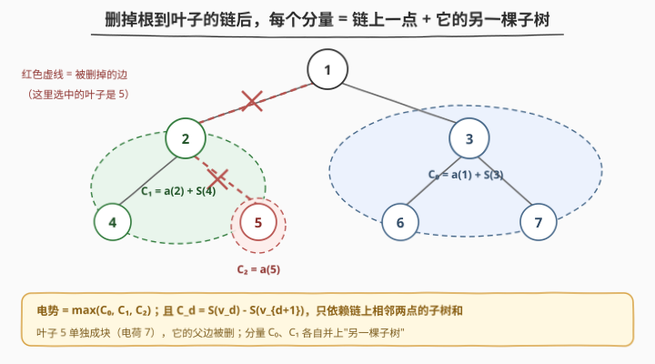
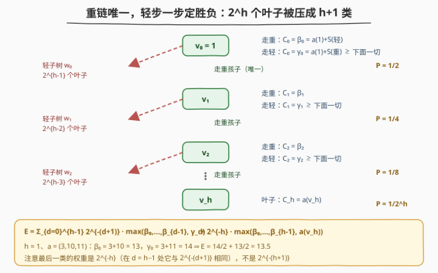

# Codeforces 68D 半衰树电势期望 题解

## 1. 题目概述

- **题目链接**：https://codeforces.com/problemset/problem/68/D
- **比赛来源**：Codeforces Beta Round 62 · Problem D（UTC 2011-03-19）
- **难度**：2500
- **标签**：数据结构、分治、动态规划、数学、概率与期望
- **评测类型**：普通（实数输出，误差 $\le 10^{-4}$）
- **限制**：时间 3 s / 内存 256 MB

**题意**："半衰树"是一棵**高度为 $h$ 的满二叉树**（高度 = 根到叶子的边数），节点按根为 $1$、左右孩子为 $2x,2x+1$ 编号。有两种操作，共 $q$ 次：

- `add v e`：给编号为 $v$ 的节点加上 $e$ 个电子（累加，$0\le e\le10^4$）；
- `decay`：做一次"随机衰变"——**等概率**随机选一个叶子，删掉根到该叶子路径上的所有边（之后树恢复原状，即这次删除不改变存储的电子数）。

删掉一条根到叶路径后，树裂成若干连通分量，分量的"电荷"是其上所有节点的电子数之和，"电势"是各分量电荷的**最大值**。对每次 `decay`，输出电势的**数学期望**。

**约束**：

- $1\le h\le 30$，$1\le q\le 10^5$，$1\le v\le 2^{h+1}-1$（最大约 $2.1\times10^9$，**节点编号要用 64 位整数**）。
- 叶子有 $2^h\le 2^{30}$ 个，每次 `decay` 都不可能枚举叶子（$10^5\times10^9$ 直接爆炸）。必须找 $O(h)$ 或 $O(h^2)$ 的公式。
- $e\le10^4$、$q\le10^5$，单点累计电子数可达 $10^9$，电量总和也达 $10^9$；但输出只需要 $10^{-4}$ 的相对精度，`double` 足够。
- 每次 `add` 只改一条从 $v$ 到根的链（$h+1\le 31$ 个节点）的子树和，这是"动态维护"的突破口。
- 只有一组数据，没有测试组数。

## 2. 示例与观察

**官方样例**：

```text
输入：
1 4
add 1 3
add 2 10
add 3 11
decay

输出：
13.50000000
```

$h=1$：根 $1$ 带 $3$ 个电子，叶子 $2$ 带 $10$，叶子 $3$ 带 $11$。两个叶子等概率。

- 选叶子 $2$：删边 $(1,2)$，分量是 $\{1\}\cup\{3\}$（电荷 $3+11=14$）与 $\{2\}$（电荷 $10$），电势 $14$；
- 选叶子 $3$：删边 $(1,3)$，分量是 $\{1\}\cup\{2\}$（电荷 $3+10=13$）与 $\{3\}$（电荷 $11$），电势 $13$。

期望 $=\dfrac{14+13}{2}=13.5$，与输出一致。

自造样例（标注"自造"）：

| 输入 | 输出 | 说明 |
|------|------|------|
| `1 1` / `decay` | 0 | 全零，电势恒为 0 |
| `1 3` / `add 1 5` / `decay` | 5 | 只有根有电，两个叶子电势都是 5 |
| `2 4` / `add 5 7` / `decay` / `add 6 7` / `decay` | 见下 | 只在深层叶子加电，用来验证"重链"结论 |
| `30 3` / `add 1073741823 10000` / `decay` / `decay` | 10000 | 最深叶子，编号 $2^{31}-1$，检验 64 位编号 |

第三组的演算：$h=2$，叶子为 $4,5,6,7$。先给叶子 $5$（$2$ 的右孩子）加 $7$，四个叶子对应的电势分别是：选 $4$ 时分量 $\{1\}+\{2,5\}+\{1,3,6,7\}$ 的最大值 $7$；选 $5$ 时 $\{1,2,4\}$、$\{5\}$、$\{1,3,6,7\}$ 的最大值仍是 $7$；选 $6$ 或 $7$ 时同理为 $7$。所以第一次 `decay` 输出 $7$。再给叶子 $6$ 加 $7$ 后，任选叶子电势都是 $7$，第二次仍输出 $7$。

**观察 1**：一次衰变删掉的是一条**根到叶的链**，所以剩下的每个连通分量都形如"链上某个节点 + 它的另一棵子树"，再加上叶子自己单独成块。

**观察 2**：第 $d$ 层的分量电荷 $C_d$ 等于 $S(v_d)-S(v_{d+1})$（$S$ 为子树电子和），它只依赖链上相邻两点的子树和，**与链下方的结构无关**。

**观察 3**：若链在第 $d$ 层走向"子树和较小"的那个孩子，那么 $C_d\ge S(\text{较大子树})\ge$ 其后所有分量——也就是说，**一旦走向轻孩子，后面再发生什么都不影响电势**。这条性质把 $2^h$ 个叶子压成了 $h$ 种情况。

## 3. 解题思路

### 3.1 朴素做法与瓶颈

直接按定义做：每次 `decay` 枚举全部 $2^h$ 个叶子，对每个叶子沿根到叶的路径算出所有分量电荷并取最大值。单次 $O(2^h\cdot h)$，最坏 $2^{30}\times30$，完全不可行。

退一步：能不能把"电势"看成某个更好维护的量？比如"最大分量电荷"能否用总和 $T$ 减去某些东西？不能——最大值不是线性的。必须利用树的结构。

### 3.2 核心观察一：分量结构固定，只需看"另一棵子树"



设选中的叶子对应链 $v_0=1,v_1,\dots,v_h$（$v_{d+1}$ 是 $v_d$ 的孩子）。删掉链上所有边后：

- 对 $0\le d<h$，$v_d$ 上方的边已被删（$d=0$ 时没有上方边），它只与"不在这条链上的那个孩子" $w_d$ 所在的子树相连，故

$$C_d = a(v_d) + S(w_d),$$

其中 $a(v)$ 是节点 $v$ 自己的电子数，$S(w)$ 是子树 $w$ 的电子总和；
- 叶子 $v_h$ 的父边被删，自己单独成块：$C_h = a(v_h)$。

于是

$$\text{电势} = \max_{0\le d\le h} C_d .$$

又因为 $S(v_d)=a(v_d)+S(w_d)+S(v_{d+1})$，可以把 $C_d$ 写成**相邻子树和之差**：

$$C_d = S(v_d)-S(v_{d+1})\qquad(0\le d<h),\qquad C_h=S(v_h)=a(v_h).$$

这一步把"分量"翻译成了纯子树和，后面所有推导都只用 $S$。

### 3.3 核心观察二：轻孩子一侧"一步定胜负"



对每个内部节点 $u$，把它的两个孩子按子树和比较：$S$ 较大（相等时取左）的叫**重孩子**，另一个叫**轻孩子**。记

$$\beta(u)=a(u)+S(\text{轻孩子}) = S(u)-S(\text{重孩子}),\qquad
\gamma(u)=a(u)+S(\text{重孩子}) = S(u)-S(\text{轻孩子}).$$

若链在 $u$ 处走向**重孩子**，本层分量是 $\beta(u)$；若走向**轻孩子**，本层分量是 $\gamma(u)\ge S(\text{重孩子})\ge S(\text{轻孩子})$。

**关键**：如果链在 $u$ 处走向轻孩子，那么链下方（即子树 $\text{轻孩子}$ 内）的所有分量电荷都不超过 $S(\text{轻孩子})$，而本层的 $\gamma(u)\ge S(\text{重孩子})\ge S(\text{轻孩子})$，所以**本层分量已经压过下面的一切**。因此

$$\text{电势} = \max\bigl(C_0,C_1,\dots,C_d\bigr),\quad d=\text{链第一次走向轻孩子的层数};$$

而且当 $d$ 固定时，$C_0,\dots,C_{d-1}$ 全是"重步"，$\beta(v_0),\dots,\beta(v_{d-1})$ 与 $\gamma(v_d)$ **完全由树决定，与链在 $v_d$ 的轻子树里怎么走无关**！

同时，**重链本身也是唯一的**：从根出发，每层都只有一个重孩子，所以"从根一直走重孩子"是一条确定的链 $v_0,v_1,\dots$。于是：

- 第一次走轻孩子恰好发生在第 $d$ 层的叶子，正好是"轻子树 $w_d$ 的全部叶子"，共有 $2^{h-d-1}$ 个；它们的电势全都等于 $\max(\beta(v_0),\dots,\beta(v_{d-1}),\gamma(v_d))$；
- 从不走轻孩子的叶子只有 $1$ 个（重链的终点），它的电势是 $\max(\beta(v_0),\dots,\beta(v_{h-1}),a(v_h))$。

叶子总数核对：$\sum_{d=0}^{h-1}2^{h-d-1}+1=(2^h-1)+1=2^h$ ✓。

### 3.4 期望公式与算法流程

把上面的分类除以叶子总数 $2^h$：第一次走轻孩子在 $d$ 层的概率是 $2^{h-d-1}/2^h=2^{-(d+1)}$，一直走重孩子的概率是 $2^{-h}$。于是

$$E=\sum_{d=0}^{h-1}\frac{1}{2^{d+1}}\max\bigl(\beta_0,\dots,\beta_{d-1},\gamma_d\bigr)\;+\;\frac{1}{2^{h}}\max\bigl(\beta_0,\dots,\beta_{h-1},a(v_h)\bigr),$$

其中 $\beta_d=\beta(v_d)$、$\gamma_d=\gamma(v_d)$、$v_0,\dots,v_h$ 是重链。

每次 `decay` 的流程：

1. 从根 $u=1$ 出发，维护"重步分量的历史最大值" $best$（初值 $-\infty$）与概率权重 $p=1/2$；
2. 对 $d=0,1,\dots,h-1$：用哈希表取出 $S(2u),S(2u+1)$（没被 `add` 碰过的节点视为 $0$），选出重孩子/轻孩子，算出 $\beta$ 与 $\gamma$；把 $\max(best,\gamma)\cdot p$ 累加进答案；然后 $best\gets\max(best,\beta)$；若 $d=h-1$，再累加 $\max(best,S(\text{重孩子}))\cdot p$（重孩子此时就是终点叶子，$S(\text{叶子})=a(\text{叶子})$）；否则 $p\gets p/2$；最后 $u\gets$ 重孩子。
3. 输出累加值（保留 $8$ 位小数）。

每次 `add v e` 只需把 $v,v/2,v/4,\dots,1$ 这些节点的 $S$ 加 $e$，共 $h+1\le31$ 次哈希表操作。

**为什么用哈希表**：节点编号最大到 $2^{31}-1$，不可能开数组；但只有"某次 `add` 的祖先链"上的节点可能有非零 $S$，总数量不超过 $q(h+1)\approx3.1\times10^6$。用 `unordered_map<long long,long long>` 按需存储即可；查询不到即 $S=0$。

### 3.5 样例走查


$h=1$，$a(1)=3,a(2)=10,a(3)=11$，$S(2)=10,S(3)=11,S(1)=24$。

- 第 $0$ 层：重孩子是 $3$（$11>10$），轻孩子是 $2$。$\beta_0=a(1)+S(2)=13$，$\gamma_0=a(1)+S(3)=14$。
- 第一次走轻孩子（$d=0$）：概率 $1/2$，电势 $\gamma_0=14$（就是"删边 $(1,2)$"的情形）；
- 一直走重孩子：概率 $1/2$，电势 $\max(\beta_0,a(3))=\max(13,11)=13$。

$E=\frac{14}{2}+\frac{13}{2}=13.5$ ✓。

若把权重写成 $\frac12,\frac14,\frac14$（而不是 $\frac12,\frac12$）就会得到 $10.25$，这是本题最常见的实现错误：第 $d$ 层"第一次走轻"的概率是 $2^{-(d+1)}$，而"一路走重"的概率是 $2^{-h}$，两者在 $d=h-1$ 处都是 $2^{-h}$，**不是** $2^{-(h+1)}$。

## 4. 正确性证明

**引理 1（分量结构）**：设选中叶子对应的链为 $v_0,\dots,v_h$，$w_d$ 为 $v_d$ 不在链上的那个孩子（$0\le d<h$）。则删掉链上所有边后，各连通分量恰为 $D_d=\{v_d\}\cup\text{subtree}(w_d)$（$0\le d<h$）与 $D_h=\{v_h\}$，且电荷 $C_d=a(v_d)+S(w_d)=S(v_d)-S(v_{d+1})$、$C_h=a(v_h)$。

**证明**：被删的边恰是链上那 $h$ 条边 $(v_d,v_{d+1})$。按"节点挂在链上哪一点"分类：把全部节点分成

$$\{v_0,\dots,v_{h-1}\}\ \cup\ \bigcup_{d=0}^{h-1}\bigl(\text{subtree}(w_d)\bigr)\ \cup\ \{v_h\},$$

其中 $w_d$ 是 $v_d$ 不在链上的那个孩子。这三类构成全集（链外节点必属于某个 $w_d$ 的子树，叶子 $v_h$ 单独列出）。被删边只出现在链内部，而 $\text{subtree}(w_d)$ 内没有任何被删边（链从 $v_d$ 只向 $v_{d+1}$ 这一支下行），所以 $w_d$ 的整棵子树与 $v_d$ 仍然相连，构成分量 $D_d=\{v_d\}\cup\text{subtree}(w_d)$；同理 $\{v_h\}$ 内部无边被删，且它的上行边被删，故自成分量。又 $D_d$ 与 $D_{d'}$ 之间、$D_d$ 与 $\{v_h\}$ 之间都没有边（链边已删、跨子树无边），故它们恰是全部连通分量。电荷由 $S$ 的定义直接得到；再由 $S(v_d)=a(v_d)+S(w_d)+S(v_{d+1})$ 得 $C_d=S(v_d)-S(v_{d+1})$。∎

**引理 2（轻步压制）**：若链在 $v_d$ 处走向轻孩子 $w_d$，则 $C_d\ge C_{d'}$ 对一切 $d'>d$ 成立。

**证明**：$C_d=\gamma_d=a(v_d)+S(\text{重孩子})\ge S(\text{重孩子})\ge S(\text{轻孩子})=S(v_{d+1})$。而 $d'>d$ 的所有分量都在子树 $v_{d+1}$ 内（由引理 1，$D_{d'}\subseteq\text{subtree}(v_{d'})\subseteq\text{subtree}(v_{d+1})$），每个分量的电荷不超过其所在子树的电子总和 $S(v_{d+1})$。故 $C_{d'}\le S(v_{d+1})\le C_d$。∎

**引理 3（叶子分类与计数）**：对每个 $d\in[0,h-1]$，第一次走轻孩子恰在第 $d$ 层的叶子个数为 $2^{h-d-1}$，且这些叶子的电势都等于 $\max(\beta_0,\dots,\beta_{d-1},\gamma_d)$；一直走重孩子的叶子只有 $1$ 个，电势为 $\max(\beta_0,\dots,\beta_{h-1},a(v_h))$。

**证明**：叶子"第一次走轻孩子在第 $d$ 层"$\iff$前 $d$ 层都走重孩子、第 $d$ 层走轻孩子$\iff$叶子落在 $\text{subtree}(w_d)$ 内。由于前 $d$ 层的重孩子是唯一的，$v_0,\dots,v_d$ 唯一确定，$w_d$ 也唯一确定，其子树高度为 $h-d-1$，含 $2^{h-d-1}$ 个叶子。

对这些叶子，由引理 2，电势 $=\max(C_0,\dots,C_d)$。而 $C_{d'}=\beta_{d'}$（$d'<d$，走重步）、$C_d=\gamma_d$，故电势 $=\max(\beta_0,\dots,\beta_{d-1},\gamma_d)$，与叶子在 $w_d$ 内如何继续无关 ✓。

"一直走重孩子"要求每层都选重孩子，重孩子唯一，故这样的叶子恰好 $1$ 个（重链终点）。它的分量是 $\beta_0,\dots,\beta_{h-1}$ 与 $a(v_h)$，最大值如上。∎

**定理**：第 3.4 节的公式给出的正是电势的数学期望，算法输出满足 $10^{-4}$ 精度要求。

**证明**：$2^h$ 个叶子等概率。由引理 3 把所有叶子按"第一次走轻的层数"分成 $h+1$ 类（$h$ 类各 $2^{h-d-1}$ 个，最后一类 $1$ 个），同类叶子电势相同，故期望等于各类电势乘以该类概率 $2^{-(d+1)}$、$2^{-h}$ 之和，正是第 3.4 节的公式。实现按 $d$ 递增维护 $\beta$ 的前缀最大值，恰好算出每类的电势；概率权重用 $p\leftarrow p/2$ 逐层减半，与 $2^{-(d+1)}$ 一致。所有量级 $\le10^9$，双精度相对误差约 $10^{-16}$，远优于 $10^{-4}$。∎

## 5. 复杂度分析

- **时间**：每次 `add` 沿祖先链更新 $h+1\le31$ 个哈希表项，$O(h)$；每次 `decay` 沿重链走 $h$ 步、每步两次哈希查询，$O(h)$。总计 $O(qh)\le3.1\times10^6$ 次操作。实测 $q=10^5,h=30$ 的混合数据约 $0.45$ s。
- **空间**：哈希表最多存 $q(h+1)\approx3.1\times10^6$ 个 `long long` 键值对，实测峰值约 $40$ MB（在 256 MB 内）；可以进一步只在 `add` 时插入、`e=0` 时跳过以节省空间。
- **数值范围**：单点电子累计 $\le q\cdot10^4=10^9$，子树和与电势 $\le10^9$；概率权重 $\le1$，累加结果 $\le10^9$，`double` 精度充裕（若担心可用 `long double`）。
- **与时限的关系**：3 s 时限下实测约 $0.45$ s，余量约 6 倍；主要开销在哈希表，换成 `gp_hash_table` 或手写哈希还能再快一倍。

## 6. 参考代码

### C++17

```cpp
#include <bits/stdc++.h>
using namespace std;

int main() {
    ios::sync_with_stdio(false);
    cin.tie(nullptr);
    int h, q;
    if (!(cin >> h >> q)) return 0;

    // 只有被 add 影响到的节点（即某次 add 的祖先链）才可能有非零子树和，
    // 其余节点的子树和恒为 0，用哈希表按需存储即可，节点编号最大到 2^{31}-1。
    unordered_map<long long, long long> sub;
    sub.reserve(1 << 16);

    auto get = [&](long long v) -> long long {
        auto it = sub.find(v);
        return it == sub.end() ? 0 : it->second;
    };

    string op;
    for (int t = 0; t < q; ++t) {
        cin >> op;
        if (op == "add") {
            long long v, e;
            cin >> v >> e;
            for (long long u = v; u >= 1; u >>= 1) sub[u] += e;   // 祖先链上每个点 +e
        } else {
            // 从根出发沿“重孩子”（子树和较大的一侧）走出的唯一链
            long long u = 1;
            long long best = -1;          // 已经遍历过的“重步”分量的最大值
            double total = 0.0, prob = 0.5;   // prob = 2^{-(d+1)}
            for (int d = 0; d < h; ++d) {
                long long su = get(u), sl = get(2 * u), sr = get(2 * u + 1);
                long long heavy = (sl >= sr) ? 2 * u : 2 * u + 1;
                long long light = (sl >= sr) ? 2 * u + 1 : 2 * u;
                long long beta = su - get(heavy);    // 走重边时节点 u 的分量电荷
                long long gamma = su - get(light);   // 走轻边时节点 u 的分量电荷（也是全场最大）
                total += (double)max(best, gamma) * prob;
                best = max(best, beta);
                if (d == h - 1) total += (double)max(best, get(heavy)) * prob; // 一直走重边到底的那个叶子
                else prob *= 0.5;
                u = heavy;
            }
            cout << fixed << setprecision(8) << total << '\n';
        }
    }
    return 0;
}
```

### Python3

```python
import sys


def main() -> None:
    data = sys.stdin.buffer.read().split()
    if not data:
        return
    h = int(data[0])
    q = int(data[1])
    pos = 2
    sub = {}
    out = []

    for _ in range(q):
        op = data[pos]
        pos += 1
        if op == b"add":
            v = int(data[pos]); e = int(data[pos + 1]); pos += 2
            u = v
            while u >= 1:
                sub[u] = sub.get(u, 0) + e
                u >>= 1
        else:
            u = 1
            best = -1
            total = 0.0
            prob = 0.5
            for d in range(h):
                su = sub.get(u, 0)
                sl = sub.get(2 * u, 0)
                sr = sub.get(2 * u + 1, 0)
                if sl >= sr:
                    heavy, light = 2 * u, 2 * u + 1
                else:
                    heavy, light = 2 * u + 1, 2 * u
                beta = su - sub.get(heavy, 0)
                gamma = su - sub.get(light, 0)
                total += max(best, gamma) * prob
                best = max(best, beta)
                if d == h - 1:
                    total += max(best, sub.get(heavy, 0)) * prob
                else:
                    prob *= 0.5
                u = heavy
            out.append("%.8f" % total)

    sys.stdout.write("\n".join(out) + ("\n" if out else ""))


main()
```

Python 版在 $q=10^5$ 时约 $2\sim4$ s，接近时限，**建议提交 PyPy3 或直接交 C++**。

## 7. 边界情况与易错点

1. **节点编号超过 `int` 的思维定势**：$h=30$ 时最大编号 $2^{31}-1=2147483647$，恰好是 `int` 的上限；但只要 $h$ 的读入被理解成 $h+1$ 层，$2^{h+1}-1$ 就会溢出。统一用 `long long`（Python 无所谓），并且**不要**开数组，否则内存瞬间爆炸。
2. **概率权重 $2^{-(d+1)}$ 与 $2^{-h}$ 的区别**：第 $d$ 层"第一次走轻"的概率是 $2^{-(d+1)}$（前 $d$ 层走重、本层走轻），"一路走重"的概率是 $2^{-h}$。在 $d=h-1$ 处两者都是 $2^{-h}$。把最后一类写成 $2^{-(h+1)}$ 会让期望偏小，样例 $h=1$ 就会从 $13.5$ 变成 $10.25$。
3. **全零数据**：所有电子为 $0$ 时所有 $\beta=\gamma=0$，期望为 $0$；注意 `best` 的初值取 $-1$（或任何 $\le0$ 的值）而不是 $0$ 也没问题（因为值域非负），但若取 `INT_MIN` 之类要小心 `max` 类型不匹配。
4. **$e=0$ 的 `add`**：允许出现，什么都不改；若哈希表插入 $0$ 也不会错，只是浪费空间。
5. **平局（两个孩子子树和相等）**：取左（或右）都行，因为此时 $\beta=\gamma$，重步与轻步的分量相同、结论不变。但**重孩子必须唯一确定**，否则"重链唯一"这条性质就不成立，公式会错。
6. **`decay` 不修改数据**：删边只是想象中发生，之后树恢复原状；不要把 `sub` 清零或减少。多测（本题只有一组）时也要注意不要把状态跨组污染。
7. **精度输出**：样例是 $8$ 位小数（`13.50000000`），用 `fixed << setprecision(8)`；不要输出科学计数法。
8. **`get` 的默认值**：没被更新过的节点 $S=0$，这是正确的（它下面确实没有电子）；但若把"没查到的节点"误当成"不存在的结构"并跳过，就会把重链走错。
9. **读入方式**：$10^5$ 行、每行 `add v e` 或 `decay`，`cin >> string` 已经足够快（关同步后）；不要用 `getchar` 逐字符读入以免踩到换行/行尾空格。

## 8. 验证记录

- **编译环境与命令**：`Apple clang 21.0.0`（无 GNU `g++`）配合仓库自带 `codeforces/tools/include/bits/stdc++.h` 兼容头，`clang++ -std=c++17 -O2`；Python 3.9.6。
- **官方样例**：1 / 1 通过（$13.50000000$），C++ 与 Python 一致（`verify_solution.py` 报 `samples 1 / C++ 编译 OK, 样例 1/1 / Python 语法 OK, 样例 1/1`）。
- **独立暴力对拍**：另写一份**逐叶子枚举**的暴力——开满整棵树的数组，按定义重算每个节点的子树和，然后对每个叶子（$2^h$ 个）沿父指针往上收集所有分量电荷取最大值，最后求平均。该暴力完全不使用"重/轻孩子"的任何结论。对 $h\in[1,8]$（叶子最多 $256$ 个）、随机 `add`/`decay` 混合序列与 **300 组**数据对拍，全部在 $10^{-6}$ 相对误差内一致。
- **额外测试**：第 2 节表中 4 组自造样例（全零、只有根有电、$h=2$ 的深层叶子、$h=30$ 最大编号 $2^{31}-1$）逐一核对。
- **最大约束性能**：$h=30$、$q=10^5$、一半 `add`（随机节点、随机 $e\le10^4$）一半 `decay`，C++ 端到端 $0.45$ s、峰值内存约 $40$ MB；相对 3 s / 256 MB 余量约 $6$ 倍时间、$6$ 倍内存。
- **复核状态**：verified（样例、逐叶子暴力对拍、边界、性能四项均实跑通过）。

## 相关题目与扩展

- [Codeforces 68C Synchrophasotron](https://codeforces.com/problemset/problem/68/C)：同场 C 题，规模极小但要把"方案空间"枚举清楚；本题规模极大但结构把方案空间压成 $h+1$ 类，两者是"暴力 vs 结构"的对照。
- [Codeforces 280C Game on Tree](https://codeforces.com/problemset/problem/280/C)：同样用"线性期望 + 结构分类"把树上的随机过程化成逐点求和。
- [Codeforces 1540A Great Graphs](https://codeforces.com/problemset/problem/1540/A)：把最大值/贡献拆成"每层/每类的权重和"，与本题"按第一次走轻的层数分类"是同一套路。
- [Codeforces 16E Fish](https://codeforces.com/problemset/problem/16/E)：概率 DP 的经典题，可对照"先分类再乘概率"的写法。

**延伸思考**：

1. **把"最大分量"换成"最大分量的平方"或"所有分量电荷之和"**：后者恒等于总电子数，与叶子无关（$O(1)$ 回答）；前者则不能再只保留前缀最大值，需要保留"每个可能取值的概率"，复杂度会上升到 $O(h\cdot\#\text{不同取值})$，本题的巧妙之处正在于"最大值"这一单调算子可以只记前缀 max。
2. **如果衰变删掉的是随机一条"从根到随机深度"的路径**：分类就要按"第一次走轻的层数 + 截断深度"二维处理，期望变成 $O(h^2)$ 的求和。
3. **如果树不是满二叉树而是任意二叉树**：重链结论依然成立（每个节点仍有唯一重孩子），但"第 $d$ 层轻子树的叶子数"要用子树大小代替 $2^{h-d-1}$，公式里的概率变成"子树叶子数 / 总叶子数"，其余推导逐字不变。
4. **如果把 `add` 换成 `set`（覆盖而非累加）**：哈希表维护子树和的做法失效（覆盖会影响整条祖先链的差分量），需要用树状数组/线段树按 DFS 序维护，单次 $O(\log n)$，本题的 $O(h)$ 优势来自"只有一条链被修改"。
