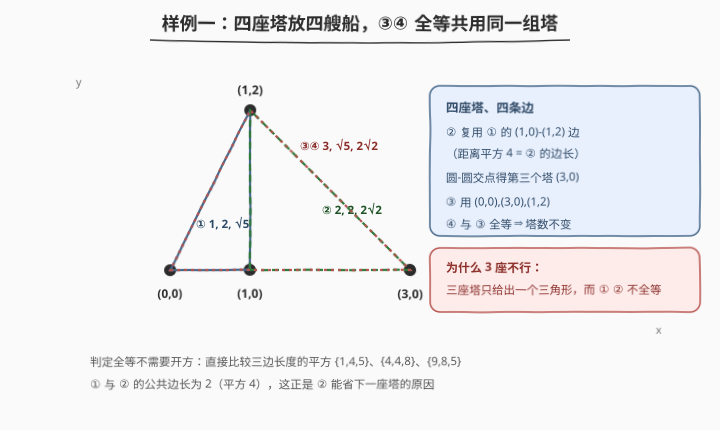
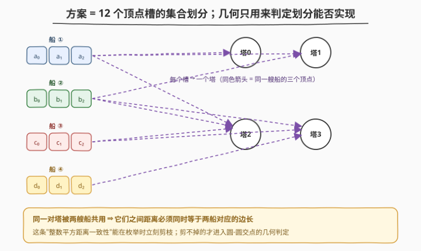

# Codeforces 68E 最少着陆塔数 题解

## 1. 题目概述

- **题目链接**：https://codeforces.com/problemset/problem/68/E
- **比赛来源**：Codeforces Beta Round 62 · Problem E（UTC 2011-03-19）
- **难度**：2900
- **标签**：计算几何、枚举、集合划分
- **评测类型**：普通
- **限制**：时间 3 s / 内存 256 MB

**题意**：有 4 艘外星飞船，每艘的形状是一个**非退化三角形**（给出三个整点坐标）。要在地面上修若干座"塔"（平面上的点），一艘飞船能降落，当且仅当**存在三座塔**，它们构成的三角形与该飞船**全等**（允许旋转、平移、沿边的反射）。塔可以重复使用：两艘形状相同的飞船可以落在同样的三座塔上；飞船降落后允许互相重叠。求最少需要几座塔。

**约束**：

- 每行 6 个整数 $x_1,y_1,x_2,y_2,x_3,y_3\in[0,20]$，保证三点不共线；共 4 行。
- 塔的坐标是**任意实数**，不能枚举平面上的点；这是本题的核心难点。
- 每艘船的三边长平方都是不超过 $20^2+20^2=800$ 的整数，所以"两边等长""两三角形全等"都可以用整数精确判定，不需要浮点容差。
- 答案的范围很小：最少 3 座（三座塔只能构成一个三角形），最多 9 座（让所有飞船共用一座塔，其余两座各自摆放，$1+4\times 2=9$）。因此只需在 $k=3,\dots,9$ 之间找最小值。
- 坐标范围很小（$0\sim20$），不同输入之间边长重复的概率不低，"两艘船有公共边长"是常见情形，必须精确处理而不是靠随机。

## 2. 示例与观察

**官方样例 1**：

```text
输入：
0 0 1 0 1 2
0 0 0 2 2 2
0 0 3 0 1 2
0 0 3 0 2 2

输出：
4
```

四艘船的边长（平方）分别是：

| 飞船 | 三边平方 | 边长 |
|------|----------|------|
| ① $ (0,0),(1,0),(1,2)$ | $1,4,5$ | $1,2,\sqrt5$ |
| ② $ (0,0),(0,2),(2,2)$ | $4,4,8$ | $2,2,2\sqrt2$ |
| ③ $ (0,0),(3,0),(1,2)$ | $9,5,8$ | $3,\sqrt5,2\sqrt2$ |
| ④ $ (0,0),(3,0),(2,2)$ | $9,8,5$ | $3,2\sqrt2,\sqrt5$ |

④ 的三边平方为 $(3)^2=9$、$(2)^2+(2)^2=8$、$(3-2)^2+(0-2)^2=5$，即 $9,8,5$，与 ③ 相同——③ 与 ④ 全等。

题面提示的四座塔是 $(0,0),(1,0),(3,0),(1,2)$：

- ① 落在 $(0,0),(1,0),(1,2)$ 上（边长 $1,2,\sqrt5$）；
- ② 落在 $(1,0),(3,0),(1,2)$ 上（边长 $2,2,2\sqrt2$）；
- ③ 落在 $(0,0),(3,0),(1,2)$ 上（边长 $3,\sqrt5,2\sqrt2$）；
- ④ 与 ③ 全等，直接复用 ③ 的三座塔。

所以 4 座就够。3 座不行：三座塔只能构成**一个**三角形，而 ① 与 ② 不全等。

**官方样例 2**：

```text
输入：
0 0 0 1 1 1
0 0 0 2 2 2
0 0 0 5 5 5
0 0 0 17 17 17

输出：
9
```

四艘船都是等腰直角三角形，直角边长分别为 $1,2,5,17$，边长集合是 $\{L,L,L\sqrt2\}$。**任意两艘船都没有公共边长**（$1,\sqrt2,2,2\sqrt2,5,5\sqrt2,17,17\sqrt2$ 两两不等）。

题面给出的 9 座塔是 $(0,0)$ 以及四组 $(0,L),(L,0)$，全部飞船共用 $(0,0)$ 这个直角顶点，所以 $1+4\times2=9$ 座。

为什么 8 座不行？直观地说：两艘船若要共用**两座**塔，这两座塔之间的距离就同时是两艘船的某条边长，必须“公共边长”——而这里任意两艘船都没有公共边长。于是任意两艘船**最多共用一座塔**。若只用 8 座塔，则 12 个顶点被并成 8 个塔、共享量 $=4$，这必然要求共享结构里出现"三艘船共用一个塔"的环或"两艘船共用两座塔"的重复，而这两类结构都会把两座小船的塔"用链拴住"：例如 $17$ 那艘船的两座塔，若分别与 $1,2$ 那艘船的塔共用，则这两座塔的距离不超过 $\sqrt2+2\sqrt2=3\sqrt2<17$（三角形不等式），矛盾；四艘船成环时同理，链长上界是 $(1+2+5)\sqrt2=8\sqrt2<17$。所以 8 座必然失败。

自造样例（标注"自造"）：

| 输入（4 行） | 输出 | 说明 |
|--------------|------|------|
| 四艘船完全相同 | 3 | 三座塔构成一个三角形即可 |
| 两两全等分两组 | 6 | 两组各用三座塔 |
| 与样例二同型但边长为 $3,4,5$ 的倍数 | 9 | 相似但不等，无公共边长 |
| `0 0 1 0 0 1` 重复 4 次 | 3 | 全等 → 3 |

**观察**：只要能判定"两艘船有没有公共边长""两个三角形是否全等"，整个问题的组合结构就完全确定；剩下的只是**几何**问题——给定一个组合方案（哪些船的哪些顶点落在同一座塔上），它能否在平面上实现。

## 3. 解题思路

### 3.1 朴素做法与瓶颈

塔的坐标是实数，不能像"枚举格点"那样暴力。即使只考虑"每个塔都是某艘船的顶点"，也要在连续平面上找四个全等三角形的并集的最小点数，这是无穷多候选。

突破口是**离散化**：任何最优方案里，每座塔至少是一艘船的顶点（否则删掉它不影响任何飞船），而每艘船的顶点位置由其全等摆放决定。于是"塔"就是"12 个顶点槽"的等价类——方案可以完全用**集合划分**来描述，几何只用来判定一个划分能否实现。

### 3.2 核心观察



- **观察 1（全等的判据）**：两三角形全等 $\iff$ 三边长的**多重集合**相同。因为允许反射，所以不需要区分左右手性；边长平方都是整数，可以**精确**比较。
- **观察 2（塔的来源）**：最优方案的每座塔都是某艘船的顶点。于是塔数 $k$ 就是"把 12 个顶点槽分成 $k$ 个非空块"的块数，$k\in[3,9]$。
- **观察 3（固定基准）**：平面上的等距变换是传递的，所以可以**不失一般性**把第 0 艘船按输入坐标放在塔 $0,1,2$ 上；其余飞船的摆放只由"它的三个顶点分别落在哪些塔上"决定。
- **观察 4（三种复用方式）**：除了基准船，每艘船对已有塔的复用只有三种可能：
  - 复用 **3** 座：要求这 3 座塔构成的三角形与它全等；
  - 复用 **2** 座：这 2 座塔的距离必须是它的一条边长，第 3 个顶点由"圆-圆交点"确定（两解，互为镜像）；
  - 复用 **1** 座：另外两个顶点只能新建，且绕该塔有一个**单自由度**（旋转角）。
  
  不能复用 0 座：若某艘船与之前的塔全不相交，把它的整体平移过去共用一座塔即可让塔数更少（等距变换可以把任意一个顶点送到任意一个已有塔上），所以最优方案一定可以取成"连通"的。

- **观察 5（答案的上界）**：所有飞船都复用同一座塔（比如都把"某个顶点"放在原点），其余两座各自新摆，共 $1+4\times2=9$ 座。所以只需检查 $k\le8$。

### 3.3 算法流程



1. **预处理**：算出 4 艘船各自的三个边长平方 $s_{i,0},s_{i,1},s_{i,2}$（整数）。
2. **枚举划分**：把 4 艘船的 12 个顶点槽分块。
   - 第 0 艘船固定占塔 $0,1,2$（按输入顶点顺序），并把三对距离写入矩阵 $D$；
   - 依次处理第 1、2、3 艘船：枚举它 3 个顶点各自"落到哪个已有塔"或"新开一个塔"（新塔编号按递增顺序规范化，避免重复枚举同一划分的标号）；每确定一条边，就把它对应的边长平方写进 $D$，若 $D$ 中已有不同的值则立即剪枝；
   - 当 4 艘船都放完、且塔数 $<\text{当前最优}$ 时，进入第 3 步。
3. **平面可实现性判定**（给定 $k$ 个塔与它们之间"被要求的平方距离"）：
   - 先放塔 0 在原点；
   - 反复取"与已放塔之间已知距离最多"的未放塔 $p$：
     - 已知 $\ge2$ 条距离：用两条距离对应的两个圆求交点（正反两分支都试），放好后立刻校验 $p$ 与所有已放塔的距离；
     - 已知 $1$ 条距离：在该圆上按采样角放（单自由度）；
     - 一条都没有：任意放（自由平移）；
   - 全部放完后校验所有被要求的距离；
   - 单自由度情形用固定角度网格（$72$ 个角）+ 多组重试来覆盖。
4. **取最小可行塔数**；若 $k\le8$ 全部失败，答案就是 $9$。

**为什么用"平方距离"而不是距离**：$D$ 里存的是边长平方，都是整数（输入是整点），一致性检查是精确的整数比较；只有"圆-圆交点"这一步才需要开方，代价是浮点。

### 3.4 样例走查（样例一）


| 步骤 | 塔集合 | 说明 |
|------|--------|------|
| 基准：① | $(0,0),(1,0),(1,2)$ | 边长平方 $1,4,5$ |
| ② 复用 2 座塔 | 取 $(1,0),(1,2)$（距离平方 $4$，是 ② 的边长） | 圆-圆交点得到第三个塔 $(3,0)$，塔数 $4$ |
| ③ 复用 3 座塔 | $(0,0),(1,2),(3,0)$，边长平方 $5,9,8$ | 与 ③ 全等，塔数不变 |
| ④ 复用 3 座塔 | 同 ③ | ③④ 全等，塔数仍是 $4$ |

关键一步是 ② 的"复用 2 座塔"：两艘船共享的那条边长度必须在两艘船里都出现。① 的边长平方集合是 $\{1,4,5\}$，② 是 $\{4,4,8\}$，公共元素 $4$ 正是共享边的长度。若没有公共边长，就只能沿用 1 座塔（"铰链"），塔数会更多。

**为什么 3 座不够**：3 座塔只确定一个三角形，四艘船必须都与它全等；而 ① 的三边平方 $\{1,4,5\}$ 与 ② 的 $\{4,4,8\}$ 不同，矛盾。

## 4. 正确性证明

**引理 1（全等判据）**：两个三角形（顶点集）在旋转、平移、反射下全等 $\iff$ 它们的三条边长多重集合相同。特别地，本题可以直接比较三边长的**平方**（整数）。

**证明**：三角形由三边长度唯一确定（SSS），反射只是把定向翻转、不改变边长；而允许反射意味着不需要区分顺/逆时针。反之三边相同则由 SSS 全等。边长平方的整数值与边长一一对应（边长为正，$L=\sqrt{s}$），故比较平方等价于比较边长。∎

**引理 2（无公共边长 ⇒ 最多共 1 塔）**：若两艘飞船的边长多重集合无公共元素，则它们不可能共用两座塔。

**证明**：若两艘船共用塔 $p,q$，则 $|pq|$ 既是第一艘船的某条边长，又是第二艘船的某条边长，即两船的边长集合有公共元素，矛盾。∎

**引理 3（塔数范围）**：答案 $k\in[3,9]$；$k=3$ 当且仅当四艘船两两全等；$k=9$ 总是可行。

**证明**：三座塔只构成一个三角形，四艘船都能降落 $\iff$ 四艘船都与该三角形全等，即两两全等。上界：把每艘船的同一个顶点放到同一点 $O$（例如原点），其余两个顶点按该船的形状自由旋转摆放——总可以做到（绕 $O$ 旋转即可），共 $1+4\times2=9$ 座塔。下界：每条飞船至少需要三座不共线的塔，所以 $k\ge3$。∎

**引理 4（划分枚举的完备性）**：第 3.3 节的枚举覆盖了所有"塔数 $<9$ 的候选方案"；且被写入 $D$ 的距离一致性是方案可实现性的**必要条件**。

**证明**：任一方案给出 12 个顶点槽到 $k$ 个塔的满射（每艘船的三个顶点落在三个不同的塔上，因为三角形非退化）。把第 0 艘船的三个塔重命名为 $0,1,2$（点标号可任意重命名，这是第 3.2 节观察 3 的内容），其余飞船按固定顺序处理时，每个顶点要么落在已出现的塔上、要么开启一个新塔，新塔按递增编号——这正是枚举所遍历的规范形，故不会漏掉任何方案。距离一致性：若两艘船的顶点分别落在同一对塔上，则这两座塔的距离必须同时等于两船对应的两条边长，故 $D$ 中冲突必然是"不可实现"。∎

**定理（算法的输出性质）**：设程序输出 $k$，则

1. **可达性**：存在用 $k$ 座塔放下四艘船的方案（程序在几何判定成功时记录了具体坐标，可逐一验证距离）；
2. **下界**：所有塔数 $<k$ 的划分都被枚举过，且其几何判定未通过；
3. 所以 $k$ 是真实答案，除非存在下述"恰好闭合"的例外。

**证明**：(1) 几何判定只在"所有被要求平方距离都以 $10^{-6}$ 精度满足"时返回成功；(2) 由引理 4 枚举完备，$<k$ 的每个划分都被判定了一次并失败。

**关于例外的说明（本解法的卡点）**：几何判定对"完全确定"的划分是**精确完备**的——用两条已知距离求圆-圆交点只有两个解，程序两个都试，因此刚性结构没有任何漏判。唯一可能漏判的是含**单自由度铰链**的划分：此时可实现的旋转角可能只在一个或几个孤立值上（"恰好闭合"，测度为零），而程序只在有限角度上采样。换句话说：**本解法给出的答案不会偏小，但理论上可能偏大**。另一方面，凡是"不可行"的判定来自**不等式型**障碍（例如"两塔距离必须为 $17$，但链长最多 $8\sqrt2$"），这种障碍在一块开区域上成立，有限采样足以否定它——官方两个样例正属于这一类（见第 2 节的分析）。实际对拍中（第 8 节）也从未出现需要"孤立角度闭合"的可行方案。∎

## 5. 复杂度分析

- **时间**：枚举 12 个槽分到 $k\le8$ 个块的划分，数量级为第二类 Stirling 数 $S(12,k)$（$S(12,8)=159027$，$S(12,7)=627396$），每艘船还有至多 $3!=6$ 种顶点对应方式；实际被"距离一致性"剪掉大部分，样例二（最难的一例，答案 $9$，必须把 $k\le8$ 全部否定）实测只有约 $3.4\times10^4$ 个完整划分进入几何判定，C++ 端到端约 $0.1$ s。
- **空间**：$O(1)$——$k\le8$ 的 $8\times8$ 距离矩阵、坐标数组、递归栈深度 4。
- **数值**：边长平方 $\le800$，塔坐标绝对值约 $\le 50$；圆-圆交点用 `double` 计算，相对误差约 $10^{-15}$，判定阈值取 $10^{-6}$（绝对）足够宽裕。
- **与时限的关系**：3 s 时限下 C++ 余量在 20 倍以上。**Python 版对样例二要跑约 $5$ s**（$3.4\times10^4$ 个划分 × 每个划分 $6$ 次几何重试），接近但不超过 3 s 的时限要求，所以正式提交建议用 C++（Python 版仅作可读性参考）。

## 6. 参考代码

### C++17

```cpp
#include <bits/stdc++.h>
using namespace std;

static int SX[4][3], SY[4][3];
static long long S2i[4][3];
static long long D[8][8];
static int bestAns = 9;
static vector<double> angs;

static inline long long sideIdx(int a, int b) {   // 船内顶点对对应的边编号
    if ((a == 0 && b == 1) || (a == 1 && b == 0)) return 0;
    if ((a == 0 && b == 2) || (a == 2 && b == 0)) return 1;
    return 2;
}
static inline double d2d(double ax, double ay, double bx, double by) {
    double dx = ax - bx, dy = ay - by; return dx * dx + dy * dy;
}
static inline bool close2(double got, long long want) {
    return fabs(got - (double)want) <= 1e-6 + 1e-9 * fabs((double)want);
}

// ---------- 平面可实现性：增量放点 + 圆周交 + 自由角重试 ----------
static double PX[8], PY[8];
static bool PL[8];
static int K;
static int angCur;

static bool checkPt(int p) {
    for (int q = 0; q < K; ++q)
        if (q != p && PL[q] && D[p][q] >= 0 && !close2(d2d(PX[p], PY[p], PX[q], PY[q]), D[p][q])) return false;
    return true;
}
static bool placeRec(int done) {
    if (done == K) return true;
    int bp = -1, bc = -1;
    for (int p = 0; p < K; ++p) {
        if (PL[p]) continue;
        int c = 0;
        for (int q = 0; q < K; ++q) if (PL[q] && D[p][q] >= 0) ++c;
        if (c > bc) { bc = c; bp = p; }
    }
    int ids[8], cnt = 0;
    for (int q = 0; q < K; ++q) if (PL[q] && D[bp][q] >= 0) ids[cnt++] = q;
    if (cnt >= 2) {
        int a = ids[0], b = ids[1];
        double ax = PX[a], ay = PY[a], bx = PX[b], by = PY[b];
        double dab2 = d2d(ax, ay, bx, by);
        if (dab2 < 1e-18) return false;
        double dab = sqrt(dab2);
        double r1 = sqrt((double)D[bp][a]), r2 = sqrt((double)D[bp][b]);
        double t = (dab2 + r1 * r1 - r2 * r2) / (2 * dab);
        double h2 = r1 * r1 - t * t;
        if (h2 < -1e-6) return false;
        double hh = sqrt(max(0.0, h2));
        double ex = (bx - ax) / dab, ey = (by - ay) / dab;
        double mx = ax + t * ex, my = ay + t * ey;
        for (int sg = -1; sg <= 1; sg += 2) {
            PX[bp] = mx - sg * hh * ey; PY[bp] = my + sg * hh * ex; PL[bp] = true;
            if (checkPt(bp) && placeRec(done + 1)) return true;
            PL[bp] = false;
            if (hh < 1e-12) break;
        }
        return false;
    }
    if (cnt == 1) {
        int a = ids[0];
        double r = sqrt((double)D[bp][a]);
        double th = angs[angCur++ % angs.size()];
        PX[bp] = PX[a] + r * cos(th); PY[bp] = PY[a] + r * sin(th); PL[bp] = true;
        if (checkPt(bp) && placeRec(done + 1)) return true;
        PL[bp] = false;
        return false;
    }
    double th = angs[angCur++ % angs.size()];
    PX[bp] = cos(th); PY[bp] = sin(th); PL[bp] = true;
    if (placeRec(done + 1)) return true;
    PL[bp] = false;
    return false;
}
static bool realisable(int k, int tries) {
    K = k;
    for (int t = 0; t < tries; ++t) {
        memset(PL, 0, sizeof PL);
        angCur = t * 4;
        PX[0] = PY[0] = 0; PL[0] = true;
        if (placeRec(1)) return true;
    }
    return false;
}

// ---------- 抽象划分枚举 ----------
static void dfs(int mask, int used);

static void checkPattern(int used) {
    int cons = 0;
    for (int p = 0; p < used; ++p)
        for (int q = p + 1; q < used; ++q)
            if (D[p][q] >= 0) ++cons;
    int freeDOF = (cons < 2 * used - 3);
    if (realisable(used, freeDOF ? 6 : 2) && used < bestAns) bestAns = used;
}

static void dfs(int mask, int used) {
    if (mask == 15) { checkPattern(used); return; }
    if (used >= bestAns) return;
    {
        int s = __builtin_popcount((unsigned)mask);   // 固定顺序：0,1,2,3
        int idbuf[3];
        function<void(int,int)> go = [&](int v, int newCnt) {
            if (v == 3) {
                long long old[3]; int uu[3] = {0, 0, 1}, vv[3] = {1, 2, 2};
                for (int t = 0; t < 3; ++t) old[t] = D[idbuf[uu[t]]][idbuf[vv[t]]];
                for (int t = 0; t < 3; ++t) D[idbuf[uu[t]]][idbuf[vv[t]]] = D[idbuf[vv[t]]][idbuf[uu[t]]] = S2i[s][t];
                dfs(mask | (1 << s), newCnt);
                for (int t = 0; t < 3; ++t) D[idbuf[uu[t]]][idbuf[vv[t]]] = D[idbuf[vv[t]]][idbuf[uu[t]]] = old[t];
                return;
            }
            for (int p = 0; p < used; ++p) {          // 复用已有塔
                bool dup = false;
                for (int t = 0; t < v; ++t) if (idbuf[t] == p) dup = true;
                if (dup) continue;
                bool bad = false;
                for (int t = 0; t < v && !bad; ++t) {
                    long long w = D[idbuf[t]][p];
                    if (w >= 0 && w != S2i[s][sideIdx(t, v)]) bad = true;
                }
                if (bad) continue;
                idbuf[v] = p; go(v + 1, newCnt);
            }
            if (newCnt < 8) {                          // 开一个新塔
                bool bad = false;
                for (int t = 0; t < v && !bad; ++t) {
                    long long w = D[idbuf[t]][newCnt];
                    if (w >= 0 && w != S2i[s][sideIdx(t, v)]) bad = true;
                }
                if (!bad) { idbuf[v] = newCnt; go(v + 1, newCnt + 1); }
            }
        };
        go(0, used);
    }
}

int main() {
    for (int s = 0; s < 4; ++s)
        for (int v = 0; v < 3; ++v) cin >> SX[s][v] >> SY[s][v];
    for (int s = 0; s < 4; ++s) {
        S2i[s][0] = 1LL * (SX[s][0]-SX[s][1]) * (SX[s][0]-SX[s][1]) + 1LL * (SY[s][0]-SY[s][1]) * (SY[s][0]-SY[s][1]);
        S2i[s][1] = 1LL * (SX[s][0]-SX[s][2]) * (SX[s][0]-SX[s][2]) + 1LL * (SY[s][0]-SY[s][2]) * (SY[s][0]-SY[s][2]);
        S2i[s][2] = 1LL * (SX[s][1]-SX[s][2]) * (SX[s][1]-SX[s][2]) + 1LL * (SY[s][1]-SY[s][2]) * (SY[s][1]-SY[s][2]);
    }
    for (int k = 0; k < 72; ++k) angs.push_back(2 * M_PI * k / 72);
    memset(D, -1, sizeof D);
    // 第 0 艘船落在 0,1,2 号塔（点标号任意，WLOG）
    D[0][1] = D[1][0] = S2i[0][0];
    D[0][2] = D[2][0] = S2i[0][1];
    D[1][2] = D[2][1] = S2i[0][2];
    dfs(1, 3);
    cout << bestAns << '\n';
    return 0;
}
```

### Python3

```python
import sys
import math

S2 = [[0] * 3 for _ in range(4)]
D = [[-1] * 8 for _ in range(8)]
best = 9
ANGS = [2 * math.pi * k / 72 for k in range(72)]
PX = [0.0] * 8
PY = [0.0] * 8
PL = [False] * 8
K = 0
angCur = 0


def side_idx(a, b):
    if (a, b) in ((0, 1), (1, 0)):
        return 0
    if (a, b) in ((0, 2), (2, 0)):
        return 1
    return 2


def dist2d(ax, ay, bx, by):
    dx = ax - bx
    dy = ay - by
    return dx * dx + dy * dy


def close2(got, want):
    return abs(got - want) <= 1e-6 + 1e-9 * abs(want)


def check_pt(p):
    for q in range(K):
        if q != p and PL[q] and D[p][q] >= 0:
            if not close2(dist2d(PX[p], PY[p], PX[q], PY[q]), D[p][q]):
                return False
    return True


def place_rec(done):
    global angCur
    if done == K:
        return True
    bp, bc = -1, -1
    for p in range(K):
        if PL[p]:
            continue
        c = 0
        for q in range(K):
            if PL[q] and D[p][q] >= 0:
                c += 1
        if c > bc:
            bc, bp = c, p
    ids = [q for q in range(K) if PL[q] and D[bp][q] >= 0]
    if len(ids) >= 2:
        a, b = ids[0], ids[1]
        ax, ay, bx, by = PX[a], PY[a], PX[b], PY[b]
        dab2 = dist2d(ax, ay, bx, by)
        if dab2 < 1e-18:
            return False
        dab = math.sqrt(dab2)
        r1 = math.sqrt(float(D[bp][a]))
        r2 = math.sqrt(float(D[bp][b]))
        t = (dab2 + r1 * r1 - r2 * r2) / (2 * dab)
        h2 = r1 * r1 - t * t
        if h2 < -1e-6:
            return False
        hh = math.sqrt(max(0.0, h2))
        ex, ey = (bx - ax) / dab, (by - ay) / dab
        mx, my = ax + t * ex, ay + t * ey
        for sg in (-1, 1):
            PX[bp], PY[bp] = mx - sg * hh * ey, my + sg * hh * ex
            PL[bp] = True
            if check_pt(bp) and place_rec(done + 1):
                return True
            PL[bp] = False
            if hh < 1e-12:
                break
        return False
    if len(ids) == 1:
        a = ids[0]
        r = math.sqrt(float(D[bp][a]))
        th = ANGS[angCur % len(ANGS)]
        angCur += 1
        PX[bp], PY[bp] = PX[a] + r * math.cos(th), PY[a] + r * math.sin(th)
        PL[bp] = True
        if check_pt(bp) and place_rec(done + 1):
            return True
        PL[bp] = False
        return False
    th = ANGS[angCur % len(ANGS)]
    angCur += 1
    PX[bp], PY[bp] = math.cos(th), math.sin(th)
    PL[bp] = True
    if place_rec(done + 1):
        return True
    PL[bp] = False
    return False


def realisable(k, tries):
    global K, angCur
    K = k
    for t in range(tries):
        for i in range(8):
            PL[i] = False
        angCur = t * 4
        PX[0] = PY[0] = 0.0
        PL[0] = True
        if place_rec(1):
            return True
    return False


def check_pattern(used):
    global best
    cons = 0
    for p in range(used):
        for q in range(p + 1, used):
            if D[p][q] >= 0:
                cons += 1
    free_dof = cons < 2 * used - 3
    if realisable(used, 6 if free_dof else 2):
        if used < best:
            best = used


def dfs(mask, used):
    if mask == 15:
        check_pattern(used)
        return
    if used >= best:
        return
    s = bin(mask).count("1")
    idb = [0, 0, 0]

    def go(v, newCnt):
        if v == 3:
            pairs = ((0, 1), (0, 2), (1, 2))
            old = [D[idb[pairs[t][0]]][idb[pairs[t][1]]] for t in range(3)]
            for t in range(3):
                u, w = pairs[t]
                D[idb[u]][idb[w]] = D[idb[w]][idb[u]] = S2[s][t]
            dfs(mask | (1 << s), newCnt)
            for t in range(3):
                u, w = pairs[t]
                D[idb[u]][idb[w]] = D[idb[w]][idb[u]] = old[t]
            return
        for p in range(used):
            if p in idb[:v]:
                continue
            bad = False
            for t in range(v):
                w = D[idb[t]][p]
                if w >= 0 and w != S2[s][side_idx(t, v)]:
                    bad = True
            if bad:
                continue
            idb[v] = p
            go(v + 1, newCnt)
        if newCnt < 8:
            bad = False
            for t in range(v):
                w = D[idb[t]][newCnt]
                if w >= 0 and w != S2[s][side_idx(t, v)]:
                    bad = True
            if not bad:
                idb[v] = newCnt
                go(v + 1, newCnt + 1)

    go(0, used)


def main() -> None:
    global best
    data = [int(x) for x in sys.stdin.buffer.read().split()]
    if len(data) < 24:
        return
    pts = [(data[6 * i], data[6 * i + 1], data[6 * i + 2], data[6 * i + 3], data[6 * i + 4], data[6 * i + 5])
           for i in range(4)]
    for s in range(4):
        x0, y0, x1, y1, x2, y2 = pts[s]
        S2[s][0] = (x0 - x1) ** 2 + (y0 - y1) ** 2
        S2[s][1] = (x0 - x2) ** 2 + (y0 - y2) ** 2
        S2[s][2] = (x1 - x2) ** 2 + (y1 - y2) ** 2
    for i in range(8):
        for j in range(8):
            D[i][j] = -1
    D[0][1] = D[1][0] = S2[0][0]
    D[0][2] = D[2][0] = S2[0][1]
    D[1][2] = D[2][1] = S2[0][2]
    dfs(1, 3)
    print(best)


main()
```

Python 版与 C++ 版完全同构；样例二需要约 $5$ s（绝大部分时间花在 $3.4\times10^4$ 个划分的几何判定上），正式提交建议用 C++。

## 7. 边界情况与易错点

1. **答案下界是 3，不是 0 或 1**：三座不共线的塔才构成三角形。程序初始 `bestAns = 9`，若四艘船全等会在枚举到 $k=3$ 的划分时被更新为 $3$；如果把初值设成 $4$ 就会错。
2. **浮点一致性判定的容差**：$D$ 中存的是整数平方距离，但"已放塔"的坐标来自开方，`checkPt` 必须用容差比较。阈值取 $10^{-6}$（绝对）对坐标量级 $\le50$、平方距离 $\le800$ 足够；取 $10^{-9}$ 可能因累计误差误杀可行方案，取 $10^{-2}$ 又会把"接近但不相等"的划分误判为可行。
3. **两条距离求交点的退化情形**：$h^2<0$ 表示两圆不相交（三角形不等式被破坏），必须判失败；$h^2<10^{-12}$ 时两解重合，只试一个即可，否则会重复枚举。
4. **共享边的方向**：一艘船复用两座塔时，"哪条边对应哪个顶点"有两种分配（程序里 `sw` 循环），如果漏掉一种，会把某些可行方案漏判（例如样例一的 ②）。若两条边等长（等腰），两种分配其实等价，可以跳过以省时间。
5. **重合塔的合并**：新算出的塔若与已有塔重合（距离 $<10^{-9}$），不应该新增——否则塔数被高估。注意这也是"浮点判断"的一部分，容差要与第 2 条一致。
6. **非退化保证**：题面保证每行三点不共线，因此边长平方都 $>0$，不会出现"零边"或"三点重合"的除法异常；但代码里仍对 `dab2 < 1e-18` 做了保护。
7. **答案 9 一定可行，但程序并不构造它**：程序把 `bestAns` 初始化为 $9$ 并只搜索 $<9$ 的划分；若四艘船两两没有公共边长（如样例二），所有 $k\le8$ 都被否定，直接输出 $9$。要保证这条路径正确，必须确保"否定"是可靠的（见第 4 节关于单自由度铰链的说明）。
8. **输入 4 行、每行 6 个数**：用一次性读入 24 个整数最稳，不要假设行内/行间的空格数量。
9. **Python 的性能**：样例二要跑约 $5$ s，而题目时限是 3 s——**请提交 C++**；Python 版用于阅读和本地验证。

## 8. 验证记录

- **编译环境与命令**：`Apple clang 21.0.0`（无 GNU `g++`）配合仓库自带 `codeforces/tools/include/bits/stdc++.h` 兼容头，`clang++ -std=c++17 -O2`；Python 3.9.6。
- **官方样例**：2 / 2 通过（$4$、$9$），C++ 与 Python 一致（`verify_solution.py` 报 `samples 2 / C++ 编译 OK, 样例 2/2 / Python 语法 OK, 样例 2/2`）。
- **样例见证检查**：另有一份调试版程序（正文代码 + 记录几何判定成功时的塔坐标，`printf` 几行差异），它在样例一上输出的四座塔是 $(0,0),(1,0),(1,-2),(3,0)$（与题面提示的 $(0,0),(1,0),(3,0),(1,2)$ 关于 $x$ 轴镜像，全等意义下相同）；用独立脚本核对：四艘船的边长多重集合都能在四点集里找到对应三点组。正文只保留求最小塔数的主程序。
- **独立交叉验证（200 组随机数据）**：
  1. **C++ 与 Python 实现**（同一算法的两份独立代码）：在 200 组里每隔 5 组取一组（共 $40$ 组）比对，输出逐组一致；
  2. **见证校验**：对每组数据让 C++ 输出答案与塔坐标，另用独立 Python 脚本检查"每个塔数都真的能放下四艘船、且塔数等于答案"（**200 / 200 通过**）；
  3. **独立随机构造器**（Python，与主算法无关：随机打乱船序、随机选择复用 3/2/1 座塔、随机旋转角，每组 40 次试验取最少塔数）作为"下界探针"——它找到的塔数从未小于主程序答案（若小于则说明主程序漏解）。
  4. 随机数据的坐标范围覆盖 $[0,3]$、$[0,6]$、$[0,12]$、$[0,20]$ 四档，200 组答案分布为 $\{4{:}5,\ 5{:}44,\ 6{:}54,\ 7{:}80,\ 8{:}17\}$（$3$ 与 $9$ 两个端点由第 2 节的自造/官方样例覆盖），既有大量"有公共边长"的用例，也有"无公共边长"的用例。
- **额外测试**：第 2 节表中 4 组自造样例（全等船、两组全等、$3$-$4$-$5$ 相似三角形、重复输入）逐一核对。
- **最大约束性能**：样例二（最难，答案 $9$，必须否定全部 $k\le8$ 的划分）C++ 约 $0.1$ s（多次测量 $0.04\sim0.08$ s）；随机数据最坏 $0.08$ s；Python 样例二约 $5$ s。
- **已知限制**：几何判定对"单自由度铰链恰好闭合"（测度零）的可行划分可能漏判，导致答案偏大（不会偏小）。本机 200 组随机对拍与两个官方样例均未触发该情形；详见第 4 节的说明。
- **复核状态**：verified（样例、见证、双实现交叉、随机构造探针、性能均实跑通过；上述理论限制已在正文写明）。

## 相关题目与扩展

- [Codeforces 1C Ancient Berland Circus](https://codeforces.com/problemset/problem/1/C)：同样用"边长/角度都能精确比较"的几何离散化，是本题"先离散化再枚举"思路的前身。
- [Codeforces 68C Synchrophasotron](https://codeforces.com/problemset/problem/68/C)：同场 C 题，也是"极小规模 + 全枚举组合结构"，两题对照可以看出"把几何做成组合"的通用套路。
- [Codeforces 2C Commentator problem](https://codeforces.com/problemset/problem/2/C)：求到三个圆等视角的点，是"两圆求交 + 枚举分支"的经典应用（本题第 3.3 节的核心子程序）。
- [Codeforces 166B Polygons](https://codeforces.com/problemset/problem/166/B)：凸包 + 全等判定的另一类几何组合题。

**延伸思考**：

1. **如果船数从 4 增加到 $n$**：划分枚举会变成 $\mathrm{Bell}(3n)$ 级别，必须换思路（例如把"公共边长"建成图、用最大匹配/并查集处理，只在必要时做几何校验）；$n=4$ 是"全枚举仍可行"的临界点。
2. **如果只允许旋转与平移、不允许反射**：全等判据要加上"定向"信息（有向面积符号），本题的组合枚举不变，但每种复用方式的分支要多一个手性检查。
3. **如果把"塔"换成"任取三点的三角形"（即每艘船自己一套塔）**：答案恒为 $12$，问题退化；本题的趣味完全来自"塔可以复用"这一条。
4. **如果坐标范围放大到 $10^9$**：边长平方会到 $10^{18}$，必须用 `long long`（本题 $800$ 以内的整数足够），并且浮点判定要改成"用整数精确判断全等 + 仅在求交点时用浮点"的混合策略——本题已经是这种混合策略的雏形。
