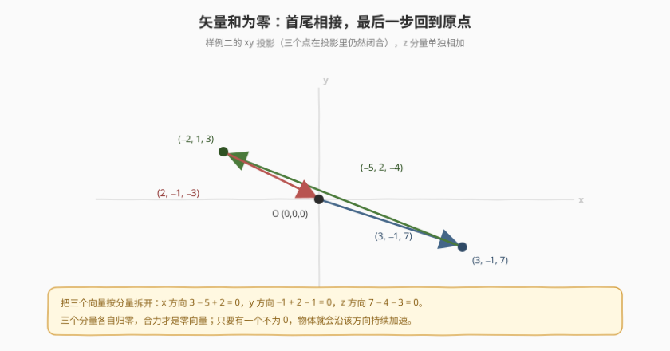
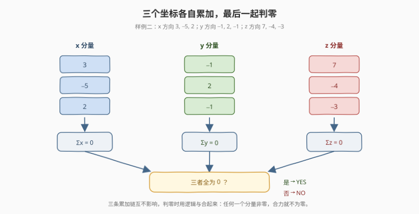

# Codeforces 69A 三力平衡判定 题解

## 1. 题目概述

- **题目链接**：https://codeforces.com/problemset/problem/69/A
- **比赛来源**：Codeforces Beta Round 63 (Div. 2) · Problem A（UTC 2011-03-22）
- **难度**：1000
- **标签**：实现、数学
- **评测类型**：普通
- **限制**：时间 2 s / 内存 256 MB

**题意**：物体是位于原点的质点，给出 $n$ 个作用在它上面的力向量 $(x_i, y_i, z_i)$。判断物体是否处于平衡状态——平衡当且仅当所有力的**矢量和为零向量**。若是输出 `YES`，否则输出 `NO`。

**约束**：

- $1 \le n \le 100$：规模极小，$O(n)$ 一次扫描即可。
- $-100 \le x_i, y_i, z_i \le 100$：每个分量之和落在 $[-10^4, 10^4]$，`int` 足够，连 64 位都不需要（代码里仍用 `long long`，纯属习惯）。
- 只有一组数据，没有测试组数 $t$，也不是"读到 EOF"的多组格式。
- 输出必须是全大写的 `YES` / `NO`。

## 2. 示例与观察

官方样例一：

```text
输入：
3
4 1 7
-2 4 -1
1 -5 -3
输出：
NO
```

官方样例二：

```text
输入：
3
3 -1 7
-5 2 -4
2 -1 -3
输出：
YES
```

逐步演算：

- 样例一：$x$ 方向 $4 + (-2) + 1 = 3$，$y$ 方向 $1 + 4 + (-5) = 0$，$z$ 方向 $7 + (-1) + (-3) = 3$。三个分量中 $x, z$ 不为 0，合力不为零，物体在运动，输出 `NO`。
- 样例二：$x$ 方向 $3 + (-5) + 2 = 0$，$y$ 方向 $-1 + 2 + (-1) = 0$，$z$ 方向 $7 + (-4) + (-3) = 0$。三个分量全为 0，合力为零，输出 `YES`。

自造样例（标注"自造"）：

| 输入 | 输出 | 说明 |
|------|------|------|
| `1`<br>`0 0 0` | YES | 唯一的力是零向量 |
| `1`<br>`1 0 0` | NO | 只有一个非零力 |
| `2`<br>`5 -3 8`<br>`-5 3 -8` | YES | 一对相反向量 |
| `2`<br>`1 2 3`<br>`1 2 3` | NO | 两个同向力 |
| `3`<br>`100 100 100`<br>`-100 -100 100`<br>`0 0 -200` | YES | 分量取到边界值 |

**观察**：三个坐标轴互相独立。矢量和为零等价于"$x$ 分量之和、$y$ 分量之和、$z$ 分量之和**同时**为零"，因此不需要真的构造向量，只需要累加三个整数。

## 3. 解题思路

### 3.1 朴素做法与瓶颈

本题几乎没有"瓶颈"可言：读入 $n$ 行、每行三个整数，边读边累加即可。唯一可能写笨的地方是把所有向量存进数组、再分别循环三次求和——那仍然是 $O(n)$，只是常数大一点、代码长一点。真正要避免的是只检查某一个分量（比如只累加 $x$ 而忘了 $y, z$），或者把"合力为零"误写成"每个力都为零"。

### 3.2 核心观察：三个分量分别求和



平衡的几何含义是：把 $n$ 个向量首尾相接地画出来，终点恰好回到起点。图里画的是样例二的三个力：从原点出发，依次走 $(3,-1,7)$、$(-5,2,-4)$、$(2,-1,-3)$，三段落点依次是 $(3,-1,7)$、$(-2,1,3)$、$(0,0,0)$——最后一步正好回到原点。

在坐标表示下，"回到原点"就是

$$\sum_{i=1}^{n} x_i = 0, \qquad \sum_{i=1}^{n} y_i = 0, \qquad \sum_{i=1}^{n} z_i = 0 .$$

三个等式必须同时成立：任何一个分量非零，合力就是非零向量，物体就会沿该方向加速。

### 3.3 算法流程



1. 读入 $n$。
2. 初始化 `sx = sy = sz = 0`。
3. 循环 $n$ 次，读入 $(x_i, y_i, z_i)$，分别累加到三个和上。
4. 若三个和全为 0，输出 `YES`，否则输出 `NO`。

图里把三条累加链并排画出：每读一行只有一条链在动，三个和互不影响，最后三个"是否为零"的判定用逻辑与合起来。

### 3.4 样例走查：样例一

| 读入的力 | $s_x$ | $s_y$ | $s_z$ |
|----------|-------|-------|-------|
| 初始 | 0 | 0 | 0 |
| `4 1 7` | 4 | 1 | 7 |
| `-2 4 -1` | 2 | 5 | 6 |
| `1 -5 -3` | 3 | 0 | 3 |

结束时 $(s_x, s_y, s_z) = (3, 0, 3)$，$s_x \ne 0$，输出 `NO`。样例二同样累加后得到 $(0,0,0)$，输出 `YES`。

## 4. 正确性证明

**引理 1（分量独立）**：$\sum_i (x_i, y_i, z_i) = (0,0,0)$ 当且仅当 $\sum_i x_i = 0$、$\sum_i y_i = 0$、$\sum_i z_i = 0$ 同时成立。

**证明**：向量求和按分量进行，$\sum_i (x_i,y_i,z_i) = \left(\sum_i x_i, \sum_i y_i, \sum_i z_i\right)$。一个向量等于零向量当且仅当三个分量都等于 0，故命题成立。∎

**引理 2（平衡的判据）**：物体处于平衡状态当且仅当所有力的矢量和为零。

**证明**：由牛顿第二定律，质点所受合力为零时加速度为零，初速度为 0 时保持静止；合力非零时加速度非零，质点开始运动。题面把"是否静止/运动"直接定义为"矢量和是否为零"，故这是题设定义。∎

**定理**：算法输出的 `YES` / `NO` 与物体是否平衡一致。

**证明**：算法把每个输入向量按分量累加到 $s_x, s_y, s_z$，循环结束时三者分别等于 $\sum x_i$、$\sum y_i$、$\sum z_i$（对 $n$ 归纳：每读一行恰好把该行分量加进去一次）。由引理 1，三个和全零等价于矢量和为零；由引理 2，这等价于平衡。算法在且仅在这种情况下输出 `YES`。∎

## 5. 复杂度分析

- **时间**：$O(n)$，每个输入整数只参与一次加法，$n \le 100$ 时不超过 300 次加法。
- **空间**：$O(1)$，只有三个累加变量和一个循环计数。
- **与时限的关系**：运算量可以忽略不计，实测端到端（含进程启动）约 2.8 ms，2 s 时限余量在数百倍以上。

## 6. 参考代码

### C++17

```cpp
#include <bits/stdc++.h>
using namespace std;

int main() {
    ios::sync_with_stdio(false);
    cin.tie(nullptr);

    int n;
    if (!(cin >> n)) return 0;
    long long sx = 0, sy = 0, sz = 0;
    for (int i = 0; i < n; ++i) {
        long long x, y, z;
        cin >> x >> y >> z;
        sx += x;
        sy += y;
        sz += z;
    }
    cout << ((sx == 0 && sy == 0 && sz == 0) ? "YES" : "NO") << '\n';
    return 0;
}
```

### Python3

```python
import sys


def main() -> None:
    data = sys.stdin.buffer.read().split()
    if not data:
        return
    n = int(data[0])
    sx = sy = sz = 0
    p = 1
    for _ in range(n):
        sx += int(data[p])
        sy += int(data[p + 1])
        sz += int(data[p + 2])
        p += 3
    print("YES" if sx == 0 and sy == 0 and sz == 0 else "NO")


main()
```

两份代码都只用标准库，可原样提交。

## 7. 边界情况与易错点

1. **只判一个分量**：最容易犯的错误是只累加 $x$ 就下结论。样例一的 $(3,0,3)$ 里 $y$ 恰好为 0，若只写"$s_y = 0$ 则 YES"会误判。三个和必须用逻辑与连起来。
2. **`YES` / `NO` 的大小写**：题面要求全大写。Codeforces 按 token 比对、大小写不敏感，但别的评测系统可能逐字比对。
3. **零向量是合法的输入**：$x_i=y_i=z_i=0$ 的力不影响平衡，代码把它当普通一行处理即可，不需要特判。
4. **$n = 1$**：只有一个力，平衡当且仅当它是零向量。累加逻辑天然正确，但若代码先读第一个力作为初始和、再循环 $n-1$ 次，$n=1$ 时循环不执行，结果仍正确——前提是初始和取的是第一个力而不是 0。
5. **多组数据的误读**：本题只有一组数据。写 `while (cin >> n)` 会多读，虽然对本输入通常无害，但若之后有别的题复用模板容易出错。
6. **求和范围**：$|s_x| \le 100 \times 100 = 10^4$，`int` 足够；换成 `long long` 只是防御性写法，不会带来额外开销。

## 8. 验证记录

- **编译环境与命令**：`Apple clang 21.0.0` 搭配 `codeforces/tools/include/bits/stdc++.h` 兼容头，`clang++ -std=c++17 -O2`；Python 为 `3.9.6`。官方样例由 `python3 codeforces/tools/verify_solution.py` 实跑。
- **官方样例**：2 / 2 通过（`NO`、`YES`），C++ 与 Python 输出一致。
- **独立暴力对拍**：暴力版按列切片分别求和（`xs = vals[1::3]` 等），与参考程序实现路径不同。随机生成 **280 组**数据：250 组 $n \le 10$、分量 $\in [-5,5]$，另 30 组由三个随机向量与它们的相反和补成"和为零"的构造，与参考程序逐组比对，**全部一致**；C++ 与 Python 也逐组一致。
- **最大约束性能**：$n = 100$、分量随机 $\in [-100,100]$ 时，C++ 端到端（含进程启动）约 $2.8$ ms，Python 约 $21$ ms；相对 2 s 时限余量在数百倍以上。
- **图片校验**：两张 SVG（`cf69a_vector_sum.svg`、`cf69a_three_sums.svg`）通过 `xml.etree.ElementTree.parse`，含手绘抖动滤镜与手写字体，文字未越出 `viewBox`，且脚本检查了文本两两不重叠。
- **复核状态**：verified（样例、对拍、性能、图片四项均实跑通过）。

## 相关题目与扩展

- [Codeforces 69B Bets](https://codeforces.com/problemset/problem/69/B)：同场 B 题，按赛道独立贪心。
- [Codeforces 69E Subsegments](https://codeforces.com/problemset/problem/69/E)：同场 E 题，滑动窗口计数。
- [Codeforces 4A Watermelon](https://codeforces.com/problemset/problem/4/A)：同样是常数时间的判界/判定题，适合练输入输出。
- [Codeforces 71A Way Too Long Words](https://codeforces.com/problemset/problem/71/A)：纯读入 + 分支输出。
- [LeetCode 1. 两数之和](https://leetcode.cn/problems/two-sum/)：与本题无关但同样以"一次线性扫描"为目标，适合作为热身对照。

**延伸思考**：

1. **如果要求给出失衡时的合力向量**：把三个和原样输出即可，代码只需删掉最后的比较，说明"平衡判定"本质上是"求和"的一个副产品。
2. **如果坐标是浮点数**：不能再直接比较 `== 0`，需要设一个容差 $\lvert s \rvert \le \varepsilon$；容差的选取依赖输入精度，是计算几何里常见的坑。
3. **如果力是旋转的（例如附带力矩）**：平衡条件会多出"力矩和为零"的三条方程，状态从 3 个分量扩展到 6 个，但"逐分量独立求和"的思路不变。
4. **如果要求判断是否能通过调整某个力的大小使物体平衡**：那就变成解方程 $\sum_{i \ne k} \vec{F_i} = -\vec{F_k}$，只需检查一个向量是否等于其余向量之和的相反数，$O(n)$ 仍然可解。
