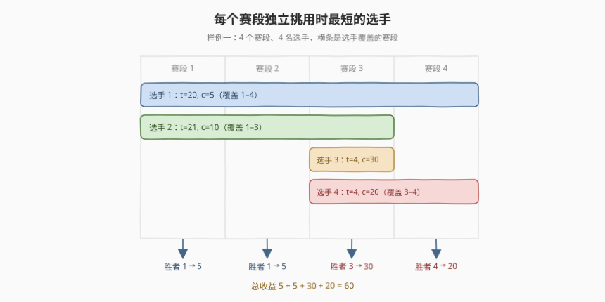
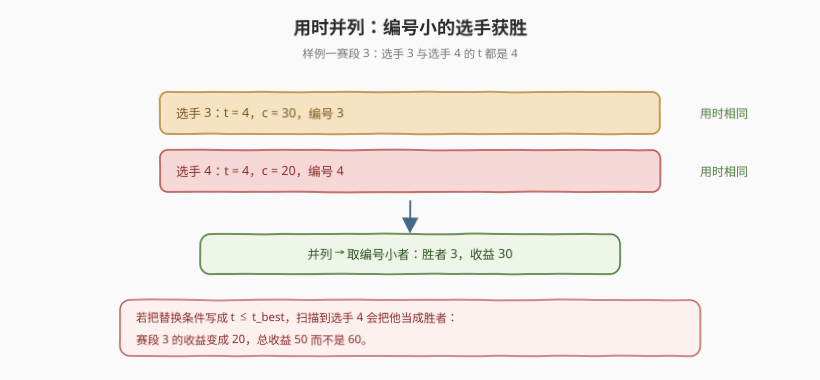

# Codeforces 69B 赛道投注收益 题解

## 1. 题目概述

- **题目链接**：https://codeforces.com/problemset/problem/69/B
- **比赛来源**：Codeforces Beta Round 63 (Div. 2) · Problem B（UTC 2011-03-22）
- **难度**：1200
- **标签**：贪心、实现
- **评测类型**：普通
- **限制**：时间 2 s / 内存 256 MB

**题意**：有 $n$ 个赛段、$m$ 名选手。第 $i$ 名选手跑第 $l_i$ 到 $r_i$ 段（闭区间），每段用时 $t_i$，若他赢下某段，押他的人获得 $c_i$ 卢布。每个赛段的胜者独立判定：在**覆盖该段**的选手中取用时 $t$ 最小者，若并列则编号小者获胜；若该段无人参赛则没有胜者。可以在每个赛段**至多押一名**参赛选手，求最大总收益。

**约束**：

- $1 \le n, m \le 100$：可以直接对每个赛段扫描所有选手，$O(nm) = 10^4$，任意实现都能过。
- $1 \le l_i \le r_i \le n$，$1 \le t_i, c_i \le 1000$：收益总和最多 $100 \times 1000 = 10^5$，`int` 足够。
- 只有一组数据，没有多测。

## 2. 示例与观察

官方样例一：

```text
输入：
4 4
1 4 20 5
1 3 21 10
3 3 4 30
3 4 4 20
输出：
60
```

官方样例二：

```text
输入：
8 4
1 5 24 10
2 4 6 15
4 6 30 50
6 7 4 20
输出：
105
```

逐步演算样例一（4 个赛段、4 名选手）：

| 赛段 | 覆盖它的选手 | 最快 | 押谁 | 收益 |
|------|--------------|------|------|------|
| 1 | 1, 2 | 选手 1（$t=20$） | 1 | 5 |
| 2 | 1, 2 | 选手 1（$t=20$） | 1 | 5 |
| 3 | 1, 2, 3, 4 | 选手 3（$t=4$，选手 4 同为 4 但编号更大） | 3 | 30 |
| 4 | 1, 4 | 选手 4（$t=4$） | 4 | 20 |

总收益 $5 + 5 + 30 + 20 = 60$，与样例一致。

样例二：

| 赛段 | 覆盖它的选手 | 最快 | 收益 |
|------|--------------|------|------|
| 1 | 1 | 1（24） | 10 |
| 2 | 1, 2 | 2（6） | 15 |
| 3 | 1, 2 | 2（6） | 15 |
| 4 | 1, 2, 3 | 2（6） | 15 |
| 5 | 1, 3 | 1（24） | 10 |
| 6 | 3, 4 | 4（4） | 20 |
| 7 | 4 | 4（4） | 20 |
| 8 | 无 | —— | 0 |

总收益 $10 + 15 + 15 + 15 + 10 + 20 + 20 = 105$，与样例一致。

**观察**：每个赛段的胜负只取决于"覆盖它的选手"，与其它赛段完全无关；而每个赛段只能押一人，所以**每个赛段独立地押该段的胜者**就是最优。问题从"选择押注方案"退化成"逐段找胜者再求和"。

## 3. 解题思路

### 3.1 朴素做法与瓶颈

如果真去枚举"每个赛段押谁"，方案数是 $\prod_{s} (\text{覆盖 } s \text{ 的选手数} + 1)$，最坏可达 $101^{100}$，显然不可行。

但换个角度：押注是**按赛段分别下注**的，第 $s$ 段押谁不影响第 $s'$ 段的收益。于是总收益等于各段收益之和，最大化总和等价于每段都取该段能拿到的最大收益——而每段的最大收益就是把注押在该段胜者身上得到的 $c$（不押则为 0，而 $c_i \ge 1$，所以押胜者严格更好）。

### 3.2 核心观察：赛段之间互不影响



图里把 4 个赛段画成列、4 名选手画成横条：选手 1 覆盖 $[1,4]$、选手 2 覆盖 $[1,3]$、选手 3 覆盖 $[3,3]$、选手 4 覆盖 $[3,4]$。每一列只看穿过它的横条，挑出用时最短的那名选手，收益就是他的 $c$。

这里有两个"独立性"：

- **赛段之间独立**：每个赛段单独下注、单独结算，互不干扰；
- **选手的整段用时与单段用时无关**：题面说选手匀速，每段用时都是 $t_i$，所以判胜负只需比较 $t_i$ 本身，不需要乘区间长度（乘同一个 $r_i-l_i+1$ 不改变相对大小，见第 4 节引理 2）。

### 3.3 算法流程



1. 读入 $n, m$ 与 $m$ 名选手的 $(l_i, r_i, t_i, c_i)$。
2. 对每个赛段 $s = 1 \dots n$：
   - 令 `best = -1`；
   - 按编号 $i = 1 \dots m$ 升序扫描，若 $l_i \le s \le r_i$ 且（`best == -1` 或 $t_i < t_{best}$），则 `best = i`；
   - 若 `best != -1`，答案加上 $c_{best}$。
3. 输出答案。

按编号升序扫描、只在**严格更小**时替换，天然满足"用时并列时编号小者胜"。

### 3.4 样例走查

样例一的关键在赛段 3：选手 3 与选手 4 的 $t$ 都是 4，编号 3 更小，所以胜者是选手 3，收益 30 而不是 20。如果实现时写成"$t_i \le t_{best}$ 就替换"，扫描到选手 4 时会把胜者换成他，总收益变成 $5+5+20+20=50$，直接 WA。

| 赛段 | 胜者 | $t$ | 收益 | 累计 |
|------|------|-----|------|------|
| 1 | 1 | 20 | 5 | 5 |
| 2 | 1 | 20 | 5 | 10 |
| 3 | 3 | 4 | 30 | 40 |
| 4 | 4 | 4 | 20 | 60 |

## 4. 正确性证明

**引理 1（赛段收益可加）**：设第 $s$ 段在最优押注下收益为 $v_s$，则最大总收益等于 $\sum_{s=1}^{n} v_s$。

**证明**：押注方案是各赛段的独立选择，总收益按定义是各段收益之和；每段的选择集合互不相交，故可以逐段取最大后再相加。形式化地，若方案 $P = (p_1, \dots, p_n)$（$p_s$ 为第 $s$ 段押的选手或空），收益 $V(P) = \sum_s \text{pay}(s, p_s)$，则 $\max_P V(P) = \sum_s \max_{p_s} \text{pay}(s, p_s) = \sum_s v_s$。∎

**引理 2（单段用时与区间长度无关）**：选手 $i$ 通过第 $s$ 段的用时是 $t_i$，因此第 $s$ 段的胜者是覆盖该段的选手中 $t_i$ 最小者（并列取编号小者）。

**证明**：题面给出"每段用时 $t_i$，整段用时 $(r_i-l_i+1)t_i$"，且所有选手速度恒定、赛段等长，故单段用时就是 $t_i$，与 $s$ 无关；整段用时是在 $t_i$ 上乘同一个正数 $(r_i-l_i+1)$，不改变同一赛段内各选手用时的相对顺序。∎

**引理 3（每段押胜者最优）**：第 $s$ 段的最大收益 $v_s$ 等于该段胜者的 $c$；若无胜者则 $v_s = 0$。

**证明**：押注只能押覆盖该段的选手，而只有胜者能带来收益 $c_i$（$c_i \ge 1$），押其他人收益为 0，不押也是 0。故最大收益就是胜者的 $c$；无胜者时只能得 0。∎

**定理**：算法输出的和，就是最大总收益。

**证明**：对每个赛段，算法按引理 2 的规则（最小 $t$，并列取小编号）正确选出胜者，并按引理 3 累加其 $c$；由引理 1，逐段最优之和即全局最优。故输出正确。∎

## 5. 复杂度分析

- **时间**：$O(nm)$，$n, m \le 100$ 时约 $10^4$ 次比较。
- **空间**：$O(m)$ 存四元组，约 1.6 KB。
- **与时限的关系**：运算量可以忽略，实测端到端（含进程启动）约 3.0 ms，2 s 时限余量在数百倍以上。

## 6. 参考代码

### C++17

```cpp
#include <bits/stdc++.h>
using namespace std;

int main() {
    ios::sync_with_stdio(false);
    cin.tie(nullptr);

    int n, m;
    if (!(cin >> n >> m)) return 0;
    vector<int> l(m), r(m), t(m), c(m);
    for (int i = 0; i < m; ++i) cin >> l[i] >> r[i] >> t[i] >> c[i];

    long long ans = 0;
    for (int s = 1; s <= n; ++s) {
        int best = -1;
        for (int i = 0; i < m; ++i) {
            if (l[i] <= s && s <= r[i]) {
                // 时间更短者胜；时间相同则编号小的胜（按编号升序扫描，只接受严格更小）
                if (best == -1 || t[i] < t[best]) best = i;
            }
        }
        if (best != -1) ans += c[best];
    }
    cout << ans << '\n';
    return 0;
}
```

### Python3

```python
import sys


def main() -> None:
    data = sys.stdin.buffer.read().split()
    if not data:
        return
    n, m = int(data[0]), int(data[1])
    seg = []
    p = 2
    for _ in range(m):
        l, r, t, c = (int(data[p]), int(data[p + 1]), int(data[p + 2]), int(data[p + 3]))
        seg.append((l, r, t, c))
        p += 4

    ans = 0
    for s in range(1, n + 1):
        best_t = None
        best_c = 0
        for i, (l, r, t, c) in enumerate(seg):
            if l <= s <= r and (best_t is None or t < best_t):
                best_t = t
                best_c = c
        ans += best_c
    print(ans)


main()
```

两份代码思路完全一致，只用标准库，可原样提交。

## 7. 边界情况与易错点

1. **某赛段没有选手覆盖**：该段没有胜者，收益记 0。样例二的第 8 段就是这种情况；若代码对空集合也去取最小值会出错。
2. **并列时取编号小者**：必须按编号升序扫描且只在 `t` **严格更小**时替换。样例一的赛段 3 专门考这一点（选手 3 与 4 同为 $t=4$）。
3. **区间是闭区间**：判断条件必须是 $l_i \le s \le r_i$，写成 $l_i < s$ 或 $s < r_i$ 会漏掉端点。
4. **只需比较单段用时 $t_i$**：题面明确"每段用时 $t_i$"，所以判单段胜负只能比 $t_i$。不同选手的区间长度不同，若误用整段用时 $(r_i-l_i+1)t_i$ 去比，长区间选手会被误判为更慢，答案直接错。
5. **不能押未覆盖该段的选手**：即使某选手的 $c$ 很大，只要他不跑这一段就不能押，代码里用 `l[i] <= s <= r[i]` 过滤。
6. **答案范围**：最多 $n \times \max c = 100 \times 1000 = 10^5$，`int` 足够；用 `long long` 只是防御。
7. **输入规模与格式**：$m$ 行四元组，没有多测；读入时按行读四个整数即可。

## 8. 验证记录

- **编译环境与命令**：`Apple clang 21.0.0` + `codeforces/tools/include/bits/stdc++.h` 兼容头，`clang++ -std=c++17 -O2`；Python 为 `3.9.6`。官方样例由 `python3 codeforces/tools/verify_solution.py` 实跑。
- **官方样例**：2 / 2 通过（`60`、`105`），C++ 与 Python 输出一致。
- **独立暴力对拍**：暴力版对每个赛段收集所有覆盖它的选手，按 `(用时, 编号)` 排序后取第一个，实现路径与参考程序不同。随机生成 **250 组**数据（$n, m \le 8$，区间随机、$t, c \le 5$ 以制造大量并列），与参考程序逐组比对，**全部一致**；C++ 与 Python 也逐组一致。
- **最大约束性能**：$n = m = 100$、区间与参数随机时，C++ 端到端（含进程启动）约 $3.0$ ms，Python 约 $24$ ms；相对 2 s 时限余量在数百倍以上。
- **图片校验**：两张 SVG（`cf69b_sections.svg`、`cf69b_tie.svg`）通过 `xml.etree.ElementTree.parse`，含手绘抖动滤镜与手写字体，文字未越出 `viewBox`，并做了文本重叠检测。
- **复核状态**：verified（样例、对拍、性能、图片四项均实跑通过）。

## 相关题目与扩展

- [Codeforces 69A Young Physicist](https://codeforces.com/problemset/problem/69/A)：同场 A 题，向量求和判零。
- [Codeforces 69E Subsegments](https://codeforces.com/problemset/problem/69/E)：同场 E 题，滑动窗口统计。
- [Codeforces 1167C News Distribution](https://codeforces.com/problemset/problem/1167/C)：区间/连通块上的独立聚合，思路与"逐赛段独立取优"相通。
- [Codeforces 279B Books](https://codeforces.com/problemset/problem/279/B)：连续区间与"每段独立决策"的贪心，入门滑动窗口。
- [LeetCode 122. 买卖股票的最佳时机 II](https://leetcode.cn/problems/best-time-to-buy-and-sell-stock-ii/)：把全局最优拆成若干互不干扰的局部最优之和，与本题的独立性论证同构。

**延伸思考**：

1. **如果每个赛段可以押多名选手**：收益变成各人 $c$ 之和（只要他们获胜），此时"押所有在该段用时最短的选手"最优，问题退化为按最小用时分组求和。
2. **如果选手的整段用时才是结算依据**（例如只比谁先跑完全程）：胜负就不再按单段 $t_i$ 判定，需要比较 $(r_i-l_i+1)t_i$，本题的"单段独立"结论失效。
3. **如果押注有总预算限制**（每押一次花一定费用）：赛段之间通过预算耦合，不能再逐段独立贪心，需要背包式 DP。
4. **如果要求输出具体下注方案**：只需在逐段扫描时记录胜者编号，输出 $(s, \text{winner})$ 列表；正确性论证不变。
