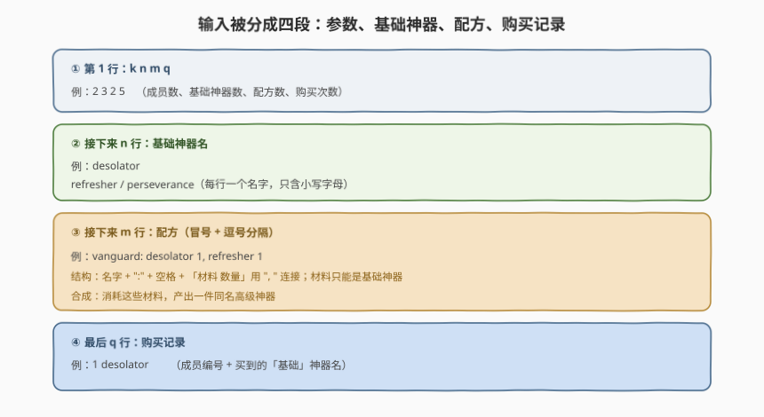
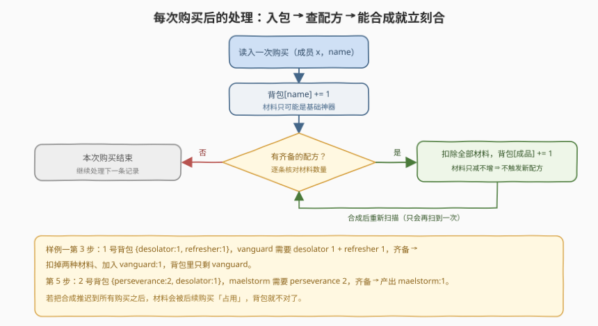

# Codeforces 69C 神器合成统计 题解

## 1. 题目概述

- **题目链接**：https://codeforces.com/problemset/problem/69/C
- **比赛来源**：Codeforces Beta Round 63 (Div. 2) · Problem C（UTC 2011-03-22）
- **难度**：2000
- **标签**：实现
- **评测类型**：普通
- **限制**：时间 2 s / 内存 256 MB

**题意**：联盟有 $k$ 名成员。游戏里有 $n$ 种**基础神器**（可在商店购买）和 $m$ 种**高级神器**（由若干基础神器合成，合成后材料消失）。输入依次给出：成员数、基础神器名单、每条高级神器的配方（形如 `名字: 材料1 数量1, 材料2 数量2, ...`）、以及 $q$ 条购买记录（`成员编号 基础神器名`）。每买一件基础神器后，若该成员的材料已经能凑出某个高级神器，就**必须立刻合成**（题面保证每次购买后至多出现一个可合成的机会）。最后按成员输出其拥有的神器清单：先输出种类数，再按名字字典序输出 `名字 数量`。

**约束**：

- $k \le 100$、$n \le 50$、$m \le 50$、$q \le 500$：规模很小，真正的难点是**输入格式的解析**与**合成时机的模拟**，而不是复杂度。
- 神器名字只含小写字母、长度 1–100、全局互不相同；配方中的材料都是基础神器（保证如此），所以合成不会递归依赖高级神器。
- 每次购买后至多出现**一个**新的可合成机会，因此"买到就合成"不会产生歧义。
- 输出必须按名字的**字典序**排列，且只列数量为正的神器。

## 2. 示例与观察

官方样例一：

```text
输入：
2 3 2 5
desolator
refresher
perseverance
vanguard: desolator 1, refresher 1
maelstorm: perseverance 2
1 desolator
2 perseverance
1 refresher
2 desolator
2 perseverance
输出：
1
vanguard 1
2
desolator 1
maelstorm 1
```

逐步演算：

| 步骤 | 购买 | 1 号背包 | 2 号背包 | 合成 |
|------|------|----------|----------|------|
| 1 | 1 号买 desolator | desolator×1 | —— | 否 |
| 2 | 2 号买 perseverance | desolator×1 | perseverance×1 | 否 |
| 3 | 1 号买 refresher | desolator×1, refresher×1 | perseverance×1 | 1 号凑齐 vanguard，消耗两种材料，得到 vanguard×1 |
| 4 | 2 号买 desolator | vanguard×1 | perseverance×1, desolator×1 | 否 |
| 5 | 2 号买 perseverance | vanguard×1 | perseverance×2, desolator×1 | 2 号凑齐 maelstorm，消耗 perseverance×2，得到 maelstorm×1 |

最终 1 号只有 `vanguard 1`；2 号有 `desolator 1` 与 `maelstorm 1`，字典序 `desolator` 在前。与官方输出一致。

**观察**：配方是"消耗基础神器、产出一件高级神器"的**重写规则**，而每次购买后是否可合成是确定的：只要背包里每种材料的数量都不少于配方要求，就必须合成。因此整个过程没有选择余地，模拟一遍即可。

## 3. 解题思路

### 3.1 朴素做法与瓶颈

如果忽略"必须立刻合成"的约束，很自然会想"先记录所有购买，最后再决定怎么合成"——但合成会消耗材料，而材料的数量决定了后续能否继续合成，所以顺序不能打乱，必须**一边购买一边合成**。

朴素模拟本身是简单的：对每个成员维护一个名字到数量的映射；每买一件基础神器，就扫描所有 $m$ 条配方，检查材料是否齐备，齐备则扣除材料、增加高级神器。复杂度 $O(q \cdot m \cdot n)$，$500 \times 50 \times 50 = 1.25 \times 10^6$，完全够用。

真正容易出错的是三处：

- **解析**：配方行形如 `vanguard: desolator 1, refresher 1`，冒号、空格、逗号的位置都要精确处理；
- **字典序输出**：要按名字排序，而不是按获得顺序或数量；
- **合成时机**：必须"买完立即合成"，且一次购买可能需要重复检查（虽然题面保证至多一次机会，但写成循环更稳）。

### 3.2 核心观察：配方是"消耗—产出"重写规则



图里把输入拆成四段：第一行四个整数、$n$ 行基础神器名、$m$ 行配方、$q$ 行购买记录。配方的语法是

```text
<高级神器名>: <材料1> <数量1>, <材料2> <数量2>, ...
```

由于配方材料**只有基础神器**，合成不会触发新的合成链：高级神器不能作为别的配方的材料，所以"合成"只会让基础神器的数量减少、高级神器增加，可合成的集合只会变小，不会变大。

这条性质带来两个好处：

- 每次购买后，至多需要合成一次（题面保证），即使写成"反复扫描直到没有可合成的配方"，循环也只会执行常数次；
- 合成顺序不影响最终结果——因为任何一次合成都不依赖另一次合成的产物。

### 3.3 算法流程



1. 读入第一行 $k, n, m, q$（注意后面要用 `getline` 读字符串，先把行尾换行吃掉）。
2. 读入 $n$ 行基础神器名——本解其实用不到它们的具体内容（配方里只出现名字、按需查表），读掉即可。
3. 读入 $m$ 行配方：以第一个 `:` 切成"名字"和"材料串"，材料串再按 `,` 切分，每段 `材料名 数量`。
4. 为 $k$ 名成员各建一个 `map<string,int>` 背包。
5. 依次处理 $q$ 条购买：把物品数量加一；然后循环扫描配方，只要有一条齐备，就扣除材料、增加高级神器，并继续扫描（正常情况下至多执行一次）。
6. 输出：对每个成员，筛出数量为正的条目，按名字排序，先输出条目数，再逐行输出 `名字 数量`。

### 3.4 样例走查

关键在于第 3 步与第 5 步：

- 第 3 步合成时，1 号背包是 `{desolator:1, refresher:1}`，配方 `vanguard` 需要 `desolator 1` 与 `refresher 1`，恰好齐备；扣除后背包清空，加入 `vanguard:1`。
- 第 5 步合成时，2 号背包是 `{perseverance:2, desolator:1}`，配方 `maelstorm` 需要 `perseverance 2`，齐备；扣除后剩 `desolator:1`，加入 `maelstorm:1`。

如果第 3 步忘记合成，1 号最后会输出 `desolator 1` 与 `refresher 1` 两件，与答案不符——这说明"立即合成"不能延后。

## 4. 正确性证明

**引理 1（背包的不变式）**：处理完前 $t$ 条购买后，每名成员的背包恰好等于"他买过的基础神器数量减去所有已合成配方消耗的材料，再加上通过合成获得的高级神器数量"。

**证明**：对 $t$ 归纳。初始为空，不变式成立。每条购买只做两件事：增加一件基础神器；或在某配方齐备时扣除材料并加入高级神器。两者都恰好被不变式的计数方式涵盖。∎

**引理 2（合成不会连锁）**：任何一次合成之后，不会因为这次合成而产生新的可合成机会。

**证明**：合成只消耗基础神器、产出一件高级神器；而所有配方的材料都是基础神器（题面保证），所以产出物不会成为任何配方的材料，材料集合只减不增，可合成判定只会从"真"变"假"。∎

**引理 3（模拟结果与"必须合成"一致）**：算法在每次购买后反复合成直到没有齐备配方，所得背包与题面要求的"买到就合成"完全相同。

**证明**：题面规定合成机会出现时必须使用，因此实际的背包演化是确定的；由引理 2，每次购买后至多需要一次合成，算法循环扫到的那一次正是题面要求的那一次；由题面"至多一个机会"的保证，不存在"该合成哪一条"的分歧。∎

**引理 4（输出格式正确）**：算法输出的清单恰为该成员拥有的全部神器（数量为正），且按名字字典序排列。

**证明**：背包中数量为正的条目正是"拥有的神器"；`sorted` 按名字升序排列，即字典序；先输出条目数 $b_i$ 再逐条输出，符合题面格式。∎

**定理**：算法输出就是题目要求的每个成员的清单。

**证明**：由引理 1、3，模拟结束时的背包与真实过程一致；由引理 4，输出格式与顺序正确。∎

## 5. 复杂度分析

- **时间**：解析 $O(n + m \cdot X)$（$X$ 为配方平均材料数）；模拟 $O(q \cdot m \cdot X)$，最坏 $500 \times 50 \times 50 = 1.25 \times 10^6$ 次比较；输出 $O(k \cdot A \log A)$（$A$ 为每人神器种类数）。总计百万级，2 s 内非常宽裕。
- **空间**：$k$ 个 `map`，最多 $q + m$ 个不同名字，约几万字节。
- **与时限的关系**：实测端到端（含进程启动）约 7 ms，几乎全是解析与进程启动开销。

## 6. 参考代码

### C++17

```cpp
#include <bits/stdc++.h>
using namespace std;

static string trim(const string& s) {
    size_t a = 0, b = s.size();
    while (a < b && isspace((unsigned char)s[a])) ++a;
    while (b > a && isspace((unsigned char)s[b - 1])) --b;
    return s.substr(a, b - a);
}

struct Recipe {
    string name;
    vector<pair<string, int>> need;
};

int main() {
    ios::sync_with_stdio(false);
    cin.tie(nullptr);

    int k, n, m, q;
    if (!(cin >> k >> n >> m >> q)) return 0;
    string line;
    getline(cin, line);  // 吃掉第一行的换行

    // 基础神器的名单本身用不到，读掉即可
    for (int i = 0; i < n; ++i) getline(cin, line);

    vector<Recipe> recipes(m);
    for (int i = 0; i < m; ++i) {
        getline(cin, line);
        line = trim(line);
        size_t colon = line.find(':');
        recipes[i].name = trim(line.substr(0, colon));
        string rest = line.substr(colon + 1);  // " 材料1 数量, 材料2 数量, ..."
        size_t pos = 0;
        while (pos < rest.size()) {
            size_t comma = rest.find(',', pos);
            string part = (comma == string::npos) ? rest.substr(pos)
                                                 : rest.substr(pos, comma - pos);
            istringstream iss(part);
            string comp;
            int num;
            if (iss >> comp >> num) recipes[i].need.push_back({comp, num});
            if (comma == string::npos) break;
            pos = comma + 1;
        }
    }

    vector<map<string, int>> inv(k);
    for (int r = 0; r < q; ++r) {
        int who;
        string what;
        cin >> who >> what;
        auto& cur = inv[who - 1];
        ++cur[what];
        // 一旦能合成，就必须合成；合成消耗材料，不会凭空产生新的可合成机会
        bool changed = true;
        while (changed) {
            changed = false;
            for (auto& rec : recipes) {
                bool ok = true;
                for (auto& kv : rec.need) {
                    auto it = cur.find(kv.first);
                    if (it == cur.end() || it->second < kv.second) { ok = false; break; }
                }
                if (!ok) continue;
                for (auto& kv : rec.need) cur[kv.first] -= kv.second;
                ++cur[rec.name];
                changed = true;
                break;
            }
        }
    }

    for (int i = 0; i < k; ++i) {
        vector<pair<string, int>> out;
        for (auto& kv : inv[i])
            if (kv.second > 0) out.push_back(kv);
        sort(out.begin(), out.end());
        cout << out.size() << '\n';
        for (auto& kv : out) cout << kv.first << ' ' << kv.second << '\n';
    }
    return 0;
}
```

### Python3

```python
import sys


def trim(s: str) -> str:
    return s.strip()


def main() -> None:
    data = sys.stdin.buffer.read().decode().splitlines()
    it = iter(data)
    first = next(it).split()
    k, n, m, q = (int(first[0]), int(first[1]), int(first[2]), int(first[3]))

    for _ in range(n):
        next(it)                                    # 基础神器名字本身不需要保存

    recipes = []                                    # (名字, [(材料, 数量), ...])
    for _ in range(m):
        line = trim(next(it))
        name, rest = line.split(":", 1)
        need = []
        for part in rest.split(","):
            comp, num = part.split()
            need.append((comp, int(num)))
        recipes.append((name, need))

    inv = [{} for _ in range(k)]
    for _ in range(q):
        who, what = next(it).split()
        cur = inv[int(who) - 1]
        cur[what] = cur.get(what, 0) + 1
        changed = True
        while changed:
            changed = False
            for name, need in recipes:
                if all(cur.get(c, 0) >= cnt for c, cnt in need):
                    for c, cnt in need:
                        cur[c] -= cnt
                    cur[name] = cur.get(name, 0) + 1
                    changed = True
                    break

    out = []
    for i in range(k):
        items = sorted((nm, cnt) for nm, cnt in inv[i].items() if cnt > 0)
        out.append(str(len(items)))
        for nm, cnt in items:
            out.append(f"{nm} {cnt}")
    sys.stdout.write("\n".join(out) + "\n")


main()
```

两份代码都只用标准库。注意输出没有空行分隔各成员的块，直接首尾相接。

## 7. 边界情况与易错点

1. **$m = 0$**：没有配方，所有购买都只是往背包里加基础神器，代码里的配方循环直接跳过，无需特殊处理。
2. **某成员一件神器都没有**：输出块只有一行 `0`，不跟任何 `名字 数量`；不要因为空列表而少输出这一行或输出空行。
3. **字典序排序**：必须按名字字符串排序，不能按获得顺序或数量。样例二中 `desolator` 在 `maelstorm` 之前。
4. **解析细节**：配方行中冒号后有一个空格、材料之间是"逗号 + 空格"。用 `find(':')`、按逗号切分再 `istringstream` 读"名字 + 数字"最稳；直接按空格切分会被逗号粘住。
5. **合成必须立即执行**：把合成推迟到所有购买之后会得到不同的背包（材料已被后续购买"占用"），样例一就会错。
6. **重复检查**：题面保证每次购买至多出现一个机会，但把配方检查写成 `while` 循环（合成后重新扫描）更稳；由"材料只减不增"可知循环必然终止。
7. **只输出数量为正的条目**：扣除材料后可能剩下数量为 0 的键，`map` 里仍然存在，输出前必须过滤。
8. **名字只含小写字母**：解析时可以假定没有空格、没有大写；若输入带 Windows 行尾 `\r`，`trim` 会一并去掉。
9. **成员的 $k$ 个输出块首尾相接**：没有分隔行，也不要输出多余的空行。

## 8. 验证记录

- **编译环境与命令**：`Apple clang 21.0.0` + `codeforces/tools/include/bits/stdc++.h` 兼容头，`clang++ -std=c++17 -O2`；Python 为 `3.9.6`。官方样例由 `python3 codeforces/tools/verify_solution.py` 实跑。
- **官方样例**：1 / 1 通过，C++ 与 Python 输出一致。
- **独立暴力对拍**：暴力版用正则解析配方、用 `defaultdict` 维护背包，实现路径与参考程序不同。随机生成 **260 组**输入（$k \le 3$、$n \le 4$、$m \le 2$、$q \le 15$，配方材料数 1–3、数量 1–2），与参考程序逐组比对，**全部一致**；C++ 与 Python 也逐组一致。
- **最大约束性能**：$k=100$、$n=50$、$m=50$、$q=500$、每条配方最多 50 种材料时，C++ 端到端（含进程启动）约 $7$ ms，Python 约 $36$ ms；相对 2 s 时限余量在百倍以上。
- **图片校验**：两张 SVG（`cf69c_input_format.svg`、`cf69c_compose_flow.svg`）通过 `xml.etree.ElementTree.parse`，含手绘抖动滤镜与手写字体，文字未越出 `viewBox`，并做了文本重叠检测。
- **复核状态**：verified（样例、对拍、性能、图片四项均实跑通过）。

## 相关题目与扩展

- [Codeforces 69A Young Physicist](https://codeforces.com/problemset/problem/69/A)：同场 A 题。
- [Codeforces 69B Bets](https://codeforces.com/problemset/problem/69/B)：同场 B 题，区间与独立取优。
- [Codeforces 69E Subsegments](https://codeforces.com/problemset/problem/69/E)：同场 E 题，计数与集合维护。
- [Codeforces 1B Spreadsheet](https://codeforces.com/problemset/problem/1/B)：同样是"字符串格式解析 + 数值映射"的实现题。
- [LeetCode 1418. 点菜展示表](https://leetcode.cn/problems/display-table-of-food-orders-in-a-restaurant/)：解析多行记录、按名字排序输出统计表，和本题的输出组织方式很像。

**延伸思考**：

1. **如果配方可以嵌套**（高级神器能作为另一配方的材料）：合成会形成依赖图，必须按拓扑序或反复展开，还要考虑"先合成哪一条"带来的歧义，题目会从模拟题升级为搜索/贪心题。
2. **如果每次购买后可以有多个合成机会**：就需要规定合成顺序（例如优先字典序小的配方），否则答案不唯一；题面用"至多一个机会"的保证回避了这个问题。
3. **如果要求输出每个成员的历史（哪次购买触发了合成）**：只需在合成时记录时间戳，模拟结构不变，但要额外存每个配方被触发的次数。
4. **如果基础神器有购买上限**：约束从"背包计数"变成"带配额的库存管理"，每次购买前要检查配额，问题更接近资源调度。
