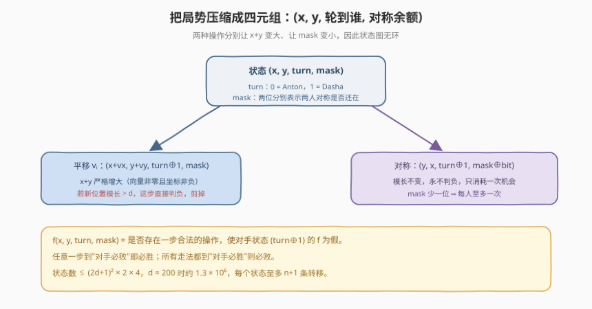
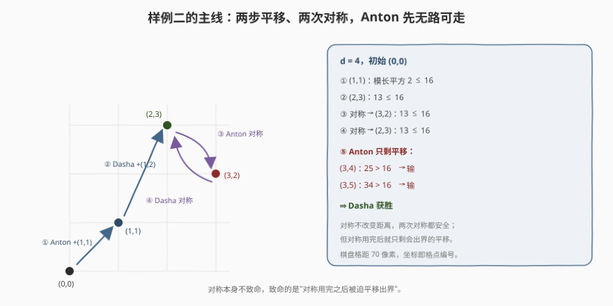

# Codeforces 69D 画点博弈胜负 题解

## 1. 题目概述

- **题目链接**：https://codeforces.com/problemset/problem/69/D
- **比赛来源**：Codeforces Beta Round 63 (Div. 2) · Problem D（UTC 2011-03-22）
- **难度**：1900
- **标签**：动态规划、博弈论
- **评测类型**：普通
- **限制**：时间 3 s / 内存 256 MB

**题意**：纸上有一个点，初始在 $(x, y)$。两人轮流操作，Anton 先手。每次操作二选一：

- 把点平移某个预先给定的向量 $(x_i, y_i)$；
- 把点关于直线 $y = x$ 对称（**每名玩家整局只能各用一次**，用不用自己决定）。

某位玩家操作之后，如果点到原点的距离**超过** $d$，该玩家立即判负。双方都采用最优策略，问谁获胜。

**约束**：

- $-200 \le x, y \le 200$，$1 \le d \le 200$，$1 \le n \le 20$，$0 \le x_i, y_i \le 200$，向量非零且互不相同。
- 保证初始点到原点的距离**小于** $d$。
- 所有可达的合法位置都满足 $x^2 + y^2 \le d^2$，因此 $x, y \in [-200, 200]$，坐标可以装进一个 $(2d+1)^2$ 的表格。
- 向量坐标非负且不全为零，所以每次平移都会让 $x+y$ 严格增大——这是整个解法能成立的关键。

## 2. 示例与观察

官方样例一：

```text
输入：
0 0 2 3
1 1
1 2
输出：
Anton
```

官方样例二：

```text
输入：
0 0 2 4
1 1
1 2
输出：
Dasha
```

题面提示已经给出了两条走法：

- 样例一：Anton 直接平移 $(1,2)$ 到 $(1,2)$，此时 $1^2+2^2=5 \le 9$。轮到 Dasha：$(2,3)$ 的模长平方是 $13 > 9$，$(2,4)$ 是 $20 > 9$，两个平移都会越界；她只能对称到 $(2,1)$，Anton 再对称回 $(1,2)$，轮到 Dasha 时两个平移仍然越界，Dasha 输，所以 Anton 胜。
- 样例二：Anton 若先走到 $(1,1)$，Dasha 平移 $(1,2)$ 到 $(2,3)$（$13 \le 16$）。Anton 此时只有对称一条路：$(3,2)$。Dasha 也对称回 $(2,3)$，用掉了她唯一的一次对称；轮到 Anton，两个平移 $(3,4)$、$(3,5)$ 的模长平方分别是 $25$、$34$，都超过 $16$，而他的对称已经用过——Anton 输。

**观察一**：对称操作不改变点到原点的距离，所以它**永远不会**让操作者直接判负，只消耗一次机会。

**观察二**：每次平移都让 $x+y$ 至少加 1（向量非负且非零）；而合法位置的 $x+y$ 有上界（$\le \sqrt{2}\,d$），所以平移次数有上限。加上每人至多一次对称，整局步数有限，不存在平局，可以放心做博弈 DP。

## 3. 解题思路

### 3.1 朴素做法与瓶颈

最直接的想法是暴力展开整棵博弈树：每个局面枚举 $n+1$ 种走法，直到有人输。但走法序列的长度可达数百步，分支因子 21，暴力展开是天文数字。

不过博弈树里存在**大量重复局面**：同一个位置、同样的"轮到谁"、同样的"谁的对称还没用"，后续胜负完全一样。只要把这些状态记忆化，状态总数就被坐标范围卡死了。

### 3.2 核心观察：把"局势"压缩成四元组



一个局面只需要四个量就能完整描述：

$$\text{state} = (x,\ y,\ \text{turn},\ \text{mask})$$

其中 `turn` 表示轮到谁（0 = Anton，1 = Dasha），`mask` 的两个二进制位分别表示 Anton、Dasha 的对称机会是否还没用。

- **平移**：$(x,y) \to (x+x_i,\ y+y_i)$，然后轮到对方。若新位置模长平方 $> d^2$，这步是"自杀"，直接从候选里剔除。
- **对称**：$(x,y) \to (y,x)$，消耗当前玩家的那一位，然后轮到对方。由于模长不变，这步永不直接判负。
- 如果当前玩家没有任何一步能通向"对方必败"的局面，那么他必败。

图里画出了状态转移的形状：平移边让 $x+y$ 增大，对称边让 `mask` 变小（可用位数减少）。两种边都让某个量单调变化，所以状态图是**有向无环图**，记忆化搜索不会死循环。

### 3.3 算法流程与状态转移



记 $f(x,y,\text{turn},\text{mask})$ 为"当前玩家是否能赢"：

$$f(x,y,\text{turn},\text{mask}) = \bigvee_{\text{legal moves } m} \lnot f(\text{next}(m)) .$$

具体实现：

1. 若状态已记忆化，直接返回。
2. 若当前玩家的对称位还在，尝试对称 $(y,x)$；若对方的对应状态是必败，则当前玩家必胜。
3. 否则枚举 $n$ 个向量：新位置模长平方不超过 $d^2$ 才继续；若对方状态必败，则当前玩家必胜。
4. 所有走法都失败，则当前玩家必败。

初始调用 $f(x, y, 0, 3)$（`mask = 3` 表示两人都还有对称），返回真则输出 `Anton`，否则输出 `Dasha`。

图里是样例二的主线：$(0,0) \xrightarrow{(1,1)} (1,1) \xrightarrow{(1,2)} (2,3) \xrightarrow{\text{对称}} (3,2) \xrightarrow{\text{对称}} (2,3)$，此后 Anton 无路可走。

### 3.4 样例走查：样例二

| 步 | 玩家 | 操作 | 位置 | 剩余对称 | 说明 |
|----|------|------|------|----------|------|
| 0 | —— | 初始 | $(0,0)$ | Anton、Dasha | $d = 4$ |
| 1 | Anton | 平移 $(1,1)$ | $(1,1)$ | 同上 | 模长平方 $2 \le 16$ |
| 2 | Dasha | 平移 $(1,2)$ | $(2,3)$ | 同上 | $13 \le 16$ |
| 3 | Anton | 对称 | $(3,2)$ | 只剩 Dasha | 模长不变，$13 \le 16$ |
| 4 | Dasha | 对称 | $(2,3)$ | 都用完 | 模长不变 |
| 5 | Anton | 无路可走 | —— | 都用完 | 两个平移都使模长平方 $>16$ |

Anton 在第 5 步被迫平移，而两条路都会让距离超过 $d$，按规则他输，因此 Dasha 胜。

## 4. 正确性证明

**引理 1（状态充分性）**：后续博弈的胜负只取决于 $(x,y,\text{turn},\text{mask})$。

**证明**：规则里所有可用的操作只依赖当前位置（平移向量集合固定、对称是否可用由 mask 给出）与轮到谁；判负条件只依赖操作后的位置。历史信息（之前走过哪些向量、对称用在哪一步）不影响任何后续判定，故四元组足以确定博弈。∎

**引理 2（状态图无环）**：从任意合法状态出发，经过有限步后必然到达终局（某方无合法走法）。

**证明**：定义势函数 $\Phi = K \cdot (\text{已用对称数}) + (x+y)$，取 $K = 1000$（大于 $x+y$ 的全部可能跨度）。每次平移让 $x+y$ 至少增加 1（向量坐标非负且非零），$\Phi$ 至少增加 1；每次对称让已用对称数增加 1，$\Phi$ 增加 $K$。另一方面，合法位置满足 $x^2+y^2 \le d^2 \le 40000$，所以 $|x+y| \le \sqrt{2}\,d \le 283$，$\Phi$ 有上界 $2K + 283$。因此任何一条博弈路径的长度都不超过 $2K + 566$，不可能无限进行。∎

**引理 3（必胜态递推）**：设当前状态为 $s$，则当前玩家必胜当且仅当存在一个合法操作，使操作后的状态 $s'$ 对**对方**是必败态。

**证明**：若存在这样的操作，当前玩家执行它，对方处于必败态，按定义对方无论如何都会输，当前玩家胜。若不存在，那么无论当前玩家怎么操作，对方都处于必胜态，对方有策略获胜，当前玩家必败。这里"合法操作"指平移后模长平方不超过 $d^2$；模长超限的平移会让操作者立即判负，不可能带来胜利，故不在候选之列。∎

**定理**：记忆化搜索 `win(x, y, turn, mask)` 返回的值，等于该状态下当前玩家的真实胜负。

**证明**：由引理 2，状态图是有限 DAG，可以按拓扑序（从终局往前）归纳。终局状态下没有合法操作，递推式给出"必败"，与实际一致。设某状态的所有后继都已正确计算，由引理 3，递推式给出的结果就是该状态的真实胜负。记忆化只是缓存了这些值，不改变结果。∎

## 5. 复杂度分析

- **时间**：状态数上界 $(2d+1)^2 \times 2 \times 4 \approx 1.29 \times 10^6$（$d = 200$），每个状态至多 $n+1 \le 21$ 条转移，理论上界约 $2.7 \times 10^7$。实际可达状态远少于上界（平移让 $x+y$ 单调增，很多点根本到不了），实测 $d=200$、$n=20$ 时约 10 ms。
- **空间**：记忆化表 $1.29 \times 10^6$ 字节（`signed char`），加上递归栈（深度不超过约 570），约 1.3 MB。
- **与时限的关系**：3 s 时限非常宽松，C++ 端到端约 10 ms；Python 版用 `lru_cache`，最坏约 0.5 s，也在时限内。

## 6. 参考代码

### C++17

```cpp
#include <bits/stdc++.h>
using namespace std;

// 状态：点 (x,y)、轮到谁走（0 = Anton，1 = Dasha）、以及两人各自的"对称"是否还没用（mask 位）。
// 每个向量都非零且坐标非负，所以每次移动都会让 x+y 严格变大，局面不会循环，可以记忆化搜索。
static const int LIM = 200;
static int N, D;
static int dx[20], dy[20];
static signed char memo[2 * LIM + 1][2 * LIM + 1][2][4];
static bool seen[2 * LIM + 1][2 * LIM + 1][2][4];

// 当前玩家是否有必胜着法
static bool win(int x, int y, int turn, int mask) {
    int ix = x + LIM, iy = y + LIM;
    if (seen[ix][iy][turn][mask]) return memo[ix][iy][turn][mask];
    seen[ix][iy][turn][mask] = true;

    bool res = false;
    int bit = 1 << turn;
    if (mask & bit) {  // 使用本局唯一的一次对称变换：位置变成 (y,x)
        if (!win(y, x, turn ^ 1, mask ^ bit)) res = true;
    }
    if (!res) {
        for (int i = 0; i < N; ++i) {
            int nx = x + dx[i], ny = y + dy[i];
            if (1LL * nx * nx + 1LL * ny * ny > 1LL * D * D) continue;  // 这步会让自己判负
            if (!win(nx, ny, turn ^ 1, mask)) { res = true; break; }
        }
    }
    memo[ix][iy][turn][mask] = res ? 1 : 0;
    return res;
}

int main() {
    ios::sync_with_stdio(false);
    cin.tie(nullptr);

    int x, y;
    if (!(cin >> x >> y >> N >> D)) return 0;
    for (int i = 0; i < N; ++i) cin >> dx[i] >> dy[i];

    cout << (win(x, y, 0, 3) ? "Anton" : "Dasha") << '\n';  // mask=3：两人都还留着对称
    return 0;
}
```

### Python3

```python
import sys
from functools import lru_cache


def main() -> None:
    data = sys.stdin.buffer.read().split()
    if not data:
        return
    x, y, n, d = map(int, data[:4])
    vec = [(int(data[4 + 2 * i]), int(data[5 + 2 * i])) for i in range(n)]
    limit = d * d

    sys.setrecursionlimit(10000)

    @lru_cache(maxsize=None)
    def win(cx: int, cy: int, turn: int, mask: int) -> bool:
        """当前玩家（turn）在 mask 位还有对称时能否必胜。"""
        bit = 1 << turn
        if mask & bit and not win(cy, cx, turn ^ 1, mask ^ bit):
            return True
        for vx, vy in vec:
            nx, ny = cx + vx, cy + vy
            if nx * nx + ny * ny > limit:
                continue
            if not win(nx, ny, turn ^ 1, mask):
                return True
        return False

    print("Anton" if win(x, y, 0, 3) else "Dasha")


main()
```

两份代码的搜索顺序完全一致；C++ 用定长数组记忆化，Python 用 `lru_cache`。由于博弈长度可能达到数百步，Python 版显式提高了递归深度上限。

## 7. 边界情况与易错点

1. **"超过 $d$"是严格大于**：模长平方恰好等于 $d^2$ 是合法的。判定必须写 `> d*d`，写成 `>=` 会把边界合法走法误判为输。
2. **对称永不判负**：$(x,y) \to (y,x)$ 保持模长不变，所以对称之后一定还在场内；不要给对称也加距离检查（虽然加了也无害，但逻辑上不对）。
3. **对称可以是"空操作"**：当 $x = y$ 时对称后位置不变，但仍消耗一次机会。状态由 `mask` 区分，DP 能正确处理；若只按位置记忆化会把"用掉对称"和"没用"混为一谈。
4. **两名玩家的对称机会互相独立**：`mask` 有 2 位，不能用"全局只能用一次"的模型——样例二正是双方各对称一次。
5. **坐标可能为负**：初始点可以落在第二、三、四象限，记忆化数组要加偏移量 `LIM = 200`。
6. **平移超界的剪枝**：新坐标可能超过 200，但此时模长一定超过 $d \le 200$，所以先判模长再访问数组，不会越界；代码里正是这个顺序。
7. **递归深度**：最坏情况下平移约 570 次、递归深度接近 600，已经贴近 Python 默认上限 1000，显式 `setrecursionlimit` 调大更保险。
8. **平局不存在**：由引理 2，博弈必然在有限步内结束，不需要处理"和棋"分支。
9. **`mask` 的初始值**：两人都还没用对称，初始 `mask = 3`；写成 1 或 0 会直接改变答案。

## 8. 验证记录

- **编译环境与命令**：`Apple clang 21.0.0` + `codeforces/tools/include/bits/stdc++.h` 兼容头，`clang++ -std=c++17 -O2`；Python 为 `3.9.6`。官方样例由 `python3 codeforces/tools/verify_solution.py` 实跑。
- **官方样例**：2 / 2 通过（`Anton`、`Dasha`），C++ 与 Python 输出一致。
- **独立暴力对拍（全状态博弈 DP）**：暴力版用字典记忆化、完整枚举 $(x, y, \text{轮次}, \text{对称位})$，不依赖坐标压缩与任何剪枝，实现路径与参考程序不同。随机生成 **290 组**数据：250 组 $d \le 10$、$n \le 4$、坐标与向量 $\in [0,5]$，另 40 组 $11 \le d \le 16$ 的较长对局，与参考程序逐组比对，**全部一致**；C++ 与 Python 也逐组一致。
- **最大约束性能**：$d = 200$、$n = 20$、向量取自 $[0,5]^2$ 时，C++ 端到端（含进程启动）约 10 ms，Python 约 510 ms；相对 3 s 时限余量充足。
- **图片校验**：两张 SVG（`cf69d_state_graph.svg`、`cf69d_sample2_tree.svg`）通过 `xml.etree.ElementTree.parse`，含手绘抖动滤镜与手写字体，文字未越出 `viewBox`，并做了文本重叠检测。
- **复核状态**：verified（样例、对拍、性能、图片四项均实跑通过）。

## 相关题目与扩展

- [Codeforces 69A Young Physicist](https://codeforces.com/problemset/problem/69/A)：同场 A 题，向量与距离。
- [Codeforces 69C Game](https://codeforces.com/problemset/problem/69/C)：同场 C 题，模拟与状态维护。
- [Codeforces 1104D Game with modulo](https://codeforces.com/problemset/problem/1104/D)：交互式博弈，靠比较结果逐步缩小可能区间。
- [Codeforces 138D World of Darkraft](https://codeforces.com/problemset/problem/138/D)：棋盘上的组合博弈，用 SG 函数拆分子游戏，是"局面=状态"思想的进阶。
- [LeetCode 292. Nim 游戏](https://leetcode.cn/problems/nim-game/)：最基础的必胜/必败态递推，适合先建立"存在一步到对方必败态即必胜"的直觉。

**延伸思考**：

1. **如果对称可以无限次使用**：位置可能在 $(x,y)$ 与 $(y,x)$ 之间来回，状态图出现环，需要引入"平局"或按步数奇偶分析，DP 不再直接适用。
2. **如果向量坐标可以为负**：$x+y$ 不再单调，可能出现循环（例如向量 $(1,-1)$ 与 $(-1,1)$ 交替），必须用博弈图上的 SCC 缩点或"必胜/必败/平局"三值 DP。
3. **如果判负条件是"到达原点"而不是"超过 $d$"**：胜负目标反转，DP 结构不变，但终局集合从"越界"变成"命中原点"，需要重新定义终局。
4. **如果要求输出 Anton 的最优第一步**：在 DP 中额外记录一个"转移到哪个后继"的指针即可，与必胜判定共用同一张表。
5. **如果把 $d$ 放大到 $10^9$**：状态数无法枚举，需要利用"平移次数受 $d$ 限制但 $n$ 很小"的结构寻找数学规律（例如只考虑前若干个向量），问题会性质大变。
