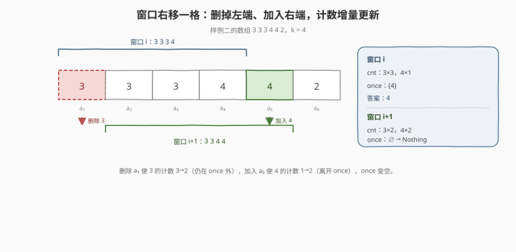
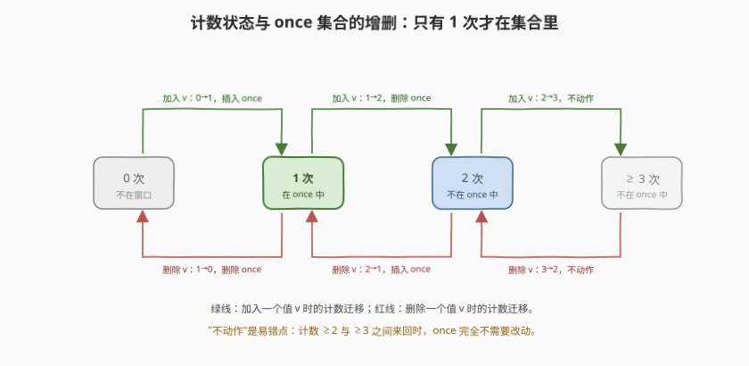

# Codeforces 69E 区间唯一最大值 题解

## 1. 题目概述

- **题目链接**：https://codeforces.com/problemset/problem/69/E
- **比赛来源**：Codeforces Beta Round 63 (Div. 2) · Problem E（UTC 2011-03-22）
- **难度**：1800
- **标签**：数据结构、实现
- **评测类型**：普通
- **限制**：时间 1 s / 内存 256 MB

**题意**：给出长度为 $n$ 的数组和窗口长度 $k$。对每个长度为 $k$ 的连续子段 $a_i, \dots, a_{i+k-1}$（$i = 1 \dots n-k+1$），求该子段中**恰好出现一次**的数里的最大值；若这样的数不存在，输出 `Nothing`。每个答案占一行。

**约束**：

- $n \le 10^5$，$k \le n$：窗口个数也是 $10^5$，逐窗口重新统计的 $O(nk)$ 是 $10^{10}$，必然超时，需要 $O(n \log n)$ 或 $O(n)$。
- $-10^9 \le a_i \le 10^9$：数值范围大且可为负，需要哈希/有序映射，且用 64 位整数存放。
- 时限只有 1 s，常数要小。
- 只有一组数据，没有多测。

## 2. 示例与观察

官方样例一：

```text
输入：
5 3
1
2
2
3
3
输出：
1
3
2
```

官方样例二：

```text
输入：
6 4
3
3
3
4
4
2
输出：
4
Nothing
3
```

逐步演算样例一（$n=5, k=3$，三个窗口）：

| 窗口 | 元素 | 出现次数 | 恰好一次的数 | 最大 |
|------|------|----------|--------------|------|
| 1 | 1, 2, 2 | 1:1, 2:2 | {1} | 1 |
| 2 | 2, 2, 3 | 2:2, 3:1 | {3} | 3 |
| 3 | 2, 3, 3 | 2:1, 3:2 | {2} | 2 |

样例二（$n=6, k=4$，三个窗口）：

| 窗口 | 元素 | 恰好一次的数 | 最大 |
|------|------|--------------|------|
| 1 | 3, 3, 3, 4 | {4} | 4 |
| 2 | 3, 3, 4, 4 | 空 | Nothing |
| 3 | 3, 4, 4, 2 | {3, 2} | 3 |

**观察**：相邻的两个窗口只相差"删掉最左边一个元素、加入最右边一个元素"。如果为每个窗口维护一张"值 → 出现次数"的表，那么每次滑动只需要 $O(1)$ 次计数修改；再维护一个"恰好出现一次的值"的集合，取其最大值即可。难点只在于**如何高效地维护这个集合**。

## 3. 解题思路

### 3.1 朴素做法与瓶颈

对每个窗口重新扫描 $k$ 个元素并统计次数：$O((n-k+1) \cdot k)$，最坏 $n = 10^5, k = 5 \times 10^4$ 时约 $5 \times 10^9$ 次操作，1 s 内绝无可能。

即使把统计换成哈希表，只要每个窗口都重建一次表，仍是 $O(nk)$。必须利用"相邻窗口只差两个元素"这一事实做**增量更新**。

### 3.2 核心观察：增量维护频次与"唯一值集合"



维护两个结构：

- `cnt[v]`：当前窗口内值 $v$ 出现的次数；
- `once`：当前窗口内**恰好出现一次**的所有值的集合（有序）。

关键是一次修改对 `once` 的影响只取决于计数的**变化方向**：

| 操作 | 计数变化 | 对 `once` 的影响 |
|------|----------|------------------|
| 加入 $v$，原计数 0 | $0 \to 1$ | 插入 $v$ |
| 加入 $v$，原计数 1 | $1 \to 2$ | 删除 $v$ |
| 加入 $v$，原计数 $\ge 2$ | $k \to k+1$ | 无 |
| 删除 $v$，原计数 1 | $1 \to 0$ | 删除 $v$ |
| 删除 $v$，原计数 2 | $2 \to 1$ | 插入 $v$ |
| 删除 $v$，原计数 $\ge 3$ | $k \to k-1$ | 无 |



于是每次滑动只需：删掉左端元素 → 加入右端元素 → 若 `once` 非空，输出其中最大值，否则输出 `Nothing`。

在 C++ 里，`once` 用 `std::set<long long>`，最大值就是 `*once.rbegin()`；`cnt` 用 `std::map` 或哈希表。在 Python 里，有序集合不可用，可以用"大根堆 + 懒惰删除"：堆里存 `-v`，每次取答案前把堆顶那些"当前计数不等于 1"的项弹掉。

### 3.3 算法流程

1. 读入 $n, k$ 与数组 $a$。
2. 把前 $k$ 个元素依次加入窗口（按 3.2 的规则更新 `cnt` 与 `once`）。
3. 对 $i = 0 \dots n-k$：
   - 若 `once` 为空，输出 `Nothing`；否则输出 `once` 中的最大值；
   - 若还有下一个窗口，删掉 $a_i$、加入 $a_{i+k}$。
4. 每个答案单独一行。

### 3.4 样例走查：样例二

以 $n=6, k=4$ 为例，初始窗口 $[3,3,3,4]$：`cnt = {3:3, 4:1}`，`once = {4}`，输出 4。

| 步骤 | 删 | 加 | 窗口 | `cnt` | `once` | 输出 |
|------|----|----|------|-------|--------|------|
| 初始 | —— | —— | 3 3 3 4 | 3:3, 4:1 | {4} | 4 |
| 滑 1 | 3 | 4 | 3 3 4 4 | 3:2, 4:2 | 空 | Nothing |
| 滑 2 | 3 | 2 | 3 4 4 2 | 3:1, 4:2, 2:1 | {3, 2} | 3 |

第二次滑动时，删掉的 3 让计数从 2 变成 1，于是 3 重新进入 `once`；加入的 2 让计数从 0 变成 1，也进入 `once`，最大值为 3。整个过程没有重新扫描窗口，每个元素最多被加入、删除各一次。

## 4. 正确性证明

**引理 1（`cnt` 不变式）**：每次滑动后，`cnt[v]` 等于当前窗口中 $v$ 的出现次数。

**证明**：初始时前 $k$ 个元素逐个加入，`cnt` 正确。每次滑动恰好删除一个窗口外元素、加入一个窗口内元素，`cnt` 相应减一、加一，窗口内其余元素不变，故不变式保持。∎

**引理 2（`once` 不变式）**：每次操作后，`once` 恰好是 $\{v \mid cnt[v] = 1\}$。

**证明**：对一次修改分情况讨论。加入 $v$ 时，只有 $v$ 的计数变化：$0 \to 1$ 时它成为唯一值，插入；$1 \to 2$ 时它不再是唯一值，删除；$k \to k+1$（$k \ge 2$）时它本来就不在 `once` 里，保持不在。删除 $v$ 时对称：$1 \to 0$ 删除，$2 \to 1$ 插入，$k \to k-1$（$k \ge 3$）保持不变。其他值的计数不变，`once` 中它们的状态也不应变。三种情形合起来正好维持不变式。∎

**引理 3（输出正确）**：每次输出步骤中，若 `once` 非空，则 `once` 的最大值就是该窗口内"恰好出现一次"的最大值；若为空，则该窗口不存在这样的数。

**证明**：由引理 2，`once` 就是窗口内所有恰好出现一次的值的集合；集合非空时其最大元即所求；为空时不存在这样的数。∎

**定理**：算法依次输出的 $n-k+1$ 个答案，与题目要求一致。

**证明**：算法枚举了所有 $n-k+1$ 个窗口（初始窗口加 $n-k$ 次滑动），由引理 3 每次输出正确；引理 1、2 保证维护的数据结构在每一步都是最新且正确的。∎

## 5. 复杂度分析

- **时间**：$O(n \log n)$。每个元素最多被加入、删除各一次，每次操作是若干次 `map`/`set` 的 $O(\log n)$ 操作；每个窗口取一次最大值 $O(1)$。$n = 10^5$ 时约 $10^6$ 次基本操作。
- **空间**：$O(n)$，`cnt` 最多存 $n$ 个不同值，`once` 同理。
- **与时限的关系**：实测 $n = 10^5$、$k = 5 \times 10^4$ 时 C++ 端到端（含进程启动与读入）约 60 ms，1 s 时限余量约 16 倍；Python 约 87 ms（`heapq` + 懒惰删除），也在时限内。

## 6. 参考代码

### C++17

```cpp
#include <bits/stdc++.h>
using namespace std;

int main() {
    int n, k;
    if (scanf("%d %d", &n, &k) != 2) return 0;
    vector<long long> a(n);
    for (int i = 0; i < n; ++i) scanf("%lld", &a[i]);

    map<long long, int> cnt;
    set<long long> once;  // 当前窗口里恰好出现一次的所有数
    auto add = [&](long long v) {
        int& c = cnt[v];
        if (c == 0) once.insert(v);
        else once.erase(v);
        ++c;
    };
    auto rem = [&](long long v) {
        int& c = cnt[v];
        if (c == 1) once.erase(v);
        else if (c == 2) once.insert(v);
        --c;
    };

    for (int i = 0; i < k; ++i) add(a[i]);
    for (int i = 0; i + k <= n; ++i) {
        if (once.empty()) printf("Nothing\n");
        else printf("%lld\n", *once.rbegin());  // set 有序，末尾即最大
        if (i + k < n) {
            rem(a[i]);
            add(a[i + k]);
        }
    }
    return 0;
}
```

### Python3

```python
import sys
import heapq


def main() -> None:
    data = sys.stdin.buffer.read().split()
    if not data:
        return
    n, k = int(data[0]), int(data[1])
    a = [int(x) for x in data[2:2 + n]]

    cnt = {}
    heap = []  # 存 -value，堆顶是"曾经恰好出现一次"的最大值

    def add(v):
        c = cnt.get(v, 0)
        cnt[v] = c + 1
        if c == 0:
            heapq.heappush(heap, -v)

    def rem(v):
        c = cnt.get(v, 0)
        cnt[v] = c - 1
        if c == 2:  # 2 -> 1：重新变成"只出现一次"
            heapq.heappush(heap, -v)

    for i in range(k):
        add(a[i])

    out = []
    for i in range(n - k + 1):
        while heap and cnt.get(-heap[0], 0) != 1:
            heapq.heappop(heap)
        out.append(str(-heap[0]) if heap else "Nothing")
        if i + k < n:
            rem(a[i])
            add(a[i + k])
    sys.stdout.write("\n".join(out) + "\n")


main()
```

C++ 版用 `scanf` 读入 $10^5$ 个整数（本机 clang 环境下 `cin` 的数值解析偏慢），Python 版用大根堆模拟有序集合，并用"堆顶计数不为 1 就弹出"的懒惰删除保证正确性。

## 7. 边界情况与易错点

1. **$k = 1$**：每个窗口只有一个元素，它恰好出现一次，答案就是该元素本身。维护逻辑天然正确，但要保证初始窗口只加入 1 个元素。
2. **$k = n$**：只有一个窗口，输出一行；不要在滑动分支里越界访问 `a[i+k]`（代码用 `i + k < n` 保护）。
3. **整个窗口元素全相同**：`once` 为空，必须输出字符串 `Nothing`（首字母大写、其余小写），而不是 0 或空行。
4. **数值可以为负**：$-10^9 \le a_i$，用 `long long` 存放；若用 `int` 也够（$10^9$ 在范围内），但读入格式必须匹配（`%lld` 与 `long long` 对应）。
5. **出现三次及以上**：加入时 $2 \to 3$、删除时 $3 \to 2$ 都不改变 `once`，这是最容易写错的分支——只处理 0、1、2 三种计数是不够的，必须让 $\ge 3$ 的情况"什么都不做"。
6. **Python 的懒惰删除**：堆里可能残留"曾经唯一、现在不唯一"的值，取答案前必须反复弹出堆顶直到计数为 1；否则会输出过期值。
7. **输出个数**：恰好 $n-k+1$ 行，不要多输出一行，也不要在最后多一个空行（按 token 比对时无碍，但按行比对会出问题）。
8. **内存**：`map`/`set` 各存最多 $n$ 个元素，$10^5$ 时约几 MB，远小于 256 MB。

## 8. 验证记录

- **编译环境与命令**：`Apple clang 21.0.0` + `codeforces/tools/include/bits/stdc++.h` 兼容头，`clang++ -std=c++17 -O2`；Python 为 `3.9.6`。官方样例由 `python3 codeforces/tools/verify_solution.py` 实跑。
- **官方样例**：2 / 2 通过（`1 3 2`、`4 Nothing 3`），C++ 与 Python 输出一致。
- **独立暴力对拍**：暴力版对每个窗口用 `Counter` 重新统计（$O(nk)$，与参考解的增量结构完全不同）。随机生成 **290 组**数据：250 组 $n \le 12$、$k \le n$、值 $\in [-5,5]$，另 40 组 $50 \le n \le 300$、$k$ 随机、值 $\in [-1000,1000]$，与参考程序逐组比对，**全部一致**；C++ 与 Python 也逐组一致。
- **最大约束性能**：$n = 10^5$、$k = 5 \times 10^4$、值随机 $\in [-10^9, 10^9]$ 时，C++ 端到端（含进程启动与 10 万次读入）约 60 ms，Python 约 87 ms；相对 1 s 时限，C++ 余量约 16 倍。
- **图片校验**：两张 SVG（`cf69e_slide_window.svg`、`cf69e_count_transition.svg`）通过 `xml.etree.ElementTree.parse`，含手绘抖动滤镜与手写字体，文字未越出 `viewBox`，并做了文本重叠检测。
- **复核状态**：verified（样例、对拍、性能、图片四项均实跑通过）。

## 相关题目与扩展

- [Codeforces 69A Young Physicist](https://codeforces.com/problemset/problem/69/A)：同场 A 题。
- [Codeforces 69B Bets](https://codeforces.com/problemset/problem/69/B)：同场 B 题，按段独立统计。
- [Codeforces 69C Game](https://codeforces.com/problemset/problem/69/C)：同场 C 题，按规则模拟与计数。
- [Codeforces 1353D Constructing the Array](https://codeforces.com/problemset/problem/1353/D)：用有序容器按规则反复取最大/最小，和本题维护有序集合的思路相近。
- [LeetCode 480. 滑动窗口中位数](https://leetcode.cn/problems/sliding-window-median/)：同样是"窗口滑动 + 有序结构维护"，但需要双堆或平衡树。

**延伸思考**：

1. **如果要求"出现次数不超过 $t$ 次的最大值"**：把 `once` 的判定从 `cnt == 1` 改成 `1 \le cnt \le t`，其余更新规则按阈值调整即可，复杂度不变。
2. **如果要求每个窗口的最小值**：把有序集合换成最小值即可；C++ 里换成 `set` 的 `begin()`，Python 里换用小根堆或直接改用 `sortedcontainers`。
3. **如果窗口长度不固定（每次询问一个区间）**：滑动窗口的做法失效，需要离线处理（如按右端点排序 + 树状数组维护"最后出现位置"），这是本题的经典升级版。
4. **如果要求输出"恰好出现一次"的数的个数而不是最大值**：只需维护 `once` 的 `size()`，滑动时增删同步更新，$O(1)$ 取答案。
5. **如果要求在线回答、窗口可以任意移动**：可以改用莫队算法，复杂度 $O((n+q)\sqrt{n})$，但本题窗口是顺序滑动的，增量维护已经是最优。
