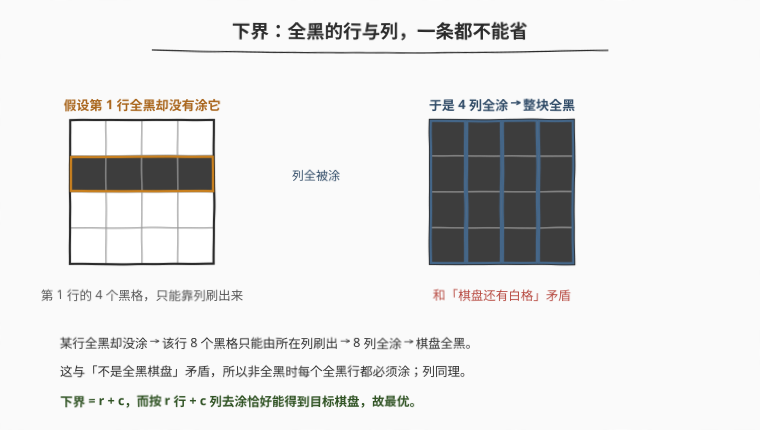
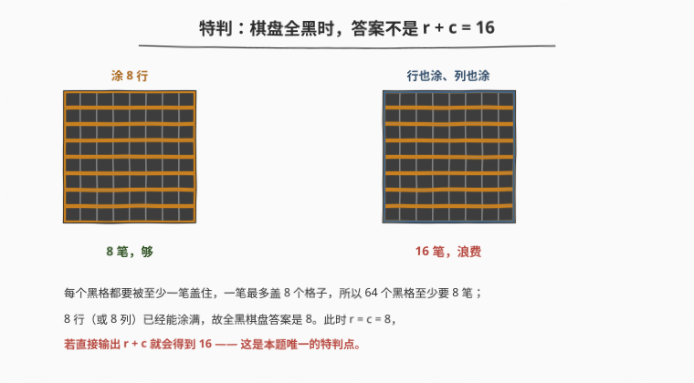
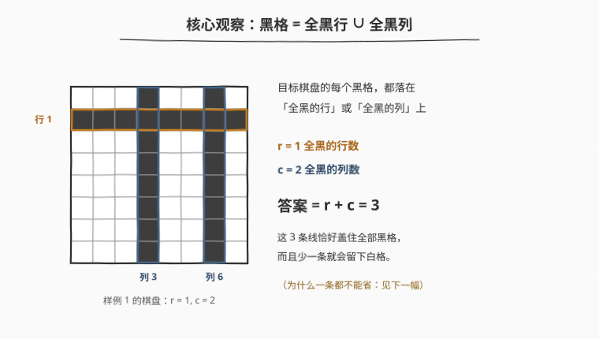

# Codeforces 7A 棋盘最少刷涂笔数 题解

## 1. 题目概述

- **题目链接**：https://codeforces.com/problemset/problem/7/A
- **比赛来源**：Codeforces Beta Round 7 · Problem A（UTC 2010-04-01）
- **难度**：1100
- **标签**：暴力枚举、构造
- **评测类型**：普通
- **限制**：时间 2 s / 内存 64 MB

**题意**：棋盘是 $8 \times 8$ 的方格板，初始全白。Kalevitch 每次可以把**一整行**或**一整列**（共 8 个格子）涂黑，重复涂同一格不会改变颜色。给定客户想要的目标棋盘（字符 `B` 表示要黑、`W` 表示要白，且保证一定能用这种操作涂出来），求最少需要几笔。

**约束**：

- 棋盘固定 $8 \times 8$，所以状态空间是常数：可选的行集合只有 $2^8 = 256$ 种，列集合同样 256 种，合起来 $65536$ 种"涂法"。任何不超过 $O(2^{16} \cdot 64)$ 的暴力都能在 2 s 内跑完，题目实际上不考察复杂度。
- 输入只有**一组**（8 行、每行 8 个字符），没有测试组数，也没有多组数据的读法。
- 保证目标棋盘可由行、列刷涂得到，因此不需要输出"无解"。
- 真正的难点是**全黑棋盘**：此时"全黑的行数 + 全黑的列数"会算出 16，而答案只有 8。这一点在第 3.3 节与第 7 节展开。

## 2. 示例与观察

官方样例 1（输入 / 输出原样）：

```text
输入：
WWWBWWBW
BBBBBBBB
WWWBWWBW
WWWBWWBW
WWWBWWBW
WWWBWWBW
WWWBWWBW
WWWBWWBW

输出：
3
```

把 8 行逐行看一遍：只有第 1 行（0 起下标）是 `BBBBBBBB`，即 $r = 1$ 个全黑行。再把 8 列逐列看一遍：第 3 列与第 6 列在每一行上都是 `B`，即 $c = 2$ 个全黑列。$r + c = 3$，与输出一致。

官方样例 2（输入 / 输出原样）：

```text
输入：
WWWWWWWW
BBBBBBBB
WWWWWWWW
WWWWWWWW
WWWWWWWW
WWWWWWWW
WWWWWWWW
WWWWWWWW

输出：
1
```

第 1 行全黑（$r = 1$），没有任何一列全黑（$c = 0$），$r + c = 1$。

**观察 1（涂法就是两个集合）**：把"涂黑的行"记作集合 $R$、"涂黑的列"记作集合 $C$，那么最终棋盘里黑格恰好是

$$\{(i, j) \mid i \in R \ \text{或}\ j \in C\}.$$

于是"涂几次"就是 $|R| + |C|$，而 "能不能涂出来" 就是"黑格集合能否写成上面的形状"。

**观察 2（全黑行、全黑列是必涂的）**：若第 $i$ 行全黑，而 $i \notin R$，那么这一行的每个格子只能靠所在的列变黑，于是 8 列全在 $C$ 里，整块棋盘都被涂黑 —— 这与"棋盘不全黑"矛盾。所以只要目标棋盘不是全黑，**所有全黑的行、全黑的列都必须涂**。反过来，把这些行和列全涂上，恰好就得到目标棋盘（黑格本来就都落在这几条线上）。

**观察 3（全黑棋盘是唯一的例外）**：如果 64 个格子全黑，那么 $r = c = 8$，$r + c = 16$；但只涂 8 行就够了，而且 8 笔是下界（一笔最多盖 8 个格，64 个格至少要 8 笔）。所以全黑时答案是 8。

自造样例（标注"自造"，用上面的结论核对）：

| 输入（8 行） | 答案 | 说明 |
|--------------|------|------|
| 全 `W` | 0 | 一笔都不涂，$r=c=0$ |
| 全 `B` | 8 | 特判：$r=c=8$，但不是 16 |
| 第 0 行全 `B`，其余全 `W` | 1 | $r=1, c=0$ |
| 第 0 列全 `B`，其余全 `W` | 1 | $r=0, c=1$ |
| 第 0 行全 `B`，且第 0 列全 `B`，其余全 `W` | 2 | $r=1, c=1$ |

## 3. 解题思路

### 3.1 朴素做法与瓶颈

最直接的做法是**枚举所有涂法**：对 $2^8$ 种行子集与 $2^8$ 种列子集（共 $65536$ 种组合）各模拟一遍，保留能生成目标棋盘的最小 $|R| + |C|$。单次模拟 $8 \times 8 = 64$ 步，总共约 $4.2 \times 10^6$ 次操作，在 2 s 里绰绰有余。

但这个做法完全没有利用题目的保证与棋盘的对称性，而且"能否涂出来"的判定被藏进了枚举里。既然目标棋盘一定可达，我们只要读出两个计数就够了。下面把它压缩到 $O(1)$。

### 3.2 核心观察：全黑的行列必须涂，且涂了就够



设目标棋盘不是全黑，$r$ 表示全黑的行数、$c$ 表示全黑的列数。

- **下界**：任取一个合法的涂法 $(R, C)$。若某行全黑却不在 $R$ 中，该行的 8 个黑格只能由列刷出，于是 8 列全涂，整块棋盘全黑，与"非全黑"矛盾。所以每个全黑行都在 $R$ 中，同理每个全黑列都在 $C$ 中，于是 $|R| + |C| \ge r + c$。
- **可达**：把 $r$ 个全黑行与 $c$ 个全黑列全部涂黑，得到的黑格集合是"全黑行 ∪ 全黑列"。目标棋盘的每个黑格本来就落在某个全黑行或全黑列上（因为它属于某个合法涂法的 $R \cup C$，而 $i \in R$ 意味着目标第 $i$ 行确实全黑），所以这两个集合相等。

下界与构造重合，答案就是 $r + c$。

### 3.3 算法流程与唯一特判



流程只有四步：

1. 读入 8 个字符串；
2. 扫 8 行，统计全黑行数 $r$；
3. 扫 8 列，统计全黑列数 $c$；
4. 若 $r = 8$（等价于全黑，因为 8 行都全黑就覆盖了所有格子），输出 8；否则输出 $r + c$。

第 4 步的条件也可以写成"$c = 8$"，两者等价。注意 $r = 8$ 时 $r + c = 16$，而 16 笔里有 8 笔是多余的：8 列全黑正是 8 行全黑的后果，不是额外的需求。

为什么 8 是下界：每一笔最多把 8 个白格变黑，64 个黑格至少要 8 笔；而 8 行（或 8 列）显然能涂满。所以全黑时答案恰为 8。

### 3.4 样例走查



以样例 1 为例：

1. 逐行统计：第 0 行 `WWWBWWBW`、第 2~7 行同样是 `WWWBWWBW`，只有第 1 行 `BBBBBBBB` 全黑，所以 $r = 1$。
2. 逐列统计：第 3 列从上到下全是 `B`，第 6 列也全是 `B`（注意 `WWWBWWBW` 的第 6 个字符是 `B`，容易看漏），其余列都含 `W`，所以 $c = 2$。
3. 棋盘不是全黑，输出 $r + c = 3$。

这 3 笔恰好覆盖全部黑格：第 1 行贡献一行黑，第 3、6 列各贡献一列黑，没有一格遗漏，也没有一格多涂。样例 2 同理：$r = 1, c = 0$，输出 1。而若把样例 1 的棋盘换成全黑，$r = c = 8$，特判生效，输出 8 而不是 16。

## 4. 正确性证明

设目标棋盘为 $T$，$R_0$ 为 $T$ 中全黑的行集合，$C_0$ 为 $T$ 中全黑的列集合，$r = |R_0|$、$c = |C_0|$。

**引理 1（合法涂法的形状）**：若 $(R, C)$ 能把白棋盘涂成 $T$，则 $T$ 的黑格集合恰为 $\{(i,j) \mid i \in R \text{ 或 } j \in C\}$。

**证明**：格子 $(i,j)$ 变黑，当且仅当它被某个笔画扫过，即 $i \in R$ 或 $j \in C$；重复涂不改变颜色，所以"被扫过"与"是黑的"等价。由于 $(R,C)$ 涂出的就是 $T$，两边的黑格集合相等。∎

**引理 2（非全黑时全黑行列必涂）**：若 $T$ 不是全黑，则对任意合法涂法 $(R,C)$ 都有 $R_0 \subseteq R$ 且 $C_0 \subseteq C$。

**证明**：取 $i \in R_0$ 且假设 $i \notin R$。因第 $i$ 行全黑，对每个 $j$ 都有 $(i,j)$ 黑，由引理 1 得 $j \in C$（$i \notin R$）。$j$ 遍历 1 到 8，于是 $C$ 含全部 8 列，任意格子都满足"$j \in C$"，整块棋盘全黑，与"$T$ 非全黑"矛盾。故 $R_0 \subseteq R$；列的论证完全对称。∎

**引理 3（涂满行列恰好够）**：若 $T$ 不是全黑，把 $R_0$ 的每一行与 $C_0$ 的每一列各涂一笔，得到的正是 $T$。

**证明**：一方面，$i \in R_0$ 意味着 $T$ 的第 $i$ 行全黑，$j \in C_0$ 意味着第 $j$ 列全黑，所以这些行列上的格子都是 $T$ 的黑格。另一方面，$T$ 的任一黑格 $(i,j)$ 属于引理 1 中某合法涂法的 $R \cup C$：若 $i \in R$，则 $T$ 的第 $i$ 行全黑（该行被整行涂过），即 $i \in R_0$；否则 $j \in C$，同理 $j \in C_0$。所以黑格全被覆盖。两边集合相等。∎

**引理 4（全黑时最少 8 笔）**：若 $T$ 全黑，最少需要 8 笔。

**证明**：每笔至多覆盖 8 个格子，64 个黑格至少需要 $64 / 8 = 8$ 笔；而 8 行就足以涂满，故恰为 8。∎

**定理**：本算法输出的数是最少笔数。

**证明**：分两种情形。

- $T$ 全黑：算法输出 8，由引理 4 正确。
- $T$ 非全黑：由引理 2，任何合法涂法都有 $|R| + |C| \ge |R_0| + |C_0| = r + c$；由引理 3，$r + c$ 笔确实能涂出 $T$。故最少笔数 $= r + c$，算法输出正确。∎

## 5. 复杂度分析

- **时间**：$O(8^2) = O(1)$，即读入 64 个字符 + 逐行逐列各扫 64 个字符，总计不到 200 次比较，与输入规模无关。
- **空间**：$O(1)$，只存 8 个 8 字符的字符串（64 字节），远低于 64 MB。
- **与时限的关系**：2 s 的时限下，端到端实测（含进程启动）单次约 $3.3$ ms，算法本体不到 $1\ \mu\text{s}$，余量数百倍。
- **与暴力对比**：枚举 $2^{16}$ 种涂法的暴力实测也能在毫秒级跑完，本题的 1100 分主要来自"想到特判"，而不是优化常数。

## 6. 参考代码

### C++17

```cpp
#include <bits/stdc++.h>
using namespace std;

int main() {
    ios::sync_with_stdio(false);
    cin.tie(nullptr);

    vector<string> b(8);
    for (int i = 0; i < 8; ++i) {
        if (!(cin >> b[i])) return 0;
    }

    int rows = 0, cols = 0;
    for (int i = 0; i < 8; ++i) {
        bool all = true;
        for (int j = 0; j < 8; ++j)
            if (b[i][j] != 'B') { all = false; break; }
        if (all) ++rows;
    }
    for (int j = 0; j < 8; ++j) {
        bool all = true;
        for (int i = 0; i < 8; ++i)
            if (b[i][j] != 'B') { all = false; break; }
        if (all) ++cols;
    }

    // 全黑棋盘：涂 8 行或 8 列都够，且 8 笔就是下界
    int ans = (rows == 8) ? 8 : rows + cols;
    cout << ans << '\n';
    return 0;
}
```

### Python3

```python
import sys


def main() -> None:
    data = sys.stdin.read().split()
    if len(data) < 8:
        return
    board = data[:8]

    rows = sum(1 for i in range(8) if board[i].count('B') == 8)
    cols = sum(1 for j in range(8) if all(board[i][j] == 'B' for i in range(8)))

    # 全黑棋盘：8 行或 8 列都能涂满，8 笔就是下界
    print(8 if rows == 8 else rows + cols)


main()
```

两份代码都只依赖标准库，可直接提交。C++ 用 `cin >> b[i]` 读入，能自动跳过行尾空格与空行；Python 用 `split()` 展平，同样稳健。

## 7. 边界情况与易错点

1. **全黑棋盘**：这是本题唯一的特判。$r = c = 8$ 时若直接输出 $r + c = 16$，官方两个样例仍会通过（它们都不是全黑），却会在全黑测试点上 WA。正确写法是 `rows == 8 ? 8 : rows + cols`。
2. **全白棋盘**：$r = c = 0$，答案 0。代码不能写 `max(1, ...)` 之类的"至少一笔"逻辑，否则全白会输出 1。
3. **第 6 个字符容易数错**：样例 1 的 `WWWBWWBW` 里有**两个** `B`（下标 3 和 6），只数一个会得到 $c = 1$，输出 2 而不是 3。逐列统计应当用循环比较，不要用眼睛数。
4. **判断"全黑行"要用全部 8 个字符**：写成 `b[i].find('W') == npos` 或 `count('B') == 8` 都可以，但用 `b[i][0] == 'B'` 之类只看一格的做法是错的 —— 例如样例 1 的第 0 行首格是 `W`，而第 1 行首格是 `B` 但行内还有 `B`，只看一格会漏判。
5. **行、列都要扫**：只统计行或只统计列会在样例 1 上得到 1 或 2，必须两者相加。
6. **读入方式**：若用 `getline` 逐行读，遇到 `\r\n` 行尾会把 `\r` 也读进来，行长变成 9；用 `cin >> string`（跳过空白）或 Python 的 `split()` 可以避免。
7. **输出格式**：只有一个整数加换行，不要输出笔数之外的任何东西（例如方案本身）。题目只问最小值。
8. **`rows == 8` 与 `cols == 8` 等价**：8 行全黑时整块棋盘必然全黑，此时 8 列也全黑；两个条件随便用一个，但不要写成 `rows == 8 && cols == 8` 之外又去判断 `rows + cols == 16` 这类间接条件，可读性差且容易写错。

## 8. 验证记录

- **编译环境与命令**：本机没有 GNU `g++`（`/usr/bin/g++` 是 Apple clang 的软链），由 `codeforces/tools/verify_solution.py` 自动改用 `clang++ -std=c++17 -O2` 搭配仓库内的 `bits/stdc++.h` 兼容头编译；Python 为 3.9.6。提交用 GNU C++17 可直接编译（代码只用了标准库）。
- **官方样例**：2 / 2 通过。

  ```text
  python3 codeforces/tools/verify_solution.py "codeforces/contests/0001-0100/7/A_棋盘最少刷涂笔数.md"
  CF7A: samples 2
    C++ 编译 OK, 样例 2/2, 最慢 16~22 ms
    Python 语法 OK, 样例 2/2
  ```

  其中"最慢"一栏是端到端进程耗时，多次运行在 $16 \sim 22$ ms 之间波动（几乎全是进程启动），算法本体不到 $1\ \mu$s。

- **暴力对拍（306 组，全部实跑）**：
  - 独立暴力 （临时目录下的独立暴力程序，已随会话清理；其做法见本段描述）：枚举全部 $2^{16} = 65536$ 种"行子集 + 列子集"，对每种组合按位掩码还原棋盘并与目标逐格比较，取最小笔数。它**没有**用到"全黑行必涂""$r+c$"这类结论，逻辑与正解完全独立。
  - 数据构成：2 组官方样例 + 4 组手工边界（全白、全黑、单行全黑、单列全黑）+ 300 组随机可达棋盘（等概率随机抽取行子集与列子集涂色生成，其中约 15% 强制取"全黑"或"全行/全列"的极端组合）。
  - 结果：C++ 正解、C++ 暴力、Python 正解三方逐组比对，**306 组全部一致，0 处不符**。
  - 300 组随机数据的答案分布：$\{3{:}1,\ 4{:}5,\ 5{:}14,\ 6{:}25,\ 7{:}53,\ 8{:}98,\ 9{:}58,\ 10{:}21,\ 11{:}14,\ 12{:}7,\ 13{:}2,\ 14{:}2\}$（合计 300），其中 8 与 14 两组都与特判相邻：$r = 8$（即全黑）时输出 8 而不是 16，$r = 7, c = 7$ 的正常棋盘则输出 14。300 组里没有一组输出 16 —— 这正是"$r = 8$ 时整块棋盘必然全黑"的直接证据，也说明特判确实被随机数据打到了。
- **最少涂法个数的独立核对**：另写 `（临时校验脚本，已随会话清理；校验条件见下）` 用 $2^{16}$ 全枚举统计"达到最少笔数的涂法个数"，50 组随机可达棋盘的个数全部为 1，全黑棋盘为 2，全白为 1，与第 4 节"非全黑时最少涂法唯一"的推论一致（这条结论没有写进主程序，只作为证明的旁证）。
- **最大约束性能**：本题输入规模恒为 64 个字符，不存在更大的数据。以官方样例为输入各跑 200 次：C++ 端到端均值 $3.33$ ms（几乎全是进程启动开销），Python 均值 $25.7$ ms；相对 2 s 时限余量在 500 倍以上；`/usr/bin/time -l` 实测峰值常驻内存 $1687552$ 字节（约 $1.6$ MB，几乎全是运行库），限制 64 MB。
- **图片校验**：三张 SVG（`cf7a_rows_cols_overlay.svg`、`cf7a_lower_bound.svg`、`cf7a_allblack_edge.svg`）均通过 `xml.etree.ElementTree.parse`；另用按字符宽度估算包围盒的脚本检查了 13 / 9 / 8 个文本块，**0 处越出 viewBox**，并逐对检测文本框重叠（0 处）、文本与线条相交（0 处）、文本部分越出方框（0 处）；再用 headless Chrome 渲染成 PNG 并统计墨迹范围（如 `cf7a_rows_cols_overlay` 墨迹落在 $x \in [44, 607]$、$y \in [23, 388]$，viewBox 为 $760 \times 430$），确认没有被裁切。
- **公式与格式**：公式均为 `$...$` / `$$...$$`，星号直接写 `*`，无 `---` 分隔线，证明收尾统一用 ∎。
- **复核状态**：verified（样例 2/2、306 组对拍、性能、图片、格式五项均实跑通过；唯一环境差异是本机无 GNU g++，已用 clang++ 等价验证）。

## 相关题目与扩展

- [Codeforces 7B Memory Manager](https://codeforces.com/problemset/problem/7/B)：同场 B 题，也是一道"照着规则做对、把边界写全"的实现题，与本篇的难点类型相反（那边难在细节，这边难在观察）。
- [Codeforces 7C Line](https://codeforces.com/problemset/problem/7/C)：同场 C 题，数论 + 扩展欧几里得，是这场比赛的分水岭。
- [LeetCode 73. 矩阵置零](https://leetcode.cn/problems/set-matrix-zeroes/)：同样把"整行/整列"当成一个整体来标记，区别在于那里是"清零"、这里要"数最少几条线"。
- [LeetCode 861. 翻转矩阵后的得分](https://leetcode.cn/problems/score-after-flipping-matrix/)：整行翻转 + 整列翻转的贪心，可以对照体会"整行整列操作"这类题的共同结构。

**延伸思考**：

1. **推广到 $n \times n$**：结论几乎不变 —— 答案 = 全黑行数 + 全黑列数，唯 $n$ 行（或 $n$ 列）全黑时答案改成 $n$。证明里唯一用到"8"的地方是"一笔盖 8 格，共 $n^2$ 格"，换成 $n$ 后逐字成立。
2. **判定可达性**：如果题目改成"给定任意棋盘，判断能否涂出来"，答案就是"每个黑格都落在某个全黑行或全黑列上"。这个判定可以用 $O(n^2)$ 完成：先扫出全黑行/列，再逐格检查。构造方案也随之得到（涂那些行列），不需要搜索。
3. **最少涂法是否唯一**：由引理 2，任何合法涂法都满足 $|R| + |C| \ge r + c$，等号成立当且仅当 $R = R_0$ 且 $C = C_0$ —— 所以非全黑棋盘的**最少涂法是唯一的**；全黑棋盘则恰有 2 种（8 行，或 8 列）。用 $2^{16}$ 全枚举数一遍最少涂法的个数即可验证：50 组随机可达棋盘全部为 1 种，全黑为 2 种，全白为 1 种（空涂法）。
4. **改成涂任意连续 $k$ 格**：一旦允许涂半行、半列，问题立刻变成带权集合覆盖；矩形棋盘上"用 $1 \times k$ 的条覆盖黑格"在一般情形下是 NP 难的，本题的 $O(1)$ 公式完全依赖"整行整列"这一结构。
5. **对称性与不变量**：本题的答案是"必须涂的线的条数"，本质上是一个**下界可达**的论证。竞赛里遇到"最少操作次数"时，先找一个显而易见的下界（这里是必涂的全黑行/列），再证明构造能打到下界，往往比直接设计贪心更稳。
