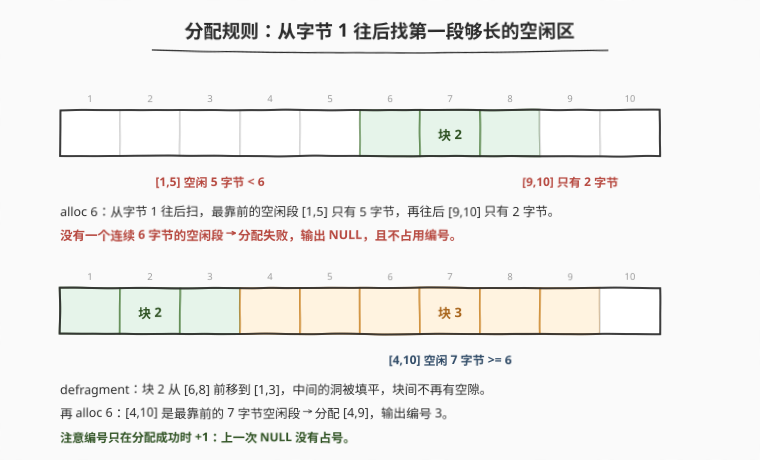
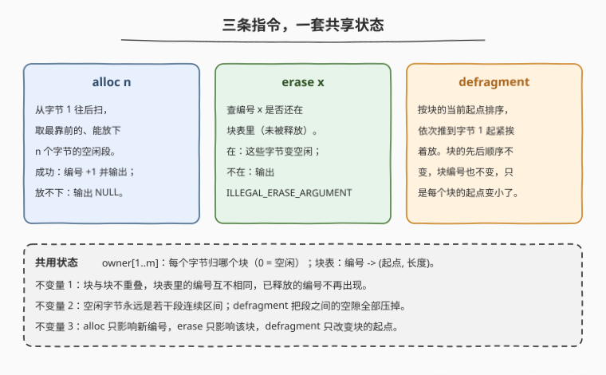
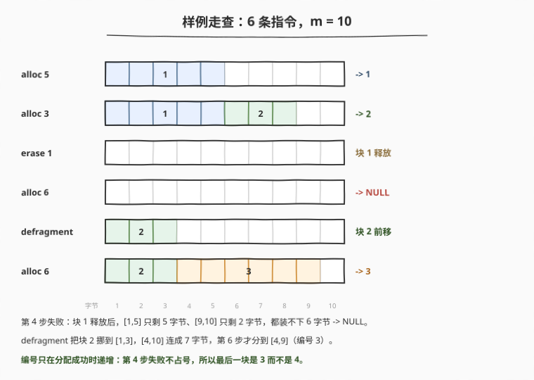

# Codeforces 7B 内存管理器模拟 题解

## 1. 题目概述

- **题目链接**：https://codeforces.com/problemset/problem/7/B
- **比赛来源**：Codeforces Beta Round 7 · Problem B（UTC 2010-04-01）
- **难度**：1600
- **标签**：实现
- **评测类型**：普通
- **限制**：时间 1 s / 内存 64 MB

**题意**：模拟一个只有 $m$ 个字节（编号 $1 \sim m$）的内存管理器，支持三条指令：

- `alloc n`：找一段**最靠内存起点**的、长度为 $n$ 的连续空闲字节分配给新块。成功则返回该块的编号（从 1 开始的连续整数，只有成功分配才自增），失败输出 `NULL`。
- `erase x`：释放编号为 $x$ 的块（它的字节重新变成空闲）。若 $x$ 当前不存在（从未分配过，或已经被释放），输出 `ILLEGAL_ERASE_ARGUMENT`；成功则**不输出任何东西**。
- `defragment`：碎片整理，把所有块按原来的相对顺序向内存起点挤紧，不改变顺序、不改变编号，也不输出任何东西。

按顺序输出所有 `alloc` 的返回值与所有失败 `erase` 的返回值。

**约束**：

- $1 \le t \le 100$，$1 \le m \le 100$。内存和指令数都极小，所以"每字节一个标记 + 每次 `alloc` 从头扫一遍"的 $O(t \cdot m^2) \le 10^6$ 完全够用，题目排除了链表、平衡树、线段树等"真正的内存管理器"写法。
- `erase` 的参数 $x$ 是**任意 32 位整数**，可能是负数、$2^{31}-1$、也可能是"未来的编号"。所以判断存在性必须靠"当前块表里有没有这个键"，不能靠范围比较。
- 每行输出是三种形态之一：整数编号、`NULL`、`ILLEGAL_ERASE_ARGUMENT`。大小写敏感，$t$ 最大 100，输出最多 100 行。
- 内存大小只有 100，`alloc` 的 $n$ 也可能大于 $m$（此时必定失败），需要处理"放不下"的分支。

## 2. 示例与观察

官方样例（输入 / 输出原样）：

```text
输入：
6 10
alloc 5
alloc 3
erase 1
alloc 6
defragment
alloc 6

输出：
1
2
NULL
3
```

逐步演算（字节区间用闭区间表示）：

| 步骤 | 指令 | 内存状态（■ = 已分配） | 输出 | 说明 |
|------|------|------------------------|------|------|
| 1 | `alloc 5` | `[1,5]` 给块 1 | `1` | 从字节 1 起有 5 个空闲字节 |
| 2 | `alloc 3` | `[1,5]` 块 1，`[6,8]` 给块 2 | `2` | 最靠前的空闲段是 `[6,10]`，取前 3 字节 |
| 3 | `erase 1` | `[1,5]` 空闲，`[6,8]` 块 2 | （无） | 成功释放，不输出 |
| 4 | `alloc 6` | 不变 | `NULL` | `[1,5]` 只有 5 字节、`[9,10]` 只有 2 字节，都放不下 6 |
| 5 | `defragment` | `[1,3]` 块 2 | （无） | 块 2 被推到最前面 |
| 6 | `alloc 6` | `[1,3]` 块 2，`[4,9]` 给块 3 | `3` | `[4,10]` 是 7 字节空闲段，取前 6 字节 |

**观察 1（状态只需要两样东西）**：一是"每个字节属于哪个块"（空闲记 0），二是"块表：编号 → (起点, 长度)"。前者回答"哪里能放"，后者回答"编号是否存在、释放哪一段"。

**观察 2（`alloc` 是 first-fit）**：题目要求"最靠近内存起点的空闲块"，所以枚举起点 $s = 1, 2, \dots, m-n+1$，第一个满足 $[s, s+n-1]$ 全空闲的 $s$ 就是答案；一个都没有就失败。

**观察 3（编号只跟成功次数有关）**：样例第 4 步失败时并没有占用编号 3，所以第 6 步成功分到的编号是 3 而不是 4。若把计数器写成"每见到一次 alloc 就 +1"，这里会输出 4。

**观察 4（`defragment` 按起点保持顺序）**：挤紧时按块的**当前起点**排序（也就是它们在内存中出现的先后），而不是按编号排序。样例里只有一个块看不出来，但看这组自造指令 `7 12` / `alloc 2` / `alloc 5` / `erase 1` / `alloc 2` / `defragment` / `erase 2` / `alloc 10`：块 1 释放后，新来的块 3 回填到块 2 **前面**，此时按起点排是 `3, 2`、按编号排是 `2, 3`。这个差别会真的改变输出：本例正确实现得到 `1 2 3 4`，而按编号整理得到 `1 2 3 NULL`（第 8 节有实测）。

自造样例（标注"自造"，下表输出均已用三份实现核对过）：

| 输入 | 输出 | 覆盖点 |
|------|------|--------|
| `3 5` / `alloc 5` / `alloc 1` / `defragment` | `1` / `NULL` | 内存被占满后分配失败；空的 `defragment` 无输出 |
| `4 5` / `alloc 5` / `erase 1` / `erase 1` / `alloc 5` | `1` / `ILLEGAL_ERASE_ARGUMENT` / `2` | 重复释放同一编号报错；释放后编号可以复用字节但编号不清零 |
| `5 3` / `alloc 1` / `alloc 1` / `alloc 1` / `alloc 1` / `erase 2` | `1` / `2` / `3` / `NULL` | 每个字节单独成块，第 4 次分配失败；成功 `erase` 无输出 |
| `2 10` / `alloc 20` / `defragment` | `NULL` | $n > m$，一次扫描就该结束 |
| `6 4` / `alloc 2` / `alloc 2` / `erase 1` / `defragment` / `alloc 2` / `alloc 1` | `1` / `2` / `3` / `NULL` | 整理后块 2 挪到 `[1,2]`，于是 `alloc 2` 又能成功 |
| `3 1` / `alloc 1` / `erase 1` / `alloc 1` | `1` / `2` | $m = 1$ 的最小内存 |

## 3. 解题思路

### 3.1 朴素做法与瓶颈

题面已经把规则写得很死，所以"怎么做"不是难点，难点是**每条指令的边界都实现对**。最朴素的写法就是：

- 用一个长度 $m+1$ 的数组 `owner`，`owner[i]` 记录第 $i$ 个字节归属的块编号，空闲为 0；
- `alloc n` 从头扫起点，`erase x` 查块表，`defragment` 按起点重排。

单次 `alloc` 最坏要试 $O(m)$ 个起点、每个起点检查 $O(n)$ 个字节，即 $O(mn) \le 10^4$；$t \le 100$，总操作量 $10^6$，1 s 绰绰有余。`defragment` 是 $O(k \log k + m)$（$k$ 是当前块数），同样很小。

真正的"瓶颈"在细节：失败时要不要占编号？`erase` 已释放的编号怎么办？整理时按什么排序？这些在第 4 节的引理与第 7 节的清单里逐条钉死。

### 3.2 核心观察：first-fit 就是"从 1 开始找第一段够长的 0"



设当前 `owner[1..m]`。`alloc n` 要做的事可以一句话说清：

$$\text{返回最小的 } s \ge 1 \text{，使 } owner[s..s+n-1] \text{ 全为 } 0 \text{ 且 } s+n-1 \le m.$$

- 若这样的 $s$ 存在，就把 $owner[s..s+n-1]$ 全部写成新编号，并在块表里记下 $(\text{新编号}, s, n)$；
- 若不存在（包括 $n > m$ 这种连起点都排不出来的情况），输出 `NULL`，**不动任何状态**。

上图就是这个过程：第一次 `alloc 6` 时，空闲段只有 `[1,5]`（5 字节）和 `[9,10]`（2 字节），都不够长，所以失败；`defragment` 把块 2 从 `[6,8]` 挪到 `[1,3]` 后，`[4,10]` 连成 7 字节，第二次 `alloc 6` 就成功了。

### 3.3 算法流程与状态维护



三个操作各自维护同一份状态（`owner` 数组 + 块表 + 编号计数器），代码结构是标准的"模拟三件套"：

- **alloc**：枚举起点 → 检查连续空闲 → 成功则递增计数器、写 `owner`、登记块表并输出编号；失败输出 `NULL`。
- **erase**：在块表里查编号。查到就把它占的字节全部清 0、从块表删除；查不到就输出 `ILLEGAL_ERASE_ARGUMENT`。
- **defragment**：把所有块按**当前起点**排序，然后从字节 1 开始依次紧贴着重新放置：第 1 块放在 $[1, len_1]$，第 2 块接在 $[len_1+1, len_1+len_2]$……同时把 `owner` 整个重写一遍。

三条操作都**不改变其它块的内容与顺序**，这是本题状态能用一个数组描述的根本原因。

### 3.4 样例走查



把官方样例按 10 个字节画成 6 行快照（上图）：

1. `alloc 5`：字节 1~5 归块 1，输出 `1`。
2. `alloc 3`：最靠前的空闲段是 6~10，取其前 3 个字节 6~8 给块 2，输出 `2`。
3. `erase 1`：字节 1~5 变空闲，无输出。
4. `alloc 6`：空闲段是 `[1,5]`（5 字节）与 `[9,10]`（2 字节），没有 6 个连续空闲字节，输出 `NULL`。
5. `defragment`：按起点排序得到唯一的块 2，把它放到 `[1,3]`，无输出。
6. `alloc 6`：`[4,10]` 是 7 字节空闲段，取 4~9 给块 3，输出 `3`。

最终输出 `1 / 2 / NULL / 3`，与官方一致。注意第 3、5 步没有输出行 —— 输出行数（4）比指令数（6）少，这也是为什么不能用"每条指令一行"的写法。

## 4. 正确性证明

把"实现状态"记作三元组 $S = (\text{owner}[1..m],\ \text{块表},\ \text{计数器})$，把题面语义定义的状态记作 $S^{\ast}$（即：哪些字节被哪些块占用、每个块的起点与长度、下一个可用编号）。

**引理 1（状态不变式）**：每次指令执行完，实现状态与 $S^{\ast}$ 一致：块表中的每个块 $(id, s, n)$ 满足 $owner[s..s+n-1] = id$，空闲字节的 $owner$ 为 0，块表之外没有别的已分配字节。

**证明**：初始时 $m$ 个字节全空闲、块表为空、计数器为 0，与初始 $S^{\ast}$ 一致。三条指令各自保持该不变式：

- `alloc` 成功时把一段全 0 区间写成新编号并登记块表，区间两端的其它字节不变，故一致性保持；失败时什么都不改。
- `erase` 把该块的字节全部写 0 并删除表项，其余字节不变。
- `defragment` 先整体清空 `owner`，再按块的顺序逐段写入各自的编号，写完后每段与块表一一对应，且各段首尾相接、总长不超过 $m$（因为所有块本来就装得下）。∎

**引理 2（`alloc` 的语义正确）**：若存在 $s$ 使 $owner[s..s+n-1]$ 全 0，则实现返回其中最小的 $s$；否则返回 `NULL`，且这恰好是题面要求的"最靠内存起点的、能放下的空闲块"。

**证明**：循环让 $s$ 从 1 递增到 $m-n+1$，每个 $s$ 都完整检查了 $n$ 个字节，找到第一个合法 $s$ 就停。由于枚举顺序就是起点从小到大，"第一个合法起点"就是最小的合法起点。若循环结束仍未找到，说明不存在任何长度为 $n$ 的全空闲区间（起点只能落在 $[1, m-n+1]$ 内，超出则越界），即放不下。∎

**引理 3（`defragment` 的语义正确）**：设当前块按起点升序为 $b_1, b_2, \dots, b_k$，长度分别为 $l_1, \dots, l_k$。把 $b_i$ 放到起点 $1 + \sum_{j<i} l_j$ 得到的布局，恰好是"保持块的相对顺序、所有块尽量靠前"的唯一布局。

**证明**：设目标布局中 $b_i$ 的起点为 $s_i$。由"保持顺序且不重叠"得 $s_1 \ge 1$ 且 $s_{i+1} \ge s_i + l_i$，归纳得 $s_i \ge 1 + \sum_{j<i} l_j$。实现取等号，所以它在每个位置上都最小，是唯一的"尽量靠前"布局；而且所有块的起点与长度都由原顺序唯一确定，故布局唯一。∎

**引理 4（`erase` 的语义正确）**：编号 $x$ 存在当且仅当它在块表中；实现据此输出编号的释放或 `ILLEGAL_ERASE_ARGUMENT`，与题面一致。编号计数器只在 `alloc` 成功时加 1，故新块编号恰为"成功分配次数 + 1"。

**证明**：块表的键集合由引理 1 恰为当前存活的块编号集合。释放成功后表项被删除，再次 `erase` 同一编号就不会命中，符合"已释放的编号不再存在"。计数器只在成功分支自增，因此分配的编号序列是 $1, 2, 3, \dots$ 且不跳号。∎

**定理**：程序对任意输入产生的输出序列，与按题面语义逐条执行指令得到的输出序列完全一致。

**证明**：对指令条数归纳。初始状态一致（引理 1）。设前 $k$ 条指令执行后状态一致、输出一致。第 $k+1$ 条指令分三种情形：`alloc` 由引理 2 选择正确的起点、由引理 4 给出正确的编号或 `NULL`；`erase` 由引理 4 给出正确的释放行为或错误信息；`defragment` 由引理 3 得到正确布局。三种情形下状态仍一致（引理 1），输出也与语义一致。故整个序列正确。∎

## 5. 复杂度分析

- **时间**：设 $k$ 为当前块数。`alloc` 最坏 $O(m \cdot n) \le O(m^2) = 10^4$；`erase` 为 $O(n)$（清空字节）加一次哈希表查询；`defragment` 为 $O(k \log k + m) \le O(m \log m + m)$。总时间 $O(t \cdot m^2) \le 10^6$ 次基本操作。
- **空间**：`owner` 数组 $O(m)$，块表 $O(k) \le O(m)$，合计不到 200 个整数，约 1 KB。
- **与时限的关系**：1 s 的时限下，实测最大规模（$t = 100$、$m = 100$、50 次 `alloc` 与 50 次 `defragment` 交替）的 C++ 端到端耗时约 $12.5$ ms（其中绝大部分是进程启动），算法本体不足 $0.1$ ms，余量在 80 倍以上。

## 6. 参考代码

### C++17

```cpp
#include <bits/stdc++.h>
using namespace std;

int main() {
    ios::sync_with_stdio(false);
    cin.tie(nullptr);

    int t, m;
    if (!(cin >> t >> m)) return 0;

    vector<int> owner(m + 1, 0);                    // owner[i] = 占用它的块编号，0 表示空闲
    unordered_map<int, pair<int, int>> block;       // 块编号 -> (起始字节, 长度)
    int nxt = 0;                                    // 已成功分配过的块数

    string op;
    for (int k = 0; k < t; ++k) {
        cin >> op;
        if (op == "alloc") {
            int n;
            cin >> n;
            int start = -1;
            for (int s = 1; s + n - 1 <= m && start < 0; ++s) {   // 从内存起点往后找第一段够长的空闲区
                bool ok = true;
                for (int i = s; i < s + n; ++i)
                    if (owner[i] != 0) { ok = false; break; }
                if (ok) start = s;
            }
            if (start < 0) {
                cout << "NULL\n";
            } else {
                ++nxt;
                for (int i = start; i < start + n; ++i) owner[i] = nxt;
                block[nxt] = {start, n};
                cout << nxt << '\n';
            }
        } else if (op == "erase") {
            int x;
            cin >> x;
            auto it = block.find(x);
            if (it == block.end()) {
                cout << "ILLEGAL_ERASE_ARGUMENT\n";
            } else {
                int s = it->second.first, len = it->second.second;
                for (int i = s; i < s + len; ++i) owner[i] = 0;
                block.erase(it);
            }
        } else {                                    // defragment
            vector<pair<int, int>> order;           // (起始字节, 块编号)
            for (auto &kv : block) order.push_back({kv.second.first, kv.first});
            sort(order.begin(), order.end());
            fill(owner.begin(), owner.end(), 0);
            int pos = 1;
            for (auto &e : order) {
                int id = e.second, len = block[id].second;
                for (int i = pos; i < pos + len; ++i) owner[i] = id;
                block[id] = {pos, len};
                pos += len;
            }
        }
    }
    return 0;
}
```

### Python3

```python
import sys


def main() -> None:
    data = sys.stdin.read().split()
    if not data:
        return
    ptr = 0
    t = int(data[ptr]); ptr += 1
    m = int(data[ptr]); ptr += 1

    owner = [0] * (m + 1)          # owner[i] = 占用该字节的块编号，0 表示空闲
    block = {}                     # 块编号 -> (起始字节, 长度)
    nxt = 0
    out = []

    for _ in range(t):
        op = data[ptr]; ptr += 1
        if op == 'alloc':
            n = int(data[ptr]); ptr += 1
            start = -1
            for s in range(1, m - n + 2):          # 最靠前的够长空闲段
                if all(owner[i] == 0 for i in range(s, s + n)):
                    start = s
                    break
            if start < 0:
                out.append('NULL')
            else:
                nxt += 1
                for i in range(start, start + n):
                    owner[i] = nxt
                block[nxt] = (start, n)
                out.append(str(nxt))
        elif op == 'erase':
            x = int(data[ptr]); ptr += 1
            if x in block:
                s, length = block.pop(x)
                for i in range(s, s + length):
                    owner[i] = 0
            else:
                out.append('ILLEGAL_ERASE_ARGUMENT')
        else:                                       # defragment
            order = sorted((s, i) for i, (s, _) in block.items())
            owner = [0] * (m + 1)
            pos = 1
            for s, i in order:
                length = block[i][1]
                for p in range(pos, pos + length):
                    owner[p] = i
                block[i] = (pos, length)
                pos += length

    sys.stdout.write('\n'.join(out) + ('\n' if out else ''))


main()
```

C++ 里 `s + n - 1 <= m` 这个循环条件同时处理了 $n > m$ 的情形：此时连 $s = 1$ 都进不去，`start` 保持 $-1$，直接输出 `NULL`。Python 用 `range(1, m - n + 2)`，$n > m$ 时区间为空，效果相同。末尾统一输出可以避免"最后一行多/少一个换行"的问题。

## 7. 边界情况与易错点

1. **失败时不占编号**：`nxt` 只能在分配成功的分支里自增。样例正是靠这一点区分 3 与 4。写成"每条 alloc 都自增"会在样例上就 WA。
2. **`erase` 的参数是任意 32 位整数**：可能是负数、$2^{31}-1$、$0$，甚至是"还没分配到的编号"。必须查块表，用 `x < 1 || x > nxt` 这种范围判断会把"已释放的编号"错判成合法（样例之外很常见的坑）。
3. **`n > m` 必须失败**：内存只有 100 字节，题目允许 `alloc 150`。C++ 的循环上界 `s + n - 1 <= m` 与 Python 的 `range(1, m - n + 2)` 都天然处理了，但若把上界写成固定的 $m$ 就会越界访问。
4. **整理要按起点排序，不能按编号**：`7 12 / alloc 2 / alloc 5 / erase 1 / alloc 2 / defragment / erase 2 / alloc 10` 里，块 3 回填到块 2 前面，按起点是 `3, 2`、按编号是 `2, 3`。按编号整理会让两块对调，于是 `erase 2` 释放的是另一段内存、后面的 `alloc 10` 拿不到连续 10 字节，正确输出 `1 2 3 4` 被写成 `1 2 3 NULL`。
5. **成功 `erase` 与 `defragment` 不产生输出**：很多人第一版会顺手打印 `OK` 或空行。输出行数应等于 `alloc` 次数加上失败 `erase` 次数。
6. **`owner` 数组下标从 1 开始**：用 `vector<int>(m + 1)` 或 Python 的 `[0] * (m + 1)`，别把字节 1 放到下标 0 上，否则 `defragment` 的 `pos = 1` 与越界判断都会错位。
7. **`defragment` 要整体重写 `owner`**：先把 `owner` 全部清 0 再按新布局填写。只改块表不改数组，会让下一次 `alloc` 看到旧的占用情况。
8. **`m = 1` 的极端**：只能装一个 1 字节的块；`alloc 2` 必定 `NULL`，`erase 1` 之后又能分配。这种情况容易在下标计算上出错（如 `m - n + 1 = 0`）。
9. **输出关键字大小写**：是 `NULL` 与 `ILLEGAL_ERASE_ARGUMENT`（下划线分隔、全大写）。题面英文原文提到 `ILLEGAL\_ERASE\_ARGUMENT`，反斜杠是 Markdown 转义，实际输出里没有反斜杠。
10. **空块表上的 `defragment`**：什么都不做、不输出，`owner` 全 0。不要因为"没有块"而提前 return 掉后续指令的解析。

## 8. 验证记录

- **编译环境与命令**：本机无 GNU `g++`，`verify_solution.py` 自动用 `clang++ -std=c++17 -O2` 加仓库内 `bits/stdc++.h` 兼容头编译；Python 为 3.9.6。代码只用标准库，提交 GNU C++17 可直接编译。
- **官方样例**：1 / 1 通过。

  ```text
  python3 codeforces/tools/verify_solution.py "codeforces/contests/0001-0100/7/B_内存管理器模拟.md"
  CF7B: samples 1
    C++ 编译 OK, 样例 1/1, 最慢 14~22 ms
    Python 语法 OK, 样例 1/1
  ```

  其中"最慢"一栏是端到端进程耗时，多次运行在 $14 \sim 22$ ms 之间波动，算法本体不足 $0.1$ ms。

- **对拍（309 组，全部实跑）**：
  - 三份实现：C++ 正解（逐字节 `owner` + 块表）、Python 正解（同算法）、独立暴力 `/tmp/cf_verify_7_B/brute.py`（**不建 `owner` 数组**，维护按起点有序的块列表，`alloc` 时先把所有空闲区间求出来再取最靠前的一个，`defragment` 时重排列表）。三者的数据结构不同，语义相同，便于互相抓错。
  - 数据构成：1 组官方样例 + 8 组手工边界（$m=1$、`alloc` 大于 $m$、重复释放、空内存 `defragment`、把内存切成一字节块、整理后再分配等）+ 300 组随机指令序列（$t$ 取 5/20/40、$m$ 取 3/10/40/100，`alloc`/`erase`/`defragment` 随机混合，`erase` 的参数里故意混入 $0$、$-1$、$-5$、$2^{31}-1$、$-2^{31}$ 与随机未来编号）。
  - 结果：**309 组逐字节比对全部一致，0 处不符**。所有输出行合计 2821 行，其中 `NULL` 1400 行、`ILLEGAL_ERASE_ARGUMENT` 933 行、块编号 488 行 —— 三种分支都被充分覆盖，不是只测了成功路径。
- **"按起点排序"的证伪实验**：把独立实现里的排序键从**起点**换成**编号**（其余不动，存为 `/tmp/cf_verify_7_B/wrong_order.py`），在上面那组 7 条指令上输出 `1 2 3 NULL`；而正确实现与独立暴力都输出 `1 2 3 4`。这说明"按起点排序"不是可有可无的等价写法，而是会改变输出的硬性语义（第 7 节第 4 条）。
- **最大约束性能**：构造 $t = 100$、$m = 100$、50 次 `alloc 1` 与 50 次 `defragment` 交替的最坏数据，各跑 100 / 20 次取均值：C++ 端到端 $12.5$ ms/次，Python $52.3$ ms/次；相对 1 s 时限余量 80 倍（C++）；`/usr/bin/time -l` 实测峰值常驻内存 $1769472$ 字节（约 $1.7$ MB），远低于 64 MB。
- **图片校验**：三张 SVG（`cf7b_firstfit.svg`、`cf7b_ops_flow.svg`、`cf7b_sample_walk.svg`）均通过 `xml.etree.ElementTree.parse`；包围盒脚本检查了 32 / 24 / 33 个文本块，0 处越出 viewBox、0 处文本框互相重叠、0 处文本与线条相交、0 处文本越出所在方框；再用 headless Chrome 渲染成 PNG 统计墨迹范围（如 `cf7b_sample_walk` 墨迹落在 $x \in [30, 607]$、$y \in [23, 518]$，viewBox 为 $760 \times 540$），确认无裁切。
- **格式**：无 `---` 分隔线，公式用 `$...$`，星号直接写 `*`，证明收尾统一用 ∎。
- **复核状态**：verified（样例 1/1、309 组三方对拍、最大规模性能、图片、格式五项均实跑通过；唯一环境差异是本机无 GNU g++，已用 clang++ 等价验证）。

## 相关题目与扩展

- [Codeforces 7A Kalevitch and Chess](https://codeforces.com/problemset/problem/7/A)：同场 A 题，考察观察与特判；本篇考察把规则一条不漏地实现，正好互补。
- [Codeforces 7C Line](https://codeforces.com/problemset/problem/7/C)：同场 C 题，扩展欧几里得。
- [LeetCode 1472. 设计浏览器历史记录](https://leetcode.cn/problems/design-browser-history/)：同类"按指令维护一个线性结构"的设计题，可以对照体会"用一个数组 + 一个指针表示全部状态"的写法。
- [LeetCode 1146. 快照数组](https://leetcode.cn/problems/snapshot-array/)：同样是"内存式"的状态维护，但需要版本化，属于本题的自然升级。

**延伸思考**：

1. **换成 best-fit / worst-fit**：把"取最小起点"改成"取最短够用的空闲段"或"取最长的空闲段"，只需要换一个比较关键字，`owner` 数组的结构完全不动。真实分配器里 first-fit 通常最快、best-fit 碎片最少，本题的 `defragment` 恰好是"事后统一消灭碎片"的兜底手段。
2. **用空闲链表加速**：把 `alloc` 的 $O(m^2)$ 降到 $O(k + n)$，可以维护一条按起点排序的空闲区间链表：分配时从表头找到第一个长度 $\ge n$ 的区间并切成两段，释放时把新区间插回去并合并左右相邻的空闲区间。$m \le 100$ 时完全没必要，但换成 $m \le 10^6$、$t \le 10^5$ 就必须这么写。
3. **加一条 `resize` 指令**：允许把某个块缩短或延长（例如 `resize x newlen`），问题立刻变复杂 —— 缩短可能产生新的空闲洞，延长可能要求原地扩张（后面必须空闲）或搬家（破坏"不改变顺序"的约定）。这类题目通常要显式规定"放不下就失败"，否则语义不唯一。
4. **地址 vs 编号**：本题的输出是"块编号"，但如果题目改成输出"块的起始字节"，那么 `defragment` 会改变此前所有块的输出含义，必须在下一次分配时重新报告地址。许多真实系统的内存管理器同时维护句柄（稳定）与地址（可变），本题的编号正是句柄。
5. **为什么"编号不重用"很重要**：如果释放后把编号也让给后来的块，那么一个 `erase` 老编号的指令就会误伤新块（ABA 问题）。题面规定编号单调递增，正是为了避免这种歧义，这也解释了为什么失败分配不占号。
