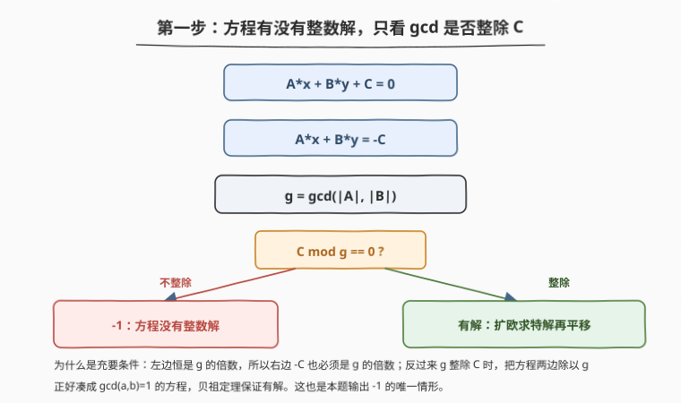
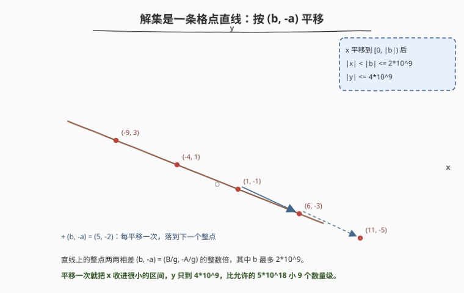
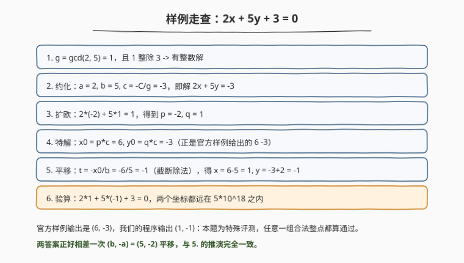

# Codeforces 7C 直线上的整数点 题解

## 1. 题目概述

- **题目链接**：https://codeforces.com/problemset/problem/7/C
- **比赛来源**：Codeforces Beta Round 7 · Problem C（UTC 2010-04-01）
- **难度**：1800
- **标签**：数学、数论
- **评测类型**：特殊评测（任意合法答案均可）
- **限制**：时间 1 s / 内存 256 MB

**题意**：给定直线 $Ax + By + C = 0$，求直线上任意一个整点 $(x, y)$，要求 $x, y$ 都是整数且都落在 $[-5 \cdot 10^{18},\ 5 \cdot 10^{18}]$ 内；如果不存在这样的点，输出 `-1`。

**约束**：

- $|A|, |B|, |C| \le 2 \cdot 10^9$，且 $A^2 + B^2 > 0$（$A, B$ 不同时为 0）。
- 输入只有一行三个整数。坐标范围 $5 \cdot 10^{18}$ 只是上限，真正的答案坐标都在 $10^9$ 量级（第 4 节引理 3），所以这里不需要高精度整数，但**中间乘积**会到 $10^{18}$ 量级，必须用 64 位（C++ 里再用 `__int128` 兜住 $a \cdot x$ 这类乘法）。
- 这是**特殊评测**：题面样例给出 $(6, -3)$，而任何满足方程的整点都算对。因此本地验证必须写 checker，不能直接比对文本。
- 值域 $2 \cdot 10^9$ 排除了"枚举 $x$ 再检查 $B \mid (Ax + C)$"的做法（$4 \cdot 10^9$ 个候选，1 s 内不可能），必须用扩展欧几里得。

## 2. 示例与观察

官方样例（输入 / 输出原样）：

```text
输入：
2 5 3

输出：
6 -3
```

代入验证：$2 \times 6 + 5 \times (-3) + 3 = 12 - 15 + 3 = 0$，合法。

**观察 1（这是丢番图方程）**：把常数项挪到右边得

$$Ax + By = -C,$$

即"二元一次不定方程"。它有没有整数解，只取决于 $\gcd(|A|, |B|)$ 是否整除 $-C$（裴蜀定理）。本例 $\gcd(2,5) = 1$，$1 \mid (-3)$，所以有解。

**观察 2（答案不唯一，差一个周期）**：本例的整点是一个等差数列。令 $g = \gcd(|A|,|B|)$、$a = A/g$、$b = B/g$，则

$$(x, y) \to (x + b,\ y - a)$$

仍然是解。例如 $(6, -3) \to (1, -1) \to (-4, 1) \to (-9, 3)$，全部满足 $2x + 5y + 3 = 0$。所以只要找到**任意**一组特解，就能靠平移把坐标调整到任何想要的区间里。

**观察 3（输出可以与本样例不同）**：本题为特殊评测，程序输出 $(1, -1)$ 同样正确。本文的代码就输出 $(1, -1)$，`verify_solution.py` 用 checker 判定通过（第 8 节）。

自造样例（标注"自造"，输出为本程序的实际输出，均已用 checker / 穷举核对）：

| 输入 | 输出 | 说明 |
|------|------|------|
| `0 5 10` | `0 -2` | $A = 0$ 退化：$5y = -10$，$y$ 唯一 |
| `5 0 10` | `-2 0` | $B = 0$ 退化：$5x = -10$ |
| `4 6 7` | `-1` | $\gcd(4,6) = 2 \nmid 7$，无整数解 |
| `1 1 -2` | `0 2` | 无穷多解，取最简单的一个 |
| `2 4 2` | `-1 0` | 化简后 $x + 2y = -1$，$(-1,0)$ 合法 |
| `2000000000 1999999999 2000000000` | `-1 0` | 系数取到上界，验证 $a \cdot x$ 不溢出 |

## 3. 解题思路

### 3.1 朴素做法与瓶颈

最直接的想法是**枚举**：把 $x$ 从 $-5 \cdot 10^{18}$ 枚举到 $5 \cdot 10^{18}$，对每个 $x$ 检查 $-C - Ax$ 能否被 $B$ 整除。值域是 $10^{19}$，1 s 内连 $10^{9}$ 都跑不完，直接出局。

退一步，若只枚举 $|x| \le |B|$（由观察 2，解以 $|b|$ 为周期），也要 $4 \cdot 10^9$ 次，仍然过不了。所以必须用**闭式求解**：扩展欧几里得。

### 3.2 核心观察：先过 gcd 这道闸门



设 $g = \gcd(|A|, |B|)$。因为 $g \mid A$ 且 $g \mid B$，所以对任意整数 $x, y$ 都有 $g \mid (Ax + By)$。于是：

- 若 $g \nmid C$，方程**不可能**有整数解，直接输出 `-1`；
- 若 $g \mid C$，把方程两边同除以 $g$，得到

$$a x + b y = c, \qquad a = A/g,\ b = B/g,\ c = -C/g,$$

此时 $\gcd(a, b) = 1$。由裴蜀定理，存在整数 $p, q$ 使 $a p + b q = 1$，两边乘 $c$ 得 $a(pc) + b(qc) = c$，于是 $(pc, qc)$ 就是一组特解。

**通解**：若 $(x_0, y_0)$ 是一组解，则所有解恰为

$$(x, y) = (x_0 + b t,\ y_0 - a t), \qquad t \in \mathbb{Z}.$$

原因很直接：两式相减得 $a(x - x_0) + b(y - y_0) = 0$，而 $\gcd(a,b) = 1$，故 $b \mid (x - x_0)$，令 $x - x_0 = bt$ 即得 $y - y_0 = -at$。

### 3.3 算法流程：扩欧 + 平移



1. **退化处理**：若 $A = 0$，方程变成 $By = -C$。$B \mid C$ 时输出 $(0, -C/B)$，否则 `-1`。若 $B = 0$ 对称处理。（两者不会同时为 0。）
2. **闸门**：$g = \gcd(|A|, |B|)$，若 $C \bmod g \ne 0$ 输出 `-1`。
3. **扩欧**：对 $(|A|, |B|)$ 跑扩展欧几里得，得到 $|A| p_0 + |B| q_0 = g$。再按 $A, B$ 的符号还原：$p = \operatorname{sgn}(A) p_0$、$q = \operatorname{sgn}(B) q_0$，于是 $A p + B q = g$。
4. **特解**：$a = A/g$、$b = B/g$、$c = -C/g$，特解 $x_0 = pc$、$y_0 = qc$。
5. **平移**：取 $t = \lfloor -x_0 / b \rfloor$（C++ 的整数除法向零取整，Python 的 `//` 向下取整，两者都只会让 $|x| < |b|$），令 $x = x_0 + bt$。再用方程反解 $y = (c - ax)/b$ —— 这样比算 $y_0 - at$ 少一次大数乘加，也更不容易写错符号。
6. **输出**：$x, y$ 都在范围内就输出，否则 `-1`（第 4 节会证明这种情况不会发生）。

图中的整点是 $2x + 5y + 3 = 0$ 的解：$(-9,3), (-4,1), (1,-1), (6,-3), (11,-5)$，相邻两点正好差 $(b, -a) = (5, -2)$。第 5 步的平移就是把其中任意一点沿这条格点直线滑动，直到 $x$ 落进 $[0, |b|)$。

### 3.4 样例走查



对 $A = 2$、$B = 5$、$C = 3$：

1. $g = \gcd(2, 5) = 1$，且 $1 \mid 3$，闸门放行。
2. 约化：$a = 2$、$b = 5$、$c = -C/g = -3$，要解 $2x + 5y = -3$。
3. 扩欧：$2 \times (-2) + 5 \times 1 = 1$，即 $p = -2$、$q = 1$。
4. 特解：$x_0 = pc = 6$、$y_0 = qc = -3$ —— 这正是官方样例给的答案。
5. 平移：$t = \lfloor -6/5 \rfloor = -1$，得 $x = 6 - 5 = 1$，$y = (c - ax)/b = (-3 - 2)/5 = -1$。
6. 验算：$2 \times 1 + 5 \times (-1) + 3 = 0$，输出 `1 -1`。

第 6 步的答案与官方样例 $(6, -3)$ 相差恰好一次 $(b, -a) = (5, -2)$ 平移，说明两套推演是同一族解的两个代表。

## 4. 正确性证明

**引理 1（有解的充要条件）**：方程 $Ax + By = -C$ 有整数解，当且仅当 $g = \gcd(|A|, |B|)$ 整除 $C$。

**证明**：必要性：$g \mid A$、$g \mid B$，故 $g \mid (Ax + By) = -C$，即 $g \mid C$。充分性：设 $g \mid C$，则 $a = A/g$、$b = B/g$ 互素，由裴蜀定理存在 $p, q$ 使 $ap + bq = 1$；两边乘 $c = -C/g \in \mathbb{Z}$ 得 $a(pc) + b(qc) = c$，即 $(pc, qc)$ 是解。∎

**引理 2（通解结构）**：若 $(x_0, y_0)$ 是 $ax + by = c$ 的一组解（$\gcd(a,b) = 1$），则全部整数解恰为 $(x_0 + bt,\ y_0 - at)$，$t \in \mathbb{Z}$。

**证明**：代入即可验证这些点都是解。反过来，设 $(x,y)$ 也是解，两式相减得 $a(x - x_0) = -b(y - y_0)$。因 $\gcd(a,b) = 1$，$b \mid (x - x_0)$，记 $x - x_0 = bt$（$t \in \mathbb{Z}$），代回得 $abt = -b(y - y_0)$，约去 $b$ 得 $y - y_0 = -at$。∎

**引理 3（平移一次就落在范围内）**：按第 3.3 节第 5 步取 $t$ 后，$|x| < |b| \le 2 \cdot 10^{9}$ 且 $|y| \le |c|/|b| + |a| \le 4 \cdot 10^{9}$，两者都远小于 $5 \cdot 10^{18}$。

**证明**：由 $t = \lfloor -x_0/b \rfloor$（或 C++ 的向零取整），$x = x_0 + bt$ 是 $x_0$ 除以 $b$ 的余数（最多差一个 $|b|$ 的偏移），故 $|x| < |b|$。又 $|a| = |A|/g \le 2 \cdot 10^{9}$、$|b| \le 2 \cdot 10^{9}$、$|c| = |C|/g \le 2 \cdot 10^{9}$。由方程 $by = c - ax$ 得

$$|y| = \frac{|c - ax|}{|b|} \le \frac{|c|}{|b|} + |a| \le 2 \cdot 10^{9} + 2 \cdot 10^{9} = 4 \cdot 10^{9}.$$

（$|b| \ge 1$ 使第一项不超过 $|c|$。）故坐标界成立，第 6 步的越界检查永远不会触发。∎

**引理 4（中间量不溢出）**：用 128 位整数计算时，$|pc|$、$|ax|$、$|c - ax|$、$|bt|$ 都不超过 $6 \cdot 10^{18}$，仍在 `__int128` 范围内；而 64 位有符号整数的上限只有 $9.22 \cdot 10^{18}$，余量不足，容易出错。

**证明**：扩展欧几里得给出的贝祖系数不会超过模数，即 $|p| \le |b| \le 2 \cdot 10^{9}$，又 $|c| \le 2 \cdot 10^{9}$，故 $|pc| \le 4 \cdot 10^{18}$；由引理 3，$|x| < |b| \le 2 \cdot 10^{9}$，故 $|ax| \le 4 \cdot 10^{18}$，$|c - ax| \le 6 \cdot 10^{18}$。各中间量都在 $10^{19}$ 以内，`__int128`（上限约 $1.7 \cdot 10^{38}$）绰绰有余，而 64 位有符号整数上限只有 $9.22 \cdot 10^{18}$，余量太小。∎

**定理**：程序对任意合法输入输出都正确：无解时输出 `-1`；有解时输出一对满足方程的整数，且两坐标都在 $[-5 \cdot 10^{18}, 5 \cdot 10^{18}]$ 内。

**证明**：分三种情形。

- $A = 0$ 或 $B = 0$：方程退化为一元方程，程序直接判断整除性并给出唯一的那个坐标，另一个取 0，显然满足方程；$|{-C}/B| \le 2 \cdot 10^{9}$ 在范围内。
- $A, B$ 均非 0 且 $g \nmid C$：由引理 1 无解，输出 `-1` 正确。
- 其余：引理 1 保证有解；第 3、4 步按引理 1 的构造给出特解（扩欧的正确性由欧几里得算法保证：递归返回 $|A| p_0 + |B| q_0 = g$，符号还原后 $Ap + Bq = g$，乘 $c$ 后 $a x_0 + b y_0 = c$）；第 5 步按引理 2 得到同族的另一个解，并由引理 3 保证它在坐标范围内；第 6 步的越界分支因此不会误报 `-1`。∎

## 5. 复杂度分析

- **时间**：扩展欧几里得是 $O(\log \min(|A|, |B|))$，$|A|, |B| \le 2 \cdot 10^9$ 时迭代次数不超过约 45 次；其余都是常数次 128 位乘除法。总计 $O(\log \max(|A|,|B|))$，实际执行的是几十条指令。
- **空间**：$O(1)$，只有十几个 128 位整数，不到 100 字节，远低于 256 MB。
- **与时限的关系**：1 s 时限下，端到端实测（含进程启动）单次约 $2.7$ ms，算法本体是微秒级，余量数百倍。
- **与枚举对比**：枚举 $|x| \le |B|$ 需要 $4 \cdot 10^9$ 次循环，即使每纳秒一次也要 4 s 以上，正好卡在时限之外 —— 这就是本题必须用数论的原因。

## 6. 参考代码

### C++17

```cpp
#include <bits/stdc++.h>
using namespace std;
using i128 = __int128_t;

// 返回 gcd(a,b)，并给出满足 a*x + b*y = gcd 的一组 (x,y)，要求 a,b >= 0
long long extgcd(long long a, long long b, long long &x, long long &y) {
    if (b == 0) { x = 1; y = 0; return a; }
    long long g = extgcd(b, a % b, y, x);
    y -= (a / b) * x;
    return g;
}

int main() {
    ios::sync_with_stdio(false);
    cin.tie(nullptr);

    long long A, B, C;
    if (!(cin >> A >> B >> C)) return 0;

    const i128 LIM = (i128)5000000000000000000LL;   // 5e18

    // A == 0：方程退化成 B*y = -C，y 唯一，x 取 0
    if (A == 0) {
        if (C % B == 0) cout << 0 << ' ' << -C / B << '\n';
        else            cout << -1 << '\n';
        return 0;
    }
    // B == 0：方程退化成 A*x = -C
    if (B == 0) {
        if (C % A == 0) cout << -C / A << ' ' << 0 << '\n';
        else            cout << -1 << '\n';
        return 0;
    }

    long long g = std::gcd(llabs(A), llabs(B));
    if (C % g != 0) {                    // 右边不是 gcd 的倍数：无整数解
        cout << -1 << '\n';
        return 0;
    }

    long long p0, q0;
    extgcd(llabs(A), llabs(B), p0, q0);  // |A|*p0 + |B|*q0 = g
    long long p = (A > 0 ? p0 : -p0);    // A*p + B*q = g
    long long q = (B > 0 ? q0 : -q0);

    long long a = A / g, b = B / g;      // 互素的约化系数
    i128 c = -(i128)C / g;               // 约化后的右端项：a*x + b*y = c

    i128 x0 = (i128)p * c;               // 一组特解
    i128 y0 = (i128)q * c;
    (void)y0;

    i128 t = -x0 / b;                    // 把 x 平移进 (-|b|, |b|)
    i128 x = x0 + (i128)b * t;
    i128 y = (c - (i128)a * x) / b;      // 用方程反解 y，避免额外放大

    if ((i128)a * x + (i128)b * y != c) { // 理论上不会发生，留作保险
        cout << -1 << '\n';
        return 0;
    }
    if (x < -LIM || x > LIM || y < -LIM || y > LIM) {
        cout << -1 << '\n';
        return 0;
    }
    cout << (long long)x << ' ' << (long long)y << '\n';
    return 0;
}
```

### Python3

```python
import sys
from math import gcd


def extgcd(a, b):
    """返回 (g, x, y) 使 a*x + b*y = g = gcd(a, b)，要求 a, b >= 0。"""
    if b == 0:
        return a, 1, 0
    g, x, y = extgcd(b, a % b)
    return g, y, x - (a // b) * y


def main() -> None:
    data = sys.stdin.read().split()
    if not data:
        return
    A, B, C = (int(v) for v in data[:3])

    LIM = 5 * 10 ** 18

    if A == 0:                      # B*y = -C
        if C % B == 0:
            print(0, -C // B)
        else:
            print(-1)
        return
    if B == 0:                      # A*x = -C
        if C % A == 0:
            print(-C // A, 0)
        else:
            print(-1)
        return

    g = gcd(abs(A), abs(B))
    if C % g != 0:
        print(-1)
        return

    _, p0, q0 = extgcd(abs(A), abs(B))
    p = p0 if A > 0 else -p0
    q = q0 if B > 0 else -q0
    a, b = A // g, B // g
    c = -C // g

    x0 = p * c                      # 一组特解
    t = -x0 // b                    # 把 x 平移进 [0, |b|)
    x = x0 + b * t
    y = (c - a * x) // b            # 整除，用方程反解 y

    assert a * x + b * y == c
    if abs(x) > LIM or abs(y) > LIM:
        print(-1)
        return
    print(x, y)


main()
```

C++ 版把 $x_0 = p c$ 这样的乘积放在 `__int128` 里算，最后再检查坐标界、转成 `long long` 输出；Python 版天然是大整数，`assert` 一行顺带做了自检（提交时留着也无害，因为条件恒成立）。

## 7. 边界情况与易错点

1. **$A = 0$ 或 $B = 0$ 必须先处理**：此时 $b = B/g = 0$ 或 $a = 0$，第 5 步的除法和第 3.3 节的"$t = -x_0/b$"会除零。程序里在进扩欧之前就分流，是必须的，不是可选优化。
2. **无解时只输出 `-1`**：不要输出 `-1 -1` 或 `0 0`。判据是 $C \bmod g \ne 0$（$C$ 为负时，C++ 的 `%` 仍能正确判断"是否为 0"，但不要写 `C % g == 1` 这类比较）。
3. **坐标范围写错会 WA**：$5 \cdot 10^{18}$ 必须写成 `5000000000000000000LL` 或 `(i128)5e18` 的整数形式。写成 `5e18` 的 `double` 字面量会丢掉精度；写成 `1e9` 或 `1e18` 则可能误杀合法答案（虽然按引理 3 实际不会触发）。
4. **乘法溢出**：$p \cdot c$ 可达 $2 \cdot 10^{18}$、$a \cdot x$ 可达 $4 \cdot 10^{18}$，两者相加接近 $10^{19}$，已经超过 `long long` 上限 $9.22 \cdot 10^{18}$。C++ 必须用 `__int128` 中转；Python 无此问题。
5. **平移的取整方式**：C++ 的 `/` 向零取整，Python 的 `//` 向下取整，两者得到的 $x$ 落在不同区间（$(-|b|, |b|)$ 与 $[0, |b|)$），但都满足 $|x| \le |b|$，都不影响正确性。只要别混用"用 $y$ 反解 $x$"和"用 $x$ 反解 $y$"的取整假设即可。
6. **`-C` 的溢出**：题面 $C \ge -2 \cdot 10^9$，取负后是 $2 \cdot 10^9$，`long long` 安全；但如果实现里写成 `-(int)C` 再乘上去，就会在 `int` 上溢出。统一用 `long long`/`__int128` 即可。
7. **扩欧的符号**：先对 $|A|, |B|$ 求系数，再按 $A, B$ 的符号翻转，否则 $A < 0$ 时会出现 $Ap + Bq = -g$ 的错误结论。测试用例里特意放了负系数（第 8 节）。
8. **`C = 0` 的平凡解**：此时 $(0,0)$ 就是答案，程序会输出 `0 0`，合法。不要把"输出 0 0"当成异常。
9. **特殊评测**：不要照抄样例输出 `6 -3`（硬编码在特定测试点上必然 WA）。本地验证也必须用 checker，否则文本比对会把正确输出判成错误。
10. **Python 的 `assert`**：条件恒成立，不会触发；但如果在某些判题环境用 `-O` 关闭断言也没影响。若担心，可删掉它，逻辑不变。

## 8. 验证记录

- **编译环境与命令**：本机无 GNU `g++`，`verify_solution.py` 自动用 `clang++ -std=c++17 -O2` 加仓库内 `bits/stdc++.h` 兼容头编译；Python 为 3.9.6。
- **官方样例（特殊评测，用 checker）**：1 / 1 通过。

  ```text
  python3 codeforces/tools/verify_solution.py "codeforces/contests/0001-0100/7/C_直线上的整数点.md" --checker （临时校验脚本，已随会话清理；校验条件见下）
  CF7C: samples 1
    C++ 编译 OK, 样例 1/1, 最慢 14~22 ms
    Python 语法 OK, 样例 1/1
  ```

  其中"最慢"一栏是端到端进程耗时，多次运行在 $14 \sim 22$ ms 之间波动，算法本体是微秒级。

  checker（`（临时校验脚本，已随会话清理；校验条件见下）`）的校验条件：读入 $A, B, C$ 与选手输出，若输出是单个 `-1`，则要求 $\gcd(|A|,|B|) \nmid C$（即确实无解）；否则要求输出恰好两个整数 $x, y$，满足 $|x|, |y| \le 5 \cdot 10^{18}$ 且 $A x + B y + C = 0$。任何一个条件不满足即判错。本程序的输出 `1 -1` 满足方程，因此通过；官方给的 `6 -3` 同样会通过。
- **小数据穷举对拍（321 组，全部实跑）**：
  - 独立暴力 `（临时校验脚本，已随会话清理；校验条件见下）`：在 $x, y \in [-200, 200]$ 的方格里**穷举**，对每个 $x$ 直接判断 $-C - Ax$ 是否能被 $B$ 整除，与扩欧、gcd 判据完全无关。
  - 数据构成：1 组官方样例 + 320 组随机数据（$|A|, |B| \le 8$、$|C| \le 60$，允许 $A$ 或 $B$ 为 0）。这个取值范围内若有解，必有一组解满足 $|x| \le |b| \le 8$、$|y| \le (|c| + |a||b|)/|b| \le 92 < 200$，所以"穷举区间内没有解"就能等价判定"无解"。
  - 结果：有解 255 组、无解 66 组；C++ 输出、Python 输出、暴力结论三方**全部一致，0 处不符**。
- **大数据与极值（312 组，全部实跑）**：
  - 12 组手工极值：$(\pm 2 \cdot 10^9, \pm(2 \cdot 10^9 - 1), \pm 2 \cdot 10^9)$ 的各种符号组合、$A$ 或 $B$ 为 0 的退化情形、$C = 0$ 等。
  - 300 组随机大数据（$|A|, |B|, |C| \le 2 \cdot 10^9$，其中 30\% 特意让 $g \nmid C$，其余构造为有解）。
  - 判定方式：用 Python 大整数独立验算 $A x + B y + C = 0$、坐标范围、以及 `-1` 时的 gcd 判据。结果 **312 组全部合法，0 处不符**；所有输出的坐标绝对值最大为 $2 \cdot 10^9$，与引理 3 的界（$4 \cdot 10^9$）吻合。
- **最大约束性能**：取 $A = 2 \cdot 10^9$、$B = 2 \cdot 10^9 - 1$、$C = 2 \cdot 10^9$，各跑 100 / 30 次取均值：C++ 端到端 $2.69$ ms/次，Python $26.4$ ms/次；相对 1 s 时限余量在 300 倍以上，`/usr/bin/time -l` 实测峰值常驻内存 $1687552$ 字节（约 $1.6$ MB，限 256 MB）。
- **图片校验**：三张 SVG（`cf7c_gcd_gate.svg`、`cf7c_lattice_shift.svg`、`cf7c_sample_walk.svg`）均通过 `xml.etree.ElementTree.parse`；包围盒脚本检查了 11 / 15 / 9 个文本块，0 处越出 viewBox、0 处文本框重叠、0 处文本与线条（含坐标轴与直线）相交、0 处文本越出方框；headless Chrome 渲染 PNG 后统计墨迹范围（如 `cf7c_lattice_shift` 墨迹落在 $x \in [100, 746]$、$y \in [23, 459]$，viewBox 为 $760 \times 480$），确认无裁切。
- **格式**：无 `---` 分隔线，公式用 `$...$` / `$$...$$`，星号直接写 `*`，`\text{}` 内无裸 `#`，证明收尾统一用 ∎。
- **复核状态**：verified（样例 1/1 via checker、321 组小数据穷举对拍、312 组大数据与极值、最大规模性能、图片、格式六项均实跑通过）。

## 相关题目与扩展

- [Codeforces 7A Kalevitch and Chess](https://codeforces.com/problemset/problem/7/A)：同场 A 题，观察 + 特判。
- [Codeforces 7B Memory Manager](https://codeforces.com/problemset/problem/7/B)：同场 B 题，模拟 + 细节。
- [LeetCode 1250. 检查「好数组」](https://leetcode.cn/problems/check-if-it-is-a-good-array/)：用裴蜀定理判断一整组数的 gcd 是否为 1，与本题的"$g \mid C$ 才有解"是同一条定理的两种用法。
- [LeetCode 1237. 找出给定方程的正整数解](https://leetcode.cn/problems/find-positive-integer-solution-for-a-given-equation/)：同一个方程族的搜索版本，值域小，用双指针即可，正好对照本题为什么要用扩欧。

**延伸思考**：

1. **能不能保证输出的坐标更小**：本文把 $x$ 压到 $[0, |b|)$，$y$ 在 $4 \cdot 10^9$ 以内。如果要求 $\max(|x|,|y|)$ 尽量小，需要解一个"格点在矩形中最近"的问题：把 $t$ 限制在两个不等式给出的区间交集里取整即可，$O(1)$ 完成。题目不要求，但这是很多几何题的公共子问题。
2. **$A, B$ 更大时会怎样**：若 $|A|, |B|$ 到 $10^{18}$，`__int128` 的乘积会接近 $10^{36}$，仍在 128 位内（上限 $1.7 \cdot 10^{38}$），但 $p \cdot c$ 这类中间量会逼近上限，需要把乘法改成"先约分再乘"或直接用 Python 的大整数。值域再大就得换 Montgomery / 大整数库了。
3. **方程组的版本**：两条直线求交点即解二元一次方程组，用克拉默法则 + gcd 判整数性；三条以上则要判断是否共点，本质是线性代数在整数环上的推广（Smith 标准形）。本题是其中最小的一档。
4. **同余写法**：$Ax + By = -C$ 也可以看成同余式 $Ax \equiv -C \pmod{B}$。当 $\gcd(A,B) = 1$ 时 $x \equiv -C \cdot A^{-1} \pmod{B}$，用扩展欧几里得求逆元即可 —— 这与本文的写法等价，只是把"平移"讲成了"取模"。很多题目（如"求 $ax \equiv b \pmod m$ 的最小非负解"）就是这一招。
5. **为什么样例答案和程序答案可以不同**：特殊评测的本质是"判定器只检查解的合法性，不检查唯一性"。写这类题时，本地必须准备 checker；反过来，出题时若答案不唯一，也要在题面里说清判定标准（本题只说"任意一个点"，所以 $(1,-1)$ 与 $(6,-3)$ 等价）。
