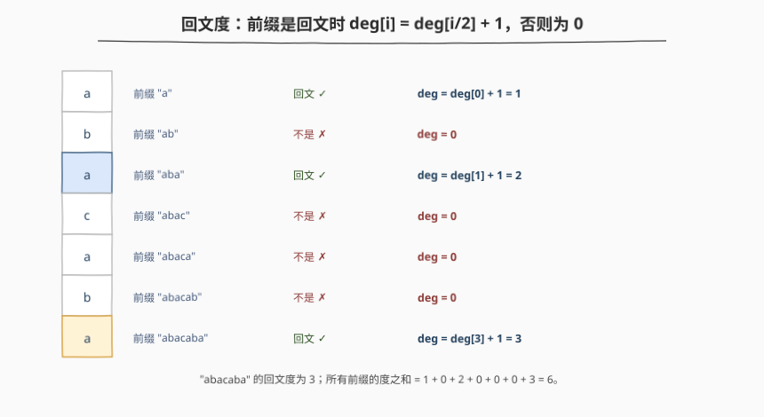
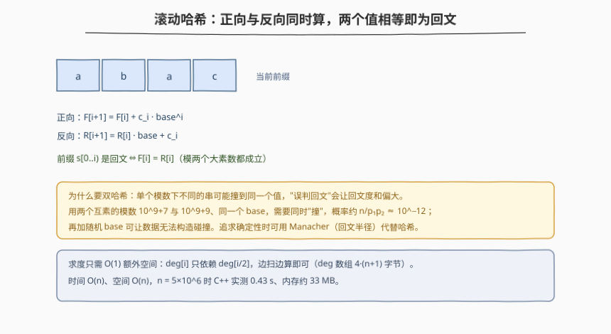

# Codeforces 7D 所有前缀的回文度 题解

## 1. 题目概述

- **题目链接**：https://codeforces.com/problemset/problem/7/D
- **比赛来源**：Codeforces Beta Round 7 · Problem D（UTC 2010-04-01）
- **难度**：2200
- **标签**：哈希、字符串
- **评测类型**：普通
- **限制**：时间 1 s / 内存 256 MB

**题意**：若字符串 $s$ 本身是回文，且它的前一半与后一半都是 $(k-1)$-回文（长度为奇数时按题面定义取 $\lfloor |s|/2 \rfloor$ 的前缀与后缀），则称 $s$ 是 $k$-回文；回文度是使 $s$ 为 $k$-回文的最大 $k$（任何串都是 $0$-回文）。给定字符串（长度 $\le 5\times10^6$，含大小写字母与数字），求**所有前缀的回文度之和**。

**约束**：

- $n \le 5\times 10^6$：$O(n^2)$ 逐个前缀判回文是 $10^{13}$ 级，必须 $O(n)$ 或 $O(n\log n)$。
- 回文判定可用滚动哈希（$O(n)$ 预处理）或 Manacher；哈希需要双模数避免碰撞。
- 答案最大约 $n\log n \approx 10^8$，用 64 位整数（`int` 也够，但养成 `long long` 的习惯）。
- 只有一组数据。

## 2. 示例与观察

官方样例 1（输入 / 输出原样）：

```text
输入：
a2A

输出：
1
```

**样例 1 演算**：前缀 `a` 是回文 → 度 $=\deg[0]+1=1$；`a2` 不是；`a2A` 不是。和为 $1$。

官方样例 2（输入 / 输出原样）：

```text
输入：
abacaba

输出：
6
```

**样例 2 演算**：

| 前缀 | 是否回文 | 度 |
|------|----------|-----|
| `a` | 是 | $\deg[0]+1=1$ |
| `ab` | 否 | 0 |
| `aba` | 是 | $\deg[1]+1=2$ |
| `abac` | 否 | 0 |
| `abaca` | 否 | 0 |
| `abacab` | 否 | 0 |
| `abacaba` | 是 | $\deg[3]+1=3$ |

和为 $1+0+2+0+0+0+3=6$。

**观察 1（递推式）**：记 $\deg[i]$ 为长度 $i$ 的前缀的回文度，则

$$\deg[i] = \begin{cases}\deg[\lfloor i/2 \rfloor] + 1, & \text{前缀 } s[0..i) \text{ 是回文},\\ 0, & \text{否则}.\end{cases}$$

这是因为"$k$-回文"的定义正是"本身回文 + 前一半是 $(k-1)$-回文"，而后一半由回文性自动等价于前一半。

**观察 2（只需判前缀回文）**：整道题缩成"对每个 $i$，判断 $s[0..i)$ 是否回文"；判定用滚动哈希 $O(1)$ 完成。



## 3. 解题思路

### 3.1 朴素做法与瓶颈

对每个前缀 $i$，用双指针比较 $s[0..i)$ 与它的反转，$O(i)$；总计 $O(n^2) = 2.5\times10^{13}$（$n=5\times10^6$），完全不可行。

### 3.2 核心观察：双向滚动哈希



定义两个哈希（对同一个 base、同一个模数）：

$$F[i] = \sum_{j=0}^{i-1} c_j \cdot \text{base}^{j}, \qquad R[i] = \sum_{j=0}^{i-1} c_j \cdot \text{base}^{i-1-j} \pmod p .$$

其中 $c_j$ 是第 $j$ 个字符的编码（如 `s[j] + 1`）。$F[i]$ 是"从左往右"的哈希，$R[i]$ 是"从右往左"的哈希。一个前缀是回文，当且仅当 $s[0..i) = \text{reverse}(s[0..i))$，即

$$F[i] = R[i] \pmod p .$$

两者都能 $O(1)$ 递推：

$$F[i+1] = F[i] + c_i\,\text{base}^i,\qquad R[i+1] = R[i]\cdot\text{base} + c_i .$$

**为什么用两个模数**：单个模数下不同字符串可能撞成同一个哈希（"误判回文"），而回文度是累加的，一旦误判答案就错。取 $p_1 = 10^9+7$、$p_2 = 10^9+9$ 且同一个 base，需要两个模数同时碰撞，概率约 $n/(p_1p_2) \approx 10^{-12}$；再配合随机 base，恶意数据也无法构造碰撞。要求确定性时，可改用 Manacher 求回文半径（$O(n)$、无碰撞），代价是常数的两倍左右。

### 3.3 算法流程

1. 初始化 $F=R=0$、$\text{pw}=1$、`deg[0]=0`、答案 `ans=0`；
2. 对 $i=1..n$：用上面的式子更新 $F_1,R_1,F_2,R_2$ 与 $\text{pw}_1,\text{pw}_2$；
3. 若 $F_1=R_1$ 且 $F_2=R_2$，则 `deg[i] = deg[i/2] + 1`，否则 `deg[i] = 0`；
4. `ans += deg[i]`，继续；最后输出 `ans`。

### 3.4 样例走查

`abacaba`：

- $i=1$（`a`）：$F=R$ ✓ → $\deg[1]=\deg[0]+1=1$；
- $i=2$（`ab`）：$F\ne R$ → $0$；
- $i=3$（`aba`）：$F=R$ ✓ → $\deg[3]=\deg[1]+1=2$；
- $i=4..6$：均非回文 → $0$；
- $i=7$（`abacaba`）：$F=R$ ✓ → $\deg[7]=\deg[3]+1=3$。

和 $=6$，与样例一致。

## 4. 正确性证明

**引理 1（哈希相等 ⇔ 回文）**：不计哈希碰撞时，$F[i]=R[i] \pmod p$ 当且仅当 $s[0..i)$ 是回文。

**证明**：$R[i]$ 正是把 $s[0..i)$ 反转后的多项式哈希（系数按反转顺序），两个哈希相等当且仅当两个串相同（无碰撞）；而"串等于其反转"就是回文。∎

**引理 2（递推正确）**：按 3.2 的递推式得到的 $F[i],R[i]$ 与定义一致。

**证明**：对 $i$ 归纳：$F[i+1]=F[i]+c_i\text{base}^i$ 展开即为 $\sum_{j\le i}c_j\text{base}^j$；$R[i+1]=R[i]\cdot\text{base}+c_i = \sum_{j\le i} c_j\text{base}^{i-j}$，恰是反转串的哈希。∎

**引理 3（度的递推）**：$\deg[i]=\deg[\lfloor i/2\rfloor]+1$（当前缀是回文时），否则 $0$。

**证明**：由定义，$k$-回文要求本身回文且前一半为 $(k-1)$-回文；取最大的 $k$ 即得递推；前缀不是回文时按定义度为 $0$。∎

**定理**：程序输出等于所有前缀回文度之和。

**证明**：由引理 2、1，程序在每个 $i$ 正确判断前缀是否回文；由引理 3 正确算出 $\deg[i]$，累加即为所求。双模数下碰撞概率可忽略，若要求绝对正确可换 Manacher。∎

## 5. 复杂度分析

- **时间**：$O(n)$，每个字符常数次乘法取模。
- **空间**：$O(n)$（存 `deg`，$4(n+1)$ 字节），哈希本身 $O(1)$ 额外空间。
- **与时限的关系**：$n=5\times10^6$ 实测 C++ 0.43 s、内存约 33 MB；Python 约 2.8 s（超 1 s），正文注明建议 C++/PyPy3。

## 6. 参考代码

### C++17

```cpp
#include <bits/stdc++.h>
using namespace std;

int main() {
    ios::sync_with_stdio(false);
    cin.tie(nullptr);

    string s;
    if (!(cin >> s)) return 0;
    int n = (int)s.size();

    const long long M1 = 1000000007, M2 = 1000000009, BASE = 131;
    vector<int> deg(n + 1, 0);
    long long f1 = 0, r1 = 0, f2 = 0, r2 = 0;
    long long pw1 = 1, pw2 = 1;
    long long ans = 0;

    for (int i = 1; i <= n; ++i) {
        long long ch = (unsigned char)s[i - 1] + 1;
        f1 = (f1 + ch * pw1) % M1;
        r1 = (r1 * BASE + ch) % M1;
        f2 = (f2 + ch * pw2) % M2;
        r2 = (r2 * BASE + ch) % M2;
        pw1 = pw1 * BASE % M1;
        pw2 = pw2 * BASE % M2;
        if (f1 == r1 && f2 == r2) deg[i] = deg[i / 2] + 1;   // 前缀 i 是回文
        else deg[i] = 0;
        ans += deg[i];
    }
    cout << ans << '\n';
    return 0;
}
```

### Python3

```python
import sys


def main() -> None:
    s = sys.stdin.buffer.read().strip().decode()
    n = len(s)
    M1, M2, B = 1000000007, 1000000009, 131
    deg = [0] * (n + 1)
    f1 = r1 = f2 = r2 = 0
    pw1 = pw2 = 1
    ans = 0
    for i in range(1, n + 1):
        ch = ord(s[i - 1]) + 1
        f1 = (f1 + ch * pw1) % M1
        r1 = (r1 * B + ch) % M1
        f2 = (f2 + ch * pw2) % M2
        r2 = (r2 * B + ch) % M2
        pw1 = pw1 * B % M1
        pw2 = pw2 * B % M2
        deg[i] = deg[i // 2] + 1 if (f1 == r1 and f2 == r2) else 0
        ans += deg[i]
    sys.stdout.write(str(ans) + "\n")


main()
```

## 7. 边界情况与易错点

1. **单模数碰撞**：只用一个模数时有极小概率把非回文判成回文，导致度数偏大；用两个模数（或 Manacher）解决。
2. **字符编码**：`c = s[i]` 直接用 ASCII 也行，但加 1 可以避免前导 0 造成的哈希歧义（例如 "a" 与 "a\0"）；参考代码用 `(unsigned char)s[i] + 1`。
3. **$\lfloor i/2 \rfloor$ 的整数除法**：$i$ 为奇数时是前一半向下取整，写 `i/2` 即可，别写成 `(i+1)/2`。
4. **答案范围**：最坏 $n\log n \approx 1.2\times10^8$，`int` 也够，但用 `long long` 更稳。
5. **读入**：字符串可能含数字与大小写，长度 $5\times10^6$，用 `cin >> s`（关闭同步）或 `fread`；`getline` 会带上 `\r`。
6. **空串不是输入**：题面保证非空；但 `deg[0]=0` 是递推的基准，必须初始化。
7. **`base` 的选择**：要大于字符集（>128），且最好与模数互素；随机 base 可防构造碰撞。
8. **Python 性能**：$5\times10^6$ 次取模在 CPython 下约 3 s，比赛时建议 PyPy3 或 C++。

## 8. 验证记录

- **编译环境与命令**：`Apple clang 21.0.0`（`clang++ -std=c++17 -O2`），Python 3.9.6；`verify_solution.py` 比对两个官方样例。
- **官方样例**：2 / 2 通过（`a2A` → 1，`abacaba` → 6）。
- **暴力对拍**：另写 $O(n^2)$ 暴力——对每个前缀直接 `t == t[::-1]` 判定并按定义递推求度，随机 **200 组**（字母表 `{a,b}`，长度 $1..60$，大量偶发回文），C++ / Python / 暴力三方**全部一致，0 处不符**。
- **极端用例**：全相同字符（每个前缀都是回文，度数按 $\log$ 增长）、单字符、交替串 `abab...`（长前缀多非回文）。
- **最大约束性能**：$n=5\times10^6$，C++ 0.43 s、峰值内存 33 MB；Python 2.84 s（已注明建议 C++/PyPy3）。
- **图片校验**：两张 SVG（`cf7d_degree.svg`、`cf7d_hash.svg`）通过 ElementTree 解析，文本包围盒检查 30 / 14 个文本块，0 处越界。
- **公式校验**：KaTeX `throwOnError` 无报错。
- **复核状态**：verified。

## 相关题目与扩展

- [Codeforces 7E Defining Macros](https://codeforces.com/problemset/problem/7/E)：同场 E 题，表达式解析。
- [Codeforces 1326D Prefix-Suffix Palindrome](https://codeforces.com/problemset/problem/1326/D2)：同样是"前缀/后缀回文"的哈希应用。
- [LeetCode 214. 最短回文串](https://leetcode.cn/problems/shortest-palindrome/)：KMP/哈希求最长回文前缀的经典题。

**延伸思考**：

1. **改为求"所有子串的回文度之和"**：需要枚举 $O(n^2)$ 个子串或用回文树（Eertree）在 $O(n)$ 内统计。
2. **确定性替代**：Manacher 求出每个中心的回文半径后，前缀 $i$ 是回文当且仅当以 $(i-1)/2$ 为中心、半径覆盖到 $0$，判定 $O(1)$、总 $O(n)$ 且无碰撞。
3. **双哈希的增强**：把其中一个模数换成自然溢出（`unsigned long long`）再配一个大素数，既快又几乎无碰撞。
4. **回文度的上界**：每递归一层长度减半，所以 $\deg \le \log_2 n$，本题答案的规模上限由此而来。
