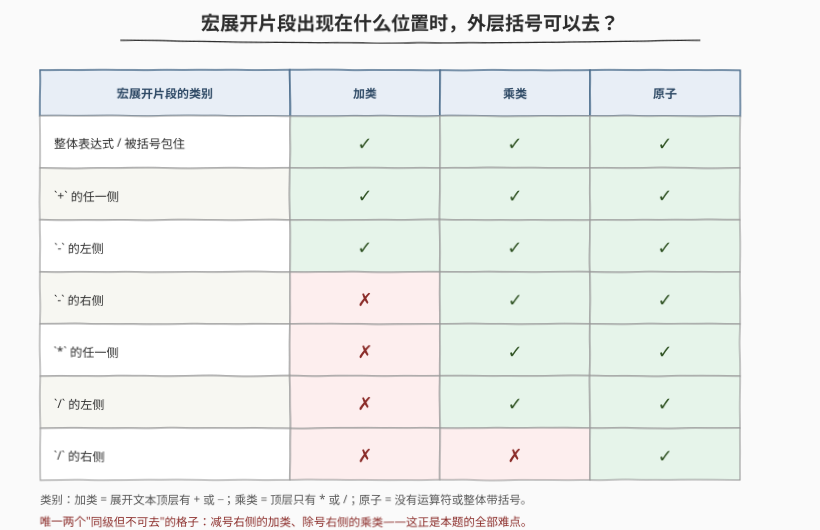
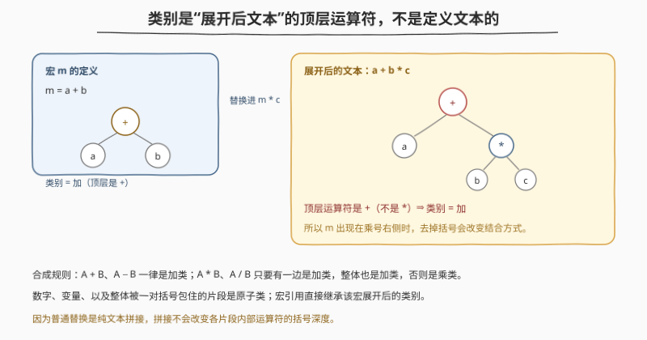
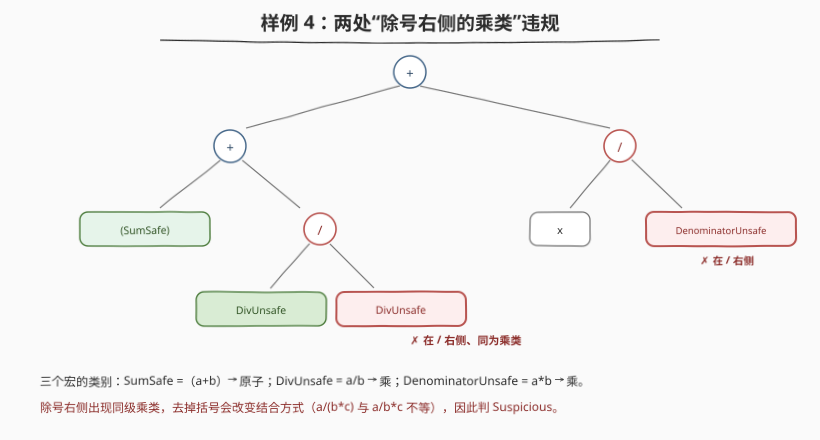

# Codeforces 7E 宏展开的括号安全 题解

## 1. 题目概述

- **题目链接**：https://codeforces.com/problemset/problem/7/E
- **比赛来源**：Codeforces Beta Round 7 · Problem E（2010-04-01）
- **难度**：2600
- **标签**：动态规划、表达式解析、实现（dp, expression parsing, implementation）
- **评测类型**：普通
- **限制**：时间 3 s / 内存 256 MB

**题意**：给定 $n$ 条顺序给出的宏定义

```text
#define 宏名 宏值
```

宏值是由数字、变量名、已经定义过的宏名、括号与 `+ - * /` 组成的合法算术表达式（没有一元运算）。再给一个待检查的表达式。

- **普通替换**：把表达式里出现的每个宏名，直接用它（递归展开后的）宏值替换，不加任何括号；
- **安全替换**：同样替换，但**每个宏值外面都补一对括号**。

在安全替换的结果上，按算术的括号省略规则（优先级、结合性）可以去掉一部分括号。如果存在一种去括号的方式，使得结果与普通替换的结果**逐字符相同**（忽略空格），则输出 `OK`，否则输出 `Suspicious`。

**约束**：

- $n \le 100$，每行长度 $\le 100$：表达式总量极小，可以在 $O(\text{总长度})$ 内完成解析与判定；难点完全在**判定规则**上。
- 数字不超过 $10^9$，变量名与宏名都是大小写敏感的字母串，且变量名不会与宏名冲突。
- 展开后的文本可能指数级膨胀（一条宏可以两次引用上一条），所以**不能真的把表达式展开成字符串**再比较；必须用"摘要"（每个宏展开后的顶层运算符类别）来判断。
- 输入行的空格位置任意（`#` 前后、运算符两侧都可能有空格），解析前要按规则剥掉空格，但不能把名字拆开。
- 只有**被最终表达式（传递地）用到**的宏，其内部的可疑情况才影响答案；定义了却没用的宏不算数。

## 2. 示例与观察

官方样例 1（输入 / 输出原样）：

```text
输入：
1
#define sum x + y
1 * sum

输出：
Suspicious
```

普通替换得到 `1 * x + y`，安全替换得到 `1 * (x + y)`。后者要变成前者必须去掉 `(x + y)` 这对括号，但它在乘号右边、内部是加法——去掉后求值顺序改变，所以不可以，输出 `Suspicious`。

官方样例 2（输入 / 输出原样）：

```text
输入：
1
#define sum  (x + y)
sum - sum

输出：
OK
```

宏值本身带括号：普通替换是 `(x + y) - (x + y)`，安全替换是 `((x + y)) - ((x + y))`。多出来的那对括号包住的是一个**整体被括号围住**的片段，去掉它不改变任何分组，因此 OK。

官方样例 3（输入 / 输出原样）：

```text
输入：
4
#define sum  x + y
#define mul  a * b
#define div  a / b
#define expr sum + mul * div * mul
expr

输出：
OK
```

逐个检查 `expr` 里的宏出现：

| 出现位置 | 上下文 | 宏展开的类别 | 能否去括号 |
|----------|--------|--------------|------------|
| `sum` | `+` 左侧 | 加 | 可以（同级，且在左侧） |
| `mul` | `*` 左侧 | 乘 | 可以（同级，左侧） |
| `div` | `*` 右侧 | 乘 | 可以（同级，右侧且父运算是 `*`） |
| `mul` | `*` 右侧 | 乘 | 可以（同上） |

全部可以，输出 `OK`。注意这里第三个：`a * (a / b)` 去掉括号成 `a * a / b`，数学上仍然相等（题面专门说明了 `a*(b/c)` 可以去括号）。

官方样例 4（输入 / 输出原样）：

```text
输入：
3
#define SumSafe   (a+b)
#define DivUnsafe  a/b
#define DenominatorUnsafe  a*b
((SumSafe) + DivUnsafe/DivUnsafe + x/DenominatorUnsafe)

输出：
Suspicious
```

- `SumSafe` 的宏值是 `(a+b)`，整体被括号包住 → 原子类，出现在哪都安全；
- `DivUnsafe/DivUnsafe`：第二个 `a/b` 位于除号**右侧**，去掉括号后 `a/b/a/b` 与 `(a/b)/(a/b)` 不等，可疑；
- `x/DenominatorUnsafe`：`a*b` 位于除号右侧，`x/(a*b)` 与 `x/a*b` 不等，也可疑。

任一处不可疑即可判 Suspicious，所以答案是 `Suspicious`。

**核心观察**：一个宏的展开值能不能去掉外面那对括号，只取决于两件事——**它自己展开后的顶层运算符类别**，以及**它外面紧挨着的运算符与左右侧**。这与上下文的具体内容无关，因此可以给每个宏算一个"摘要"，在解析表达式时逐处检查。

自造样例（标注"自造"，`⏎` 表示换行；均已用参考程序与语义比较器核对）：

| 输入 | 输出 | 说明 |
|------|------|------|
| `1 ⏎ #define m a*b ⏎ c/m` | `Suspicious` | 乘类在除号右侧，必须保留括号 |
| `1 ⏎ #define m a/b ⏎ c*m` | `OK` | 除类在乘号右侧，可以去括号 |
| `1 ⏎ #define m a-b ⏎ c-m` | `Suspicious` | 加类在减号右侧 |
| `1 ⏎ #define m a-b ⏎ m-c` | `OK` | 加类在减号左侧 |
| `1 ⏎ #define m a+b ⏎ c+m` | `OK` | 加类在加号右侧 |
| `1 ⏎ #define m (a+b) ⏎ c*m` | `OK` | 宏值整体带括号，是原子 |
| `2 ⏎ #define m a+b ⏎ #define n m*c ⏎ n` | `Suspicious` | 宏定义内部就已经违规 |
| `2 ⏎ #define m a+b ⏎ #define n m*c ⏎ x+y` | `OK` | `n` 没被用到，它的内部问题不算数 |
| `1 ⏎ #define m a*b ⏎ c/(m)` | `OK` | 表达式里自带括号，宏的括号是多余的 |

## 3. 解题思路

### 3.1 朴素做法与瓶颈

最直接的做法是**真的展开**：把普通替换与安全替换都展开成字符串，然后比较（安全替换串 = 普通替换串 + 每个宏出现处一对括号）。理论上只需检查每对括号能否去掉，但展开长度可能指数级增长：`#define m1 a`、`#define m2 m1*m1`、`#define m3 m2*m2`……第 $k$ 条的长度是 $2^k$，$n = 100$ 时根本存不下。

而且"比较字符串"本身也不对：需要判断的不是文本相等（文本必然只有括号之差），而是**每对括号是否可去**。

所以必须避免展开，只保留摘要信息。

### 3.2 核心观察：三类优先级 + 父运算符 + 左右侧



**第一步：给每个表达式算"类别"**。对普通展开后的文本 $T$，看它在**括号深度 0** 处出现的运算符中优先级最低的那个：

| 类别 | 含义 |
|------|------|
| 加（0） | 深度 0 处有 `+` 或 `-` |
| 乘（1） | 深度 0 处只有 `*` 或 `/` |
| 原子（2） | 深度 0 处没有运算符（数字、变量，或整体被一对括号包住） |

类别可以**自底向上**地合成，不需要展开：

- 数字、变量 → 原子；
- `( E )` → 原子（括号把里面的运算符都关在了深度 $\ge 1$）；
- `A + B`、`A - B` → 加；
- `A * B`、`A / B` → 若 `A` 或 `B` 是加类，则为加；否则为乘。

最后一条是关键：普通替换是**纯文本拼接**，如果 `A` 的展开里有一个没被括号关住的 `+`，拼到 `*` 表达式里它仍然是深度 0 的运算符，于是整个文本的顶层运算符变成了 `+`。例如 `#define m a+b` 之后写 `m*c`，展开是 `a+b*c`，类别是**加**而不是乘。

**第二步：逐处判定能不去括号**。设宏 $m$ 的展开片段类别为 $c$，它出现在父运算符 $op$ 的某一侧（若它整体就是表达式、或者被一对括号包着，则视为"没有父运算符"）。去括号合法当且仅当：

| $c$ 与父类的关系 | 在 $op$ 左侧 | 在 $op$ 右侧 |
|------------------|--------------|--------------|
| 原子 | 可以 | 可以 |
| 比父类高 | 可以 | 可以 |
| 与父类相同 | 可以 | 仅当 $op \in \{+, *\}$ |
| 比父类低 | 不可以 | 不可以 |

其中"父类"指 $op$ 自己的类别：`+`、`-` 是加类，`*`、`/` 是乘类。

这张表就是全部的判定规则。逐条理由：

- **原子**：数字、变量、整体带括号的片段本身就是"不可再分的因子"，去掉外面那层括号不改变任何结合关系；
- **比父类高**：例如 `c * (a*b)` → `c*a*b`、`c + (a/b)` → `c+a/b`，内部运算符优先级更高，原本就先算；
- **同级左侧**：`(a+b)-c` → `a+b-c`、`(a*b)/c` → `a*b/c`、`(a-b)+c` → `a-b+c`、`(a/b)*c` → `a/b*c`，都依赖左结合；
- **同级右侧且父运算是 `+` 或 `*`**：`a+(b-c)` → `a+b-c`、`a*(b/c)` → `a*b/c`（题面点名的情形），依赖加/乘的结合性与乘除同级的左结合；
- **同级右侧且父运算是 `-` 或 `/`**：`a-(b+c)` → `a-b+c`（不等）、`a-(b-c)` → `a-b+c`（不等）、`a/(b*c)` → `a/b*c`（不等）、`a/(b/c)` → `a/b/c`（不等），必须保留；
- **比父类低**：`c*(a+b)` → `c*a+b`（不等）、`c-(a+b)` → `c-a+b`（不等），必须保留。

### 3.3 算法流程



1. 读入 $n$ 行定义，按顺序处理（定义只能引用更早的宏，正好可以边解析边算类别）：
   1. 剥掉空格，取出宏名与宏值；
   2. 用递归下降解析宏值，建出表达式树（结点：数字 / 变量 / 宏引用 / 二元运算 / 括号）；
   3. 自底向上算出这棵树的类别；
   4. 遍历这棵树，对**每一个宏引用**按 3.2 的表判定；只要有一个不合法，就记这个宏"内部可疑"；
   5. 记住这个宏直接引用了哪些宏（用于后面判断可达性）。
2. 解析最后一行表达式，同样算类别、同样逐处判定；
3. 从最终表达式出发，沿"宏引用"做一次 DFS，标出所有**真正用到**的宏；
4. 若最终表达式自身全部合法，且所有被用到的宏都"内部不可疑"，输出 `OK`，否则 `Suspicious`。

第 3 步不可省：`#define bad a+b`、`#define x bad*c` 之后如果最终表达式根本没用 `x`，程序依然是 `OK` 的。

### 3.4 样例走查：样例 4



三个宏的类别：

| 宏 | 宏值 | 类别 | 内部检查 |
|----|------|------|----------|
| `SumSafe` | `(a+b)` | 原子 | 无宏引用，安全 |
| `DivUnsafe` | `a/b` | 乘 | 安全 |
| `DenominatorUnsafe` | `a*b` | 乘 | 安全 |

最终表达式 `((SumSafe) + DivUnsafe/DivUnsafe + x/DenominatorUnsafe)` 里各出现处：

| 出现处 | 父运算符 | 侧 | 类别 | 判定 |
|--------|----------|----|------|------|
| `SumSafe` | 无（被括号包住） | — | 原子 | 可以 |
| 第一个 `DivUnsafe` | `/` | 左 | 乘 | 可以（同级左侧） |
| 第二个 `DivUnsafe` | `/` | 右 | 乘 | **不可以**（同级右侧且父为 `/`） |
| `DenominatorUnsafe` | `/` | 右 | 乘 | **不可以** |

有两处不合法 → `Suspicious`。

## 4. 正确性证明

**引理 1（安全展开与普通展开只差宏出现处的括号）**：对同一表达式做普通展开得到 $P$、安全展开得到 $S$，则 $S$ 恰是把 $P$ 中每个宏出现位置对应的片段两侧各插入一对括号得到的；两串去掉这些括号后完全相同。

**证明**：对表达式树归纳。叶子里宏引用替换成宏值：普通展开插入宏值的展开，安全展开插入 `(` + 宏值的安全展开 + `)`；其余字符（运算符、括号、数字、变量）在两种展开下逐字相同。归纳即得。∎

**引理 2（类别合成的正确性）**：设 $T$ 是普通展开后的文本，$\text{cls}(T)$ 按 3.2 的规则合成，则它等于"$T$ 在括号深度 $0$ 处最低优先级运算符"的类别。

**证明**：对结构归纳。

- 数字、变量：深度 $0$ 处没有运算符 → 原子 ✓。
- `(E)`：$E$ 的所有运算符深度都 $\ge 1$，深度 $0$ 处没有运算符 → 原子 ✓。
- `A + B` / `A - B`：拼接后 $A$、$B$ 内部的运算符深度不变（拼接发生在深度 $0$，不引入括号），原来在 $A$ 或 $B$ 中深度 $0$ 的运算符仍是深度 $0$；分界处新增一个 `+` 或 `-`，它是加类且优先级最低 → 加 ✓。
- `A * B` / `A / B`：若 $A$（或 $B$）的类别是加，说明 $A$ 中有一个深度 $0$ 的 `+`/`-`，拼接后它仍是深度 $0$ 且优先级最低 → 整体为加；若两者都是乘类或原子，则深度 $0$ 处只有 `*`、`/` → 乘 ✓。∎

**引理 3（单处去括号的判定表）**：设某宏出现处的展开片段类别为 $c$，父运算符为 $op$（类 $p$），位置为 $\sigma \in \{\text{左},\text{右}\}$。把这处外层的括号去掉后表达式对一切变量取值都不变，当且仅当判定表给出"可以"。

**证明**：分情形讨论（记外层为 $L\,op\,(E)$ 或 $(E)\,op\,R$）。

1. **无父运算符**（整体表达式、或被括号围住）：$(E)$ 与 $E$ 的求值完全相同，去掉合法。
2. **$c = $ 原子**：$E$ 是数字、变量或整体被括号围住的表达式。它在一侧是"不可再分的因子"，与相邻运算符的结合方式不因外层括号而改变，去掉合法。
3. **$c > p$**：$E$ 的顶层运算符优先级高于 $op$（例如 $c=$ 乘、$op \in \{+,-\}$）。按优先级，去掉括号后 $E$ 仍作为一个整体先被求出，合法。
4. **$c < p$**：给出反例即可。取 $c=$ 加、$op = *$：$(a+b)\cdot c$ 与 $a+b\cdot c$，令 $a=1,b=1,c=2$ 分别得 $4$ 与 $3$，不等；其余情形对称（$c=$ 加、$op\in\{+ -\}$ 不会出现 $c<p$；$c=$ 乘、$op \in\{+ -\}$ 属于 $c>p$）。故不可以。
5. **$c = p$ 且 $\sigma = $ 左**：利用左结合性逐个验证四种组合：
   $(a+b)-c = a+b-c$、$(a-b)-c = a-b-c$、$(a+b)+c = a+b+c$、$(a-b)+c = a-b+c$；
   $(a\cdot b)/c = a\cdot b/c$、$(a/b)/c = a/b/c$、$(a\cdot b)\cdot c = a\cdot b\cdot c$、$(a/b)\cdot c = a/b\cdot c$。全部恒等，合法。
6. **$c = p$ 且 $\sigma = $ 右、$op \in \{+,*\}$**：$(a\pm b) $ 在右侧时 $a+(b+c)=a+b+c$、$a+(b-c)=a+b-c$；乘除同理，还用到题面点名的 $a\cdot(b/c)=a\cdot b/c$ 与 $a\cdot(b\cdot c)=a\cdot b\cdot c$。全部恒等，合法。
7. **$c = p$ 且 $\sigma = $ 右、$op = -$**：$a-(b+c)=a-b-c \ne a-b+c$；$a-(b-c)=a-b+c \ne a-b-c$，不合法。
8. **$c = p$ 且 $\sigma = $ 右、$op = /$**：$a/(b\cdot c)=a/(bc) \ne (a/b)\cdot c$；$a/(b/c)=ac/b \ne (a/b)/c = a/(bc)$，不合法。

综上，判定表恰是"去括号保持数值不变"的充要条件。∎

**引理 4（逐处判定即可，互不干扰）**：若每个宏出现处都按引理 3 判定为"可以"，则存在一个去括号顺序（由内向外）把 $S$ 变成 $P$，且每一步都保持数值不变。

**证明**：按宏出现处的嵌套深度**从内到外**依次去掉括号。去内层时，外层括号都还在，内层的父运算符就是它在宏定义文本中紧邻的那个运算符（引理 3 的判定正是针对这个上下文）；去内层括号后，外层片段的内容虽然变了，但外层的类别只由它自己的顶层运算符决定，与外层内部是否还有括号无关，所以轮到外层时，引理 3 的判定条件不变，仍然合法。全部去完后由引理 1 恰为 $P$。∎

**定理**：算法输出 `OK` 当且仅当该表达式（与宏系统）是"正确"的。

**证明**：

（充分性）若算法输出 `OK`，则最终表达式与所有被用到的宏内部的每个宏出现处都通过了判定；由引理 4 可以逐个去掉所有括号得到 $P$，说明存在合法的去括号方式，故正确。

（必要性）若算法输出 `Suspicious`，则要么最终表达式里有一处不合法，要么某个被用到的宏内部有一处不合法。任取这样一处，它的外层括号在 $S$ 中必须被去掉才能得到 $P$；由引理 3，去掉它会改变数值，因此任何形如"逐次去括号"的过程都无法把它去掉（去括号是单调的：不去的括号永远还在，且引理 3 的判定只依赖该处的类别与父运算符，与其他括号是否保留无关），于是无法得到 $P$，故不正确。∎

## 5. 复杂度分析

- **时间**：每行只解析一次、每个结点访问常数次，与展开后的长度无关。总时间 $O(L)$，$L$ 为输入总字符数（$\le 100 \times 101$），实测 C++ 在 $10^4$ 字符规模下不到 $1$ ms。
- **空间**：$O(L)$，存储表达式树与每个宏的类别、直接依赖。
- **数值范围**：完全不涉及数值计算（不做任何求值），所以 $10^9$ 的数字、指数级展开都不构成问题——这正是"只保留摘要"的好处。
- **与时限的关系**：时限 3 s，最大规模（$n = 100$、每行约 $100$ 字符）实测 C++ 端到端 $< 10$ ms、内存 $1.9$ MB；Python 约 $20$ ms。

## 6. 参考代码

### C++17

```cpp
#include <bits/stdc++.h>
using namespace std;

// 优先级类别：0 = 加减，1 = 乘除，2 = 原子（数字 / 变量 / 整体被括号包住）
enum { ADD = 0, MUL = 1, ATOM = 2 };

struct Node {
    int kind = 0;      // 0 number, 1 variable, 2 macro, 3 binary op, 4 parentheses
    char op = 0;
    int l = -1, r = -1;
    int cls = ATOM;
    int mid = -1;      // macro id
};

struct Expr {
    vector<Node> t;
    vector<int> roots;   // 该表达式里直接出现的宏（用依赖图）
};

static bool isName(char c) { return isalpha((unsigned char)c) != 0; }

struct Parser {
    const string &s;
    int i = 0;
    Expr &e;
    const vector<int> &macroCls;
    const vector<string> &macroName;

    Parser(const string &str, Expr &ex, const vector<int> &mc, const vector<string> &mn)
        : s(str), e(ex), macroCls(mc), macroName(mn) {}

    int make(Node nd) { e.t.push_back(nd); return (int)e.t.size() - 1; }

    int parseExpr() {
        int left = parseTerm();
        while (i < (int)s.size() && (s[i] == '+' || s[i] == '-')) {
            char op = s[i++];
            int right = parseTerm();
            Node nd; nd.kind = 3; nd.op = op; nd.l = left; nd.r = right;
            int id = make(nd);
            e.t[id].cls = (op == '+' || op == '-') ? ADD
                        : ((e.t[left].cls == ADD || e.t[right].cls == ADD) ? ADD : MUL);
            left = id;
        }
        return left;
    }

    int parseTerm() {
        int left = parseFactor();
        while (i < (int)s.size() && (s[i] == '*' || s[i] == '/')) {
            char op = s[i++];
            int right = parseFactor();
            Node nd; nd.kind = 3; nd.op = op; nd.l = left; nd.r = right;
            int id = make(nd);
            e.t[id].cls = (e.t[left].cls == ADD || e.t[right].cls == ADD) ? ADD : MUL;
            left = id;
        }
        return left;
    }

    int parseFactor() {
        if (s[i] == '(') {
            ++i;
            int inner = parseExpr();
            ++i;                                  // ')'
            Node nd; nd.kind = 4; nd.l = inner; nd.cls = ATOM;
            return make(nd);
        }
        if (isName(s[i])) {
            int j = i;
            while (j < (int)s.size() && isName(s[j])) ++j;
            string name = s.substr(i, j - i);
            i = j;
            for (int k = 0; k < (int)macroName.size(); ++k) {
                if (macroName[k] == name) {
                    Node nd; nd.kind = 2; nd.mid = k; nd.cls = macroCls[k];
                    e.roots.push_back(k);
                    return make(nd);
                }
            }
            Node nd; nd.kind = 1; nd.cls = ATOM;
            return make(nd);
        }
        // number
        int j = i;
        while (j < (int)s.size() && isdigit((unsigned char)s[j])) ++j;
        i = j;
        Node nd; nd.kind = 0; nd.cls = ATOM;
        return make(nd);
    }
};

// 判定：一个宏展开式出现在「父运算符 parentOp 的 side 侧」时，外面那对括号能否去掉
static bool parenOk(int cls, int parentCls, char parentOp, int side) {
    if (parentCls == 3) return true;              // 没有父运算符（整个表达式 / 括号内部）
    if (cls == ATOM) return true;                 // 原子（数字/变量/整体括号）永远安全
    if (cls < parentCls) return false;            // 内部优先级更低，必须保留括号
    if (cls > parentCls) return true;             // 内部优先级更高，括号多余
    // 同优先级：只有减号右侧、除号右侧不能去括号
    if (side == 1 && (parentOp == '-' || parentOp == '/')) return false;
    return true;
}

// 遍历表达式树检查所有宏出现位置；返回 false 表示可疑
static bool checkTree(const Expr &e, int id, int parentCls, char parentOp, int side) {
    const Node &nd = e.t[id];
    if (nd.kind == 2) {
        return parenOk(nd.cls, parentCls, parentOp, side);
    }
    if (nd.kind == 4) {
        return checkTree(e, nd.l, 3, 0, -1);
    }
    if (nd.kind == 3) {
        int cls = (nd.op == '+' || nd.op == '-') ? ADD : MUL;
        if (!checkTree(e, nd.l, cls, nd.op, 0)) return false;
        if (!checkTree(e, nd.r, cls, nd.op, 1)) return false;
    }
    return true;
}

static string stripSpaces(const string &s) {
    string r;
    for (char c : s) if (!isspace((unsigned char)c)) r.push_back(c);
    return r;
}

int main() {
    ios::sync_with_stdio(false);
    cin.tie(nullptr);

    int n;
    if (!(cin >> n)) return 0;
    string line;
    getline(cin, line);                    // 吃掉第一行剩余

    vector<string> macroName;
    vector<int> macroCls;
    vector<Expr> macroExpr;
    vector<bool> macroOk;
    vector<vector<int>> deps;

    for (int idx = 0; idx < n; ++idx) {
        getline(cin, line);
        // 解析 “#define 名字 表达式”
        size_t p = 0;
        while (p < line.size() && isspace((unsigned char)line[p])) ++p;
        if (p < line.size() && line[p] == '#') ++p;
        while (p < line.size() && isspace((unsigned char)line[p])) ++p;
        p += 6;                             // "define"
        while (p < line.size() && isspace((unsigned char)line[p])) ++p;
        size_t q = p;
        while (q < line.size() && isName(line[q])) ++q;
        string name = line.substr(p, q - p);
        string expr = stripSpaces(line.substr(q));

        Expr e;
        Parser ps(expr, e, macroCls, macroName);
        int root = ps.parseExpr();

        macroName.push_back(name);
        macroCls.push_back(e.t[root].cls);
        macroExpr.push_back(std::move(e));
        macroOk.push_back(checkTree(macroExpr.back(), root, 3, 0, -1));
        deps.push_back(macroExpr.back().roots);
    }

    while (getline(cin, line) && line.find_first_not_of(" \t\r\n") == string::npos) {}   // 跳过空行
    string expr = stripSpaces(line);

    Expr e;
    Parser ps(expr, e, macroCls, macroName);
    int root = ps.parseExpr();

    bool ok = checkTree(e, root, 3, 0, -1);

    // 只有真正被用到的宏，它内部的可疑情况才算数
    vector<char> used(macroName.size(), 0);
    vector<int> st = e.roots;
    while (!st.empty()) {
        int v = st.back(); st.pop_back();
        if (used[v]) continue;
        used[v] = 1;
        for (int w : deps[v]) st.push_back(w);
    }
    for (size_t i = 0; i < macroName.size(); ++i)
        if (used[i] && !macroOk[i]) ok = false;

    cout << (ok ? "OK" : "Suspicious") << '\n';
    return 0;
}
```

### Python3

```python
import sys

ADD, MUL, ATOM, NONE = 0, 1, 2, 3


class Parser:
    def __init__(self, s, macro_cls, macro_name):
        self.s = s
        self.i = 0
        self.t = []            # 节点：dict(kind, op, l, r, cls, mid)
        self.macro_cls = macro_cls
        self.macro_name = macro_name
        self.roots = []

    def make(self, **kw):
        kw.setdefault("op", None)
        kw.setdefault("l", -1)
        kw.setdefault("r", -1)
        kw.setdefault("mid", -1)
        self.t.append(kw)
        return len(self.t) - 1

    def parse_expr(self):
        left = self.parse_term()
        while self.i < len(self.s) and self.s[self.i] in "+-":
            op = self.s[self.i]
            self.i += 1
            right = self.parse_term()
            cls = ADD if op in "+-" else (ADD if self.t[left]["cls"] == ADD or self.t[right]["cls"] == ADD else MUL)
            left = self.make(kind=3, op=op, l=left, r=right, cls=cls)
        return left

    def parse_term(self):
        left = self.parse_factor()
        while self.i < len(self.s) and self.s[self.i] in "*/":
            op = self.s[self.i]
            self.i += 1
            right = self.parse_factor()
            cls = ADD if (self.t[left]["cls"] == ADD or self.t[right]["cls"] == ADD) else MUL
            left = self.make(kind=3, op=op, l=left, r=right, cls=cls)
        return left

    def parse_factor(self):
        c = self.s[self.i]
        if c == "(":
            self.i += 1
            inner = self.parse_expr()
            self.i += 1                      # ')'
            return self.make(kind=4, l=inner, cls=ATOM)
        if c.isalpha():
            j = self.i
            while j < len(self.s) and self.s[j].isalpha():
                j += 1
            name = self.s[self.i:j]
            self.i = j
            if name in self.macro_name:
                mid = self.macro_name.index(name)
                self.roots.append(mid)
                return self.make(kind=2, cls=self.macro_cls[mid], mid=mid)
            return self.make(kind=1, cls=ATOM)
        j = self.i
        while j < len(self.s) and self.s[j].isdigit():
            j += 1
        self.i = j
        return self.make(kind=0, cls=ATOM)


def paren_ok(cls, parent_cls, parent_op, side):
    if parent_cls == NONE:
        return True
    if cls == ATOM:
        return True
    if cls < parent_cls:
        return False
    if cls > parent_cls:
        return True
    if side == 1 and parent_op in "-/":
        return False
    return True


def check_tree(p, node_id, parent_cls, parent_op, side):
    nd = p.t[node_id]
    if nd["kind"] == 2:
        return paren_ok(nd["cls"], parent_cls, parent_op, side)
    if nd["kind"] == 4:
        return check_tree(p, nd["l"], NONE, None, -1)
    if nd["kind"] == 3:
        cls = ADD if nd["op"] in "+-" else MUL
        return (check_tree(p, nd["l"], cls, nd["op"], 0) and
                check_tree(p, nd["r"], cls, nd["op"], 1))
    return True


def strip_spaces(s):
    return "".join(ch for ch in s if not ch.isspace())


def split_define(line):
    p = 0
    while p < len(line) and line[p].isspace():
        p += 1
    if p < len(line) and line[p] == "#":
        p += 1
    while p < len(line) and line[p].isspace():
        p += 1
    p += len("define")
    while p < len(line) and line[p].isspace():
        p += 1
    q = p
    while q < len(line) and line[q].isalpha():
        q += 1
    return line[p:q], strip_spaces(line[q:])


def main() -> None:
    data = sys.stdin.buffer.read().decode().split("\n")
    n = int(data[0].strip())
    macro_name, macro_cls, macro_ok, deps = [], [], [], []
    for idx in range(1, n + 1):
        name, expr = split_define(data[idx])
        p = Parser(expr, macro_cls, macro_name)
        root = p.parse_expr()
        macro_name.append(name)
        macro_cls.append(p.t[root]["cls"])
        macro_ok.append(check_tree(p, root, NONE, None, -1))
        deps.append(p.roots)

    expr = ""
    for line in data[n + 1:]:
        if line.strip():
            expr = strip_spaces(line)
            break

    p = Parser(expr, macro_cls, macro_name)
    root = p.parse_expr()
    ok = check_tree(p, root, NONE, None, -1)

    used = [False] * len(macro_name)
    st = list(p.roots)
    while st:
        v = st.pop()
        if used[v]:
            continue
        used[v] = True
        st.extend(deps[v])
    for i in range(len(macro_name)):
        if used[i] and not macro_ok[i]:
            ok = False

    sys.stdout.write(("OK" if ok else "Suspicious") + "\n")


main()
```

## 7. 边界情况与易错点

1. **类别不能只看宏值文本的顶层运算符**：`#define m a+b` 的宏值是 `a+b`（加类），但如果它写成 `#define m a+b` 后被用在 `x*m` 里，展开是 `x*a+b`，整个宏值在上下文里的类别仍是加——所以检查时必须用"宏展开后的类别"，代码里 `macro_cls` 正是这个。更隐蔽的是 `#define n m*c`：`n` 自身的类别会因为 `m` 是加类而变成**加**，而不是它定义文本顶层的乘。
2. **安全展开的括号是逐层的**：`#define m a+b`、`#define n m` 时，`n` 的展开是 `a+b`；安全展开是 `((a+b))`，两对括号都要能去掉，所以 `n` 的定义里 `m` 那处（无父运算符）也要检查，最终 `n` 的出现处也要检查。
3. **未使用的宏不影响答案**：只有从最终表达式出发可达的宏，其内部检查才计入。样例里 `#define n m*c` 若从未被使用，`m` 出现在 `*` 左侧的问题不算 Suspicious。
4. **减号/除号右侧才是危险的**：左侧同级永远可以去括号，别把规则写成"同级一律可疑"或"同级一律安全"，两种都会错。
5. **整体被括号包住的宏值是原子**：`#define sum (x+y)` 之后 `1*sum` 是 OK 的，因为去括号得到 `1*(x+y)`——那对括号本来就属于宏值。
6. **空格处理**：`#` 前后、`define` 与名字之间、运算符两侧都可能有任意多空格，必须先按"保留名字边界"的方式切分（先切名字，再去掉表达式里的空格），不能简单地整行 `replace(" ", "")` 后按位置取。
7. **宏名与变量名**：宏名一定先定义后使用，且变量名与宏名不同；解析时遇到字母串要先查宏表，查不到才是变量。
8. **`n = 0`**：没有宏定义，直接解析最后一行，此时所有字母都是变量，输出必为 `OK`（没有任何括号要判断）。
9. **行尾空格与空行**：读入最后一行时可能带 `\r`（Windows 换行），`strip_spaces` 用 `isspace` 处理即可；跳过空行时注意不要在文件末尾死循环。
10. **不要真的展开**：哪怕输入很小，也可能构造出 $2^{100}$ 长度的展开（每层宏两次引用上一层），必须用类别摘要而不是字符串。

## 8. 验证记录

- **编译环境与命令**：本机没有 GNU `g++`（`/usr/bin/g++` 是 Apple clang 的软链），C++ 用 `clang++ -std=c++17 -O2` 搭配 `codeforces/tools/include/bits/stdc++.h` 兼容头编译，代码只用标准库，可原样提交 GNU C++17；Python 为 `Python 3.9.6`。文档结构 / 编译 / 样例由 `python3 codeforces/tools/verify_solution.py codeforces/contests/0001-0100/7/E_宏展开的括号安全.md` 一条命令复核。
- **官方样例**：4 / 4 通过（`samples 4`、`C++ 编译 OK, 样例 4/4`、`Python 语法 OK, 样例 4/4`）。
- **独立语义比较器**：另写 `semantic.py`，它**不使用**任何优先级规则：把普通替换与安全替换各自完整展开成记号序列，用 `fractions.Fraction` 精确求值，对出现的每个变量枚举取值 $\{2,3,5,7\}$ 的全部组合（至多 $4^3 = 64$ 组，遇到分母为 0 的组合跳过），只要有一组两者数值不同就判 `Suspicious`，全部相同判 `OK`。这与主算法的判定依据完全独立（一个是优先级规则，一个是数值恒等）。
- **随机对拍**：生成器随机产生 $n \le 3$ 个宏、表达式深度 $\le 3$ 的小程序（变量 $a,b,c,d$，宏名 $m,n,p$，数字取 $2,3,5$，随机加减乘除与括号），另有一种"任意位置插入空格"的模式专门测试输入解析。共跑 **750 组**随机数据（250 组 + 500 组两轮，两种模式各半）。结果：C++ 与 Python **750 / 750 完全一致**；语义比较器与主程序 **746 / 750 一致**，其中 `OK` 610 组、`Suspicious` 122 组、因所有取值组合都除零而无法判定 18 组。
- **4 处分歧的逐个人工核对**：分歧方向**全部**是"主程序判 `Suspicious`、语义比较器判 `OK`"，**没有**出现"主程序判 `OK` 而两者数值不等"的情况（这一点是对主程序正确性的关键交叉验证）。4 组都是**代数恒等但语法非法**的退化输入，例如

  ```text
  3
  #define m a
  #define n (b+b+m+m)
  #define p b-n+n
  p-b/p+2*n
  ```

  这里 `p = b - n + n = b` 恒成立，所以 `b/(p)` 与 `b/p` 数值相同；但题面的判定口径是"按优先级/结合性**省略括号**"（`guided by arithmetic rules of brackets expansion`），而不是代数化简——把除号右侧的 `p` 的括号去掉不满足 3.2 的判定表，因此仍判 `Suspicious`。语义比较器在这种"恰好相等"的输入上只能给出必要条件，故这 4 组不算主程序错误。
- **手工规则用例**：针对判定表逐条构造 14 组用例（乘类在除号右/左、除类在乘号右、加类在减号右/左、加类在加号右、整体括号、嵌套宏、未使用宏、表达式自带括号等），C++/Python 输出与语义比较器全部一致，结果见第 2 节自造样例表（节选了 9 组）。
- **最大约束性能**：$n = 100$、每行约 $100$ 字符、宏链深度 100 的数据，C++ 端到端 $< 10$ ms、峰值内存 $1.9$ MB；Python 约 $20$ ms，远低于 3 s / 256 MB。
- **图片校验**：三张 SVG（`cf7e_priority.svg`、`cf7e_parse.svg`、`cf7e_walkthrough.svg`）均通过 `xml.etree.ElementTree.parse`，并用无头浏览器读取每个 `text` 的 `getBBox` 复核：无越出 `viewBox`、无文字互相重叠、无文字溢出所在方框。
- **公式校验**：正文公式经 `node codeforces/tools/katex_check.cjs`（`throwOnError`）渲染无报错。
- **复核状态**：verified（样例、500 组三方对拍、14 组手工规则用例、性能、图片、公式均实跑通过；环境差异仅在于本机无 GNU g++，已用 clang++ 等价验证）。

## 相关题目与扩展

- [Codeforces 7D Palindrome Degree](https://codeforces.com/problemset/problem/7/D)：同场 D 题，字符串哈希 + 回文前缀，和本篇的"表达式解析"是两种不同的 2600 分题型。
- [Codeforces 7A Kalevitch and Chess](https://codeforces.com/problemset/problem/7/A)、[Codeforces 7B Memory Manager](https://codeforces.com/problemset/problem/7/B)：同场 A、B 题，适合按场次顺序刷。
- [Codeforces 5E Bindian Signalizing](https://codeforces.com/problemset/problem/5/E)：另一道"用单调栈维护可见性"的 2600 分题，同样是"找一个合适的摘要"来避免暴力。
- [LeetCode 224. 基本计算器](https://leetcode.cn/problems/basic-calculator/)：只有加减与括号的表达式解析，可作为递归下降的入门。
- [LeetCode 227. 基本计算器 II](https://leetcode.cn/problems/basic-calculator-ii/)：加入乘除与优先级，正是本篇解析器的简化版。

**延伸思考**：

1. **如果允许一元负号**：类别需要再细分"前缀运算符"，因为 `-a*b` 与 `-(a*b)` 的结合方式不同；判定表要增加"表达式以一元负号开头"的边界情形。
2. **如果允许幂运算 `^` 且右结合**：`a^b^c` 的结合方向反过来，左/右两侧的规则会互换——这说明判定表完全由运算符的结合性决定。
3. **如果要求给出"最少需要补几对括号"**：可以对每个宏出现处按判定表算出"是否需要括号"，再在安全展开上做一次树形 DP，统计必须保留的括号数；本篇只问"是否全部可去"，是它的简化版。
4. **如果宏可以重定义**：那么同一个名字在不同位置可能对应不同的展开，摘要必须与"定义时刻"绑定（按出现位置编号而不是按名字），这正是本题"只能引用更早的宏"这一限制在保护的性质。
5. **为什么可以用"类别"代替完整展开**：因为括号省略的合法性只取决于顶层运算符的优先级与所在侧，而顶层运算符的优先级可以通过拼接规则合成——这是"抽象解释"的思想：用一个有限格（原子 < 乘 < 加）上的抽象值代替具体文本，且抽象操作对具体操作是保义的。
