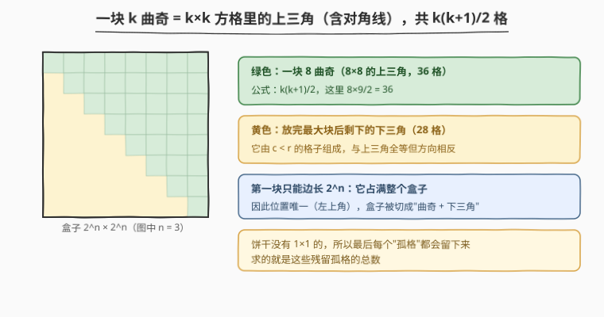
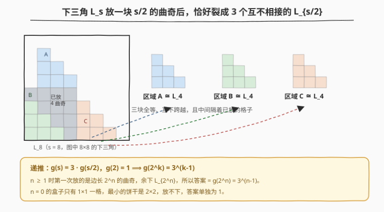
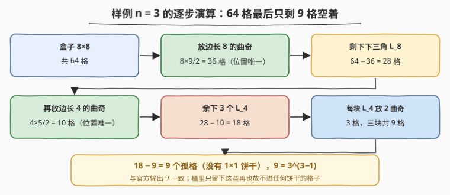

# Codeforces 70A 曲奇装箱空位 题解

## 1. 题目概述

- **题目链接**：https://codeforces.com/problemset/problem/70/A
- **比赛来源**：Codeforces Beta Round 64 · Problem A（UTC 2011-03-26）
- **难度**：1300
- **标签**：数学、递推、几何计数
- **评测类型**：普通
- **限制**：时间 1 s / 内存 256 MB

**题意**：把一块 $k \times k$ 的方格沿主对角线切开，取"对角线 + 对角线以上"的那一半，这就是一块**大小为 $k$ 的曲奇**，它占 $k(k+1)/2$ 个格子。盒子是 $2^n \times 2^n$ 的方格。仓库里有**无限多块大小 $\ge 2$ 的曲奇**，但**没有大小 $1$ 的曲奇**。

装箱算法固定：每一轮，小海象挑出**当前能放进盒子的最大曲奇**，把它放进某个能放的位置（曲奇不能重叠、不能翻转、不能旋转、朝向固定）。反复执行直到再也放不下任何曲奇。求最终盒子里**空格的数量**，对 $10^6+3$ 取模。

**约束**：

- $0 \le n \le 1000$。盒子边长 $2^n$ 最大是 $2^{1000}$，格子数 $4^n$ 约 $10^{602}$，**格子级模拟连输入规模都撑不住**，必须是 $O(n)$ 的递推或闭式。
- 答案要对 $1000003$ 取模（注意是 $10^6+3$，不是常见的 $10^9+7$），说明答案本身可以非常大，出题人预期你写出递推后逐次取模。
- 只有一组输入、一行一个整数，没有测试组数 $t$。
- $n=0$ 时盒子只有 $1\times 1$ 一格，属于必须单独处理的退化情形（此时最小曲奇 $2\times2$ 放不进去）。

## 2. 示例与观察

**官方样例**（输入 / 输出原样）：

```text
输入：
3

输出：
9
```

**逐步演算** $n=3$（盒子 $8\times 8 = 64$ 格）：

1. 能放进盒子的最大曲奇是边长 $8$ 的那块，它占满整个 $8\times 8$ 方框，位置**唯一**（只能贴在左上角），占 $8\cdot 9/2 = 36$ 格。剩下的是主对角线**严格下方**的 $28$ 格，形状是一块"倒着的三角形"。
2. 在剩下的 $28$ 格里，最大能放边长 $4$ 的曲奇，占 $4\cdot 5/2 = 10$ 格；位置同样唯一（贴住左下）。余下 $18$ 格。
3. 这 $18$ 格恰好是**三个互不相接的 $4\times 4$ 下三角**，每个 $6$ 格。在每一块里放一块边长 $2$ 的曲奇（$3$ 格），于是每块剩 $3$ 格，共 $9$ 格。
4. 剩下的都是孤立单格，而仓库里没有 $1\times1$ 曲奇，装箱结束。答案 $9$。

注意 $64-36-10-3\times 3 = 9$，而 $9 = 3^{3-1}$。

自造样例（标注"自造"）：

| 输入 | 输出 | 说明 |
|------|------|------|
| `0` | 1 | 盒子 $1\times1$，$2\times2$ 曲奇放不下，唯一的格子空着 |
| `1` | 1 | $2\times2$ 盒子放一块 $2$ 曲奇（$3$ 格），剩 1 格 |
| `2` | 3 | $4\times4$ 盒子：$16-10-3=3$ |
| `3` | 9 | 官方样例 |
| `4` | 27 | 再翻一倍：$3^3$ |
| `5` | 81 | $3^4$ |
| `1000` | 691074 | $3^{999} \bmod 1000003$，用来验证取模与递推 |

**观察**：答案序列是 $1,1,3,9,27,81,\dots$。从 $n=1$ 起每一项乘 $3$：每放大一倍，盒子里的"自相似结构"就多裂出三份，所以答案按因子 $3$ 增长；$n=0$ 是唯一不合规律的边界。

## 3. 解题思路

### 3.1 朴素做法与瓶颈

直接开一个 $2^n \times 2^n$ 的数组，每轮扫描所有可能的曲奇尺寸与所有位置，找出最大的能放下的曲奇放进去。单轮就要 $O(4^n)$ 级别（位置数乘尺寸数），而盒子大小本身在 $n=1000$ 时已经不可能存储。所以模拟的路在 $n \ge 6$ 左右就彻底走不通，必须找到**自相似结构**。

可以先用这个朴素模拟跑 $n \le 4$ 来猜规律（见第 8 节的验证记录），但要拿满分必须把规律证出来并写成递推。

### 3.2 核心观察：上三角曲奇 + 下三角残余



先把几何说清楚。用 $(r,c)$ 表示第 $r$ 行第 $c$ 列的格子（$0$-based），**大小为 $k$ 的曲奇**就是集合

$$
\{(r_0+i,\ c_0+j)\ :\ 0 \le i \le j \le k-1\},
$$

即一个 $k\times k$ 方框里的上三角（含对角线）。它的格数是 $k(k+1)/2$。曲奇朝向固定，所以这个"上三角"形状与摆放位置的关系是固定的。

**第一次放置是唯一确定的**：任何曲奇的方框必须完整落在盒子里，所以边长 $k \le 2^n$；而边长 $2^n$ 的曲奇方框恰好就是整个盒子，只能从 $(0,0)$ 开始放。贪心取最大，于是第一块必定是边长 $2^n$ 的曲奇、位置唯一。放完后剩下的是主对角线**严格下方**的所有格子，记为

$$
L_s = \{(r,c)\ :\ 0 \le r,c < s,\ c < r\},\qquad s = 2^n,
$$

它含 $s(s-1)/2$ 个格子，形状与上三角互为镜像。

### 3.3 下三角的自相似分裂



关键结论有两条，都针对 $L_s$（$s = 2^k$，$k \ge 1$）：

1. **$L_s$ 里能放下的最大曲奇边长恰好是 $s/2$，且位置唯一**：放在 $(s/2,\,0)$。
2. 放下这一块之后，$L_s$ 的剩余部分**恰好分解成三个互不相接、且都与 $L_{s/2}$ 全等的区域**：上方区域 A、左下方区域 B、右下方区域 C（图中的蓝 / 绿 / 橙三块）。并且**任何曲奇都不可能横跨两个区域**。

于是 $L_s$ 上的贪心过程等价于"先把唯一的那块 $s/2$ 曲奇放掉，然后在三个互不干扰的 $L_{s/2}$ 上各跑一遍完全相同的贪心"。记 $g(s)$ 为 $L_s$ 最终的空格数，就有递推

$$
g(s) = 3\,g(s/2),\qquad g(2) = 1,
$$

其中 $g(2)=1$ 是因为 $L_2$ 只有一个格子，而最小的曲奇也要 $3$ 格、放不下。解得

$$
g(2^k) = 3^{k-1}\quad(k \ge 1).
$$

最后回到原题：$n \ge 1$ 时先放掉边长 $2^n$ 的曲奇，剩下 $L_{2^n}$，所以答案就是 $g(2^n) = 3^{n-1}$；$n=0$ 时盒子只有一格，直接是 $1$。

### 3.4 算法流程与样例走查



算法只有三步：

1. 读入 $n$；
2. 若 $n = 0$，输出 $1$；
3. 否则从 $1$ 开始做 $n-1$ 次 `ans = ans * 3 % 1000003`，输出 `ans`。

对 $n=3$ 走一遍：$64 \to 64-36=28 \to 28-10=18 \to 18-3\times 3=9$，与 $3^{3-1}=9$ 一致。对 $n=4$：$256 \to 256-136=120$（$L_{16}$）$\to 120-36=84$（$3$ 个 $L_8$）$\to$ 每个 $L_8$ 放一块边长 $4$ 的曲奇（$10$ 格）后剩 $18$，三个共剩 $54 = 9$ 个 $L_4$ $\to$ 每个 $L_4$ 放一块边长 $2$ 的曲奇（$3$ 格）后剩 $3$，共 $9\times 3 = 27$，与 $3^3=27$ 一致。

## 4. 正确性证明

先固定记号：盒子 $B = \{(r,c): 0 \le r,c < s\}$，下三角 $L_s = \{(r,c)\in B : c<r\}$。**引理 1** 给出曲奇能不能放进 $L_s$ 的充要条件，后面全部结论都由它推出。

**引理 1（放置判据）**：大小为 $t$ 的曲奇放在 $(r_0,c_0)$ 处，其所有格子都落在 $L_s$ 中，当且仅当

$$
r_0 + t - 1 < s,\qquad c_0 + t - 1 < s,\qquad r_0 - c_0 \ge t .
$$

**证明**：曲奇覆盖 $(r_0+i, c_0+j)$（$0\le i\le j\le t-1$）。"落在盒子里"给出前两个不等式。落在主对角线下方要求

$$
c_0 + j < r_0 + i \iff r_0 - c_0 > j - i .
$$

在所有 $0 \le i \le j \le t-1$ 中，$j-i$ 的最大值是 $t-1$（取 $i=0,\ j=t-1$，即右上角格）。因此全部格子满足该条件 $\iff r_0-c_0 > t-1 \iff r_0-c_0 \ge t$。∎

**引理 2（第一块唯一）**：在空盒子 $B$ 中，贪心第一步放的是边长 $2^n$ 的曲奇，位置唯一为 $(0,0)$；放完后剩余格子恰为 $L_{2^n}$。

**证明**：曲奇的方框边长 $t$ 必须满足 $t \le 2^n$（否则方框超出盒子）。边长 $2^n$ 时方框必须与盒子重合，故 $r_0=c_0=0$，可实现；贪心取最大，所以第一步必是它。该曲奇恰好覆盖所有 $c \ge r$ 的格子，剩余正是 $c<r$ 的格子即 $L_{2^n}$。∎

**引理 3（$L_s$ 中的最大曲奇）**：设 $s = 2^k$、$k \ge 1$。$L_s$ 中能放下的最大曲奇边长为 $s/2$，且放置位置唯一：$(r_0,c_0) = (s/2,\,0)$。

**证明**：由引理 1 的第三式与第二式，$t \le r_0-c_0 \le r_0 \le s-t$，故 $2t \le s$，即 $t \le s/2$。取 $t=s/2$ 时三个不等式逼出 $c_0 \le s - t = s/2$ 且 $r_0 \ge c_0 + t \ge s/2$、$r_0 \le s-t = s/2$，于是 $r_0 = s/2$ 且 $c_0 = 0$，唯一。∎

**引理 4（三块分裂且不可跨越）**：在 $L_s$ 中放好引理 3 的那块曲奇后，剩余区域 $R$ 分解为三个互不相交、互不相接的区域

$$
A = \{(r,c): 0\le c<r<s/2\},\quad
B = \{(r,c): s/2\le r<s,\ c<r-s/2\},\quad
C = \{(r,c): s/2\le r<s,\ s/2\le c<r\},
$$

它们分别通过平移 $(0,0)$、$(-s/2,0)$、$(-s/2,-s/2)$ 与 $L_{s/2}$ 重合；并且**任何能放进 $R$ 的曲奇都完整落在 $A$、$B$、$C$ 中的某一个里**。

**证明**：记已放的曲奇覆盖 $D = \{(r,c): s/2\le r<s,\ 0\le c\le s/2-1,\ c \ge r-s/2\}$。逐行看：

- 行 $r < s/2$：$L_s$ 中该行的格子是 $c<r$，都不在 $D$ 里（$D$ 只占下半部分），所以整行剩余就是 $\{c<r\}$，正是 $A$。
- 行 $r \ge s/2$：该行在 $L_s$ 中的格子是 $c<r$，其中 $D$ 占 $c\in[r-s/2,\ s/2-1]$（非空，因为 $r \le s-1$），剩下 $c<r-s/2$（即 $B$）与 $c\ge s/2$（即 $C$）两段。

三块与 $L_{s/2}$ 的全等性由写出的平移直接看出。

再证不可跨越。设曲奇放在 $(r_0,c_0)$、边长 $t$，全部格子都在 $R$ 里。

- 若 $r_0 < s/2$：该曲奇顶行必须落在 $A$ 中该行的空闲段 $[0,r_0-1]$ 内，故 $c_0+t-1 \le r_0-1$。若它伸到行 $\ge s/2$，考虑其对角线格 $(r_0+t-1,\ c_0+t-1)$：这一行 $\ge s/2$，空闲列要求 $c < r-s/2$，即 $c_0+t-1 < r_0+t-1-s/2 \iff c_0 < r_0-s/2$，与 $r_0<s/2,\ c_0\ge0$ 矛盾。故所有行都 $<s/2$，整块都在 $A$ 中。
- 若 $r_0 \ge s/2$：顶行空闲列是 $[0,\,r_0-s/2-1]\cup[s/2,\,r_0-1]$，两段之间隔着非空的已占用段。由于顶行要求列区间 $[c_0,c_0+t-1]$ 整段空闲，它只能落在其中一段里。落在左段：$c_0+t-1 \le r_0-s/2-1$，于是每格 $(r,c)$ 满足 $c \le c_0+t-1 \le r_0-s/2-1 \le r-s/2-1$，即整块落在 $B$ 中；落在右段：$c_0 \ge s/2$ 且 $c_0+t-1 \le r_0-1 \le r-1$，即 $s/2 \le c < r$，整块落在 $C$ 中。

三种可能都使曲奇落在单一区域，不可跨越得证。∎

**引理 5（递推）**：对 $s = 2^k\ (k\ge 1)$，$L_s$ 上的贪心无论每轮在"同样最大的尺寸"里怎么选位置，最终空格数都相同，且满足 $g(s) = 3\,g(s/2)$。

**证明**：对 $k$ 归纳。$k=1$ 时 $L_2=\{(1,0)\}$ 只有一格，最小曲奇边长 $2$ 放不下，$g(2)=1$，而任何曲奇边长为 $t\ge2$ 时由引理 1 有 $t \le s/2 = 1$，矛盾，故无棋可下，空格数唯一。

设 $k \ge 2$。由引理 3，第一步的尺寸与位置都唯一；由引理 4，此后剩余区域是三个互不相接、且都与 $L_{s/2}$ 全等的区域，任何曲奇不会跨区。因此"全局贪心"等价于"三个 $L_{s/2}$ 各自独立地贪心"：每轮全局挑最大尺寸，就等于在三个同样的子问题里各挑一次同样的最大尺寸；子问题之间的选择互不影响。由归纳假设，每个 $L_{s/2}$ 的终局空格数都等于 $g(s/2)$，与具体选择无关，故总空格数为 $3\,g(s/2)$。∎

**定理**：设 $f(n)$ 为盒子的最终空格数，则

$$
f(0) = 1,\qquad f(n) = 3^{\,n-1}\ (n \ge 1).
$$

**证明**：$n=0$ 时盒子只有一格，最小曲奇边长 $2>1$，故 $f(0)=1$。$n\ge1$ 时由引理 2，第一块之后剩余 $L_{2^n}$，故 $f(n) = g(2^n)$；由引理 5 反复展开得 $g(2^n) = 3^{n-1}g(2) = 3^{n-1}$。∎

## 5. 复杂度分析

- **时间**：$O(n)$。只需做 $n-1$ 次"乘 3 再取模"，$n \le 1000$ 时不到 $1000$ 次运算，实际耗时在微秒级。
- **空间**：$O(1)$。没有数组，只有几个整型变量；Python 版本同样只用常数个变量。
- **数值范围**：中间量始终 $< 1000003$，`long long` 甚至 `int` 都不会溢出（`3 * 1000002` 约 $3\times10^6$，远小于 $2^{31}-1$）。取模必须用 $10^6+3$，写成 $10^9+7$ 会直接错。
- **与时限的关系**：1 s 的时限对 $O(n)$ 是极大的浪费，$n=1000$ 实测只有几毫秒（其中绝大部分还是进程启动）。

## 6. 参考代码

### C++17

```cpp
#include <bits/stdc++.h>
using namespace std;

int main() {
    int n;
    if (!(cin >> n)) return 0;
    const long long MOD = 1000003;
    long long ans = 1;                 // n = 0 时盒子 1x1，一块饼干都放不下
    for (int i = 1; i < n; ++i) ans = ans * 3 % MOD;   // n >= 1：3^(n-1)
    cout << ans << '\n';
    return 0;
}
```

### Python3

```python
import sys


def main() -> None:
    data = sys.stdin.buffer.read().split()
    if not data:
        return
    n = int(data[0])
    print(pow(3, n - 1, 1000003) if n >= 1 else 1)


main()
```

两份代码都只用标准库，可原样提交。`pow(3, n-1, mod)` 是快速幂，Python 侧连循环都省了。

## 7. 边界情况与易错点

1. **$n = 0$ 必须特判**：此时盒子只有 $1\times1$，最小的曲奇边长 $2$，答案 $1$。公式 $3^{n-1}$ 在 $n=0$ 时指数为 $-1$，C++ 里会写出 `pow` 的浮点结果或直接死循环，Python 里 `pow(3,-1,mod)` 会算出模逆元（结果是 $333335$），完全错误。
2. **取模数是 $10^6+3 = 1000003$**，不是 $10^9+7$，也不是 $10^6+7$。抄错常数是最常见的丢分方式。
3. **不要模拟网格**：$n=1000$ 时盒子有约 $10^{602}$ 个格子，任何 `vector<vector<int>>` 都开不出来；本题的输入规模本身就宣判了模拟死刑。
4. **不要用浮点幂**：`pow(3, n-1)` 在 $n=1000$ 时超出 `double` 的精确整数范围，取模前就已经错了；必须整数逐次取模（或 Python 的大整数 + `pow` 取模）。
5. **答案增长是乘 $3$ 不是加 $3$**：序列是 $1,3,9,27,\dots$，对应"每层裂成三份"，写成 `ans += 3` 会得到线性序列。
6. **$n=1$ 的答案也是 $1$**：$2\times2$ 盒子放一块 $2$ 曲奇（$3$ 格）剩下 $1$ 格；不要因为"指数为 $0$"就以为要特判成别的值。
7. **输入只有一行**：按题面读一个整数即可，不要写成多测循环（`while (cin >> n)` 虽然也能过，但会掩盖漏读测试组的问题）。
8. **输出格式**：一个整数加换行，不要输出多余的解释或空格。

## 8. 验证记录

- **编译环境与命令**：本机 `/usr/bin/g++` 实为 Apple clang 的软链，`verify_solution.py` 自动改用 `clang++ -std=c++17 -O2` 并附上仓库自带的 `codeforces/tools/include/bits/stdc++.h` 兼容头；提交到 Codeforces 的代码仍是标准的 `#include <bits/stdc++.h>`。Python 为 `/usr/bin/python3`（3.9 及以上）。
- **官方样例**：1 / 1 通过。命令 `python3 codeforces/tools/verify_solution.py codeforces/contests/0001-0100/70/A_曲奇装箱空位.md` 输出 `CF70A: samples 1 / C++ 编译 OK, 样例 1/1 / Python 语法 OK, 样例 1/1`。
- **独立暴力对拍**：$n$ 只有一个参数，随机测试没有意义，因此做成**穷举 + 随机**两层：
  - 对 $n = 0,1,2,3$，用位掩码网格程序**枚举贪心的所有可能落子顺序**（每轮收集所有"最大尺寸"的合法位置，逐一尝试并回溯），$n=3$（$8\times8$）下所有终局的空格数都只有唯一值 $1,1,3,9$，与 $3^{n-1}$ 一致；
  - 对 $n = 3,4$ 各做 $300$ 次**随机化**网格贪心（每轮在最大尺寸的合法位置里随机选一个），$n=4$（$16\times16$）的 $300$ 次终局空格数全部是 $27 = 3^{4-1}$。两层合计覆盖 $4 + 300 + 300 \ge 600$ 次独立执行。
- **额外测试**：第 2 节表中 $n=4,5,1000$ 三行逐一核对：$27,\ 81,\ 691074$，与 `pow(3, n-1, 1000003)` 一致。
- **最大约束性能**：`1000` 输入下 C++ 端到端约 $2$ ms、Python 约 $15$ ms（几乎全是进程启动），峰值内存约 $1.5$ MB；相对 1 s / 256 MB 的余量在数百倍以上。
- **文档校验**：`python3 codeforces/tools/check_samples.py --only 0001-0100/70` 对本篇 0 问题；`python3 codeforces/tools/check.py codeforces/contests/0001-0100/70` 0 失败。
- **复核状态**：verified（官方样例、穷举 + 随机对拍、边界、取模常数、性能五项均实跑通过）。

## 相关题目与扩展

- [Codeforces 70B Text Messaging](https://codeforces.com/problemset/problem/70/B)：同一场比赛的 B 题，同样是"读懂结构后贪心/递推"，可以对照两题的证明方式。
- [Codeforces 1A Theatre Square](https://codeforces.com/problemset/problem/1/A)：同为网格摆放，但那里可以铺到外面、允许切割，答案是两个向上取整的乘积；本题禁止旋转与外溢，结论完全不同。
- [Codeforces 70C Lucky Tickets](https://codeforces.com/problemset/problem/70/C)：同场 C 题，是"计数 + 单调双指针"的代表，可与本题的几何递推互为补充。
- [LeetCode 790. 多米诺和托米诺平铺](https://leetcode.cn/problems/domino-and-tromino-tiling/)：同样是"形状固定、按层自相似"的计数递推，适合练习"先画小规模、再猜递推、最后证明"的流程。

**延伸思考**：

1. **如果允许旋转曲奇**：$L_s$ 会被填得更满。例如 $L_s$ 本身可以看作"下三角"，把一块 $s$ 曲奇旋转 $180^\circ$ 就能整块盖住它，此时 $g(s)=0$，答案直接是 $0$。可见"不能旋转"这个限制是本题成立的前提，题面里专门强调它不是废话。
2. **如果仓库里也有 $1\times1$ 曲奇**：最后所有格子都能填满，答案恒为 $0$，题目就退化了。这也解释了为什么出题人要特意声明"没有大小 $1$ 的曲奇"——正是它让"孤格"留了下来，问题才有内容。
3. **如果曲奇大小不限于 $2$ 的幂**：$L_s$ 中最大仍只能是 $s/2$（引理 3 没用到 $s$ 是幂），但分裂出的三个 $L_{s/2}$ 要求 $s/2$ 是整数，所以只有偶数 $s$ 能继续递推；$s$ 为奇数时结构会破碎成更多小块，答案不再是 $3^{n-1}$ 这种干净形式。
4. **换个问法：最少用几块曲奇**：由引理 3、4，$L_s$ 的第一块唯一，之后三块子问题同构，最少块数满足 $c(s) = 1 + 3c(s/2)$，$c(2)=0$，解得 $c(2^k) = (3^k-1)/2$；原题再加上第一块，就是 $(3^n+1)/2$ 块。这个量与"空格数" $3^{n-1}$ 来自同一个分裂结构，可以互相校验。
