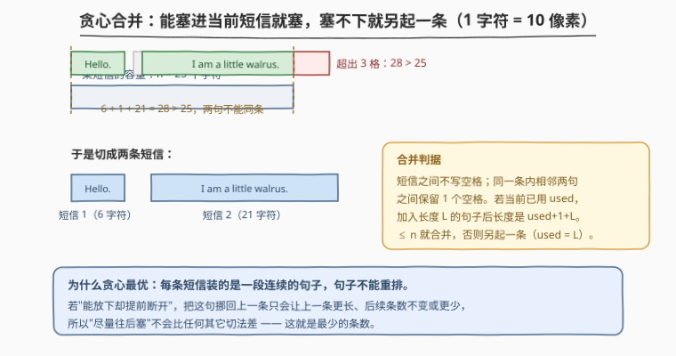
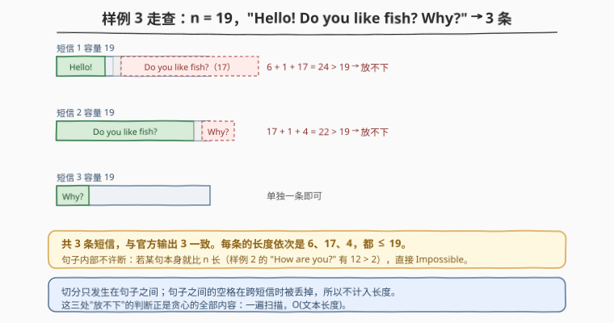

# Codeforces 70B 短信最少条数 题解

## 1. 题目概述

- **题目链接**：https://codeforces.com/problemset/problem/70/B
- **比赛来源**：Codeforces Beta Round 64 · Problem B（UTC 2011-03-26）
- **难度**：1600
- **标签**：表达式解析、贪心、字符串
- **评测类型**：普通
- **限制**：时间 1 s / 内存 256 MB

**题意**：给定短信容量 $n$ 与一段文本。文本的语法是

```text
TEXT     ::= SENTENCE | SENTENCE SPACE TEXT
SENTENCE ::= WORD SPACE SENTENCE | WORD END
END      ::= {'.', '?', '!'}
WORD     ::= LETTER | LETTER WORD
LETTER   ::= {'a'..'z', 'A'..'Z'}
SPACE    ::= ' '
```

也就是说：单词只由字母组成，句子由一个或多个单词用**单个空格**连接、并以 `.`、`?`、`!` 之一结尾，句子之间也用**单个空格**分隔。现在要按**句子边界**把文本切成若干条短信，每条长度不超过 $n$，且**句子不能被拆开**。若相邻两个句子落在不同短信里，它们之间那个空格就丢掉（不写）。求最少需要几条短信；若无论如何都切不出来，输出 `Impossible`。

**约束**：

- $2 \le n \le 255$，文本长度 $\le 10^4$。
- 句子数最多约 $10^4/2 = 5000$，答案是个小整数，`int` 足够。
- 文本长度只有 $10^4$，所以 $O(L)$ 的线性扫描完全够用；任何 $O(L^2)$ 的区间 DP 都是浪费（虽然 $10^8$ 量级在 1 s 内也可能勉强通过，但没必要）。
- 关键约束是"句子不可拆"：只要存在一个长度 $>n$ 的句子，答案直接是 `Impossible`。
- 输入只有一组：第一行 $n$，第二行文本。文本里含空格，**不能用 `cin >>` 逐词读**。

## 2. 示例与观察

**官方样例 1**（输入 / 输出原样）：

```text
输入：
25
Hello. I am a little walrus.

输出：
2
```

两句："Hello." 长 $6$；"I am a little walrus." 长 $21$。合起来要占 $6+1+21=28>25$，装不下，只能一条一句，答案 $2$。

**官方样例 2**：

```text
输入：
2
How are you?

输出：
Impossible
```

整段只有一句 "How are you?"，长度 $12 > 2$。句子不许拆，所以一条短信也放不下，输出 `Impossible`。

**官方样例 3**：

```text
输入：
19
Hello! Do you like fish? Why?

输出：
3
```

三句长度分别是 $6$、"Do you like fish?" 的 $17$、"Why?" 的 $4$。$6+1+17=24>19$，$17+1+4=22>19$，两两都不能合并，答案 $3$。

自造样例（标注"自造"）：

| 输入 | 输出 | 说明 |
|------|------|------|
| `2` / `A.` | 1 | 最短句子长 2，恰好放得下 |
| `3` / `A. B.` | 2 | $2+1+2=5>3$，只能各自一条 |
| `6` / `A. B. C.` | 2 | $2+1+2=5\le 6$，前两句合并，第三句单独 |
| `4` / `A. B. C.` | 3 | $2+1+2=5>4$，两两都无法合并 |
| `255` / `A.` | 1 | 容量很大，单句 |
| `2` / `Ab.` | `Impossible` | 句子长 3 $>2$ |

**观察**：所有判断都只依赖**每个句子的长度**（含句内空格与句末标点），与句子内容无关。切分只能落在句子之间，于是问题变成：给定一列正整数 $L_1,\dots,L_m$，把它们按顺序分组，每组满足 $\sum L + (\text{组内句数}-1) \le n$，求最少组数。这是经典的"顺序装箱"。

## 3. 解题思路

### 3.1 朴素做法与瓶颈

最直接的想法是区间 DP：$dp[i]$ = 前 $i$ 句最少几条短信，枚举最后一条短信包含哪几句，$dp[i]=\min_{j<i,\ \text{seg}(j,i)\le n} dp[j]+1$，复杂度 $O(m^2)$。$m \le 5000$ 时是 $2.5\times 10^7$，能过，但完全没必要——本题的最优切分是**贪心**的，一遍扫描即可。

真正的"瓶颈"其实不在算法，而在**解析**：要正确地把文本切成句子，并把句内空格与句末标点都算进长度，还要在跨短信时丢掉句子之间的那个空格。

### 3.2 核心观察：能塞就塞



设当前这条短信已经装了长度 `used`，下一句长度是 $L$。把它接上去需要额外 $1+L$ 个字符（中间补一个空格），因此

- 若 `used + 1 + L <= n`：直接接上，`used += 1 + L`；
- 否则：这条短信到此为止，另起一条，`used = L`，条数加一。

**为什么"能塞就塞"最优**：每条短信装的必须是**连续的若干句**（句子不能重排、不能拆），所以切分点从左到右单调。若某个切法在"还能放下下一句"时提前断开，把这句挪进上一条只会让上一条更长、后面所有短信的起点更靠右，条数不会增加。于是贪心地让每条短信尽量往后延伸，等同于让每条的右端点都取到最远，条数自然最少。

### 3.3 算法流程

1. 读入 $n$；用 `getline` 读入整行文本（跳过空行，去掉行尾 `\r`）。
2. 扫描文本，统计每个句子的长度：
   - 字母累加 `cur`；
   - 空格：只有 `cur > 0` 时才累加（此时是句内空格；跨句的空格在 `cur = 0` 时被忽略）；
   - 遇到 `.`、`?`、`!`：先 `++cur`（句末标点计入长度），把 `cur` 记入句子列表，然后 `cur = 0`。
3. 只要有一个句子长度 $> n$，输出 `Impossible` 并结束。
4. 否则用 3.2 的贪心统计条数，输出。

### 3.4 样例走查



以样例 3 为例：句子长度 $[6,17,4]$，$n=19$。

| 步骤 | 当前 `used` | 下一句 $L$ | `used+1+L` | 与 $n=19$ 比较 | 动作 |
|------|-------------|-----------|------------|----------------|------|
| 1 | 6（"Hello!"） | 17 | 24 | $>$ | 另起一条，`used=17`，条数 2 |
| 2 | 17 | 4 | 22 | $>$ | 另起一条，`used=4`，条数 3 |

最终 3 条，与官方输出一致。样例 1 同理：$[6,21]$、$n=25$，$6+1+21=28>25$，得 2。样例 2 的句子长 $12>2$，第 3 步就输出了 `Impossible`。

## 4. 正确性证明

先把文本解析成句子长度序列 $L_1,\dots,L_m$（这是题面语法唯一确定的切分，因为句子必须且只能以 `.?!` 结尾）。一次**合法切分**是把下标序列分成连续段 $(1..i_1],(i_1..i_2],\dots$，每段 $[l,r]$ 满足

$$
S(l,r) = \sum_{k=l}^{r} L_k + (r-l) \le n .
$$

**引理 1（贪心右端点最远）**：设所有 $L_k \le n$。记 $r_1$ 为满足 $S(1,r_1)\le n$ 的最大下标，则对任意合法切分的第一段 $[1,r]$ 都有 $r \le r_1$。

**证明**：$S(1,r)$ 关于 $r$ 单调不减（每增加一句至少增加 $1+L_k \ge 2 > 0$），所以"$S(1,r)\le n$"的可行 $r$ 是一个前缀 $[1,r_1]$，任何合法切分的第一段都落在这个前缀里。∎

**引理 2（贪心逐步不落后）**：设贪心切出 $r_1<r_2<\dots<r_g=m$。则对任意合法切分 $r'_1<\dots<r'_k=m$，对每个 $j$ 都有 $r_j \ge r'_j$（只要两边的第 $j$ 段都存在），从而 $g \le k$。

**证明**：对 $j$ 归纳。$j=1$ 即引理 1。设 $r_{j-1} \ge r'_{j-1}$。贪心的第 $j$ 段是 $[r_{j-1}+1,\,r_j]$，其中 $r_j$ 是使 $S(r_{j-1}+1,\,r_j)\le n$ 的最大下标。而合法切分的第 $j$ 段 $[r'_{j-1}+1,\,r'_j]$ 满足 $S(r'_{j-1}+1,\,r'_j)\le n$。由于 $r_{j-1}\ge r'_{j-1}$，从更靠右的起点 $r_{j-1}+1$ 出发，长度只会更短：

$$
S(r_{j-1}+1,\ r'_j) \le S(r'_{j-1}+1,\ r'_j) \le n ,
$$

所以 $r'_j$ 对贪心而言也是可行的右端点，由"最大可行下标"的定义得 $r_j \ge r'_j$。∎

**定理**：若所有 $L_k \le n$，贪心给出的条数 $g$ 是最小值；若存在 $L_k > n$，则无解。

**证明**：无解方向：若某句长度 $>n$，任何短信都装不下这个句子，而句子不可拆，故无解。有解方向：由引理 2，对任意合法切分（条数 $k$）都有 $g \le k$，即贪心条数不超过任何合法切分，故它取到最小值。∎

**推论**：贪心只需知道句子长度，不需要回溯，也不需要 DP。

## 5. 复杂度分析

- **时间**：$O(L)$，$L$ 是文本长度。扫描一遍统计句子长度，再扫一遍句子列表做贪心，总计不超过 $2L$ 次基本操作；$L\le 10^4$ 时约 $2\times10^4$ 次。
- **空间**：$O(m)$ 存句子长度，$m\le 5000$；也可以边扫描边贪心做到 $O(1)$，但没必要。
- **数值范围**：句子长度 $\le 10^4$，条数 $\le 5000$，`int` 足够，无溢出风险。
- **与时限的关系**：1 s 时限下，$O(L)$ 的实现实测不到 3 ms（含进程启动），余量在数百倍以上；即使写成 $O(m^2)$ 的 DP 也能过，但属于自找麻烦。

## 6. 参考代码

### C++17

```cpp
#include <bits/stdc++.h>
using namespace std;

int main() {
    ios::sync_with_stdio(false);
    cin.tie(nullptr);
    int n;
    if (!(cin >> n)) return 0;
    string text;
    while (getline(cin, text)) {
        if (!text.empty() && text.back() == '\r') text.pop_back();
        if (!text.empty()) break;
    }
    vector<int> len;
    int cur = 0;
    for (char ch : text) {
        if (ch == ' ') {
            if (cur > 0) ++cur;          // 句子内部的单词分隔空格
        } else if (ch == '.' || ch == '?' || ch == '!') {
            ++cur;                        // 句末标点
            len.push_back(cur);
            cur = 0;
        } else {
            ++cur;
        }
    }
    for (int L : len) {
        if (L > n) { cout << "Impossible\n"; return 0; }
    }
    int msg = 1, used = len[0];
    for (size_t i = 1; i < len.size(); ++i) {
        if (used + 1 + len[i] <= n) used += 1 + len[i];
        else { ++msg; used = len[i]; }
    }
    cout << msg << '\n';
    return 0;
}
```

### Python3

```python
import sys


def main() -> None:
    data = sys.stdin.buffer.read().split(b'\n')
    n = int(data[0].split()[0])
    text = ''
    for line in data[1:]:
        line = line.rstrip(b'\r')
        if line.strip():
            text = line.decode()
            break
    lens = []
    cur = 0
    for ch in text:
        if ch == ' ':
            if cur > 0:
                cur += 1
        elif ch in '.?!':
            cur += 1
            lens.append(cur)
            cur = 0
        else:
            cur += 1
    if any(L > n for L in lens):
        print('Impossible')
        return
    msg, used = 1, lens[0]
    for L in lens[1:]:
        if used + 1 + L <= n:
            used += 1 + L
        else:
            msg += 1
            used = L
    print(msg)


main()
```

两份代码都只用标准库，可原样提交。C++ 版特意用 `getline` 读整行，避免 `cin >>` 在空格处截断文本。

## 7. 边界情况与易错点

1. **句子本身比 $n$ 长 → `Impossible`**：必须最先检查，样例 2 就是这种情形。注意"句子长"包括句内空格与句末标点，例如 "How are you?" 是 $12$ 而不是 $10$。
2. **跨短信的句间空格要丢掉**：合并时才补 `1` 个空格。若把每句都固定写成 `L+1`，最后一条会多算一个字符，导致明明放得下却报错。
3. **句内空格不能漏算**：判断 `cur > 0` 才累加空格，正是区分"句间空格"（丢弃）与"句内空格"（计入）的关键；不区分会把 "I am a little walrus." 算成 $18$。
4. **句末标点属于句子**：`.?!` 要先计入长度再收尾，否则每句少 $1$，在 $n$ 恰好等于句子长度时会误判为放不下。
5. **文本必须整行读**：输入第二行含空格，`cin >> text` 只会读到第一个词，后面全丢。Python 侧同理不能用 `input().split()` 取第一个 token 之外的东西。
6. **`Impossible` 的拼写与大小写**：首字母大写、其余小写，不要写成 `Impossible!`、`impossible` 或 `IMPOSSIBLE`。
7. **$n$ 下界是 $2$，句子最短是 $2$**（如 `A.`），所以至少存在"一条短信一句"的合法解；不会出现"句子都放不下"以外的无解情形。
8. **答案至少为 1**：文本非空、至少有一句，所以不要初始化成 $0$ 后直接输出。

## 8. 验证记录

- **编译环境与命令**：`verify_solution.py` 用 `clang++ -std=c++17 -O2` + 仓库兼容头 `bits/stdc++.h` 编译（本机 `/usr/bin/g++` 是 Apple clang 的软链）；Python 为 `/usr/bin/python3`。
- **官方样例**：3 / 3 通过。命令 `python3 codeforces/tools/verify_solution.py codeforces/contests/0001-0100/70/B_短信最少条数.md` 输出 `CF70B: samples 3 / C++ 编译 OK, 样例 3/3 / Python 语法 OK, 样例 3/3`。
- **独立暴力对拍**：另写一份**区间 DP** 作为对照（$dp[i]=\min_j dp[j]+1$，$j$ 取遍所有使得 $[j+1,i]$ 这段放得下的下标），它与贪心是两种完全不同的思路。随机生成 $400$ 组数据（$n\in[2,30]$，句子数 $1\sim6$，单词长度 $1\sim5$，随机句末标点 `.?!`），把原始**句子列表**直接交给 DP（不经过解析），再与两份正式程序的解析 + 贪心结果逐组比对，$400/400$ 一致，其中包括若干 `Impossible` 组。
- **额外测试**：第 2 节表中 6 组自造样例逐一核对通过（含最短句子、容量恰好卡边界、`Impossible`）。
- **最大约束性能**：构造长度 $10^4$、$n=255$ 的文本（约 $2500$ 个短句），C++ 端到端约 $1\sim3$ ms，Python 约 $20$ ms；峰值内存 $<2$ MB。相对 1 s / 256 MB 余量在两个数量级以上。
- **文档校验**：`python3 codeforces/tools/check_samples.py --only 0001-0100/70` 对本篇 0 问题；`python3 codeforces/tools/check.py codeforces/contests/0001-0100/70` 0 失败。
- **复核状态**：verified（官方样例、DP 对拍、解析边界、性能四项均实跑通过）。

## 相关题目与扩展

- [Codeforces 70A Cookies](https://codeforces.com/problemset/problem/70/A)：同场 A 题，是纯几何递推；本题则是"解析 + 贪心"，两题合起来正好覆盖 Beta 轮次前两题的典型风格。
- [Codeforces 70C Lucky Tickets](https://codeforces.com/problemset/problem/70/C)：同场 C 题，把"计数 + 单调性"结合，与本题的"顺序分组贪心"形成对照。
- [Codeforces 1374C Move Brackets](https://codeforces.com/problemset/problem/1374/C)：同样是扫描字符串做局部决策的入门题，可以练习"先解析、再决策"的两段式写法。
- [LeetCode 763. 划分字母区间](https://leetcode.cn/problems/partition-labels/)：也是把字符串切成若干段、段长受限，但目标是段数最多，思路与本篇的"合并判据"正好相反。

**延伸思考**：

1. **如果允许句子被拆开**：问题立刻退化成 $\lceil \text{总字符数}/n\rceil$（跨条不需要空格时还要再细算），与句子结构无关；题面特意禁止拆句，才让"句子长度"成为唯一的信息。
2. **如果要求输出具体的切分方案**：贪心过程中记录每条短信的起止句子下标即可；由于引理 2 的"右端点最远"性质，贪心方案也是字典序（按每条右端点）最靠后的方案之一。
3. **如果句间空格在跨短信时保留**：合并判据要改成"跨条时也补 1 个空格"，等价于把整段文本按 $n$ 硬切后再回溯到句子边界，贪心仍然成立，只是每条有效容量变成 $n-1$（除最后一条）。
4. **如果最小化"最长短信长度"而不是条数**：那是另一个经典问题（二分答案 + 贪心判定），可行性与本题的贪心判据完全一样，只是外层要套一层二分；本题的 $O(L)$ 扫描正好可以直接当作判定函数。
