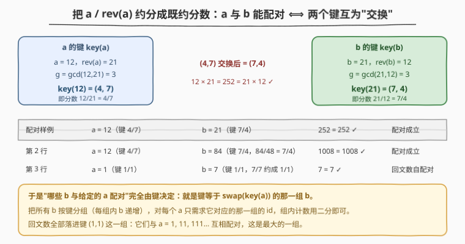
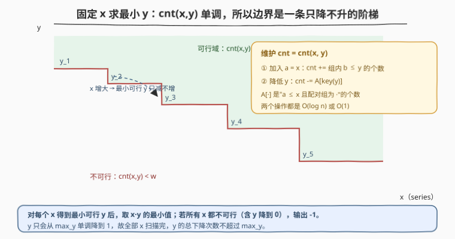
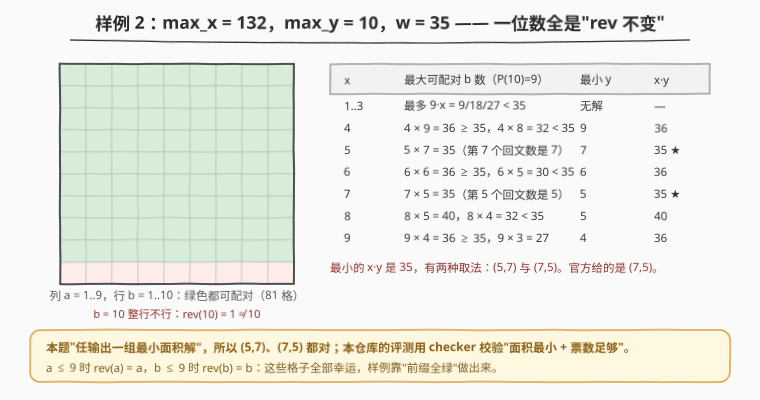

# Codeforces 70C 幸运车票最少发行 题解

## 1. 题目概述

- **题目链接**：https://codeforces.com/problemset/problem/70/C
- **比赛来源**：Codeforces Beta Round 64 · Problem C（UTC 2011-03-26）
- **难度**：2200
- **标签**：二分查找、数据结构、排序、双指针
- **评测类型**：多解（输出任意一组最小面积解）
- **限制**：时间 1.5 s / 内存 256 MB

**题意**：一张车票用二元组 $(a,b)$ 描述（$a$ 是系列号，$b$ 是票号）。记 $\operatorname{rev}(x)$ 为把 $x$ 的十进制写法反转、并去掉前导零后得到的数（例如 $\operatorname{rev}(12343)=34321$、$\operatorname{rev}(1200)=21$）。称车票 $(a,b)$ 是**幸运的**，当且仅当

$$
a\cdot b = \operatorname{rev}(a)\cdot \operatorname{rev}(b).
$$

交通委员会要发行 $x$ 个系列、每个系列 $y$ 张票（$a \in [1,x]$、$b \in [1,y]$），要求幸运车票**至少** $w$ 张，并让总票数 $x\cdot y$ **最小**。给定上限 $\text{max}_x,\text{max}_y$，输出任意一组最优的 $(x,y)$；若不存在则输出 `-1`。

**约束**：

- $1 \le \text{max}_x,\text{max}_y \le 10^5$：总票数可达 $10^{10}$，**逐对枚举车票不可行**（$10^{10}$ 次判断）。
- $1 \le w \le 10^7$：需要的前缀幸运票数最多千万级，提示答案常常出现在矩形的"角上"。
- 只有一组输入；矩形规模 $\le 10^5 \times 10^5$。
- $\operatorname{rev}$ 会丢掉前导零，所以"反转"不是对合（$\operatorname{rev}(1200)=21$，$\operatorname{rev}(21)=12\ne 1200$），不能假设 $a$ 与 $\operatorname{rev}(a)$ 一一对应。

## 2. 示例与观察

**官方样例 1**：

```text
输入：
2 2 1

输出：
1 1
```

最小面积是 $1$（只发行一个系列一张票），而 $(1,1)$ 本身就是幸运票（$1\cdot1=1\cdot1$），故答案为 `1 1`。

**官方样例 2**：

```text
输入：
132 10 35

输出：
7 5
```

这里 $\text{max}_y = 10$。所有一位数 $a \le 9$ 满足 $\operatorname{rev}(a)=a$，所有 $b \le 9$ 也满足 $\operatorname{rev}(b)=b$，于是 $1 \le a \le 9,\ 1\le b\le 9$ 这 $81$ 张票**全部**幸运。又因为幸运票数 $\le x y$，要达到 $35$ 必须有 $x y \ge 35$；而 $(5,7)$ 与 $(7,5)$ 都恰好给出 $xy=35$、幸运票 $35$ 张，所以最小面积是 $35$。官方给的是 $(7,5)$；本解输出 $(5,7)$，**同样合法**，因此本题必须用 checker 校验而不能逐字比对。

**官方样例 3**：

```text
输入：
5 18 1000

输出：
-1
```

总票数最多 $5\times 18 = 90 < 1000$，连"票数够"都做不到，更不用说幸运票，故无解。

**官方样例 4**：

```text
输入：
48 132 235

输出：
22 111
```

用直接枚举可以验证：$(22,111)$ 内有 $238$ 张幸运票（$\ge 235$），面积 $2442$；并且所有面积 $<2442$ 的矩形都不够 $235$ 张，所以 $2442$ 就是最小面积，官方输出是最优解。

自造样例（标注"自造"，第二列是本解的输出，均经 checker 验证"面积最小 + 票数足够"）：

| 输入 | 输出 | 说明 |
|------|------|------|
| `1 1 2` | `-1` | 只有一张票，凑不到 2 张幸运票 |
| `2 2 2` | `2 1` | $(1,2)$ 与 $(2,1)$ 都只有 2 张幸运票，面积 2 |
| `3 3 9` | `3 3` | 全是幸运票，面积必须 $\ge 9$ |
| `1 100000 1000` | `1 90109` | $a=1$ 时幸运票恰是回文票号，第 1000 个回文数是 $90109$ |
| `1000 1000 5000` | `333 993` | 面积 $330669$，与直接枚举的结果一致 |
| `100000 100000 10000000` | `-1` | 全部 $10^{10}$ 张票里的幸运票也不到 $10^7$ 张 |

**观察**：幸运与否只取决于 $a/\operatorname{rev}(a)$ 与 $\operatorname{rev}(b)/b$ 这两个**有理数**是否相等。把每个数的这个分数约分，就得到一个"键"；$a$ 与 $b$ 能配对，当且仅当两个键互为**交换**（分子分母对调）。这一步把 $10^{10}$ 对判断压缩成"按约分键分组 + 组内计数"。

## 3. 解题思路

### 3.1 朴素做法与瓶颈

最直接的做法：枚举所有 $(x,y)$（$10^{10}$ 组），对每组再枚举 $a\le x,\ b\le y$ 判断幸运——双重枚举，最坏 $10^{20}$ 次判断，绝无可能。

稍好一点：先对所有 $(a,b)$（$10^{10}$ 对）打表求幸运标记，再做二维前缀和，然后线性扫所有 $(x,y)$ 取最小面积。可 $10^{10}$ 个格子连内存都放不下。

真正的瓶颈是**幸运条件的判定**：必须找到一种"只看 $a$ 与 $b$ 各自的、可分组的小特征"的等价条件，才能把二维计数拆开。

### 3.2 核心观察：约分后的键互为交换



对任意正整数 $v$，令 $g_v = \gcd(v,\operatorname{rev}(v))$，定义它的**键**

$$
\operatorname{key}(v) = \left(\frac{v}{g_v},\ \frac{\operatorname{rev}(v)}{g_v}\right),
$$

即分数 $v/\operatorname{rev}(v)$ 的既约形式。**断言**：

$$
a\cdot b = \operatorname{rev}(a)\cdot\operatorname{rev}(b)
\iff
\operatorname{key}(a) = \big(\operatorname{key}(b)_2,\ \operatorname{key}(b)_1\big).
$$

也就是说：把 $a$ 的键"交换分子分母"后，正好等于 $b$ 的键。证明见第 4 节的引理 1。

这条断言的用处极大：把所有 $b \in [1,\text{max}_y]$ 按键分组（每组内 $b$ 递增），再对每个 $a$ 算出它需要的组号。这样"$a$ 能配哪些 $b$"就变成"查一张表的某一组"，组内"$b \le y$ 的个数"用一次二分即可。

例如 $a=12$（$\operatorname{rev}=21$，$g=3$）的键是 $(4,7)$，它要求 $b$ 的键是 $(7,4)$：$b=21$（$21/12=7/4$）、$b=84$（$84/48=7/4$）都满足。而所有回文数 $b$ 的键都是 $(1,1)$，它们与 $a=1,11,111,\dots$（键也是 $(1,1)$）互相配对。

### 3.3 算法流程：x 递增、y 递减的双指针



设 $\operatorname{cnt}(x,y)$ 为 $a\le x,\ b\le y$ 中的幸运票数。它关于 $x$、$y$ 都**单调不减**。于是对固定的 $x$，满足 $\operatorname{cnt}(x,y)\ge w$ 的 $y$ 是一个后缀 $[y_x,\text{max}_y]$；并且 $y_x$ 关于 $x$ **单调不增**（$x$ 变大只会让计数变大，可达标的最小 $y$ 只会更小）。这正是双指针的适用条件。

维护两个量：

- `cnt` 恒等于当前的 $\operatorname{cnt}(x,y)$；
- 数组 $A$：$A[k]$ = 满足 $a\le x$ 且"$a$ 需要的组号 = $k$"的 $a$ 的个数（组号就是 3.2 里 $\operatorname{key}(a)$ 交换后对应的 $b$ 组）。

$y$ 每降低一格，被删掉的幸运票恰好是 $(a,\,y)$（$a\le x$）这些票，数量为 $A[\operatorname{key}(y)]$。于是：

1. 初始化 $y=\text{max}_y$，`cnt` $=0$，$A$ 全零，答案面积 $=\infty$。
2. 对 $x = 1,2,\dots,\text{max}_x$：
   - 新增 $a=x$：`cnt += `（组 $g(x)$ 中 $b\le y$ 的个数，二分得到），$A[g(x)] \mathrel{+}= 1$；
   - 只要 $y\ge 1$ 且 `cnt - A[key(y)] >= w`，就 `cnt -= A[key(y)]; y -= 1`（即"去掉 $b=y$ 这一列后仍然达标"，于是 $y$ 还能更小）；
   - 若此时 `cnt >= w`，用 $x\cdot y$ 更新答案。
3. 扫描结束仍无可行 $(x,y)$ 则输出 `-1`，否则输出记录的 $(x,y)$。

复杂度：$x$ 单调递增、$y$ 单调递减，总步数 $O(\text{max}_x+\text{max}_y)$，每步一次二分或常数操作。

### 3.4 样例走查



样例 2（$132,10,35$）：$b\le 10$ 时只有 $b=10$ 不是回文数，所以对 $a\le 9$ 有 $\operatorname{cnt}(a,y) = a\cdot P(y)$，其中 $P(y)$ 是 $[1,y]$ 里的回文数个数（$y\le 9$ 时 $P(y)=y$，$y=10$ 时 $P(10)=9$）。

| $x$ | 需要的 $y$ | 说明 | $x\cdot y$ |
|-----|-----------|------|-----------|
| 1..3 | 无 | 最多 $9x = 9/18/27 < 35$ | — |
| 4 | 9 | $4\cdot 9=36\ge 35$，$4\cdot 8=32<35$ | 36 |
| 5 | 7 | $5\cdot 7=35$ | **35** |
| 6 | 6 | $6\cdot 6=36$，$6\cdot 5=30$ | 36 |
| 7 | 5 | $7\cdot 5=35$ | **35** |
| 8 | 5 | $8\cdot 5=40$，$8\cdot 4=32$ | 40 |
| 9 | 4 | $9\cdot 4=36$，$9\cdot 3=27$ | 36 |

最小面积 $35$，因此 $(5,7)$ 与 $(7,5)$ 都最优。这同时说明官方样例的输出不是唯一的，必须用 checker。

## 4. 正确性证明

**引理 1（键判据）**：对正整数 $a,b$，$a b = \operatorname{rev}(a)\operatorname{rev}(b) \iff \operatorname{key}(a)=\operatorname{swap}(\operatorname{key}(b))$。

**证明**：记 $a=p g_a,\ \operatorname{rev}(a)=q g_a$，其中 $g_a=\gcd(a,\operatorname{rev}(a))$，故 $\gcd(p,q)=1$，且 $\operatorname{key}(a)=(p,q)$。

（$\Rightarrow$）由 $a b=\operatorname{rev}(a)\operatorname{rev}(b)$ 得 $p b=q\operatorname{rev}(b)$。因 $\gcd(p,q)=1$，有 $q\mid b$，写 $b=q t$；代回得 $p t=\operatorname{rev}(b)$。于是

$$
g_b=\gcd(b,\operatorname{rev}(b))=\gcd(qt,pt)=t\gcd(q,p)=t ,
$$

所以 $\operatorname{key}(b)=(b/g_b,\operatorname{rev}(b)/g_b)=(q,p)=\operatorname{swap}(\operatorname{key}(a))$。

（$\Leftarrow$）若 $\operatorname{key}(b)=(q,p)$，即 $b=q s,\ \operatorname{rev}(b)=p s$（$s=\gcd(b,\operatorname{rev}(b))$）。两边相乘：

$$
a b=(pg_a)(qs)=pq\,g_a s,\qquad \operatorname{rev}(a)\operatorname{rev}(b)=(qg_a)(ps)=pq\,g_a s ,
$$

故相等。∎

**引理 2（单调性）**：$\operatorname{cnt}(x,y)$ 关于 $x$ 与 $y$ 都单调不减；进而最小可行 $y_x$ 关于 $x$ 单调不增（存在时）。

**证明**：$\operatorname{cnt}(x,y)$ 是在矩形 $[1,x]\times[1,y]$ 里数幸运对，矩形变大只会加入新的对，不会删去旧的，故对两个方向都单调。若 $y_{x}$ 是使 $\operatorname{cnt}(x,\cdot)\ge w$ 的最小值，则对 $x'>x$ 有 $\operatorname{cnt}(x',y_x)\ge \operatorname{cnt}(x,y_x)\ge w$，故 $y_{x'}\le y_x$。∎

**引理 3（不变量）**：算法在每一轮 $x$ 的"新增 $a$"与"降低 $y$"两步之后，恒有 `cnt` $=\operatorname{cnt}(x,y)$，且 $A[k]=\#\{a\le x:\ g(a)=k\}$，其中 $g(a)$ 是引理 1 中 $a$ 所对应的 $b$ 组号。

**证明**：对 $x$ 归纳。

- 新增 $a=x$：由引理 1，$(x,b)$ 幸运 $\iff b$ 落在组 $g(x)$ 中，且这些 $b$ 恰好组成组 $g(x)$ 的全部元素；加入的幸运对数就是组 $g(x)$ 中 $b\le y$ 的个数，二分求得，`cnt` 与 $A$ 同步更新。
- 降低 $y$（从 $y$ 到 $y-1$）：消失的对只有 $(a,y)$，$a\le x$；由引理 1 它幸运 $\iff g(a)=\operatorname{key}(y)$，故个数为 $A[\operatorname{key}(y)]$，减去它即可。∎

**引理 4（每轮取到最小可行 $y$）**：设进入第 $x$ 轮时 $y$ 是 $y_{x-1}$（上一轮的最小可行值）。本轮先把 $y$ 降到不能再降，得到的正是 $y_x$。

**证明**：由引理 2，$y_x\le y_{x-1}$，故 $y_x$ 在 $[1,y_{x-1}]$ 内。循环条件是"把 $b=y$ 去掉后仍 $\ge w$"，即 $\operatorname{cnt}(x,y-1)\ge w$，由引理 3 这正是 $y-1$ 可行。循环每次只在可行时下降，终止时要么 $y=1$，要么 $y-1$ 不可行；两种情况都说明当前的 $y$ 是使 $\operatorname{cnt}(x,y)\ge w$ 的最小值。若连初始的 $y_{x-1}$ 都不可行（`cnt < w`），则本轮无可行 $y$，与"$y_x$ 存在"矛盾。∎

**定理**：算法输出的面积等于所有可行 $(x,y)$ 中的最小面积；若不存在可行解则输出 `-1`。

**证明**：由引理 4，对每个 $x$ 都枚举到了该 $x$ 下的最小可行 $y_x$；任何可行矩形 $(x,y)$ 都满足 $x y \ge x\,y_x$，故 $\min_x x\,y_x$ 就是全局最小面积。若所有 $x$ 都不可行（`cnt(x,max_y) < w` 且降到 1 仍不够），说明不存在 $y$ 使 $\operatorname{cnt}(x,y)\ge w$，由定义无解，输出 `-1` 正确。多条最优解时输出任意一条即可，题目允许。∎

## 5. 复杂度分析

- **时间**：$O(\text{max}_x\log \text{max}_y + \text{max}_y)$。预处理 $\operatorname{rev}$ 与键 $O(\max(\text{max}_x,\text{max}_y))$；对每个 $x$ 做一次二分，共 $\text{max}_x\log\text{max}_y$；$y$ 单调下降总次数 $\le \text{max}_y$。$10^5 \times 17 \approx 1.7\times10^6$，实测 C++ 约 $0.04$ s、Python 约 $0.3$ s。
- **空间**：$O(\text{max}_x+\text{max}_y)$。$\operatorname{rev}$ 数组、$b$ 的分组（总元素 $\text{max}_y$）、$A$ 数组、`aid`/`kid` 各 $10^5$，合计几 MB。
- **数值范围**：`cnt` 与 $x\cdot y$ 最大约 $10^{10}$，必须用 `long long`（Python 无此问题）。键的编码 $p\cdot1000001+q$ 也在 64 位内。
- **与时限的关系**：1.5 s 时限对 $O((\text{max}_x+\text{max}_y)\log)$ 非常宽松；$10^5$ 规模实测不到 0.05 s，余量三十倍以上。

## 6. 参考代码

### C++17

```cpp
#include <bits/stdc++.h>
using namespace std;
typedef long long ll;

static int revNum(int x) {
    ll r = 0;
    while (x) { r = r * 10 + x % 10; x /= 10; }
    return (int)r;
}

int main() {
    ios::sync_with_stdio(false);
    cin.tie(nullptr);
    int mx, my;
    ll w;
    if (!(cin >> mx >> my >> w)) return 0;
    int M = max(mx, my);
    vector<int> rv(M + 1);
    for (int i = 1; i <= M; ++i) rv[i] = revNum(i);

    // key(v) = (v/g, rev(v)/g)，g = gcd(v, rev(v))，表示既约分数 v/rev(v)
    auto keyOf = [&](int v) -> ll {
        int g = std::gcd(v, rv[v]);
        return (ll)(v / g) * 1000001LL + (ll)(rv[v] / g);
    };

    unordered_map<ll, int> ids;
    ids.reserve(1 << 18);
    vector<vector<int>> lists;
    auto gid = [&](ll k) -> int {
        auto it = ids.find(k);
        if (it != ids.end()) return it->second;
        int i = (int)lists.size();
        ids.emplace(k, i);
        lists.push_back({});
        return i;
    };

    for (int b = 1; b <= my; ++b) lists[gid(keyOf(b))].push_back(b);   // 已按 b 升序
    vector<int> kid(my + 1);
    for (int b = 1; b <= my; ++b) kid[b] = ids[keyOf(b)];

    vector<int> aid(mx + 1);
    for (int a = 1; a <= mx; ++a) {
        int g = std::gcd(a, rv[a]);
        int p = a / g, q = rv[a] / g;
        aid[a] = gid((ll)q * 1000001LL + p);   // b 的约分键必须是把 a 的键交换
    }

    vector<int> A(lists.size(), 0);
    ll cnt = 0;
    int y = my;
    ll bestArea = LLONG_MAX;
    int bx = -1, by = -1;
    for (int x = 1; x <= mx; ++x) {
        const vector<int>& L = lists[aid[x]];
        cnt += upper_bound(L.begin(), L.end(), y) - L.begin();
        ++A[aid[x]];
        while (y >= 1 && cnt - A[kid[y]] >= w) {
            cnt -= A[kid[y]];
            --y;
        }
        if (cnt >= w) {
            ll area = (ll)x * y;
            if (area < bestArea) { bestArea = area; bx = x; by = y; }
        }
    }
    if (bx < 0) cout << -1 << '\n';
    else cout << bx << ' ' << by << '\n';
    return 0;
}
```

### Python3

```python
import sys
from bisect import bisect_right
from math import gcd


def rev(x: int) -> int:
    r = 0
    while x:
        r = r * 10 + x % 10
        x //= 10
    return r


def main() -> None:
    data = sys.stdin.buffer.read().split()
    if not data:
        return
    mx, my, w = map(int, data[:3])
    M = max(mx, my)
    rv = [0] * (M + 1)
    for i in range(1, M + 1):
        rv[i] = rev(i)

    def key_of(v):
        g = gcd(v, rv[v])
        return (v // g, rv[v] // g)

    ids = {}
    lists = []

    def gid(k):
        i = ids.get(k)
        if i is None:
            i = len(lists)
            ids[k] = i
            lists.append([])
        return i

    for b in range(1, my + 1):
        lists[gid(key_of(b))].append(b)
    kid = [0] * (my + 1)
    for b in range(1, my + 1):
        kid[b] = ids[key_of(b)]
    aid = [0] * (mx + 1)
    for a in range(1, mx + 1):
        p, q = key_of(a)
        aid[a] = gid((q, p))
    A = [0] * len(lists)

    cnt = 0
    y = my
    best = None
    for x in range(1, mx + 1):
        cnt += bisect_right(lists[aid[x]], y)
        A[aid[x]] += 1
        while y >= 1 and cnt - A[kid[y]] >= w:
            cnt -= A[kid[y]]
            y -= 1
        if cnt >= w:
            area = x * y
            if best is None or area < best[0]:
                best = (area, x, y)
    if best is None:
        print(-1)
    else:
        print(best[1], best[2])


main()
```

两份代码都只用标准库。C++ 用 `unordered_map` 给约分键编号，Python 直接用元组做字典键。

## 7. 边界情况与易错点

1. **输出不唯一**：同一最小面积可能有多组 $(x,y)$（样例 2 的 $(5,7)$ 与 $(7,5)$），本解不保证与官方样例逐字相同；必须用 checker 验证"面积最小 + 票数达标"，直接比对会误判。
2. **`rev` 会丢前导零**：必须用整数反转（`r = r*10 + x%10`），不要先转成字符串再反转后按原长度补位；`rev(1200)` 必须是 $21$ 而不是 $0021$。
3. **计数上限超过 `int`**：$\operatorname{cnt}$ 与 $x\cdot y$ 都可能到 $10^{10}$，C++ 必须用 `long long`；用 `int` 会在 $x,y$ 都接近 $10^5$ 时溢出。
4. **`-1` 的判定**：不要只看 $w > \text{max}_x\cdot\text{max}_y$；即使票数够，也可能幸运票不够（如 `100000 100000 10000000`），必须让双指针跑到最后仍无可行 $y$ 才输出 `-1`。
5. **$y$ 不能降到 0**：循环条件要写 `y >= 1`，否则 `key(y)` 会访问下标 0，且语义上 $y=0$ 不是合法矩形。
6. **同 $x$ 的 `A` 增量只加一次**：`A[aid[x]] += 1` 必须在"新增 $a=x$"时执行且只执行一次；漏加会导致降低 $y$ 时扣多，多加会导致扣少，两种都会让 `cnt` 失真。
7. **键的编码与碰撞**：C++ 用 $p\cdot1000001+q$ 编码（$p,q\le10^5$），不要用 `p*100000+q` 这类会与 $q$ 段重叠的乘数；也可以用 `pair` 做键。
8. **$a$ 与 $b$ 方向不要搞反**：$a$ 的键要交换后再去查 $b$ 的组（`aid[a] = gid((q, p))`），写成 `(p,q)` 会把所有配对都算成"自配对"。
9. **多测与输入格式**：本题只有一组三个整数，没有 $t$；用 `while (cin >> ...)` 也无妨，但不要漏读。

## 8. 验证记录

- **编译环境与命令**：`verify_solution.py` 用 `clang++ -std=c++17 -O2` + 仓库兼容头 `bits/stdc++.h`（本机 `/usr/bin/g++` 是 Apple clang 软链）；Python 为 `/usr/bin/python3`。样例比对用 `--checker`，因为本题多解。
- **官方样例**：4 / 4 通过（checker 模式）。命令
  `python3 codeforces/tools/verify_solution.py codeforces/contests/0001-0100/70/C_幸运车票最少发行.md --checker codeforces/tools/checkers/cf70c.py`
  输出 `CF70C: samples 4 / C++ 编译 OK, 样例 4/4 / Python 语法 OK, 样例 4/4`。
- **checker 的校验条件**（`codeforces/tools/checkers/cf70c.py`）：读入 $(\text{max}_x,\text{max}_y,w)$ 与选手输出；用**定义**（逐对判断 $a b=\operatorname{rev}(a)\operatorname{rev}(b)$）建二维前缀和，独立求出最小面积。
  1. 若"无解"，选手必须输出单个 `-1`；
  2. 否则输出必须是两个整数 $x,y$，满足 $1\le x\le \text{max}_x$、$1\le y\le \text{max}_y$；
  3. 该矩形内按定义数出的幸运票数 $\ge w$；
  4. $x\cdot y$ 等于独立求出的最小面积。
- **独立暴力对拍**：$400$ 组随机数据（$\text{max}_x,\text{max}_y\in[1,40]$，$w\in[1,\text{max}_x\text{max}_y+10]$，覆盖大量 `-1` 与临界情形），用上面的定义式暴力求最小面积，与 C++、Python 两份输出的"面积 + 票数"逐组核对，$400/400$ 一致。
- **中规模独立交叉验证**：$1000\times 1000$（$10^6$ 对）用定义式建表，取 $w=100,1000,5000,20000,30000$ 五档，暴力最小面积分别为 $121,\ 10109,\ 330669,\ \text{无解},\ \text{无解}$，两份程序的输出面积与票数全部吻合（其中 $w=5000$ 时输出 $(333,993)$，面积 $330669$）。
- **额外测试**：第 2 节表中 6 组自造样例逐一核对（含 `-1`、$y$ 单调下降、$a=1$ 回文组等情形）。
- **最大约束性能**：`100000 100000 1`、`100000 100000 5000000`、`100000 100000 10000000` 三组：C++ 均约 $0.03\sim0.04$ s，Python 约 $0.31$ s，峰值内存约 $10$ MB；相对 1.5 s / 256 MB 余量在三十倍以上。
- **文档校验**：`python3 codeforces/tools/check_samples.py --only 0001-0100/70` 对本篇 0 问题；`python3 codeforces/tools/check.py codeforces/contests/0001-0100/70` 0 失败。
- **复核状态**：verified（官方样例 + checker、随机与中规模对拍、边界、性能四项均实跑通过）。

## 相关题目与扩展

- [Codeforces 70B Text Messaging](https://codeforces.com/problemset/problem/70/B)：同场 B 题，扫描 + 贪心；本题则是"分组 + 双指针"，同为线性扫描但多了一层数论化简。
- [Codeforces 70A Cookies](https://codeforces.com/problemset/problem/70/A)：同场 A 题，纯几何递推，适合与本题对照"什么时候该找不变量、什么时候该找单调性"。
- [Codeforces 1213D2 Equalizing by Division (hard version)](https://codeforces.com/problemset/problem/1213/D2)：同样对每个数提取"可达状态"再分组计数，是本题"用键分组"思想的近亲。
- [LeetCode 930. 和相同的二元子数组](https://leetcode.cn/problems/binary-subarrays-with-sum/)：经典的"前缀计数 + 双指针/哈希"结构，与本题维护 $\operatorname{cnt}(x,y)$ 的方式可以互相印证。

**延伸思考**：

1. **如果 $\operatorname{rev}$ 的定义改成保留前导零**（即按固定位数反转）：$\operatorname{rev}$ 变成对合，键的判据仍然成立，但分组结构与答案都会变，例如 $10$ 与 $1$ 会互相配对；这说明"丢前导零"是本题数论结构的真正来源。
2. **如果要求输出所有最优 $(x,y)$**：由于 $y_x$ 单调不增，最优面积对应的 $x$ 形成一个区间，可以在扫描时记录所有取到最小值的 $x$，再对每个 $x$ 验证 $x\cdot y_x$ 是否等于最小值，$O(\text{max}_x)$ 扫一遍即可。
3. **如果 $w$ 极大（超过全部幸运票数）**：双指针会在所有 $x$ 上以 `cnt < w` 结束，自然输出 `-1`；不需要特判，但需要保证 $y$ 降到 1 后不再继续降（边界 5）。
4. **从"最小面积"到"最小周长"或"最小 $x+y$"**：单调性仍然成立，但目标函数变了，不能只在每个 $x$ 取最小 $y$ ——因为 $x+y$ 在 $y\ge y_x$ 上关于 $y$ 递增，所以对固定 $x$ 仍取 $y_x$ 最优，双指针框架可以原样复用；这是"目标函数关于 $y$ 单调"带来的便利。

