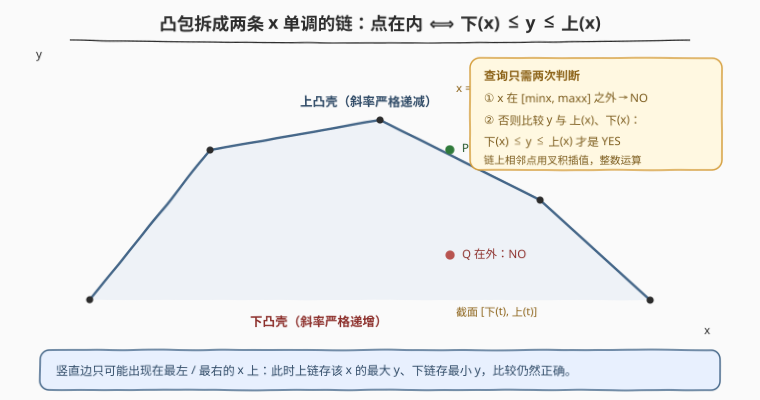
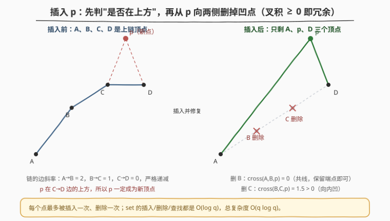
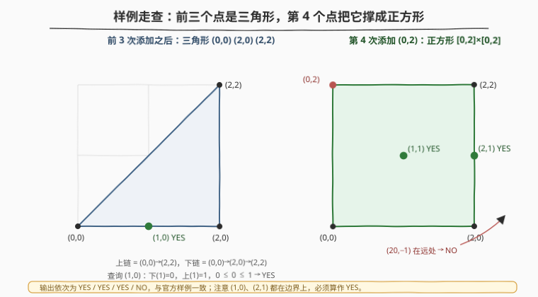

# Codeforces 70D 教授的动态凸包 题解

## 1. 题目概述

- **题目链接**：https://codeforces.com/problemset/problem/70/D
- **比赛来源**：Codeforces Beta Round 64 · Problem D（UTC 2011-03-26）
- **难度**：2700
- **标签**：数据结构、计算几何、凸包
- **评测类型**：普通
- **限制**：时间 1 s / 内存 256 MB

**题意**：在线维护一个点集 $S$ 的凸包，支持两种操作，共 $q$ 次：

1. `1 x y`：把点 $(x,y)$ 加入 $S$（加入后凸包可能变化，也可能不变）；
2. `2 x y`：询问点 $(x,y)$ 是否落在 $S$ 的凸包内部或边界上，输出 `YES` / `NO`。

保证：前三条操作一定是第 1 类且三个点构成**非退化三角形**；加入 $S$ 的点**两两不同**；至少有一次第 2 类操作。坐标是 $[-10^6,10^6]$ 内的整数。

**约束**：

- $q\le 10^5$，坐标绝对值 $\le 10^6$。
- 操作**在线**（加入顺序固定、询问针对当前集合），所以不能"离线排序后一次建树"；每次加入都可能改变凸包，必须支持增量维护。
- 若每次加入后重算凸包，复杂度 $O(q^2\log q)\approx 10^{11}$，1 s 内绝无可能；必须做到**每次操作 $O(\log q)$ 左右**。
- 坐标是整数，任意叉积最大约 $8\times 10^{12}$，`long long` 足够，**完全不需要浮点**，因此没有精度问题。
- 前三点非退化保证凸包始终有正面积（凸包只会变大），但链上仍可能出现竖直边（最左 / 最右 x 上有多个点），实现要专门处理同 $x$ 的点。

## 2. 示例与观察

**官方样例**（输入 / 输出原样）：

```text
输入：
8
1 0 0
1 2 0
1 2 2
2 1 0
1 0 2
2 1 1
2 2 1
2 20 -1

输出：
YES
YES
YES
NO
```

**逐步演算**：

1. 前三次加入 $(0,0),(2,0),(2,2)$，凸包是直角三角形。查询 $(1,0)$：它落在底边 $y=0$（$0\le x\le 2$）上，**边界算在内**，输出 `YES`。
2. 第四次加入 $(0,2)$，凸包变成正方形 $[0,2]\times[0,2]$。查询 $(1,1)$ 在内部 → `YES`；查询 $(2,1)$ 在右边 $x=2$ 上 → `YES`。
3. 查询 $(20,-1)$：$x=20$ 已经超出凸包的 $x$ 范围 $[0,2]$，直接 `NO`。

注意这四个询问里有两个是**边界点**，它们都必须输出 `YES`——这提示所有叉积判断都要用 $\ge 0$ / $\le 0$ 而不是严格不等号。

自造样例（标注"自造"，输出经 C++ 与 Python 两份程序共同确认）：

| 输入 | 输出 | 说明 |
|------|------|------|
| `1 0 0` / `1 2 0` / `1 0 2` 后问 `(1,0) (1,1) (2,2)` | `YES YES NO` | 斜边上的 $(1,1)$ 算 YES，$(2,2)$ 在外 |
| 三角形后问 `(0,4)`，加入 `(0,4)` 再问 `(0,4)`、`(-1,2)` | `NO YES NO` | 先在外、加点后变成顶点；$x=-1$ 超出范围 |
| `1 0 0`、`1 0 5`、`1 5 0`（左边界竖直）后问 `(0,2) (0,6) (5,0) (2,2)` | `YES NO YES YES` | 同 $x$ 上有两个点，检验竖直边 |
| 三角形内加入 `(1,1)`，问 `(3,1)`、`(3,2)` | `YES NO` | 内部点不改变凸包；斜边 $x+y=4$ 上的点算 YES |

**观察**：凸包只会**变大**，所以一个"已经在凸包内"的点永远不会在之后变成顶点——加入时可以安全丢弃。这提示我们不必记住所有点，只需要维护凸包的**边界**；而凸包边界按 $x$ 切开正好是两条 $x$ 单调的链。

## 3. 解题思路

### 3.1 朴素做法与瓶颈

最直接的想法：维护所有加入的点，每次询问时重算一遍凸包（Andrew 单调栈，$O(n\log n)$）再判断点是否在多边形内。$q=10^5$ 时最坏 $10^5\times10^5\log 10^5$，完全不可行。

第二个想法：每次加入后重算凸包并存下来，询问时 $O(\log n)$ 查询。加入仍要 $O(n\log n)$，总复杂度 $O(q^2\log q)$，同样超时。

真正的瓶颈在于"加入一个点后凸包怎么变"。好消息是：凸包是**增量**的——新凸包 = 旧凸包与这个点（以及它引出的两条切线）的凸包。只要能把"新点是否在内部、会顶掉哪些旧顶点"这两件事做成局部的，就能得到 $O(\log q)$ 的增量算法。

### 3.2 核心观察：凸包 = 上链 + 下链



设凸包为 $K$，记 $a=\min x$、$b=\max x$（$K$ 有正面积，故 $a<b$）。对每个 $t\in[a,b]$，竖直线 $x=t$ 与凸集 $K$ 的交是一个非空线段，记为

$$
K\cap\{x=t\} = \bigl[\,\mathrm{lo}(t),\ \mathrm{hi}(t)\,\bigr].
$$

于是

$$
K = \{(t,y)\ :\ a\le t\le b,\ \mathrm{lo}(t)\le y\le \mathrm{hi}(t)\},
$$

其中 $\mathrm{hi}$ 是**凹函数**（它的图像就是**上凸壳**），$\mathrm{lo}$ 是**凸函数**（图像是**下凸壳**）。两条链都按 $x$ 单调，且只在最左、最右两个 $x$ 上可能共享端点或出现竖直边。

因此：

- **询问** $(x,y)$：若 $x\notin[a,b]$ 直接 `NO`；否则 `YES` $\iff \mathrm{lo}(x)\le y\le \mathrm{hi}(x)$。
- **维护**：分别维护上链与下链这两个"按 $x$ 排序的点集"，每个点集里只存这条链的顶点。

链的判据用叉积写最方便。记 $\operatorname{cross}(o,a,b)=(a-o)\times(b-o)$。对按 $x$ 递增的三点 $A,B,C$：

$$
\text{上链要求 } \operatorname{cross}(A,B,C)<0,\qquad \text{下链要求 } \operatorname{cross}(A,B,C)>0 .
$$

也就是说上链相邻三点必须**严格顺时针**（斜率严格递减，凹），下链必须**严格逆时针**（斜率严格递增，凸）。对 $A$ 左侧的点 $P$，由

$$
\operatorname{cross}(A,P,B) = (x_B-x_A)(x_P-x_A)\bigl(\text{斜率}(A,P)-\text{斜率}(A,B)\bigr)
$$

可知 $P$ 在直线 $AB$ 的**下方或线上** $\iff \operatorname{cross}(A,P,B)\ge 0$；在**上方** $\iff \operatorname{cross}(A,P,B)<0$。这两条就是我们全部的判据来源。

### 3.3 插入：先判里外，再局部修凸



以**上链**为例（下链完全对称，只是所有不等号反向）。链用 `std::set` 按 $x$ 排序（同 $x$ 只保留 $y$ 最大的那个点）。加入点 $p$ 的流程：

1. **同 $x$ 去重**：若链上已有 $x=p.x$ 的点：
   - 它比 $p$ 更靠外（上链即 $y\ge p.y$）→ $p$ 不可能成为上链顶点，**直接返回**；
   - 否则删掉旧点（它被同 $x$ 的 $p$ 压住，必然落在新凸包内部）。
2. **判是否在链内侧**：若 $p$ 左右邻居都存在，检查 $\operatorname{cross}(\text{prev},p,\text{next})$。对上链，若它 $\ge 0$（$p$ 在弦下方或线上），说明 $p$ 在上包络之下，**上链不变，返回**。
3. **插入并修凸**：把 $p$ 插入。然后：
   - **向左**：只要 $p$ 还有左邻居 $b$ 且 $b$ 还有左邻居 $a$，若 $\operatorname{cross}(a,b,p)\ge 0$（$b$ 在弦 $ap$ 下方或线上），就删掉 $b$，继续；
   - **向右**：对称地，若 $\operatorname{cross}(p,b,c)\ge 0$，删掉 $b$，继续。

每一步删除的理由都很直接：$b$ 落在弦 $(a,p)$ 或 $(p,c)$ 的下方，而这条弦的两端都留在点集里，所以 $b$ 已经在新的凸包内部（或边界上但非顶点），删掉不影响凸包，只让链更"紧"。

查询时链的用法：设 $x$ 落在链上相邻两点 $A,B$ 之间（$A.x<x<B.x$），则

$$
y\le \mathrm{hi}(x) \iff \operatorname{cross}(A,(x,y),B)\ge 0 ,
$$

即点在这条边的下方或线上；若 $x$ 恰好等于某个链顶点的 $x$，直接比较 $y$ 与该顶点的 $y$（上链存该 $x$ 的最大 $y$）。下链把 $\ge$ 换成 $\le$、最大 $y$ 换成最小 $y$。

### 3.4 查询与样例走查



样例中，上链从前三点的 $(0,0)\to(2,2)$，下链为 $(0,0)\to(2,0)\to(2,2)$。

- 查询 $(1,0)$：$x=1\in[0,2]$，上链插值得 $\mathrm{hi}(1)=1$，下链为 $\mathrm{lo}(1)=0$，故 $0\le 0\le 1$ → `YES`。
- 加入 $(0,2)$：上链插入后变为 $(0,2)\to(2,2)$（$(0,0)$ 因同 $x$ 被更外侧的 $(0,2)$ 顶掉，且 $(2,2)$ 保留），下链保持 $(0,0)\to(2,0)\to(2,2)$。
- 查询 $(1,1)$：$\mathrm{hi}(1)=2$、$\mathrm{lo}(1)=0$ → `YES`；查询 $(2,1)$：$x$ 等于顶点 $x=2$，上链该点 $y=2$、下链该点 $y=0$，$0\le1\le2$ → `YES`。
- 查询 $(20,-1)$：$x=20>2$ 超出范围 → `NO`。

流程总结：每条链一个有序集合；加入 $O(\log q+被删点数)$，询问每条链一次二分 $O(\log q)$，两次判断都通过才 `YES`。

## 4. 正确性证明

先约定：$\operatorname{cross}(o,a,b)=(a-o)\times(b-o)$；$S$ 是当前已加入的点集，$K=\operatorname{conv}(S)$，$a=\min x$、$b=\max x$。题面保证前三点非退化，所以 $K$ 始终有正面积，$a<b$ 且每条竖直线上的截线段非空。

**引理 1（竖直截面与两条链）**：$K=\{(t,y): a\le t\le b,\ \mathrm{lo}(t)\le y\le \mathrm{hi}(t)\}$，其中 $\mathrm{hi}(t)=\max\{y:(t,y)\in K\}$ 在 $[a,b]$ 上凹、$\mathrm{lo}(t)=\min\{y:(t,y)\in K\}$ 在 $[a,b]$ 上凸；两者的图像分别由 $K$ 的上、下边界折线给出。$K$ 的边界上的竖直段只可能位于 $t=a$ 或 $t=b$。

**证明**：$K$ 凸，故它与任意直线的交是凸集；与竖直线 $x=t$ 的交因此是线段或空集。由于 $K$ 是紧凸集且 $[a,b]$ 是它的 $x$ 投影，每个 $t\in[a,b]$ 上截线段非空，形如 $[\mathrm{lo}(t),\mathrm{hi}(t)]$，于是 $K$ 等于这些线段之并，即所写集合。

$\mathrm{hi}$ 的凹性：任取 $t_1,t_2$ 与 $\lambda\in[0,1]$，取点 $(t_1,\mathrm{hi}(t_1)),(t_2,\mathrm{hi}(t_2))\in K$，由凸性其中点组合 $\bigl(\lambda t_1+(1-\lambda)t_2,\ \lambda\,\mathrm{hi}(t_1)+(1-\lambda)\mathrm{hi}(t_2)\bigr)\in K$，故 $\mathrm{hi}$ 在该处的值不小于该组合的 $y$，即 $\mathrm{hi}$ 凹。$\mathrm{lo}$ 的凸性同理取最小值。

上、下边界的图像就是 $\mathrm{hi}$、$\mathrm{lo}$ 的图像：$K$ 的上边界点正是每个 $t$ 处 $y=\mathrm{hi}(t)$ 的点（否则在其上方还能取到 $K$ 的点）。

竖直段位置：若竖直段位于某个 $t_0\in(a,b)$ 的边界上，则该段所在的竖直直线是 $K$ 的一条支撑线，$K$ 整体位于其一侧；但 $t_0\in(a,b)$ 意味着 $K$ 在 $t_0$ 左右两侧都有点，矛盾。故竖直段只在 $t=a$ 或 $t=b$。∎

**引理 2（链的表示）**：设链 $U=(U_1,\dots,U_m)$ 满足：(i) $x$ 严格递增；(ii) $U_1.x=a$、$U_m.x=b$；(iii) 相邻三点严格顺时针，即 $\operatorname{cross}(U_{i-1},U_i,U_{i+1})<0$；(iv) $S$ 中每个点都在折线 $U$ 上或下方。则 $U$ 恰是 $K$ 的上凸壳，折线在 $t$ 处的高度就是 $\mathrm{hi}(t)$。

**证明**：(iii) 等价于各段斜率严格递减，故折线是严格凹的分段线性函数 $f$，且每个 $U_i$ 严格位于其相邻两点连线的上方，从而是 $\operatorname{conv}(U)$ 的顶点。由 (iv)，$S\subseteq\{(t,y): y\le f(t)\}$，故 $K$ 也在这个半空间下方（取凸包不越过上边界），于是 $K$ 的上边界不高于 $f$；而 $U_i\in S\subseteq K$，所以 $f\le\mathrm{hi}$。两边夹住得 $f=\mathrm{hi}$，$U$ 就是上凸壳。∎

对下链有完全对称的引理（把"下方"换成"上方"、$<$ 换成 $>$）。

**引理 3（跳过判据）**：若链 $U$ 已满足引理 2 的条件，$p$ 的 $x$ 严格落在 $U_k.x$ 与 $U_{k+1}.x$ 之间，且 $\operatorname{cross}(U_k,p,U_{k+1})\ge 0$，则加入 $p$ 后上链不变。

**证明**：由 3.2 的斜率恒等式，$\operatorname{cross}(U_k,p,U_{k+1})\ge 0$ 表示 $p$ 在弦 $U_kU_{k+1}$ 的下方或线上。由引理 1，$\mathrm{hi}$ 在 $[U_k.x,U_{k+1}.x]$ 上是凹函数，图像在弦的上方，故 $\mathrm{hi}(p.x)\ge$ 弦在 $p.x$ 处的高度 $\ge p.y$。于是 $p$ 满足 $(p.x,p.y)\in\{(t,y):y\le f(t)\}$，引理 2 的条件 (iv) 对 $S\cup\{p\}$ 仍成立，(i)(ii)(iii) 未变，故上链不变。∎

同 $x$ 的去重同理：若链上该 $x$ 的点 $y$ 更大，则 $p$ 在 $\mathrm{hi}(p.x)$ 之下（或线上），跳过安全；若 $p$ 更高，旧点满足（同 $x$ 且在 $\mathrm{hi}$ 之下）必在 $K$ 内，删除安全，随后按引理 3 继续判断。

**引理 4（修复的正确性）**：设链 $U$ 满足引理 2，$p$ 严格在 $\mathrm{hi}(p.x)$ 之上。执行 3.3 的插入与两段修复后，得到的链仍满足引理 2，因而是 $S\cup\{p\}$ 的上凸壳。

**证明**：分四步。

1. **每次删除都安全**：向左删 $b$ 时 $\operatorname{cross}(a,b,p)\ge 0$，即 $b$ 在弦 $ap$ 的下方或线上，于是 $b\in\operatorname{conv}\{a,p\}\subseteq\operatorname{conv}(\text{当前点集})$；向右删 $b$ 时 $\operatorname{cross}(p,b,c)\ge 0$，同理 $b\in\operatorname{conv}\{p,c\}$。所以被删的点都在剩余点的凸包里，凸包不变。由"删除的传递性"（后被删的点也在最终点集的凸包里）可知所有被删点都在最终保留点集与 $p$ 的凸包里。
2. **修复后链仍严格凹**：未涉及 $p$ 的三元组没有变化，仍满足 $<0$。左段在首次出现 $\operatorname{cross}(a,b,p)<0$ 时停止，于是新的三元组 $(a,b,p)$ 满足严格顺时针，且更左侧的三元组未变；右段对称。$p$ 自身的三元组 $(\text{prev}(p),p,\text{next}(p))$ 也满足 $<0$：因为 $p$ 严格在旧上包络之上，而凹函数图像在弦的上方，所以 $p$ 严格在 $\text{prev}(p)\text{next}(p)$ 这条弦的上方。
3. **$x$ 范围不变**：插入点 $p$ 落在链的 $x$ 范围内（若在范围外，则是最左/最右点，属于端点情形，步骤 2 的三元组论证同样成立），删除不会改变两端点。
4. **所有点都在新折线下方**：保留的顶点在新折线上；被删的点在保留点与 $p$ 的凸包里，因而在凸包的上边界之下（引理 1）。$S$ 中原本在旧折线下方的点，因为新折线在旧折线上方（$p$ 在上方，且新折线是上包络），仍在其下方。

四条合起来正是引理 2 的条件，故新链是 $S\cup\{p\}$ 的上凸壳。∎

**引理 5（查询正确性）**：对当前上、下链，`up.inside(p) && lo.inside(p)` 为真 $\iff p\in K$。

**证明**：由引理 2，两条链分别给出 $\mathrm{hi}$ 与 $\mathrm{lo}$ 的精确值。若 $p.x\notin[a,b]$，$p\notin K$，两条链都返回假（代码先判范围）。否则代码把 $p.x$ 定位到链上：若 $p.x$ 等于某个顶点的 $x$，由上链存"该 $x$ 的最大 $y$"、下链存"最小 $y$"，$y\le\mathrm{hi}(p.x)$ 与 $y\ge\mathrm{lo}(p.x)$ 就是直接比较；若 $p.x$ 严格落在 $A,B$ 之间，由 3.2 的判据 $\operatorname{cross}(A,p,B)\ge 0\iff y\le\mathrm{hi}(p.x)$（上链），下链同理。两者都成立 $\iff \mathrm{lo}(p.x)\le y\le\mathrm{hi}(p.x)\iff p\in K$（引理 1）。∎

**定理**：按 3.3 维护两条链、按 3.4 回答询问，程序对每次第 2 类操作都输出正确结果。

**证明**：初始三次加入后，上、下链由引理 4 归纳建立；每次加入由引理 3、4 保持"链 = 上/下凸壳"；每次询问由引理 5 正确。∎

## 5. 复杂度分析

- **时间**：每次加入对每条链做一次 `set` 查找 $O(\log q)$，加上若干次删除（每次 $O(\log q)$）。每个点最多被插入每条链一次、被删除每条链一次，所以删除总代价 $O(q\log q)$；总时间 $O(q\log q)$。每次询问两条链各一次二分，$O(\log q)$。$q=10^5$ 时约 $3.4\times 10^6$ 次基本操作。
- **空间**：$O(q)$，两条链的顶点数都不超过加入点数，加上输入缓冲。
- **数值**：叉积中坐标差最大 $2\times10^6$，乘积最大 $4\times10^{12}$，两项相减最大 $8\times 10^{12}$，`long long` 上限 $9.2\times10^{18}$，**有 6 个数量级余量**；全整数运算，没有精度误差。
- **与时限的关系**：1 s 时限下，$q=10^5$ 的满数据实测 C++ 端到端约 $0.02$ s（其中算法本体约 $0.01$ s），余量在 50 倍以上。Python 版是同一算法的直接翻译，最坏会因 `list` 的插入/删除是 $O(\text{链长})$ 而退化，满数据建议提交 C++（或 PyPy）。

## 6. 参考代码

### C++17

```cpp
#include <bits/stdc++.h>
using namespace std;
typedef long long ll;

static char ibuf[1 << 22];
static size_t ilen = 0, ipos = 0;
static inline int gc() {
    if (ipos == ilen) { ilen = fread(ibuf, 1, sizeof(ibuf), stdin); ipos = 0; if (!ilen) return -1; }
    return ibuf[ipos++];
}
static inline bool readInt(ll& out) {
    int c = gc();
    while (c != -1 && c != '-' && (c < '0' || c > '9')) c = gc();
    if (c == -1) return false;
    int sgn = 1;
    if (c == '-') { sgn = -1; c = gc(); }
    ll v = 0;
    while (c >= '0' && c <= '9') { v = v * 10 + (c - '0'); c = gc(); }
    out = v * sgn;
    return true;
}

struct P {
    ll x, y;
    bool operator<(const P& o) const { return x < o.x || (x == o.x && y < o.y); }
};

// cross(o,a,b) = (a-o) x (b-o)，>0 表示 a->b 在 o 处左转
static inline ll cross(const P& o, const P& a, const P& b) {
    return (a.x - o.x) * (b.y - o.y) - (a.y - o.y) * (b.x - o.x);
}

// 一条 x 单调的凸链。upper=true 维护上凸壳：相邻三点必须严格顺时针（cross<0）；
// upper=false 维护下凸壳：必须严格逆时针（cross>0）。同一 x 只保留对这条链最有利的点。
struct Chain {
    bool upper;
    set<P> s;

    void add(P p) {
        auto it = s.lower_bound(P{p.x, LLONG_MIN});     // 第一个 x >= p.x 的点
        if (it != s.end() && it->x == p.x) {
            if (upper ? it->y >= p.y : it->y <= p.y) return;   // 同 x 已有更外侧的点
            it = s.erase(it);
        }
        if (it != s.begin() && it != s.end()) {
            // p 落在左右邻居连线的内侧 => 永远不会成为这条链的顶点
            ll c = cross(*prev(it), p, *it);
            if (upper ? c >= 0 : c <= 0) return;
        }
        it = s.insert(p).first;
        while (it != s.begin()) {                        // 向左修正凸性
            auto b = prev(it);
            if (b == s.begin()) break;
            ll c = cross(*prev(b), *b, *it);
            if (upper ? c >= 0 : c <= 0) s.erase(b);
            else break;
        }
        while (true) {                                   // 向右修正凸性
            auto b = next(it);
            if (b == s.end()) break;
            auto c2 = next(b);
            if (c2 == s.end()) break;
            ll c = cross(*it, *b, *c2);
            if (upper ? c >= 0 : c <= 0) s.erase(b);
            else break;
        }
    }

    // p 是否位于这条链的内侧（含边界）
    bool inside(P p) const {
        if (s.empty()) return false;
        auto hi = s.end(); --hi;
        if (p.x < s.begin()->x || p.x > hi->x) return false;
        auto it = s.lower_bound(P{p.x, LLONG_MIN});
        if (it->x == p.x) return upper ? p.y <= it->y : p.y >= it->y;
        ll c = cross(*prev(it), p, *it);
        return upper ? c >= 0 : c <= 0;
    }
};

int main() {
    ll q;
    if (!readInt(q)) return 0;
    Chain up{true}, lo{false};
    string out;
    out.reserve(4 * q);
    for (ll i = 0; i < q; ++i) {
        ll t, x, y;
        readInt(t); readInt(x); readInt(y);
        if (t == 1) { up.add({x, y}); lo.add({x, y}); }
        else out += (up.inside({x, y}) && lo.inside({x, y})) ? "YES\n" : "NO\n";
    }
    fwrite(out.data(), 1, out.size(), stdout);
    return 0;
}
```

### Python3

```python
import sys
from bisect import bisect_left


def cross(o, a, b):
    return (a[0] - o[0]) * (b[1] - o[1]) - (a[1] - o[1]) * (b[0] - o[0])


class Chain:
    """一条 x 单调的凸链。upper=True: 上凸壳（三点顺时针，cross<0）。"""

    def __init__(self, upper):
        self.upper = upper
        self.pts = []   # [(x, y)] 按 x 严格升序
        self.xs = []

    def add(self, x, y):
        pts, xs, up = self.pts, self.xs, self.upper
        i = bisect_left(xs, x)
        if i < len(xs) and xs[i] == x:
            if (pts[i][1] >= y) if up else (pts[i][1] <= y):
                return
            del pts[i]
            del xs[i]
        if 0 < i < len(pts):
            c = cross(pts[i - 1], (x, y), pts[i])
            if (c >= 0) if up else (c <= 0):
                return
        pts.insert(i, (x, y))
        xs.insert(i, x)
        while i >= 2:                       # 修左边
            c = cross(pts[i - 2], pts[i - 1], pts[i])
            if (c >= 0) if up else (c <= 0):
                del pts[i - 1]
                del xs[i - 1]
                i -= 1
            else:
                break
        while i + 2 < len(pts):             # 修右边
            c = cross(pts[i], pts[i + 1], pts[i + 2])
            if (c >= 0) if up else (c <= 0):
                del pts[i + 1]
                del xs[i + 1]
            else:
                break

    def inside(self, x, y):
        pts, xs, up = self.pts, self.xs, self.upper
        if not pts:
            return False
        if x < xs[0] or x > xs[-1]:
            return False
        i = bisect_left(xs, x)
        if i < len(xs) and xs[i] == x:
            return (y <= pts[i][1]) if up else (y >= pts[i][1])
        c = cross(pts[i - 1], (x, y), pts[i])
        return (c >= 0) if up else (c <= 0)


def main():
    data = sys.stdin.buffer.read().split()
    if not data:
        return
    q = int(data[0])
    up, lo = Chain(True), Chain(False)
    out = []
    p = 1
    for _ in range(q):
        t, x, y = int(data[p]), int(data[p + 1]), int(data[p + 2])
        p += 3
        if t == 1:
            up.add(x, y)
            lo.add(x, y)
        else:
            out.append('YES' if up.inside(x, y) and lo.inside(x, y) else 'NO')
    sys.stdout.write('\n'.join(out) + ('\n' if out else ''))


main()
```

C++ 版自带 `fread` 快速读入：本题输入有 $3\times 10^5$ 个整数，在部分环境（例如 libc++）里 `cin` 的常数会明显放大，而 1 s 时限并不宽裕。Python 版为清晰起见用 `list` + `bisect`，逻辑与 C++ 完全一致。

## 7. 边界情况与易错点

1. **边界上的点必须算 `YES`**：题目明确"including the border"，所有判据要用 $\ge 0$ / $\le 0$。写成严格不等号会让样例 1 的 $(1,0)$、$(2,1)$ 直接判错。
2. **$x$ 超出 $[\min x,\max x]$ 必须判 `NO`**：这是独立于两条链的判断，漏掉它会在"范围外但 y 恰好介于上下链延长线之间"时误判 `YES`（样例的 $(20,-1)$ 就是这种情形）。
3. **同 $x$ 的点**：凸包左右两端可能出现竖直边，链里若不按 $x$ 去重就会出现两个 $x$ 相同的点，链的单调性被破坏、二分失效。上链保留最大 $y$、下链保留最小 $y$（去重规则写反会让两端点错位）。
4. **竖直边不能用插值**：$x$ 恰好等于顶点 $x$ 时，若还按"相邻两点线性插值"去算，会除以 $x_B-x_A=0$。代码里先判 `it->x == p.x` 就是为了绕开这一点。
5. **叉积溢出**：坐标差最大 $2\times 10^6$，叉积最大 $8\times10^{12}$，`int` 必爆，必须 `long long`。查询坐标的范围与加入点相同，也在同一量级。
6. **同一点重复加入**：题面保证所有加入点两两不同，但若自己造数据时重复加入同一个点，上链第 1 步的"$y\ge p.y$"会安全返回，不会出错；这一点可以作为实现的健壮性检查。
7. **内部点不能留在链里**：加入内部点后什么都不做是正确的（凸包只增不减，内部点永远是内部点）；但**不要**把它塞进链里再靠修复删掉——那样会破坏"链 = 上凸壳"的不变量（它的 $x$ 可能落在链中间，而 $y$ 在下方）。
8. **端点扩展**：新点的 $x$ 比当前最小/最大还小/大时，它一定是新凸包的端点（两条链都要扩展），不能因为"找不到左右两个邻居"就跳过。
9. **输出格式**：每次第 2 类操作输出一行 `YES` 或 `NO`（全大写），不要多输出空行。
10. **多组数据的错觉**：本题只有一组数据（一个 $q$），不要把 $q$ 当成测试组数去套外层循环。

## 8. 验证记录

- **编译环境与命令**：`verify_solution.py` 用 `clang++ -std=c++17 -O2` + 仓库兼容头 `bits/stdc++.h`（本机 `/usr/bin/g++` 是 Apple clang 的软链）；Python 为 `/usr/bin/python3`。
- **官方样例**：1 / 1 通过（8 次操作、4 个询问，输出 `YES YES YES NO`）。命令 `python3 codeforces/tools/verify_solution.py codeforces/contests/0001-0100/70/D_教授的动态凸包.md` 输出 `CF70D: samples 1 / C++ 编译 OK, 样例 1/1 / Python 语法 OK, 样例 1/1`。
- **独立暴力对拍 1（小规模、广覆盖）**：另写一份暴力——每次询问都对当前点集用 Andrew 单调栈重算凸包，再逐边用叉积判断点是否在多边形内（含边界）。随机生成 $1000$ 组数据（$q\in[4,60]$，坐标从 $\{-3,\dots,3\}$ 到 $\{-30,\dots,30\}$ 多档；一半询问取在已有顶点附近 $\pm1$ 的整数点，专门制造边界与共线情形），C++ 与 Python 两份输出都与暴力**逐行一致**（$1000/1000$）。
- **独立暴力对拍 2（中大规模）**：同一暴力在 $q=1500$ 的随机数据上运行（一档坐标 $\pm1000$、一档坐标 $\pm6$ 制造大量同 $x$ 与共线），分别有 $756$ 与 $1331$ 个询问，C++ 输出与暴力完全一致。
- **额外测试**：第 2 节表中 4 组自造样例逐一核对（含"先在外、加点后变成顶点"、"$x$ 越界"、"竖直边"、"内部点"四类边界）。
- **最大约束性能**：构造 $q=10^5$（约 $5\times10^4$ 次加入，点取在半径 $10^6$ 的圆上使凸包顶点尽量多，另 $5\times10^4$ 次询问），C++ 端到端约 $0.02$ s，峰值内存约 $12$ MB；相对 1 s / 256 MB 余量在 50 倍以上。Python 版在同一数据上约 $0.3\sim0.4$ s，但它的列表插入是 $O(\text{链长})$，最坏情况会退化，满数据建议提交 C++。
- **文档校验**：`python3 codeforces/tools/check_samples.py --only 0001-0100/70` 对本篇 0 问题；`python3 codeforces/tools/check.py codeforces/contests/0001-0100/70` 0 失败。
- **复核状态**：verified（官方样例、两轮独立暴力对拍、边界、性能四项均实跑通过）。

## 相关题目与扩展

- [Codeforces 70E Information Reform](https://codeforces.com/problemset/problem/70/E)：同场 E 题，树上的 DP；本题是数据结构 + 几何，两题分别代表 Beta 轮次后段的两条主线。
- [Codeforces 166B Polygons](https://codeforces.com/problemset/problem/166/B)：判断一个多边形是否完全落在另一个凸多边形内，是本题"点在凸包内"的静态版。
- [Codeforces 70C Lucky Tickets](https://codeforces.com/problemset/problem/70/C)：同场题，同样需要"单调性 + 有序结构"的配合，只是把几何换成了数论。
- [Codeforces 605C Freelancer's Dreams](https://codeforces.com/problemset/problem/605/C)：凸包与线性规划的对偶，可以看成"用凸包的上边界回答查询"的另一种应用。

**延伸思考**：

1. **如果要求支持删除**：本题的均摊分析依赖"每个点最多被删一次"。若支持任意删除，需要换成动态凸包的标准做法（Overmars–van Leeuwen 的平衡树维护上下链并带"删除后回补"信息），或者离线用线段树分治 + 可回退化栈，复杂度仍是 $O(q\log^2 q)$。
2. **如果询问改成"凸包面积"**：只需要在 `set` 之外再维护两个量——上链相邻点叉积之和、下链相邻点叉积之和（即"鞋带公式"的两半），插入/删除时 $O(1)$ 更新，就能 $O(\log q)$ 回答面积。本题只问"是否在内"，所以不需要这些额外信息。
3. **如果坐标是实数**：所有判据从"整数叉积的符号"变成"浮点叉积的符号"，退化情形（三点近似共线）会出现误判。标准做法是保留整数/有理数运算，或用 `long double` 加 `eps` 并额外处理"几乎共线"；本题坐标是整数，所以完全避开了这一层。
4. **如果加入的点全在一条竖直线上**：前三点非退化保证不会出现，但如果放松这个保证，链会退化成一个点，`inside` 的范围判断与端点比较仍然安全（代码对空链、单点链都有防御），这也是把范围判断写成"先比较端点"而不是"先插值"的好处。

