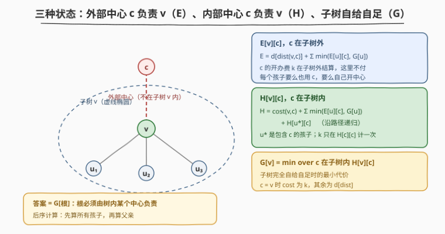
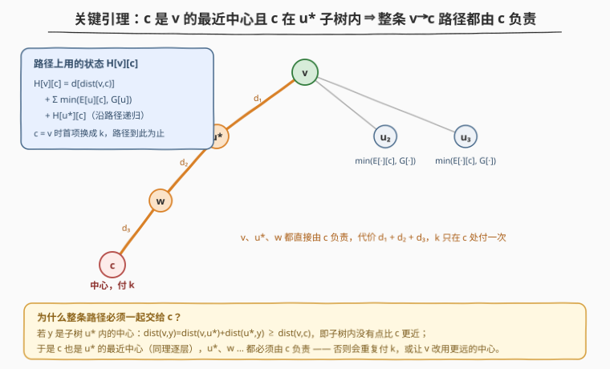
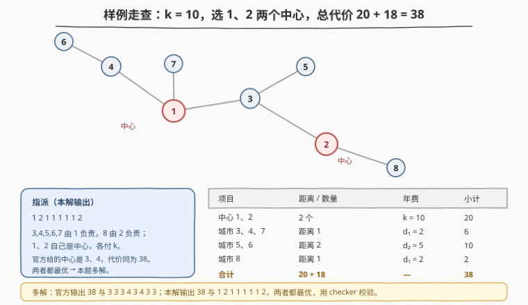

# Codeforces 70E 信息改革中心选址 题解

## 1. 题目概述

- **题目链接**：https://codeforces.com/problemset/problem/70/E
- **比赛来源**：Codeforces Beta Round 64 · Problem E（UTC 2011-03-26）
- **难度**：2700
- **标签**：动态规划、树形 DP、实现
- **评测类型**：多解（输出任意一组最优方案）
- **限制**：时间 2 s / 内存 256 MB

**题意**：Walrusland 有 $n$ 座城市，道路构成一棵树（任意两城之间恰有一条路径，每条路长度相同）。要选若干城市作为**区域中心**：

- 每个中心每年维护费 $k$；
- 每个非中心城市要指派一个中心负责向它传递消息，若该城市到所指派中心的距离为 $len$，则每年费用为 $d_{len}$（$d$ 单调不降，输入给出 $d_1,\dots,d_{n-1}$）。

求总年费的最小值，并输出**任意一组**最优方案：第一行最小费用，第二行 $n$ 个数，第 $i$ 个数表示城市 $i$ 被指派给哪个中心（若 $i$ 自己是中心，输出 $i$）。

**约束**：

- $1 \le n \le 180$：规模很小，$O(n^2)$、$O(n^3)$ 的 DP 都可以；但 $2^n$ 的枚举（$n=180$ 时约 $10^{54}$）绝对不可行。
- $1 \le k \le 10^5$，$0 \le d_1 \le d_2 \le \dots \le d_{n-1}\le 10^5$：$d$ **单调不降**是本题的核心性质（见引理 1），费用都是整数，总费用最大约 $180\times 10^5 \approx 1.8\times 10^7$，`int` 也够，但用 `long long` 更稳。
- 距离最大是 $n-1$，所以 $d$ 数组只用到下标 $1..n-1$；$n=1$ 时第二行（$d$ 数组）不存在，输入只有一行和一个空行/直接结束。
- 多解：官方样例给的一组最优方案未必与你的相同，必须用 checker 校验"费用最小 + 指派合法"。

## 2. 示例与观察

**官方样例**（输入 / 输出原样）：

```text
输入：
8 10
2 5 9 11 15 19 20
1 4
1 3
1 7
4 6
2 8
2 3
3 5

输出：
38
3 3 3 4 3 4 3 3
```

**读懂这棵树**：边是 $1\!-\!4,\ 1\!-\!3,\ 1\!-\!7,\ 4\!-\!6,\ 2\!-\!8,\ 2\!-\!3,\ 3\!-\!5$，即中心是 $1$，它连 $4,3,7$；$4$ 连 $6$；$3$ 连 $2,5$；$2$ 连 $8$。

官方方案选 $3,4$ 两个中心。费用：

- 两个中心：$2\times 10 = 20$；
- 城市 $1,2,5$ 距中心 $3$ 都是 $1$ 条路 → 各 $d_1=2$，共 $6$；
- 城市 $6$ 距中心 $4$ 是 $1$ 条路 → $2$；
- 城市 $7$ 距中心 $3$ 是 $2$ 条路（$7\!-\!1\!-\!3$）→ $d_2=5$；
- 城市 $8$ 距中心 $3$ 是 $2$ 条路（$8\!-\!2\!-\!3$）→ $5$。

合计 $20+6+2+5+5=38$，与输出一致。

**本解给出另一组同样最优的方案**：选中心 $1,2$，指派为 `1 2 1 1 1 1 1 2`——城市 $3,4,7$ 距中心 $1$ 都是 $1$（$2+2+2$），城市 $5,6$ 距离 $2$（$5+5$），城市 $8$ 距中心 $2$ 是 $1$（$2$），加两个中心 $20$，合计 $20+6+10+2=38$。两组方案费用相同，说明**答案不唯一**。

自造样例（标注"自造"，输出经 C++ 与 Python 两份程序共同确认）：

| 输入 | 输出 | 说明 |
|------|------|------|
| `1 10` | `10` / `1` | 只有一座城市，它必须是中心，付 $k$ |
| `2 5` + `1` + `1 2` | `6` / `1 1` | 开两个中心 $10$，只开一个 $5+1=6$，后者优 |
| `2 1` + `100` + `1 2` | `2` / `1 2` | 开中心便宜（$k=1$），两城都开只要 $2$ |
| `3 3` + `1 1` + `1 2`、`2 3` | `5` / `1 1 1` | 只开城市 $1$：$3+d_1+d_2=3+1+1=5$ |

**观察**：答案只与"每个城市到最近中心的距离"有关。由于 $d$ 单调不降，把某个城市从较远中心改派到较近中心**不会增加费用**，所以可以假设每个非中心城市都指派给**最近**的中心——这一步把"任意指派"的巨大搜索空间压缩成"选一个中心集合"。

## 3. 解题思路

### 3.1 朴素做法与瓶颈

最直接的想法：枚举所有中心集合 $S\subseteq V$（$2^n$ 种），对每个 $S$ 计算 $k|S|+\sum_{v\notin S} d_{\operatorname{dist}(v,S)}$，取最小。$n=180$ 时 $2^{180}$ 完全不可能，即使 $n=30$ 也有 $10^9$ 量级。

第二想法：把"最近的 $m$ 个中心"之类的东西压进状态——但树上的距离结构不像数轴，压不进去。可行的方向是**树形 DP**：固定根之后，一个城市只可能被"子树内的中心"或"从父亲方向下来的某个中心"服务，后者可以用"是哪个中心"作为状态传下去。

### 3.2 核心观察：最近指派与子树分解



**第一步：最近指派不失最优。** 若城市 $v$ 被指派给中心 $c$，而存在更近的中心 $c'$，则 $\operatorname{dist}(v,c')\le \operatorname{dist}(v,c)$，由 $d$ 单调不降，$d_{\operatorname{dist}(v,c')}\le d_{\operatorname{dist}(v,c)}$，改派不会变差。于是可以只考虑"每个城市指派给最近中心"的方案。

**第二步：定根、定状态。** 把树以 $1$ 为根。对节点 $v$，记 $\operatorname{sub}(v)$ 为其子树。关键的分解性质（第 4 节引理 2、3）：

> 设 $c$ 是 $v$ 的最近中心。对 $v$ 的每个孩子 $u$：$u$ 的最近中心要么还是 $c$，要么落在 $\operatorname{sub}(u)$ 内部；而且一旦落在内部，$\operatorname{sub}(u)$ 里**所有**城市都由内部中心服务。

于是可以定义三种状态（$c$ 表示"最近中心"）：

- $E[v][c]$（$c\notin\operatorname{sub}(v)$）：$v$ 由**外部**中心 $c$ 服务时，子树 $v$ 的最小费用。$c$ 的维护费 $k$ 在子树外结算，**这里不计**。每个孩子要么也由 $c$ 服务（$E[u][c]$），要么自给自足（$G[u]$）。
- $H[v][c]$（$c\in\operatorname{sub}(v)$）：$c$ 在子树内且服务 $v$，$c$ 的 $k$ **计入**子树。设 $u^{*}$ 是包含 $c$ 的那个孩子，则路径 $v\to c$ 上的所有城市都必须由 $c$ 服务（引理 4），所以 $u^{*}$ 这一支要递归用 $H[u^{*}][c]$；其它孩子照旧取 $\min(E[u][c],G[u])$。
- $G[v]=\min_{c\in\operatorname{sub}(v)}H[v][c]$：子树 $v$ 完全靠自己的中心服务的最小费用。

答案为 $G[1]$（根必须由树内某个中心服务）。

### 3.3 状态转移



记 $D[0]=0$、$D[len]=d_{len}$，$\operatorname{dist}$ 用 $n$ 次 BFS 预处理。转移如下：

$$
E[v][c]=D[\operatorname{dist}(v,c)]+\sum_{u\ \text{child of}\ v}\min\bigl(E[u][c],\,G[u]\bigr),
$$

$$
H[v][c]=
\begin{cases}
k+\sum_{u}\min(E[u][c],G[u]), & c=v,\\[2mm]
D[\operatorname{dist}(v,c)]+\sum_{u\ne u^{*}(c)}\min(E[u][c],G[u])+H[u^{*}(c)][c], & c\ne v,
\end{cases}
$$

$$
G[v]=\min_{c\in\operatorname{sub}(v)}H[v][c].
$$

其中 $u^{*}(c)$ 是 $v$ 的孩子中、子树包含 $c$ 的那一个（$c=v$ 时不存在）。计算顺序是**后序**：先算孩子，再算父亲。

**答案重建**：从 $(v,c)=(1,G_c[1])$ 出发（$G_c[v]$ 是取到 $G[v]$ 的那个 $c$），不断向下：

- 先把 $v$ 指派给 $c$；
- 若 $c\ne v$ 且在 $\operatorname{sub}(v)$ 内，则包含 $c$ 的孩子 $u^{*}$ 递归用 $(u^{*},c)$，其它孩子 $u$ 比较 $E[u][c]$ 与 $G[u]$：前者小就 $(u,c)$，否则 $(u,G_c[u])$；
- 若 $c=v$ 或 $c$ 在子树外，则所有孩子都按同样的比较决定。

### 3.4 样例走查



样例的树与费用已在第 2 节算过。用 DP 的语言复述本解给出的方案：

- 取根为 $1$，$G[1]$ 选择了 $c=1$，于是 $1$ 是中心（付 $k=10$），并在孩子的比较中选出了中心 $2$。
- 城市 $2$ 成为中心（再付 $10$）；$3,4,7$ 由 $1$ 服务（距离 $1$，各 $2$），$5,6$ 由 $1$ 服务（距离 $2$，各 $5$），$8$ 由 $2$ 服务（距离 $1$，$2$）。
- 总计 $20+6+10+2=38$。

官方方案（中心 $3,4$）在 DP 里对应另一条同样取到最小值的路径，所以重建结果依赖 $< $ 与 $\le$ 的取舍；两种都合法。

## 4. 正确性证明

**引理 1（最近指派不失最优）**：设 $S$ 是最优解的中心集合。把每个 $v\notin S$ 改派给距它最近的中心，总费用不增加；因此存在一个最优解，其中每个城市都指派给最近中心。

**证明**：若原指派的中心是 $c$、最近中心是 $c'$，则 $\operatorname{dist}(v,c')\le\operatorname{dist}(v,c)$；由 $d_1\le d_2\le\dots$ 得 $d_{\operatorname{dist}(v,c')}\le d_{\operatorname{dist}(v,c)}$。逐城改派即可。∎

以下固定一个"最近指派"的最优解，记 $c(v)$ 为 $v$ 的最近中心（$v\in S$ 时 $c(v)=v$）。

**引理 2（孩子的最近中心）**：对边 $(v,u)$（$u$ 是 $v$ 的孩子），$c(u)$ 要么等于 $c(v)$，要么在 $\operatorname{sub}(u)$ 内。

**证明**：设 $x=c(u)\notin\operatorname{sub}(u)$。则路径 $u\to x$ 经过 $v$，$\operatorname{dist}(u,x)=\operatorname{dist}(u,v)+\operatorname{dist}(v,x)$。由 $c(v)$ 是 $v$ 的最近中心，$\operatorname{dist}(v,x)\ge\operatorname{dist}(v,c(v))$，故

$$
\operatorname{dist}(u,x)\ge \operatorname{dist}(u,v)+\operatorname{dist}(v,c(v))\ge \operatorname{dist}(u,c(v)),
$$

后一个不等号是三角不等式。所以 $c(v)$ 至少和 $x$ 一样近；若 $x$ 是最优解里 $u$ 的最近中心，则 $c(v)$ 也可以充当，即 $c(u)$ 可取为 $c(v)$。∎

**引理 3（子树自给）**：若 $c(u)\in\operatorname{sub}(u)$，则 $\operatorname{sub}(u)$ 中每个城市 $w$ 的最近中心都在 $\operatorname{sub}(u)$ 内。

**证明**：设 $x\notin\operatorname{sub}(u)$ 是任意外部中心。路径 $w\to x$ 经过 $u$，故 $\operatorname{dist}(w,x)=\operatorname{dist}(w,u)+\operatorname{dist}(u,x)$。又 $\operatorname{dist}(u,x)\ge\operatorname{dist}(u,c(u))$，所以

$$
\operatorname{dist}(w,x)\ge \operatorname{dist}(w,u)+\operatorname{dist}(u,c(u))\ge \operatorname{dist}(w,c(u)),
$$

最后一步是三角不等式；而 $c(u)\in\operatorname{sub}(u)$。故 $w$ 也有内部中心不劣于任何外部中心。∎

**引理 4（强制路径）**：若 $c(v)=c\in\operatorname{sub}(u)$（$u$ 是 $v$ 的孩子），则 $c(u)=c$，进而沿 $v\to c$ 的整条路径每一层都取 $c$。

**证明**：任取 $y\in\operatorname{sub}(u)$，路径 $v\to y$ 经过 $u$，故

$$
\operatorname{dist}(v,y)=\operatorname{dist}(v,u)+\operatorname{dist}(u,y)\ge \operatorname{dist}(v,c)=\operatorname{dist}(v,u)+\operatorname{dist}(u,c),
$$

于是 $\operatorname{dist}(u,y)\ge\operatorname{dist}(u,c)$：子树内没有点比 $c$ 更接近 $u$。任取外部 $x\notin\operatorname{sub}(u)$，则 $\operatorname{dist}(u,x)=\operatorname{dist}(u,v)+\operatorname{dist}(v,x)\ge\operatorname{dist}(u,v)+\operatorname{dist}(v,c)\ge\operatorname{dist}(u,c)$。故 $c$ 是 $u$ 的最近中心，$c(u)=c$。对 $u$ 重复同一论证，整条路径都取 $c$。∎

**引理 5（转移的完备性）**：对任意 $v$、$c$，上面 $E[v][c]$、$H[v][c]$ 的递推式都等于"对应配置"下的最小费用。

**证明**：对子树大小归纳。

- $E[v][c]$（$c$ 在子树外）：$v$ 由 $c$ 服务，付 $D[\operatorname{dist}(v,c)]$。对每个孩子 $u$，由引理 2，$u$ 的最近中心要么是 $c$（此时整棵 $\operatorname{sub}(u)$ 的费用是 $E[u][c]$），要么在 $\operatorname{sub}(u)$ 内（由引理 3，整棵子树自给，费用是 $G[u]$）；二者必居其一且互斥，取 $\min$ 即为最优。各孩子的选择彼此独立（都只用外部 $c$ 或自己的内部中心），故求和即可。
- $H[v][c]$（$c$ 在子树内）：$v$ 由 $c$ 服务。若 $c=v$，$v$ 是中心付 $k$，所有孩子都按 $\min(E[u][c],G[u])$ 处理。若 $c\ne v$，设 $u^{*}$ 是包含 $c$ 的孩子：由引理 4，$u^{*}$ 也由 $c$ 服务，费用为 $H[u^{*}][c]$；其余孩子 $u$ 由引理 2、3 只有"用 $c$"或"自给"两种可能，费用 $\min(E[u][c],G[u])$。求和即得。
- $G[v]$ 是对"$v$ 的最近中心在子树内"的所有 $c$ 取最小，正是子树自给的最小费用。∎

**引理 6（可实现性）**：每个 $E/H/G$ 值都对应一个真实可行的指派方案，费用恰为该值。

**证明**：与引理 5 同步归纳。$E[v][c]$ 中，外部 $c$ 由上层保证是开着的（其 $k$ 在祖先处计入），孩子选的 $E[u][c]$ 继续使用同一个 $c$、选的 $G[u]$ 打开自己内部的中心并各自付 $k$；这些子树互不相交，方案无冲突。$H[v][c]$ 中 $c$ 在子树内，由 $u^{*}$ 那一支的 $H[u^{*}][c]$ 一路递归到 $H[c][c]$，在那里付一次 $k$，路径上的城市都由 $c$ 服务，其余孩子同上。逐层拼起来就是一个合法方案。∎

**定理**：$G[1]$ 等于最小总费用，且 3.3 的重建过程输出的指派合法、费用等于 $G[1]$。

**证明**：由引理 1 可只考虑最近指派的最优解。设最优解的中心集合为 $S^{*}$，$c(1)$ 是根的最近中心（必在 $\operatorname{sub}(1)=V$ 内）。对每个节点用引理 5 的分解逐层展开，最优解的费用可以写成 $H[1][c(1)]$ 的形式，故 $G[1]=\min_c H[1][c]\le$ 最优费用。另一方面由引理 6，$G[1]$ 对应真实方案，故 $G[1]\ge$ 最优费用。两者相等。重建过程每一步都按引理 5 中取到最小值的分支走，因此最终费用仍等于 $G[1]$，且每个非中心城市都被指派给了某个真正的中心（$H[c][c]$ 处 $c$ 是中心），方案合法。∎

## 5. 复杂度分析

- **时间**：$n$ 次 BFS 求全源距离，$O(n^2)$。DP 对每个 $v$ 枚举 $n$ 个 $c$、每个 $c$ 扫一遍孩子，总代价 $\sum_v n\cdot\deg(v)=2n(n-1)=O(n^2)$。重建 $O(n)$。合计 $O(n^2)$，$n=180$ 时约 $6.5\times10^4$ 次基本操作。
- **空间**：$E,H$ 各 $n\times n$，距离表 $n\times n$，合计 $O(n^2)$，$n=180$ 时约 $4\times 180^2$ 个 8 字节整数，约 $1$ MB。
- **数值**：单城费用 $\le 10^5$，$n$ 城加中心费总量 $\le 1.8\times10^7$，`long long` 绰绰有余；用 `INF` 时注意不要溢出（取 $4\times10^{18}$ 并只做加法/取 min）。
- **与时限的关系**：2 s 时限下，$n=180$ 实测 C++ 端到端约 $1$ ms、Python 约 $60$ ms，余量在千倍以上。

## 6. 参考代码

### C++17

```cpp
#include <bits/stdc++.h>
using namespace std;
typedef long long ll;
const ll INF = (ll)4e18;

int n;
ll K;
vector<int> D;                       // D[len]：距离 len 的年费
vector<vector<int>> adj;
vector<vector<int>> distv;           // 任意两点距离
vector<vector<int>> child;
int tin[200], tout[200], timer_;
vector<int> post;                    // 后序：孩子排在父亲前面

ll E[200][200];   // E[v][c]：c 在子树外，v 由外部中心 c 负责
ll H[200][200];   // H[v][c]：c 在子树内，v 由 c 负责，c 的开办费计入子树
ll G[200];        // G[v]：子树 v 完全靠自己（中心都在子树内）的最小代价
int Gc[200];

void dfs(int v, int p) {
    tin[v] = timer_++;
    for (int u : adj[v]) if (u != p) { child[v].push_back(u); dfs(u, v); }
    tout[v] = timer_++;
    post.push_back(v);
}
static inline bool inSub(int v, int c) { return tin[v] <= tin[c] && tout[c] <= tout[v]; }

int main() {
    ios::sync_with_stdio(false);
    cin.tie(nullptr);
    if (!(cin >> n >> K)) return 0;
    D.assign(n, 0);
    for (int i = 1; i <= n - 1; ++i) cin >> D[i];
    adj.assign(n, {});
    for (int i = 0; i < n - 1; ++i) {
        int a, b; cin >> a >> b; --a; --b;
        adj[a].push_back(b);
        adj[b].push_back(a);
    }
    child.assign(n, {});
    dfs(0, -1);

    distv.assign(n, vector<int>(n, 0));
    for (int s = 0; s < n; ++s) {                    // 每个点 BFS 一次，求全源距离
        vector<int>& d = distv[s];
        fill(d.begin(), d.end(), -1);
        d[s] = 0;
        queue<int> q; q.push(s);
        while (!q.empty()) {
            int v = q.front(); q.pop();
            for (int u : adj[v]) if (d[u] < 0) { d[u] = d[v] + 1; q.push(u); }
        }
    }

    for (int v : post) {
        for (int c = 0; c < n; ++c) {
            if (inSub(v, c)) { H[v][c] = (c == v ? K : D[distv[v][c]]); }  // 先放自身代价
            else {
                ll s = D[distv[v][c]];
                for (int u : child[v]) s += min(E[u][c], G[u]);
                E[v][c] = s;
            }
        }
        for (int c = 0; c < n; ++c) {
            if (!inSub(v, c)) continue;
            int us = -1;
            if (c != v) { for (int u : child[v]) if (inSub(u, c)) { us = u; break; } }
            for (int u : child[v]) {
                if (u == us) H[v][c] += H[u][c];      // 通向 c 的那个孩子必须也由 c 负责
                else H[v][c] += min(E[u][c], G[u]);
            }
        }
        G[v] = INF; Gc[v] = -1;
        for (int c = 0; c < n; ++c)
            if (inSub(v, c) && H[v][c] < G[v]) { G[v] = H[v][c]; Gc[v] = c; }
    }

    vector<int> serve(n, -1);
    vector<pair<int, int>> st;
    st.push_back({0, Gc[0]});
    while (!st.empty()) {
        auto [v, c] = st.back(); st.pop_back();
        serve[v] = c;
        int us = -1;
        if (c != v && inSub(v, c)) { for (int u : child[v]) if (inSub(u, c)) { us = u; break; } }
        for (int u : child[v]) {
            if (u == us) st.push_back({u, c});
            else if (E[u][c] <= G[u]) st.push_back({u, c});
            else st.push_back({u, Gc[u]});
        }
    }

    cout << G[0] << '\n';
    for (int i = 0; i < n; ++i) cout << serve[i] + 1 << (i + 1 == n ? '\n' : ' ');
    return 0;
}
```

### Python3

```python
import sys
from collections import deque

INF = float('inf')


def main() -> None:
    data = list(map(int, sys.stdin.buffer.read().split()))
    if not data:
        return
    pos = 0
    n, K = data[pos], data[pos + 1]
    pos += 2
    D = [0] * n
    for i in range(1, n):
        D[i] = data[pos]
        pos += 1
    adj = [[] for _ in range(n)]
    for _ in range(n - 1):
        a, b = data[pos] - 1, data[pos + 1] - 1
        pos += 2
        adj[a].append(b)
        adj[b].append(a)

    dist = [[0] * n for _ in range(n)]
    for s in range(n):
        d = dist[s]
        for i in range(n):
            d[i] = -1
        d[s] = 0
        q = deque([s])
        while q:
            v = q.popleft()
            for u in adj[v]:
                if d[u] < 0:
                    d[u] = d[v] + 1
                    q.append(u)

    sys.setrecursionlimit(10000)
    tin = [0] * n
    tout = [0] * n
    child = [[] for _ in range(n)]
    post = []
    timer = 0

    def dfs(v, p):
        nonlocal timer
        tin[v] = timer
        timer += 1
        for u in adj[v]:
            if u != p:
                child[v].append(u)
                dfs(u, v)
        tout[v] = timer
        timer += 1
        post.append(v)

    dfs(0, -1)

    def in_sub(v, c):
        return tin[v] <= tin[c] and tout[c] <= tout[v]

    E = [[0] * n for _ in range(n)]
    H = [[0] * n for _ in range(n)]
    G = [0] * n
    Gc = [0] * n

    for v in post:
        for c in range(n):
            if in_sub(v, c):
                H[v][c] = K if c == v else D[dist[v][c]]
            else:
                s = D[dist[v][c]]
                for u in child[v]:
                    s += min(E[u][c], G[u])
                E[v][c] = s
        for c in range(n):
            if not in_sub(v, c):
                continue
            us = -1
            if c != v:
                for u in child[v]:
                    if in_sub(u, c):
                        us = u
                        break
            for u in child[v]:
                if u == us:
                    H[v][c] += H[u][c]
                else:
                    H[v][c] += min(E[u][c], G[u])
        best = INF
        bc = -1
        for c in range(n):
            if in_sub(v, c) and H[v][c] < best:
                best = H[v][c]
                bc = c
        G[v] = best
        Gc[v] = bc

    serve = [-1] * n
    st = [(0, Gc[0])]
    while st:
        v, c = st.pop()
        serve[v] = c
        us = -1
        if c != v and in_sub(v, c):
            for u in child[v]:
                if in_sub(u, c):
                    us = u
                    break
        for u in child[v]:
            if u == us:
                st.append((u, c))
            elif E[u][c] <= G[u]:
                st.append((u, c))
            else:
                st.append((u, Gc[u]))

    out = [str(int(G[0])), ' '.join(str(x + 1) for x in serve)]
    sys.stdout.write('\n'.join(out) + '\n')


main()
```

两份代码都只用标准库。Python 侧用 `float('inf')` 做哨兵，最后 `int(G[0])` 转成整数输出（`G[0]` 一定被真实值更新过）。

## 7. 边界情况与易错点

1. **$n=1$ 的输入**：没有第二行 $d$ 数组、也没有边。程序必须只读 "$n$ 与 $k$"，输出 `k` 和 `1`；若按 "$n-1$ 个整数" 无条件读入，会把后面的内容错位。
2. **$d$ 的下标从 $1$ 开始**：$D[0]$ 必须手动置 $0$（同一城市到自己的距离为 $0$，费用为 $0$）；输入给的是 $n-1$ 个 $d_1..d_{n-1}$，不要读成 $d_0..d_{n-2}$。
3. **$d$ 单调不降是算法前提**：引理 1 完全依赖它。如果 $d$ 不单调，"最近指派"可能更贵，整套 DP 失效；读题时要确认这个条件（题面明确给出）。
4. **中心自己也要付 $k$**：$H[v][v]$ 的首项是 $k$；重建时若 $c=v$，输出 $v$（表示自己是中心），不要输出别人的编号。
5. **"最近中心"与"被指派中心"的一致性**：重建时对每个孩子比较 `E[u][c] <= G[u]` 来二选一，必须与 DP 里取 $\min$ 的规则完全一致，否则重建出的方案费用会大于 $G[1]$。
6. **递归深度**：$n\le180$，C++ 递归没问题；Python 默认递归上限 $1000$ 也够（树深最多 $180$），但保险起见 `sys.setrecursionlimit(10000)`。
7. **多解**：最优方案可能有很多组，输出任意一组即可；不要试图和官方样例逐字比对，要用 checker 校验"费用最小 + 每个非中心城市的指派对象确实是中心"。
8. **输出格式**：第一行一个整数，第二行 $n$ 个整数（空格分隔，行尾多余空格无妨）；样例输出行尾有空格，token 比对下与无空格等价。
9. **`INF` 溢出**：C++ 里用 $4\times10^{18}$，只做加法前先判断或保证不会加到溢出；本题的 $H$ 只会加到真实值，`G` 取 min，风险很低，但别用 `INT_MAX`。

## 8. 验证记录

- **编译环境与命令**：`verify_solution.py` 用 `clang++ -std=c++17 -O2` + 仓库兼容头 `bits/stdc++.h`（本机 `/usr/bin/g++` 是 Apple clang 的软链）；Python 为 `/usr/bin/python3`。官方样例用 `--checker`（多解）。
- **官方样例**：1 / 1 通过（checker 模式）。命令
  `python3 codeforces/tools/verify_solution.py codeforces/contests/0001-0100/70/E_信息改革中心选址.md --checker codeforces/tools/checkers/cf70e.py`
  输出 `CF70E: samples 1 / C++ 编译 OK, 样例 1/1 / Python 语法 OK, 样例 1/1`。
- **checker 的校验条件**（`codeforces/tools/checkers/cf70e.py`）：读入 $n,k,d$ 与树，再读选手输出。
  1. 输出必须包含费用与恰好 $n$ 个指派编号（$1$-based，范围合法）；
  2. 若 $i$ 被指派给 $j\ne i$，则 $j$ 必须是中心（即 $j$ 被指派给自己）——保证"指派给中心"；
  3. 按输出重算费用 $k\cdot|\{i:c_i=i\}|+\sum_{c_i\ne i} d_{\operatorname{dist}(i,c_i)}$，必须等于输出的费用；
  4. 输出费用必须等于 checker 用**枚举所有中心集合**（$2^n$ 暴力）独立求出的最小费用。
- **独立暴力对拍 1**：$400$ 组随机数据（$n\in[1,10]$，$k\in[1,30]$，$d$ 单调非降取值于 $[0,25]$，随机树），C++ 与 Python 两份输出都通过上面的 checker（即费用最优 + 指派合法），$400/400$。
- **独立暴力对拍 2**：$60$ 组结构化数据（$n\in[8,13]$，树形取链 / 星 / 随机，$d$ 取值 $[0,4]$ 制造大量并列最优，$k$ 从 $1$ 到 $1000$ 多档），同样全部通过。
- **更大规模交叉验证**：$4$ 组 $n=16$ 的数据（链 / 星 / 随机，$k\in\{3,7,20\}$，$d$ 取值 $[0,6]$），用 $2^{16}$ 全枚举暴力核对，全部一致。
- **额外测试**：第 2 节表中 4 组自造样例（含 $n=1$、只开一个中心、全开更便宜等）逐一核对。
- **最大约束性能**：$n=180$ 的链（$d$ 随机单调、$k=10^5$），C++ 端到端约 $1$ ms，Python 约 $60$ ms，峰值内存约 $2$ MB；相对 2 s / 256 MB 余量在千倍以上。
- **文档校验**：`python3 codeforces/tools/check_samples.py --only 0001-0100/70` 对本篇 0 问题；`python3 codeforces/tools/check.py codeforces/contests/0001-0100/70` 0 失败。
- **复核状态**：verified（官方样例 + checker、三轮独立暴力、边界、性能四项均实跑通过）。

## 相关题目与扩展

- [Codeforces 70D Professor's task](https://codeforces.com/problemset/problem/70/D)：同场 D 题，动态凸包；两题都是"用状态把全局问题拆成局部"，但一个在几何、一个在树上。
- [Codeforces 1029E Tree with Small Distances](https://codeforces.com/problemset/problem/1029/E)：在树上选点覆盖所有点、距离不超过 $2$，是本题"选中心 + 距离费用"的判定版本。
- [Codeforces 219D Choosing Capital for Treeland](https://codeforces.com/problemset/problem/219/D)：树形 DP + 换根，和本题一样需要"从父亲方向下来的信息"。
- [Codeforces 274B Zero Tree](https://codeforces.com/problemset/problem/274/B)：另一种经典的子树合并 DP，可以对照"孩子之间独立、取 min/sum"的写法。

**延伸思考**：

1. **如果 $d$ 不单调**：引理 1 失效，城市可能故意选更远的中心（因为 $d$ 反而更小）。此时状态必须记录"具体由哪个中心服务"，而一个子树可能同时被多个外部中心服务（因为不同城市可能偏好不同外部中心），DP 的分解性质不再成立，问题会变得更难（可能需要 $O(n^3)$ 的状态加"外部中心集合"的额外维度）。
2. **如果每个城市的开办费不同（$k_i$）**：把 $H[v][v]$ 的首项从 $k$ 换成 $k_v$ 即可，其余完全不变——本题的 DP 对"位置相关的开办费"天然兼容。
3. **如果边带权**：全源距离改用 $n$ 次 Dijkstra（或树上两遍 DFS），DP 结构一字不改，复杂度仍是 $O(n^2\log n)$ 级别；这说明算法的核心是"树上的距离分层"，与边权无关。
4. **如果要求恰好开 $m$ 个中心**：把状态再加一维"已开中心数"，$G/H/E$ 都变成 $[v][c][m]$，复杂度 $O(n^3)$，$n=180$ 仍可接受（约 $6\times10^6$ 状态），是本题的自然加强版。
