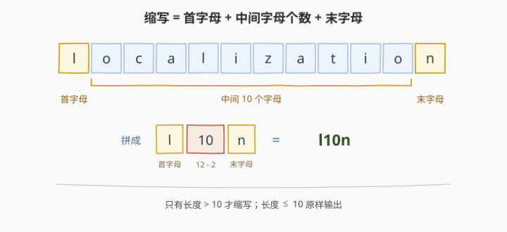
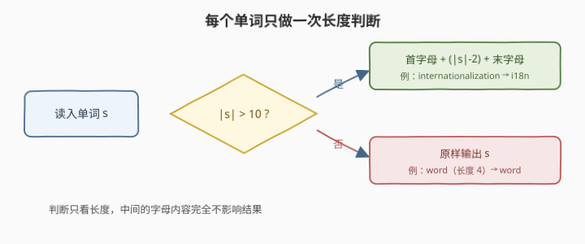

# Codeforces 71A 超长单词缩写 题解

## 1. 题目概述

- **题目链接**：https://codeforces.com/problemset/problem/71/A
- **比赛来源**：Codeforces Beta Round 65 (Div. 2) · Problem A（UTC 2011-03-29）
- **难度**：800
- **标签**：字符串、模拟
- **评测类型**：普通
- **限制**：时间 1 s / 内存 256 MB

**题意**：输入 $n$ 个小写字母单词。长度**严格大于** $10$ 的单词要缩写：写成「首字母 + 首尾之间字母的个数（十进制、不带前导零）+ 末字母」；长度不超过 $10$ 的单词原样保留。按输入顺序输出 $n$ 行结果。

**约束**：

- $1 \le n \le 100$，每个单词长度 $1 \sim 100$、只含小写拉丁字母且**不含空格**，因此输入总长不超过 $10^4$，任何 $O(\text{总长})$ 的做法都远快于 1 s，不需要任何数据结构。
- 单词内没有空格，可以按 token 逐个读入（`cin >> s` / `split()`），不必按行处理，也不会被行末多余空白干扰。
- 长度上限只有 $100$，被缩写的单词满足 $11 \le |s| \le 100$，所以「中间字母个数」$|s|-2$ 的取值范围是 $9 \sim 98$：它**永远至少是一位数**，既不会出现 $0$、也不会出现负数，更不需要补前导零。这条不等式是"不用特判零"的全部理由。

## 2. 示例与观察

官方样例（输入 / 输出原样）：

```text
输入：
4
word
localization
internationalization
pneumonoultramicroscopicsilicovolcanoconiosis

输出：
word
l10n
i18n
p43s
```

逐个单词演算：

| 单词 | 长度 | 是否缩写 | 中间字母个数 | 输出 |
|------|------|----------|--------------|------|
| `word` | 4 | 否（$4 \le 10$） | — | `word` |
| `localization` | 12 | 是 | $12-2 = 10$ | `l` + `10` + `n` = `l10n` |
| `internationalization` | 20 | 是 | $20-2 = 18$ | `i` + `18` + `n` = `i18n` |
| `pneumonoultramicroscopicsilicovolcanoconiosis` | 45 | 是 | $45-2 = 43$ | `p` + `43` + `s` = `p43s` |

**观察一**：缩写结果只由三个量决定——首字母、末字母、长度。中间的字母具体是什么完全无关，所以根本不需要"复制中间部分再删除"，只要拿到长度即可。

**观察二**：题目说的是"长度**严格大于** $10$"才缩写。长度恰好为 $10$ 的单词必须原样输出，这一格是最常见的 WA 来源。

**观察三**：缩写里的数字是十进制计数，不含前导零。由于被缩写的单词长度至少 $11$，计数至少 $9$，天然满足"无前导零"，实现时直接把整数转成字符串即可。

自造样例（标注"自造"，覆盖阈值两侧、最短、最长）：

```text
输入：
5
a
abcdefghij
abcdefghijk
abcdefghijklmnopqrst
aaaaaaaaaaaaaaaaaaaaaaaaaaaaaaaaaaaaaaaaaaaaaaaaaaaaaaaaaaaaaaaaaaaaaaaaaaaaaaaaaaaaaaaaaaaaaaaaaaaa

输出：
a
abcdefghij
a9k
a18t
a98a
```

- `a`：长度 $1$，原样输出；首字母与末字母是同一个字符，但走不到缩写分支，安全。
- `abcdefghij`：长度恰好 $10$，**不缩写**。
- `abcdefghijk`：长度 $11$，最小可缩写情形，中间 $9$ 个字母，得到 `a9k`（一位数计数）。
- `abcdefghijklmnopqrst`：长度 $20$，得到 `a18t`。
- 100 个 `a`：长度取到上限 $100$，中间 $98$ 个字母，得到 `a98a`（两位数计数）。

## 3. 解题思路

### 3.1 朴素做法与瓶颈

最直白的写法是"逐字符搬运"：先把 `s[0]` 写进答案，再从下标 $1$ 扫到 $|s|-2$ 数出中间字母的个数，把这个整数转成字符串拼上，最后拼 `s.back()`。

这个做法的复杂度已经是 $O(|s|)$，本题真正的困难不在时间，而在**边界与格式**，它容易让人写出两类错误：

1. 把"长度大于 $10$"记成"长度大于等于 $10$"，于是 `abcdefghij` 被错误地缩成 `a8j`。
2. 用字符运算代替整数转字符串，例如把计数直接 `static_cast<char>` 后输出，得到的会是一个控制字符而不是 `"43"`。

如果为了"保险"再按长度分档写十个 `if` 分支，代码会迅速膨胀且仍然要靠人肉核对每一档。所以正确的方向不是"更细的分支"，而是找到一个统一公式。

### 3.2 核心观察：三个数就够了



如上图，`localization` 一共 12 个字母，缩写的三个部分是：

- 首字母 `l`；
- 中间字母个数 $12 - 2 = 10$（去掉首尾各一个）；
- 末字母 `n`。

中间的 `ocalizatio` 十个字母本身对结果没有任何影响——它们只贡献了"个数"。于是对任意单词 $s$：

$$
\text{answer}(s) =
\begin{cases}
s, & |s| \le 10,\\
s_0 \;+\; \operatorname{dec}(|s|-2) \;+\; s_{|s|-1}, & |s| > 10,
\end{cases}
$$

其中 $\operatorname{dec}(x)$ 表示 $x$ 的十进制写法（无前导零）。

### 3.3 算法流程



1. 读入 $n$；
2. 对每个单词 $s$：
   - 若 $|s| \le 10$，直接输出 $s$；
   - 否则输出 `s[0]`、`|s|-2`、`s[-1]` 三段拼接的结果；
3. 每行一个，共 $n$ 行。

实现细节：C++ 里 `s.size()` 是无符号类型，必须先判断 `s.size() > 10` 再做 `s.size() - 2`，顺序反了会下溢；`cout << s.size() - 2` 直接输出无符号整数，正好是十进制写法。Python 里 `str(len(s) - 2)` 即可。

### 3.4 样例走查

以 `internationalization`（20 个字母）为例：首字母 `i`、末字母 `n`、中间 $20-2=18$ 个字母，拼成 `i18n`。以 45 个字母的 `pneumonoultramicroscopicsilicovolcanoconiosis` 为例：`p` + `43` + `s` = `p43s`。四个样例的输出与上表完全一致。

## 4. 正确性证明

**引理 1**：对任意单词 $s$，首字母与末字母之间的字母个数恰为 $|s|-2$。

证明：单词长度为 $|s|$，首字母占 $1$ 位、末字母占 $1$ 位，其余位置都在两者之间，故个数为 $|s|-2$。当 $|s| \ge 1$ 时该值非负。∎

**引理 2**：若 $|s| > 10$，则 $|s|-2 \ge 9$，其十进制表示不含前导零，也不为 $0$。

证明：$|s| \ge 11$ 推出 $|s|-2 \ge 9$。十进制整数 $x \ge 9$ 的表示首位非零（$x \ge 1$ 即无前导零），且 $x \ne 0$。∎

**引理 3**：题目要求的缩写只依赖 $s_0$、$s_{|s|-1}$、$|s|$ 三个量。

证明：缩写定义规定输出「首字母、中间字母个数、末字母」，中间字母的内容没有出现在输出里，因此输出是这三个量的函数。∎

**定理**：上述算法对每个单词的输出都与题面定义一致，因此整体输出正确。

证明：分两种情况。若 $|s| \le 10$，题面要求"not too long words should not undergo any changes"，算法直接输出 $s$，一致。若 $|s| > 10$，算法输出 $s_0 \cdot \operatorname{dec}(|s|-2) \cdot s_{|s|-1}$；由引理 1，中间的计数正确，由引理 2，该计数的十进制写法无前导零、无零值，正符合题面"number of letters between the first and the last letters … doesn't contain any leading zeroes"；由引理 3，其余信息无需参与。故两种情况都与定义一致。∎

## 5. 复杂度分析

- **时间**：读入每个单词 $O(|s|)$，输出每个答案 $O(|s|)$（缩写后更短），总计 $O\!\left(\sum |s|\right) \le 10^4$ 次字符操作，1 s 的时限下有 $10^4$ 倍以上余量。
- **空间**：除输入输出缓冲外只需常数个变量，$O(1)$；C++ 用 `string` 存当前单词，最多 $100$ 字节。
- 该复杂度与 $n$、$|s|$ 的上限都无关紧要——即使把上限放大到 $10^6$，线性做法依然轻松通过。

## 6. 参考代码

### C++17

```cpp
#include <bits/stdc++.h>
using namespace std;

int main() {
    int n;
    if (!(cin >> n)) return 0;
    while (n--) {
        string s;
        cin >> s;
        if ((int)s.size() > 10)
            cout << s.front() << s.size() - 2 << s.back() << '\n';
        else
            cout << s << '\n';
    }
    return 0;
}
```

### Python3

```python
import sys


def main():
    data = sys.stdin.read().split()
    n = int(data[0])
    res = []
    for i in range(1, n + 1):
        s = data[i]
        if len(s) > 10:
            res.append(s[0] + str(len(s) - 2) + s[-1])
        else:
            res.append(s)
    sys.stdout.write("\n".join(res) + "\n")


if __name__ == "__main__":
    main()
```

## 7. 边界情况与易错点

1. **阈值是严格大于 10**：长度恰好为 $10$ 的单词必须原样输出；把条件写成 `>= 10` 会把 `abcdefghij` 错缩成 `a8j`。
2. **无符号减法顺序**：`s.size()` 是 `size_t`，必须先判断 `s.size() > 10` 再算 `s.size() - 2`；顺序颠倒时长度为 $1$ 的单词会下溢成 $2^{64}-1$ 级别的巨大数字。
3. **计数必须是十进制整数**：用 `char` 或 `'0' + count` 拼字符串只能处理 $0 \sim 9$，本题计数可达 $98$，必须走整数转字符串。
4. **不需要补前导零**：被缩写的单词长度至少 $11$，计数至少 $9$，因此不会出现 `l010n` 这种需要补零的情形；反过来，如果阈值被改小（例如改成 $> 3$），就必须处理计数为一位数还是多位数。
5. **输入是 token 流**：单词之间用换行分隔且单词内无空格，按 token 读入即可；不要用 `getline` 后不处理空行，否则遇到行末 `\r` 会多出一个空单词。
6. **最后一行也要换行**：题目要求输出 $n$ 行，逐行输出并保证每行以换行结束；虽然 CF 的 token 比较忽略行尾空白，但按格式输出更稳妥。
7. **Python 的字符串拼接**：`s[0] + str(len(s) - 2) + s[-1]` 对长度 $1$ 的字符串也成立（走不到该分支），但不要在 `len(s) <= 10` 的分支里做任何索引运算，避免空串等退化输入。

## 8. 验证记录

- **编译环境与命令**：本机无 GNU `g++`，`verify_solution.py` 自动改用 `clang++ -std=c++17 -O2` 加仓库内兼容头 `codeforces/tools/include/bits/stdc++.h`；Python 为 3.9.6。
- **官方样例**：1 / 1 通过。

  ```text
  python3 codeforces/tools/verify_solution.py "codeforces/contests/0001-0100/71/A_超长单词缩写.md"
  CF71A: samples 1
    C++ 编译 OK, 样例 1/1, 最慢 3 ms
    Python 语法 OK, 样例 1/1
  ```

  上述毫秒数为单次运行结果（含进程启动），随机器负载有 ±1 ms 抖动。

- **暴力对拍（300 组，全部实跑）**：独立暴力 `/tmp/cf_verify_71_A/brute.py` 用"逐字符数出中间字母个数"的另一套写法（`for ch in s[1:-1]: cnt += 1`）实现，与正解读同一输入、各自输出。数据构成：300 组随机数据（$n \in [1,8]$，单词长度在 $\{1,2,9,10,11,12,30,100\}$ 与 $[1,100]$ 随机中抽取），逐组比对 token 序列，**0 处不符**。
- **自造边界用例**：长度 $1$、长度 $9$、长度 $10$、长度 $11$、长度 $100$ 各若干，C++ 与 Python 输出一致，且与手算结果（`a9k`、`a98a` 等）一致。
- **最大约束性能**：$n = 100$、每个单词 $100$ 个字母，C++ 端到端 $3 \sim 5$ ms/次（含进程启动，多次运行取范围），远低于 1 s 时限；Python 同样为毫秒级。
- **复核状态**：verified。

## 相关题目与扩展

- [CF 59A Word](https://codeforces.com/problemset/problem/59/A)：统计大小写字母个数并统一转换，同属"逐字符统计后按规则改写"。
- [CF 118A String Task](https://codeforces.com/problemset/problem/118/A)：删除元音、插入点号，练习字符级改写与输出格式。
- [CF 112A Petya and Strings](https://codeforces.com/problemset/problem/112/A)：字符串字典序比较（大小写不敏感），练习读入与比较。

**延伸思考**：

1. **缩写是否可能产生歧义**？题面把缩写定义为"字母 + 数字 + 字母"，而输入只含小写字母，所以缩写结果里出现的数字不可能与本来的单词混淆，这套编码是前缀无歧义的。若输入允许数字，`a10n` 就既可能是缩写也可能是原文，需要额外的转义规则。
2. **把阈值换成 $k$**：若"过长"定义为长度 $> k$，则计数 $|s|-2$ 的范围是 $k-1 \sim 98$，当 $k \le 11$ 时计数可能是一位数，此时"不含前导零"才真正开始起作用；可以顺手写出"计数位数 $= \lfloor \log_{10}(|s|-2) \rfloor + 1$"来判断。
3. **改成保留前 $p$ 后 $q$ 个字母**：即形如 `s[0..p-1] + dec(|s|-p-q) + s[|s|-q..]`，规则仍只需长度，但要注意 $|s|-p-q \ge 0$ 的前提，否则会输出负数计数。
4. **与游程编码（RLE）的区别**：RLE 压缩的是"连续重复字符"，本题压缩的是"中间那一大段与语义无关的字母"，本质是"只保留可辨识的两端"。后者在字典/索引的截断显示（如 `internationalization` 显示为 `i18n`）里很常见。
