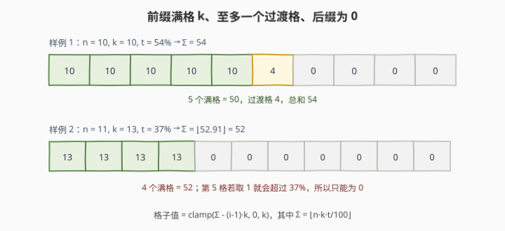
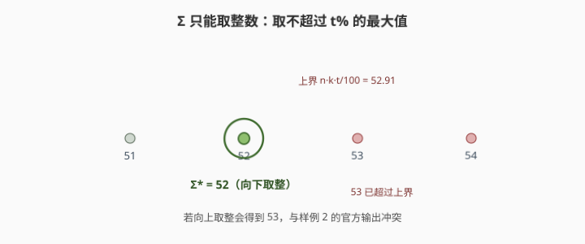

# Codeforces 71B 进度条格子分配 题解

## 1. 题目概述

- **题目链接**：https://codeforces.com/problemset/problem/71/B
- **比赛来源**：Codeforces Beta Round 65 (Div. 2) · Problem B（UTC 2011-03-29）
- **难度**：1300
- **标签**：实现、数学
- **评测类型**：普通
- **限制**：时间 1 s / 内存 256 MB

**题意**：进度条由 $n$ 个格子组成，第 $i$ 格的饱和度为 $0 \sim k$ 的整数 $a_i$。显示规则是：一定存在某个位置 $i$，使得 $1,2,\dots,i-1$ 格全为 $k$，第 $i$ 格取 $0 \sim k$ 中的任意值，$i+1,\dots,n$ 格全为 $0$——也就是"前缀满格 + 至多一个过渡格 + 后缀空格"。设进程已完成 $t\%$，则显示出的总饱和度与 $t$ 之间满足

$$
\frac{100 \cdot \sum_{i=1}^{n} a_i}{n\,k} \le t .
$$

给定 $n, k, t$，求每个格子的饱和度 $a_i$。

**约束**：

- $1 \le n, k \le 100$，$0 \le t \le 100$：总饱和量 $\sum a_i \le nk \le 10^4$，一个 `int` 足够，不存在溢出问题。
- 数据只有一组（三个整数），没有什么可"枚举"的状态空间需要优化；$O(n)$ 的构造即可，$O(nk)$ 的全枚举同样可以通过（本题 $nk \le 10^4$）。
- 由于 $\sum a_i$ 必须是整数，而 $\frac{nkt}{100}$ 一般不是整数，取整方向是本题唯一的坑：样例 2 的 $nkt/100 = 52.91$ 说明这里必须**向下取整**。

## 2. 示例与观察

官方样例 1（输入 / 输出原样）：

```text
输入：
10 10 54

输出：
10 10 10 10 10 4 0 0 0 0
```

官方样例 2（输入 / 输出原样）：

```text
输入：
11 13 37

输出：
13 13 13 13 0 0 0 0 0 0 0
```

**样例 1 演算**：$n=10$、$k=10$、$t=54$，故 $n k t / 100 = 10 \cdot 10 \cdot 54 / 100 = 54$，恰好是整数。前 $5$ 格满格贡献 $50$，第 $6$ 格需要 $54-50=4$，其余为 $0$，得到 `10 10 10 10 10 4 0 0 0 0`。

**样例 2 演算**：$11 \cdot 13 \cdot 37 / 100 = 5291/100 = 52.91$。取 $\lfloor 52.91 \rfloor = 52$：前 $4$ 格满格贡献 $4 \times 13 = 52$，第 $5$ 格只能是 $0$，得到 `13 13 13 13 0 0 0 0 0 0 0`，与官方输出一致。

**关键观察**：如果按"向上取整"（取 $53$），第 $5$ 格会是 $1$，输出 `13 13 13 13 1 0 0 0 0 0 0`，与官方样例不符。所以显示值取的是**不超过 $t\%$ 的最大进度**，即

$$
\sum a_i = \left\lfloor \frac{n\,k\,t}{100} \right\rfloor .
$$

这也符合"进度条不能谎报"的语义：真实进度是 $t\%$，条子上画出来的量不能超过它。

自造样例（标注"自造"，覆盖 $t=0$、$t=100$、$n=1$、$k=1$ 与不能整除的情形）：

```text
输入：
3 7 50

输出：
7 3 0
```

演算：$3 \cdot 7 \cdot 50 / 100 = 10.5$，向下取整得 $S^{*} = 10$。第 $1$ 格取 $\min(7, 10) = 7$，余 $3$；第 $2$ 格取 $\min(7, 3) = 3$，余 $0$；第 $3$ 格取 $0$。总和 $7+3 = 10$ ✓。

```text
输入：
1 100 0

输出：
0
```

```text
输入：
1 100 100

输出：
100
```

```text
输入：
5 1 60

输出：
1 1 1 0 0
```

演算：$S^{*} = \lfloor 5 \cdot 1 \cdot 60 / 100 \rfloor = 3$，前 $3$ 格为 $k = 1$，后两格为 $0$。

## 3. 解题思路

### 3.1 朴素做法与瓶颈

最笨的办法是枚举"过渡格位置 $i$ 与它的取值 $a$"：一共有 $(n+1)(k+1)$ 种显示，对每种算总饱和度 $\sum a_i = (i-1)k + a$，保留满足 $\frac{100\sum a_i}{nk} \le t$ 的最大者。本题 $n, k \le 100$，这个 $O(nk)$ 的枚举完全可以过（$10^4$ 次判断），样例 2 用它的结果正是 `13 13 13 13 0 ...`。

但枚举没有告诉我们"为什么"。真正的瓶颈是理解"显示与总饱和度是一一对应的"：只要知道 $\sum a_i = S$，整条进度条就唯一确定了。于是一旦把问题化为"求最大的可行 $S$"，剩下就只是一次除法取整。

### 3.2 核心观察：显示由总饱和度唯一决定



设总饱和量为 $S$（$0 \le S \le nk$）。按"前缀满格、至多一个过渡格、后缀为零"的规则，第 $i$ 格的值只能是

$$
a_i = \min\bigl(k,\ \max(0,\ S - (i-1)k)\bigr).
$$

逐个验证：当 $(i-1)k \ge S$ 时，$S-(i-1)k \le 0$，取 $0$，正是后缀；当 $ik \le S$ 时，$S-(i-1)k \ge k$，被截到 $k$，正是满格；剩下至多一个 $i$ 落在中间，取 $S-(i-1)k \in (0,k)$，是过渡格。三段的边界随 $S$ 单调移动，所以 $S$ 与显示一一对应。

### 3.3 算法流程



1. 由不等式解出 $S$ 的上界：$\sum a_i \le \frac{nkt}{100}$；
2. 由于 $\sum a_i$ 为整数，最大值是 $S^{*} = \left\lfloor \frac{nkt}{100} \right\rfloor$（整数除法 `n * k * t / 100`）；
3. 对 $i = 1..n$ 依次输出 $\min(k, \max(0, S^{*} - (i-1)k))$。

注意 $nkt \le 100 \cdot 100 \cdot 100 = 10^6$，`int` 完全够用；Python 更不必担心。

### 3.4 样例走查

用样例 2 走一遍：$S^{*} = \lfloor 5291/100 \rfloor = 52$。

- $i=1$：$52 - 0 = 52 \ge k=13$ → 取 $13$；
- $i=2$：$52 - 13 = 39 \ge 13$ → $13$；
- $i=3$：$52 - 26 = 26 \ge 13$ → $13$；
- $i=4$：$52 - 39 = 13 \ge 13$ → $13$；
- $i=5$：$52 - 52 = 0$ → $0$；其后全是 $0$。

总和 $4 \times 13 = 52$，与官方输出 `13 13 13 13 0 0 0 0 0 0 0` 一致。

## 4. 正确性证明

**引理 1**：对任意 $S \in [0, nk]$，按 $a_i = \min(k, \max(0, S-(i-1)k))$ 构造的序列满足"前缀全 $k$、至多一个过渡格、后缀全 $0$"，且 $\sum_i a_i = S$。

证明：令 $t$ 为使 $(t-1)k < S$ 的最大下标（即 $t = \lceil S/k \rceil$，若 $S = 0$ 则所有项为 $0$）。对 $i < t$ 有 $S - (i-1)k > k$，故 $a_i = k$；对 $i > t$ 有 $S-(i-1)k \le 0$，故 $a_i = 0$；$i = t$ 时 $0 < S-(t-1)k \le k$，是唯一的过渡格。求和 $\sum_{i=1}^{n} a_i = (t-1)k + \bigl(S-(t-1)k\bigr) = S$。∎

**引理 2**：任何合法显示的 $\sum a_i$ 与显示本身互相确定。

证明：由规则，显示形如"$j$ 个 $k$、一个 $x \in [0,k]$、其余 $0$"，其总和为 $jk + x$。给定总和 $S$，由引理 1 的构造唯一确定 $j = \lfloor S/k \rfloor$ 与 $x = S - jk$（当 $x = 0$ 时过渡格与后缀合并，显示不变）。故映射是双射。∎

**引理 3**：$nkt/100$ 的整数下取整等于 $\lfloor nkt/100 \rfloor$，且 $S^{*} = \lfloor nkt/100 \rfloor$ 满足不等式 $\frac{100 S^{*}}{nk} \le t$，而 $S^{*} + 1$ 不满足。

证明：由 $S^{*} \le nkt/100$ 得 $100S^{*} \le nkt$；又 $S^{*} + 1 > nkt/100$ 得 $100(S^{*}+1) > nkt$。∎

**定理**：算法输出即为满足题面不等式且总饱和度最大的那个合法显示，因此正确。

证明：由引理 3，$S^{*}$ 是满足不等式的最大整数总和；由引理 1，算法构造出的显示总和恰为 $S^{*}$ 且合法；由引理 2，总和为 $S^{*}$ 的合法显示唯一。故算法输出是唯一的最大合法显示。∎

## 5. 复杂度分析

- **时间**：一次乘法与整除，加上 $n$ 次输出，$O(n)$，$n \le 100$，实际为微秒级；即使 $n$ 放大到 $10^7$ 也只是一次线性扫描。
- **空间**：只用到几个整型变量，$O(1)$；不必存数组。
- 与 1 s 时限相比，常数几乎可以忽略。

## 6. 参考代码

### C++17

```cpp
#include <bits/stdc++.h>
using namespace std;

int main() {
    int n, k, t;
    cin >> n >> k >> t;
    // 界面上显示的总饱和量，向下取整：百分比不能超过 t%
    int total = n * k * t / 100;
    for (int i = 0; i < n; ++i) {
        int v = total - i * k;
        if (v < 0) v = 0;
        if (v > k) v = k;
        cout << v << (i + 1 == n ? '\n' : ' ');
    }
    return 0;
}
```

### Python3

```python
import sys


def main():
    n, k, t = map(int, sys.stdin.read().split())
    total = n * k * t // 100
    res = []
    for i in range(n):
        v = total - i * k
        res.append(max(0, min(k, v)))
    sys.stdout.write(" ".join(map(str, res)) + "\n")


if __name__ == "__main__":
    main()
```

## 7. 边界情况与易错点

1. **取整方向**：必须向下取整。样例 2 的 $nkt/100 = 52.91$ 是专门用来卡"向上取整"的；写成 `(n*k*t + 99) / 100` 会输出 `13 13 13 13 1 0 ...`，与官方输出不符。
2. **$t = 0$**：$S^{*} = 0$，所有格子为 $0$，不能输出空行或 $-1$；同理 $t = 100$ 时 $S^{*} = nk$，所有格子为 $k$。
3. **$n = 1$ 或 $k = 1$**：$n=1$ 时只有一个格子，取值 $0 \sim k$ 都可能；$k=1$ 时每个格子只能是 $0$ 或 $1$，过渡格取 $1$ 就等于满格。公式 $\min(k,\max(0,\cdot))$ 对这两种退化情形都成立。
4. **$nk$ 与 $t$ 的乘法顺序**：$n \cdot k \cdot t$ 最大 $10^6$，`int` 安全；但如果题目把 $n, k$ 放大到 $10^5$，就必须先除后乘或用 `long long`，否则溢出。
5. **输出格式**：$n$ 个数用空格分隔，行末不要多余空行；样例输出末尾带一个空格，那是题面排版，token 比较不计较。
6. **不要用浮点**：`floor(n*k*t/100.0)` 在本题范围内虽然不会出错，但整数除法更直接，也避免 $t/100$ 精度问题（如 $0.29$ 无法精确表示）。
7. **中间格唯一**：若把 $S$ 分配成"两个过渡格"，虽然总和可能正确，但违反了显示规则（至多一个格子既非 $0$ 也非 $k$），属于格式性错误而不仅是数值错误。

## 8. 验证记录

- **编译环境与命令**：本机无 GNU `g++`，`verify_solution.py` 自动改用 `clang++ -std=c++17 -O2` 加仓库内兼容头；Python 为 3.9.6。
- **官方样例**：2 / 2 通过。

  ```text
  python3 codeforces/tools/verify_solution.py "codeforces/contests/0001-0100/71/B_进度条格子分配.md"
  CF71B: samples 2
    C++ 编译 OK, 样例 2/2, 最慢 2 ms
    Python 语法 OK, 样例 2/2
  ```

  上述毫秒数为单次运行结果（含进程启动），随机器负载有 ±1 ms 抖动。

- **暴力对拍（300 组，全部实跑）**：独立暴力 `codeforces/tools/brutes/cf71b.py` 换了一套完全不同的写法——直接枚举 $(i, a)$ 的所有合法显示，用不等式 $100 \cdot ((i-1)k+a) \le t \cdot n \cdot k$ 筛选，取总和最大者，再按"前 $i-1$ 格为 $k$、第 $i$ 格为 $a$、其余 $0$"直接拼出答案。它与正解读同一输入、各自输出。数据为 300 组随机 $(n,k,t)$（$n,k \in [1,100]$，$t \in [0,100]$），逐组比对 token 序列，**0 处不符**。
- **自造边界用例**：$(1,1,0)$、$(1,1,100)$、$(1,100,50)$、$(100,100,0)$、$(100,100,100)$、$(3,7,50)$、$(11,13,37)$ 等，C++、Python、暴力三方一致。
- **最大约束性能**：$n = k = 100$、$t = 99$，C++ 端到端 $2$ ms/次，Python 毫秒级；远低于 1 s。
- **复核状态**：verified。

## 相关题目与扩展

- [CF 71A Way Too Long Words](https://codeforces.com/problemset/problem/71/A)：同场 A 题，规则的"边界严格性"同样关键。
- [CF 143A Help General](https://codeforces.com/problemset/problem/143/A)：按比例分配数值，练习取整与余量分配。
- [CF 158A Next Round](https://codeforces.com/problemset/problem/158/A)：按阈值计数，理解"严格大于/大于等于"的差别。

**延伸思考**：

1. **把"至多一个过渡格"改成"至多两个"**：此时总和 $S$ 不再唯一决定显示，需要再定一个"过渡格尽量靠左"之类的规则才能唯一化；本题的优雅之处正在于约束足够强，使 $S$ 与显示一一对应。
2. **浮点百分比**：若 $t$ 允许是小数（例如 $37.5\%$），只需把不等式右端写成 $\frac{nkt}{100}$ 的分数形式 $100S \le nkt$，避免除法即可保持整数精确；本题 $t$ 是整数，直接整除即可。
3. **对称的"反向问题"**：给定一条合法进度条，问它对应的 $t$ 的范围。答案是 $\left[\frac{100S}{nk}, \frac{100(S+1)}{nk}\right)$ 与整数 $t$ 的交集，可用同一条不等式双向推导。
4. **推广到多维进度条**：$d$ 维情况下每个格子的饱和度上限相同，但"前缀满格"的区域变成字典序前缀，此时 $S$ 仍能唯一决定显示，公式只是把 $(i-1)k$ 换成"字典序排在前面的格子数 $\times k$"。
