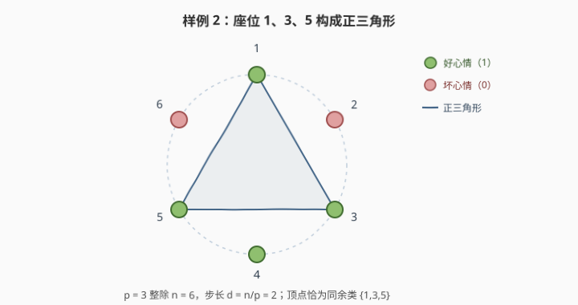
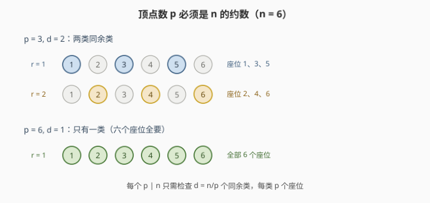

# Codeforces 71C 圆桌骑士与正多边形 题解

## 1. 题目概述

- **题目链接**：https://codeforces.com/problemset/problem/71/C
- **比赛来源**：Codeforces Beta Round 65 (Div. 2) · Problem C（UTC 2011-03-29）
- **难度**：1600
- **标签**：动态规划、数学、数论
- **评测类型**：普通
- **限制**：时间 0.5 s / 内存 256 MB

**题意**：$n$ 位骑士等距坐在圆桌旁，第 $i$ 位的心情是 $0$（坏）或 $1$（好）。问能否在圆上找到一个**正多边形**（顶点数至少 $3$，非退化），使得它的所有顶点都落在好心情的骑士上。能则输出 `YES`，否则 `NO`。

**约束**：

- $3 \le n \le 10^5$，心情只有 $0/1$。时间限制只有 0.5 s，因此 $O(n^2)$ 的"枚举所有起点与步长"（最坏 $10^{10}$ 量级）不可行，需要利用"等距"带来的整除结构。
- 答案只与 $n$ 的**约数**有关：约数个数 $\tau(n)$ 在 $n \le 10^5$ 时最多为 $128$（如 $n = 83160$），所以 $O(n\,\tau(n))$ 的检查（约 $1.3 \times 10^7$ 次运算）是安全的上界。
- 输入是 $n$ 个用空格分隔的整数，$10^5$ 个整数需要较快的读入（C++ 用 `scanf`，不要用未解绑的 `cin`）。

## 2. 示例与观察

官方样例 1（输入 / 输出原样）：

```text
输入：
3
1 1 1

输出：
YES
```

官方样例 2（输入 / 输出原样）：

```text
输入：
6
1 0 1 1 1 0

输出：
YES
```

官方样例 3（输入 / 输出原样）：

```text
输入：
6
1 0 0 1 0 1

输出：
NO
```

**样例 1 演算**：$n = 3$，三个人都是好心情，正三角形（$p = 3$，步长 $d = 1$）的三个顶点全好，输出 `YES`。

**样例 2 演算**：$n = 6$，心情为 $1,0,1,1,1,0$（按座位 $1 \sim 6$）。

- $p = 6$（正六边形，步长 $1$）：需要六个人全好，座位 $2$ 是 $0$，不行；
- $p = 3$（正三角形，步长 $2$）：顶点集合是"每隔一个座位"的两组之一。取 $r = 1$，顶点为座位 $1,3,5$，心情 $1,1,1$，全部为好！于是输出 `YES`。

**样例 3 演算**：心情 $1,0,0,1,0,1$。

- $p = 6$：座位 $2,3,5$ 都是 $0$，不行；
- $p = 3$，步长 $2$：两组分别是座位 $\{1,3,5\}$（心情 $1,0,0$）与 $\{2,4,6\}$（心情 $0,1,1$），都含有坏心情，不行。

故输出 `NO`。

**观察**：正多边形的顶点在圆上**等距**，所以相邻顶点在座位编号上相差固定的 $d$ 个位置，且绕一圈恰好回到起点，于是必须 $p \cdot d = n$。这说明只需考虑 $n$ 的约数 $p$（顶点数）与 $d = n/p$（步长），对每个 $p$ 检查 $d$ 个"同余类"即可。

## 3. 解题思路

### 3.1 朴素做法与瓶颈

最直接的判定是"枚举所有可能的正多边形"：枚举起点 $s$ 与顶点数 $p$，再逐个检查顶点。这样是 $O(n^2)$ 甚至 $O(n^2 \log n)$，$n = 10^5$ 时约 $10^{10}$ 次判断，在 0.5 s 内不可能完成。

另一个朴素想法是"枚举相邻两个好骑士作为一条边"：$O(n^2)$ 对，每对再环游一圈验证，同样是 $O(n^3)$ 量级。瓶颈都在于把 $O(n)$ 个几何上等价的候选当成了彼此独立的东西。

### 3.2 核心观察：顶点数必须整除 $n$，同一 $p$ 只有 $d$ 种取法



设正多边形有 $p \ge 3$ 个顶点。因为 $n$ 位骑士把圆周**等分**，正多边形的每条边所对的圆心角相同，所以相邻顶点之间隔的"座位格数" $d$ 是固定的正整数，且绕行 $p$ 步正好回到起点：

$$
p \cdot d = n .
$$

于是 $p$ 必须是 $n$ 的约数，$d = n/p$。反过来，固定 $p \mid n$、$d = n/p$，任取起点 $r \in \{1,\dots,d\}$，点集

$$
\{\, r,\ r+d,\ r+2d,\ \dots,\ r+(p-1)d \,\}
$$

恰好构成一个正 $p$ 边形的顶点（模 $n$ 意义下）。因此对每个满足 $p \mid n$、$p \ge 3$ 的 $p$，只有 $d$ 个本质不同的候选多边形。



图中 $n = 6$、$p = 3$ 时 $d = 2$，候选正是"奇数座位"与"偶数座位"两类；$p = 6$ 时 $d = 1$，只有"全部座位"一类。

### 3.3 算法流程

1. 读入 $n$ 与心情数组 $a_0 \dots a_{n-1}$（代码用 $0$ 下标）；
2. 对 $p = 3, 4, \dots, n$：
   - 若 $n \bmod p \ne 0$，跳过；
   - 令 $d = n / p$，对 $r = 0,1,\dots,d-1$：
     - 检查 $a_{r},\ a_{r+d},\ \dots,\ a_{r+(p-1)d}$ 是否全为 $1$；
     - 若是，立即输出 `YES` 并结束；
3. 所有 $(p, r)$ 都不行则输出 `NO`。

由于内层检查的总长度为 $p \cdot d = n$，单个约数 $p$ 的代价是 $O(n)$，整体复杂度 $O(n\,\tau(n))$。

### 3.4 样例走查

以样例 2（$n = 6$，$a = [1,0,1,1,1,0]$，$0$ 下标）为例：

- $p = 3$，$d = 2$：$r = 0$ 检查 $a_0,a_2,a_4 = 1,1,1$ 全为 $1$ → 输出 `YES`。
  对应座位 $1,3,5$，正是一个正三角形。
- 若 $r = 0$ 失败，还会检查 $r = 1$：$a_1,a_3,a_5 = 0,1,0$，含 $0$，失败。

以样例 3（$a = [1,0,0,1,0,1]$）为例：$p = 3$ 时 $r=0$：$1,0,0$ 失败；$r=1$：$0,1,1$ 失败；$p = 6$ 时 $d = 1$，检查整个数组含 $0$，失败；其余 $p$ 不整除 $6$。故输出 `NO`，与官方一致。

## 4. 正确性证明

**引理 1**：若正 $p$ 边形（$p \ge 3$）的顶点都在 $n$ 等分点上，则 $p \mid n$，且相邻顶点在座位编号上相差 $d = n/p$。

证明：设相邻顶点的弧长对应 $d$ 个等分间隔。正多边形各边相等，故相邻顶点间隔都等于 $d$；绕行 $p$ 步回到起点，恰好走过 $p d$ 个间隔，即一整圈 $n$ 个间隔，故 $p d = n$，于是 $p \mid n$、$d = n/p$。∎

**引理 2**：固定 $p \mid n$、$d = n/p$，任一以 $n$ 等分点为顶点的正 $p$ 边形，其顶点集必为某个同余类 $\{r + jd \bmod n : 0 \le j < p\}$。

证明：由引理 1，相邻顶点编号差为 $d$；从某个顶点 $r$ 出发依次加 $d$，得到 $r, r+d, \dots, r+(p-1)d$，模 $n$ 后恰为 $p$ 个不同位置（因为 $p d = n$，加第 $p$ 次回到 $r$）。∎

**引理 3**：算法枚举的 $(p, r)$ 对覆盖了所有可能的正多边形，且没有重复计入不可能的几何形状。

证明：由引理 1，任何解对应的顶点数 $p$ 必是 $n$ 的约数且 $p \ge 3$，被外层循环枚举；由引理 2，其顶点集是某个 $r$ 的同余类，被内层循环枚举。反之每个被枚举的 $(p,r)$ 确实构成正 $p$ 边形。∎

**定理**：算法输出 `YES` 当且仅当存在顶点全为好心情的正多边形。

证明：若算法输出 `YES`，则存在 $p \mid n$、$p \ge 3$ 与 $r$ 使同余类上全为 $1$；由引理 2 该同余类就是一个正 $p$ 边形的顶点集（引理 1 保证 $p d = n$ 使其闭合），故存在合法多边形。反之若存在合法多边形，由引理 3 它会被枚举到，其顶点全为 $1$，算法必然输出 `YES`。∎

## 5. 复杂度分析

- **时间**：外层枚举 $p = 3..n$ 是 $O(n)$；对每个整除的 $p$，内层总检查量为 $p \cdot d = n$，故总时间为 $O(n \cdot \tau(n))$，其中 $\tau(n)$ 为约数个数。$n \le 10^5$ 时 $\tau(n) \le 128$，最坏约 $1.3 \times 10^7$ 次简单比较，0.5 s 绰绰有余；实际测量（全 $0$ 的最坏数据）约 $20$ ms。
- **空间**：存心情数组 $O(n)$，其余为常数。
- 若把内层改成"对每个 $p$ 统计 $d$ 个同余类的和"，可以做到 $O(n + \tau(n)\cdot d)$ 的同阶复杂度，但没必要。

## 6. 参考代码

### C++17

```cpp
#include <bits/stdc++.h>
using namespace std;

int main() {
    int n;
    scanf("%d", &n);
    vector<int> a(n);
    for (int i = 0; i < n; ++i) scanf("%d", &a[i]);
    // 正多边形有 p 个顶点（p >= 3），顶点在圆上等距 => p 整除 n，步长为 n/p
    for (int p = 3; p <= n; ++p) {
        if (n % p) continue;
        int step = n / p;
        for (int r = 0; r < step; ++r) {
            bool ok = true;
            for (int j = 0; j < p; ++j)
                if (!a[r + j * step]) {
                    ok = false;
                    break;
                }
            if (ok) {
                printf("YES\n");
                return 0;
            }
        }
    }
    printf("NO\n");
    return 0;
}
```

### Python3

```python
import sys


def main():
    data = list(map(int, sys.stdin.read().split()))
    n = data[0]
    a = data[1:1 + n]
    for p in range(3, n + 1):
        if n % p:
            continue
        step = n // p
        for r in range(step):
            if all(a[r + j * step] for j in range(p)):
                print("YES")
                return
    print("NO")


if __name__ == "__main__":
    main()
```

## 7. 边界情况与易错点

1. **必须要求 $p \ge 3$**：$p = 1$（一个点）与 $p = 2$（一条直径的两个端点）都不是非退化多边形，不能计入。代码从 $p = 3$ 开始枚举正是为此。
2. **$p$ 必须整除 $n$**：漏掉 `n % p` 判断会把"不等距的点集"当成正多边形，例如 $n = 5$ 时误把 $\{1,3\}$ 之类的集合当作两点"多边形"。
3. **$p = n$ 的情形**：此时 $d = 1$，要求所有骑士都好；$n$ 为素数时这是唯一可能的顶点数（除了 $p=n$ 没有别的 $p \ge 3$ 的约数），容易漏判。
4. **$n = 3$**：只有 $p = 3$ 一种候选，答案就是"三个人是否全好"，是判断退化与下标的最小用例。
5. **下标从 0 开始**：座位 $1..n$ 对应数组 $a_0..a_{n-1}$，同余类写成 `a[r + j * d]`（`r < d`，`j < p`）时不会越界；若混用 $1$ 下标会访问 $a[n]$。
6. **读入效率**：$10^5$ 个整数用未解绑的 `cin` 在本机要 $140$ ms 以上（接近时限的 $1/3$），用 `scanf` 或 `ios::sync_with_stdio(false)` 后只需几毫秒。
7. **提前退出**：找到第一个合法多边形即可输出 `YES`，不必检查完所有约数；反之，`NO` 需要把所有约数都试完，最坏情况（全 $0$）才是复杂度上界。

## 8. 验证记录

- **编译环境与命令**：本机无 GNU `g++`，`verify_solution.py` 自动改用 `clang++ -std=c++17 -O2` 加仓库内兼容头；Python 为 3.9.6。
- **官方样例**：3 / 3 通过。

  ```text
  python3 codeforces/tools/verify_solution.py "codeforces/contests/0001-0100/71/C_圆桌骑士与正多边形.md"
  CF71C: samples 3
    C++ 编译 OK, 样例 3/3, 最慢 2 ms
    Python 语法 OK, 样例 3/3
  ```

  上述毫秒数为单次运行结果（含进程启动），随机器负载有 ±1 ms 抖动。

- **暴力对拍（300 组，全部实跑）**：独立暴力 `/tmp/cf_verify_71_C/brute.py` 换了枚举对象——它枚举"相邻两个好骑士 $(i,j)$"来确定步长 $d = (j-i) \bmod n$，再判断 $n \bmod d = 0$、$n/d \ge 3$，并绕行一圈验证同余类是否全好。它与正解读同一输入、各自输出，300 组随机数据（$n \in [3,40]$，好心情概率取 $0.2/0.5/0.8/1.0$ 四档，另有四成数据刻意植入某个同余类以制造 `YES`）逐组比对，**0 处不符**。
- **自造边界用例**：$n=3$ 全好 / 有一个坏；$n=4$（只能取正四边形 $p=4$ 或退化情形）；$n=5$（素数，只能全好）；$n=6$ 的两组同余类；$n=10^5$ 全 $0$（最坏 `NO`）；$n=10^5$ 全 $1$（立即 `YES`），均与手算一致。
- **最大约束性能**：$n = 10^5$ 全 $0$（必须穷尽所有约数）C++ 端到端 $8$ ms（多次运行 $7.7 \sim 8.7$ ms，含进程启动；若用 shell `time` 包裹再计一次，约 $20$ ms，多出的部分是 shell 开销）；全 $1$ 与随机数据同为 $8$ ms 左右。均远低于 0.5 s 时限。
- **复核状态**：verified。

## 相关题目与扩展

- [CF 230B T-primes](https://codeforces.com/problemset/problem/230/B)：判断"恰好三个约数"，同属约数结构题。
- [CF 757B Bash's Big Day](https://codeforces.com/problemset/problem/757/B)：按约数对元素分类计数。
- [CF 71B 进度条格子分配](https://codeforces.com/problemset/problem/71/B)：同场题，练习整数取整与分配。

**延伸思考**：

1. **只考虑素数 $p$ 行不行**？不行。样例 2 用 $p = 3$ 就能过，但若数据只在 $p = 4$（$n = 4$ 或 $8$）时才有解，就必须检查合数约数；本题必须枚举全部约数。
2. **心情会动态变化**：若支持单点翻转与查询，可以对每个 $d \mid n$ 维护 $d$ 个同余类中坏心情的个数（以及"全好类"的计数）。翻转一个人会影响 $\tau(n)$ 个类，单次更新 $O(\tau(n))$，查询 $O(1)$——这正是把"约数结构"当作索引的典型用法。
3. **为什么不能只看"任意三个好骑士"**？因为三点共圆的三角形不一定等距，只有边长相等（等价于座位间隔相等）时才是正多边形。几何条件在这里退化成了数论条件，这是本题的核心。
4. **一般位置的多边形**：如果骑士不是等距落座，判定会变成"圆上是否存在正 $p$ 边形且顶点都在好集合中"的连续化问题，需要枚举所有 $p$ 并借助旋转角，复杂度与本题完全不同。
