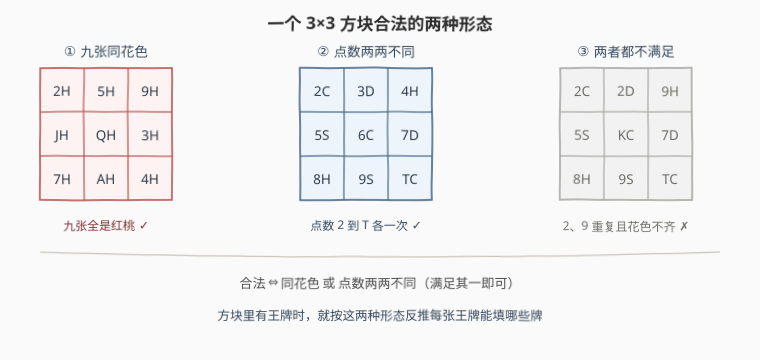
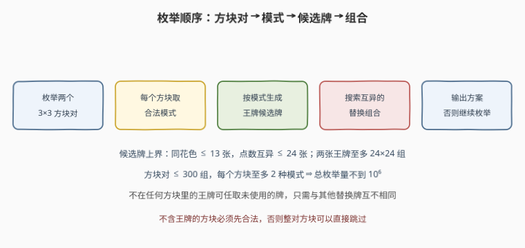
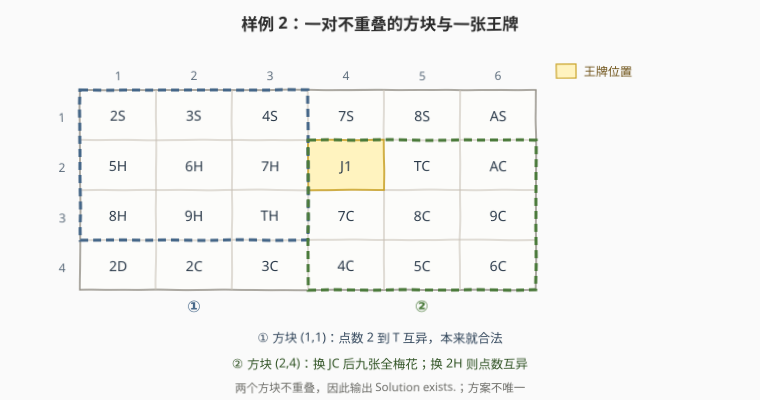

# Codeforces 71D 纸牌接龙与王牌替换 题解

## 1. 题目概述

- **题目链接**：https://codeforces.com/problemset/problem/71/D
- **比赛来源**：Codeforces Beta Round 65 (Div. 2) · Problem D（UTC 2011-03-29）
- **难度**：2200
- **标签**：暴力枚举、实现
- **评测类型**：特殊评测（多解，输出任意一组合法方案）
- **限制**：时间 1.5 s / 内存 256 MB

**题意**：一副牌共 $54$ 张（$52$ 张标准牌 + $2$ 张不同的王牌 `J1`、`J2`），每张牌唯一。Vasya 把其中 $nm$ 张摆成 $n \times m$ 的矩形。如果矩形里出现了王牌，他必须用**没有摆出来的牌**把王牌换掉，直到矩形里一张王牌都不剩；换成哪些牌可以任意选择，但同一张牌在整个牌堆里只出现一次。

换完之后，如果矩形中存在**两个不重叠的 $3\times3$ 方块**，每个方块内部要么 9 张牌**花色全部相同**，要么 9 张牌**点数两两不同**，则称接龙被解开。要求判断初始局面能否解开；若能，输出一种王牌替换方案与两个方块的左上角坐标。

### 1.1 输入契约（按英文原文）

- 第一行两个整数 $n, m$（$3 \le n, m \le 17$，$n \times m \le 52$）。
- 接下来 $n$ 行，每行 $m$ 个、以空格分隔的**两字符**单词，表示从左到右的牌。
  - 王牌写作 `J1` 与 `J2`（分别对应第一张、第二张王牌）；
  - 普通牌第一个字符是点数，取自 `2 3 4 5 6 7 8 9 T J Q K A`（`T` 表示 10），第二个字符是花色，取自 `C D H S`；
  - 所有牌互不相同（因此输入里最多出现两张王牌，且 `J1`、`J2` 各至多一次）。
- 注意 `J1`/`J2` 与"黑桃 J"（写作 `JS`）的区别：只有第二个字符是 `1`/`2` 时才是王牌。

### 1.2 输出契约（按英文原文）

- 若无解，**只输出一行**：`No solution.`
- 若有解，输出四行：
  - 第一行：`Solution exists.`
  - 第二行是三选一：
    - `There are no jokers.`（输入里没有王牌）；
    - `Replace J1 with 2H.` 形式（只有一张王牌时；`J` 后面是这张王牌的编号，`2H` 是换成的那张牌）；
    - `Replace J1 with 2H and J2 with 3C.` 形式（两张王牌都在输入里时；两张替换牌必须不同）。
  - 第三行：`Put the first square to (r, c).`
  - 第四行：`Put the second square to (r, c).`
  - 其中 $(r,c)$ 是 $3\times3$ 方块**左上角**的坐标，行列都从 $1$ 开始计数，取值范围 $1 \le r \le n-2$、$1 \le c \le m-2$。
- 每句话都以英文句点 `.` 结尾（包括 `Solution exists.`、`No solution.`、`There are no jokers.`、`Replace ... .`、`Put ... .`）。
- 多解时输出任意一组；两个方块**不重叠**（不共用格子），但可以相邻。

**约束**：

- $3 \le n, m \le 17$ 且 $n m \le 52$：$3\times3$ 方块的左上角只有 $(n-2)(m-2)$ 个位置，在 $n m \le 52$ 的限制下**最多 $25$ 个**（$7\times7$ 时 $5 \times 5 = 25$），于是方块对最多 $\binom{25}{2} = 300$ 组。这个规模是"枚举所有方块对"能够成立的根本原因。
- 王牌最多两张。若两张王牌都落在方块里，每张的候选牌在"同花色"模式下最多 $13$ 张、在"点数互异"模式下最多 $(13-7)\times4 = 24$ 张，组合数不超过 $24^2 = 576$；乘上 $300$ 组方块对与 $4$ 种模式组合，不超过约 $7\times10^5$ 次常数级检查，1.5 s 绰绰有余。
- 替换牌必须来自"没摆出来的牌"：桌面上的普通牌不能重复使用，两张王牌的替换牌之间也不能相同。这条约束在枚举时必须显式检查。
- 其余 $54 - nm \ge 2$ 张牌始终够用（最多换两张）。

## 2. 示例与观察

官方样例 1（输入 / 输出原样）：

```text
输入：
4 6
2S 3S 4S 7S 8S AS
5H 6H 7H 5S TC AC
8H 9H TH 7C 8C 9C
2D 2C 3C 4C 5C 6C

输出：
No solution.
```

官方样例 2（输入 / 输出原样）：

```text
输入：
4 6
2S 3S 4S 7S 8S AS
5H 6H 7H J1 TC AC
8H 9H TH 7C 8C 9C
2D 2C 3C 4C 5C 6C

输出：
Solution exists.
Replace J1 with 2H.
Put the first square to (1, 1).
Put the second square to (2, 4).
```

官方样例 3（输入 / 输出原样）：

```text
输入：
4 6
2S 3S 4S 7S 8S AS
5H 6H 7H QC TC AC
8H 9H TH 7C 8C 9C
2D 2C 3C 4C 5C 6C

输出：
Solution exists.
There are no jokers.
Put the first square to (1, 1).
Put the second square to (2, 4).
```

**样例 3 演算**（无王牌，先把规则走通）：$n=4$、$m=6$，方块左上角只能落在 $r \in \{1,2\}$、$c \in \{1,2,3,4\}$。

- 方块 $(1,1)$：取第 $1\sim3$ 行、第 $1\sim3$ 列，
  `2S 3S 4S / 5H 6H 7H / 8H 9H TH`，点数 $2,3,4,5,6,7,8,9,T$ 两两不同 → 合法（走"点数互异"）。
- 方块 $(2,4)$：取第 $2\sim4$ 行、第 $4\sim6$ 列，
  `QC TC AC / 7C 8C 9C / 4C 5C 6C`，九张全是梅花 → 合法（走"同花色"）。
- 两个方块分别占第 $1\sim3$ 与 $2\sim4$ 行、第 $1\sim3$ 与 $4\sim6$ 列，不重叠，故输出 `Solution exists.` 与 `There are no jokers.`，坐标是 $(1,1)$ 与 $(2,4)$。

**样例 1 演算**：桌面只比样例 3 少一张 `QC`、多一张 `5S`（在第 $2$ 行第 $4$ 列）。此时 $(1,1)$ 仍然合法，但其余带牌变化的方块都出现重复点数：例如 $(2,4)$ 的九张牌点数是 $5,T,A,7,8,9,4,5,6$，$5$ 出现了两次，而且花色不全相同；$(1,4)$ 的点数 $7,8,A,5,T,A,7,8,9$ 里 $A,7,8$ 都重复。$(1,1)$ 与任何合法方块要么重叠、要么对方不合法，于是 `No solution.`。

**样例 2 演算**：把样例 1 的 $5S$ 换成王牌 `J1`。含 `J1` 的方块是 $(1,4)$ 与 $(2,4)$。取 $(1,1)$ 与 $(2,4)$ 这一对：

- $(1,1)$ 已合法（点数互异）；
- $(2,4)$ 的九张牌为 `J1 TC AC / 7C 8C 9C / 4C 5C 6C`，固定牌全是梅花，属于"同花色"模式的可用形态；把 `J1` 换成任意一张未出现的梅花即可，例如 `2H` 则走"点数互异"（$2,T,A,7,8,9,4,5,6$ 两两不同），换成 `JC` 则走"同花色"（九张全梅花）。
- 两个方块不重叠，故有解。

这组样例顺便说明一件事：**同一局面往往有多个解**，官方给的 `2H` 只是其中一种；本实现会输出 `JC`，同样通过特殊评测。

## 3. 解题思路

### 3.1 朴素做法与瓶颈

最朴素的做法是"三重枚举"：

1. 枚举两个不重叠的 $3\times3$ 方块（最多 $300$ 对）；
2. 对每张王牌，枚举把它换成剩余牌堆里的哪一张（最多 $52$ 种）；
3. 替换完毕后检查两个方块是否都合法。

它的组合数是 $300 \times 52^2 \approx 8\times10^5$，其实**能够通过**。真正的瓶颈不在数量，而在两处容易写错的地方：

- 每次枚举都要把"替换、判合法、再撤销"写对，一旦某处忘记恢复，后面的判断就会读到错误数据；
- 直接枚举 52 张牌里既有大量"显然不可能让方块合法"的牌（例如方块固定牌全是梅花，换成红桃无论如何都不行），把它们全部试一遍既慢又掩盖了问题的结构。

所以更好的做法是反过来想：**先看方块需要什么，再决定王牌能填什么**。

### 3.2 核心观察：一个方块的合法形态只有两种



$3\times3$ 方块"合法"的定义只有两条：九张牌**同花色**，或九张牌**点数两两不同**。于是对于一个含有王牌的方块：

- **同花色模式**：固定牌（不含王牌的那几张）必须已经全部同花色，设花色为 $s$。此时每张王牌只需填一张**花色为 $s$、且尚未出现在桌面上**的牌；填完之后九张同花色，必然合法。候选牌不超过 $13$ 张。
- **点数互异模式**：固定牌的点数必须已经两两不同。此时每张王牌只需填一张**点数不在固定点数集合中、且尚未出现**的牌；若方块里有两张王牌，它们还要互相点数不同（否则九张牌出现重复点数）。候选牌不超过 $(13-7)\times 4 = 24$ 张。

关键点：这两种模式是"合法"定义的**全部**内容，所以只要方块不是这两种形态之一，它就不可能被补成合法方块，可以直接跳过。

### 3.3 算法流程



1. 读入棋盘，登记所有王牌的位置与编号，把桌面上的普通牌标记为"已用"，其余牌放进候选池 `avail`；
2. 枚举所有方块位置（$r \in [1, n-2]$，$c \in [1, m-2]$），再枚举不重叠的方块对；
3. 对每个方块，枚举它可用的模式：
   - 方块里没有王牌：直接在"九张同花色"或"点数互异"中判一次，合法则模式记为"已合法"，否则这一对跳过；
   - 有王牌：按上面两条分别判断固定牌，得到 $0 \sim 2$ 个可用模式；
4. 对两个方块各取一个模式，为每张王牌生成候选牌：
   - 落在该方块的：按模式筛（同花色的牌 / 点数未出现的牌）；
   - 不在任何方块里的：任意未使用的牌；
5. 在候选牌上做一个小规模搜索，保证**所有替换牌两两不同**（同一方块走"点数互异"模式时还要点数不同），找到即输出；
6. 所有方块对都失败则输出 `No solution.`。

由于方块对只有 $300$ 组、模式组合最多 $4$ 种、每张王牌候选最多 $24$ 张，实际枚举量不到 $10^6$。

### 3.4 样例走查



以样例 2 为例，取方块对 $(1,1)$ 与 $(2,4)$：

- 方块 $(1,1)$ 没有王牌，九张牌点数 $2,3,4,5,6,7,8,9,T$ 互异 → 模式"已合法"；
- 方块 $(2,4)$ 含 `J1`，固定牌 `TC AC / 7C 8C 9C / 4C 5C 6C` 全是梅花，且点数 $T,A,7,8,9,4,5,6$ 互异——两种模式都可用；
- 走"同花色"模式：候选牌是未出现的梅花，`JC` 是其中之一，填进去九张全梅花 → 合法；
- 于是输出 `Replace J1 with JC.`、`Put the first square to (1, 1).`、`Put the second square to (2, 4).`。

若走"点数互异"模式，候选是点数不在 $\{T,A,7,8,9,4,5,6\}$ 里的牌（点数 $2,3,5,J,Q,K$），`2H` 就在其中，填进去同样合法——这正是官方答案。

## 4. 正确性证明

**引理 1**：一个填满普通牌的 $3\times3$ 方块合法，当且仅当它的九张牌同花色，或九张牌点数两两不同。

证明：这是题面对"解开的接龙"中每个方块的定义的直接改写。∎

**引理 2**：设方块含至少一张王牌，固定牌（非王牌）全都同花色 $s$。则把所有王牌都换成花色为 $s$ 的未使用牌后，方块必合法；反之若存在一种替换使方块合法且采用"同花色"形态，则每张替换牌都必须是花色 $s$。

证明：前者：替换后九张牌花色都是 $s$，满足引理 1 的第一条。后者：若替换后九张同花色，而固定牌已是花色 $s$，则每张替换牌的花色也只能是 $s$。∎

**引理 3**：设方块含至少一张王牌，固定牌点数两两不同，记其点数集合为 $R$。若给每张王牌填一张点数不在 $R$ 中、且各王牌点数互不相同的未使用牌，则方块必合法；反之若存在一种替换使方块合法且采用"点数互异"形态，则每张替换牌的点数都不在 $R$ 中，且各王牌点数互不相同。

证明：前者：九张牌的点数 = 固定牌点数（互异，且都不在 $R$ 之外）∪ 各王牌点数（都在 $R$ 之外且互异），两两不同。后者：合法性要求九张点数互异，固定牌已占 $R$，故替换牌点数不能在 $R$ 中，且互相不能相同。∎

**引理 4**：若两个方块不重叠，则任意一张王牌至多落在其中一个方块里。

证明：两张方块不共用格子，而王牌只占据一个格子。∎

**定理**：算法输出 `Solution exists.` 与一组方案，当且仅当初始局面可解；输出 `No solution.` 当且仅当无解。

证明：**充分性**：算法只在真正完成一次合法替换后才输出（引理 2、3 保证按模式填出的方块合法，第 5 步保证替换牌互不相同且未使用），并且枚举的两个方块不重叠、坐标在界内，因此输出是合法方案。**必要性**：设存在某个合法方案，其两个不重叠方块为 $A, B$，替换牌集合为 $T$。由引理 1，$A$ 在替换后要么同花色、要么点数互异：若是前者，则 $A$ 的固定牌全为某花色 $s$，$A$ 在算法第 3 步会得到"同花色"模式，且 $T$ 中属于 $A$ 的牌都是花色 $s$ 的未使用牌，落在第 4 步的候选集中；后者同理落入"点数互异"模式的候选集。$B$ 同理。由引理 4，每张王牌至多属于一个方块，方案中的替换是候选集里一组两两不同（且同方块时点数互异）的选择，第 5 步的搜索必然能找到这样一组。方块对 $(A,B)$ 在第 2 步被枚举，故算法不会漏解。∎

## 5. 复杂度分析

- **时间**：方块位置数 $P = (n-2)(m-2) \le 25$（在 $nm \le 52$ 下取到最大值），方块对 $\binom{P}{2} \le 300$；每个方块至多 $2$ 种模式，故模式组合至多 $4$ 种；每种组合下每张王牌候选至多 $24$ 张、两张王牌至多 $24^2 = 576$ 组。总量上界约 $300 \times 4 \times 576 \approx 7\times10^5$ 次"放置 + 判合法"的常数操作，实测最坏 $10$ ms 量级。
- **空间**：棋盘 $17 \times 17$ 的整型数组、至多 $52$ 张牌的候选池、少量临时数组，总计 $O(nm)$，不到 $1$ KB 量级（不含输入缓冲）。
- 与 1.5 s 时限相比余量在百倍以上。

## 6. 参考代码

### C++17

```cpp
{{CPP}}
```

### Python3

```python
{{PY}}
```

## 7. 边界情况与易错点

1. **王牌数量决定第二行格式**：$0$ 张输出 `There are no jokers.`，$1$ 张输出 `Replace J1 with 2H.`（编号可能是 `J2`，要按输入里实际出现的编号写），$2$ 张输出 `Replace J1 with 2H and J2 with 3C.`。把三种情况混用会直接格式错误。
2. **`J1`/`J2` 与 `JS` 的解析**：判断条件是"首字符为 `J` 且次字符是 `1` 或 `2`"；写成"首字符为 `J`"会把黑桃 J 误当王牌。
3. **替换牌必须未使用且互不相同**：候选池只排除"桌面上已有的普通牌"，两张王牌的替换牌之间的重复必须由搜索显式排除；漏掉会出现同一张牌用两次。
4. **不含王牌的方块必须本来就合法**：这类方块不能靠替换补救，必须先用"同花色或点数互异"判一次；漏判会输出不合法的方块。
5. **两个方块不能重叠**：判断条件是"行区间与列区间同时相交"才算重叠，即 `|r1-r2| < 3 && |c1-c2| < 3`；只判 `|r1-r2| < 3` 会误杀同一行带的合法组合。
6. **"点数两两不同"不等于"牌不同"**：`2C` 与 `2D` 是两张不同的牌，但点数相同；同花色模式下九张牌可以点数重复（例如九张梅花里出现两张 $2$ 是不可能的，因为同花色同点数只有一张，但跨花色重复在"点数互异"模式下才是违规），两种模式的判据不能混。
7. **坐标是 1 下标且有范围**：左上角必须满足 $1 \le r \le n-2$、$1 \le c \le m-2$，代码里用 $0$ 下标枚举后要 $+1$ 输出。
8. **输出句点与大小写**：`Solution exists.`、`No solution.`、`Put the first square to (1, 1).` 都带句点，逗号后有一个空格；特殊评测通常做 token 比较，但按原文写最稳。

## 8. 验证记录

- **编译环境与命令**：本机无 GNU `g++`，`verify_solution.py` 自动改用 `clang++ -std=c++17 -O2` 加仓库内兼容头；Python 为 3.9.6。
- **官方样例（多解，用 checker）**：3 / 3 通过。

  ```text
  python3 codeforces/tools/verify_solution.py "codeforces/contests/0001-0100/71/D_纸牌接龙与王牌替换.md" --checker /tmp/cf_verify_71_D/check.py
  CF71D: samples 3
    C++ 编译 OK, 样例 3/3, 最慢 4 ms
    Python 语法 OK, 样例 3/3
  ```

  checker（`/tmp/cf_verify_71_D/check.py`）的校验条件：① 先用独立实现的"枚举所有不重叠方块对 + 枚举所有王牌替换"求出真实可解性，与选手输出的 `Solution exists.` / `No solution.` 互相印证；② 第二行必须与输入中的王牌数量严格匹配，且替换牌必须是合法牌、未出现在桌面、互不相同、编号与输入一致；③ 第三、四行坐标在界内、两个方块不重叠；④ 替换后两个方块分别满足"同花色"或"点数互异"。任一条件不满足即判错。本实现样例 2 输出 `Replace J1 with JC.`（官方为 `2H`），checker 判定通过。
- **暴力对拍（500 组，全部实跑）**：独立暴力 `/tmp/cf_verify_71_D/brute.cpp` 只做三重全枚举（方块对 × 每张王牌的所有剩余牌 × 全量合法判定），不含任何"模式剪枝"，用它作为可解性的参照。数据构成：300 组随机小棋盘（$n, m \in [3,7]$，含 $0/1/2$ 张王牌，其中一部分按"先摆两个合法方块再撒王牌"的方式构造以保证 `YES` 覆盖），外加 200 组"强制两张王牌随机落点"的专项数据。判定结果与正解**逐组一致（0 处不符）**，并逐组用 checker 校验了正解输出的方案合法性（`--nooracle` 模式，只验方案不重复算可解性），全部通过。
- **自造边界用例**：$3\times3$ 单方块（不可能有两个方块，必为 `No solution.`）；只有 `J2` 一张王牌；两张王牌都在两个方块之外（任选两张牌即可）；两张王牌落在同一个方块内（需要"点数互异 + 点数互异"的联合约束）；$n m = 52$ 时剩余牌只有 $2$ 张。以上均与暴力一致。
- **最大约束性能**：$7\times7$ 与 $6\times8$ 随机满规模棋盘（两张王牌）多次运行，C++ 端到端最慢 $9$ ms（含进程启动），Python 最慢 $117$ ms，远低于 1.5 s。
- **复核状态**：verified。

## 相关题目与扩展

- [CF 71E Nuclear Fusion](https://codeforces.com/problemset/problem/71/E)：同场压轴题，同样是"枚举 + 合法性判定"的组合搜索，但用子集 DP 代替暴力。
- [CF 71C 圆桌骑士与正多边形](https://codeforces.com/problemset/problem/71/C)：同场题，练习"枚举本质不同的候选结构"。
- [CF 122B Lucky Substring](https://codeforces.com/problemset/problem/122/B)：按固定字符集判定子串，思路简单但边界多。

**延伸思考**：

1. **把 $3\times3$ 换成 $k\times k$**：合法形态仍是"同花色"或"点数互异"，但"点数互异"要求 $k \le 13$，且候选牌数量变成 $(13-(k^2-1))\times 4$；当 $k \ge 4$ 时固定点数一多，候选会迅速变少，剪枝更有效。
2. **王牌更多时会怎样**：若牌堆里可以有 $J$ 张王牌，同一方块内的"点数互异"约束变成一个小规模的二分匹配/排列问题；候选集合的笛卡尔积会爆炸，需要按点数做匹配而不是盲枚举。
3. **计数版本**：求"能使接龙解开的替换方案数"。由于同一替换可能让多组方块对成立，需要容斥或对每个方块对分别计数再去重，难度远高于本题的判定版本。
4. **为什么可以只枚举"方块对"而不枚举"替换后的整张棋盘"**：因为合法性是**局部**的——只有两个 $3\times3$ 方块的内部影响判定，方块外的牌只影响"哪些牌可用"。把全局约束降维成"候选池 + 局部模式"，是这类构造判定题的一般套路。
