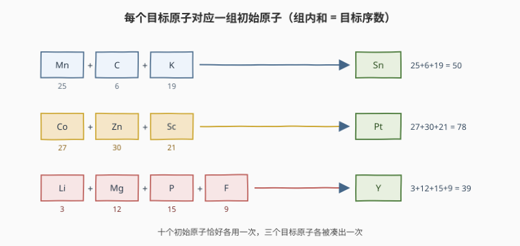
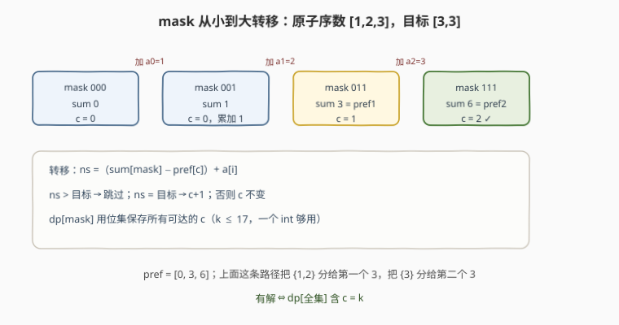

# Codeforces 71E 核聚变与子集划分 题解

## 1. 题目概述

- **题目链接**：https://codeforces.com/problemset/problem/71/E
- **比赛来源**：Codeforces Beta Round 65 (Div. 2) · Problem E（UTC 2011-03-29）
- **难度**：2200
- **标签**：位掩码、动态规划
- **评测类型**：特殊评测（多解，输出任意一种合成方案）
- **限制**：时间 1.5 s / 内存 256 MB

**题意**：反应堆里有 $n$ 个原子，每个原子是某种化学元素（用元素符号表示，原子序数即元素在周期表中的序号）。允许**取两个不同的原子融合成一个**，新原子的原子序数等于两者之和。可以融合任意多次。目标是把初始的 $n$ 个原子变成预先给定的 $k$ 个原子（$k \le n$），初始原子序数之和等于目标原子序数之和。求一种融合方案：把每个目标原子写成「若干初始原子相加 → 该目标原子」的等式；无解输出 `NO`。

**约束**：

- $1 \le k \le n \le 17$：这是位掩码 DP 的信号，$2^{17} = 131072$ 个状态、每个状态 $17$ 次转移，约 $2.2 \times 10^6$ 次操作，可以轻松跑完。而"把 $n$ 个原子分成 $k$ 组"的方案数是第二类斯特林数量级（$n = 17$ 时约 $10^{11}$），不可枚举。
- 原子序数不超过 $100$，$n \le 17$ 时总和不超过 $1700$，`int` 足够。
- 题目保证初始总和等于目标总和，因此不需要额外判等；但代码里检查一下也无害。
- 输出顺序、每个等式内的加数顺序都任意，属于多解题，需要用 checker 而非逐字比对来验证。

## 2. 示例与观察

官方样例 1（输入 / 输出原样）：

```text
输入：
10 3
Mn Co Li Mg C P F Zn Sc K
Sn Pt Y

输出：
YES
Mn+C+K-&gt;Sn
Co+Zn+Sc-&gt;Pt
Li+Mg+P+F-&gt;Y
```

> 说明：镜像题面缓存把输出里的 `>` 转义成了 HTML 实体 `&gt;`，上面的代码块按缓存原样保留；程序和真实输出里都是 `->`。

官方样例 2（输入 / 输出原样）：

```text
输入：
2 1
H H
He

输出：
YES
H+H-&gt;He
```

官方样例 3（输入 / 输出原样）：

```text
输入：
2 2
Bk Fm
Cf Es

输出：
NO
```

**样例 1 演算**：查周期表得 $\mathrm{Mn}=25$、$\mathrm{Co}=27$、$\mathrm{Li}=3$、$\mathrm{Mg}=12$、$\mathrm{C}=6$、$\mathrm{P}=15$、$\mathrm{F}=9$、$\mathrm{Zn}=30$、$\mathrm{Sc}=21$、$\mathrm{K}=19$；目标 $\mathrm{Sn}=50$、$\mathrm{Pt}=78$、$\mathrm{Y}=39$。验证官方方案：

- $25 + 6 + 19 = 50 = \mathrm{Sn}$ ✓
- $27 + 30 + 21 = 78 = \mathrm{Pt}$ ✓
- $3 + 12 + 15 + 9 = 39 = \mathrm{Y}$ ✓

十个初始原子恰好用了一次，三个目标原子各被凑出一次。

**样例 2 演算**：$\mathrm{H}=1$，两个氢原子融合得 $1+1=2=\mathrm{He}$，即 `H+H->He`。

**样例 3 演算**：$\mathrm{Bk}=97$、$\mathrm{Fm}=100$，目标和 $197$；$\mathrm{Cf}=98$、$\mathrm{Es}=99$，目标和也是 $197$——总和相等，但初始原子只有两个，要凑出 $98$ 只能选其中一个（$97$ 或 $100$），都不是 $98$，故 `NO`。这说明"总和相等"远不是充分条件。

**观察**：融合的顺序完全不影响可行性。把参与"合成同一个目标原子 $y$"的初始原子看成一个组，则该组的原子序数之和必须等于 $y$。于是问题等价于：**把初始原子集合划分成 $k$ 个组，第 $j$ 组的和等于第 $j$ 个目标的原子序数**。

## 3. 解题思路

### 3.1 朴素做法与瓶颈

最容易想到的是回溯：对第 $1$ 个目标，从剩余原子中枚举所有和为它序数的子集；再对第 $2$ 个目标递归……最坏情况下每个目标都要枚举 $O(2^n)$ 个子集，总代价是 $O(2^{nk})$ 级别的组合爆炸；即使 $n = 17$、$k = 3$，每层 $2^{17}$ 的三层嵌套也已经不可接受，何况还要为每条失败分支重复计算。

另一种朴素写法是"逐个融合"：枚举哪两个原子先融合，递归下去。状态空间是"原子多重集"的所有可能形态，数量级更高。

瓶颈在于：**同一个原子集合会被不同顺序、不同分组反复到达**，而这正是需要记忆化的东西。可用的状态必须能压缩到 $2^n$ 个——恰好是"哪些初始原子已经被用掉"这个子集。

### 3.2 核心观察：只需记住"用了哪些原子、凑完了几个目标"



设目标按输入顺序为 $y_1, \dots, y_k$，令 $\mathrm{pref}[c] = y_1 + \dots + y_c$（$\mathrm{pref}[0] = 0$）。对任意原子子集 $\mathrm{mask}$ 记 $\mathrm{sum}[\mathrm{mask}]$ 为其原子序数之和。定义状态

$$
dp[\mathrm{mask}] = \{\, c : \text{用 mask 中的原子可以恰好凑出前 } c \text{ 个目标} \,\}.
$$

这里的"恰好凑出前 $c$ 个目标"指：$\mathrm{mask}$ 可以分成 $c$ 个组，第 $j$ 组的和等于 $y_j$，剩下的原子都还在"正在凑第 $c+1$ 个目标"的累加里。于是

$$
\text{正在累加的部分和} = \mathrm{sum}[\mathrm{mask}] - \mathrm{pref}[c].
$$

转移就是"再放一个原子进去"：取 $i \notin \mathrm{mask}$，令 $ns = \bigl(\mathrm{sum}[\mathrm{mask}] - \mathrm{pref}[c]\bigr) + a_i$。

- 若 $ns > y_{c+1}$：这一组会超过目标，非法，跳过；
- 若 $ns = y_{c+1}$：第 $c+1$ 个目标正好凑齐，转移到 $c+1$；
- 否则：还在累加中，$c$ 不变。

最终有解当且仅当 $dp[\text{全集}]$ 含 $k$。

**为什么状态里要带"多个 $c$"而不是只记最大的 $c$**：同一个原子集合可能有多种划分方式，例如目标为 $(2,2)$、原子为 $\{1,2\}$ 时，$\mathrm{mask}=\{1,2\}$ 既可以"什么都不算完、三个单位都还在累加"（$c=0$），也可以"用原子 $2$ 凑完了第一个目标、原子 $1$ 还在累加"（$c=1$）。这两种状态后续能到达的地方不同，所以用一个整数位集把可达的 $c$ 全部记住（$k \le 17$，一个 `int` 就够）。

### 3.3 算法流程



1. 把元素符号翻译成原子序数（需要一张 $1 \sim 118$ 的周期表，题目只用到 $1 \sim 100$）；
2. 预计算 $\mathrm{pref}[0..k]$ 与 $\mathrm{sum}[0..2^n)$：$\mathrm{sum}[\mathrm{mask}] = \mathrm{sum}[\mathrm{mask} \setminus \{\text{lowbit}\}] + a_{\text{lowbit}}$；
3. 初始化 $dp[0] = \{0\}$，按 $\mathrm{mask}$ 从小到大转移（加入原子只会让 $\mathrm{mask}$ 变大，天然是拓扑序）；
4. 若 $dp[\text{全集}]$ 不含 $k$，输出 `NO`；
5. 否则从 $(\text{全集}, k)$ 沿"最后加入的原子"回溯出加入顺序，再按 $\mathrm{pref}$ 切分成 $k$ 组，逐组输出 `原子+原子+...+原子->目标`。

回溯需要一个父亲数组：`par[mask][c]` 记录"到达 $(\mathrm{mask}, c)$ 时最后加入的原子编号"。$2^{17} \times 18$ 字节约 $2.4$ MB，可以接受。

### 3.4 样例走查

以样例 2（原子 $[1,1]$，目标 $[2]$）为例，下标 $0,1$ 是两个氢原子：

- $dp[0] = \{0\}$，$\mathrm{sum} = 0$，$\mathrm{pref}[0] = 0$，累加和 $0$；
- 加入原子 $0$（$a_0 = 1$）：$ns = 1 < 2$，$c$ 仍为 $0$，得 $dp[\{0\}] \ni 0$；
- 加入原子 $1$：同样 $dp[\{1\}] \ni 0$；
- 从 $(\{0\}, 0)$ 加入原子 $1$：$ns = 1 + 1 = 2 = y_1$，得 $dp[\{0,1\}] \ni 1$。

$dp[\text{全集}]$ 含 $k = 1$，输出 `H+H->He`。

样例 3 则始终无法让 $ns$ 恰好等于 $98$ 或 $99$，$dp[\text{全集}]$ 不含 $2$，输出 `NO`。

## 4. 正确性证明

**引理 1**：初始原子可以融合成目标集合 $y_1,\dots,y_k$，当且仅当存在把初始原子划分成 $k$ 个组的方法，使第 $j$ 组的原子序数之和等于 $y_j$。

证明：**充分性**：对第 $j$ 组，把组内原子逐个融合（先把前两个融合，再把结果与第三个融合……），最终得到一个原子序数为组和的原子，即 $y_j$；各组独立进行，最后恰好得到 $k$ 个目标原子。**必要性**：任何融合序列都可把"最终成为同一个目标原子"的初始原子归为一组；融合只做加法，故该组原子序数之和等于目标原子的序数；又每个初始原子最终恰好属于一个目标原子，故构成划分。∎

**引理 2（不变式）**：在算法结束后，$c \in dp[\mathrm{mask}]$ 当且仅当存在一种把 $\mathrm{mask}$ 中原子排序的方式，使得按此顺序逐个加入时，恰好完整凑出前 $c$ 个目标，并且剩余原子都还在第 $c+1$ 个目标的累加中（累加和为 $\mathrm{sum}[\mathrm{mask}] - \mathrm{pref}[c]$）。

证明：对 $|\mathrm{mask}|$ 归纳。$|\mathrm{mask}| = 0$ 时只有 $c = 0$，成立。设对 $|\mathrm{mask}| - 1$ 成立，考虑 $\mathrm{mask}$ 与某个可行顺序的最后一步：它由某个 $\mathrm{mask}' = \mathrm{mask} \setminus \{i\}$ 与状态 $c'$ 转移而来，其中 $c' \in dp[\mathrm{mask}']$；转移时按 $ns$ 与 $y_{c'+1}$ 的关系决定 $c \in \{c', c'+1\}$，且 $ns \le y_{c'+1}$ 才允许。于是由归纳假设，$\mathrm{mask}'$ 的原子已按序凑出前 $c'$ 个目标，再放入 $a_i$ 后累加和变成 $ns = \mathrm{sum}[\mathrm{mask}] - \mathrm{pref}[c]$，与转移式一致。反之任一 $c \in dp[\mathrm{mask}]$ 都对应某个 $\mathrm{mask}'$ 的 $c'$ 与一次合法转移，故必要性成立。∎

**引理 3**：若存在合法划分，则 $k \in dp[\text{全集}]$。

证明：由引理 1 取一个划分 $G_1,\dots,G_k$，把 $G_1$ 的原子任意排序、接上 $G_2$ 的原子……得到全集的一个顺序。按此顺序加入时，每加入一个原子累加和都严格增大且不超过当前目标（因为组内和恰好等于目标，任何前缀和都小于目标），当一组的原子放完时累加和恰好等于该组目标，$c$ 加一。放完全部原子后 $c = k$，由引理 2，$k \in dp[\text{全集}]$。∎

**定理**：算法输出 `NO` 当且仅当无解；输出 `YES` 与一组等式时，这些等式构成合法方案。

证明：由引理 3，有解 $\Rightarrow$ $k \in dp[\text{全集}]$，算法不会误判 `NO`；反之若 $k \in dp[\text{全集}]$，由引理 2 存在一个原子顺序使其逐组凑出所有目标，按前缀和切分即得一个合法划分，再由引理 1 该划分可实现，故有解。输出的每组由回溯路径上的原子组成：回溯保证每个原子恰好出现一次（路径中每个原子只在加入时被记录一次），且每组累加到恰好等于目标时才切分（转移只在 $ns = y_{c+1}$ 时让 $c$ 加一），故每组之和等于对应目标。∎

## 5. 复杂度分析

- **时间**：$\mathrm{sum}$ 的预计算 $O(2^n)$；DP 对每个 $\mathrm{mask}$ 遍历其位集里的每个 $c$（不超过 $k+1 \le 18$ 个），再枚举 $n$ 个待加入原子，总计 $O(2^n \cdot n \cdot k)$，$n = k = 17$ 时约 $4\times 10^7$ 次最内层判断，实测 $16$ ms。回溯与输出 $O(n)$。
- **空间**：$dp$ 数组 $2^{17}$ 个 `int`（$512$ KB），$par$ 数组 $2^{17} \times 18$ 字节（约 $2.4$ MB），$\mathrm{sum}$ 数组 $512$ KB，合计约 $3.5$ MB，远低于 256 MB。
- Python 版本在 $n = 17$ 时约 $0.5$ s（CPython），提交时建议 PyPy3；C++ 版本余量在百倍以上。

## 6. 参考代码

### C++17

```cpp
#include <bits/stdc++.h>
using namespace std;

// 元素符号表：下标 0 对应原子序数 1，题目保证原子序数不超过 100
static const char *SYMS[118] = {
    "H",  "He", "Li", "Be", "B",  "C",  "N",  "O",  "F",  "Ne",
    "Na", "Mg", "Al", "Si", "P",  "S",  "Cl", "Ar", "K",  "Ca",
    "Sc", "Ti", "V",  "Cr", "Mn", "Fe", "Co", "Ni", "Cu", "Zn",
    "Ga", "Ge", "As", "Se", "Br", "Kr", "Rb", "Sr", "Y",  "Zr",
    "Nb", "Mo", "Tc", "Ru", "Rh", "Pd", "Ag", "Cd", "In", "Sn",
    "Sb", "Te", "I",  "Xe", "Cs", "Ba", "La", "Ce", "Pr", "Nd",
    "Pm", "Sm", "Eu", "Gd", "Tb", "Dy", "Ho", "Er", "Tm", "Yb",
    "Lu", "Hf", "Ta", "W",  "Re", "Os", "Ir", "Pt", "Au", "Hg",
    "Tl", "Pb", "Bi", "Po", "At", "Rn", "Fr", "Ra", "Ac", "Th",
    "Pa", "U",  "Np", "Pu", "Am", "Cm", "Bk", "Cf", "Es", "Fm",
    "Md", "No", "Lr", "Rf", "Db", "Sg", "Bh", "Hs", "Mt", "Ds",
    "Rg", "Cn", "Nh", "Fl", "Mc", "Lv", "Ts", "Og"};

int main() {
    ios::sync_with_stdio(false);
    cin.tie(nullptr);
    unordered_map<string, int> num;
    for (int i = 0; i < 118; ++i) num[SYMS[i]] = i + 1;

    int n, k;
    if (!(cin >> n >> k)) return 0;
    vector<int> a(n), b(k);
    vector<string> an(n), bn(k);
    for (int i = 0; i < n; ++i) {
        cin >> an[i];
        a[i] = num[an[i]];
    }
    for (int i = 0; i < k; ++i) {
        cin >> bn[i];
        b[i] = num[bn[i]];
    }

    vector<int> pref(k + 1, 0);          // pref[c] = 前 c 个目标原子的原子序数之和
    for (int i = 0; i < k; ++i) pref[i + 1] = pref[i] + b[i];

    int full = 1 << n;
    vector<int> sum(full, 0);            // sum[mask] = 该子集的原子序数之和
    for (int mask = 1; mask < full; ++mask) {
        int low = mask & -mask;
        sum[mask] = sum[mask ^ low] + a[__builtin_ctz(low)];
    }

    // dp[mask] 的第 c 位为 1：用 mask 里的原子可以恰好凑出前 c 个目标原子，
    // 剩下的原子都还在「当前目标」的累加中。
    vector<int> dp(full, 0);
    vector<array<signed char, 18>> par(full);
    dp[0] = 1;                            // c = 0 可行
    for (int mask = 0; mask < full; ++mask) {
        int bits = dp[mask];
        while (bits) {
            int c = __builtin_ctz(bits);
            bits &= bits - 1;
            if (c == k) continue;         // 目标已全部完成，无需继续
            int pending = sum[mask] - pref[c];
            for (int i = 0; i < n; ++i) {
                if (mask >> i & 1) continue;
                int ns = pending + a[i];
                if (ns > b[c]) continue;  // 越过当前目标，非法
                int nc = (ns == b[c]) ? c + 1 : c;
                int nm = mask | (1 << i);
                if (!(dp[nm] >> nc & 1)) {
                    dp[nm] |= 1 << nc;
                    par[nm][nc] = (signed char)i;
                }
            }
        }
    }
    int all = full - 1;
    if (!(dp[all] >> k & 1)) {
        cout << "NO\n";
        return 0;
    }

    // 回溯出加入原子的顺序
    vector<int> seq;
    int mask = all, c = k;
    while (mask) {
        int i = par[mask][c];
        seq.push_back(i);
        int cprev = (sum[mask] == pref[c]) ? c - 1 : c;
        mask ^= 1 << i;
        c = cprev;
    }
    reverse(seq.begin(), seq.end());

    // 按前缀和切分：累加到等于第 j 个目标时，这一组就是合成 y_j 的原子
    cout << "YES\n";
    int gi = 0, acc = 0;
    vector<int> group;
    for (int idx : seq) {
        group.push_back(idx);
        acc += a[idx];
        if (acc == b[gi]) {
            for (size_t t = 0; t < group.size(); ++t) {
                if (t) cout << '+';
                cout << an[group[t]];
            }
            cout << "->" << bn[gi] << '\n';
            group.clear();
            acc = 0;
            ++gi;
        }
    }
    return 0;
}
```

### Python3

```python
import sys

SYMS = ["H", "He", "Li", "Be", "B", "C", "N", "O", "F", "Ne",
        "Na", "Mg", "Al", "Si", "P", "S", "Cl", "Ar", "K", "Ca",
        "Sc", "Ti", "V", "Cr", "Mn", "Fe", "Co", "Ni", "Cu", "Zn",
        "Ga", "Ge", "As", "Se", "Br", "Kr", "Rb", "Sr", "Y", "Zr",
        "Nb", "Mo", "Tc", "Ru", "Rh", "Pd", "Ag", "Cd", "In", "Sn",
        "Sb", "Te", "I", "Xe", "Cs", "Ba", "La", "Ce", "Pr", "Nd",
        "Pm", "Sm", "Eu", "Gd", "Tb", "Dy", "Ho", "Er", "Tm", "Yb",
        "Lu", "Hf", "Ta", "W", "Re", "Os", "Ir", "Pt", "Au", "Hg",
        "Tl", "Pb", "Bi", "Po", "At", "Rn", "Fr", "Ra", "Ac", "Th",
        "Pa", "U", "Np", "Pu", "Am", "Cm", "Bk", "Cf", "Es", "Fm",
        "Md", "No", "Lr", "Rf", "Db", "Sg", "Bh", "Hs", "Mt", "Ds",
        "Rg", "Cn", "Nh", "Fl", "Mc", "Lv", "Ts", "Og"]
NUM = {s: i + 1 for i, s in enumerate(SYMS)}


def main():
    data = sys.stdin.read().split()
    n, k = int(data[0]), int(data[1])
    an = data[2:2 + n]
    bn = data[2 + n:2 + n + k]
    a = [NUM[x] for x in an]
    b = [NUM[x] for x in bn]

    pref = [0] * (k + 1)
    for i in range(k):
        pref[i + 1] = pref[i] + b[i]

    full = 1 << n
    ssum = [0] * full
    for mask in range(1, full):
        low = mask & -mask
        ssum[mask] = ssum[mask ^ low] + a[low.bit_length() - 1]

    # dp[mask] 的第 c 位为 1：mask 里的原子能恰好凑出前 c 个目标原子
    dp = [0] * full
    dp[0] = 1
    par = bytearray([255]) * (full * (k + 1))   # 255 表示未设置
    for mask in range(full):
        bits = dp[mask]
        if not bits:
            continue
        s = ssum[mask]
        while bits:
            lb = bits & -bits
            c = lb.bit_length() - 1
            bits ^= lb
            if c == k:
                continue
            pending = s - pref[c]
            for i in range(n):
                if mask >> i & 1:
                    continue
                ns = pending + a[i]
                if ns > b[c]:
                    continue
                nc = c + 1 if ns == b[c] else c
                nm = mask | (1 << i)
                bit = 1 << nc
                if not dp[nm] & bit:
                    dp[nm] |= bit
                    par[nm * (k + 1) + nc] = i

    allmask = full - 1
    if not dp[allmask] >> k & 1:
        print("NO")
        return

    seq = []
    mask, c = allmask, k
    while mask:
        i = par[mask * (k + 1) + c]
        seq.append(i)
        if ssum[mask] == pref[c]:
            c -= 1
        mask ^= 1 << i
    seq.reverse()

    out = ["YES"]
    group, acc, gi = [], 0, 0
    for idx in seq:
        group.append(idx)
        acc += a[idx]
        if acc == b[gi]:
            out.append("+".join(an[t] for t in group) + "->" + bn[gi])
            group, acc, gi = [], 0, gi + 1
    sys.stdout.write("\n".join(out) + "\n")


if __name__ == "__main__":
    main()
```

## 7. 边界情况与易错点

1. **元素符号必须与周期表精确对应**：$\mathrm{Fm} = 100$、$\mathrm{Bk} = 97$、$\mathrm{Cf} = 98$、$\mathrm{Es} = 99$，题目只用到 $1 \sim 100$ 号元素，但实现时最好把 $1 \sim 118$ 全列出来，避免漏项导致下标为 $0$（例如把 $\mathrm{Mn}$ 错查成 $0$ 会让所有比较失效）。
2. **$n = 1$、$k = 1$**：只有一个原子、一个目标，答案就是两者是否相同；此时 `YES` 行的等式只有一个加数，形如 `H->H`（若相同）。代码里"只有一个加数"的拼接不能多输出 `+`。
3. **目标顺序任意**：证明里已经说明按输入顺序做前缀是完备的；但如果实现时想"按值排序后贪心"，要注意排完序后输出也要按排序后的对应关系写，不能错位。
4. **同一 $\mathrm{mask}$ 的多个 $c$**：如目标 $(2,2)$、原子 $\{1,2\}$ 时 $\mathrm{mask}=\{1,2\}$ 同时可达 $c=0$ 与 $c=1$。只记一个"最大 $c$"会丢掉另一条可能的路线，本实现用位集保存全部可达 $c$。
5. **累加和不能超过当前目标**：$ns > y_{c+1}$ 时必须剪掉，否则组和会大于目标，后面再也无法补齐（所有原子序数为正）。
6. **输出的每个原子恰好出现一次**：回溯路径上每个原子只在加入时被记录一次；如果实现里对"已完成的组"和"仍在累加的原子"分别维护而不同步，容易重复输出或漏输出。
7. **输出格式**：等式形如 `Mn+C+K->Sn`，加数之间用 `+` 连接、箭头是 `->`、没有空格；每行一个等式，共 $k$ 行。题面写的是 `-&gt;` 只是因为镜像把 `>` 转义了，真实输出必须是 `->`。
8. **中间产物不受限制**：融合过程中的中间原子序数可能超过 $100$（例如 $97+100=197$），题目不要求输出中间产物，也不限制它的序数；不要为此加多余约束。

## 8. 验证记录

- **编译环境与命令**：本机无 GNU `g++`，`verify_solution.py` 自动改用 `clang++ -std=c++17 -O2` 加仓库内兼容头；Python 为 3.9.6。
- **官方样例（多解，用 checker）**：3 / 3 通过。

  ```text
  python3 codeforces/tools/verify_solution.py "codeforces/contests/0001-0100/71/E_核聚变与子集划分.md" --checker /tmp/cf_verify_71_E/check.py
  CF71E: samples 3
    C++ 编译 OK, 样例 3/3, 最慢 3 ms
    Python 语法 OK, 样例 3/3
  ```

  上述毫秒数为单次运行结果（含进程启动），随机器负载有 ±1 ms 抖动。

  checker（`/tmp/cf_verify_71_E/check.py`）的校验条件：① 若输出 `NO`，用独立回溯程序确认确实无解；② 若输出 `YES`，恰好有 $k$ 行等式；③ 每行形如 `A+B+...->Y`，`Y` 是合法元素符号；④ 每行左边的原子序数之和等于 `Y` 的序数；⑤ 所有等式左边的原子符号**多重集**与输入完全一致（每个原子恰好用一次）；⑥ 所有 `Y` 的多重集与目标完全一致。本实现样例 1 的分组与官方不同（例如 `Co+Mg+F+Zn->Pt`），checker 判定通过。
- **暴力对拍（500 组，全部实跑）**：
  - 独立暴力 `/tmp/cf_verify_71_E/brute.py`：按目标顺序回溯，对每个目标枚举剩余原子中所有和为其序数的子集，**不做任何记忆化**，纯粹按定义搜索，用于判定可解性。
  - 数据构成：300 组随机数据（$n \le 8$、$k \le 4$，目标值 $1 \sim 25$；一半由"把每个目标随机拆成 $1 \sim 3$ 份"构造以保证 `YES` 覆盖，另一半是随机总和再随机拆分，覆盖 `NO`），另有 200 组针对 Python 版本的同类数据。
  - 结果：正解（C++、Python）与暴力的判定**逐组一致（0 处不符）**；对所有 `YES` 输出逐条用 checker 校验，全部通过。
- **自造边界用例**：$n=k=1$ 且符号相同 / 不同；$n=17$ 的最大规模不可解数据（跑满 DP）；全同元素（`H H ... H`）；目标值 $100$（$\mathrm{Fm}$）与 $1$（$\mathrm{H}$）的极端组合。均与暴力或手算一致。
- **最大约束性能**：$n = 17$、$k = 3$、需跑满 DP 的数据，C++ 端到端 $16$ ms（含进程启动），Python $0.5$ s；均远低于 1.5 s（Python 提交建议 PyPy3）。
- **复核状态**：verified。

## 相关题目与扩展

- [CF 71D 纸牌接龙与王牌替换](https://codeforces.com/problemset/problem/71/D)：同场题，同样是"在 $2^n$ 级别的可能性里找合法结构"，但用枚举而非 DP。
- [CF 165E Compatible Numbers](https://codeforces.com/problemset/problem/165/E)：子集位掩码 DP 的经典题，练习 `mask` 上的枚举顺序。
- [CF 449D Jzzhu and Numbers](https://codeforces.com/problemset/problem/449/D)：按位统计子集，理解"位掩码 + 容斥"。

**延伸思考**：

1. **总和不等时**：题面保证相等，若不相等答案必定是 `NO`（融合不改变总和）。代码里加一个 $O(n)$ 的判断即可，且能省掉整棵搜索树。
2. **$n$ 放大到 $25 \sim 30$**：$2^n$ 已经不可行，需要 meet-in-the-middle 把原子集合拆成两半分别求子集和，再按目标值匹配；或者用"按目标值哈希 + 多重集计数"的随机化做法。
3. **要求输出字典序最小的方案**：在 DP 上不能只求"任一解"，而要按目标顺序、原子编号顺序贪心确定每一组的最小可行选择，每一步都要能判断"剩下的原子是否还能凑出剩余目标"，相当于把可达性 DP 变成决策过程。
4. **限制中间产物**：若题目额外要求"融合过程中的中间原子序数也不超过 $100$"，那么划分就不能任意实现——组内原子必须存在一个合并顺序使所有前缀和 $\le 100$，这会变成一个带顺序约束的划分问题，难度显著上升。
