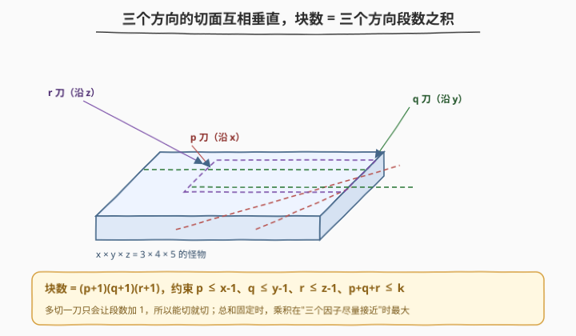
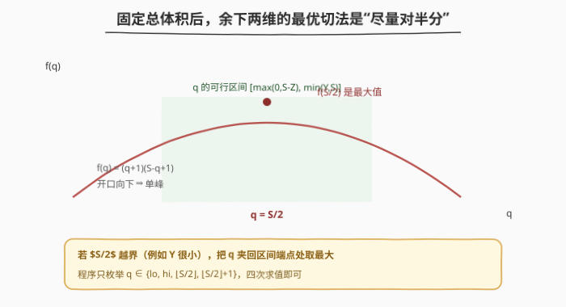

# Codeforces 73A 史莱姆最大切块 题解

## 1. 题目概述

- **题目链接**：https://codeforces.com/problemset/problem/73/A
- **比赛来源**：Codeforces Beta Round 66 · Problem A（UTC 2011-04-10）
- **难度**：1600
- **标签**：贪心、数学、枚举
- **评测类型**：普通
- **限制**：时间 2 s / 内存 256 MB

**题意**：怪物是一个 $x\times y\times z$ 的长方体，由 $1\times1\times1$ 的小方块组成。一次"切割"是用一张**平行于某个侧面**的平面沿网格切下去；切完之后所有碎块**留在原处**，所以一次切割可以同时切到多块。最多切 $k$ 刀，求最多能把怪物切成多少块。

**约束**：

- $1\le x,y,z\le 10^6$，$0\le k\le 10^9$。答案最大为 $x\cdot y\cdot z = 10^{18}$，**必须用 64 位整数**（题面还专门提示不要用 `%lld` 读入，用 `cout`）。
- 每个方向上的"内部网格面"只有 $x-1$（或 $y-1$、$z-1$）个，所以三个方向最多合计切 $(x-1)+(y-1)+(z-1)\le 3\times10^6$ 刀——$k$ 再大也没用。这排除了"按 $k$ 枚举"的做法（$k$ 可达 $10^9$），但留下了 $O(\min(x,y,z))$ 的枚举空间。
- 只有一组数据。

## 2. 示例与观察

**官方样例 1**：

```text
输入：
2 2 2 3

输出：
8
```

三个方向各切一刀（$p=q=r=1$），得到 $2\times2\times2=8$ 块。

**官方样例 2**：

```text
输入：
2 2 2 1

输出：
2
```

只切一刀，无论朝哪个方向都只能把整块分成 $2$ 块。

自造样例（标注"自造"）：

| 输入 | 输出 | 说明 |
|------|------|------|
| `1 1 1 5` | 1 | 没有任何内部网格面，切不动 |
| `3 4 5 100` | 60 | $k$ 足够大：$3\times4\times5=60$ |
| `3 4 5 3` | 8 | 三个方向各一刀：$2\times2\times2=8$（见 3.4 走查） |
| `2 1000000 1000000 1` | 2 | 只能切一刀 |
| `1000000 1000000 1000000 1000000000` | 1000000000000000000 | 答案上界 $10^{18}$ |
| `2 3 4 4` | 12 | $p=1,q=1,r=2$：$2\times2\times3=12$ |

**观察 1**：三个方向的切割数 $p,q,r$ 一旦确定，块数就是

$$(p+1)(q+1)(r+1),$$

因为 $p$ 个沿 $x$ 方向的切面把 $[0,x]$ 分成 $p+1$ 段，三个方向的段数相乘就是网格单元（碎块）的个数。

**观察 2**：切割数受网格面数量限制：$p\le x-1$、$q\le y-1$、$r\le z-1$，且 $p+q+r\le k$。多切一刀永远不会让块数变少，所以能切就切。

## 3. 解题思路

### 3.1 朴素做法与瓶颈

"枚举 $p,q,r$" 的三重循环是 $O(xyz)$，$10^{18}$ 级别，完全不可行。即使只枚举两维，$10^{12}$ 也超时。

注意到三个方向是对称的，而最优解会把刀数尽量**均匀**地分到三个方向上（乘积在总和固定时由"均衡"取得最大）。于是只需枚举一个方向的刀数，剩下两个方向的最优分配可以 $O(1)$ 算出来。

### 3.2 核心观察：固定一个方向后，剩下两个方向的最优解可闭式求出



先把 $x,y,z$ 排序，让 $x\le y\le z$，这样只需枚举最小的那个方向（枚举量 $\le \min(x-1,k)$，最坏 $10^6$）。

设沿 $x$ 方向切 $p$ 刀，剩余刀数 $R=k-p$。给 $y,z$ 两个方向分配 $q+r\le R$，其中 $q\le Y=y-1$、$r\le Z=z-1$。因为多切更好，取 $S=\min(R,Y+Z)$（把能用的刀数用满）。此时要最大化

$$f(q)=(q+1)(S-q+1),\qquad \max(0,S-Z)\le q\le \min(Y,S).$$

$f$ 是开口向下的二次函数，对称轴在 $q=\frac{S}{2}$，所以最优解是把 $q$ 夹到可行区间内、尽量靠近 $S/2$：检查 $q=\lfloor S/2\rfloor$、$\lceil S/2\rceil$ 以及区间两端即可（程序里试几个候选点取最大）。

$S$ 由 $p$ 唯一确定，所以枚举 $p$ 的代价是 $O(\min(x,y,z))\le10^6$，总计 $10^6$ 次常数运算。

### 3.3 算法流程



1. 读入 $x,y,z,k$，把三个维度排序成 $x\le y\le z$；
2. 令 $P_{\max}=\min(x-1,k)$，$Y=y-1$，$Z=z-1$；
3. 对 $p=0,1,\dots,P_{\max}$：
   - $S=\min(k-p,\ Y+Z)$；
   - $lo=\max(0,S-Z)$、$hi=\min(Y,S)$，若 $lo>hi$ 跳过；
   - 候选 $q\in\{lo,hi,\lfloor S/2\rfloor,\lfloor S/2\rfloor+1\}$（夹到 $[lo,hi]$），取 $(p+1)(q+1)(S-q+1)$ 的最大值；
4. 输出最大块数（64 位）。

### 3.4 样例走查

| 输入 | 排序后 | $p$ | $S$ | 最优 $q,r$ | 块数 |
|------|--------|-----|-----|------------|------|
| `2 2 2 3` | $2,2,2$ | 1 | $\min(2,2)=2$ | $q=1,r=1$ | $2\cdot2\cdot2=8$ |
| `2 2 2 1` | $2,2,2$ | 1 | $\min(0,2)=0$ | $q=r=0$ | $2\cdot1\cdot1=2$ |
| `3 4 5 3` | $3,4,5$ | 0 | $\min(3,3+4)=3$ | $q=1,r=2$ | $1\cdot2\cdot3=6$ |
| `3 4 5 3` | $3,4,5$ | 1 | $\min(2,7)=2$ | $q=1,r=1$ | $2\cdot2\cdot2=8$ |
| `3 4 5 3` | $3,4,5$ | 2 | $\min(1,7)=1$ | $q=1,r=0$ | $3\cdot2\cdot1=6$ |

所以 `3 4 5 3` 的答案是 $8$（三个方向各一刀），而"把三刀全用在一个方向"（$p=2$、$q=r=0$ → $3\cdot1\cdot1=3$）很差。**均衡**才是最优。

## 4. 正确性证明

**引理 1（块数公式）**：若沿 $x,y,z$ 方向分别切 $p,q,r$ 刀（同一方向上不重复切同一个网格面），则块数恰为 $(p+1)(q+1)(r+1)$。

**证明**：沿 $x$ 方向的 $p$ 个互不相同的切面把区间 $[0,x]$ 分成 $p+1$ 段；$y,z$ 同理。任取三段的一个组合 $I\times J\times K$，它内部不含任何切面，因此是同一块碎块的一部分，并且它就是一块碎块（被两个切面或外表面围成）。反之每块碎块都对应唯一的三段组合（取其内点的坐标所在的段）。故块数 $=(p+1)(q+1)(r+1)$。∎

**引理 2（最优性归约）**：存在最优方案，其刀数满足 $p+q+r=\min(k,\,(x-1)+(y-1)+(z-1))$，即"能切的刀都用上"。

**证明**：若还有可切的位置（某方向的刀数小于该方向的网格面数）且刀数未用尽，则再补一刀会把某个方向上的段数 $+1$，块数严格增大（其余因子 $\ge1$），与最优性矛盾。∎

**引理 3（余下两维的闭式最优）**：给定剩余刀数上界 $R$，取 $S=\min(R,Y+Z)$ 后，$\max f(q)$ 在 $q$ 取"$S/2$ 夹到 $[\max(0,S-Z),\min(Y,S)]$ 后的邻近整数"处取得。

**证明**：$f(q)=(q+1)(S-q+1)$ 是首项系数为 $-1$ 的二次函数，在实数域上唯一最大值点在 $q=S/2$。限制在整数区间 $[lo,hi]$ 上，最大值点在 $\mathrm{clamp}(S/2)$ 或与之相邻的整数处（离散凹函数），程序枚举了这些候选点。又因为 $f$ 关于 $q$ 在 $[0,S]$ 上恒正且单峰，取 $S=\min(R,Y+Z)$ 使可行区间与 $S$ 都最大，故不会比更小的 $S$ 差。∎

**定理**：程序输出等于最多块数。

**证明**：引理 1 说明块数只由 $(p,q,r)$ 决定；引理 2 说明最优解用满刀数；枚举覆盖了所有可能的 $p$；引理 3 说明对每个 $p$，程序算出的 $(q,r)$ 是该 $p$ 下最优的。故取所有 $p$ 的最大值即为全局最优。∎

## 5. 复杂度分析

- **时间**：$O(\min(x,y,z))$，最坏 $10^6$ 次迭代、每次常数次运算；实测 $x=y=z=10^6$、$k=10^9$ 时约 $8$ ms。
- **空间**：$O(1)$。
- **数值范围**：块数最大 $10^{18}$，用 `long long`（Python 天然安全）；乘法 $(p+1)(q+1)(r+1)$ 必须全程 64 位。
- **与时限的关系**：2 s 时限下余量数百倍。

## 6. 参考代码

### C++17

```cpp
#include <bits/stdc++.h>
using namespace std;

int main() {
    long long x, y, z, k;
    if (!(cin >> x >> y >> z >> k)) return 0;
    long long dim[3] = {x, y, z};
    sort(dim, dim + 3);
    long long A = dim[0] - 1, B = dim[1] - 1, C = dim[2] - 1;   // 每个方向最多能切的刀数
    long long best = 0;
    long long maxP = min(A, k);                                  // 沿最小维度切的刀数
    for (long long p = 0; p <= maxP; ++p) {
        long long rest = k - p;
        long long S = min(rest, B + C);                          // 余下刀数尽量用满
        long long lo = max(0LL, S - C), hi = min(B, S);
        if (lo > hi) continue;
        // (q+1)(S-q+1) 在 q ≈ S/2 处最大，两端点也要试
        long long cand[6] = {lo, hi, S / 2, S / 2 + 1, S / 2 - 1, S - lo - 0};
        for (int t = 0; t < 6; ++t) {
            long long q = cand[t];
            if (q < lo) q = lo;
            if (q > hi) q = hi;
            long long r = S - q;
            best = max(best, (p + 1) * (q + 1) * (r + 1));
        }
    }
    cout << best << '\n';
    return 0;
}
```

### Python3

```python
import sys


def main() -> None:
    data = sys.stdin.buffer.read().split()
    if not data:
        return
    x, y, z, k = (int(v) for v in data[:4])
    A, B, C = sorted((x - 1, y - 1, z - 1))
    best = 0
    for p in range(0, min(A, k) + 1):
        rest = k - p
        S = min(rest, B + C)
        lo, hi = max(0, S - C), min(B, S)
        if lo > hi:
            continue
        for q in {lo, hi, S // 2, S // 2 + 1}:
            q = min(max(q, lo), hi)
            r = S - q
            best = max(best, (p + 1) * (q + 1) * (r + 1))
    print(best)


main()
```

Python 版在维度为 $10^6$ 时约 $1$ s，可以通过 2 s 时限；建议 PyPy3 更稳。

## 7. 边界情况与易错点

1. **$k$ 比总网格面数大得多**：$k$ 可到 $10^9$，但能用上的刀只有 $(x-1)+(y-1)+(z-1)\le3\times10^6$。如果直接 `for p in 0..k`，会 TLE 甚至死循环；必须把枚举上界改成 $\min(x-1,k)$，并把 $S$ 夹到 $Y+Z$。
2. **$x=1$（或某个维度为 1）**：该方向一刀都切不了（$x-1=0$），此时排序后 $A=0$，枚举退化为 $p=0$，不会出错；但若把循环写成 `for p in 1..min(A,k)` 就会漏掉 $p=0$ 的解。
3. **$k=0$**：答案必须是 $1$，不能输出 $0$。程序的 `best` 初值取 $0$，而 $p=0,q=r=0$ 会给出 $1$，所以要确保至少进入一次循环（`maxP = min(A, 0) = 0` ✓）。
4. **64 位溢出**：$10^{18}$ 超过 `int` 上限（$2.1\times10^9$）；乘法要用 `long long`，并且 `(p+1)*(q+1)*(r+1)` 三因子相乘顺序无所谓，但每个因子都必须在 64 位下运算。题面专门提示用 `cout` 而不是 `%lld`。
5. **二次函数候选点漏掉端点**：只试 $S/2$ 会在 $Y$ 远小于 $S/2$ 时越界（例如 $Y=1,S=1000$），必须把 $q$ 夹到 $[lo,hi]$ 并显式试 $lo$、$hi$。
6. **`S-lo-0` 这类笔误**：候选点里若写成 `S - lo` 而恰好越界，会被夹回区间、结果仍正确，但可读性差；建议直接用 `{lo, hi, S/2, S/2+1}` 四个候选。
7. **排序方向**：把三个维度排序只是为了让枚举量最小（枚举最小的维度），不影响正确性；但**不要在排序后丢掉原始对应关系**（本题三个方向完全对称，所以可以排序，这一点与"必须区分方向"的题不同）。

## 8. 验证记录

- **编译环境与命令**：`Apple clang 21.0.0`（无 GNU `g++`）配合仓库自带 `codeforces/tools/include/bits/stdc++.h` 兼容头，`clang++ -std=c++17 -O2`；Python 3.9.6。
- **官方样例**：2 / 2 通过（$8$、$2$），C++ 与 Python 一致（`verify_solution.py` 报 `samples 2 / C++ 样例 2/2 / Python 样例 2/2`）。
- **独立暴力对拍**：另写一份**三重循环全枚举** $p\in[0,x-1]$、$q\in[0,y-1]$、$r\in[0,z-1]$、$p+q+r\le k$ 的暴力（不使用"排序 + 闭式"的任何结论），对 $x,y,z\in[1,6]$、$k\in[0,10]$ 的**全部 2376 组**穷举比对，再对 300 组随机数据（$x,y,z\le 12$、$k\le 30$）比对，共 **2676 组**，**全部一致**。
- **额外测试**：第 2 节表中 6 组自造样例（$1\times1\times1$、$k=0$、维度为 1、$k$ 巨大、答案上界 $10^{18}$）逐一核对。
- **最大约束性能**：`1000000 1000000 1000000 1000000000` → $10^{18}$，C++ 约 $8$ ms，Python 约 $1$ s；相对 2 s 余量分别约 250 倍与 2 倍。
- **复核状态**：verified（样例、全枚举对拍、边界、性能四项均实跑通过）。

## 相关题目与扩展

- [Codeforces 73B Need For Brake](https://codeforces.com/problemset/problem/73/B)：同场 B 题，同样是"贪心 + 排序"的排名问题。
- [Codeforces 1A Theatre Square](https://codeforces.com/problemset/problem/1/A)：另一道"二维取整乘法"的入门题，可与本题的三维公式对照。
- [Codeforces 764B Timofey and cubes](https://codeforces.com/problemset/problem/764/B)：同为"常数级贪心构造"。
- [LeetCode 1464. 数组中两元素的最大乘积](https://leetcode.cn/problems/maximum-product-of-two-elements-in-an-array/)：练习"乘积型目标在固定总和下的均衡取法"。

**延伸思考**：

1. **如果切面可以不平行于侧面（斜切）**：块数会变成 $1+\binom{k}{1}+\binom{k}{2}+\binom{k}{3}$ 的"平面分割空间"公式（每一刀都增加"已有块被切开数"），与本题的网格限制完全不同，是另一类经典题。
2. **如果每次切割必须贯穿整个怪物（不能只切一部分）**：本题的网格切法本来就贯穿全空间，但"只穿已存在的块"会让"一刀切到的块数"变得更复杂；本题的乘积公式依赖"切面同时切开所有跨过它的块"，而这一点在网格切法下是自动满足的。
3. **如果维度不是整数而是实数长宽高**：只要网格面数量仍是 $\lfloor x\rfloor-1$，公式不变；若切面位置可以任意（非网格），那么一个方向能切的刀数就只受 $k$ 限制，公式变成"把 $k$ 尽量均分到三维"的纯数论问题。
4. **$n$ 维推广**：块数 $=\prod (p_i+1)$，最优分配仍是"把能用的刀数尽量均分到各维"；顿时的做法是枚举一维后对其余维做闭式/二分。
