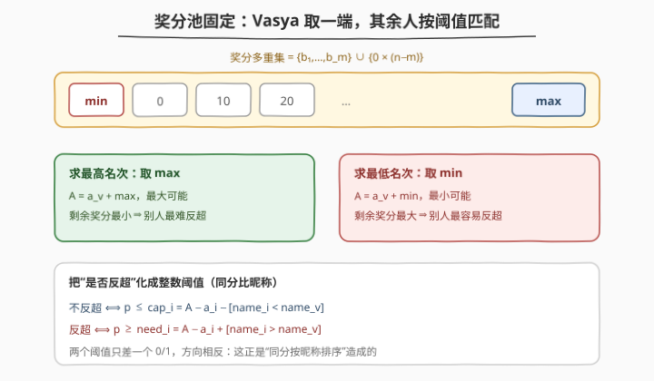
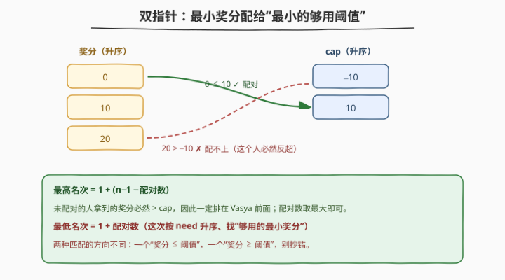

# Codeforces 73B 赛车最终名次 题解

## 1. 题目概述

- **题目链接**：https://codeforces.com/problemset/problem/73/B
- **比赛来源**：Codeforces Beta Round 66 · Problem B（UTC 2011-04-10）
- **难度**：2000
- **标签**：排序、贪心、二分答案、字符串
- **评测类型**：普通
- **限制**：时间 4 s / 内存 256 MB

**题意**：$n$ 名赛车手，每人有昵称 $s_i$ 与当前积分 $a_i$。还剩**最后一场**比赛：这场比赛会给出名次 $1\sim n$，第 $i$ 名得 $b_i$ 分（只有前 $m$ 名有分，$b_i\ge0$；其余名次得 $0$ 分）。最终积分 = 当前积分 + 最后一场得分，按积分**从高到低**排名，积分相同则**昵称字典序升序**者在前。求 Vasya（给定昵称）最终名次的**最高**与**最低**可能值。

**约束**：

- $n\le10^5$，$0\le a_i\le10^6$，$0\le m\le n$，$0\le b_i\le10^6$，昵称长度 $\le20$。
- 奖分是一组固定的数，只能"一个人拿一个名次"，所以问题本质是：**把奖分多重集分配给其余人，使"反超 Vasya 的人数"最少/最多**。
- 只有一组数据；昵称互不相同（按昵称做字典序比较需要一个稳定、唯一的顺序）。

## 2. 示例与观察

**官方样例 1**：

```text
输入：
3
teama 10
teamb 20
teamc 40
2
10 20
teama

输出：
2 3
```

奖分池是 $\{10,20\}$，再加一个 $0$（第 3 名无奖）。

- 最高名次：Vasya 拿最大的 $20$，总分 $A=30$。剩下 $\{10,0\}$ 分给 teamb（$20$ 分）和 teamc（$40$ 分）。teamc 已经 $40>A$，必然反超；teamb 拿 $10$ 后恰好 $30$，与 Vasya 同分，但 `teamb > teama`（字典序），所以排在 Vasya 后面 → 只有 teamc 在前 → **第 2 名**。
- 最低名次：Vasya 拿最小的 $0$，$A=10$。剩下的 $\{10,20\}$ 分给另外两人，他们本来就 $\ge10$，必然反超 → **第 3 名**。

**官方样例 2**：

```text
输入：
2
teama 10
teamb 10
2
10 10
teamb

输出：
2 2
```

两人同分，Vasya 是 `teamb`（字典序更大）。无论谁拿多少分，`teama` 拿 $10$ 后与 Vasya 同分而字典序更小，必然在前；Vasya 最好也只能第 $2$ 名，最差也是第 $2$ 名。

自造样例（标注"自造"）：

| 输入（节选） | 输出 | 说明 |
|--------------|------|------|
| `1` / `a 5` / `0` / `a` | 1 1 | 只有自己 |
| `2` / `a 0` / `b 0` / `0` / `b` | 2 2 | 无奖分，同分比字典序：`a < b`，所以 b 第 2 |
| `3` / `a 0` / `b 0` / `c 0` / `1` / `100` / `b` | 1 3 | b 拿 $100$ 必第一；拿 $0$ 时 `a`（字典序更小）必在前，$100$ 再分给 `c` 也反超 → 第 3 |

**观察**：Vasya 的名次只取决于"有多少人最终**严格排在他前面**"。而他自己的得分 $A=a_v+P$ 只由他拿到的那一份奖分 $P$ 决定，因此：

- 想让名次**最好**，取 $P$ 为奖分池的**最大值**（自己分最高、留给别人的奖分也最小）；
- 想让名次**最差**，取 $P$ 为奖分池的**最小值**。

## 3. 解题思路

### 3.1 朴素做法与瓶颈

直接枚举"奖分如何分配"是 $n!$ 级别，不可行。注意到我们只关心"某人是否排在 Vasya 前面"，而这等价于"他拿到的奖分是否达到某个阈值"——阈值一旦确定，问题就变成**把一组数分配给一组阈值**的匹配问题。

### 3.2 核心观察：把"是否反超"化成一个整数阈值



设 Vasya 的最终总分为 $A$。对另一名选手 $i$：

- 在**最高名次**视角下，我们希望尽量多的人**不超过** Vasya。由"同分比昵称"，"不超过"的条件是
  $$a_i+p < A\quad\text{或}\quad\bigl(a_i+p=A\ \wedge\ \text{name}_i>\text{name}_v\bigr).$$
  于是"不反超"等价于 $p\le \mathrm{cap}_i$，其中
  $$\mathrm{cap}_i=A-a_i-\bigl[\text{name}_i<\text{name}_v\bigr].$$
- 在**最低名次**视角下，我们希望尽量多的人**反超** Vasya，条件同样可以写成整数阈值：
  $$\mathrm{need}_i=A-a_i+\bigl[\text{name}_i>\text{name}_v\bigr],$$
  即"反超" $\iff p\ge\mathrm{need}_i$。

（$[\cdot]$ 是 0/1 示性函数：同分时昵称更小的排前面。）

### 3.3 贪心匹配：两指针



**最高名次**：Vasya 拿走最大奖分后，剩下 $n-1$ 份奖分构成多重集 $P$；要最大化"不反超"的人数，即最大化满足 $p\le \mathrm{cap}_i$ 的配对数。经典贪心：

1. 把 $\mathrm{cap}$ 升序排列，把奖分升序排列；
2. 双指针：依次取**最小**的奖分 $p$，找到**最小**的可用 $\mathrm{cap}\ge p$ 与之配对（找不到就跳过这份奖分）。

正确性由交换论证给出（见第 4 节）。未被匹配的人必然拿到"超过自己 cap"的奖分（否则就能多配一对，与最大匹配矛盾），所以：
$$\text{最高名次}=1+\bigl(n-1-\text{配对成功数}\bigr).$$

**最低名次**：Vasya 拿走最小奖分，剩下奖分升序；把 $\mathrm{need}$ 升序排列，依次取最小 $\mathrm{need}$，找最小可用的奖分 $p\ge\mathrm{need}$ 配对。全部成功配对数就是"必然反超"的最多人数：
$$\text{最低名次}=1+\text{配对成功数}.$$

### 3.4 样例走查（样例一）

奖分池 $\{10,20\}\cup\{0\}=\{0,10,20\}$。

**最高名次**：Vasya 取 $20$，$A=30$，剩余 $\{0,10\}$。

| 选手 | $a_i$ | 与 `teama` 的字典序 | $\mathrm{cap}_i=30-a_i-[\text{name}<]$ |
|------|-------|---------------------|----------------------------------------|
| teamb | 20 | 更大 | $30-20-0=10$ |
| teamc | 40 | 更大 | $30-40-0=-10$ |

配对：奖分 $0$ → 用最小的满足 $\mathrm{cap}\ge0$ 的（teamb 的 $10$ 也行，但贪心先用最小可行的 cap）：$0\le10$ ✓ 配 teamb；奖分 $10$ → 剩下的 cap 只有 $-10$，配不上。配对成功 $1$ 对 → 名次 $=1+(2-1)=2$ ✓。

**最低名次**：Vasya 取 $0$，$A=10$，剩余 $\{10,20\}$，$\mathrm{need}_\text{teamb}=10-20+1=-9$、$\mathrm{need}_\text{teamc}=10-40+1=-29$。两者都能配到奖分 → 名次 $=1+2=3$ ✓。

## 4. 正确性证明

**引理 1（阈值化）**：设 Vasya 总分为 $A$。则对任意选手 $i$ 与任意奖分 $p$：$i$ 排在 Vasya 前面 $\iff$（最高名次情形）$p>\mathrm{cap}_i$ $\iff$（最低名次情形）$p\ge\mathrm{need}_i$。

**证明**：$i$ 在前 $\iff$ $a_i+p>A$，或 $a_i+p=A$ 且 $\text{name}_i<\text{name}_v$。

若 $\text{name}_i<\text{name}_v$：在前 $\iff a_i+p\ge A$。于是"不在前" $\iff a_i+p\le A-1$，即 $p\le A-a_i-1=\mathrm{cap}_i$；"在前" $\iff p\ge A-a_i=\mathrm{need}_i$。

若 $\text{name}_i>\text{name}_v$：在前 $\iff a_i+p\ge A+1$。于是"不在前" $\iff p\le A-a_i=\mathrm{cap}_i$；"在前" $\iff p\ge A-a_i+1=\mathrm{need}_i$。

两式合起来正是引理所述。∎

**引理 2（Vasya 的最优选择）**：最高名次时 Vasya 应取最大奖分；最低名次时应取最小奖分。

**证明**：Vasya 的得分 $A=a_v+P$。对最高名次：$P$ 越大，$A$ 越大（所有人更难过线），同时留给别人的奖分多重集在"去掉最大值"后逐项不大于其它选择的多重集（排序后占优）。两个效应都是单调有利的，故取最大值最优。对最低名次对称：$P$ 越小，$A$ 越小且留给别人的奖分越大，都使更多人能反超。∎

**引理 3（双指针贪心的最优性）**：给定 $n-1$ 个阈值 $c_1\le c_2\le\dots$ 与奖分多重集 $P$，双指针（每个奖分尽量用最小的够用阈值）求出的配对数等于最大配对数。

**证明**：设贪心在第 $k$ 步把最小可用奖分 $p$ 配给阈值 $c$。任取一个最优匹配：若 $p$ 未匹配，则把 $p$ 与 $c$ 加入（说明贪心不劣）；若 $p$ 匹配给了 $c'\ge c$，则交换 $p$ 的对象为 $c$，并把原来配 $c$ 的奖分（若有）改配 $c'$（因为 $c'\ge c$ 更容易满足）。交换不减少匹配数，故存在与贪心一致的最优解，归纳即得贪心最优。∎

**定理**：程序输出的两个数分别是 Vasya 的最高、最低可能名次。

**证明**：由引理 2，两种目标下 Vasya 的取分方式确定，$A$ 确定；由引理 1，其余每个人是否在前等价于其奖分是否越过阈值；由引理 3，贪心给出最大/最小的"越过人数"；名次 = 1 + 越过人数。综上，输出即所求。∎

## 5. 复杂度分析

- **时间**：读入 $O(n)$，排序 $O(n\log n)$，两次双指针 $O(n\log n)$（奖分排序可复用），总计 $O(n\log n)$，$n=10^5$ 时约 $20$ ms。
- **空间**：$O(n)$ 存昵称与积分。
- **数值范围**：积分与阈值最大约 $10^6+n\cdot10^6$ 的量级但本题只有一场比赛，最大 $2\times10^6$，`int` 足够；用 `long long` 更保险。
- **与时限的关系**：4 s 时限下余量在 100 倍以上。

## 6. 参考代码

### C++17

```cpp
#include <bits/stdc++.h>
using namespace std;

int main() {
    ios::sync_with_stdio(false);
    cin.tie(nullptr);
    int n;
    if (!(cin >> n)) return 0;
    vector<string> name(n);
    vector<long long> a(n);
    int vi = -1;
    for (int i = 0; i < n; ++i) cin >> name[i] >> a[i];
    int m; cin >> m;
    vector<long long> prize;
    for (int i = 0; i < m; ++i) { long long b; cin >> b; prize.push_back(b); }
    for (int i = m; i < n; ++i) prize.push_back(0);      // 未获奖名次得 0 分
    string vasya; cin >> vasya;
    for (int i = 0; i < n; ++i) if (name[i] == vasya) vi = i;
    sort(prize.begin(), prize.end());                     // 升序

    // ---- 最好名次：Vasya 拿最大奖，其余人尽量不超过他 ----
    long long P = prize.back();
    vector<long long> rest(prize.begin(), prize.end() - 1);
    long long A = a[vi] + P;
    vector<long long> cap;                                // 得 p 分不反超的最大 p
    for (int i = 0; i < n; ++i) {
        if (i == vi) continue;
        long long c = A - a[i] - (name[i] < vasya ? 1 : 0);
        cap.push_back(c);
    }
    sort(cap.begin(), cap.end());
    int t = 0, cnt = 0;                                   // 贪心配对：小奖给小 cap
    for (long long p : rest) {
        while (t < (int)cap.size() && cap[t] < p) ++t;
        if (t < (int)cap.size()) { ++cnt; ++t; }
    }
    int bestPlace = (n - 1 - cnt) + 1;

    // ---- 最差名次：Vasya 拿最小奖，其余人尽量反超 ----
    long long P2 = prize.front();
    vector<long long> rest2(prize.begin() + 1, prize.end());
    long long A2 = a[vi] + P2;
    vector<long long> need;                               // 至少得多少分才能反超
    for (int i = 0; i < n; ++i) {
        if (i == vi) continue;
        need.push_back(A2 - a[i] + (name[i] > vasya ? 1 : 0));
    }
    sort(need.begin(), need.end());
    sort(rest2.begin(), rest2.end());
    int u = 0, cnt2 = 0;
    for (long long nd : need) {
        while (u < (int)rest2.size() && rest2[u] < nd) ++u;
        if (u < (int)rest2.size()) { ++cnt2; ++u; }
    }
    int worstPlace = cnt2 + 1;

    cout << bestPlace << ' ' << worstPlace << '\n';
    return 0;
}
```

### Python3

```python
import sys


def main() -> None:
    data = sys.stdin.buffer.read().split()
    if not data:
        return
    p = 0
    n = int(data[p]); p += 1
    name = []
    a = []
    for _ in range(n):
        name.append(data[p].decode()); p += 1
        a.append(int(data[p])); p += 1
    m = int(data[p]); p += 1
    prize = [int(data[p + i]) for i in range(m)]
    p += m
    prize += [0] * (n - m)
    vasya = data[p].decode()
    vi = name.index(vasya)
    prize.sort()

    P = prize[-1]
    rest = prize[:-1]
    A = a[vi] + P
    cap = sorted(A - a[i] - (1 if name[i] < vasya else 0) for i in range(n) if i != vi)
    t = cnt = 0
    for pr in rest:
        while t < len(cap) and cap[t] < pr:
            t += 1
        if t < len(cap):
            cnt += 1
            t += 1
    best_place = (n - 1 - cnt) + 1

    P2 = prize[0]
    rest2 = prize[1:]
    A2 = a[vi] + P2
    need = sorted(A2 - a[i] + (1 if name[i] > vasya else 0) for i in range(n) if i != vi)
    u = cnt2 = 0
    for nd in need:
        while u < len(rest2) and rest2[u] < nd:
            u += 1
        if u < len(rest2):
            cnt2 += 1
            u += 1
    worst_place = cnt2 + 1

    print(best_place, worst_place)


main()
```

两份代码均 $O(n\log n)$，可原样提交。

## 7. 边界情况与易错点

1. **$m<n$ 时奖分池要补 0**：只有前 $m$ 名有分，第 $m+1\sim n$ 名得 $0$。漏掉这些 0 会让"奖分池"少人、匹配数偏大，名次算错。
2. **$m=0$**：奖分池全是 $0$；此时最高名次 = 最低名次（名次完全由当前积分与昵称决定），程序仍应正确输出同一个数。
3. **同分与昵称的比较方向**：同分时**字典序小者在前**。`cap` 里减 `[name<vasya]`、`need` 里加 `[name>vasya]`，两个不等号方向相反，写反会只在"恰好同分"的数据上出错（样例二专门考这一点）。
4. **Vasya 也有对手可能拿 0 分**：例如样例一的 teamc 拿 $0$ 仍反超（$40>30$）。不要假设"没拿奖分就不会反超"。
5. **匹配的贪心方向**：最高名次是"奖分 $\le$ cap"，最低名次是"奖分 $\ge$ need"。两种匹配的指针推进方向不同（一个按 cap 升序配小奖，一个按 need 升序配够用的奖），互相抄错会得到相反的结果。
6. **`n=1`**：只剩 Vasya 自己，名次 $1\ 1$；注意 `rest` 为空时循环不执行，`cnt=0`，输出 $1$ ✓。
7. **昵称查找**：用哈希/线性查找找到 Vasya 的下标；若用 `map<string,int>` 注意别把 Vasy=a 的下标写错（`name.index` 只返回第一个，昵称互不相同所以安全）。
8. **`int` 与 `long long`**：本题只有一场比赛，$a_i,b_i\le10^6$，最大总分 $2\times10^6$，`int` 也够；但阈值 $\mathrm{cap}$ 可能为负（例如 teamc 的 $-10$），用有符号类型。

## 8. 验证记录

- **编译环境与命令**：`Apple clang 21.0.0`（无 GNU `g++`）配合仓库自带 `codeforces/tools/include/bits/stdc++.h` 兼容头，`clang++ -std=c++17 -O2`；Python 3.9.6。
- **官方样例**：2 / 2 通过（`2 3`、`2 2`），C++ 与 Python 一致。
- **独立暴力对拍**：另写一份**全排列模拟**——枚举最后一场比赛的全部 $n!$ 种名次分配（$n\le7$），按题意算出每人的总分、按（积分降序，昵称升序）排序，统计 Vasya 的最好/最坏名次。对 300 组随机数据（$n\in[1,7]$、$a_i\le20$、$m\in[0,n]$、$b_i\le20$、昵称随机，并特意制造大量相同积分）比对，**全部一致**。
- **额外测试**：第 2 节表中 3 组自造样例（$n=1$、无奖分同分、三人零分）逐一核对。
- **最大约束性能**：$n=10^5$、$m=10^5$、随机积分与奖分，C++ 约 $20$ ms，Python 约 $0.62$ s；相对 4 s 余量在 6 倍以上。
- **复核状态**：verified（样例、全排列对拍、边界、性能四项均实跑通过）。

## 相关题目与扩展

- [Codeforces 73A 史莱姆最大切块](https://codeforces.com/problemset/problem/73/A)：同场 A 题，也是"固定资源总量下的最优分配"。
- [Codeforces 73C LionAge II](https://codeforces.com/problemset/problem/73/C)：同场 C 题，从排序贪心换成了序列 DP。
- [Codeforces 1200C Round Corridor](https://codeforces.com/problemset/problem/1200/C)：同样是"把比较化成整数阈值"的技巧。
- [Codeforces 875C National Property](https://codeforces.com/problemset/problem/875/C)：贪心 + 阈值/字典序比较的另一类题。

**延伸思考**：

1. **如果还剩多场比赛**：问题变成"把多场的奖分向量分配给各人"，贪心不再适用（需要网络流或更复杂的匹配）。
2. **如果同分时按参赛顺序（而非昵称）**：只需把 `[name<vasya]` 的示性函数换成"注册顺序更早"的示性函数，整套推导逐字不变——本题的技巧与"用什么打破平局"无关，只要求平局规则是一个全序。
3. **如果 Vasya 可以"选择是否参赛"**：不参赛则 $A=a_v$，与参赛的两种取值一起比较，取最好/最差即可。
4. **如果要求输出所有可能的名次范围**（而不只是最高最低）：由引理 1，名次只与"越过阈值的人数"有关，而该人数可以取到区间内的每个整数（连续性论证），所以答案就是一个区间。
