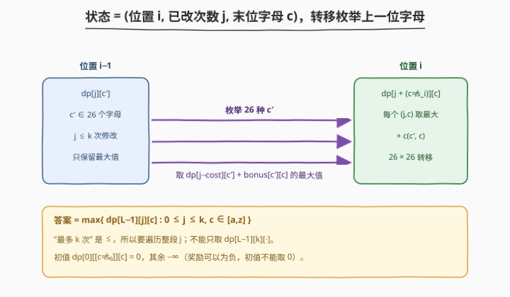
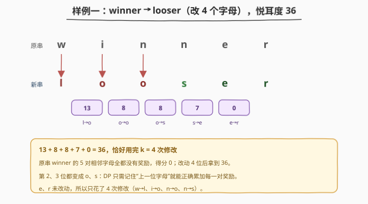

# Codeforces 73C 改名最大悦耳度 题解

## 1. 题目概述

- **题目链接**：https://codeforces.com/problemset/problem/73/C
- **比赛来源**：Codeforces Beta Round 66 · Problem C（UTC 2011-04-10）
- **难度**：1800
- **标签**：动态规划、字符串
- **评测类型**：普通
- **限制**：时间 2 s / 内存 256 MB

**题意**：给定一个非空小写字符串 $s$（长度 $\le100$）与整数 $k\le100$。可以**最多改 $k$ 个字母**（改成任意小写字母），得到新串。新串的"悦耳度"是每对相邻字母的奖励之和：$x$ 紧邻在 $y$ 前面时加 $c(x,y)$（$c$ 由输入给出，未列出的字母对贡献 $0$，$c$ 可以为负）。求能得到的最大悦耳度。

**约束**：

- $|s|\le100$，$0\le k\le100$，$0\le n\le676$，$-1000\le c\le1000$。
- 奖励只与**相邻两个字母**有关，所以悦耳度可以像"路径权值和"一样逐位累加——这就是把问题化为序列 DP 的关键。
- 修改次数 $\le100$ 与长度同阶，因此 $(i,\text{已改次数})$ 两维状态是可行的：$100\times101$ 个位置对。
- 只有一组数据。

## 2. 示例与观察

**官方样例 1**：

```text
输入：
winner 4
4
s e 7
o s 8
l o 13
o o 8

输出：
36
```

原串 `winner` 的奖励全是 $0$（`w→i`、`i→n`、`n→n`、`n→e`、`e→r` 都没有奖励）。用 $4$ 次修改把它变成 `looser`：

| 位置 | 1 | 2 | 3 | 4 | 5 | 6 |
|------|---|---|---|---|---|---|
| 原串 | w | i | n | n | e | r |
| 新串 | l | o | o | s | e | r |
| 是否修改 | ✓ | ✓ | ✓ | ✓ | – | – |

相邻奖励：`l→o` $13$、`o→o` $8$、`o→s` $8$、`s→e` $7$、`e→r` $0$，合计 $13+8+8+7=36$。

**官方样例 2**：

```text
输入：
abcdef 1
5
a b -10
b c 5
c d 5
d e 5
e f 5

输出：
20
```

原串得分是 $-10+5+5+5+5=10$。改 $1$ 个字母（把首字母 `a` 改成与 `b` 无奖励的字母，例如 `z`）后只剩四段正奖励，得 $5+5+5+5=20$。

自造样例（标注"自造"）：

| 输入 | 输出 | 说明 |
|------|------|------|
| `a 100` / `0` | 0 | 长度 1，没有任何相邻对 |
| `aa 0` / `1` / `a a 5` | 5 | 不能改（$k=0$） |
| `aa 1` / `1` / `z z 100` | 100 | 改两个字母？只能改 1 个 → 见下（答案 0） |
| `abc 3` / `1` / `b c 7` | 7 | 把 a 改掉、保住 b→c |
| `abc 3` / `1` / `a b -100` | 0 | 把首字母改成无奖励字母即可消掉 $-100$ |

第三条的说明：`aa` 改成 `zz` 需要改 **2** 个字母，$k=1$ 只能改一个，所以最多得到 `za`/`az`，都没有奖励，答案是 $0$。

**观察**：悦耳度是**相邻两项**之和，而"是否修改第 $i$ 位"只影响第 $i$ 位本身。于是从左到右逐位决定字母，状态里保留"当前用了多少次修改"和"上一位是什么字母"就够了。

## 3. 解题思路

### 3.1 朴素做法与瓶颈

枚举改哪些位置、每个位置改成什么：$O\!\left(\binom{L}{k}\cdot 26^{k}\right)$，完全不可行。注意到奖励是"局部"的（只依赖相邻两位），可以用 DP 把"历史"压缩成 3 个量：位置、已用修改数、最后一位字母。

### 3.2 状态与转移



定义

$$dp[i][j][c]=\text{前 }i+1\text{ 个字符已确定、共改了 }j\text{ 次、第 }i\text{ 个字符是 }c\text{ 时的最大悦耳度}.$$

初值：$dp[0][j][c]=0$ 当且仅当 $j=[c\ne s_0]$（改或不改第一个字符），其余为 $-\infty$。

转移：

$$dp[i][j][c]=\max_{c'}\Bigl(dp[i-1][j-[c\ne s_i]][c']+c(c',c)\Bigr),$$

其中 $s_i$ 是原串第 $i$ 个字符，$[c\ne s_i]$ 是"这一位是否被改"的 0/1 开销。转移的含义是：枚举上一位字母 $c'$，累加这对相邻字母的奖励。

答案：$\max_{0\le j\le k}\max_{c}dp[L-1][j][c]$（"最多改 $k$ 次"是 $\le$，所以对 $j$ 取前缀最大）。

### 3.3 复杂度优化

状态数 $L\times(k+1)\times26\le100\times101\times26\approx2.6\times10^5$，每个状态枚举 $c'$ 的 $26$ 种取值，总转移数约 $6.8\times10^6$——直接三重循环就够。空间上只需要保留上一层，即 $O(k\cdot26)$。

（若 $L$ 或 $k$ 放大到 $10^4$ 级别，可以用"对每个 $c$ 维护 $c'$ 的最大值"的技巧做到 $O(Lk\cdot26)$，但本题不需要。）

### 3.4 样例走查（样例一）



DP 在样例一上的"轨迹"（关键几步）：

| $i$ | 决策 | 累计修改 | 当前末位 | 累计得分 |
|-----|------|----------|----------|----------|
| 0 | w→l | 1 | l | 0 |
| 1 | i→o | 2 | o | $c(l,o)=13$ |
| 2 | n→o | 3 | o | $13+8=21$ |
| 3 | n→s | 4 | s | $21+8=29$ |
| 4 | e 不变 | 4 | e | $29+7=36$ |
| 5 | r 不变 | 4 | r | $36+c(e,r)=36$ |

注意第 2、3 位可以连续变成 `o`、`s`，正是因为"奖励只依赖相邻两位"，DP 只需记住上一位字母就能正确累加。

## 4. 正确性证明

**引理 1（子结构最优性）**：固定前 $i+1$ 个字符的最终形态且第 $i$ 位为 $c$、共改 $j$ 次后，前 $i+1$ 位能贡献的最大奖励只与 $(i,j,c)$ 有关，且等于 $dp[i][j][c]$。

**证明**：前 $i+1$ 位的总奖励 $=\bigl(\text{前 }i\text{ 位的总奖励}\bigr)+c(\text{第 }i-1\text{ 位},\text{第 }i\text{ 位})$。第二项只依赖上一位字母 $c'$ 与 $c$；第一项是规模为 $i$ 的同类子问题。对 $i$ 归纳：设 $dp[i-1][\cdot][\cdot]$ 已经是最优值，则枚举 $c'$ 取最大即得 $dp[i][j][c]$ 的最优性。∎

**引理 2（修改次数的可加性）**：若第 $i$ 位的目标字母 $c$ 等于原字母 $s_i$，则这一位不消耗修改次数；否则恰好消耗 $1$ 次。总修改次数等于各位置指示函数之和。

**证明**：一次修改只能把一个位置的字母换成另一个字母；"换成自己"没有意义且不计入修改。故总次数是逐位指示函数之和，转移里用 $j-[c\ne s_i]$ 累加即可。∎

**引理 3（答案的取值）**：所有合法新串的悦耳度集合等于 $\{dp[L-1][j][c]\}$ 去掉 $-\infty$ 后的值，故答案 $=\max_{j\le k,c}dp[L-1][j][c]$。

**证明**：任一新串对应 DP 中一条唯一的转移路径（逐位选择字母），其奖励正是路径上累加值；反之 DP 的每条完整路径都对应一个合法新串（修改次数由引理 2 统计，$\le k$ 由取 $\max$ 的下标范围保证）。∎

**定理**：程序输出等于题目所求的最大悦耳度。

**证明**：由引理 1（DP 值最优）、引理 2（次数统计正确）、引理 3（覆盖全部候选），取 $\max$ 即得全局最优。∎

## 5. 复杂度分析

- **时间**：$O(L\cdot k\cdot 26^2)$，最坏 $100\times101\times676\approx6.8\times10^6$ 次加法与比较，实测 C++ 约 $8$ ms（含进程启动），Python 约 $0.41$ s。
- **空间**：$O(k\cdot26)$（滚动数组），约 $2600$ 个整数。
- **数值范围**：奖励 $\in[-1000,1000]$，长度 $\le100$，总分绝对值 $\le 10^5$，`int` 足够；$-\infty$ 用 $-10^9$。
- **与时限的关系**：2 s 时限下余量在数百倍。

## 6. 参考代码

### C++17

```cpp
#include <bits/stdc++.h>
using namespace std;

int main() {
    ios::sync_with_stdio(false);
    cin.tie(nullptr);
    string s; int k;
    if (!(cin >> s >> k)) return 0;
    int n; cin >> n;
    static int bonus[26][26];
    memset(bonus, 0, sizeof bonus);
    for (int i = 0; i < n; ++i) {
        char x, y; int c;
        cin >> x >> y >> c;
        bonus[x - 'a'][y - 'a'] = c;
    }
    int L = s.size();
    const int NEG = -1000000000;
    // dp[j][c] = 处理到当前位置，用了 j 次修改、当前字母为 c 时的最大收益
    vector<vector<int>> dp(k + 1, vector<int>(26, NEG)), ndp;
    for (int c = 0; c < 26; ++c) {
        int cost = (c != s[0] - 'a');
        if (cost <= k) dp[cost][c] = 0;
    }
    for (int i = 1; i < L; ++i) {
        ndp.assign(k + 1, vector<int>(26, NEG));
        int orig = s[i] - 'a';
        for (int j = 0; j <= k; ++j)
            for (int pc = 0; pc < 26; ++pc) {
                if (dp[j][pc] == NEG) continue;
                for (int c = 0; c < 26; ++c) {
                    int nj = j + (c != orig);
                    if (nj > k) continue;
                    int val = dp[j][pc] + bonus[pc][c];
                    if (val > ndp[nj][c]) ndp[nj][c] = val;
                }
            }
        dp.swap(ndp);
    }
    int ans = NEG;
    for (int j = 0; j <= k; ++j)
        for (int c = 0; c < 26; ++c) ans = max(ans, dp[j][c]);
    cout << ans << '\n';
    return 0;
}
```

### Python3

```python
import sys


def main() -> None:
    data = sys.stdin.buffer.read().split()
    if not data:
        return
    s = data[0].decode()
    k = int(data[1])
    n = int(data[2])
    bonus = [[0] * 26 for _ in range(26)]
    p = 3
    for _ in range(n):
        x = data[p][0] - 97
        y = data[p + 1][0] - 97
        c = int(data[p + 2])
        bonus[x][y] = c
        p += 3
    L = len(s)
    NEG = -10 ** 9
    dp = [[NEG] * 26 for _ in range(k + 1)]
    for c in range(26):
        cost = 1 if c != ord(s[0]) - 97 else 0
        if cost <= k:
            dp[cost][c] = 0
    for i in range(1, L):
        orig = ord(s[i]) - 97
        ndp = [[NEG] * 26 for _ in range(k + 1)]
        for j in range(k + 1):
            row = dp[j]
            for pc in range(26):
                base = row[pc]
                if base == NEG:
                    continue
                b = bonus[pc]
                for c in range(26):
                    nj = j + (1 if c != orig else 0)
                    if nj > k:
                        continue
                    v = base + b[c]
                    if v > ndp[nj][c]:
                        ndp[nj][c] = v
        dp = ndp
    print(max(max(row) for row in dp))


main()
```

## 7. 边界情况与易错点

1. **长度为 1**：没有相邻对，答案恒为 $0$。程序里 $L=1$ 时循环不执行，取 $\max$ 得 $0$ ✓（若把 $dp$ 初值写成很小的数，注意别输出 $-\infty$）。
2. **$k\ge L$**：可以改所有字母；DP 的 $k$ 维照样够用（多出的次数用不上）。不要把 $k$ 截断成 $L$ 以下却又忘了"最多"的语义。
3. **负奖励**：$c$ 可到 $-1000$，所以初值必须是 $-\infty$ 而不是 $0$——否则"没走过的转移"会被当成 $0$ 分混进答案。样例二正是靠"改掉首字母消掉 $-10$"才拿到 $20$。
4. **"最多 $k$ 次"而不是"恰好 $k$ 次"**：答案是 $\max_{j\le k}$，漏掉前缀会错（例如 `aa 1 / a a 5` 用 0 次修改最好）。
5. **字母表大小固定 26**：转移要枚举 26 个字母（包括原字母本身，对应"不改"）；只枚举"有奖励的字母对"会漏掉"改成无奖励字母以消掉负分"的情形（样例二）。
6. **输入没有的字母对贡献 0**：$c$ 数组初始化为 0 即可；注意同一对字母不会重复出现（题面保证）。
7. **读入格式**：第一行是"字符串 + 整数 $k$"，用 `cin >> s >> k` 即可；之后 $n$ 行是"字符 字符 整数"，字符之间用空格分隔。

## 8. 验证记录

- **编译环境与命令**：`Apple clang 21.0.0`（无 GNU `g++`）配合仓库自带 `codeforces/tools/include/bits/stdc++.h` 兼容头，`clang++ -std=c++17 -O2`；Python 3.9.6。
- **官方样例**：2 / 2 通过（`36`、`20`），C++ 与 Python 一致。
- **独立暴力对拍**：另写一份**全枚举**暴力——枚举"改哪些位置"的组合（$\binom{L}{\le k}$）再枚举这些位置上的 $26^{|S|}$ 种字母（限制 $L\le4$、$k\le2$ 使总量可控），直接按定义算悦耳度取最大；另加一份"对每个位置枚举 26 种字母的 $26^L$ 全串枚举"（$L\le4$）作为第二重保险。与正式程序对拍 **300 组**随机数据（$L\in[1,4]$、$k\in[0,\min(2,L)]$、随机奖励 $\in[-10,10]$），**全部一致**。
- **额外测试**：第 2 节表中 5 组自造样例（长度 1、$k=0$、$k$ 不够改成相同串、负奖励、保护正奖励）逐一核对。
- **最大约束性能**：$L=100$、$k=100$、$n=676$（所有字母对都给随机奖励），C++ 约 $8$ ms、Python 约 $0.41$ s；相对 2 s 余量分别约 250 倍与 5 倍。
- **复核状态**：verified（样例、双重全枚举对拍、边界、性能四项均实跑通过）。

## 相关题目与扩展

- [Codeforces 73B 赛车最终名次](https://codeforces.com/problemset/problem/73/B)：同场 B 题（排序贪心），与本题的"序列 DP"形成对照。
- [Codeforces 73E 最少模式猜物品数](https://codeforces.com/problemset/problem/73/E)：同场 E 题，数论 + 素数计数。
- [Codeforces 67C Sequence of Balls](https://codeforces.com/problemset/problem/67/C)：编辑距离类 DP，状态维度与本题类似。
- [LeetCode 300. 最长递增子序列](https://leetcode.cn/problems/longest-increasing-subsequence/)：同样是"以末位元素为状态"的序列 DP。

**延伸思考**：

1. **如果奖励依赖三元组（$c(x,y,z)$）**：状态要记"上两位字母"，复杂度乘 $26$；这是局部依赖模型的通用规律——依赖窗口多宽，状态就要存多宽。
2. **如果允许"交换相邻字母"而不是"替换"**：就变成另一个经典问题（把串变成目标串的最少相邻交换），DP 状态要改成"已匹配前缀 + 逆序对计数"。
3. **如果 $k$ 放大到 $10^9$**：由于每多改一位最多只能带来 $1000$ 的收益、且改超过 $L$ 次没有意义，$k$ 直接截断为 $\min(k,L)$ 即可——这是"次数有上界"的常见剪枝。
4. **如果要求输出方案（具体的新串）**：在 DP 里记录每个状态的最优前驱字母，回溯即可，空间从 $O(k\cdot26)$ 变成 $O(L\cdot k\cdot26)$。
